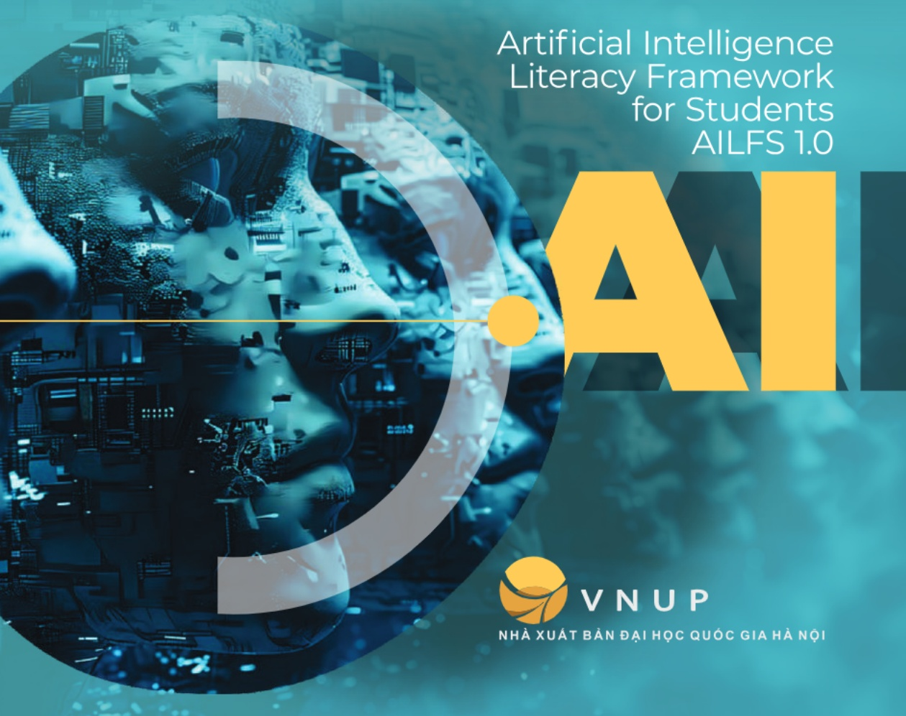
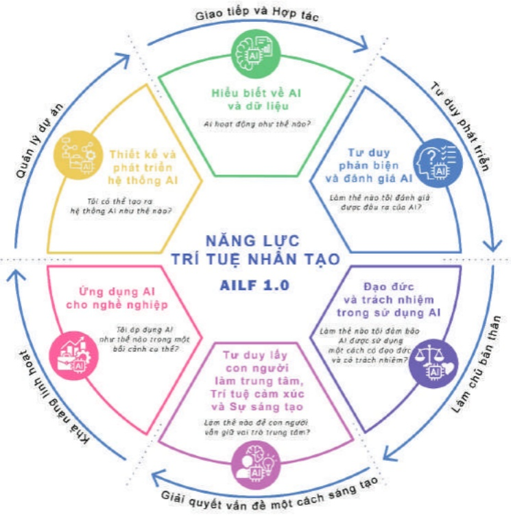

<!-- page: 1 -->

ĐỐ VĂN HÙNG (Chủ biên)
HOÀNG ANH TUẤN - NGUYỄN GIA HY - BÙI THANH THỦY
NGUYỄN PHONG ANH - ĐÀO MINH QUÂN - TRẦN ĐỨC HOÀ
NGUYỄN THỊ KIM DUNG - NGUYỄN THỊ PHƯƠNG - BÙI THỊ arker TUYẾT

KHUNG NĂNG LỰC
TRÍ TUỆ NHÂN TẠO
DÀNH ĆHO SINH VIÊN

Artificial Intelligence Literacy Framework for Students AILFS 1.0

VNUP
NHÀ XUẤT BẢN ĐẠI HỌC QUỐC GIA HÀ NỘI

<!-- page: 2 -->

Đỗ Văn Hùng (Chủ biên)

Hoàng Anh Tuấn - Nguyễn Gia Hy - Bùi Thanh Thủy
Nguyễn Phong Anh - Đào Minh Quân - Trần Đức Hoà
Nguyễn Thị Kim Dung - Nguyễn Thị Phương - Bùi Thị Ánh Tuyết

# KHUNG NĂNG LỰC TRÍ TUỆ NHÂN TẠO DÀNH CHO SINH VIÊN

Artificial Intelligence Literacy Framework for students - AILFS 1.0

NHÀ XUẤT BẢN ĐẠI HỌC QUỐC GIA HÀ NỘI

<!-- page: 3 -->

## Cổ vấn cao cấp

\- GS. Hoàng Anh Tuấn - Hiệu trưởng Trường Đại học Khoa học Xã hội và Nhân văn, Đại học Quốc gia Hà Nội.

\- Ông Ruici Tio - Quản lý Chương trình Chính sách về An toàn và Liêm chính Khu vực Châu Á - Thái Bình Dương của Tập đoàn Meta.

\- TS. Trần Văn Tùng - Chủ Tích Hội thông tin Khoa học và Công nghệ Việt Nam, Nguyên Thứ trưởng Bộ Khoa học và Công nghệ

<!-- page: 4 -->

"Al là một công cụ, không phải là sự thay thế con người. Al có thể nâng cao năng suất và hỗ trợ con người trong công việc và cuộc sống, nhưng không nên xem nó là tương đương với trí tuệ hay năng lực của con người."

AI Alliance

<!-- page: 5 -->

<!-- page: 6 -->

## MỤC LỤC

- GIỚI THIỆU....7
- LỜI TỰA....9
- MỤC TIÊU VÀ PHẠM VI....11
- CỔ SỞ KHOA HỌC VÀ KHUNG THAM CHIẾU....13
- CÁC KHÁI NIỆM VÀ THUẬT NGỮ....15
- TIẾP CẬN XÂY DỰNG KHUNG NĂNG LỰC AI....21
- CẤU TRÚC KHUNG NĂNG LỰC....23
- CHI TIẾT CÁC MIỂN NĂNG LỰC....35
- HỒ SỞ NGƯỜI DÙNG AI....53
- HUỐNG DẪN ÁP DỰNG KHUNG NĂNG LỰC AI....55
- KÊU GỘI HỢP TÁC VÀ HÀNH ĐỘNG....63
- LỜI CẢM ÔN VÀ GHI NHẬN ĐÓNG GÓP....64
- TÀI LIỆU THAM KHẢO....65

<!-- page: 7 -->

<!-- page: 8 -->

# GIỚI THIÊU

Khung năng lực trí tuệ nhân tạo dành cho sinh viên (AILFS) là kết quả hợp tác giữa Trường Đại học Khoa học Xã hội và Nhân văn (USSH), Đại học Quốc gia Hà Nội và Tập đoàn Meta trong khuôn khổ dự án Ứng dụng trí tuệ nhân tạo trong giảng dạy, học tập và nghiên cứu. Khoa Thông tin - Thư viện là đơn vị chịu trách nhiệm triển khai, với sự hỗ trợ chuyên môn của SkillPixel.

Chúng tôi hiểu rằng thách thức về phát triển năng lực AI mang tính hệ thống - không một lĩnh vực riêng lẻ nào chịu trách nhiệm hoàn toàn và cũng không một lĩnh vực nào có thể tự mình giải quyết được. Đề đưa ra các giải pháp mang tính quy mô, cần có sự phối hợp giữa doanh nghiệp, giáo dục, các đơn vị đào tạo nghề, Chính phủ và các tổ chức phi lợi nhuận.

Bên cạnh đó, cũng cần đi vào cụ thể, tập trung vào các năng lực cốt lõi không chỉ dành cho các chuyên gia phát triển và xây dựng các sản phẩm AI tiên tiến, mà còn cho tất cả mọi người đang sống và làm việc trong các xã hội và nền kinh tế chịu tác động của AI.

"Tôi nghĩ rằng chúng ta cần có một cuộc đối thoại, cả trong ngành công nghiệp và trong toàn xã hội, về AI là gì và nó sẽ ảnh hưởng như thế nào đến tương lai công việc, kinh tế và thị trường lao động... AI có thể mang lại rất nhiều giá trị trong tương lai, nếu chúng ta phát triển nó một cách bao trùm và có suy nghĩ thấu đáo. Đây là một cơ hội để tạo ra tác động có ý nghĩa đối với giáo dục, cũng như để đào tạo lại và nâng cao kỹ năng cho người dân nhằm sử dụng các công nghệ mới nhất theo cách giúp cải thiện công việc và cuộc sống cá nhân của họ."

Rebekkah Hogan

Trưởng nhóm Quản lý chương trình AI tại Meta, Đồng Chủ tịch
Nhóm công tác Kỹ năng và Giáo dục của Liên minh AI

<!-- page: 9 -->

Tài liệu này được xuất bản truy cập mở với giấy phép CC BY-SA 4.0. Giấy phép này cho phép người dùng được quyền cập nhật, sửa đổi nội dung của tài liệu này để tạo ra các sản phẩm phải sinh, đồng thời có thể phân phối lại và thương mại hóa. Yêu cầu bắt buộc đối với tác phẩm phải sinh là phải dùng lại giấy phép giống như giấy phép đã cấp cho tác phẩm gốc. Xem chi tiết tại: https://creativecommons.org/licenses/by-sa/4.0/
Ghi chú: Những nội dung và hình ảnh từ các nguồn trích không thuộc phạm vi điều chỉnh của giấy phép này.

<!-- page: 10 -->

## LỜI TỰA

Sự troï dây nhanh chóng của trí tuệ nhân tạo (AI) đang định hình lại cách chúng ta làm việc, học tập và đổi mới sáng tạo. AI không còn là mối quan tâm của tương lai mà đã trở thành một yêu cầu cấp thiết ở hiện tại. Trí tuệ nhân tạo ngày càng trở thành một phần không thể tách rời trong cuộc sống, đời hồi các hệ thống giáo dục phải chủ động trang bị cho người học năng lực sử dụng và đồng sáng tạo AI một cách có trách nhiệm, hiệu quả và đạo đức. Việc tích hợp các mục tiêu học tập về AI vào chương trình giáo dục chính thức là điều thiết yếu, nhằm giúp sinh viên và giảng viên tiếp cận AI một cách an toàn, có ý nghĩa và sẵn sàng thích ứng với một xã hội đang chuyển đổi số mạnh mẽ. Những cơ sở giáo dục không đáp ứng yêu cầu này sẽ khó duy trì được tính phù hợp và khả năng cạnh tranh trong bối cảnh mới.

Khung năng lực trí tuệ nhân tạo dành cho sinh viên đại học do Trường Đại học Khoa học Xã hội và Nhân văn phối hợp với Tập đoàn Meta xây dựng là một phản hồi kịp thời trước yêu cầu cấp bách trong bối cảnh AI đang trở thành một phần không thể thiếu của đời sống học thuật, nghề nghiệp và xã hội. Khung năng lực này được hình thành trên cơ sở tham vấn các chuyên gia, nhà nghiên cứu, giảng viên và sinh viên, đồng thời tham chiếu các khung năng lực số và AI quốc tế đang được sử dụng rộng rãi.

Khung năng lực AI được xây dựng với mục tiêu làm nền tảng cho việc phát triển các chương trình đào tạo, trang bị cho sinh viên đại học khả năng sử dụng, đánh giá, sáng tạo và ứng xử có trách nhiệm với công

<!-- page: 11 -->

nghệ AI trong học tập, nghiên cứu, phát triển sự nghiệp và khởi nghiệp. Chúng tôi không chỉ hướng đến việc chuẩn bị cho sinh viên và giảng viên ứng dụng AI trong giáo dục đại học, mà còn xem đây là một năng lực nền tảng, phục vụ cho năng suất lao động, sự thịnh vượng và thích ứng bền vững trong tương lai.

Khung năng lực được cấu trúc thành 6 miền năng lực: Hiểu biết về AI và dữ liệu (AI hoạt động như thế nào?), Tư duy phần biện và đánh giá AI (Làm thế nào tôi đánh giá được đầu ra của AI?), Đạo đức và trách nhiệm trong sử dụng AI (Làm thế nào tôi đảm bảo AI được sử dụng một cách có đạo đức và có trách nhiệm?), Tư duy lấy con người làm trung tâm, Trí tuệ cảm xúc và Sự sáng tạo (Làm thế nào để con người vẫn giữ vai trò trung tâm?), Ứng dụng AI cho nghề nghiệp (Tôi áp dụng AI như thế nào trong một bối cảnh cụ thể?), Thiết kế và phát triển hệ thống AI (Tôi có thể tạo ra hệ thống AI như thế nào?). Mỗi miền năng lực được triển khai theo 4 cấp độ phát triển: thành thạo, thông thạo, chuyên sâu và làm chủ, phù hợp với năng lực tiến triển của sinh viên trong suốt quá trình học tập và làm việc sau khi ra trường.

Dựa trên tầm nhìn coi sinh viên là những công dân có trách nhiệm và đồng sáng tạo cùng AI, khung năng lực nhân mạnh vai trò của việc đánh giá phản biện các giải pháp công nghệ, nhận thức rõ trách nhiệm xã hội trong thời đại AI, thúc đẩy việc học tập suốt đời và phát triển các giải pháp AI mang tính bao trùm và bền vững.

Chúng tôi tin rằng AI có tiềm năng tăng cường năng lực con người, nhưng điều đó chỉ thành hiện thực khi người học được trang bị một nền tàng vững chắc về năng lực AI, bao gồm hiểu biết sâu sắc, khả năng ứng dụng hiệu quả, tư duy phản biện và đạo đức nghề nghiệp. Chính vì vậy, chúng tôi kêu gọi sự đồng hành của các tổ chức giáo dục và cộng đồng để cùng xây dựng một thế hệ sinh viên làm chủ công nghệ và sử dụng AI vì lợi ích chung của xã hội.

GS. Hoàng Anh Tuân

<!-- page: 12 -->

# MỤC TIÊU VÀ PHẠM VI

## ▶ Mục tiêu

Khung năng lực này nhằm hướng tới hướng dẫn cá nhân tiếp cận tri thức về AI: Trang bị cho người học kiến thức nền tảng về cách thức hoạt động, khả năng và giới hạn của trí tuệ nhân tạo; giúp họ hiểu rõ vai trò và tiềm năng của các công cụ AI trong việc hỗ trợ nâng cao năng lực cá nhân và hiệu quả công việc.

Xây dựng nền tảng cho việc sử dụng AI một cách phù hợp: Đảm bảo AI được sử dụng một cách có trách nhiệm, có nhận thức rõ ràng về các hệ quả đạo đức tiềm ẩn như thông tin sai lệch, đạo văn, xâm phạm quyền riêng tư và tác động xã hội rộng hơn.

Thức đầy sự hợp tác tích cực giữa con người và AI: Khuyến khích việc phát huy các năng lực cốt lõi của con người như tư duy phần biện, sáng tạo, khả năng thích ứng và ra quyết định trong quá trình tương tác và cộng tác với AI, giữ vững vai trò trung tâm của con người trong sự phát triển và ứng dụng AI.

Hỗ trợ cá thể hóa việc học và thức đầy học tập suốt đời: Tạo điều kiện để người học tận dụng AI như một công cụ học tập linh hoạt, thích ứng với nhu cầu, năng lực và mục tiêu cá nhân; góp phần xây dựng năng lực học tập suốt đời trong bối cảnh chuyển đổi số và biến động nhanh chóng của xã hội tri thức.

## ▶ Phạm vi

Khung này được thiết kế cho sinh viên thuộc nhiều ngành học khác nhau, từ khoa học xã hội và nhân văn đến khoa học tự nhiên và kỹ thuật. Đặc biệt phù hợp cho sinh viên không chuyên sâu về công nghệ nhưng cần hiểu và sử dụng AI trong các lĩnh vực học tập và công việc sau này.

<!-- page: 13 -->

Sinh viên sẽ học cách sử dụng AI để giải quyết các vấn đề thực tế và áp dụng vào các dự án học tập, công việc và phát triển bản thân.

Khung cung cấp lộ trình học tập từ nhận thức cơ bản về AI đến khả năng sử dụng thành thạo các công cụ AI và phát triển tư duy phần biện về các tác động xã hội, đạo đức của công nghệ này.

Khung này đặt mục tiêu giúp sinh viên có được sự chuẩn bị tốt nhất để ứng dụng AI vào cuộc sống và nghề nghiệp, đồng thời góp phần xây dựng lực lượng lao động có hiểu biết sâu sắc về AI trong tương lai.

Khung năng lực này cũng có thể sử dụng cho người đi làm, chuyên gia trong lĩnh vực AI, trong đó mức 4 là mức chuyên gia.

Đế phù hợp với đặc điểm đa ngành trong giáo dục đại học Việt Nam, khung năng lực này chia người học thành hai tuyến chính:

\- Tuyến người dùng AI (AI Users): bao gồm sinh viên thuộc các ngành không chuyên sâu về kỹ thuật hoặc khoa học máy tính. Hộ cần đạt mức năng lực từ 1 đến 3 ở các miền 1 đến 5 và không bắt buộc đạt ở miền 6 (Thiết kế và phát triển hệ thống AI).

\- Tuyến người phát triển AI (AI Developers): bao gồm sinh viên thuộc các ngành kỹ thuật, công nghệ thông tin, dữ liệu, toán,... Tuyến này yêu cầu phát triển đầy đủ cả 6 miền năng lực, với mục tiêu đạt từ mức độ 3 trở lên ở miền 6.

Việc phân tuyến giúp đảm bảo tính khả thi và phù hợp khi áp dụng khung năng lực trong thực tế đào tạo, đồng thời tạo điều kiện để người học lựa chọn lộ trình phát triển năng lực phù hợp với lĩnh vực chuyên môn và định hướng nghề nghiệp của mình.

<!-- page: 14 -->

## CÓ SỞ KHOA HỌC VÀ KHUNG THAM CHIẾU

Đế xây dựng Khung năng lực trí tuệ dành cho sinh viên, chúng tôi đã tiến hành khảo sát và đánh giá năng lực trí tuệ nhân tạo và nhu cầu phát triển năng lực này của 1.000 sinh viên, học viên và nghiên cứu sinh và hơn 250 giảng viên để làm cơ sở thực tiễn, đồng thời kết hợp với việc tham chiếu các khung năng lực trí tuệ nhân tạo đang được sử dụng rộng rãi hiện nay, bao gồm:

\- Khung năng lực AI - Digital Education Council (2025)

\- Hướng dẫn về các năng lực thiết yếu cho AI - AI Alliance, Meta (2025)

\- Khung năng lực AI dành cho sinh viên - UNESCO (2024)

\- Khung năng lực số dành cho người học - Bộ Giáo dục và Đào tạo (2025)

\- Khung năng lực AI - Đại học Stanford (2025)

\- Khung năng lực AI - Đại học Adelaide (2024)

\- Chương trình giáo dục AI - Microsoft (2025)

Những khung năng lực và chương trình này, kết hợp với số liệu khảo sát giúp chúng tôi hiểu sâu hơn về các yêu cầu kỹ thuật, xã hội, tư duy, nhân văn và chiến lược học tập trong lĩnh vực AI, từ đó phát triển một khung năng lực phù hợp cho sinh viên tại Việt Nam. Sinh viên được hiểu là người học trong bậc giáo dục đại học bao gồm Cử nhân, Thạc sĩ và Tiến sĩ.

Bên cạnh việc tham chiếu các khung năng lực quốc tế, khung AILFS cũng được đối chiếu với Chuẩn đầu ra chương trình đào tạo theo Thông tư số 17/2021/TT-BGDĐT ngày 22/6/2024 của Bộ Giáo dục và Đào tạo Việt Nam, Quyết định số 1982/QĐ-TTg ngày 18/10/2016 của Thủ tướng Chính phủ về Phê duyệt Khung trình độ Quốc gia, Thông tư số 02/2025/TT-BGDĐT ngày 24/01/2025 của Bộ Giáo dục và Đào tạo về Quy định

<!-- page: 15 -->

Khung năng lực số cho người học. Việc này nhằm đảm bảo sự tích hợp hài hòa giữa các yêu cầu về năng lực số, năng lực AI, tư duy phần biện, năng lực giải quyết vấn đề và năng lực học tập suốt đời trong bối cảnh Việt Nam và hội nhập quốc tế.

Các miền năng lực trong khung năng lực AILFS được trình bày theo 4 cấp độ năng lực (Thành thạo - Thông thạo - Chuyên sâu - Làm chủ) kết hợp với thang đo nhận thức của Bloom (Nhớ - Hiểu - Vận dụng - Phân tích - Đánh giá - Sáng tạo) để đảm bảo tính phân bậc rõ ràng, có thể đo được và phù hợp cho thiết kế chuẩn đầu ra, phát triển các chương trình đào tạo năng lực AI phù hợp.

<!-- page: 16 -->

## CÁC KHÁI NIỆM VÀ THUẬT NGỮ

Việc hiểu được các khái niệm và thuật ngữ sau không đời hỏi chuyên môn kỹ thuật sâu, kinh nghiệm sử dụng các sản phẩm và công cụ AI, hay đào tạo chuyên biệt về AI. Thay vào đó, chúng cung cấp cho người học một vốn từ vựng cơ bản và các khuôn khổ nhận thức giúp hiểu được AI là gì và không phải là gì, cũng như AI có thể làm được gì và không làm được gì.

## ▶ Trí tuệ nhân tạo

Trí tuệ nhân tạo (Artificial Intelligence) là một lĩnh vực của khoa học máy tính tập trung vào việc tạo ra các hệ thống có khả năng thực hiện các nhiệm vụ mà thông thường cần đến trí tuệ con người. Các nhiệm vụ này bao gồm học hỏi, lập luận, giải quyết vấn đề, sáng tạo, nhận thức và sử dụng ngôn ngữ tự nhiên (UNESCO, 2024).

## ▶ Trí tuệ nhân tạo hẹp

Trí tuệ nhân tạo hep (Narrow AI) là loại trí tuệ nhân tạo được thiết kế để thực hiện một nhiệm vụ hoặc một nhóm nhiệm vụ cụ thể, như nhận diện khuôn mặt, dịch ngôn ngữ, hay đề xuất sản phẩm. Đây là loại AI phổ biến nhất hiện nay, có khả năng vượt trội so với con người trong từng tác vụ riêng lẻ, nhưng không thể tự học hay thích ứng ngoài phạm vi đã định (University of Wolverhampton, 2023).

## ▶ Trí tuệ nhân tạo tổng quát

Trí tuệ nhân tạo tổng quát (Artificial General Intelligence - AGI) là dạng trí tuệ nhân tạo có khả năng học tập, suy nghĩ và giải quyết vấn đề một cách linh hoạt như con người, trong bất kỳ lĩnh vực nào - từ ngôn ngữ, hình ảnh đến lập luận phức tạp - mà không cần được lập trình riêng cho từng nhiệm vụ. AGI khác với AI thông thường (Narrow AI) ở chỗ nó không chỉ giới một việc cụ thể, mà có thể tự thích nghi và xử lý

<!-- page: 17 -->

các tình huống chưa từng gặp, giống như con người sử dụng trí thông minh để học hỏi suốt đời.

## ▶ Trí tuệ nhân tạo siêu viết

Trí tuệ nhân tạo siêu viết (Artificial Superintelligence – ASI) là cấp độ trí tuệ nhân tạo giả định trong tương lai, vượt xa con người ở mọi khóa cạnh: từ sáng tạo, tư duy logic, cho đến kỹ năng xã hội. ASI có thể đưa ra quyết định và phát triển tri thức ở mức độ mà con người không thể kiểm soát hay dự đoán. Đây là một chủ đề gây tranh cải và thường xuất hiện trong các thảo luận về đạo đức và an toàn AI.

## ▶ Trí tuệ nhân tạo tạo sinh

Trí tuệ nhân tạo tạo sinh (Generative AI) là một lĩnh vực của trí tuệ nhân tạo có khả năng tạo ra nội dung mới như: văn bản, hình ảnh, video, âm thanh... Những hệ thống này học từ dữ liệu huấn luyện và tạo ra nội dung mới dựa trên các lời nhắc (prompts) bằng ngôn ngữ tự nhiên. Các hệ thống trí tuệ nhân tạo tạo sinh vẫn thuộc nhóm trí tuệ nhân tạo hẹp (Narrow AI), vì chúng chỉ thực hiện một nhóm nhiệm vụ cụ thể và không có khả năng hiểu biết rộng hay tư duy linh hoạt như con người (OECD, 2023).

## ▶ Tác nhân AI

Tác nhân AI (AI Agent) là một hệ thống phần mềm hoặc phần mềm kết hợp phần cứng có khả năng tự động cảm nhận môi trường xung quanh, phân tích thông tin, ra quyết định và thực hiện hành động để đạt được một mục tiêu nhất định mà không cần con người can thiệp liên tục.

## ▶ Học máy

Học máy (Machine Learning) là một lĩnh vực của trí tuệ nhân tạo cho phép máy tính học hỏi từ dữ liệu để tự động cải thiện hiệu suất mà

<!-- page: 18 -->

không cần được lập trình cụ thể cho từng tác vụ. Thông qua việc phát hiện các mẫu và quy luật trong dữ liệu, hệ thống học máy có thể đưa ra dự đoán hoặc quyết định đối với các tình huống mới. Nói cách khác, học máy giúp máy tính “học từ kinh nghiệm” giống như con người, nhờ đó có khả năng thích nghi và cải tiến theo thời gian.

## ▶ Học sâu

Học sâu (Deep Learning) là một lĩnh vực thuộc học máy (Machine Learning), trong đó các hệ thống máy tính học cách xử lý thông tin thông qua mạng nơ-ron nhân tạo nhiều lớp, mô phỏng cách hoạt động của bộ não con người. Nhờ khả năng tự động trích xuất và học các đặc trưng từ dữ liệu lớn, học sâu cho phép máy tính thực hiện những nhiệm vụ phức tạp như nhận diện hình ảnh, hiểu ngôn ngữ tự nhiên, phân tích cảm xúc và dự đoán hành vi, mà không cần lập trình cụ thể từng bước.

## ▶ Dữ liệu lớn

Dữ liệu lớn (Big Data) là tập hợp dữ liệu có khối lượng rất lớn, được tạo ra với tốc độ nhanh, đa dạng về định dạng và nguồn gốc, vượt quá khả năng xử lý của các công cụ truyền thống. Đặc trưng bởi 5V – Volume (khối lượng), Velocity (tốc độ), Variety (đa dạng), Veracity (độ tin cậy) và Value (giá trị tiềm năng) – dữ liệu lớn cần đến các phương pháp và công nghệ đặc biệt để thu thập, lưu trữ, phân tích và chuyển hóa thành thông tin hữu ích phục vụ ra quyết định.

## ▶ Dữ liệu huấn luyện

Dữ liệu huấn luyện (Training Data) là dữ liệu được sử dụng để “dạy” một mô hình học máy nhận diện hoặc tái tạo các mẫu (Patterns). Các dữ liệu huấn luyện cần được con người gán nhãn (Label). Hệ thống AI phụ thuộc vào dữ liệu gán nhãn để “học” và ra quyết định, chất lượng của những quyết định đó phụ thuộc vào chất lượng dữ liệu mà mô hình được huấn luyện.

<!-- page: 19 -->

## ▶ Xử lý ngôn ngữ tự nhiên

Xử lý ngôn ngữ tự nhiên (Natural Language Processing - NLP) là một nhánh của trí tuệ nhân tạo tập trung vào việc giúp máy móc hiểu và xử lý ngôn ngữ của con người, làm nền tảng cho các ứng dụng như chatbot, phân tích cảm xúc và dịch thuật.

## ▶ Thiên kiến

Trong AI, thiên kiến (Bias) đề cập đến các sai lệch trong mô hình có thể dẫn đến kết quả sai, không chính xác hoặc mang tính phân biệt đối xử, bắt nguồn từ những hạn chế trong dữ liệu huấn luyện hoặc cách thiết kế mô hình (AI Alliance, 2025).

## ▶ Năng lực phân tích dữ liệu

Năng lực hỗ trợ việc lựa chọn, sử dụng và quản lý dữ liệu một cách hiệu quả, cũng như áp dụng các phương pháp phù hợp để đạt được mục tiêu dự án và giải quyết vấn đề (AI Alliance, 2025).

## ▶ Năng lực trí tuệ nhân tạo

Năng lực trí tuệ nhân tạo là tập hợp kiến thức và kỹ năng thiết yếu để hiểu, tương tác và đánh giá một cách phần biện các công nghệ trí tuệ nhân tạo. Năng lực AI bao gồm khả năng sử dụng hiệu quả và có đạo đức các công cụ AI, đánh giá đầu ra của chúng, đảm bảo con người giữ vai trò trung tâm trong quá trình ứng dụng AI, đồng thời thích ứng với sự phát triển không ngừng AI trong cả đời sống cá nhân lẫn nghề nghiệp (DEC, 2025).

## ▶ Sử dụng AI có trách nhiệm

Là việc vận dụng các kiến thức, kỹ năng và năng lực cần thiết để đảm bảo AI được sử dụng một cách đạo đức, an toàn và hiệu quả. Điều này bao gồm việc bảo vệ quyền riêng tư và an toàn cá nhân - nghề

<!-- page: 20 -->

nghiệp, giảm thiểu các tác động tiêu cực đến cuộc sống, công việc và xã hội. Đồng thời, người dùng cần có nhận thức đầy đủ, cân nhắc kỹ lưỡng và tương tác với AI một cách chủ động, có hiểu biết và mang lại giá trị thực tiễn.

## ▶ AI là công cụ, không phải sự thay thế con người

AI có thể nâng cao năng suất và hỗ trợ con người trong công việc cũng như cuộc sống, nhưng không nên được xem là có thể thay thế trí tuệ hay năng lực của con người.

## ▶ Cơ chế tự hồi quy

Cơ chế tự hồi quy (Autoregressive) là cách mà các mô hình ngôn ngữ lớn (LLMs) dự đoán từng từ tiếp theo dựa trên các từ đã xuất hiện trước đó. Đây là cơ chế cốt lõi trong các mô hình ngôn ngữ như: Llama, GPT, Gemini,... Mặc dù AI có thể tạo ra nội dung hoặc trả lời giống như con người nhưng nó không thực sự hiểu hay tư duy như con người. Các mô hình AI chỉ đơn thuần dự đoán mẫu (Patterns) dựa trên xác suất thống kê từ dữ liệu huấn luyện, chir không có ý thức, cảm xúc hay sự hiểu biết về ngữ nghĩa thực sự.

## ▶ AI cần sự giám sát và tương tác của con người

Đề đảm bảo việc sử dụng AI có đạo đức, bảo vệ con người, tránh thiên kiến và tạo ra kết quả đáng tin cậy, AI cần sự giám sát, định hướng và diễn giải từ con người.

## ▶ Tư duy phản biện

Trong một số trường hợp, người dùng có thể dễ dàng nhận biết các sản phẩm hoặc ứng dụng có sử dụng AI. Nhưng trong nhiều trường hợp khác, rất khó để xác định một cách chắc chắn liệu công cụ hay sản phẩm có dùng AI, hoặc liệu hình ảnh, văn bản hay video có được tạo ra

<!-- page: 21 -->

bôi AI hay không. Việc sử dụng tư duy phần biện để đánh giá kết quả và cân nhắc kỹ lưỡng trước khi chia sẻ, sử dụng nội dung là rất quan trọng.

## ▶ Công nghệ và ứng dụng AI đang thay đổi nhanh chóng

Vì vây, việc thích ứng và học tập liên tục sẽ đóng vai trò then chất giúp người dùng cập nhật kịp thời các thay đổi trong AI và tiếp tục tận dụng những lợi ích mà công nghệ này mang lại.

<!-- page: 22 -->

## TIẾP CẬN XÂY DỰNG KHUNG NĂNG LỰC AI

Việc sử dụng hiệu quả AI được xây dựng trên nền tảng của năng lực số. Khung năng lực trí tuệ nhân tạo dành cho sinh viên đại học được xây dựng trên cơ sở tiếp cận tích hợp đa chiều, nhằm đảm bảo sinh viên không chỉ làm chủ công nghệ mà còn phát triển năng lực toàn diện trong môi trường số. Trước hết, tư duy phần biện được xác định là năng lực cốt lỗi xuyên suốt toàn bộ khung năng lực, giúp người học có khả năng đánh giá, phân tích và đặt câu hỏi một cách có hệ thống trước các sản phẩm và tác động của AI. Năng lực này giúp sinh viên không rơi vào tỉnh trạng lệ thuộc vào công cụ, mà biết vận dụng AI một cách hiệu quả, có kiểm chứng và có chọn lọc.

Thứ hai, khung năng lực được thiết kế với trọng tâm là con người, nhân mạnh việc sử dụng AI để tăng cường năng lực tư duy, sáng tạo và giá trị đạo đức của người học thay vì thay thế con người. AI trong giáo dục cần được triển khai theo hướng hỗ trợ, bổ sung và thúc đẩy tiềm năng cá nhân, đảm bảo tính nhân văn và không làm lu mờ vai trò chủ thể của người học trong quá trình học tập và ra quyết định.

Thứ ba, khung năng lực hướng tới phát triển bền vững và khả năng thích ứng, phản ánh yêu cầu ngày càng cấp thiết trong bối cảnh AI phát triển nhanh chóng và liên tục thay đổi. Việc rèn luyện cho sinh viên khả năng học hỏi linh hoạt, giải quyết vấn đề trong bối cảnh biến động, cũng như đảm bảo tính bao trùm và công bằng xã hội trong ứng dụng AI, là yếu tố then chất đề xây dựng một thể hệ công dân số có trách nhiệm.

Thứ tư, nguyên tắc cốt lõi trong tiếp cận xây dựng khung năng lực trí tuệ nhân tạo là đảm bảo AI được phát triển và ứng dụng theo cách tôn trọng và bảo vệ quyền con người, đề cao sự đa dạng văn hóa và ngôn ngữ, đồng thời góp phần thúc đẩy công bằng xã hội. Điều này đời hỏi người học không chỉ hiểu cách AI vận hành, mà còn nhận thức sâu sắc về các giá trị đạo đức và xã hội gắn liền với công nghệ. Khung năng lực

<!-- page: 23 -->

cần hướng tới việc hình thành tư duy phần biện và trách nhiệm xã hội ở người học, để từ đó có thể đồng hành cùng AI trong việc xây dựng một xã hội bao trùm, tôn trọng sự khác biệt và phát triển bền vững.

Cuối cùng, toàn bộ cấu trúc khung được định hình để phục vụ mục tiêu học tập suốt đời, khuyến khích sinh viên liên tục cập nhật tri thức, nâng cao kỹ năng và làm chủ công nghệ trong suốt hành trình nghề nghiệp. AI không chỉ là công cụ hỗ trợ trong giai đoạn học tập tại trường, mà còn là nền tảng giúp người học thích ứng với môi trường việc làm thay đổi, đổi mới sáng tạo và phát triển cá nhân trong dài hạn.

<!-- page: 24 -->

## CÂU TRÚC KHUNG NĂNG LỰC

Khung năng lực trí tuệ nhân tạo cho sinh viên bao gồm 2 phần: các năng lực thích ứng lâu dài (Durable Competencies) và các năng lực AI cụ thể (AI Competencies) - 6 miền năng lực. Trong đó năng lực thích ứng là các năng lực mang tính xuyên suốt, có vai trò hỗ trợ việc học tập và vận dụng các năng lực về trí tuệ nhân tạo. Các năng lực AI cụ thể là những năng lực cốt lõi giúp người học hiểu, đánh giá và ứng dụng hiệu quả các công nghệ AI trong học tập, nghiên cứu, công việc và đời sống. Đây là nhóm năng lực chuyên sâu, trực tiếp trang bị cho sinh viên khả năng tương tác với AI một cách có tư duy phần biện, sáng tạo và có trách nhiệm. Các năng lực AI cụ thể được chia thành các mức độ khác nhau để phù hợp với người học ở các lĩnh vực khác nhau và trình độ khác nhau.

Hình 1. Khung năng lực Al dành cho sinh viên

<!-- page: 25 -->

## ▶ Các năng lực thích ứng lâu dài (Durable Competencies)

Sự gia tăng của công nghệ và tự động hóa không có nghĩa là con người sẽ cần ít hơn các kỹ năng mềm hay năng lực thích ứng lâu dài; ngược lại, điều này có thể làm gia tăng nhu cầu đối với những kỹ năng và năng lực mang tính con người đặc trưng - những yếu tố sẽ cần được tiếp tục hỗ trợ và phát triển. Các kỹ năng và năng lực thích ứng lâu dài dưới đây được xem là ưu tiên cao, có vai trò bổ trợ cho mọi nhóm năng lực AI và đặc biệt quan trọng đối với mọi đối tượng trong xã hội và nền kinh tế.

Những năng lực bền vững này được trình bày dưới dạng danh sách, vì mức độ và cách thể hiện của chúng sẽ rất khác nhau tùy theo bối cảnh. Đây là những năng lực có thể giảng dạy, có thể thể hiện rõ ràng và có thể đánh giá được. Các năng lực thích ứng lâu dài bao gồm:

## \* Khả năng linh hoạt (Flexibility)

\- Khả năng chấp nhận thay đổi và thích nghi hiệu quả với những trải nghiệm, môi trường và tình huống mới - dù đó là sự thay đổi trong công nghệ, phương pháp làm việc, môi trường học tập hay trong vai trò nghề nghiệp. Đây là một trong những năng lực bền vững thiết yếu trong kỳ nguyên AI, khi mà tốc độ đổi mới đang diễn ra nhanh chóng và thường xuyên.

\- Tính linh hoạt giúp cá nhân không chỉ tồn tại mà còn phát triển trong môi trường đầy biến động, cho phép họ tận dụng AI như một công cụ hỗ trợ thay vì bị phụ thuộc hoặc bị thay thế.

\- Biểu hiện cụ thể của năng lực linh hoạt:

° Thích ứng nhanh chóng với công nghệ hoặc phương pháp mới.

° Cởi mở với sự thay đổi và không bị “đóng khung” trong thời quen cũ.

° Có khả năng giữ bình tỉnh và chủ động giải quyết vấn đề trong tình huống không chắc chắn.

<!-- page: 26 -->

° Sẫn sàng học hỏi và thử nghiệm những cách tiếp cận mới.

° Chuyển đổi linh hoạt giữa các vai trò, công việc, hoặc nhiệm vụ khác nhau.

## \* Tư duy phát triển (Growth Mindset)

\- Khi tốc độ thay đổi ngày càng nhanh, có một sự đồng thuận rộng rãi rằng con người sẽ cần học nhiều hơn và học thường xuyên hơn. Việc học này không nhất thiết phải thông qua các chương trình đào tạo chính quy hay bằng cấp học thuật, mà có thể đào tạo tại nơi làm việc, nâng cao kỹ năng, tái đào tạo cho các vai trò mới trong tổ chức và liên tục tiếp thu những kỹ năng mới để bắt kịp với các công cụ và quy trình đang thay đổi.

\- Việc AI được đưa vào xã hội và môi trường làm việc đã khởi gọi sự hứng thú với một số người, nhưng cũng gây lo lắng cho nhiều người khác. Một bộ phận lớn còn e ngại trong việc sử dụng các công cụ công nghệ thông tin cơ bản. Đề có thể tương tác hiệu quả và khai thác tối đa tiềm năng của AI, việc xây dựng sự tự tin – cả trong khả năng sử dụng công nghệ đúng cách và trong khả năng giải quyết các vấn đề không rõ ràng bằng công nghệ – là yếu tố then chất. Cách tốt nhất để xây dựng sự tự tin về kỹ thuật là thực hành trong những tình huống ít hoặc không có rủi ro.

\- Tự duy phát triển là năng lực tin tưởng rằng khả năng, trí tuệ và kỹ năng cá nhân có thể được cải thiện thông qua nỗ lực, học hỏi liên tục và thích nghi với thách thức. Đây là một yếu tố then chất giúp con người phát triển bền vững trong thời đại công nghệ, nơi tri thức và kỹ năng không ngừng thay đổi.

\- Một người sở hữu tư duy phát triển là người: không ngại học hỏi cái mới, kể cả khi chưa từng biết đến; chấp nhận sai sót như một phần của quá trình học tập; tự tin và chủ động tìm kiếm giải pháp, ngay cả khi phải đối mặt với công nghệ phức tạp hoặc chưa quen thuộc; sẵn sàng nâng cao năng lực bản thân thông qua

<!-- page: 27 -->

học tập suốt đời, bao gồm cả học tập không chính quy (tại nơi làm việc, học trực tuyến, cộng đồng,...).

\- Biểu hiện cụ thể của tư duy phát triển:

° Tin rằng kỹ năng sử dụng AI và công nghệ có thể cải thiện theo thời gian.

° Cởi mở với phần hồi và xem đó là cơ hội để hoàn thiện bản thân.

° Kiên trì trong việc làm quen với những công nghệ mới, không dễ bổ cuộc.

° Tìm kiểm cơ hội học tập ngay trong công việc và cuộc sống hàng ngày.

° Sẫn sàng bắt đầu lại khi gặp thất bại trong quá trình sử dụng AI.

## \* Làm chủ bản thân (Personal Agency)

\- Năng lực và sự sẵn sàng hành động một cách có mục tiêu, cùng với niềm tin rằng những hành động đó có thể tạo ra tác động tích cực trong tương lai, sẽ ngày càng trở nên quan trọng khi ảnh hưởng của trí tuệ nhân tạo (AI) lan rộng và sâu sắc hơn.

\- Nếu thiếu năng lực này, tiềm năng của các công nghệ AI có thể không được khai thác đầy đủ và con người dễ rơi vào trạng thái thời hoặc quá bị quan trước một thế giới đang thay đổi.

\- Một cảm giác làm chủ bản thân mạnh mê là nền tảng cho sự kiện cường về tâm lý - điều cần thiết để mỗi cá nhân có thể đặt ra mục tiêu, chịu trách nhiệm và đối mặt với các thách thức trong một thế giới luôn biến động và đầy bất định.

\- Biểu hiện cụ thể của tư duy phát triển:

° Chủ động đề xuất và thực hiện hành động có mục tiêu

° Tin vào khả năng tạo ra sự thay đổi tích cực

° Tự đặt mục tiêu và kế hoạch phát triển cá nhân

<!-- page: 28 -->

° Chiu trách nhiệm với hành động và quyết định của mình

° Kiên trì và kiên cường trong môi trường bất định

° Tham gia chủ động vào các vấn đề xã hội liên quan đến công nghệ

## \* Giải quyết vấn đề một cách sáng tạo (Creative Problem Solving)

\- Sáng tạo giúp con người suy nghĩ về các vấn đề và nhiệm vụ theo những cách mới mẻ, bằng cách sử dụng trí tưởng tượng, nhiều góc nhìn khác nhau và kiến thức để xây dựng các giải pháp và ý tưởng độc đáo. Khi các công cụ AI ngày càng tự động hóa các nhiệm vụ lặp lại, thâm chí tự phát triển giải pháp dựa trên dữ liệu, mối liên hệ và ví dụ sẵn có, thì khả năng của con người trong việc kết nối những ý tưởng và bối cảnh tưởng chủng không liên quan sẽ cảng trở nên giá trị hơn.

\- Tư duy chiến lược và phần biện bao gồm khả năng nhìn tổng thể, cân nhắc đa chiều và đánh giá thông tin để đưa ra quyết định quan trọng, cùng với năng lực vận dụng nhiều phương pháp khác nhau để giải quyết vấn đề sẽ là những năng lực cốt lõi trong kỳ nguyên AI.

\- Biểu hiện cụ thể của giải quyết vấn đề một cách sáng tạo:

° Tư duy đa chiều và linh hoạt

° Khả năng kết nối các ý tưởng không liên quan

° Vận dụng AI như công cụ hỗ trợ sáng tạo

° Tư duy phản biện và chiến lược khi đưa ra giải pháp

° Dám đón nhận rủi ro và học từ sai làm

° Trình bày ý tưởng sáng tạo một cách thuyết phục

<!-- page: 29 -->

## \* Giao tiếp và hợp tác (Communication and Collaboration)

\- Kỹ năng giao tiếp hiệu quả sẽ trở nên đặc biệt quan trọng, không chỉ giữa con người với nhau mà còn giữa con người và máy móc. AI hoạt động tối ưu khi người dùng đưa ra chỉ dẫn và gọi ý rõ ràng. Tuy nhiên, kết quả do AI tạo ra thường thiếu ngữ cảnh, sắc thái và sự đồng cảm - những yếu tố cốt lõi của giao tiếp hiệu quả.

\- Hợp tác hiệu quả cũng sẽ ngày càng cần thiết. Làm việc nhóm thường mang lại tiến độ nhanh hơn và kết quả tốt hơn, điều này vẫn đúng trong thế giới bị tác động bởi AI. Sự đổi mới, sáng tạo và học hỏi nhanh chóng thông qua làm việc nhóm sẽ tiếp tục có giá trị trong mọi lĩnh vực.

\- Máy móc hiện nay chưa thể diễn giải phần ứng, cẩm xúc hay ngôn ngữ cơ thể và AI cũng chưa hiểu được các sắc thái văn hóa trong từng nhóm người hoặc giữa các xã hội. Do đó, năng lực hiểu biết văn hóa (Cultural Competency) sẽ trở thành một lĩnh vực kiến thức và kỹ năng đặc biệt quan trọng.

\- Biểu hiện cụ thể của năng lực giao tiếp và hợp tác:

° Giao tiếp rõ ràng và có câu trúc

° Giải thích và diễn giải kết quả AI một cách có ngữ cảnh

° Lắng nghe chủ động và phản hồi tích cực

° Làm việc nhóm tích cực

° Tôn trọng sự khác biệt văn hóa và góc nhìn

° Sử dụng AI để hỗ trợ giao tiếp và hợp tác

## \* Quản lý dự án (Project Management)

\- Kỹ năng quản lý dự án đóng vai trò then chất trong nhiều lĩnh vực và vị trí công việc. Điều này bao gồm khả năng xác định mục tiêu rõ ràng, lập kế hoạch thời gian và kiểm soát ngân sách hiệu quả, cũng như hiểu được nhu cầu, quan điểm và mức độ ưu

<!-- page: 30 -->

tiên khác nhau của các bên liên quan để phối hợp và triển khai dự án một cách thành công.

\- Biểu hiện cụ thể của năng lực quản lý dự án:

° Lập kế hoạch và xác định mục tiêu rõ ràng

° Quản lý tiến độ và nguồn lực

° Kiểm soát ngân sách và rủi ro

° Giao tiếp và điều phối nhóm hiệu quả

° Đánh giá kết quả và cải tiến

° Tích hợp công nghệ và AI vào quản lý dự án

## ▶ Các năng lực AI cụ thể (AI Competencies)

Khung năng lực AI có 6 miền năng lực, bao gồm:

\- Hiểu biết về AI và dữ liệu (AI hoạt động như thế nào?);

\- Tư duy phần biện và đánh giá AI (Làm thế nào tôi đánh giá được đầu ra của AI?);

\- Đạo đức và trách nhiệm trong sử dụng AI (Làm thế nào tôi đảm bảo AI được sử dụng một cách có đạo đức và có trách nhiệm?);

\- Tự duy lấy con người làm trung tâm, trí tuệ cẩm xúc và sự sáng tạo (Làm thế nào để con người vẫn giữ vai trò trung tâm?);

\- Ứng dụng AI cho nghề nghiệp (Tôi áp dụng AI như thế nào trong một bối cảnh cụ thể?);

\- Thiết kế và phát triển hệ thống AI (Tôi có thể tạo ra hệ thống AI như thế nào?).

Trong đó mỗi miền năng lực AI bao gồm bốn cấp độ thể hiện, mô tả quá trình phát triển từ mức thành thạo (Fluency) đến làm chủ (Mastery). Trong mọi trường hợp, các cấp độ này được xây dựng theo hướng phát triển tích lũy. Ví dụ, người đạt năng lực ở mức làm chủ sẽ sở hữu những năng lực cụ thể vượt trội hơn so với các mức chuyên sâu, thông thạo và thành thạo. Cụ thể:

<!-- page: 31 -->

\- Thành thạo (Fluency): Có khả năng sử dụng trời chảy, nhanh nhạy trong tình huống quen thuộc, chưa chuyên sâu.

\- Thông thạo (Proficiency): Có thể áp dụng chính xác, hiệu quả trong các tỉnh hướng thực tiễn, có chiều sâu chuyên môn.

\- Chuyên sâu (Expertise): Có kiến thức và kỹ năng sâu rộng, có thể giải quyết vấn đề phức tạp, hướng dẫn người khác.

\- Làm chủ (Mastery): Làm chủ toàn diện, sáng tạo, đổi mới và dẫn đất trong lĩnh vực chuyên môn hoặc nghiên cứu.

## ▶ Các mức độ của năng lực AI cụ thể

## - Mức độ 1: Thành thạo (Fluency)

Năng lực ở mức này tập trung vào kiến thức, kỹ năng và khả năng giúp người học sử dụng được các công cụ và sản phẩm AI, đồng thời hiểu những nguyên lý cơ bản về cách AI hoạt động, cách sử dụng AI một cách có trách nhiệm và hiệu quả trong công việc cũng như cuộc sống cá nhân. Người đạt năng lực ở mức này có thể theo kịp các cuộc thảo luận về AI, nhận diện được các ứng dụng của AI và thực hiện được các tác vụ cơ bản bằng các công cụ và sản phẩm AI.

## - Mức độ 2: Thông thạo (Proficiency)

Năng lực ở mức thông thạo tập trung vào kiến thức, kỹ năng và khả năng giúp người học sử dụng các công cụ và sản phẩm AI một cách có tư duy phân biện để giải quyết vấn đề và tạo ra kết quả mong muốn. Người ở mức này có nền tầng kiến thức vững chắc về các chủ đề liên quan đến AI và có thể vận dụng kỹ năng, kiến thức đó một cách độc lập, không cần hỗ trợ đáng kể. Hộ cũng có khả năng chia sẻ hiểu biết và kinh nghiệm của mình với người khác.

## - Mức độ 3: Chuyên sâu (Expertise)

Năng lực ở mức chuyên sâu tập trung vào kiến thức, kỹ năng và

<!-- page: 32 -->

khả năng giúp người học làm việc trong các lĩnh vực liên quan đến AI, bao gồm việc sử dụng, phân tích, điều chỉnh và thâm chí sửa đổi các khóa cạnh của công nghệ AI để đạt được kết quả mong muốn. Người đạt mức này thường làm việc trong môi trường công nghệ hoặc thường xuyên ứng dụng AI vào lĩnh vực công tác, học tập hoặc đời sống cá nhân. Hộ sở hữu hiểu biết sâu sắc về các chủ đề và tác động của AI, đồng thời có thể vận dụng kiến thức và kỹ năng một cách độc lập, không cần hỗ trợ.

## - Mức độ 4: Làm chủ (Mastery)

Năng lực ở mức làm chủ tập trung vào kiến thức, kỹ năng và năng lực cho phép cá nhân làm việc ở trình độ cao nhất trong lĩnh vực AI, bao gồm đổi mới, phát triển và dẫn đất người khác. Người đạt mức này có hiểu biết sâu rộng về các chủ đề liên quan đến AI và các tác động của nó, thường giữ vai trò lãnh đạo nhóm hoặc tổ chức, giảng dạy ở trình độ nâng cao, hoặc dẫn đặt trong lĩnh vực chuyên môn. Hộ có thể thiết kế các mô hình AI mới, xây dựng phương pháp tiếp cận sáng tạo và thường đóng góp cho cộng đồng thông qua vai trò tư tưởng, vận động chính sách hoặc nghiên cứu học thuật.

## ▶ Tổng quan các miền năng lực

| STT | Miền năng lực | Mô tả tổng quát |
| --- | --- | --- |
| 1 | Hiểu biết về AI và dữ liệu(AI hoạt động như thế nào?) | Hiểu cách các hệ thống AI vận hành, các nguyên tắc về thu thập, xử lý và diễn giải dữ liệu, cũng như ý nghĩa của kết quả do AI tạo ra. Miền năng lực này giúp sinh viên tương tác một cách phản biện với các công cụ AI, đánh giá khả năng và giới hạn của chúng, đồng thời đưa ra quyết định sáng suốt trong việc sử dụng AI. |

<!-- page: 33 -->

| STT | Miền năng lực | Mô tả tổng quát |
| --- | --- | --- |
| 2 | Tư duy phân biện và đánh giá AI (Làm thế nào tôi đánh giá được đầu ra của AI?) | Tập trung vào khả năng đánh giá nội dung do AI tạo ra, nhận diện thiên kiến và áp dụng lập luận logic khi sử dụng AI khi ra quyết định. Bao gồm các kỹ năng như xác minh nguồn, nhận diện thông tin sai lệch, nhận thức về giới hạn của AI, và đảm bảo rằng phản đoán của con người vẫn giữ vai trò trung tâm trong các quy trình có sự hỗ trợ của AI. Tư duy phân biện bảo đảm rằng AI là công cụ bổ trợ, không phải là đối tượng để lệ thuộc một cách thiếu suy xét. |
| 3 | Đạo đức và trách nhiệm trong sử dụng AI (Làm thế nào tôi đảm bảo AI được sử dụng một cách có đạo đức và có trách nhiệm?) | Bao gồm các cân nhắc đạo đức và khung pháp lý cần thiết cho việc áp dụng AI một cách có trách nhiệm. Bao hàm việc hiểu các nguyên tắc đạo đức AI (như công bằng, minh bạch, trách nhiệm và quyền riêng tư), nhận diện các rủi ro tiềm ẩn (như thiên kiến, phân biệt đối xử, thông tin sai lệch) và thực hành sử dụng AI một cách có trách nhiệm. Đồng thời, yêu cầu khả năng điều hướng các quy định pháp lý và hướng dẫn nội bộ để bảo đảm tuân thủ và liêm chính trong việc ứng dụng AI. |
| 4 | Tư duy lấy con người làm trung tâm, trí tuệ cảm xúc và sự sáng tạo(Làm thế nào để con người vẫn giữ vai trò trung tâm?) | Nhấn mạnh tầm quan trọng các kỹ năng của con người trong một thế giới do AI chi phối, bao gồm sự thấu cảm, khả năng thích ứng, giao tiếp, học tập suốt đời và tư duy sáng tạo. Khi AI tự động hóa nhiều nhiệm vụ, các kỹ năng lấy con người làm trung tâm trở nên thiết yếu để duy trì việc ra quyết định có đạo đức, thúc đẩy các thực hành AI bao trùm và đa dạng, đồng thời bão đảm AI phù hợp với các giá trị xã hội. Nội dung này cũng bao gồm việc quản lý tác động của AI đến tương tác giữa con người và đến sức khỏe tỉnh thần trong môi trường giáo dục và nghề nghiệp. |

<!-- page: 34 -->

| STT | Miền năng lực | Mô tả tổng quát |
| --- | --- | --- |
| 5 | Ứng dụng AI cho nghề nghiệp (Tôi áp dụng AI như thế nào trong một bối cảnh cụ thể?) | Miền năng lực này hướng đến việc phát triển khả năng ứng dụng AI của sinh viên trong các ngữ cảnh học tập và công việc cụ thể. Kết hợp giữa kiến thức, kỹ năng sử dụng các công cụ AI và kiến thức chuyên môn nghề nghiệp để giải quyết các nhiệm vụ đặt ra trong một lĩnh vực học thuật hoặc nghề nghiệp cụ thể một cách nhanh chóng và hiệu quả. |
| 6 | Thiết kế và phát triển hệ thống AI (Tôi có thể tạo ra hệ thống AI như thế nào?) | Năng lực này hướng đến khả năng thiết kế, phát triển và triển khai các hệ thống AI có trách nhiệm của sinh viên. Bao gồm việc hiểu được các bước trong quy trình xây dựng hệ thống AI, từ xác định vấn đề, thu thập và chuẩn bị dữ liệu, lựa chọn mô hình, huấn luyện, kiểm thử đến triển khai và giám sát hệ thống. Đồng thời, năng lực này cũng bao gồm khả năng áp dụng các nguyên tắc đạo đức, tư duy hệ thống và nhận thức xã hội trong quá trình phát triển các giải pháp AI nhằm đảm bảo tính minh bạch, công bằng và hiệu quả. |

<!-- page: 35 -->

## ▶ Tổng hợp miền năng lực theo trình độ

| Miền năng lực | Mức độ 1: Thành thạo (Fluency) | Mức độ 2: Thông thạo (Proficiency) | Mức độ 3: Chuyên sâu (Expertise) | Mức độ 4: Làm chủ (Mastery) |
| --- | --- | --- | --- | --- |
| Hiểu biết về AI và dữ liệu | Nhận thức về AI và dữ liệu | Vận dụng AI và dữ liệu vào thực tiễn | Tối ưu hóa AI và dữ liệu | Dẫn đất tư duy dữ liệu và chiến lược AI |
| Tư duy phần biện và đánh giá AI | Đặt câu hỏi với đầu ra của AI | Đánh giá đầu ra của AI | Phần biện đầu ra của AI | Thức đầy tư duy phần biện với AI ở cấp độ hệ thống |
| Đạo đức và trách nhiệm trong sử dụng AI | Nhận biết các rủi ro đạo đức và vấn đề pháp lý cơ bản khi sử dụng AI | Áp dụng các thực hành có trách nhiệm | Định hình các thực hành có trách nhiệm | Xây dựng chính sách và chiến lược sử dụng AI có đạo đức |
| Tư duy lấy con người làm trung tâm, trí tuệ cảm xúc và sự sáng tạo | Nhận thức về tương tác giữa con người và AI | Sử dụng AI như một công cụ hợp tác | Phát triển thực hành AI lấy con người làm trung tâm | Thiết kế và lãnh đạo thực hành AI nhân văn |
| Ứng dụng AI cho nghề nghiệp | Nhận thức ứng dụng AI | Ứng dụng AI trong bối cảnh chuyên môn | Dẫn đất chiến lược AI | Lãnh đạo triển khai AI trong lĩnh vực chuyên môn |
| Thiết kế và phát triển hệ thống AI | Nhận biết các bước cơ bản trong thiết kế hệ thống AI | Thiết kế mô hình AI đơn giản và đánh giá kết quả | Phát triển và triển khai hệ thống AI trong thực tiễn | Dẫn đất xây dựng hệ thống AI minh bạch, hiệu quả và có trách nhiệm |

<!-- page: 36 -->

## CHI TIẾT CÁC MIÊN NĂNG LỰC

Dưới đây là mô tả chi tiết cho các miền năng lực, được trình bày theo 4 cấp độ năng lực (Thành thạo - Thông thạo - Chuyên sâu - Làm chủ) kết hợp với thang đo nhận thức của Bloom (Nhớ - Hiểu - Vận dụng - Phân tích - Đánh giá - Sáng tạo) để đảm bảo tính phân bậc rõ ràng, có thể đo được và phù hợp cho thiết kế, phát triển các chương trình đào tạo.

<!-- page: 37 -->

▶ Miền năng lực 1: Hiểu biết về AI và dữ liệu

<table><tr><td>Hiểu biết về AI và dữ liệu</td><td colspan="4">Hiểu cách các hệ thống AI vận hành, các nguyên tắc về thu thập, xử lý và diễn giải dữ liệu, cũng như ý nghĩa của kết quả do AI tạo ra. Miền năng lực này giúp sinh viên tương tác một cách phản biện với các công cụ AI, đánh giá khả năng và giới hạn của chúng, đồng thời đưa ra quyết định sáng suốt trong việc sử dụng AI.</td></tr><tr><td>Mức độ</td><td>Mô tả</td><td>Kiến thức</td><td>Kỹ năng và thể hiện cụ thể</td><td>Hành động để phát triển năng lực</td></tr><tr><td>Mức 1: Nhận thức về AI và dữ liệu.</td><td>Người học hình thành hiểu biết cơ bản về các khái niệm trí tuệ nhân tạo, cách các hệ thống AI hoạt động và vai trò của dữ liệu trong quá trình ra quyết định của AI.</td><td>- Định nghĩa AI và các thành phần chính của nó (ví dụ: học máy, tự động hóa).- Mô tả được vai trò của dữ liệu trong hoạt động của các hệ thống AI.- Trình bày được các khả năng và giới hạn cơ bản của AI trong thực tiễn.</td><td>- Sử dụng được các công cụ AI đơn giản để hỗ trợ học tập hoặc công việc.- Phản hồi kết quả đầu ra AI bằng các tiêu chí nhận biết đơn giản.- Nhận diện được kết quả không phù hợp do dữ liệu thiếu chính xác hoặc thiên lệch rõ ràng.</td><td>- Tự học tài liệu đào tạo cơ bản về AI, bao gồm các khóa học trực tuyến nhập môn hoặc sách giáo khoa.- Tìm hiểu các khái niệm dữ liệu cơ bản, như dữ liệu có cấu trúc và không có cấu trúc và cách các hệ thống AI xử lý thông tin.- Khám phá và thử nghiệm cách các hệ thống AI sử dụng dữ liệu huấn luyện.- Thử nghiệm với các công cụ AI phổ biến (ví dụ: chatbot AI, công cụ dịch thuật và hệ thống gọi ý) để quan sát cách chứng hoạt động.</td></tr></table>

<!-- page: 38 -->

| Mức 2: Vận dụng AI và dữ liệu vào thực tiễn. | Người học có thể lựa chọn công cụ AI để thực hiện các nhiệm vụ thực tế, hiểu cách các mô hình AI hoạt động và đánh giá vai trò của dữ liệu trong hiệu suất AI. | - Giải thích cách các mô hình AI xử lý dữ liệu và tạo ra đầu ra.- Xác định các yếu tố ảnh hưởng đến hiệu suất của AI, chẳng hạn như chất lượng dữ liệu.- Hiểu cách áp dụng các công cụ AI để tự động hóa hoặc hỗ trợ các nhiệm vụ chuyên môn. | - Chọn được công cụ AI phù hợp với ngữ cảnh và nhu cầu cụ thể.- Điều chỉnh đầu vào để cải thiện chất lượng đầu ra từ hệ thống AI.- Thực hiện phân tích cơ bản để đánh giá tính chính xác của kết quả AI. | - Thực hiện phân tích so sánh giữa các mô hình AI khác nhau để đánh giá độ chính xác và các hạn chế của chứng.- Sử dụng các công cụ phân tích dựa trên AI (ví dụ: mô hình học máy, trực quan hóa dữ liệu bằng AI, hoặc công cụ báo cáo tự động) để khai thác thông tin từ các tập dữ liệu.- Tìm hiểu về các hệ thống quản lý dữ liệu và cách AI tương tác với các tập dữ liệu có cấu trúc.- Làm việc với tập dữ liệu trong các ứng dụng AI, tập trung vào việc cải thiện chất lượng dữ liệu nhằm nâng cao hiệu suất của AI. |
| --- | --- | --- | --- | --- |

<!-- page: 39 -->

| Mức 3: Tối ưu hóa AI và dữ liệu. | Người học phản biện và tương tác chuyên sâu với hệ thống AI, đánh giá năng lực kỹ thuật của chúng và tích hợp AI một cách chiến lược vào quy trình ra quyết định. | - So sánh các mô hình AI khác nhau và ứng dụng của chúng trong nhiều loại nhiệm vụ.- Tích hợp AI vào quy trình làm việc nhằm nâng cao hiệu suất.- Truyền đạt cho người khác về các khả năng và hạn chế của hệ thống AI. | - Lựa chọn và vận hành mô hình AI phù hợp để giải quyết các nhiệm vụ chuyên môn.- Đánh giá, so sánh hiệu quả các mô hình AI nhằm tối ưu hiệu suất.- Trình bày và đề xuất giải pháp tích hợp AI vào quy trình ra quyết định.- Hướng dẫn và hỗ trợ người khác trong việc hiểu và ứng dụng AI hiệu quả. | - Đẫn đất các dự án tích hợp AI, đảm bảo việc sử dụng hiệu quả các quy trình xử lý dữ liệu và lựa chọn mô hình phù hợp.- Chủ trì các buổi thảo luận hoặc đào tạo về tích hợp AI, đảm bảo các bên liên quan hiểu rõ điểm mạnh và hạn chế của AI.- Tham gia đóng góp vào các cuộc thảo luận ở cấp tổ chức hoặc chính sách liên quan đến AI và quản trị dữ liệu.- Xây dựng chiến lược xử lý các tập dữ liệu lớn và cải thiện hiệu suất AI cho tổ chức. |
| --- | --- | --- | --- | --- |
| Mức 4: Dẫn đất tư duy dữ liệu và chiến lược AI. | Người học có khả năng dẫn đất các chiến lược dữ liệu và tích hợp AI ở cấp tổ chức hoặc cộng đồng, đảm bảo hiệu quả, đạo đức và bền vững trong việc ra quyết định dựa trên AI. | - Tổng hợp kiến thức liên ngành về AI, dữ liệu, đạo đức và bối cảnh ứng dụng.- Hiểu sâu về tác động xã hội và chiến lược sử dụng AI có trách nhiệm.- Thiết kế được các tiêu chuẩn đánh giá kết quả AI phù hợp với từng lĩnh vực. | - Đẫn đất hoạt động phân tích và phản biện kết quả AI trong tổ chức hoặc nghiên cứu.- Thiết kế và triển khai chiến lược sử dụng AI minh bạch, có đạo đức và hiệu quả.- Tham gia xây dựng hướng dẫn sử dụng AI có trách nhiệm trong cộng đồng chuyên môn. | - Tham gia xây dựng chính sách và tiêu chuẩn đánh giá AI ở cấp tổ chức/ngành.- Tổ chức tọa đảm, đào tạo và có vấn về phản biện AI.- Xuất bản hoặc trình bày nghiên cứu về chất lượng và tác động của AI. |

<!-- page: 40 -->

▶ Miền năng lực 2: Tư duy phản biện và đánh giá AI

<table><tr><td>Tư duy phần biện và đánh giá AI</td><td colspan="4">Tập trung vào khả năng đánh giá nội dung do AI tạo ra, nhận diện thiên kiến và áp dụng lập luận logic khi sử dụng AI khi ra quyết định. Bao gồm các kỹ năng như xác minh nguồn, nhận diện thông tin sai lệch, nhận thức về giới hạn của AI và đảm bảo rằng phản đoán của con người vẫn giữ vai trò trung tâm trong các quy trình có sự hỗ trợ của AI. Tư duy phần biện bảo đảm rằng AI là công cụ bổ trợ, không phải là đối tượng để lệ thuộc một cách thiếu suy xét.</td></tr><tr><td>Mức độ</td><td>Mô tả</td><td>Kiến thức</td><td>Kỹ năng và thể hiện cụ thể</td><td>Hành động để phát triển năng lực</td></tr><tr><td>Mức 1: Đặt câu hỏi về đầu ra của AI.</td><td>Người học có thể xác định các tiêu chí đánh giá đầu ra của AI và hiểu rằng nội dung do AI tạo ra có thể chứa sai lệch hoặc lỗi.</td><td>- Hiểu tầm quan trọng của việc xác minh kết quả do AI tạo ra bằng đánh giá của con người.- Hiểu các tiêu chí đánh giá cơ bản như độ chính xác, tính nhất quán và độ tin cậy của nguồn.- Xác định một số lỗi hoặc thiên kiến trong nội dung do AI tạo ra.</td><td>- So sánh đầu ra của AI với nguồn đã được kiểm chứng.- Xác định lỗi thường gặp trong đầu ra của AI.- Tìm hiểu cách AI có thể tạo ra thông tin sai lệch.</td><td>- Học các tài liệu nhập môn về độ tin cậy và chỉ số đánh giá AI.- So sánh nội dung do AI tạo ra với các nguồn đã xác minh để xác định sai khác.- Tham gia vào các nghiên cứu tình huống nơi AI tạo ra thông tin sai lệch.- Khám phá các công cụ AI để đánh giá độ chính xác.</td></tr></table>

<!-- page: 41 -->

| Mức 2: Đánh giá đầu ra AI. | Người học đánh giá một cách phản biện nội dung do AI tạo ra bằng các tiêu chí đã được thiết lập và xác định được thiên kiến hay điểm không nhất quán. | - Áp dụng các khung đánh giá để kiểm chứng độ tin cậy của đầu ra AI.- Xác định và diễn giải các thiên kiến hoặc điểm không nhất quán.- So sánh thông tin do AI tạo ra với nhiều nguồn độc lập để xác minh. | - Áp dụng các khung đánh giá để phân tích độ chính xác của đầu ra AI.- Tham gia thảo luận liên ngành về phương pháp đánh giá AI.- Sử dụng công cụ phân tích để đánh giá mô hình AI trên nhiều lĩnh vực. | - Xây dựng bộ tiêu chí đánh giá đầu ra AI trong môi trường học thuật hoặc chuyên môn.- So sánh các mô hình AI khác nhau để đánh giá độ tin cậy giữa các lĩnh vực.- Tham gia vào thảo luận đa ngành về phương pháp đánh giá AI.- Bắt đầu áp dụng khung đánh giá AI vào các tình huống thực tế. |
| --- | --- | --- | --- | --- |
| Mức 3: Phản biện đầu ra AI. | Người học thể hiện chuyên môn trong việc đánh giá đầu ra AI bằng phương pháp nghiêm ngặt, đặt câu hỏi về quá trình lập luận của AI và đánh giá tác động của AI đến nhận thức con người. | - Áp dụng tư duy logic để hiểu cách AI tạo ra phản hồi, phân tích điểm mạnh/yếu của các mô hình AI và mở rộng từ đó.- Khai thác AI để nâng cao kỹ năng tư duy phản biện.- Nhận diện và xử lý các tác động tỉnh vi của AI trong các tình huống quan trọng. | - Đánh giá độc lập công cụ AI bằng nhiều nguồn và bối cảnh khác nhau.- Nâng cấp phương pháp đánh giá dựa trên kinh nghiệm thực tiễn và nghiên cứu mới.- Công bố bài viết học thuật hoặc báo cáo đánh giá AI chuyên sâu. | - Tiến hành đánh giá độc lập các công cụ AI, so sánh kết quả từ nhiều nguồn để đảm bảo tính chính xác.- Cải tiến phương pháp đánh giá dựa trên các tiến bộ mới nhất.- Công bố bài nghiên cứu hoặc đánh giá về độ tin cậy AI trong một lĩnh vực cụ thể.- Áp dụng khung đánh giá nâng cao vào môi trường chuyên môn, nghiên cứu, hoặc chính sách. |

<!-- page: 42 -->

| Mức 4: Thúc đầy tư duy phản biện với AI ở cấp độ hệ thống. | Người học thể hiện vai trò dẫn đất trong đánh giá và phản biện việc sử dụng AI ở cấp tổ chức hoặc cộng đồng, chú trọng đến các tác động đạo đức và xã hội ở tầm hệ thống. | - Hiểu sâu về các nguyên lý triết học, đạo đức và xã hội học liên quan đến đánh giá AI.- Nhận diện các mô hình thiên kiến hệ thống và hậu quả tiềm ẩn ở cấp độ xã hội.- Phân tích tác động của AI lên các nhóm dễ bị tồn thương và công bằng xã hội. | - Dẫn đất việc xây dựng khung đánh giá AI trong tổ chức hoặc lĩnh vực cụ thể.- Đào tạo, cố vấn về kỹ năng đánh giá AI cho đội nhóm hoặc cộng đồng chuyên môn.- Đóng góp vào các tiêu chuẩn đánh giá quốc tế hoặc chiến lược AI quốc gia. | - Dẫn đất thảo luận về tác động hệ thống của AI.- Tham gia xây dựng chính sách, tiêu chuẩn đánh giá AI.- Đào tạo, cố vấn về tư duy phản biện với AI.- Đề xuất chiến lược sử dụng AI công bằng và minh bạch.- Đánh giá hệ thống AI lớn theo nhiều chiều cạnh. |
| --- | --- | --- | --- | --- |

<!-- page: 43 -->

▶ Miền năng lực 3: Đạo đức và trách nhiệm trong sử dụng AI

<table><tr><td>Đạo đức và trách nhiệm trong sử dụng AI</td><td colspan="4">Bao gồm các cân nhắc đạo đức và khung pháp lý cần thiết cho việc áp dụng AI một cách có trách nhiệm. Bao hàm việc hiểu các nguyên tắc đạo đức AI (như: công bằng, minh bạch, trách nhiệm và quyền riêng tư), nhận diện các rủi ro tiềm ẩn (như: thiên kiến, phân biệt đối xử, thông tin sai lệch) và thực hành sử dụng AI một cách có trách nhiệm. Đồng thời, yêu cầu khả năng điều hướng các quy định pháp lý và hướng dẫn nội bộ để bảo đảm tuân thủ và liêm chính trong việc ứng dụng AI.</td></tr><tr><td>Mức độ</td><td>Mô tả</td><td>Kiến thức</td><td>Kỹ năng và thể hiện cụ thể</td><td>Hành động để phát triển năng lực</td></tr><tr><td>Mức 1: Hiểu các rủi ro.</td><td>Người học hiểu các nguyên tắc đạo đức cơ bản trong AI và nhận biết các rủi ro tiềm ẩn như: thiên kiến, thông tin sai lệch và phân biệt đối xử.</td><td>- Xác định các nguyên tắc đạo đức cơ bản (công bằng, minh bạch, trách nhiệm, quyền riêng tư).- Nhận diện cách AI có thể cùng cố sự thiên lệch và bất bình đẳng.- Xác định các vấn đề đạo đức trong ra quyết định sử dụng AI (ví dụ: tuyển dụng, giám sát, thực thi pháp luật).</td><td>- Nhận diện và mô tả các vấn đề đạo đức phổ biến trong AI như: thiên kiến, phân biệt đối xử, thông tin sai lệch, xâm phạm quyền riêng tư.- Nếu ví dụ về các hệ thống AI có rủi ro đạo đức, chỉ ra vấn đề và hậu quả tiềm ẩn.- Tham gia trao đổi thảo luận về các tình huống đạo đức, đưa ra quan điểm cá nhân có suy xét.</td><td>- Nghiên cứu các tài liệu nhập môn về đạo đức AI, bao gồm các tình huống thất bại trong đạo đức.- Phân tư về trải nghiệm cá nhân khi sử dụng AI và cân nhắc các hệ quả đạo đức.- Phân tích tình huống thực tế nơi đạo đức AI bị thách thức.- Tham gia thảo luận về các tình huống đạo đức trong ra quyết định bằng AI.</td></tr></table>

<!-- page: 44 -->

| Mức 2: Áp dụng các thực hành có trách nhiệm. | Người học áp dụng nguyên tắc và khuôn khô đạo đức để đánh giá và giảm thiểu rủi ro liên quan đến việc sử dụng AI trong bối cảnh học thuật hoặc chuyên môn. | - Đánh giá hệ thống AI theo tiêu chuẩn đạo đức và quy định pháp lý.- Nhận diện và giảm thiểu rủi ro liên quan đến thiên lệch, phân biệt đối xử và quyền riêng tư trong ứng dụng AI.- Triển khai các chiến lược bảo đảm tính công bằng và minh bạch trong ra quyết định bằng AI. | - Sử dụng khung đạo đức và pháp lý để phân tích rủi ro trong các tình hướng sử dụng AI thực tế.- Xác định và đề xuất các biện pháp giảm thiểu rủi ro đạo đức trong ứng dụng AI.- Áp dụng nguyên tắc công bằng, minh bạch và trách nhiệm trong các quyết định học thuật hoặc nghề nghiệp có sử dụng AI. | - Thực hiện đánh giá tác động đạo đức của các ứng dụng AI trong tổ chức hoặc nghiên cứu.- Tham gia thảo luận liên ngành về AI có trách nhiệm.- Xem xét các hướng dẫn nội bộ về việc triển khai AI một cách đạo đức.- Áp dụng các nguyên tắc đạo đức vào phân tích chính sách hoặc phát triển dự án. |
| --- | --- | --- | --- | --- |
| Mức 3: Định hình các thực hành có trách nhiệm. | Người học thể hiện năng lực đánh giá chuyên sâu, định hình và thức đầy các chính sách, khung quản trị và thực hành đạo đức trong AI ở cấp tổ chức hoặc xã hội. | - Đánh giá nghiêm tức tác động đạo đức của việc triển khai AI ở cấp tổ chức hoặc xã hội.- Góp phần xây dựng khung quản trị và chính sách đạo đức cho AI.- Tư vấn về việc triển khai đạo đức AI trong các môi trường chuyên môn, học thuật hoặc chính sách. | - Đánh giá hệ thống AI hoặc chính sách AI hiện hành theo tiêu chuẩn đạo đức và pháp lý.- Đề xuất cải tiến các chiến lược hoặc hướng dẫn đạo đức trong tổ chức, học thuật hoặc cộng đồng.- Phát biểu, tư vấn hoặc phản biện có căn cứ về các vấn đề đạo đức trong hội thảo, diễn đàn chuyên môn. | - Viết hoặc đóng góp cho các hướng dẫn đạo đức AI trong tổ chức, viện nghiên cứu, hoặc cơ quan quản lý.- Xuất bản báo cáo nghiên cứu, chính sách hoặc bài viết phân tích thách thức và giải pháp về đạo đức AI.- Tổ chức hội thảo hoặc đào tạo về đạo đức AI.- Tham gia nhóm tư vấn hoặc các diễn đàn quốc gia/ quốc tế về chính sách AI. |

<!-- page: 45 -->

| Mức 4: Xây dựng chính sách và chiến lược sử dụng AI có đạo đức. | Dẫn đất xây dựng và thúc đầy chính sách, chiến lược AI có đạo đức ở cấp tổ chức hoặc quốc gia, với khả năng dự báo, đánh giá tác động và đề xuất giải pháp bảo đảm tính nhân văn, công bằng và minh bạch. | - Vận dụng kiến thức liên ngành sâu rộng về đạo đức, luật pháp, quản trị và công nghệ AI.- Hiểu rõ mối liên hệ giữa AI, các giá trị xã hội và phát triển bền vững.- Nắm được các mô hình chính sách và khung chiến lược AI quốc tế. | - Thiết kế và đánh giá các chiến lược đạo đức AI ở cấp hệ thống.- Dẫn đất các nhóm chuyên môn xây dựng hướng dẫn đạo đức AI.- Đánh giá tác động chính sách và đề xuất điều chỉnh phù hợp.- Đại diện cho tổ chức trong các diễn đàn đạo đức AI khu vực hoặc quốc tế. | - Chủ trì xây dựng, đánh giá và điều chỉnh các chiến lược AI có đạo đức trong tổ chức.- Viết các tài liệu khuyến nghị chính sách về đạo đức AI cho tổ chức.- Tham gia vào các mạng lưới quốc tế về AI có trách nhiệm.- Hướng dẫn, có vấn cho các nhóm phát triển AI trong việc tích hợp nguyên tắc đạo đức vào sản phẩm. |
| --- | --- | --- | --- | --- |

<!-- page: 46 -->

▶ Miền năng lực 4: Tư duy lấy con người làm trung tâm, trí tuệ cảm xúc và sự sáng tạo

<table><tr><td>Tư duy lấy con người làm trung tâm, trí tuệ cảm xúc và sự sáng tạo</td><td colspan="4">Nhấn mạnh tầm quan trọng của các kỹ năng của con người trong một thế giới do AI chi phối, bao gồm sự thấu cảm, khả năng thích ứng, giao tiếp, học tập suốt đời và tư duy sáng tạo. Khi AI tự động hóa nhiều nhiệm vụ, các kỹ năng lấy con người làm trung tâm trở nên thiết yếu để duy trì việc ra quyết định có đạo đức, thúc đầy các thực hành AI bao chùm và đa dạng, đồng thời bảo đảm AI phù hợp với các giá trị xã hội. Nội dung này cũng bao gồm việc quản lý tác động của AI đến tương tác giữa con người và đến sức khỏe tỉnh thần trong môi trường giáo dục và nghề nghiệp.</td></tr><tr><td>Mức độ</td><td>Mô tả</td><td>Kiến thức</td><td>Kỹ năng và thể hiện cụ thể</td><td>Hành động để phát triển năng lực</td></tr><tr><td>Mức 1: Nhận thức về tương tác giữa con người và AI.</td><td>Người học có hiểu biết nền tàng về cách AI ảnh hưởng đến quá trình ra quyết định, giao tiếp và trí tuệ cảm xúc của con người.</td><td>- Nhận biết AI ảnh hưởng như thế nào đến hành vi, ra quyết định và tương tác của con người.- Xác định các tình hướng mà AI thiếu sự nhạy cảm với con người (ví dụ: phản hồi do AI tạo, ra quyết định tự động).- Hiểu tầm quan trọng của sự thấu cảm và khả năng thích ứng trong môi trường có hỗ trợ AI.</td><td>- Nhận diện cách AI ảnh hưởng đến hành vi, giao tiếp và ra quyết định của con người.- Nhận biết các giới hạn của AI trong việc thể hiện sự thấu cảm và nhạy cảm xã hội.- Thể hiện sự đồng cảm và linh hoạt khi làm việc trong môi trường có hỗ trợ AI.</td><td>- Quan sát cách AI ảnh hưởng đến giao tiếp, dịch vụ khách hàng, giáo dục hoặc công việc.- Phân ánh kinh nghiệm cá nhân khi sử dụng các công cụ giao tiếp tích hợp AI (ví dụ: chatbot, trợ lý ảo).- Thảo luận về hạn chế của AI trong việc nhận diện cảm xúc con người.- Nghiên cứu tài liệu về ảnh hưởng tâm lý và xã hội của AI trong tương tác con người.</td></tr></table>

<!-- page: 47 -->

| Mức 2: Sử dụng AI như một công cụ hợp tác. | Người học tích hợp kỹ năng lấy con người làm trung tâm vào môi trường sử dụng AI nhằm thức đầy hành vi có trách nhiệm, đạo đức và bao trùm. | - Áp dụng chiến lược giao tiếp hiệu quả và kỹ thuật “con người trong quy trình” khi sử dụng AI trong môi trường chuyên môn và giáo dục.- Xác định cơ hội để tăng cường kỹ năng lấy con người làm trung tâm và thúc đầy tư duy sáng tạo với AI.- Đánh giá mức độ bao trùm đối với các nhóm người dùng khác nhau. | - Áp dụng kỹ năng giao tiếp có tính nhân văn khi sử dụng các hệ thống AI.- Đề xuất các chiến lược sử dụng AI nhằm hỗ trợ tư duy sáng tạo và hợp tác nhóm.- Đánh giá mức độ công bằng và bao trùm khi sử dụng AI trong môi trường học tập và làm việc. | - Thực hiện nghiên cứu điển hình về thực hành lấy con người làm trung tâm trong các ngành khác nhau.- Tham gia các dự án sáng tạo có AI nhằm nâng cao ra quyết định dựa trên con người.- Khám phá các tiêu chuẩn đạo đức đảm bảo AI tôn trọng chuẩn mực xã hội.- Phân tích tác động của AI đối với kỹ năng, khả năng sáng tạo và bảo toàn năng lực con người. |
| --- | --- | --- | --- | --- |
| Mức 3: Phát triển thực hành AI lấy con người làm trung tâm. | Người học vận động cho cách tiếp cận AI lấy con người làm trung tâm, đảm bảo AI là công cụ hỗ trợ chữ không thay thế kỹ năng con người. | - Phát triển chính sách sử dụng AI trong nơi làm việc hoặc giáo dục đảm bảo vai trò ra quyết định của con người.- Thiết lập hướng dẫn sử dụng AI sao cho AI hỗ trợ thay vì thay thế khả năng tương tác và sáng tạo của con người. | - Thiết kế hoặc cải tiến chính sách sử dụng AI nhằm bảo vệ vai trò con người trong các hệ thống ra quyết định.- Thực hiện nghiên cứu hoặc thử nghiệm đánh giá tác động của AI đến sáng tạo, cảm xúc và hành vi. | - Dẫn đất nghiên cứu hoặc phát triển chính sách về trí tuệ cảm xúc trong môi trường làm việc có AI.- Thiết kế các chương trình đào tạo về cân bằng tích hợp AI và kỹ năng con người. |

<!-- page: 48 -->

|  |  | - Thực hiện nghiên cứu thực nghiệm để đánh giá tác động của AI đến vai trò của con người. | - Hướng dẫn cộng đồng chuyên môn tích hợp AI một cách nhân văn, có trách nhiệm và hiệu quả. | - Tương tác với ngành hoặc giới học thuật để xác định thực hành tốt nhất cho hợp tác con người – AI.- Viết báo cáo hoặc tài liệu vận động chính sách về nguyên tắc lấy con người làm trung tâm trong giáo dục, quản trị hoặc kinh doanh. |
| --- | --- | --- | --- | --- |
| Mức 4: Thiết kế và lãnh đạo thực hành AI nhân văn. | Người học thể hiện vai trò lãnh đạo trong thiết kế và triển khai các chiến lược AI nhân văn, định hướng phát triển AI hỗ trợ con người, đề cao cảm xúc, sáng tạo và giá trị xã hội ở cấp tổ chức, quốc gia hoặc quốc tế. | - Tổng hợp, kết nối và tái cấu trúc kiến thức liên ngành để thiết kế hệ thống AI đề cao yếu tố cảm xúc, đạo đức và sáng tạo.- Phân tích và đánh giá các chính sách, mô hình AI hiện hành đề kiến tạo giải pháp mới lấy con người làm trung tâm.- Xây dựng khung lý thuyết và tiêu chuẩn ứng dụng AI vì sự phát triển bền vững và bao trùm của xã hội. | - Thiết kế và cố vấn triển khai hệ thống AI thúc đầy sáng tạo, cảm xúc và hợp tác giữa con người - máy.- Lãnh đạo phát triển bộ quy tắc đạo đức, tiêu chuẩn nghề nghiệp và chính sách tích hợp AI nhân văn.- Truyền cảm hứng và điều phối các nhóm liên ngành để định hình tương lai AI vì con người. | - Tham gia hoặc dẫn đất các nhóm xây dựng chiến lược quốc gia/tổ chức về AI nhân văn.- Viết sách, xuất bản nghiên cứu hoặc cố vấn cho các sáng kiến AI liên ngành về cảm xúc, sáng tạo và đạo đức.- Thiết lập mạng lưới học thuật - công nghiệp thúc đầy đổi mới sáng tạo nhân văn trong hệ sinh thái AI. |

<!-- page: 49 -->

▶ Miền năng lực 5: Úng dụng AI cho nghệ nghiệp

<table><tr><td>Ứng dụngAI cho nghề nghiệp</td><td colspan="4">Miền năng lực này hướng đến việc phát triển khả năng ứng dụng AI của sinh viên trong các ngữ cảnh học tập và công việc cụ thể. Kết hợp giữa kiến thức, kỹ năng sử dụng các công cụ AI và kiến thức chuyên môn nghề nghiệp để giải quyết các nhiệm vụ đặt ra trong một lĩnh vực học thuật hoặc nghề nghiệp cụ thể một cách nhanh chóng và hiệu quả.</td></tr><tr><td>Mức độ</td><td>Mô tả</td><td>Kiến thức</td><td>Kỹ năng và thể hiện cụ thể</td><td>Hành động đế phát triển năng lực</td></tr><tr><td>Mức 1: Nhận thức về AI theo lĩnh vực.</td><td>Người học phát triển hiểu biết cơ bản về cách AI được sử dụng trong lĩnh vực chuyên môn cụ thể của mình và xác định các công cụ, ứng dụng AI phù hợp.</td><td>- Xác định các ứng dụng AI quan trọng liên quan đến một lĩnh vực cụ thể.- Nhận biết cách AI đang chuyển đổi vai trò nghề nghiệp và các tiêu chuẩn trong ngành.- Hiểu được những giới hạn cơ bản của AI khi ứng dụng vào lĩnh vực cụ thể.</td><td>- Xác định được công cụ hoặc ứng dụng AI có liên quan đến lĩnh vực tập hoặc nghề nghiệp của mình.- Mô tả được vai trò của AI trong thay đổi quy trình chuyên môn hoặc nghề nghiệp cụ thể.- Nếu ví dụ minh họa về một ứng dụng AI đang được sử dụng trong lĩnh vực đang học hoặc quan tâm.</td><td>- Khám phá và thử nghiệm các công cụ AI chuyên biệt cho lĩnh vực.- Tham gia thảo luận hoặc nghiên cứu tình huống liên quan đến ứng dụng AI trong lĩnh vực chuyên môn.- Tham gia các khóa học cơ bản giới thiệu về AI trong lĩnh vực cụ thể.</td></tr></table>

<!-- page: 50 -->

| Mức 2: Ứng dụng AI trong bối cảnh chuyên môn. | Người học sử dụng hiệu quả các công cụ AI để hỗ trợ công việc, tối ưu quy trình và cải thiện ra quyết định trong lĩnh vực chuyên môn. | - Lựa chọn và ứng dụng các công cụ AI giúp nâng cao hiệu suất và độ chính xác trong môi trường học thuật hoặc chuyên môn.- Đánh giá điểm mạnh và điểm yếu của các ứng dụng AI trong một quy trình hoặc phân đoạn cụ thể.- Tích hợp hiểu biết về AI vào quá trình ra quyết định trong chuyên môn, kết hợp AI như một phần bổ trợ cho chuyên môn con người. | - Sử dụng được một hoặc vài công cụ AI để xử lý công việc trong chuyên môn (như: phân tích dữ liệu, tạo báo cáo, tối ưu quy trình).- Đánh giá được hiệu quả sử dụng AI dựa trên tiêu chí năng suất, độ chính xác hoặc sự phù hợp.- Trình bày được lý do lựa chọn công cụ AI và đề xuất phương án cải tiến hoặc điều chỉnh phù hợp với bối cảnh thực tiễn. | - Triển khai giải pháp AI vào quy trình làm việc và đánh giá tác động đến hiệu suất và độ chính xác.- So sánh các công cụ AI trong lĩnh vực để xác định ứng dụng phù hợp nhất.- Thực hiện nghiên cứu quy mô nhỏ hoặc dự án thử nghiệm ứng dụng AI trong môi trường chuyên môn. |
| --- | --- | --- | --- | --- |
| Mức 3: Dẫn đất chiến lược AI. | Người học chủ động xây dựng và điều chỉnh các chiến lược áp dụng AI trong lĩnh vực chuyên môn, đảm bảo tuân thủ quy định, đạo đức và hiệu quả vận hành. | - Phân tích chuyên sâu các xu hướng và tác động của AI đến quy trình chuyên môn.- Hiểu rõ rủi ro, yêu cầu pháp lý và đạo đức trong triển khai AI.- Vận dụng tư duy hệ thống để tích hợp AI vào chiến lược phát triển của lĩnh vực. | - Đánh giá và điều chỉnh chiến lược áp dụng AI trong lĩnh vực chuyên môn, có tính đến các ràng buộc về pháp lý, đạo đức và vận hành.- Dẫn đất việc triển khai các đổi mới dựa trên AI trong bối cảnh nghề nghiệp hoặc học thuật. | - Xây dựng tài liệu hướng dẫn hoặc đào tạo về AI cho đồng nghiệp trong ngành.- Thực hiện nghiên cứu hoặc viết báo cáo phân tích chiến lược AI hiện hành. |

<!-- page: 51 -->

|  |  |  | - Xây dựng tài liệu đào tạo hoặc hướng dẫn nhằm nâng cao hiểu biết về AI cho đồng nghiệp và những người cùng lĩnh vực. | - Tham gia nhóm có vấn triển khai AI cấp khoa, viện hoặc tổ chức nghề nghiệp. |
| --- | --- | --- | --- | --- |
| Mức 4: Lãnh đạo triển khai AI trong lĩnh vực chuyên môn. | Người học phát triển chuyên môn nâng cao về ứng dụng AI trong lĩnh vực, đảm bảo AI được tích hợp hiệu quả vào quá trình ra quyết định chiến lược. | - Đánh giá và hoàn thiện các chiến lược triển khai AI trong lĩnh vực, có cân nhắc đến khóa cạnh pháp lý, đạo đức và vận hành.- Lãnh đạo triển khai đổi mới dựa trên AI trong bối cảnh học thuật hoặc nghề nghiệp.- Xây dựng tài liệu đào tạo hoặc hướng dẫn nhằm nâng cao hiểu biết về AI cho đồng nghiệp và các bên liên quan. | - Lãnh đạo các dự án AI quy mô lớn trong chuyên môn.- Tham gia hoạch định chính sách và ra quyết định chiến lược dựa trên AI.- Kết nối chuyên gia, nhà quản lý và cộng đồng nghề nghiệp để thúc đẩy hệ sinh thái AI hiệu quả và có đạo đức. | - Thực hiện đánh giá chiến lược về xu hướng áp dụng AI trong ngành và tác động đến thực tiễn chuyên môn.- Công bố kết quả nghiên cứu hoặc bài viết chuyên sâu về ứng dụng AI trong lĩnh vực.- Tham gia nhóm tư vấn hoặc diễn đàn đề góp ý và định hình chính sách AI ở cấp tổ chức hoặc quốc gia. |

<!-- page: 52 -->

▶ Miền năng lực 6: Thiết kế và phát triển hệ thống AI

<table><tr><td>Thiết kế và phát triển hệ thống AI</td><td colspan="4">Năng lực này hướng đến khả năng thiết kế, phát triển và triển khai các hệ thống AI có trách nhiệm của sinh viên. Bao gồm việc hiểu được các bước trong quy trình xây dựng hệ thống AI, từ xác định vấn đề, thu thập và chuẩn bị dữ liệu, lựa chọn mô hình, huấn luyện, kiểm thử đến triển khai và giám sát hệ thống. Đồng thời, năng lực này cũng bao gồm khả năng áp dụng các nguyên tắc đạo đức, tư duy hệ thống và nhận thức xã hội trong quá trình phát triển các giải pháp AI nhằm đảm bảo tính minh bạch, công bằng và hiệu quả.</td></tr><tr><td>Mức độ</td><td>Mô tả</td><td>Kiến thức</td><td>Kỹ năng và thể hiện cụ thể</td><td>Hành động để phát triển năng lực</td></tr><tr><td>Mức 1: Nhận biết các bước cơ bản trong thiết kế hệ thống AI.</td><td>Người học hiểu được các bước cơ bản trong thiết kế hệ thống AI, từ xác định vấn đề, thu thập dữ liệu đến lựa chọn mô hình và đánh giá.</td><td>- Hiểu các thành phần cơ bản của hệ thống AI.- Nhận thức vai trò của từng bước trong quy trình phát triển hệ thống AI.- Biết cách thu thập và xử lý dữ liệu đầu vào.</td><td>- Trình bày quy trình thiết kế hệ thống AI và mô tả vai trò từng bước.- Sử dụng công cụ trực quan đề mô phỏng quá trình thiết kế đơn giản.- Phân biệt được các loại đầu vào dữ liệu và đầu ra của hệ thống.</td><td>- Học các khóa nhập môn về AI và thiết kế hệ thống.- Mô phỏng quy trình phát triển hệ thống bằng phần mềm đơn giản.- Quan sát và phân tích ví dụ minh họa hệ thống AI thực tế.</td></tr></table>

<!-- page: 53 -->

| Mức 2: Thiết kế mô hình AI đơn giản và đánh giá kết quả. | Người học có thể thiết kế và triển khai một mô hình AI đơn giản, đánh giá đầu ra và cải tiến hệ thống. | - Áp dụng kiến thức về xử lý dữ liệu, lựa chọn mô hình và đánh giá hiệu suất.- Nhận biết các tiêu chí đánh giá hệ thống AI.- Hiểu cách cải tiến dựa trên kết quả đầu ra. | - Thiết kế mô hình AI cơ bản (như phân loại hoặc hồi quy).- Thử nghiệm và đánh giá hiệu suất mô hình.- Phân tích nguyên nhân ảnh hưởng tới hiệu quả mô hình. | - Thực hiện các bài tập thực hành thiết kế mô hình AI trên bộ dữ liệu mẫu.- So sánh kết quả mô hình bằng các chỉ số (độ chính xác, độ bao phù...)- Viết báo cáo ngắn phân tích kết quả đầu ra. |
| --- | --- | --- | --- | --- |
| Mức 3: Phát triển và triển khai hệ thống AI trong thực tiễn. | Người học phát triển hệ thống AI thực tế, đánh giá và cải tiến theo nhu cầu cụ thể, đồng thời bảo đảm hiệu quả. | - Phân tích yêu cầu nghiệp vụ đề thiết kế hệ thống phù hợp.- Lựa chọn công cụ và kiến trúc phù hợp.- Nắm rõ các tiêu chuẩn đánh giá chất lượng hệ thống. | - Triển khai mô hình AI vào môi trường thực tế.- Đánh giá hiệu quả, điều chỉnh và đảm bảo hệ thống hoạt động ổn định.- Viết tài liệu hướng dẫn sử dụng mô hình AI. | - Tham gia dự án nhỏ triển khai AI trong tổ chức/nhóm học tập.- Đánh giá hệ thống trong các tình huống thực tế.- Viết báo cáo đề xuất cải tiến hệ thống. |
| Mức 4: Dẫn đất xây dựng hệ thống AI minh bạch, hiệu quả và có trách nhiệm. | Người học dẫn đất việc xây dựng hệ thống AI quy mô lớn, đảm bảo minh bạch, trách nhiệm và tính bền vững. | - Tổng hợp kiến thức về thiết kế, triển khai và đánh giá toàn diện hệ thống AI.- Hiểu các nguyên tắc đạo đức và pháp lý trong thiết kế hệ thống AI.- Nắm rõ các tiêu chí đánh giá rủi ro và tác động xã hội của hệ thống AI. | - Dẫn đất nhóm xây dựng chiến lược và kiến trúc hệ thống AI.- Thiết kế hệ thống đáp ứng tiêu chuẩn minh bạch và trách nhiệm xã hội.- Tư vấn kỹ thuật và đạo đức trong các dự án AI quy mô lớn. | - Tham gia nhóm nghiên cứu và dự án quy mô lớn.- Tổ chức hội thảo/chương trình đào tạo nội bộ về phát triển hệ thống AI có trách nhiệm.- Viết đề xuất/chính sách về thiết kế và vận hành hệ thống AI trong tổ chức. |

<!-- page: 54 -->

## HÔ SỐ NGƯỜI DÙNG AI

Mặc dù khung năng lực này được thiết kế hướng tới đối tượng là sinh viên, tuy nhiên nó cũng có thể được sử dụng cho các đối tượng khác nhau, những người đã đi làm, chuyên gia, nhà quản lý đang làm việc ở các lĩnh vực khác nhau. Do vậy, bên cạnh việc xác định các năng lực cốt lõi cần thiết, tài liệu này còn xem xét cách các năng lực đó có thể được ứng dụng trong từng vai trò cụ thể. Theo Liên minh AI (2025) các vai trò này bao gồm:

\- Người dùng mới (Novice User)

\- Người ra quyết định có hiểu biết về AI (AI-Informed Decision Maker)

\- Người định hướng AI (AI Navigator)

\- Người sử dụng AI trong công việc (AI Users on the Job)

\- Chuyên gia được AI hỗ trợ (AI-Empowered Specialist)

\- Lực lượng lao động tương lai (AI Future Workforce)

\- Lực lượng chuyên gia AI (AI Expert Workforce)

Mỗi vai trò đều thể hiện một cách khác nhau về cách tiếp cận, sử dụng và phát triển năng lực AI, tùy theo bối cảnh công việc, vị trí xã hội và mức độ tương tác với công nghệ. Sau đây là bảng tổng hợp các vai trò người dùng AI:

| Vai trò | Đối tượng tiêu biểu | Mức năng lực yêu cầu | Năng lực ưu tiên |
| --- | --- | --- | --- |
| Người dùng mới (Novice User) | Sinh viên, công chúng phổ thông, người học tự do | Fluency | Sử dụng AI có trách nhiệm, nhận diện giới hạn của dữ liệu |

<!-- page: 55 -->

| Người ra quyết định có hiểu biết về AI(AI-Informed Decision Maker) | Lãnh đạo tổ chức, nhà hoạch định chính sách, quản lý cộng đồng | Expert: Trách nhiệm, giới hạn dữ liệuProficiency: Phân tích dữ liệu, học máy, logic AI | Nhận diện rủi ro, đạo đức AI, quản lý và ra quyết định |
| --- | --- | --- | --- |
| Người định hướng AI (AI Navigator) | Giáo viên, huấn luyện viên, người hướng dẫn cộng đồng | Proficiency: Trách nhiệm, giới hạn dữ liệuFluency: Dữ liệu, học máy, logic AI | Hướng dẫn người học, ứng dụng công cụ AI hàng ngày |
| Người sử dụng AI trong công việc (AI Users on the Job) | Sinh viên, nhân viên văn phòng, người lao động sử dụng AI trong công việc cụ thể | Proficiency: Trách nhiệm, giới hạn dữ liệuFluency: Phân tích dữ liệu | Ứng dụng AI đề tăng năng suất và chất lượng |
| Chuyên gia được AI hỗ trợ (AI-Empowered Specialist) | Nhà báo, giáo viên, chuyên gia y tế, nhà nghiên cứu ngoài ngành AI | Expert: Trách nhiệm, giới hạn dữ liệuProficiency: Phân tích dữ liệuFluency: Học máy, logic AI | Áp dụng AI trong ra quyết định, nghiên cứu và dịch vụ chuyên môn |
| Lực lượng lao động tương lai (AI Future Work-force) | Sinh viên ngành công nghệ, người mới bắt đầu nghề nghiệp ICT | Expertise ở tất cả năng lực | Cần chuẩn bị năng lực toàn diện đề tham gia thị trường việc làm AI |
| Lực lượng chuyên gia AI (AI Expert Work-force) | Lãnh đạo cấp cao, nhà phát triển, nhà khoa học dữ liệu | Mastery ở tất cả năng lực | Thiết kế, triển khai, quản lý sản phẩm AI và định hình chính sách |

<!-- page: 56 -->

## HƯỚNG DẪN ÁP DỤNG KHUNG NĂNG LỰC AI

## ▶ Chiến lược áp dụng AI trong các cơ sở đào tạo

Việc triển khai Khung năng lực trí tuệ nhân tạo dành cho sinh viên trong môi trường giáo dục đại học tại Việt Nam cần được tiếp cận một cách toàn diện, liên ngành và phù hợp với thực tiễn từng cơ sở đào tạo. Dưới đây là một số nguyên tắc và hướng dẫn áp dụng:

## \* Lồng ghép năng lực Al vào các chương trình đào tạo hiện có

\- Các trường đại học có thể tích hợp khung năng lực AI vào chương trình đào tạo theo hai hướng:

° Xây dựng các học phần riêng về AI ứng dụng và AI tạo sinh trong các chương trình đào tạo tùy vào đặc thù ngành nghề.

° Lồng ghép các năng lực AI vào các học phần hiện có, đặc biệt là học phần phương pháp nghiên cứu, công nghệ thông tin, khởi nghiệp, đổi mới sáng tạo.

\- Đối với sinh viên khối ngành khoa học xã hội và nhân văn, cần nhân mạnh vào đạo đức AI, tư duy phản biện và các kỹ năng sử dụng AI một cách có trách nhiệm.

## \* Xác định mức độ năng lực phù hợp với từng nhóm ngành

\- Căn cứ vào cấu trúc phân bậc của khung (thành thạo, thông thạo, chuyên sâu, làm chủ), các trường có thể lựa chọn mức độ năng lực phù hợp với đầu ra của từng chương trình.

\- Ví dụ, sinh viên ngành báo chí cần đạt mức “chuyên sâu” về sử dụng AI trong sáng tạo nội dung và kiểm chứng thông tin, trong khi sinh viên ngành luật cần đạt mức cao về đánh giá tác động đạo đức và pháp lý của AI.

<!-- page: 57 -->

## \* Phát triển mô hình học tập linh hoạt và liên ngành

\- Triển khai các khóa học kỹ năng ngắn hạn, học phần tự chọn, học trực tuyến (MOOCs), phòng lab thực hành AI để sinh viên các ngành khác nhau có cơ hội tiếp cận AI theo nhu cầu.

\- Khuyến khích sinh viên tham gia các dự án liên ngành có ứng dụng AI (ví dụ: AI trong nghiên cứu xã hội, AI trong du lịch thông minh, AI trong giáo dục).

## \* Tăng cường năng lực giảng viên và hạ tầng số

\- Cần có chương trình bồi dưỡng cho giảng viên về AI và phương pháp giảng dạy lấy sinh viên làm trung tâm trong môi trường AI hỗ trợ.

\- Đầu tư xây dựng nền tảng công nghệ học tập (LMS, AI tools sandbox), bảo đảm môi trường học tập số thuận lợi để triển khai khung năng lực hiệu quả.

## \* Xây dựng đánh giá năng lực theo chuẩn đầu ra

\- Hệ thống đánh giá nên dựa trên biểu hiện thực tế của người học: khả năng vận dụng AI trong dự án, năng lực phản biện giải pháp AI, sáng kiến có trách nhiệm trong ứng dụng công nghệ.

\- Khuyến khích sử dụng đánh giá theo năng lực thay vì đánh giá lý thuyết thuần túy, có thể kết hợp phản hồi của giảng viên, đánh giá ngang hàng và tự đánh giá của sinh viên.

## \* Gắn với hệ sinh thái đổi mới sáng tạo trong trường đại học

\- Khung năng lực AI cần được kết nối với các trung tâm đổi mới sáng tạo, vườn υτοm khởi nghiệp, câu lạc bộ học thuật và sáng tạo để khuyến khích sinh viên học tập suốt đời, phát triển ý tưởng và sản phẩm AI có tính ứng dụng thực tiễn.

<!-- page: 58 -->

## ▶ Mức độ áp dụng cho từng lĩnh vực

Đề hỗ trợ việc triển khai khung năng lực AI trong các trường đại học, bảng dưới đây gọi ý mức độ tối thiểu nên đạt được cho từng nhóm ngành học, nhằm hỗ trợ triển khai khung một cách linh hoạt, phù hợp thực tiễn và dễ tích hợp vào chương trình đào tạo.

| Nhóm ngành | Miền áp dụng | Mức độ áp dụng khuyến nghị | Ghi chú |
| --- | --- | --- | --- |
| 1. Nhóm Khoa học Xã hội - Nhân văn - Giáo dục | Miền 1, 2, 3, 4, 5 | Mức 2, 3 | Sử dụng AI như công cụ hỗ trợ phân tích, truyền thông, quản lý giáo dục, phản biện xã hội. |
| 2. Nhóm Kinh tế - Luật - Quản trị - Dịch vụ | Miền 1, 2, 3, 4, 5 | Mức 2, 3 | Nâng cao hiệu quả phân tích, ra quyết định, cá nhân hóa dịch vụ, đảm bảo đạo đức và minh bạch dữ liệu. |
| 3. Nhóm Khoa học - Kỹ thuật - Công nghệ | Miền 1, 2, 3, 4, 5, 6 | Mức 3, 4 | Phát triển năng lực chuyên sâu cả về sử dụng và thiết kế hệ thống AI. |
| 4. Nhóm Y tế - Sức khỏe - Nông nghiệp - Môi trường | Miền 1, 2, 3, 4, 5 | Mức 2 trở lên | Ứng dụng AI trong phân tích dữ liệu, chẩn đoán, ra quyết định hỗ trợ; nhân mạnh đạo đức và an toàn. |
| 5. Nhóm Nghệ thuật - Thiết kế - Sáng tạo nội dung | Miền 1, 2, 3, 4, 5 | Mức 2 trở lên | Hỗ trợ sáng tạo, thiết kế nội dung, xây dựng trải nghiệm người dùng, phát triển cá nhân. |

Tùy theo điều kiện và định hướng nghề nghiệp, các cơ sở giáo dục có thể tùy chỉnh mức yêu cầu phù hợp nhưng cần đảm bảo sinh viên được phát triển tối thiểu ở các năng lực cốt lõi trong bối cảnh phổ cập AI.

<!-- page: 59 -->

## ▶ Phương pháp đánh giá năng lực AI

Đề đảm bảo khả năng triển khai và đánh giá năng lực AI của người học, khung AILFS khuyến nghị sử dụng một số phương pháp đánh giá sau:

\- Tự đánh giá năng lực (Self - Assessment): Sinh viên phản ánh mức độ tự tin, kỹ năng và kiến thức về từng miền năng lực theo các cấp độ.

\- Portfolio sản phẩm học tập: Thu thập bài tập ứng dụng AI trong học tập, báo cáo phần biện AI, dự án nhóm,...

\- Bài kiểm tra nhận thức và thực hành: Trắc nghiệm nhận thức về AI (gắn với Bloom cấp độ 1-3), bài tập thực hành đánh giá đầu ra AI hoặc phân tích tình huống đạo đức.

\- Rubric đánh giá chi tiết: Giảng viên sử dụng bằng tiêu chí đánh giá định tính - định lượng với mô tả rõ ràng cho từng mức độ năng lực.

Việc đánh giá nên được lồng ghép trong các môn học, hoạt động dự án hoặc đánh giá học kỳ cuối cùng, tùy theo chương trình đào tạo.

## ▶ Phát triển năng lực AI cho người học lên mức độ mong muốn

Một số ví dụ gọi ý sau đây có thể sử dụng để phát triển năng lực AI của người học lên một trình độ mong muốn ở mỗi miền năng lực.

## \* Hiểu biết về Al và dữ liệu

| Chiến lược giảng dạy | Ứng dụng trong lớp học |
| --- | --- |
| Tìm hiểu hệ thống AI thông qua khám phá dữ liệu.Giảng dạy cho sinh viên cách các hệ thống AI sử dụng dữ liệu đề tạo ra đầu ra và cách thiên lệch có thể xuất hiện. | - Yêu cầu sinh viên phân tích các bộ dữ liệu được sử dụng trong mô hình AI và xác định các thiên lệch tiềm năng.- Giao các dự án trong đó sinh viên thay đổi dữ liệu huấn luyện và quan sát sự thay đổi trong hành vi của AI. |

<!-- page: 60 -->

|  | - Khuyến khích sinh viên đánh giá một cách phản biện các nguồn dữ liệu và tác động của chúng đến kết quả của AI. |
| --- | --- |
| Sơ đồ tư duy về các khái niệm và mối liên hệ trong AI.Kết hợp biểu diễn bằng hình ảnh và ngôn ngữ để nâng cao sự hiểu các khái niệm AI phức tạp. | - Yêu cầu sinh viên tạo sơ đồ tư duy về các công nghệ AI, các cân nhắc đạo đức và ứng dụng trong thực tiễn.- Đề nghị sinh viên về mối quan hệ giữa các mô hình AI, nguồn dữ liệu và quá trình ra quyết định.- Khuyến khích sinh viên trình bày sơ đồ tư duy của mình trong lớp để thảo luận nhóm. |

## \* Tự duy phần biện và đánh giá Al

| Chiến lược giảng dạy | Ứng dụng trong lớp học |
| --- | --- |
| Đánh giá đầu ra của AI về độ chính xác và thiên lệch.Giúp sinh viên đánh giá một cách phản biện nội dung do AI tạo ra và nhận biết các thiên lệch trong đầu ra đó. | - Cung cấp cho học sinh các bài viết hoặc hình ảnh do AI tạo ra và yêu cầu các em kiểm tra sự thật, chú thích các sai lệch theo các tiêu chí đánh giá quan trọng.- Sử dụng các trường hợp thông tin sai lệch do AI tạo ra trong thực tế để phân tích và thảo luận nhóm.- Yêu cầu học sinh so sánh đầu ra của AI từ các công cụ khác nhau để đánh giá độ tin cậy và tính nhất quán. |
| Đánh giá thông tin sai lệch trong nội dung do AI tạo ra.Đào tạo sinh viên phát hiện thông tin sai lệch và nội dung gây hiểu nhằm do AI tạo ra. | - Cung cấp cho học sinh nội dung do AI tạo ra và yêu cầu các em xác minh độ chính xác bằng cách sử dụng các nguồn tin cậy.- Thảo luận các chiến lược để phát hiện deepfake và thông tin sai lệch do AI tạo ra.- Yêu cầu học sinh so sánh đầu ra của AI với các nguồn truyền thống để đánh giá độ tin cậy. |

<!-- page: 61 -->

\* Đạo đức và trách nhiệm trong sử dụng AI

| Chiến lược giảng dạy | Ứng dụng trong lớp học |
| --- | --- |
| Tình hướng tiến thoái lượng nan về đạo đức trong AI.Thu hút sinh viên tham gia thảo luận về các tình hướng tiến thoái lượng nan liên quan đến đạo đức, gắn với tác động của AI đối với xã hội và đời sống cá nhân. | - Trình bày các kịch bản đạo đức (ví dụ: vai trò của AI trong giám sát, thiên lệch trong thuật toán tuyển dụng, các vấn đề về quyền riêng tư trong nền tàng do AI điều khiển).- Tổ chức thảo luận nhóm, tranh biện và các hoạt động phản tư nơi sinh viên đề xuất giải pháp.- Cho phép sinh viên trình bày quan điểm của mình thông qua bài luận, áp phích hoặc kể chuyện sáng tạo. |
| Học tập dựa trên tình hướng về thất bại và thiên lệch của AI.Việc học từ các thất bại thực tế của AI giúp sinh viên hiểu tầm quan trọng của thiết kế AI có trách nhiệm. | - Phân tích các thất bại của AI đã được ghi nhận rõ ràng (ví dụ: hệ thống nhận diện khuôn mặt thiên lệch, thông tin sai lệch do AI tạo ra).- Hướng dẫn sinh viên đề xuất các giải pháp thay thế đảm bảo tính công bằng, minh bạch và trách nhiệm giải trình.- Yêu cầu sinh viên nghiên cứu và trình bày các tình hướng đạo đức hiện đại liên quan đến AI. |

\* Tự duy lấy con người làm trung tâm, trí tuệ cảm xúc và sự sáng tạo

| Chiến lược giảng dạy | Ứng dụng trong lớp học |
| --- | --- |
| Hình dung sự tham gia của con người trong vòng đồi AI.Giúp sinh viên hiểu vai trò của con người trong quá trình ra quyết định của AI và tác động của nó đến doanh nghiệp và xã hội. | - Yêu cầu sinh viên về sơ đồ khái niệm về sự tham gia của con người trong các giai đoạn của vòng đồi AI (thu thập dữ liệu, xử lý thuật toán, ra quyết định và đánh giá).- Bao gồm các yếu tố như: quyền sở hữu dữ liệu, quyền riêng tư, khả năng giải thích và sự kiểm soát của con người.- Khuyến khích sinh viên suy ngãm về hậu quả của việc mất đi sự tham gia của con người ở từng bước. |

<!-- page: 62 -->

| Giải quyết vấn đề sáng tạo với sự hỗ trợ của AI.Khám phá AI như một công cụ tăng cường khả năng sáng tạo và giải quyết vấn đề, đồng thời đảm bảo sự giám sát từ con người. | - Giao các dự án mà sinh viên sử dụng AI cho các nhiệm vụ sáng tạo (ví dụ: viết lách hỗ trợ bởi AI, nghệ thuật kỹ thuật số).- Tổ chức thảo luận về việc AI tăng cường khả năng sáng tạo như thế nào và ở đầu sự phản đoán của con người vẫn là thiết yếu.- Yêu cầu sinh viên phê bình đầu ra sáng tạo do AI tạo ra và đề xuất các cải tiến. |
| --- | --- |

## \* Ứng dụng Al cho nghề nghiệp

| Chiến lược giảng dạy | Ứng dụng trong lớp học |
| --- | --- |
| Tham gia ngành nghề và sẵn sàng cho nghề nghiệp. Chuẩn bị cho sinh viên làm việc trong môi trường có tích hợp AI bằng cách giới thiệu các xu hướng ngành và kỹ năng cần thiết. | - Mời các chuyên gia đang sử dụng AI trong lĩnh vực của họ đến giảng dạy.- Giao các dự án theo ngành nghề, nơi sinh viên áp dụng công cụ AI để giải quyết các thách thức đặc thù của ngành.- Khuyến khích sinh viên nghiên cứu các thay đổi do AI thúc đầy trong lĩnh vực nghề nghiệp mà họ hướng tới và đề xuất chiến lược thích ứng. |
| Ra quyết định với AI trong các lĩnh vực chuyên môn.Phân tích cách AI hỗ trợ việc ra quyết định trong các ngành nghề khác nhau. | - Giao các nghiên cứu tình hướng nơi thông tin chỉ tiết từ AI ảnh hưởng đến các quyết định trong môi trường chuyên môn (ví dụ: y tế, pháp lý, tài chính).- Hướng dẫn thảo luận về cách AI có thể được sử dụng như một công cụ hỗ trợ thay vì thay thế chuyên gia, tập trung vào những thách thức đối với các chuyên gia trẻ.- Yêu cầu sinh viên xác định các rủi ro của việc tự động hóa ra quyết định mà không có sự giám sát của con người. |

<!-- page: 63 -->

\* Thiết kế và phát triển hệ thống Al

| Chiến lược giảng dạy | Ứng dụng trong lớp học |
| --- | --- |
| Thiết kế và phát triển hệ thống AI.Trang bị cho sinh viên kiến thức nền tảng và kỹ năng thực hành đề thiết kế, xây dựng và đánh giá các mô hình và hệ thống AI mang tính đạo đức, ổn định và phù hợp với các nhu cầu thực tiễn. | - Hướng dẫn sinh viên thực hành xây dựng mô hình AI (như mô hình học máy đơn giản) bằng các công cụ như: Python, Scikit-learn hoặc Teachable Machine.- Giao các dự án nhóm yêu cầu sinh viên thiết kế quy trình từ thu thập dữ liệu đến triển khai mô hình AI đề giải quyết một vấn đề cụ thể (ví dụ: phân loại văn bản, nhận diện hình ảnh).- Tổ chức các buổi phân tích mã nguồn và đánh giá chéo đề sinh viên học cách tối ưu mô hình; đảm bảo tính minh bạch, khả năng giải thích và công bằng.- Mời chuyên gia kỹ thuật AI thuyết trình về các phương pháp thiết kế hệ thống AI trong doanh nghiệp và thực hành triển khai quy mô lớn. |
| Học thông qua dự án thiết kế hệ thống AI.Khuyến khích sinh viên áp dụng kiến thức lý thuyết đề thiết kế và phát triển các hệ thống AI đơn giản, nhằm nâng cao năng lực thực hành, tư duy hệ thống và khả năng giải quyết vấn đề theo hướng sáng tạo và có trách nhiệm. | - Tổ chức hoạt động xây dựng hệ thống AI theo mô hình dự án (Project - Based Learning), ví dụ: chatbot hỗ trợ thư viện, hệ thống gọi ý sách cá nhân hóa.- Phân nhóm sinh viên đảm nhiệm các vai trò khác nhau trong quá trình phát triển (thu thập và xử lý dữ liệu, thiết kế thuật toán, kiểm thử, đánh giá).- Kết hợp hoạt động báo cáo tiến độ và phản biện giữa các nhóm đề rèn luyện kỹ năng làm việc nhóm, phản biện và cải tiến.- Yêu cầu sinh viên đánh giá hệ thống AI đã xây dựng theo các tiêu chí: hiệu quả, khả năng giải thích, tính công bằng và mức độ thân thiện với người dùng. |

<!-- page: 64 -->

## KÊU GỘI HỢP TÁC VÀ HÀNH ĐỘNG

Chúng tôi hy vọng rằng Khung năng lực này sẽ trở thành một tài liệu hữu ích đối với sinh viên, giảng viên, nhà quản lý, các cơ sở giáo dục, cơ quan quản lý và các tổ chức quan tâm đến việc phát triển năng lực trí tuệ nhân tạo một cách rõ ràng và có hệ thống cho người học, nhân viên trong bối cảnh học tập cũng như nghề nghiệp.

Trong bối cảnh công nghệ AI đang phát triển nhanh chóng cùng với sự xuất hiện liên tục của các sản phẩm, công cụ và ứng dụng mới, Khung năng lực này cần được cập nhật và điều chỉnh thường xuyên để bắt kịp với thực tiễn. Mặc dù được xây dựng dựa trên các nghiên cứu liên ngành, tham vấn từ nhiều bên liên quan và đặc biệt là sự hỗ trợ từ Tập đoàn Meta, phiên bản hiện tại chỉ là bước khởi đầu cho một quá trình hoàn thiện lâu dài. Trong tương lai, các nội dung sẽ tiếp tục được bổ sung và phát triển nhằm hỗ trợ tốt hơn cho người học và nhà trường.

Chúng tôi mong muốn nhận được những góp ý, đề xuất, ý tưởng từ các bạn - những người học và người đồng hành trong giáo dục. Mọi ý kiến đóng góp đều có ý nghĩa, không chỉ để cải thiện và mở rộng Khung năng lực, mà còn giúp chúng tôi hiểu rõ hơn về các nhu cầu và ứng dụng thực tế trong môi trường học đường và xã hội. Chúng tôi mong nhận được từ bạn đọc những chia sẻ suy nghĩ và trải nghiệm của mình, gửi góp ý cho chúng tôi để hiệu chỉnh và phát triển khung này được hoàn thiện hơn.

<!-- page: 65 -->

## LỜI CẢM ƠN VÀ GHI NHẬN ĐÓNG GÓP

Khung năng lực này được phát triển trong bối cảnh giáo dục đại học đang đối mặt với yêu cầu đổi mới chương trình đào tạo nhằm thích ứng với sự phát triển nhanh chóng của trí tuệ nhân tạo và các công nghệ số. Chúng tôi xin trân trọng gửi lời cảm đơn đến các giảng viên, chuyên gia, nhà khoa học đã tham gia góp ý, phản biện và đồng hành trong quá trình xây dựng nội dung khung năng lực.

Chúng tôi đặc biệt ghi nhận và cẩm ơn sự tham gia tích cực của đông đảo sinh viên trong các hoạt động khảo sát, thảo luận nhóm và phản hồi ý kiến. Những chia sẻ chân thực, đa chiều từ sinh viên đã giúp nhóm nghiên cứu hiểu rõ hơn về nhu cầu, năng lực thực tiễn và kỳ vọng của người học - từ đó bảo đảm rằng khung năng lực không chỉ mang tính lý luận mà còn có tính khả thi và phù hợp với thực tiễn đào tạo.

Chúng tôi chân thành cảm on Giáo sư Hoàng Anh Tuấn, Hiệu trưởng Trường Đại học Khoa học Xã hội và Nhân văn, Đại học Quốc gia Hà Nội, vì sự quan tâm chỉ đạo, định hướng chuyên môn và tạo điều kiện thuận lợi trong suốt quá trình triển khai dự án.

Chúng tôi cũng xin cảm ơn ông Ruici Tio, Quản lý Chương trình Chính sách về An toàn và Liêm chính Khu vực châu Á – Thái Bình Dương của Tập đoàn Meta - người đã đóng vai trò kết nối, hỗ trợ chuyên môn và đồng hành trong việc thức đầy sáng kiến nâng cao năng lực AI cho sinh viên Việt Nam. Sự hỗ trợ chuyên sâu cả về tài chính và chuyên môn từ Meta đã tạo điều kiện để khung năng lực này được phát triển một cách bài bản, có chiều sâu và có tính ứng dụng cao.

Chúng tôi hy vọng khung năng lực này sẽ trở thành tài liệu tham khảo hữu ích cho các cơ sở đào tạo, giảng viên và sinh viên trong việc định hướng học tập, phát triển kỹ năng AI và thích ứng hiệu quả với bối cảnh chuyển đổi số hiện nay, biến AI thành trợ thủ đặc lực, nhưng không quá lệ thuộc vào AI.

<!-- page: 66 -->

## TÀI LIỆU THAM KHẢO

AI Alliance (2025). Guide to Essential Competencies for AI. Truy cập tại https://thealliance.ai/docs/guide-to-essential-competencies-for-ai.pdf.

Becker, K. P., Parker, J. L., & Richter, D. (2024). Framework for the Future: Building AI Literacy in Higher Education. Moxie. https://moxielearn.ai/wp-content/uploads/2024/06/Ai-literacies-white-paper.docx.pdf.

Digital Education Council (2025). DEC AI literacy framework - AI literacy for all. Truy cập từ https://www.digitaleducationcouncil.com/post/digital-education-council-ai-literacy-framework.

Microsoft (2025). AI cho giáo dục: Tài nguyên và cơ hội học tập. Truy cập tại https://learn.microsoft.com/vi-vn/training/educator-center/topics/ai-for-education.

OECD (2025). Generative AI. Truy cập từ: https://www.oecd.org/en/topics/generative-ai.html.

Quyết định số 1982/QĐ-TTg ngày 18/10/2016 của Thủ tướng Chính phủ: Phê duyệt Khung trình độ quốc gia Việt Nam

Stanford University (2025). AI literacy framework. Truy cập tại https://teachingcommons.stanford.edu/teaching-guides/artificial-intelligence-teaching-guide/understanding-ai-literacy.

Stapleton-Corcoran, Erin (2023). Bloom's Taxonomy of Educational Objectives. Truy cập tại https://teaching.uic.edu/cate-teaching-guides/syllabus-course-design/blooms-taxonomy-of-educational-objectives/

The University of Adelaide (2024). Artificial Intelligence Literacy Framework. Truy cập tại https://www.adelaide.edu.au/library/system/files/media/documents/2024-10/ua31352\_ai-literacy-framework-doc-v2.pdf

<!-- page: 67 -->

Thông tư số 02/2025/TT-BGDĐT ngày 24/01/2025 của Bộ Giáo dục và Đào tạo: Quy định Khung năng lực số cho người học

Thông tư số 17/2021/TT-BGDĐT ngày 22/06/2021 của Bộ Giáo dục và Đào tạo: Quy định về chuẩn chương trình đào tạo; xây dựng, thẩm định và ban hành chương trình đào tạo các trình độ của giáo dục đại học

UNESCO (2024). AI competency framework for students. Truy cập tại https://www.unesco.org/en/articles/ai-competency-framework-students.

UNESCO (2025). Artificial Intelligence. Truy cập tại https://www.unesco.org/en/artificial-intelligence.

University of Wolverhampton (2023). Narrow Artificial Intelligence: Advantages, Disadvantages, and the Future of AI. Truy cập tại https://online.wlv.ac.uk/narrow-artificial-intelligence-advantages-disadvantages-and-the-future-of-ai/

<!-- page: 68 -->

Chịu trách nhiệm xuất bản: Giám đốc: TS. TRẦN QUỐC BÌNH
Chịu trách nhiệm nội dung: Tổng biên tập: TS. NGUYỄN THỊ HÔNG NGA

Biên tập chuyên môn: BÙI HUỆ NGỌC MAI

Biên tập xuất bản: LÊ THỊ HÔNG THƠM

Chế bản: PHẠM THỊ OANH

Trình bày bìa: NGUYỄN NGỌC ANH

Đối tác liên kết: Trường Đại học Khoa học Xã hội và Nhân văn - ĐHQGHN

Địa chỉ: 336 NGUYỄN TRÃI, P. THANH XUÂN, HÀ NỘI

Sách liên kết

KHUNG NĂNG LỰC TRÍ TUỆ NHÂN TẠO DÀNH CHO SINH VIÊN - ARTIFICIAL INTELLIGENCE LITERACY FRAMEWORK FOR STUDENTS - AILFS 1.0

Mã số: 2L-259ĐH2025

In 500 bản, khổ 16x24cm tại Công ty TNHH in Thanh Bình

Địa chỉ: Số 432 Đường K2, P. Từ Liêm, Hà Nội

Số xác nhận ĐKXB: 4028-2025/CXBIPH/07-312/ĐHQGHN, ngày 13/10/2025

Quyết định xuất bản số: 1252 LK-XH/QĐ - NXB ĐHQGHN, ngày 14/10/2025

In xong và nộp lưu chiều năm 2025.

<!-- page: 69 -->

KHUNG NĂNG LỰC
TRÍ TƯỆ NHÂN TẠO
DÀNH CHÒ SINH VIỀN

Artificial Intelligence
Literacy Framework
for Students
AILFS 1.0
