<!-- page: 1 -->

**Trí tuệ nhân tạo**

**Biên tập bởi:**

Trần Ngân Bình

<!-- page: 2 -->

## Trí tuệ nhân tạo

**Biên tập bởi:**

Trần Ngân Bình

**Các tác giả:**

Huynh Tram Vo

Phiên bản trực tuyến:

[http://voer.edu.vn/c/764b3239](http://voer.edu.vn/c/764b3239)

<!-- page: 3 -->

## MỤC LỤC

- 1. Lời nói đầu
- 2. GIỚI THIỆU TỔNG QUAN VỀ TRÍ TUỆ NHÂN TẠO
- 2.1. GIỚI THIỆU TỔNG QUAN VỀ TRÍ TUỆ NHÂN TẠO
- 2.2. GIỚI THIỆU VỀ TRÍ TUỆ NHÂN TẠO
- 2.3. LỊCH SỬ HÌNH THÀNH VÀ PHÁT TRIỂN CỦA TRÍ TUỆ NHÂN TẠO
- 2.4. ĐỊNH NGHĨA TRÍ TUỆ NHÂN TẠO
- 2.5. KHÁI QUẤT CÁC LĨNH VỰC ỨNG DỤNG CỦA TTNT
- 2.6. MỘT SỐ TỔNG KẾT VỀ TTNT
- 3. TRÍ TUỆ NHÂN TẠO NHƯ LÀ BIỂU DIỄN VÀ TÌM KIỂM
- 3.1. LOGIC HÌNH THỨC
- 3.2. ĐỐI SÁNH MÃU VÀ PHÉP HỢP NHẤT
- 4. CÁC CẦU TRỨC VÀ CHIỂN LUỘC DÙNG CHO VIỆC TÌM KIỂM TRONG KHÔNG GIAN TRẠNG THÁI
- 4.1. MỞ ĐẦU
- 4.2. CÁC CHIỂN LUỘC DÙNG CHO TÌM KIỂM TRONG KHÔNG GIAN TRẠNG THÁI (TK-KGTT)
- 4.3. DÙNG KHÔNG GIAN TRẠNG THÁI ĐỂ BIỂU DIỄN QUÁ TRÌNH SUY LUẬN BẰNG PHÉP TÍNH VỊ TỬ
- 5. TÌM KIỂM HEURISTIC
- 5.1. MỞ ĐẦU
- 5.2. THUẬT TOÁN TÌM KIỂM HEURISTIC
- 5.3. SỬ DỤNG HEURISTIC TRONG CÁC TRÒ CHɔI
- 6. ĐIỀU KHIỂN VÀ CÀI ĐẶT TÌM KIỂM TRONG KHÔNG GIAN TRẠNG THÁI
- 6.1. TÌM KIỂM DỰA TRÊN CƠ SỞ ĐỆ QUI
- 6.2. HỆ THÔNG LUẬT SINH (HỆ SINH – PRODUCTION SYSTEM)
- 6.3. KIỂN TRỨC BẰNG ĐEN (BLACKBOARD ARCHITECTURE)
- 7. GIẢI QUYẾT VĂN ĐỀ DỰA TRÊN TRI THỨC (KNOWLEDGE – BASED PROBLEM SOLVING)
- 7.1. Gi Odds thiỆu:
- 7.2. TỔNG QUAN VỀ CÔNG NGHỆ HỆ CHUYÊN GIA
- 7.3. HỆ chuyên gia DỰA trên LUẬT (RULE-BASED ES)
- 7.4. SUY LUẬN DỰA TRÊN MÔ HÌNH: (MODEL-BASED REASONING)
- 7.5. SUY LUẬN DỰA TRÊN TRƯỜNG HỢP: (caSe-BASED REASONING)
- 8. SUY LUẬN KHÔNG CHẮC CHẤN

<!-- page: 4 -->

8.1. Giới thiệu

8.2. TIẾP CẬN THỐNG KÊ ĐỐI VỚI TÍNH KHÔNG CHẮC CHẮN

8.3. SUY LUẬN VỚI CÁC TẬP MỜ (fUZZY LOGIC)

9. CÁC CHỦ ĐỀ NÂNG CAO

9.1. Giới thiệu

9.2. NHẬN XÉT VỀ PHƯƠNG PHÁP HỢP GIẢI

10. HỌC MÁY (MACHINE LEARNING)

10.1. Giới thiệu

10.2. TIẾP CẬN KÝ HIỆU: gIẢI THUẬT QUY NẠP CÂY QUYẾT ĐỊNH ID3

10.3. TIẾP CẬN KẾT NỐI: MẠNG NEURON

10.4. TIẾP CẬN XÃ HỘI VÀ NỔI TRỘI: GIẢI THUẬT DI TRUYỀN (GENETIC ALGORITHM - GA)

11. TÀI LIỆU THAM KHẢO

Tham gia đóng góp

<!-- page: 5 -->

## Lời nói đầu

## LỜI NÓI ĐẦU

Để đáp ứng nhu cầu học tập của các bạn sinh viên, nhất là sinh viên chuyên ngành Tin học, Khoa Công Nghệ Thông Tin & Truyền thông - Trường Đại Học Cần Thơ chúng tôi đã tiến hành biên soạn các giáo trình, bài giảng chính trong chương trình học theo hướng giúp sinh viên có thể tự học, tự nghiên cứu. Giáo trình môn Trí tuệ nhân tạo này được biên soạn cơ bản dựa trên quyển “Artificial Intelligence” của George F. Luger và William A. Stubblefield, xuất bản bởi Wesley Publishing Company, Inc vào năm 1997; và quyển “Trí tuệ nhân tạo – Các cấu trúc và chiến lược giải quyết vấn đề”- biên dịch bởi Bùi Xuân Toại – Trương Gia Việt phát hành bởi NXB Thống kê năm 2000. Giáo trình cũng được biên soạn dựa trên kinh nghiệm giảng dạy nhiều năm môn Trí tuệ nhân tạo của chúng tôi.

Tài liệu này được soạn theo đề cương chi tiết môn Trí tuệ nhân tạo dành cho sinh viên chuyên ngành Tin học - Khoa Công Nghệ Thông Tin & Truyền thông - Trường Đại Học Cần Thơ. Mục tiêu của nó nhằm giúp các bạn sinh viên chuyên ngành năm thứ tư có một tài liệu cô đọng dùng làm tài liệu học tập, nhưng cũng không loại trừ sự tham khảo của các đối tượng khác.

Chúng tôi đã hết sức làm cụ thể hóa trong phạm vi có thể các nội dung trong giáo trình so với thời lượng mà môn học cho phép. Dù đã rất cố gắng nhưng có lẽ giáo trình vẫn còn nhiều thiếu sót và hạn chế. Chúng tôi xin chân thành cảm ơn và rất hoan nghênh các ý kiến đóng góp của các bạn đồng nghiệp gần, xa và của các bạn sinh viên để giáo trình môn học này được hoàn chỉnh hơn theo thời gian.

Đại Học Cần Thơ, tháng 08 năm 2006

## VÕ HUỲNH TRÂM – TRẦN NGÂN BÌNH

Email : [vhtram@cit.ctu.edu.vn](mailto:vhtram@cit.ctu.edu.vn)<u>t</u>[nbinh@cit.ctu.edu.vn](mailto:tnbinh@cit.ctu.edu.vn)

<!-- page: 6 -->

# GIỚI THIỆU TỔNG QUAN VỀ TRÍ TUỆ NHÂN TẠO

## GIỚI THIỆU TỔNG QUAN VỀ TRÍ TUỆ NHÂN TẠO

**GIỚI THIỆU TỔNG QUAN VỀ**

**TRÍ TUỆ NHÂN TẠO**

Mặc dù trong các thế kỷ 18, 19 và đầu thế kỷ 20, sự hình thức hóa trong khoa học và toán học đã tạo điều kiện tiên quyết về mặt trí tuệ cho việc nghiên cứu trí tuệ nhân tạo, nhưng phải cho đến thế kỷ 20 cùng với sự ra đời của máy tính số thì Trí tuệ nhân tạo (AI: Artificial Intelligence) mới trở thành một ngành khoa học có sức sống. Cho đến cuối những năm 1940, bằng những chương trình thông minh, các máy tính số đã cho thấy được tiềm năng to lớn của chúng trong việc cung cấp bộ nhớ và sức mạnh cho những xử lý cần thiết. Ngày nay, chúng ta có thể cài đặt các hệ suy luận hình thức vào trong máy tính và kiểm tra một cách thực nghiệm khả năng biểu lộ trí thông minh của chúng. Một thành phần không thể thiếu được của Trí tuệ nhân tạo là việc dùng các máy tính số như một phương tiện chọn lựa để tạo ra và thử nghiệm các lý thuyết về trí tuệ. Không chỉ thế, kiến trúc của chúng còn cung cấp một mô hình đặc trưng cho những lý thuyết đó: trí tuệ là một hình thức xử lý thông tin. Những kỹ thuật và hình thức được khảo sát trong lĩnh vực Trí tuệ nhân tạo luôn thể hiện mối quan hệ khắng khít giữa máy tính số và những cốt lõi lý thuyết của nó.

Cũng như với bất cứ khoa học nào khác, Trí tuệ nhân tạo (AI : Artificial Intelligence) tự nó liên quan đến một tập hợp nhất định những vấn đề và triển khai một nhóm các kỹ thuật đặc thù để tiếp cận những vấn đề đó. Một lịch sử hình thành và phát triển ngắn gọn về Trí tuệ nhân tạo, về những con người và những nhận định đã định hình, một số các định nghĩa và cách nhìn khái quát về các lĩnh vực ứng dụng của Trí tuệ nhân tạo được trình bày dưới đây sẽ giúp cho chúng ta một cái nhìn tổng quan về ngành khoa học còn tương đối mới mẻ này.

Download slide <u>tại đây</u>

<!-- page: 7 -->

# GIỚI THIỆU VỀ TRÍ TUỆ NHÂN TẠO

**GIỚI THIỆU VỀ TRÍ TUỆ NHÂN TẠO**

Nội dung chính: Trong chương này, chúng ta sẽ giới thiệu một cách khái quát về lịch sử hình thành và phát triển của khoa học Trí tuệ nhân tạo, các định nghĩa mang tính tương đối về Trí tuệ nhân tạo – một lĩnh vực khoa học mới mẻ với sức phát triển nhanh chóng trong những thập niên gần đây. Các lĩnh vực ứng dụng quan trọng của Trí tuệ nhân tạo và hiệu quả thiết thực của chúng trong các mặt cuộc sống con người được đề cập đến một cách chi tiết sau đó. Cuối chương, một số đặc điểm mang tính tổng kết về Trí tuệ nhân tạo cũng sẽ được trình bày.

**Mục tiêu cần đạt** : Sau chương này, sinh viên có thể :

• Biết khái quát về lịch sử hình thành và phát triển của TTNT

• Biết các định nghĩa về TTNT

• Hiểu và dẫn chứng được một số lĩnh vực ứng dụng của TTNT

• Hiểu các đặc điểm cơ bản của GQVĐ trong TTNT

**Kiến thức tiên quyết** : Các hiểu biết về lịch sử phát triển của khoa học máy tính.

Tài liệu tham khảo :

George F. Luger, William A. Stubblefield – Albuquerque – Artificial Intelligence – Wesley Publishing Company, Inc – 1997 (Chapter 1)

• Bùi Xuân Toại – Trương Gia Việt (Biên dịch) – Trí tuệ nhân tạo – Các cấu trúc và chiến lược giải quyết vấn đề - NXB Thống kê, 2000 (Phần I)

• PTS. Nguyễn Thanh Thủy – Trí tuệ nhân tạo – Các phương pháp giải quyết vấn đề và kỹ thuật xử lý tri thức– NXB Giáo dục, 1995 (Chương 1)

• Wikipedia – Bách khoa toàn thư mở - Lịch sử ngành Trí tuệ nhân tạo

[http://en.wikipedia.org/wiki/Artificial\_intelligence](http://en.wikipedia.org/wiki/Artificial_intelligence)

• Artificial Intelligence: A Modern Approach (Second Edition) by [**Stuart Russell**](http://www.cs.berkeley.edu/~russell) and [**Peter Norvig**](http://www.norvig.com/) : Introduction on AI

[http://aima.cs.berkeley.edu/](http://aima.cs.berkeley.edu/)

<!-- page: 8 -->

# LỊCH SỬ HÌNH THÀNH VÀ PHÁT TRIỂN CỦA TRÍ TUỆ NHÂN TẠO

## LỊCH SỬ HÌNH THÀNH VÀ PHÁT TRIỂN CỦA TRÍ TUỆ NHÂN TẠO

Những năm gần đây, khá nhiều sách, báo, công trình nghiên cứu khoa học đề cập đến các kỹ thuật tính toán, người ta hay nhắc đến nhiều thuật ngữ như: máy tính thông minh, máy tính thế hệ V, hệ chuyên gia, mạng ngữ nghĩa, ... Các ngôn ngữ lập trình như LISP, PROLOG mở đường cho việc áp dụng hàng loạt các hệ thống chương trình có khả năng “thông minh”.

Trước đây, mỗi khi nói đến Trí tuệ nhân tạo (TTNT) người ta thường quan tâm đến việc tạo lập các máy tính có khả năng “suy nghĩ”, thậm chí trong một số phạm vi hẹp nào đó, có thể cạnh tranh hoặc vượt quá khả năng của bộ não con người. Những hy vọng này trong một thời gian dài đã ảnh hưởng rất nhiều đến các nghiên cứu trong phòng thí nghiệm. Mặc dù những mô hình tương tự các máy tính thông minh đã được đưa ra hàng nhiều năm trước, nhưng chỉ từ khi Alan Turing công bố những kết quả nghiên cứu quan trọng đầu tiên, người ta mới bắt đầu thực sự nghiên cứu đến các vấn đề TTNT một cách nghiêm túc. Phát hiện của Turing cho rằng chương trình có thể được lưu trữ trong bộ nhớ để sau đó được thực hiện trên cơ sở các phép toán cơ bản thao tác với các bit 0, 1. Điều này đã tạo nên nền tảng của những máy tính hiện đại. Việc lưu trữ chương trình trong máy cho phép thay đổi chức năng của nó một cách nhanh chóng và dễ dàng thông qua việc nạp một chương trình mới vào bộ nhớ. Theo một nghĩa nào đó, khả năng này làm cho máy tính có khả năng học và suy nghĩ. Đó cũng chính là một trong những biểu hiện quan trọng đầu tiên của những máy tính được trang bị TTNT.

Năm 1956, chương trình dẫn xuất kết luận trong hệ hình thức đã được công bố. Tiếp theo đó, năm 1959 chương trình chứng minh các định lý hình học phẳng và chương trình giải quyết bài toán vạn năng (GPS - General Problem Solving) đã được đưa ra. Tuy vậy chỉ cho đến khoảng năm 1960 khi McCathy ở MIT (Massachussets Institute of Technology) đưa ra ngôn ngữ lập trình đầu tiên dùng cho trí tuệ nhân tạo LISP (list processing), các nghiên cứu về TTNT mới bắt đầu phát triển mạnh mẽ. Thuật ngữ TTNT do Marvin Minsky một chuyên gia nổi tiếng cũng ở MIT đưa ra năm 1961 trong bài báo “ Steps Forwards To Artificial Intelligence”. Những năm 60 có thể xem là một mốc quan trọng trong quá trình xây dựng các máy có khả năng suy nghĩ. Các chương trình chơi cờ và các chương trình chứng minh định lý toán học đầu tiên cũng được công bố trong khoảng thời gian này.

Những bế tắc, hạn chế thành công của các công trình nghiên cứu TTNT trong những năm 60 chính là do giới hạn khả năng của các thiết bị, bộ nhớ và đặc biệt là yếu tố thời gian thực hiện. Chính những yếu tố này không cho phép tổng quát hóa những thành

<!-- page: 9 -->

công bước đầu đạt được trong các hệ chương trình TTNT đã xây dựng. Tuy rằng vào giữa những năm 70, bộ nhớ máy tính và thời gian tính toán đã được nâng cao đáng kể về chất, song những cách tiếp cận khác nhau đến TTNT vẫn chưa đem tới những thành công thật sự do sự bùng nổ tổ hợp trong quá trình tìm kiếm lời giải cho các bài toán đặt ra.

Cuối những năm 70, một số nghiên cứu cơ bản trong các lĩnh vực như xử lý ngôn ngữ tự nhiên, biểu diễn tri thức, lý thuyết giải quyết vấn đề đã đem lại diện mạo mới cho TTNT. Thị trường tin học đã bắt đầu đón nhận những sản phẩm TTNT ứng dụng đầu tiên mang tính thương mại. Đó là các hệ chuyên gia được áp dụng trong các lĩnh vực khác nhau. Hệ chuyên gia là các phần mềm máy tính, chứa các thông tin và tri thức về một lĩnh vực cụ thể nào đó, có khả năng giải quyết những yêu cầu của người dùng ở một mức độ nào đó với trình độ như một chuyên gia có kinh nghiệm lâu năm. Một trong những hệ chuyên gia đầu tiên được sử dụng thành công trong thực tế là hệ MYCIN, được thiết kế và cài đặt tại trường Đại học Tổng Hợp Stanford.

Một sự kiện quan trọng trong sự phát triển của khoa học TTNT là sự ra đời của ngôn ngữ PROLOG, do Alain Calmerauer đưa ra năm 1972. Năm 1981, dự án của Nhật Bản xây dựng các máy tính thế hệ thứ V lấy ngôn ngữ PROLOG như là ngôn ngữ cơ sở đã làm thay đổi khá nhiều tình hình phát triển TTNT ở Mỹ cũng như châu Âu.

Giai đoạn 1981 trở đi người ta cảm nhận khá rõ nét rằng các chuyên gia về TTNT đang dần chuyển các kết quả nghiên cứu từ phòng thí nghiệm sang cài đặt các ứng dụng cụ thể. Có thể nói đây cũng là giai đoạn cạnh tranh ráo riết của các công ty, các viện nghiên cứu hàng đầu nhằm đưa ra thị trường các sản phẩm phần mềm ứng dụng kỹ thuật TTNT.

Cuối những năm 80, đầu những năm 90 thị trường các sản phẩm dân dụng đã có khá nhiều sản phẩm ở trình độ cao như máy giặt, máy ảnh, . . . sử dụng TTNT. Các hệ thống nhận dạng và xử lý hình ảnh, tiếng nói đang ngày càng thúc đẩy sự phát triển kỹ thuật mạng Neuron. Sự xích lại của hai cách tiếp cận: Tiếp cận mờ trong lập luận xấp xỉ và kỹ thuật mạng Neuron đã và đang gây được sự quan tâm đặc biệt của các chuyên gia tin học. Bên cạnh sự xuất hiện của các hệ chuyên gia, các ứng dụng công nghiệp và quản lý xã hội, quản lý kinh tế cũng đòi hỏi sự ra đời của các hệ thống xử lý tri thức – dữ liệu tích hợp.

Thế giới đang chuyển mình trong những nghiên cứu về TTNT. Tuy vậy câu hỏi liệu kỹ thuật TTNT có tạo nên những bước nhảy vọt trong công nghệ tin học, đặc biệt là trong công nghệ máy tính như người ta đã mong đợi hay không vẫn chưa có lời giải đáp thỏa đáng.

<!-- page: 10 -->

# ĐỊNH NGHĨA TRÍ TUỆ NHÂN TẠO

## ĐỊNH NGHĨA TRÍ TUỆ NHÂN TẠO

## Trí tuệ nhân tạo

Trí tuệ nhân tạo (AI: Artificial Intelligence) có thể được định nghĩa như một ngành của khoa học máy tính liên quan đến việc tự động hóa các hành vi thông minh. AI là một bộ phận của khoa học máy tính và do đó nó phải được đặt trên những nguyên lý lý thuyết vững chắc, có khả năng ứng dụng được của lĩnh vực này. Những nguyên lý này bao gồm các cấu trúc dữ liệu dùng cho biểu diễn tri thức, các thuật toán cần thiết để áp dụng những tri thức đó, cùng các ngôn ngữ và kỹ thuật lập trình dùng cho việc cài đặt chúng.

Tuy nhiên định nghĩa trên phải chấp nhận một thực tế - trí tuệ tự nó là một khái niệm không được định nghĩa một cách rõ ràng. Mặc dù hầu hết chúng ta đều có thể nhận ra các hành vi thông minh khi nhìn thấy chúng nhưng rất khó có thể đưa ra một định nghĩa về trí tuệ.

Vì thế mà vấn đề định nghĩa Trí tuệ nhân tạo tự nó trở thành một sự định nghĩa trí tuệ: đó có phải là một năng lực duy nhất hay chỉ là tên dùng gọi một tập hợp những khả năng khác nhau và không liên quan gì đến nhau ? Thế nào là khả năng sáng tạo ? Thế nào là trực giác ? Có thể kết luận ngay về tính trí tuệ từ việc quan sát một hành vi hay không hay cần phải có biểu hiện của một cơ chế nào đó nằm bên trong ? Tất cả những câu hỏi này vẫn chưa được trả lời và chúng đã nêu ra những vấn đề cần có phương pháp luận để giải quyết.

Cho đến nay, Trí tuệ nhân tạo vẫn còn là một ngành khoa học trẻ, những mối quan tâm và những phương pháp của nó chưa được rõ ràng so với tất cả các ngành khoa học đã trưởng thành trước đó. Song, một trong những mục tiêu trọng tâm của nó là quan tâm đến việc mở rộng khả năng của khoa học máy tính hơn là tìm cách định nghĩa những giới hạn của nó.

## Câu hỏi :

Nêu một định nghĩa theo sự khái quát của riêng bạn về Trí tuệ nhân tạo ?

## Trắc nghiệm Turing

Năm 1950, một nhà toán học người Anh là Alan Turing đã viết những trang sách đầu tiên trả lời một cách cụ thể câu hỏi: trí tuệ máy có liên hệ như thế nào với máy tính kỹ thuật số hiện đại. Tác phẩm “Máy tính và trí tuệ” (Turing 1950) của ông vẫn còn mang tính thời đại đối với việc đánh giá những tranh luận về khả năng tạo ra một máy tính

<!-- page: 11 -->

thông minh, cũng như đối với những câu trả lời của tác phẩm này cho các tranh luận trên.

Turing, người nổi tiếng chủ yếu qua những đóng góp của ông cho lý thuyết về khả năng tính toán đã xem xét câu hỏi: liệu có thể làm cho một máy tính thực sự có khả năng suy nghĩ hay không ? Để giải quyết những mơ hồ trong câu hỏi này, ông đã đề xuất thay thế câu trả lời bằng kết quả của một trắc nghiệm mang tính thực nghiệm – trắc nghiệm Turing (Turing test) hay “trò chơi bắt chước”.

Trắc nghiệm Turing đo lường khả năng của một máy tính được coi là thông minh và so sánh với khả năng đó của con người – một đối tượng được xem là có hành vi thông minh nhất và là chuẩn mực duy nhất về trí tuệ. Trong trắc nghiệm này, một máy tính và một người tham gia trắc nghiệm được đặt vào trong các căn phòng cách biệt với một người thứ hai, người này được gọi là “người thẩm vấn” (hình 1.1). Người thẩm vấn không thể nhìn thấy hay nói chuyện với bất kỳ ai trong trong hai đối tượng trên, cũng không biết được chính xác đối tượng nào là người hay máy tính, và cũng chỉ có thể giao tiếp với hai đối tượng đó thông qua một thiết bị soạn thảo văn bản, chẳng hạn như một thiết bị đầu cuối. Người thẩm vấn có nhiệm vụ phân biệt người với máy tính bằng cách chỉ dựa trên những câu trả lời của họ đối với những câu hỏi được truyền qua thiết bị liên lạc này. Trong trường hợp nếu người thẩm vấn không thể phân biệt được máy tính với người thì khi đó, theo Turing, máy tính này có thể được xem là thông minh.

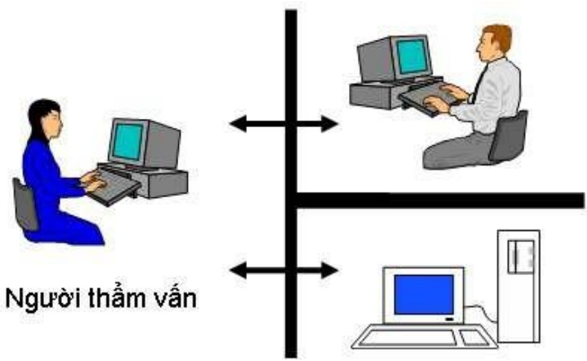

Hình 1.1 – Trắc nghiệm Turing

Bằng cách cách ly người thẩm vấn với máy tính cũng như người tham gia vào trắc nghiệm, thí nghiệm này bảo đảm rằng người thẩm vấn sẽ không có thành kiến với sự xuất hiện của máy tính hay bất kỳ một đặc tính máy móc nào trong lời nói của nó. Tuy nhiên, với mục đích cố gắng phát hiện ra đâu là máy tính, người thẩm vấn có thể được tự do hỏi bất kỳ câu hỏi nào, cho dù là những câu hỏi bóng gió hay quanh co. Chẳng

<!-- page: 12 -->

hạn, người thẩm vấn có thể yêu cầu cả hai đối tượng thực hiện một phép tính liên quan ít nhiều đến số học với giả định rằng máy tính sẽ thực hiện nhanh và chính xác hơn người. Để đối phó với chiến thuật này, một máy tính thông minh cần phải biết khi nào thì nó nên đưa ra một câu trả lời sai cho những bài toán nhằm tỏ ra nó giống con người. Một cách tương tự, để có thể phát hiện ra đặc tính con người dựa vào bản chất cảm xúc, người thẩm vấn cũng có thể hỏi cả hai đối tượng các kiến thức về thơ văn hay nghệ thuật. Và để đối phó với chiến thuật này đòi hỏi máy tính cũng phải có những kiến thức liên quan đến cảm xúc xuất phát từ con người.

Những đặc trưng quan trọng của trắc nghiệm này là :

Nó đưa ra một khái niệm khách quan về trí tuệ, tức là hành vi của một thực thể thông minh nào đó đáp ứng lại một tập hợp các câu hỏi đặc thù. Việc này cho chúng ta một chuẩn mực để xác định trí thông minh, đồng thời tránh được những tranh luận không cần thiết về bản chất “đúng” của nó.

Nó tránh cho chúng ta khỏi bị lạc đường bởi những câu hỏi rắc rối và hiện thời chưa thể trả lời được, chẳng hạn như máy tính có sử dụng những suy luận thích hợp bên trong nó hay không, hay máy tính thực sự có ý thức được những hành động của nó hay không.

Nó loại trừ bất cứ định kiến thiên vị nào vì bắt buộc người thẩm vấn chỉ tập trung vào nội dung các câu trả lời.

Nhờ những ưu điểm này, trắc nghiệm Turing đã cung cấp một cơ sở cho nhiều sơ đồ đánh giá mà những sơ đồ này được dùng thực sự cho các chương trình TTNT hiện đại. Người ta có thể đánh giá khả năng chuyên môn của một chương trình về một lĩnh vực nào đó bằng cách so sánh kết quả làm việc của nó với một chuyên gia khi cùng giải quyết một tập các bài toán cho trước. Kỹ thuật đánh giá này chỉ là biến thể của trác nghiệm Turing: một nhóm chuyên gia sau đó sẽ được yêu cầu so sánh kết quả thực hiện của máy và người trên một tập hợp đặc thù các bài toán mà không được thấy các đối tượng. Chúng ta sẽ thấy rằng phương pháp luận này đã trở thành một công cụ không thể thiếu trong cả hai giai đoạn phát triển và kiểm chứng của các hệ chuyên gia hiện đại.

## Câu hỏi :

Hãy so sánh những điểm khác nhau cơ bản trong khả năng giải quyết vấn đề giữa máy tính hiện đại với con người ?

<!-- page: 13 -->

# KHÁI QUÁT CÁC LĨNH VỰC ỨNG DỤNG CỦA TTNT

## KHÁI QUÁT CÁC LĨNH VỰC ỨNG DỤNG CỦA TTNT

Hai mối quan tâm nền tảng nhất của các nhà nghiên cứu TTNT là biểu diễn tri thức (knowledge representation) và tìm kiếm (search). Sự quan tâm thứ nhất chú ý đến vấn đề nắm bắt theo một ngôn ngữ hình thức, tức là một dạng thức thích hợp để máy tính vận hành, phạm vi tri thức đầy đủ mà hành vi thông minh đòi hỏi. Trong khi, tìm kiếm là kỹ thuật giải quyết vấn đề theo cách khảo sát có hệ thống một không gian trạng thái bài toán (problem state), tức là các giai đoạn tuần tự và có chọn lựa trong quá trình giải quyết vấn đề.

Giống như hầu hết các ngành khoa học khác, Trí Tuệ Nhân Tạo cũng được phân thành những ngành con. Trong khi chia sẻ một tiếp cận giải quyết vấn đề cơ bản, các ngành con này có các mối quan tâm đến các ứng dụng khác nhau. Phần sau sẽ phác thảo tổng thể một vài lĩnh vực ứng dụng chính và những đóng góp của chúng cho Trí tuệ nhân tạo.

## Trò chơi

Ngay từ thời kỳ đầu của việc nghiên cứu vấn đề tìm kiếm trong không gian trạng thái, người ta đã tiến hành nhiều thử nghiệm bằng cách sử dụng các trò chơi thông dụng có bàn cờ như cờ đam (checker), cờ vua và trò đố 15 ô (15 puzzule). Ngoài sức quyến rũ do tính chất trí óc vốn có trong các trò chơi có bàn cờ, có nhiều tính nhất định làm cho chúng trở thành một đối tượng lý tưởng của thời kỳ này. Hầu hết các trò chơi đều sử dụng một tập hợp các luật chơi được xác định rõ ràng. Điều này làm cho việc phát sinh không gian tìm kiếm trở nên dễ dàng và giải phóng nhiều nghiên cứu khỏi những sự mơ hồ và phức tạp vốn có trong các bài toán ít cấu trúc hơn. Hình dạng của những bàn cờ sử dụng trong các trò chơi này dễ dàng được biểu diễn vào máy tính, trong khi không đòi hỏi một hình thức khó hiểu cần thiết nào để nắm bắt những tinh tế và ngữ nghĩa trong những lĩnh vực bài toán phức tạp hơn. Do có thể chơi các trò chơi một cách dễ dàng nên việc thử nghiệm một chương trình chơi trò chơi không phải trả một gánh nặng nào về tài chính hay đạo đức.

Các trò chơi có thể phát sinh ra một số lượng không gian tìm kiếm cực kỳ lớn. Những không gian này đủ lớn và phức tạp để đòi hỏi những kỹ thuật mạnh nhằm quyết định xem những chọn lựa nào cần được khảo sát trong không gian bài toán. Những kỹ thuật này được gọi là các heuristic và chúng tạo thành một lĩnh vực lớn trong nghiên cứu TTNT. Một heuristic là một chiến lược giải quyết vấn đề tốt nhưng tiềm ẩn khả năng thất bại, chẳng hạn như việc kiểm tra để biết chắc rằng một thiết bị không nhạy đã được cắm vào trước khi giả định rằng nó bị hỏng, hay cố gắng bảo vệ quân cờ hoàng hậu của bạn khỏi bị bắt trong trò chơi cờ vua. Nhiều thứ mà chúng ta gọi là thông minh thuộc về các heuristic được người ta sử dụng để giải quyết các vấn đề.

<!-- page: 14 -->

Hầu hết chúng ta đều có một số kinh nghiệm với những trò chơi đơn giản này, nên chúng ta cũng có khả năng nghĩ ra và kiểm nghiệm tính hiệu quả của những heuristic của chính mình. Chúng ta không cần đi tìm và hỏi ý kiến chuyên gia trong một số lĩnh vực chuyên môn sâu như là y học hay toán học (cờ vua là một ngoại lệ dễ thấy đối với quy tắc này). Vì những lý do đó, các trò chơi cung cấp một không gian mênh mông cho việc nghiên cứu các tìm kiếm heuristic. Các chương trình chơi trò chơi, trái ngược với tính đơn giản của chúng, đưa ra những thử thách riêng của chúng, bao gồm các đấu thủ mà các nước đi của anh ta có thể không dự đoán trước được một cách chắc chắn. Sự có mặt này của đấu thủ càng làm phức tạp hơn mô hình chương trình do sự thêm vào một yếu tố không dự đoán trước được và sự cần thiết phải tính đến những yếu tố tâm lý cũng như là chiến thuật trong chiến lược của trò chơi.

## Suy luận và chứng minh định lý tự động

Chúng ta có thể cho rằng chứng minh định lý tự động là một nhánh nghiên cứu có từ lâu đời nhất của Trí tuệ nhân tạo khi tìm lại nguồn gốc của nó qua các tác phẩm “Nhà lý luận logic (logic theorist)” (Newell và Simon 1963a) và “Công cụ giải quyết vấn đề tổng quát (General problem solver)” (Newell và Simon 1965b) của Newell và Simon, cho đến trong những nổ lực của Rusell và Whitehead xem toàn bộ toán học như là sự dẫn xuất hình thức thuần tuý của các định lý từ các tiên đề cơ sở. Trong bất cứ trường hợp nào, nó chắc chắn vẫn là một trong những ngành phong phú nhất của lĩnh vực này. Nghiên cứu chứng minh định lý đã đạt được nhiều thành tích trong thời kỳ đầu của việc hình thức hoá các giải thuật tìm kiếm và phát triển các ngôn ngữ biểu diễn hình thức như phép tính vị từ.

Hầu hết sự quyến rũ của chứng minh định lý tự động đều là không đáng tin cậy và không đúng với nguyên tắc chung của logic. Vì là một hệ hình thức, logic tự bổ sung cho mình sự tự động hoá. Người ta có thể khảo sát một số lượng lớn những bài toán khác nhau, bằng cách biểu diễn mô tả của bài toán và những thông tin cơ sở liên quan như là tiên đề logic, và xem những trường hợp bài toán là những định lý cần phải chứng minh. Sự hiểu biết thấu đáo này là cơ sở cho việc nghiên cứu chứng minh định lý tự động và các hệ suy luận toán học.

Một lý do khác cho việc tiếp tục quan tâm đến các máy chứng minh định lý tự động là sự nhận thức rằng một hệ thống kiểu như vậy không nhất thiết phải có khả năng giải quyết những bài toán cực kỳ phức tạp một cách độc lập mà không có sự trợ giúp nào của con người. Nhiều máy chứng minh định lý hiện đại hoạt động như những trợ lý viên thông minh khi chúng cho phép con người thực hiện những công tác đòi hỏi trình độ cao hơn là phân tích một bài toán lớn thành nhiều bài toán con và đặt ra những heuristic để tìm kiếm trong không gian những chứng minh có thể chọn. Máy chứng minh định lý sau đó thực hiện công tác đơn giản hơn nhưng cũng quan trọng là chứng minh các bổ đề, kiểm chứng những giải quyết nhỏ hơn, và hoàn thành những khía cạnh hình thức của

<!-- page: 15 -->

một chứng minh đã được phác thảo bởi sự hợp tác của nó với con người (Boyer và More 1979).

## Các hệ chuyên gia

Kể từ lúc khoa học giải quyết vấn đề được nghiên cứu, người ta đã sớm ý thức một cách sâu sắc và cơ bản về tầm quan trọng của tri thức chuyên ngành. Lấy ví dụ một bác sĩ chẳng hạn, cô ta không thể chẩn đoán bệnh tốt chỉ nhờ vào một số kỹ năng giải quyết vấn đề tổng quát bẩm sinh; mà cô ta đã chẩn đoán tốt là vì cô ta có nhiều kiến thức y học. Tương tự như thế, một nhà địa chất giỏi phát hiện các mỏ khoáng vì anh ta biết áp dụng một cách hiệu quả nhiều tri thức lý thuyết và thực nghiệm về địa lý vào bài toán đang nằm trong tay anh ta. Tri thức chuyên gia về lĩnh vực là sự kết hợp giữa kiến thức lý thuyết về vấn đề đó và một tập hợp các quy tắc giải quyết vấn đề theo kiểu heuristic mà kinh nghiệm khi sử dụng những quy tắc này đã tỏ ra hiệu quả trong lĩnh vực đó. Các hệ chuyên gia được người ta xây dựng bằng cách thu thập các kiến thức từ chuyên gia người và mã hoá nó thành dạng thức mà máy tính có thể áp dụng cho những bài toán tương tự.

Sự tin cậy vào tri thức của chuyên gia chuyên ngành trong các chiến lược giải quyết vấn đề của hệ là một đặc trưng chính của các hệ chuyên gia. Người ta đã viết ra một số chương trình mà ở đó người thiết kế cũng là nguồn tri thức chuyên ngành, nhưng sẽ điển hình hơn nhiều nếu chúng ta xem xét những chương trình được phát sinh từ sự cộng tác giữa một chuyên gia chuyên ngành chẳng hạn như một bác sĩ, một nhà hoá học, một nhà địa chất học hay một kỹ sư, với một chuyên gia riêng về trí tuệ nhân tạo. Chuyên gia chuyên ngành cung cấp kiến thức cần thiết về chuyên ngành thông qua những cuộc thảo luận tổng quát về các phương pháp giải quyết vấn đề của anh ta, và bằng cách biểu diễn những kỹ năng đó trên một tập hợp các bài toán mẫu được chọn lựa cẩn thận. Chuyên gia TTNT, hay còn gọi là kỹ sư tri thức (knowledge engineer), như người ta vẫn thường gọi là các nhà thiết kế hệ chuyên gia, có trách nhiệm thể hiện tri thức này vào một chương trình mà chương trình đó phải vừa hiệu quả vừa có vẻ thông minh trong các hành vi của nó. Một chương trình như thế vừa hoàn thành xong, cần phải tinh chế kiến thức chuyên môn của nó thông qua một quá trình cung cấp cho nó những bài toán mẫu để giải, để cho chuyên gia chuyên ngành phê bình hành vi của nó và thực hiện bất cứ thay đổi hay cải biến nào cần thiết đối với tri thức của chương trình. Quá trình này lặp đi lặp lại cho đến khi chương trình đạt được mức độ hoàn thiện mong muốn.

Một trong các hệ chuyên gia sớm nhất khai thác tri thức chuyên ngành để giải quyết vấn đề là DENDRAL được phát triển tại Stanford vào cuối những năm 1960 (Lindsay et al.1980). DENDRAL được thiết kế để phỏng đoán cấu trúc của các phân tử hữu cơ từ công thức hoá học của chúng và các thông tin về khối quang phổ có liên quan đến các liên kết hoá học có mặt trong các phân tử. Vì các phân tử hữu cơ thường rất lớn, nên số lượng cấu trúc có khả năng tồn tại đối với những phân tử này thường là khổng lồ. DENDRAL chú ý vào bài toán của không gian tìm kiếm rộng lớn này bằng cách áp

<!-- page: 16 -->

dụng tri thức heuristic của các chuyên gia hoá học vào bài toán làm sáng tỏ cấu trúc. Các phương pháp của DENDRAL đã tỏ ra có một sức mạnh đáng kể. Khi thường xuyên tìm thấy cấu trúc đúng trong hàng triệu khả năng khác nhau chỉ sau có vài phép thử. Phương pháp này tỏ ra thành công đến mức người ta đã sử dụng những phiên bản của hệ chuyên gia nói trên trong các phòng thí nghiệm hoá học khắp nơi trên thế giới.

Trong khi DENDRAL là một trong số những chương trình đầu tiên sử dụng tri thức chuyên ngành một cách hiệu quả để đạt được khả năng giải quyết vấn đề cấp chuyên gia, thì MYCIN là hệ chuyên gia đã thiết lập nên phương pháp luận cho các hệ chuyên gia hiện đại (contemporary expert systems) (Buchanan and Shortliff 1984). MYCIN sử dụng tri thức y khoa chuyên gia để chẩn đoán và kê đơn điều trị cho bệnh viêm màng não tuỷ sống và những trường hợp nhiễm trùng vi khuẩn trong máu.

MYCIN, được các nhà nghiên cứu phát triển ở Stanford vào giữa những năm 1970, là một trong những chương trình đầu tiên chú ý đến những bài toán suy luận bằng thông tin không chắc chắn hoặc không đầy đủ. MYCIN cung cấp những giải quyết rõ ràng và logic về quá trình suy luận của nó, sử dụng một cấu trúc kiểm tra thích hợp với lĩnh vực chuyên môn của vấn đề, và nhận biết đặc tính để đánh giá một cách tin cậy hoạt động của nó. Nhiều kỹ thuật xây dựng hệ chuyên gia đang dùng hiện nay đã được người ta phát triển lần đầu trong dự án MYCIN.

Những hệ chuyên gia cổ điển khác bao gồm chương trình PROSPECTOR dùng để tìm ra những nơi có chứa quặng mỏ và xác định loại quặng mỏ, dựa trên thông tin địa lý về một địa điểm nào đó (duda et al. 1979a, 1979b), chương trình INTERNIST dùng để chẩn đoán trong lĩnh vực nội khoa, Dipmeter Advisor dùng để phiên dịch các kết quả của các máy khoan giếng dầu (Smith and Baker 1983) và XCON dùng để định hình các máy tính hệ VAX.XCON được sử dụng từ năm 1981, tất cả các máy VAX và Digital Equipment Corporation bán thời bấy giờ đều được định hình bằng XCON. Vô số những hệ chuyên gia khác ngày nay đang giải quyết những bài toán trong nhiều lĩnh vực khác nhau như y học, giáo dục, kinh doanh, thiết kế và khoa học (Waterman 1986). Một điều thú vị mà chúng ta có thể nhận thấy là hầu hết các hệ chuyên gia được viết cho những lĩnh vực khá chuyên biệt và ở cấp độ chuyên gia. Nói chung những lĩnh vực này đều được nghiên cứu kỹ và chúng có những chiến lược giải quyết vấn đề đã xác định một cách rõ ràng.

Mặc dù còn tồn tại những hạn chế này các hệ chuyên gia vẫn đang chứng minh giá trị của chúng trong nhiều ứng dụng quan trọng.

## Câu hỏi :

Nêu thêm một số ưu điểm của hệ chuyên gia trên các phương diện tri thức, xã hội hoặc tài chính ?

<!-- page: 17 -->

## Hiểu và mô hình hoá ngữ nghĩa ngôn ngữ tự nhiên

Một trong những mục tiêu có từ lâu đời của Trí tuệ nhân tạo là tạo ra các chương trình có khả năng hiểu ngôn ngữ của con người. Khả năng hiểu ngôn ngữ tự nhiên không chỉ là một trong những biểu hiện căn bản nhất của trí thông minh con người mà sự tự động hoá nó một cách thành công sẽ gây ra một tác động ngoài sức tưởng tượng đối với năng lục và hiệu quả chính của những chiếc máy tính. Người ta đã bỏ ra nhiều công sức để viết các chương trình có khả năng hiểu ngôn ngữ tự nhiên. Tuy những chương trình này đã có được một số thành công trong những ngữ cảnh hạn chế, nhưng các hệ thống có khả năng sử dụng ngôn ngữ tự nhiên một cách linh hoạt và tổng quát theo cách như con người vẫn còn ở ngoài tầm tay những phương pháp luận hiện nay.

Hiểu ngôn ngữ tự nhiên liên quan đến nhiều thứ hơn nhiều so với chỉ phân tích các câu thành các phần riêng rẽ những nhóm câu của chúng và tìm những từ đó trong từ điển. Khả năng hiểu thực sự tuỳ thuộc vào kiến thức nền tảng rộng lớn về lĩnh vực của bài văn và những thành ngữ dùng trong lĩnh vực đó, cũng như là khả năng ứng dụng những kiến thức tổng quát tuỳ thuộc theo ngữ cảnh để giải quyết những trường hợp bỏ sót hay tối nghĩa, là một đặc điểm bình thường trong lối nói con người.

Ví dụ như chúng ta thử xem xét những khó khăn khi tiến hành một cuộc hội thoại về bóng chày với một người biết tiếng Anh nhưng không biết gì về luật chơi, các đấu thủ, hoặc lịch sử của môn chơi. Liệu người này có thể hiểu được hay không nghĩa của câu: “With none down in the top of the nith anh the go-ahead run at second, the managercalled this relief from the bull pen ?” Tuy từng từ riêng lẻ trong câu này là có thể hiểu được, nhưng câu này vẫn được coi là sai ngữ pháp ngay cả đối với người thông minh nhất trong số những người không am hiểu bóng chày.

Công việc tập hợp và tổ chức kiến thức nền tảng này được tiến hành theo cách mà sao cho cách ấy có thể áp dụng được cho sự lĩnh hội ngôn ngữ, đã hình thành nên vấn đề chủ yếu của việc tự động hoá quá trình hiểu ngôn ngữ tự nhiên. Để đáp ứng yêu cầu này, các nhà nghiên cứu đã phát triển nhiều kỹ thuật dùng để cấu trúc hoá ý nghĩa ngữ nghĩa, các kỹ thuật này được dùng xuyên suốt khoa học Trí tuệ nhân tạo.

Do việc hiểu ngôn ngữ tự nhiên đòi hỏi những khối lượng kiến thức khổng lồ, hầu hết các công trình được người ta thực hiện trong những lĩnh vực vấn đề đã được hiểu rõ và chuyên môn hoá. Một trong những chương trình khai thác sớm nhất phương pháp luận “thế giới qui mô” này là SHRDLU của Winograd, một hệ ngôn ngữ tự nhiên có khả năng “trò chuyện” về hình dáng đơn giản của các khối có nhiều hình dạng và màu sắc khác nhau (winograd 1973). SHRDLU có thể trả lời được những câu hỏi kiểu như “khối màu gì đang nằm trên hình lập phương màu xanh da trời ?” và dự kiến những hành động kiểu như “di chuyển hình chóp màu đỏ lên viên gạch màu xanh lá cây”. Những bài toán loại này, liên quan đến việc mô tả và thao tác những sắp xếp đơn giản của các khối đã

<!-- page: 18 -->

xuất hiện và thường xuyên gây ngạc nhiên trong giới nghiên cứu TTNT và được người ta biết đến dưới cái tên là những bài toán “thế giới của khối”.

Mặc cho SHRDLU thành công với việc trò chuyện về sự sắp xếp của các khối, nhưng phương pháp của nó đã không đủ khái quát được để vượt ra khỏi thế giới các khối. Những kỹ thuật biểu diễn được sử dụng trong chương trình này quá đơn giản nên không đủ để tổ chức nắm bắt ngữ nghĩa của nhiều lĩnh vực phong phú và phức tạp hơn một cách có kết quả. Nhiều sự đầu tư nghiên cứu về hiểu ngôn ngữ tự nhiên trong thời gian gần đây được người ta dành hết cho việc tìm ra những hình thức biểu diễn, mà về cơ bản đủ dùng trong một phạm vi rộng lớn các ứng dụng mà những ứng dụng này tự bản thân chúng còn chưa thích nghi tốt với cấu trúc đặc thù của lĩnh vực đó. Người ta khảo sát một số lượng những kỹ thuật khác nhau (hầu hết đều là những mở rộng hay cải tiến của kỹ thuật mạng ngữ nghĩa) cho mục đích này và dùng chúng vào việc phát triển những chương trình có khả năng hiểu ngôn ngữ tự nhiên trong những lĩnh vực tri thức cấp bách nhưng lý thú. Sau cùng, trong nghiên cứu gần đây (grosz 1997, marcus 1980), các mô hình và cách tiếp cận stochastic, mô tả cách các tập hợp từ “cùng xuất hiện” trong các môi trường ngôn ngữ, đã được dùng để khắc hoạ nội dung ngữ nghĩa của câu. Tuy nhiên, hiểu ngôn ngữ tự nhiên một cách tổng quát là vấn đề vẫn còn vượt quá giới hạn hiện nay của chúng ta.

## Câu hỏi :

Trình bày một số ứng dụng cụ thể mà bạn biết cho việc xử lý ngôn ngữ tự nhiên đang áp dụng vào các lĩnh vực cuộc sống hiện nay ?

## Mô hình hoá hoạt động của con người

Mặc dù khá nhiều vấn đề đã nói ở trên dùng trí tuệ con người làm điểm tựa tham khảo để xem xét trí tuệ nhân tạo, thực tế đã không diễn biến theo cách mà những chương trình cần phải lấy sự tổ chức của trí óc con người làm kiểu mẫu cho chúng. Thực ra nhiều chương trình TTNT được thiết kế để giải một số bài toán cần thiết mà không cần chú ý đến tính tương tự của chúng so với kiến trúc trí óc con người. Ngay cả các hệ chuyên gia, trong khi nhận được nhiều tri thức từ các chuyên gia con người, cũng không thực sự cố gắng bắt chước những quá trình trí tuệ bên trong của con người. Nếu như sự hoạt động chỉ là những đặc tính mà theo đó một hệ thống sẽ được đánh giá, thì có thể là không có mấy lý do để mô phỏng các phương pháp giải quyết vấn đề của con người. Trong thực tế, những chương trình sử dụng các phương pháp không theo kiểu con người để giải quyết các bài toán thường thành công hơn những chương trình theo kiểu con người. Tuy nhiên, mô hình của những hệ thống rõ ràng bắt chước một số khía cạnh của cách giải quyết vấn đề theo kiểu con người vẫn là một mảnh đất màu mỡ trong nghiên cứu cho cả hai ngành khoa học trí tuệ nhân tạo và tâm lý học.

<!-- page: 19 -->

Mô hình hóa hoạt động con người, ngoài việc cung cấp cho TTNT nhiều phương pháp luận cơ bản, đã chứng tỏ được rằng nó là một dụng cụ mạnh để công thức hóa và thử nghiệm những lý thuyết về sự nhận thức của con người. Những phương pháp luận giải quyết vấn đề được các nhà khoa học máy tính phát triển đã đem đến cho các nhà tâm lý học một sự ẩn dụ mới để khảo sát trí tuệ con người. Hơn cả việc mở rộng được các lý thuyết về sự nhận thức trong thứ ngôn ngữ không rõ ràng sử dụng vào đầu thời kỳ nghiên cứu hay là từ bỏ được bài toán mô tả toàn bộ những hoạt động bên trong của trí óc con người (như đề nghị của các nhà hành vi học), nhiều nhà tâm lý học đã đưa ngôn ngữ và lý thuyết khoa học máy tính vào để công thức hóa các mô hình trí tuệ con người. Những kỹ thuật này không chỉ cung cấp một vốn từ vựng cho việc mô tả trí tuệ con người mà sự thể hiện trên máy tính những lý thuyết này đã tạo cho các nhà tâm lý học một cơ hội để thử nghiệm, phê bình và cải tiến một cách thực nghiệm những ý tưởng của họ (luger 1994).

## Lập kế hoạch và robotics

Lập kế hoạch (planning) là một khía cạnh quan trọng trong những cố gắng nhằm chế tạo ra các robot có thể thực hiện được nhiệm vụ của chúng với một trình độ nhất định và khả năng linh hoạt và phản ứng với thế giới bên ngoài. Nói một cách khác ngắn gọn, việc lập kế hoạch giả định rằng robot có khả năng thực hiện những hành động sơ cấp (atomic action) nhất định. Nó cố gắng tìm ra một chuỗi các hành động cho phép hoàn thành một công tác ở cấp độ cao hơn, chẳng hạn như đi qua một căn phòng chứa đầy những chướng ngại vật.

Có nhiều những lý do khiến cho việc lập kế hoạch trở thành một bài toán khó khăn, ngoài lý do không đáng kể nhất là kích thước quá lớn của không gian những chuỗi bước đi có thể tồn tại. Ngay cả một máy tính cực kỳ đơn giản cũng có khả năng tạo ra một số lượng khổng lồ những chuỗi bước đi có thể. Ví dụ, chúng ta hãy tưởng tượng rằng, một robot có khả năng di chuyển về phía trước, phía sau, bên phải, bên trái và cần xem xét có bao nhiêu cách khác nhau mà robot đó có thể dùng để di chuyển quanh căn phòng đó và robot phải lựa chọn một đường đi quanh chúng theo một phương pháp nào đó có hiệu quả. Viết một chương trình có khả năng tìm ra đường đi tốt nhất một cách thông minh với điều kiện như vậy, mà không bị chôn vùi bởi khối lượng khổng lồ các khả năng dự kiến, đòi hỏi phải có những kỹ thuật phức tạp để biểu diễn tri thức về không gian và kiểm soát việc tìm kiếm trong môi trường cho phép.

Một phương pháp mà con người vẫn áp dụng để lập kế hoạch là phân rã vấn đề từng bước (hierarchical problem decoposition). Nếu bạn đang lập kế hoạch cho chuyến du lịch đến Luân Đôn, thì nói chung những vấn đề như sắp xếp chuyến bay, đến sân bay, liên hệ với hãng hàng không, vận chuyển đường bộ tại Luân Đôn sẽ được bạn xem xét một cách riêng lẻ, cho dù tất cả chúng đều là bộ phận của một kế hoạch toàn thể lớn hơn. Từng vấn đề này có thể được tiếp tục phân rã thành những vấn đề con (subproblem) nhỏ hơn như tìm một bản đồ thành phố, xem xét hệ thống giao thông, và tìm một nơi ăn ở

<!-- page: 20 -->

phù hợp điều kiện về tài chính. Cách làm này không những làm giảm bớt một cách hiệu quả không gian tìm kiếm mà nó còn cho phép chúng ta tiết kiệm được những kế hoạch con có thể dùng trong tương lai.

Trong khi con người lập kế hoạch một cách chẳng mấy khó khăn, thì việc tạo ra một chương trình máy tính có thể làm được công việc như vậy là một thách thức ghê gớm. Một công tác có vẻ đơn giản là phá vỡ một vấn đề lớn thành nhiều vấn đề con liên quan thực sự cần đến những heuristic phức tạp và kiến thức bao quát về lĩnh vực đang lập kế hoạch. Quyết định xem cần giữ lại những kế hoạch con nào và tổng quát hóa chúng như thế nào cho sự sử dụng trong tương lai là một vấn đề phức tạp tương đương.

Một robot thực hiện một dãy các hành động một cách mù quáng mà không biết phản ứng lại với những thay đổi trong môi trường của nó hoặc không có khả năng phát hiện và sửa chữa trong chính kế hoạch của nó khó có thể được người ta coi là thông minh. Thông thường, một robot sẽ phải làm thành công thức một kế hoạch dựa trên thông tin không đầy đủ và sửa chữa hành vi của nó khi thi hành kế hoạch. Robot có thể không có những giác quan thích hợp để định vị tất cả những chướng ngại vật trên con đường đi đã vạch ra. Một robot như vậy phải bắt đầu di chuyển qua căn phòng dựa vào những gì mà nó “nhận thức” được và điều chỉnh đường đi của nó khi phát hiện ra những chướng ngại vật khác. Thiết lập cho các kế hoạch cho phép có thể phản ứng lại với những điều kiện của môi trường là một nhiệm vụ chủ yếu khác trong lập kế hoạch.

Nói chung, thiết kế robot là một trong những lĩnh vực nghiên cứu của TTNT đã mang lại nhiều hiểu biết sâu sắc hỗ trợ cho phương pháp giải quyết vấn đề theo kiểu hướng thành viên (agent - oriented). Bị thất bại bởi những phức tạp trong việc bảo đảm độ lớn của không gian biểu diễn cũng như bởi mô hình của các thuật toán tìm kiếm dùng cho việc lập kế hoạch theo kiểu truyền thống, các ngành nghiên cứu, gồm cả agre và chapman (1987) và brooks (1991a), đã phát biểu lại vấn đề lớn hơn này dựa trên các thuật ngữ về sự tương tác lẫn nhau giữa nhiều thành viên (agent) theo kiểu bán tự quản. Mỗi thành viên chịu trách nhiệm về phần đóng góp của chính nó trong nhiệm vụ của bài toán và thông qua sự phối hợp giữa chúng lời giải tổng quát sẽ hiện ra.

## Các ngôn ngữ và môi trường dùng cho TTNT

Nghiên cứu Trí tuệ nhân tạo đã tạo ra một số những sản phẩm phụ, đó là những tiến bộ trong các ngôn ngữ lập trình và các môi trường phát triển phần mềm. Vì nhiều lý do, bao gồm cả qui mô tổng thể của hầu hết các chương trình TTNT, khuynh hướng phát sinh ra các không gian khổng lồ của các thuật toán tìm kiếm, và những khó khăn trong việc tiên đoán các hành vi của các chương trình điều khiển bằng heuristics, các nhà lập trình TTNT đã bị thúc ép phải xây dựng nên một tập hợp các phương pháp lập trình.

Các môi trường lập trình bao gồm cả các kỹ thuật cấu tạo tri thức (knowledge structuring) như lập trình hướng đối tượng (object-oriented programming) và các cơ cấu

<!-- page: 21 -->

tổ chức hệ chuyên gia. Các ngôn ngữ cấp cao như Lisp và Prolog, là các ngôn ngữ tích cực hỗ trợ kiểu phát triển theo module, khiến cho việc quản lý tính đồ sộ và phức tạp của chương trình dễ dàng hơn. Các gói chương trình lần tìm cho phép người lập trình tạo dựng lại quá trình thực thi của một thuật toán phức tạp và cho phép tháo gỡ những phức tạp khi tìm kiếm bằng điều khiển của heuristics. Không có công cụ kỹ thuật đó, khó mà tin được rằng người ta có thể xây dựng nên những hệ thống TTNT gây chú ý như vậy.

Kỹ thuật này hiện nay là những công cụ chuẩn dùng cho công nghệ phần mềm, và tương đối có quan hệ với hạt nhân lý thuyết của TTNT. Những kỹ thuật khác như là lập trình hướng đối tượng, được quan tâm đáng kể cả trên lý thuyết và thực tiễn. Các ngôn ngữ phát triển cho việc lập trình trí tuệ nhân tạo gắn bó mật thiết với cấu trúc lý thuyết của lĩnh vực đó.

## Máy học

Tuy thành công trong vai trò những máy giải quyết vấn đề, học vẫn còn là một sự nan giải đối với các chương trình TTNT. Khuyết điểm này dường như rất nghiêm trọng, đặc biệt là khi khả năng học là một trong những thành phần quan trọng nhất làm nên hành vi thông minh. Một hệ chuyên gia có thể thực hiện những tính toán lớn và rất tốn kém nhằm giải quyết một bài toán. Tuy thế không giống như con người, nếu đưa cho nó cùng bài toán ấy hoặc một bài toán tương tự lần thứ hai, nó sẽ không nhớ lời giải lần trước. Nó thực hiện lại chuỗi tính toán đó lần nữa. Điều này đúng cho cả lần thứ hai, thứ ba, thứ tư, và bất cứ khi nào nó giải quyết bài toán đó – hầu như không thể gọi đó là hành vi của một máy giải quyết vấn đề thông minh.

Hầu hết các hệ chuyên gia đều bị cản trở bởi tính cứng nhắc trong các chiến lược giải quyết vấn đề của chúng và sự khó khăn khi phải thay đổi khối lượng lớn mã chương trình. Giải pháp dễ thấy đối với những khó khăn này là hoặc để cho các chương trình học tập trên chính kinh nghiệm, sự tương tự, và những ví dụ của chúng, hoặc là “nói” cho chúng biết phải làm gì.

Tuy rằng học là một lĩnh vực khó khăn trong nghiên cứu, một vài chương trình được viết đã đề xuất rằng đây không phải là một mục tiêu không thể đạt được. Có thể một chương trình như thế gây chú ý nhất là AM - Automated Mathematician - được thiết kế để khám phá các quy luật toán học (lenat 1977, 1982). Ban đầu người ta đưa cho AM các khái niệm và tiên đề của lý thuyết tập hợp, sau đó nó đã tìm ra những khái niệm toán học quan trọng như là lực lượng (cardinality) và số học số nguyên, và nhiều kết quả khác của lý thuyết số. AM đã phỏng đoán các lý thuyết mới bằng cách cập nhật cơ sở tri thức hiện hành của nó, và sử dụng các heuristic để theo đuổi “khả năng đáng quan tâm” nhất trong hàng loạt các lựa chọn có thể.

<!-- page: 22 -->

Một nghiên cứu khác có ảnh hưởng tới dư luận của winston về sự quy nạp các khái niệm cấu trúc, chẳng hạn như “hình cung” từ một tập hợp các ví dụ trong trò chơi thế giới của khối (winston 1975a). Thuật toán ID3 đã tỏ ra thành công trong việc học các mẫu tổng quát từ các ví dụ (quinlan 1986a). Menta-dendral học các luật để phiên dịch dữ liệu quang phổ khối trong hóa học hữu cơ từ các mẫu dữ liệu về các hợp chất của cấu trúc đã biết. Teiresias, một đại diện khá thông minh của các hệ chuyên gia có thể chuyển đổi lời chỉ đạo cấp cao thành các luật mới cho cơ sở dữ liệu của nó (davis 1982). Hacke nghĩ ra các kế hoạch để thực hiện các thao tác trong trò thế giới các khối thông qua một quá trình lặp lại nhiều lần việc đặt ra một kế hoạch, thử nghiệm nó, và hiệu chỉnh bất cứ lỗ hỏng nào phát hiện ra trong kế hoạch dự tuyển (sussman 1975). Những nghiên cứu trong việc học trên cơ sở giải thích đã cho thấy tính hiệu quả của tri thức ưu tiên trong quá trình học (mitchell et al. 1986, dejong and mooney 1986).

Sự thành công của các chương trình học máy thuyết phục rằng có thể tồn tại một tập hợp các nguyên tắc học tổng quát cho phép xây dựng nên các chương trình có khả năng học tập trong nhiều lĩnh vực thực tế.

## Xử lý phân tán song song và tính toán kiểu nảy sinh

Hầu hết các kỹ thuật nói đến trong tài liệu này đều sử dụng tri thức được biểu diễn rõ ràng và các thuật toán tìm kiếm được thiết kế một cách cẩn thận để cài đặt trí tuệ. Một cách tiếp cận rất khác là tìm cách xây dựng các chương trình thông minh bằng cách sử dụng các mô hình tương tự như cấu trúc nơ-ron (neuron) của bộ não con người.

Một sơ đồ neuron đơn giản gồm có một thân tế bào có rất nhiều những chỗ nhô ra theo nhánh, gọi là các tổ chức cây (dendrite), và một nhánh đơn gọi là trục (axon). Các tổ chức cây nhận tín hiệu từ các neuron khác. Khi những xung lực kết hợp này vượt quá một ngưỡng nhất định nào đó, thì neuron phát động và một xung lực, hay còn gọi là “cụm” (spike), chạy xuống trục. Các nhánh ở cuối trục hình thành nên các khớp thần kinh (synapse) với những tổ chức cây của các neuron; các khớp thần kinh có thể thuộc loại kích thích (excitatory) hay ngăn chặn (inhibitory). Một khớp thần kinh kích thích sẽ cộng thêm vào tổng số tín hiệu đi đến neuron; còn khớp thần kinh ngăn chặn thì trừ bớt đi tổng số này.

Mô tả một neuron như vậy là quá sức đơn giản, nhưng nó thâu tóm tất cả những đặc trưng liên quan đến các mô hình tính toán neuron. Đặc biệt mỗi đơn vị tính toán tính toán một số chức năng đầu vào của nó rồi chuyển kết quả đến các đơn vị liên hệ trong mạng. Thay vì sử dụng các ký hiệu và phép toán rõ ràng, tri thức của các hệ này nảy sinh ra khỏi toàn bộ mạng các kết nối neuron và các giá trị ngưỡng.

Vì nhiều lý do, cấu trúc neuron hiện đang hết sức hấp dẫn để dùng làm cơ chế cài đặt trí tuệ. Các chương trình TTNT truyền thống có khuynh hướng dễ gãy vỡ và nhạy cảm quá đáng khi phải đương đầu với sự nhiễu loạn: thay vì giảm giá trị một cách từ từ, những

<!-- page: 23 -->

chương trình như vậy thường thành công hoàn toàn hoặc thất bại hoàn toàn. Trí tuệ con người linh hoạt hơn nhiều; chúng ta có thể tiếp nhận được tốt đầu vào nhiễu loạn, chẳng hạn như nhận ra một khuôn mặt trong một căn phòng tối từ góc nhìn hẹp hay theo dõi duy nhất một cuộc đối thoại trong bữa tiệc ồn ào. Ngay cả khi không thể giải quyết được một số vấn đề, chúng ta nói chung vẫn có thể đưa ra một sự phỏng đoán có lý và coi đó như lời giải của bài toán. Do các cấu trúc neuron thâu tóm tri thức vào trong một số lượng lớn các đơn vị được nghiền thật nhỏ, nên chúng tỏ ra có triển vọng hơn trong việc đối sánh một cách toàn phần các dữ liệu nhiễu loạn và không đầy đủ.

Cấu trúc neuron cũng vững chắc hơn vì tri thức phân bố khá đồng đều xung quanh mạng. Kinh nghiệm của những người đã bị mất một phần não bộ do bệnh tật hay tai nạn đã cho thấy rằng họ không bị mất các vùng nhớ riêng biệt, mà đúng hơn là các quá trình trí não của họ phải chịu đựng nhiều sự giảm sút tổng thể.

<!-- page: 24 -->

## MỘT SỐ TỔNG KẾT VỀ TTNT

## MỘT SỐ TỔNG KẾT VỀ TTNT

• Sử dụng máy tính vào suy luận trên các ký hiệu, nhận dạng, học, và một số hình thức suy luận khác.

• Tập trung vào một số vấn đề không thích hợp với các lời giải mang tính thuật toán. Điều này dựa trên cơ sở tin tưởng vào phép tìm kiếm heuristic như một kỹ thuật giải quyết vấn đề TTNT.

• Sự quan tâm đến các kỹ thuật giải quyết vấn đề bằng những thông tin không chính xác, thiếu hụt hoặc được định nghĩa một cách nghèo nàn, và sự sử dụng các hình thức biểu diễn cho phép người lập trình bù đắp được những thiếu sót này.

• Suy luận những đặc trưng định tính quan trọng của tình huống.

• Một cố gắng để giải quyết những vướng mắc về ý nghĩa, ngữ nghĩa cũng như là hình thức cú pháp.

• Những câu trả lời không chính xác cũng như tối ưu, nhưng trong một chừng mực nào đó được coi là “đủ”. Đây là kết quả của sự tin cậy cốt yếu vào các phương pháp giải quyết vấn đề theo kiểu heuristic trong những tình huống mà kết quả tối ưu hoặc chính xác là quá tốn kém hoặc không thể thực hiện được.

• Sử dụng những khối lượng lớn tri thức chuyên ngành trong giải quyết vấn đề. Đây là cơ sở cho các hệ chuyên gia.

• Sử dụng các tri thức cấp meta (meta-level knowledge) để tăng thêm sự tinh vi cho việc kiểm soát các chiến lược giải quyết vấn đề. Tuy rằng đây là một vấn đề rất khó khăn, được chú ý trong một số khá ít các hệ thống gần đây, nó đã nổi bật lên như một lĩnh vực nghiên cứu chủ yếu.

## TỔNG KẾT CHƯƠNG I:

Phần nội dung chương I đã nêu lên vài nét về lịch sử hình thành và phát triển của khoa học TTNT, một vài định nghĩa mang tính khái quát về một lĩnh vực khoa học đầy thử thách và tiềm năng là TTNT. Những lĩnh vực ứng dụng TTNT từ rất lâu đời và vẫn đang phát triển cho đến hiện nay. Các khái niệm như lý luận, quy luật, biểu diễn, … hiện nay vẫn đang được nghiên cứu một cách cẩn thận bởi vì những nhà khoa học máy tính đòi hỏi phải hiểu chúng theo kiểu thuật toán. Trong khi đó, hoàn cảnh chính trị, kinh tế và đạo đức trên toàn cầu hiện nay buộc chúng ta phải đương đầu với trách nhiệm về hậu quả của những sáng chế hay phát minh khoa học. Sự tác động qua lại giữa những ứng dụng và những khát vọng mang tính nhân đạo hơn đối với TTNT tiếp tục đặt ra những vấn đề phong phú và đầy thách thức. Những chương tiếp theo sẽ đi sâu hơn vào những kỹ thuật được dùng trong TTNT mà chương đầu tiên này đã đề cập đến.

<!-- page: 25 -->

## Bài tập chương I

• Tự sáng tạo để trình bày và chứng minh một định nghĩa về Trí tuệ nhân tạo theo như bạn hiểu.

• Thảo luận về tiêu chuẩn mà Turing nêu ra trong “Trắc nghiệm Turing” nhằm quy định cho một phần mềm máy tính được coi là “thông minh”? Nêu quan điểm của riêng bạn về tiêu chuẩn đối với một phần mềm máy tính “thông minh”?

• Cho biết một vài lĩnh vực bài toán mà bạn thấy có thể chứng minh được rằng cần phải thiết kế một giải pháp hệ chuyên gia ? Nêu các hiệu quả có thể đạt được và những khó khăn có thể gặp phải ?

• Theo ý kiến riêng của bạn, hãy trình bày một số hiệu quả có khả năng tác động tiêu cực đối với xã hội của các kỹ thuật Trí tuệ nhân tạo?

<!-- page: 26 -->

# TRÍ TUỆ NHÂN TẠO NHƯ LÀ BIỂU DIỄN VÀ TÌM KIẾM

## LOGIC HÌNH THỨC

LOGIC HÌNH THỨC

**Nội dung chính :** Trong chương này, chúng ta giới thiệu phép tính vị từ như một ngôn ngữ biểu diễn dùng cho Trí tuệ nhân tạo. Những ưu điểm của việc dùng phép tính vị từ bao gồm một ngữ nghĩa hình thức (formal semantics) được định nghĩa chính xác cùng với các luật suy diễn vững chắc và đầy đủ. Chương này bắt đầu bằng việc nhắc lại phép tính mệnh đề, định nghĩa cú pháp và ngữ nghĩa của phép tính vị từ. Tiếp theo, chúng ta thảo luận về các luật suy diễn của phép tính vị từ và việc sử dụng chúng trong giải quyết vấn đề. Phần cuối chương sẽ minh họa cách sử dụng phép tính vị từ để cài đặt một cơ sở tri thức trong lĩnh vực tư vấn đầu tư tài chính.

**Mục tiêu cần đạt :** Sau chương này, sinh viên có thể :

• Hiểu Logic mệnh đề và Logic vị từ

• Vận dụng các phép biến đổi tương đương

• Biết biểu diễn tri thức của vấn đề bằng logic vị từ bậc nhất.

• Vận dụng các phép suy diễn để chứng minh một vấn đề đơn giản.

• Vận dụng phép hợp nhất và giải thuật đối sánh mẫu

**Kiến thức tiên quyết** : Khái niệm về Trí tuệ nhân tạo, Logic mệnh đề, Logic vị từ, …

Tài liệu tham khảo :

George F. Luger, William A. Stubblefield – Albuquerque – Artificial Intelligence – Wesley Publishing Company, Inc – 1997 (Chapter 2)

• Bùi Xuân Toại – Trương Gia Việt (Biên dịch) – Trí tuệ nhân tạo – Các cấu trúc và chiến lược giải quyết vấn đề - NXB Thống kê, 2000 (Phần II)

• Wikipedia – Bách khoa toàn thư mở - Phép tính vị từ bậc nhất

[http://en.wikipedia.org/wiki/Predicate\_calculus](http://en.wikipedia.org/wiki/Predicate_calculus)

<!-- page: 27 -->

## PHÉP TÍNH MỆNH ĐỀ

## Định nghĩa – Ký hiệu phép tính mệnh đề

## Mệnh đề :

Mệnh đề là một phát biểu có thể khẳng định tính đúng hoặc sai.

Các ký hiệu (symbol) của phép tính mệnh đề là các ký hiệu mệnh đề : P, Q, R, S, … (thông thường nó là các chữ cái in hoa nằm gần cuối bảng chữ cái tiếng Anh), các ký hiệu chân lý – chân trị (truth symbol) : true, false hay các phép toán kết nối như : ∧, ∨,?, ⟶, =

Các ký hiệu mệnh đề (propositional symbol) biểu thị các mệnh đề (proposition) hay các phát biểu về thế giới thực mà giá trị của chúng có thể là đúng hoặc sai.

Thí dụ 2.1: Các mệnh đề

với mọiChiếc xe hơi kia màu đỏvới mọi

với mọiNước thì ướtvới mọi

## Câu :

Câu trong phép tính mệnh đề được cấu tạo từ những ký hiệu sơ cấp (atomic symbol) theo các luật sau đây :

• Tất cả các ký hiệu mệnh đề và ký hiệu chân lý đều là câu (sentences) : true, P, Q và R là các câu.

• Phủ định của một câu là một câu : ? P và ? false là các câu

• Hội hay và của hai câu là một câu : P ∧ ? P là một câu

• Tuyển hay hoặc của hai câu là một câu : P ∨ ? P là một câu

• Kéo theo của một câu để có một câu khác là một câu : $\mathbf { P } \longrightarrow \mathbf { Q }$ là một câu.

• Tương đương của hai câu là một câu : P ∨ Q = R là một câu

Các câu hợp lệ được gọi là các công thức dạng chuẩn (well-formed formula) hay WFF.

Trong các câu phép tính mệnh đề, các ký hiệu ( ) và [ ] dùng để nhóm các ký hiệu vào các biểu thức con và nhờ đó kiểm soát được thứ tự của chúng trong việc đánh giá biểu thức và diễn đạt. Ví dụ $( \mathrm { P } \lor \mathrm { Q } ) = \mathrm { R }$ hoàn toàn khác với P ∨ (Q = R).

<!-- page: 28 -->

## Biểu thức :

Một biểu thức là một câu hay công thức dạng chuẩn, của phép tính mệnh đề khi và chỉ khi nó có thể được tạo từ những ký hiệu hợp lệ thông qua một dãy những luật này.

Thí dụ 2.2: (( P ∧ Q) ⟶ R = ? P ∨ ? Q ∨ R là một câu dạng chuẩn trong phép tính mệnh đề vì : P, Q, R là các mệnh đề và do đó là các câu.

P ∧ Q, hội của hai câu là một câu.

(P ∧ Q) ⟶ R, kéo theo của một câu là một câu.

? P và ? Q, phủ định của các câu là câu.

? P ∨ ? Q, tuyển của hai câu là câu.

? P ∨ ? Q ∨ R, tuyển của hai câu là câu.

(( P ∧ Q) ⟶ R = ? P ∨ ? Q ∨ R, tương đương của hai câu là câu.

Đây là câu xuất phát, nó đã được xây dựng thông qua một loạt các luật hợp lệ và do đó nó có dạng chuẩn.

## Ngữ nghĩa của phép tính mệnh đề

Sự gán giá trị chân lý cho các câu mệnh đề được gọi là một sự diễn giải (interpretation), một sự khẳng định chân trị của chúng trong một thế giới khả hữu (possible world) nào đó. Một cách hình thức, một diễn giải là một ánh xạ từ các ký hiệu mệnh đề vào tập hợp {T, F}.

Phép gán giá trị chân lý cho các mệnh đề phức tạp thường được mô tả thông qua bảng chân trị như sau :

| P | Q | $\neg P$ | $P \land Q$ | $P \lor Q$ | $P \Rightarrow Q$ | $P = Q$ |
| --- | --- | --- | --- | --- | --- | --- |
| T | T | F | T | T | T | T |
| T | F | F | F | T | F | F |
| F | T | T | F | T | T | F |
| F | F | T | F | F | T | T |

Thí dụ 2.3: Chân trị của mệnh đề

$$
(\neg \mathrm{P} \lor \neg \mathrm{Q}) = (\mathrm{P} \Rightarrow \mathrm{Q})
$$

<!-- page: 29 -->

được cho như trong bảng sau :

| P | Q | $\neg P$ | $\neg P \lor \neg Q$ | $P \Rightarrow Q$ | $(\neg P \lor \neg Q) = (P \Rightarrow Q)$ |
| --- | --- | --- | --- | --- | --- |
| T | T | F | T | T | T |
| T | F | F | F | F | T |
| F | T | T | T | T | T |
| F | F | T | T | T | T |

Hai biểu thức trong phép tính mệnh đề là tương đương nhau nếu chúng có cùng giá trị trong mọi phép gán chân trị. Một số công thức biến đổi tương đương của các mệnh đề đươc cho như trong bảng sau:

<div class="docvortex-algorithm" style="white-space: pre-wrap; font-family:monospace;">
$\neg(\neg P) = P$
$(P \lor Q) = (\neg P \Rightarrow Q)$
Luật tương phần: $(P \Rightarrow Q) = (\neg Q \Rightarrow \neg P)$
Luật De Morgan: $\neg(P \lor Q) = (\neg P \land \neg Q), \text{ và }$
$\neg(P \land Q) = (\neg P \lor \neg Q)$
Luật giao hoán: $(P \land Q) = (Q \land P), \text{ và } (P \lor Q) = (Q \lor P)$
Luật kết hợp: $((P \land Q) \land R) = (P \land (Q \land R)),$
$((P \lor Q) \lor R) = (P \lor (Q \lor R))$
Luật phân phối: $P \lor (Q \land R) = (P \lor Q) \land (P \lor R),$
$P \land (Q \lor R) = (P \land Q) \lor (P \land R)$
</div>

## Bảng 2.1 – Bảng công thức biến đổi t ươ ng đ ươ ng

Những đồng nhất thức trong bảng 2.1 trên được dùng để biến đổi các biểu thức mệnh đề sang một dạng khác về mặt cú pháp nhưng tương đương về mặt logic. Có thể dùng các đồng nhất thức này thay cho các bảng chân trị để chứng minh hai biểu thức mệnh đề là tương đương nhau.

## Câu hỏi :

Sử dụng bảng chân trị, hãy chứng minh sự tương đương của các đồng nhất thức trong bảng 2.1.

## Phép tính vị từ

Trong phép tính mệnh đề, mỗi ký hiệu câu sơ cấp P, Q, … biểu thị một mệnh đề và chúng ta không thể tác động vào từng phần riêng lẻ của câu. Phép tính vị từ (predicate

<!-- page: 30 -->

calculus) cung cấp cho chúng ta khả năng này. Chẳng hạn, đặt mệnh đề với mọihôm qua trời mưavới mọilà P, từ đó chúng ta có thể tạo ra một vị từ chỉ thời tiết mô tả quan hệ giữa một ngày và thời tiết trong ngày ấy: thời\_tiết (hôm\_qua, mưa). Thông qua các luật suy diễn, chúng ta sẽ có thể thao tác trên các biểu thức phép tính mệnh đề, truy xuất và suy ra những câu mới.

**Ký hiệu vị từ : là tập hợp gồm các chữ cái, chữ số, ký hiệu với mọi\_với mọi, và được bắt đầu bằng chữ cái.**

Thí dụ 2.4: X3, tom\_and\_jerry

Ký hiệu vị từ có thể là:

• Ký hiệu chân lý: true, false

• Hằng: dùng để chỉ một đối tượng / thuộc tính trong thế giới.

Hằng được ký hiệu bắt đầu bằng chữ thường: helen, yellow, rain, …

• Biến: dùng để chỉ một lớp tổng quát các đối tượng/thuộc tính.

Biến được ký hiệu bắt đầu bằng chữ hoa: X, People, Students, …

• Hàm: dùng để chỉ một hàm trên các đối tượng.

Hàm được ký hiệu bắt đầu bằng chữ thường: father, plus, …

Mỗi ký hiệu hàm có một ngôi n, chỉ số lượng các đối số của hàm.

• Vịtừ: dùng để định nghĩa một mối quan hệ giữa không hoặc nhiều đối tượng.

Vị từ được ký hiệu bắt đầu bằng chữ thường: likes, equals, part\_of, …

**Biểu thức hàm: là một ký hiệu hàm theo sau bởi n đối số.**

Ví dụ: father(david) price(bananas) like(tom, football)

**Mục (term): là một hằng, một biến hay một biểu thức hàm**

**Câu sơ cấp: là một hằng vị từ với n ngôi theo sau bởi n thành phần nằm trong cặp dấu ( ), cách nhau bởi dấu ‘,’, và kết thúc với dấu ‘.’**

\- Trị chân lý true, false là các câu sơ cấp.

\- Câu sơ cấp còn được gọi là: biểu thức nguyên tử, nguyên tử hay mệnh đề

<!-- page: 31 -->

Thí dụ 2.5 : friends(helen, marry). likes(hellen, mary).

likes(helen, sister(mary)). likes(X, ice-cream).

Ký hiệu vị từ trong các câu này là friends, likes.

Câu: được tạo ra bằng cách kết hợp các câu sơ cấp sử dụng:

• **Các phép kết nối logic**:

¬, ∧, ∨, ⇒, =

• **Các lượng tử biến**:

**+ Lượng tử phổ biến với mọi:** dùng để chỉ một câu là đúng với mọi giá trị của biến lượng giá

• Ví dụ: với mọiX likes(X, ice-cream).

**+ Lượng tử tồn tại \$:** dùng để chỉ một câu là đúng với một số giá trị nào đó của biến lượng giá.

Ví dụ: \$Y friends(Y,tom).

Thí dụ 2.6 :

likes(helen, chocolat) ∧  likes(bart, chocolat)

3 X foo(X,two,plus(tw o,three))∧ equal(plus(three,two),five) (foo(two, two,plus(two,three))) ⇒(equal(plus(three,two),five)= true

## Ngữ nghĩa - Phép tính vị từ

Tương tự như phép tính mệnh đề, ngữ nghĩa của phép tính vị từ cung cấp một cơ sở để xác định chân trị của các biểu thức dạng chuẩn. Chân trị của các biểu thức phụ thuộc vào ánh xạ từ các hằng, các biến, các vị từ và các hàm vào các đối tượng và quan hệ trong lĩnh vực được đề cập.

Sự thông dịch (cách diễn giải) của một tập hợp các câu phép tính vị từ: là một sự gán các thực thể trong miền của vấn đề đang đề cập cho mỗi ký hiệu hằng, biến, vị từ và hàm.

Giá trị chân lý của một câu sơ cấp được xác định qua sự thông dịch. Đối với các câu không nguyên tố, sử dụng bảng chân lý cho cho các phép nối kết, và:

<!-- page: 32 -->

• Giá trị của câu với mọiX &lt;câu&gt; là true nếu &lt;câu&gt; là T cho tất cả các phép gán có thể được cho X.

• Giá trị của câu \$ X &lt;câu&gt; là true nếu tồn tại một phép gán cho X làm cho &lt;câu&gt; có giá trị T.

Thí dụ 2.7: Cho trước một tập hợp các quan hệ gia đình như sau :

mother (eve,abel) mother(eve,cain)

father(adam,abel) father(adam,cain)

vi miX vi moiY father(X,Y) V mother(X,Y) ⇒ parent(X,Y)

vói mņiX vi mņiY ∃Z parent(Z,X) ∧ parent(Z,Y) ⇒ sibling(X,Y)

Ta có thể suy luận:

parent(eve,abel) parent(eve,cain)

parent(adam,abel) parent(adam,cain)

sibling(abel,cain) sibling(cain,abel)

sibling(abel,abel) sibling(cain,cain) ! Không có nghĩa

**Phép tính vị từ bậc nhất (First – order predicate calculus)**

Phép tính vị từ bậc nhất cho phép các biến lượng giá tham chiếu đến các đối tượng trong miền của vấn đề đang đề cập nhưng KHÔNG được tham chiếu đến các vị từ và hàm.

Thí dụ 2.8 : Ví dụ không hợp lệ: với mọi(Likes) Likes(helen, ice-cream)

Ví dụ hợp lệ:

Néu ngày mai tri không muta, Tom sê đi biên.

weather(rain, tomorrow) ⇒ go(tom, sea)

Tát c các câu th bóng r đu cao.

vói moiX(basketball\_player(X) ⇒ tall(X))

Có ngui thích coca-cola.

3 X person(X) ∧ likes(X, coca-cola)

Không ai thích thu.

¬∃ X likes(X, taxes)

Hầu hết bất kỳ câu đúng ngữ pháp nào cũng có thể biểu diễn trong phép tính vị từ bậc nhất bằng cách sử dụng các ký hiệu, các phép kết nối và ký hiệu biến.

<!-- page: 33 -->

## Các luật suy diễn

Ngữ nghĩa của phép tính vị từ cung cấp một cơ sở cho lý thuyết hình thức về suy diễn logic. Khả năng suy ra những biểu thức đúng mới từ một tập hợp các khẳng định đúng là một đặc trưng quan trọng của phép tính vị từ. Logic vị từ dùng các luật suy diễn sau :

Luật Modus Ponens (MP): P

$$
\underline {{\mathbf {P} \Rightarrow \mathbf {Q}}}
$$

Q

Thí dụ 2.9: Nếu ta có quan sát sau đây với mọinếu trời mưa thì sân ướtvới mọi(P Þ Q) và với mọitrời đang mưavới mọi(P) thì ta dễ dàng suy ra được với mọisân ướtvới mọi(Q).

Luật Modus Tollens (MT):

$$
\mathbf {P} \Rightarrow \mathbf {Q}
$$

$$
\frac {\neg \mathbf {Q}}{\neg \mathbf {P}}
$$

**Luật triển khai phổ biến (Universal Instantiation):**

với mọiX P(X)

**a thuộc miền xác định của X**

P(a)

Thí dụ 2.10: Cho trước:

$$
\begin{array}{r l} & (1) \text {vói moiX} (\operatorname{man} (\mathrm{X}) \Rightarrow \text {mortal(X)}) \\ & \quad (2) \text {man(socrates)} \end{array}
$$

=> (3) man(socrates) ⇒ mortal(socrates) tù (1),(2) bàng luat UI. (4) mortal(socrates) t (3) và (2) bàng lut MP.

Download slide bài giảng <u>tại đây</u>

<!-- page: 34 -->

# ĐỐI SÁNH MẪU VÀ PHÉP HỢP NHẤT

**ĐỐI SÁNH MẪU VÀ PHÉP HỢP NHẤT**

## Phép hợp nhất

Phép hợp nhất (unification) là một thuật toán dùng để xác định những phép thế cần thiết để làm cho hai biểu thức vị từ đối sánh (match) nhau.

Hợp nhất và các luật suy diễn khác như Modus ponens cho phép chúng ta tạo ra các suy diễn dựa trên một tập hợp các khẳng định logic. Phép hợp nhất phức tạp do có thể thay thế một biến với bất kỳ mục nào gồm cả những biến và những biểu thức hàm khác với độ phức tạp tùy ý. Những biểu thức này tự thân chúng lại có thể chứa các biến.

Thí dụ 2.11: Đối sánh foo(X,a,goo(Y)) với:

foo(X,b,foo(Y)) không đối sánh

foo(X,Y) không đối sánh

moo(X,a,goo(Y)) không đối sánh

foo(fred,a, goo(Z)) {fred/X, Z/Y}

foo(W,a,goo(jack)) {W/X,jack/Y}

foo(Z,a,goo(moo(Z))) {Z/X,moo(Z)/Y}

Nói chung một quá trình giải quyết vấn đề sẽ đòi hỏi nhiều suy diễn và do đó cần nhiều phép hợp nhất nói tiếp nhau. Các chương trình giải quyết vấn đề logic phải duy trì tính nhất quán của các phép thế biến. Điều này được phát biểu trong giải thuật đối sánh mẫu.

## Giải thuật đối sánh mẫu

**Hằng / hằng đối sánh :** chỉ khi chúng giống hệt nhau

Hằng a / biến X đối sánh:

• Biến chưa kết buộc: biến trở thành kết buộc với hằng {a/X}

• Biến đã kết buộc : xem (1)

Biến / biến đối sánh:

<!-- page: 35 -->

• Hai biến chưa kết buộc: luôn luôn đối sánh

• Một biến kết buộc và một biến chưa kết buộc: xem (2)

• Hai biến kết buộc: xem (1)

**Biểu thức / biểu thức đối sánh:** chỉ khi các tên hàm hoặc vị từ, số ngôi giống nhau thì áp dụng đối sánh từng đối số một.

<u>Lưu ý</u> : Phạm vi của một biến là một câu. Một khi biến đã bị kết buộc, các phép hợp nhất theo sau và các suy luận kế tiếp phải giữ sự kết buộc này.

## Câu hỏi :

Hp nhát các cp biu thc dui đay, chǐ ra các giá tr đi sánh (nu có) hoc gii thích ti sao chúng không th hp nhát :

P(X, Y) và p(a, Z)

P(X, X) và p(a, b)

ancestor(X, Y) và ancestor(bill, father(bill))

ancestor(X, father(X)) và ancestor(david, george)

q(X) và ¬ q(a)

## Ứng dụng : Chương trình tư vấn tài chính

Họat động của chương trình là trợ giúp người dùng trong việc quyết định có nên đầu tư vào một tài khoản tiết kiệm hay thị trường chứng khoán hay không, một số nhà đầu tư cũng có thể muốn phân bổ số tiền của họ thành hai khoản. Việc đầu tư sẽ được gợi ý cho những nhà đầu tư dựa trên thu nhập của họ và số tiền hiện tại mà họ đã có trong tài khoản tiết kiệm. Hệ làm việc theo các quy tắc sau :

• Các cá nhân không đủ tiền tiết kiệm cần ưu tiên tăng tiền tiết kiệm, bất kể thu nhập là bao nhiêu.

• Các cá nhân có đủ tiền tiết kiệm và đủ thu nhập nên xem xét việc đầu tư mạo hiểm hơn nhưng có khả năng đem lại lợi nhuận hơn vào thị trường chứng khoán.

• Các cá nhân với thu nhập thấp nhưng đủ tiền tiết kiệm có thể chia phần thu nhập thêm vào tiết kiệm và chứng khoán, nhằm làm tăng số tiền tiết kiệm trong khi vẫn muốn tăng thu nhập thông qua chứng khoán.

Sự tương xứng giữa tiền tiết kiệm và thu nhập được xác định bởi số thành viên gia đình mà một cá nhân cần chu cấp. Quy tắc là :

• Tiết kiệm đủ là 5000\$/ người phụ thuộc

• Thu nhập đủ 15000\$ + (4000\$ / người phụ thuộc)

<!-- page: 36 -->

Ta xây dựng hệ thống logic với các câu vị từ như sau:

```txt
- savings_account(inadequate) ⇒ investment(saving)
```

```txt
- savings_account(adequate) ∧ income(adequate) ⇒ investment(stocks)
```

```txt
- savings_account(adequate) ∧ income(inadequate) ⇒ investment(combination)
```

```txt
- với mọiX amount_saved(X) ∧ ∃Y(dependents(Y) ∧ greater(X,min savings(Y))) ⇒ savings_account(adequate)
```

```txt
- với mọiX amount_saved(X) ∧ ∃Y(dependents(Y) ∧
    ¬greater(X,minsavings(Y))) ⇒ savings_account(inadequate)
```

```txt
- với mọiX earning(X, steady) ∧ ∃Y(dependents(Y) ∧ greater(X,minincome(Y))) ⇒ income(adequate)
```

```txt
- với mọiX earning(X, steady) ∧ ∃Y(dependents(Y) ∧
    ¬greater(X,minincome(Y))) ⇒ income(inadequate)
```

vi mņiX earning(X, unsteady) ⇒income(inadequate)

```txt
With: minsavings(X) = 5000 * X minincome(X)=15000+(4000*X)
```

Để thực hiện một phiên tư vấn, thông tin mô tả về một nhà đầu tư nào đó được bổ sung vào tập hợp các câu vị từ. Chẳng hạn một cá nhân với 3 thành viên phụ thuộc, có số tiền trong tài khoản tiết kiệm là 22.000\$ và có thu nhập ổn định là 25.000\$ sẽ được mô tả như sau :

• amount\_saved(22000)

• earnings(25000,steady)

• dependents(3)

Sử dụng phép hợp nhất và modus ponens, một chiến lược đầu tư đúng đắn người này có thể được rút ra như là một hệ quả logic từ những mô tả này :

Hợp giải (10), (11) với (7) bằng đối sánh {25000/X, 3/Y}, ta có :

income(inadequate)

Hợp giải (9), (11) với (4) bằng đối sánh {22000/X, 3/Y}, ta có :

savings\_account(adequate)

Hợp giải (12), (13) với (3) suy ra investment (combination)

<!-- page: 37 -->

Như vậy hình thức đầu tư được tư vấn từ hệ là kết hợp cả việc gởi tiền vào tài khoản tiết kiệm và đầu tư vào chứng khoán.

## TỔNG KẾT CHƯƠNG II:

Trong chương này, chúng ta đã được giới thiệu phép tính vị từ như một ngôn ngữ biểu diễn dùng cho việc giải quyết vấn đề trong AI. Chúng ta đã định nghĩa các khái niệm về biến, hàng, hàm, biểu thức, … và ngữ nghĩa của ngôn ngữ này. Dựa trên ngữ nghĩa của phép tính vị từ, các luật suy diễn cũng cho phép suy diễn các câu từ một tập hợp các biểu thức cho trước. Phần cuối chương định nghĩa một thuật toán hợp nhất và đối sánh mẫu dùng xác định các phép thay thế biến làm cho hai biểu thức đối sánh nhau, một ví dụ minh họa ứng dụng cụ thể cho giải thuật này là bài toán hệ tư vấn tài chính. Trong chương tiếp theo, lý thuyết và những kỹ thuật tìm kiếm trên không gian trạng thái bài toán sẽ được giới thiệu.

## Bài tập chương II

Jane có bốn thành viên gia đình phụ thuộc, thu nhập bằng lương hàng tháng là 30.000\$ và tài khoản tiết kiệm của cô ta là 20.000\$. Hãy đưa ra các vị từ thích hợp mô tả tình trạng tài chính của Jane cho chương trình tư vấn tài chính và tiến hành các phép hợp nhất, suy diễn cần thiết để xác định phương thức đầu tư thích hợp cho cô ta.

Chuyển các câu sau đây thành câu trong logic vị từ:

• Tất cả các con mèo đều là động vật.

• Không có con chó nào là loài bò sát.

• Tất cả các nhà khoa học máy tính đều thích một hệ điều hành nào đó.

• Mọi đứa trẻ đều thích Coca-cola.

• Không có đứa trẻ nào thích ăn rau.

• Một số người thích kẹo, một số khác thì không.

• Không có sinh viên nào học mà thi rớt môn này.

## Cho một vấn đề được phát biểu như sau:

• John thích mọi loại thức ăn.

• Táo là thức ăn.

• Gà là thức ăn.

• Tất cả mọi thứ ăn được mà vẫn còn sống thì đó là thức ăn.

• Bill ăn đậu phộng và Bill vẫn còn sống.

• Sue ăn mọi thứ mà Bill ăn.

• Hãy biểu diễn vấn đề trên theo logic vị từ bậc nhất.

• Dùng giải thuật đối sánh mẫu để chứng minh với mọiJohn thích đậu phộngvới mọi

<!-- page: 38 -->

Câu chuyện dưới đây được lấy từ quyển sách Algorithms + Data structures = Programs (Thuật toán + Cấu trúc dữ liệu = Chương trình) của N. Wirth (1976):

với mọiTôi cưới một góa phụ (W), bà ta có một cô con gái đã lớn (D). Cha tôi (F), người thường xuyên đến thăm chúng tôi đã phải lòng cô con riêng của vợ tôi và cưới cô ta. Vì thế cha tôi trở thành con rể tôi và con ghẻ tôi trở thành mẹ tôi. Vài tháng sau đó, vợ tôi sinh một đứa con trai (S1), nó trở thành em rể của bố tôi, cũng như trở thành chú tôi. Vợ của bố tôi, tức là con ghẻ của tôi, cũng sinh một đứa con trai (S2).với mọi

Sử dụng phép tính vị từ, hãy tạo ra một tập hợp các biểu thức biểu diễn hoàn cảnh trong câu chuyện trên. Hãy đưa ra các biểu thức định nghĩa các quan hệ gia đình cơ bản như định nghĩa bố vợ chẳng hạn, và sử dụng modus ponens trên hệ này để chứng minh kết luận với mọiTôi cũng chính là ông tôivới mọi.

<!-- page: 39 -->

# CÁC CẤU TRÚC VÀ CHIẾN LƯỢC DÙNG CHO VIỆC TÌM KIẾM TRONG KHÔNG GIAN TRẠNG THÁI

**MỞ ĐẦU**

**MỞ ĐẦU**

Bằng cách biểu diễn bài toán dưới dạng đồ thị không gian trạng thái (state space graph), chúng ta có thể dùng lý thuyết đồ thị (graph theory) để phân tích cấu trúc và độ phức tạp của bài toán này lẫn các thủ tục dùng để giải quyết nó.

Một đồ thị sẽ bao gồm một số nút (node) và một số cung (arc), hay còn gọi là liên kết (link), nối giữa các cặp nút. Trong mô hình không gian trạng thái của bài toán, các nút của đồ thị được dùng để biểu diễn các trạng thái rời rạc trong quá trình đó, như các kết quả của những suy diễn logic hay các cấu hình của một bảng trò chơi chẳng hạn. Còn các cung thì biểu diễn sự chuyển tiếp giữa các trạng thái đó. Những chuyển tiếp này tương ứng với các bước suy diễn logic hoặc các di chuyển hợp luật của một trò chơi.

Lý thuyết đồ thị là một công cụ tốt nhất của chúng ta trong việc suy luận về cấu trúc của các đối tượng và các mối quan hệ. Thật vậy, đây cũng chính là một trong những nguyên nhân dẫn đến sự sáng tạo ra nó vào thời kỳ đầu thế kỷ XVIII.

Nhà toán học người Áo Leonhard Euler đã phát minh ra lý thuyết đồ thị để giải quyết “bài toán các cây cầu của Konigsberg”. Thành phố Konigsberg nằm trên cả hai bờ và hai hòn đảo của một con sông. Người ta nối các đảo và hai bờ sông với nhau bằng bảy chiếc cầu như hình 3.1

<!-- page: 40 -->

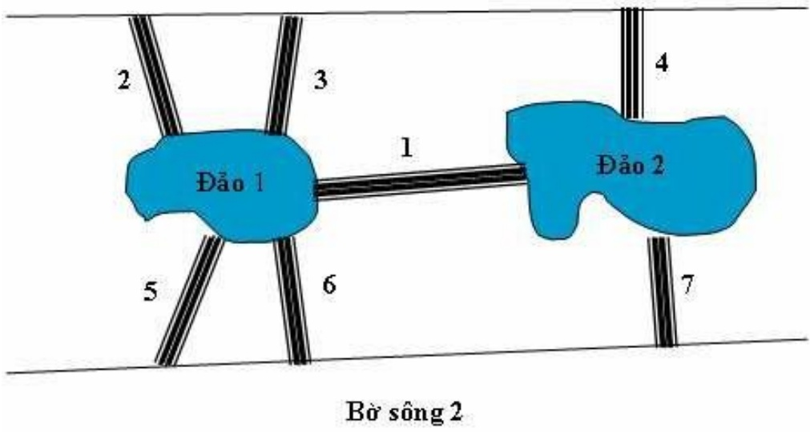

Hình 3.1 - Biểu diễn không gian trạng thái hệ thống cầu thành phố Konigsberg

Bài toán Konigsberg đặt câu hỏi là liệu có thể đi khắp thành phố mà chỉ ngang qua mỗi cây cầu một lần hay không? Mặc dù những người dân ở đây không ai tìm được lối đi nào như vậy, nhưng họ vẫn nghi ngờ là có thể, đồng thời cũng không ai chứng minh được là không có khả năng. Nhờ phát minh dạng lý thuyết đồ thị, Euler đã tạo ra cách biểu diễn phương án lựa chọn cho bản đồ thành phố như trên hình 3.2

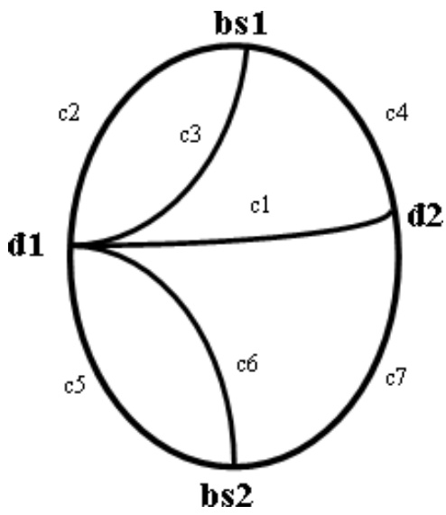

Hình 3.2 - Đồ thị của hệ thống cầu Konigsberg

Các bờ sông (bs1 và bs2) và các hòn đảo (đ1 và đ2) đều được mô tả bằng các nút của đồ thị; còn các cây cầu được biểu diễn bằng các cung có đánh dấu nối giữa các nút (c1, c2,

<!-- page: 41 -->

..., c7). Đồ thị này biểu diễn cấu trúc bản chất của hệ thống cầu, bỏ qua các đặc trưng phụ khác như khoảng cách và hướng chẳng hạn.

## Câu hỏi :

Chu trình Hamilton là con đường sử dụng tất cả các nút của đồ thị đúng một lần ? Bạn nghĩ có tồn tại một con đường như vậy trong đồ thị hệ thống cầu Konigsberg ?

## ĐỊNH NGHĨA TÌM KIẾM TRONG KHÔNG GIAN TRẠNG THÁI

Một không gian trạng thái (state space) được biểu diễn bằng một nhóm gồm bốn yếu tố [N, A, S, GD], trong đó:

N (node) là tập hợp các nút hay các trạng thái của đồ thị. Tập này tương ứng với các trạng thái trong quá trình giải bài toán.

A (arc) là tập các cung (hay các liên kết) giữa các nút. Tập này tương ứng với các bước trong quá trình giải bài toán.

S (Start) là một tập con không rỗng của N, chứa (các) trạng thái ban đầu của bài toán.

GD (Goal Description) là một tập con không rỗng của N, chứa (các) trạng thái đích của bài toán. Các trạng thái trong GD được mô tả theo một trong hai đặc tính:

• Đặc tính có thể đo lường được các trạng thái gặp trong quá trình tìm kiếm.

• Đặc tính của đường đi được hình thành trong quá trình tìm kiếm.

Đường đi của lời giải (solution path) là đường đi qua đồ thị này từ một nút trong S đến một nút trong GD.

Một đích có thể mô tả như một trạng thái, như bảng thắng cuộc trong trò chơi Tic - tac - toe hay một cấu hình đích trong trò đố 8 ô. Nhưng mặt khác, đích cũng có thể được mô tả như một đặc tính nào đó của chính đường đi lời giải.

Trong bài toán di chuyển của người bán hàng (hình 3.6 và 3.7), quá trình tìm kiếm sẽ kết thúc khi tìm được đường đi ngắn nhất qua tất cả các nút của đồ thị. Trong bài toán phân tích ngữ pháp, đường đi của quá trình phân tích thành công đối với một câu sẽ cho biết rõ điểm kết thúc.

Các cung của không gian trạng thái tương ứng với các bước trong quá trình giải bài toán, và các đường đi qua không gian này sẽ biểu diễn các lời giải trong các giai đoạn hoàn thành khác nhau. Các đường đi sẽ được khảo sát, bắt đầu từ trạng thái xuất phát và tiếp tục đi xuyên qua đồ thị, cho đến khi gặp được một mô tả đích thỏa mãn hoặc đến khi không đi được nữa. Việc tạo ra các trạng thái mới trên đường đi sẽ được thực hiện bằng

<!-- page: 42 -->

cách áp dụng các thao tác, như “các di chuyển hợp $\mathbb { 1 } \hat { \underline { { \mathbf { \Theta } } } } ^ { \flat \flat }$ trong trò chơi hay quy tắc suy diễn trong bài toán logic và trong hệ chuyên gia chẳng hạn, vào các trạng thái hiện hữu trên đường đi.

Nhiệm vụ của thuật toán tìm kiếm là tìm ra đường đi lời giải trong một không gian bài toán như vậy. Thuật toán tìm kiếm phải lưu vết các đường đi dẫn từ nút xuất phát đến nút đích, vì các đường đi này chứa hàng loạt thao tác dẫn đến lời giải của bài toán. Một đặc trưng phổ biến của đồ thị, đồng thời là vấn đề phát sinh khi thiết kế thuật toán tìm kiếm trên đồ thị, là đôi khi tiếp cận một trạng thái nào đó bằng nhiều đường đi khác nhau.

## Thí dụ 3.1: Trò chơi tic–tac-toe

Cách biểu diễn không gian trạng thái của Tic-tac-toe như trong hình 2.1. Trạng thái xuất phát là một bảng rỗng, và đích kết thúc (hay mô tả đích) là một trạng thái dạng bảng có 3 ô x trong một hàng, một cột, hay một đường chéo (giả sử đích là một thắng cuộc đối với X). Đường đi từ trạng thái xuất phát đến trạng thái đích sẽ cho ta hàng loạt nước đi cho một ván thắng.

Các trạng thái trong không gian này là các cách sắp xếp tập hợp {ô rỗng, X, O} trong chín ô trống của trạng thái bắt đầu, như vậy ta sẽ có $3 ^ { 9 }$ cách sắp xếp, nhưng hầu hết chúng không bao giờ xảy ra trong một ván chơi thực tế. Các cung sẽ được tạo ra bởi các nước đi đúng luật trong cuộc chơi, sau khi luân phiên đặt X và O vào một vị trí chưa dùng đến. Không gian trạng thái này là một đồ thị chứ không phải một cây, vì có thể đạt đến một số trạng thái nằm ở mức thứ ba và các mức sâu hơn bằng các đường đi khác nhau. Tuy vậy không có vòng lặp nào trong không gian trạng thái này vì các cung có hướng của đồ thị không cho phép đi lại một nước đã đi, nghĩa là không được phép “đi ngược trở lại” một cấu trúc một khi đã đi đến trạng thái nào đó. Do đó, không cần phải kiểm tra về vòng lặp trong việc tạo ra đường đi. Một cấu trúc đồ thị có đặc tính như vậy gọi là đồ thị có hướng không lặp lại (directed acyclic graph), hay DAG và phổ biến trong các quá trình tìm kiếm không gian trạng thái.

Việc biểu diễn không gian trạng thái cho chúng ta một phương tiện để xác định mức độ phức tạp của bài toán. Trong Tic-Tac-Toe có chín cách đi đầu tiên với tám khả năng có thể xảy ra đối với mỗi cách đi đó; tiếp theo là bảy khả năng có thể xảy ra nữa cho từng cách đi ở lượt thứ hai, … Như vậy có tất cả $9 \mathrm { ~ x ~ } 8 \mathrm { ~ x ~ } 7 \mathrm { ~ x ~ } . .$ hay 9! đường đi khác nhau có thể được tạo ra. Mặc dù máy tính hoàn toàn có đủ khả năng thăm dò hết số lượng đường đi này (362880), nhưng nhiều bài toán quan trọng có mức độ phức tạp theo qui luật số mũ hay giai thừa với qui mô lớn hơn nhiều. Cờ vua có $1 0 ^ { 1 2 0 }$ cách đi có thể xảy ra cho một ván chơi, cờ đam có $1 0 ^ { 4 0 }$ cách đi, một số trong đó có thể không bao giờ xảy ra ở một ván chơi thực tế. Các không gian này rất khó hoặc không thể nào khảo sát cho đến hết được. Chiến lược tìm kiếm đối với một không gian lớn như vậy thường phải dựa vào các heuristic để làm giảm bớt mức độ phức tạp cho quá trình tìm kiếm.

<!-- page: 43 -->

Nguyên bản của trò chơi là trò đố 15 ô như hình 3.3, có 15 viên gạch đánh số khác nhau được đặt vừa vào 16 ô vuông theo bảng. Có một ô vuông để trống nên các viên gạch đó có thể di chuyển loanh quanh để tạo ra các sắp xếp khác nhau. Mục tiêu là tìm ra một chuỗi bước di chuyển các viên gạch vào ô trống để sắp xếp bảng thành một cấu hình đích nào đó. Không gian trạng thái bài toán đủ lớn để xem xét (16! nếu các trạng thái đối xứng được xem xét riêng biệt).

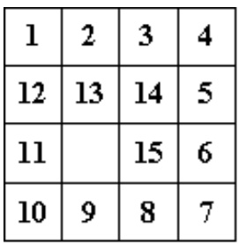

15-puzzle

| 1 | 2 | 3 |
| --- | --- | --- |
| 8 |  | 4 |
| 7 | 6 | 5 |

8-puzzle

Hình 3.3 - Trò đố 15 ô và 8 ô

Trò đố 8 ô là một phiên bản với kích thước 3 x 3 của trò đố 15 ô, vì nó tạo ra không gian trạng thái nhỏ hơn so với trò đố 15 ô nên thường được dùng cho nhiều ví dụ. Các cách di chuyển đúng luật là:

• Di chuyển ô trống lên phía trên (Up)

• Di chuyển ô trống về bên phải (Right)

• Di chuyển ô trống xuống phía dưới (Down)

• Di chuyển ô trống về bên trái (Left)

Để áp dụng một di chuyển, phải bảo đảm rằng không di chuyển ô trống ra ngoài bảng. Do đó, tất cả bốn cách di chuyển này không phải lúc nào cũng có thể áp dụng. Nếu đã xác định một trạng thái xuất phát và một trạng thái đích thì có thể đưa ra một sơ đồ không gian trạng thái của quá trình giải toán. Giống như trò chơi Tic-tac-toe không gian trạng thái của trò đố 8 ô cũng là một đồ thị (với hầu hết các trạng thái đều có nhiều nút cha), nhưng khác Tic-tac-toe là có vòng lặp. Mô tả đích (GD) của không gian trạng thái này là một trạng thái cụ thể, tức một cấu hình bảng cụ thể nào đó. Khi tìm được trạng thái này trên đường đi, quá trình tìm kiếm kết thúc. Đường đi từ trạng thái xuất phát đến trạng thái đích là dãy các bước di chuyển theo yêu cầu.

<!-- page: 44 -->

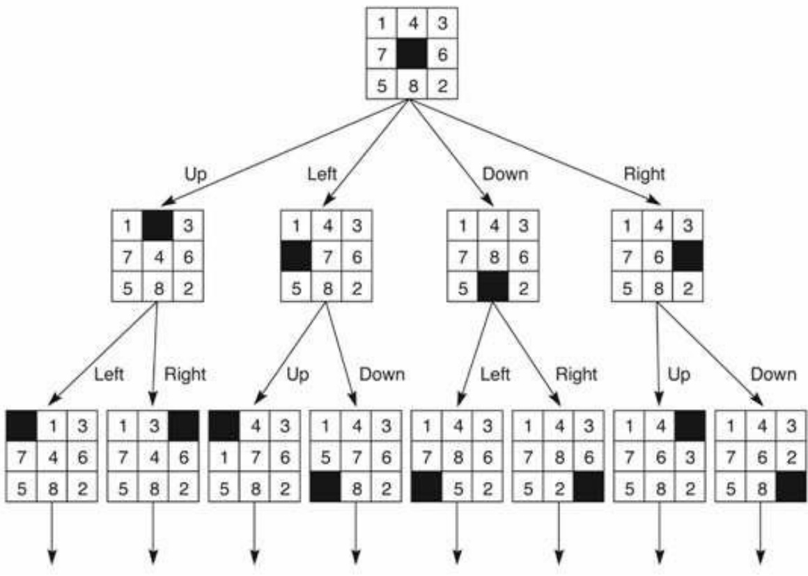

Hình 3.4 – Không gian trạng thái trong trò đố 8 ô.

Thí dụ 3.3: Đường đi của người bán hàng

Giả sử có một người bán hàng phải giao hàng cho năm thành phố và sau đó phải quay về nhà. Đích của bài toán là tìm con đường ngắn nhất cho người giao hàng đó đi đến từng thành phố, rồi quay về thành phố xuất phát. Hình 3.5 cho một trường hợp của bài toán này.

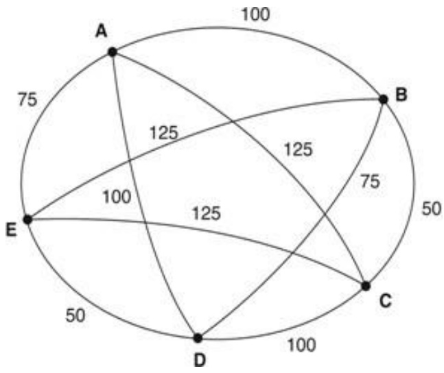

<!-- page: 45 -->

## Hình 3.5 – Một ví dụ của bài toán TSP

Các nút trong đồ thị biểu diễn các thành phố, và mỗi cung đều được ghi kèm một trọng số cho biết phí tổn đi lại trên cung đó. Chi phí này có thể là số km phải di chuyển bằng ô tô hay giá vé máy bay giữa hai thành phố. Để thuận tiện, chúng ta giả thiết người bán hàng sống ở thành phố A và sẽ quay về đây, mặc dù giả thiết này chỉ giảm từ bài toán n thành phố xuống bài toán (n-1) thành phố.

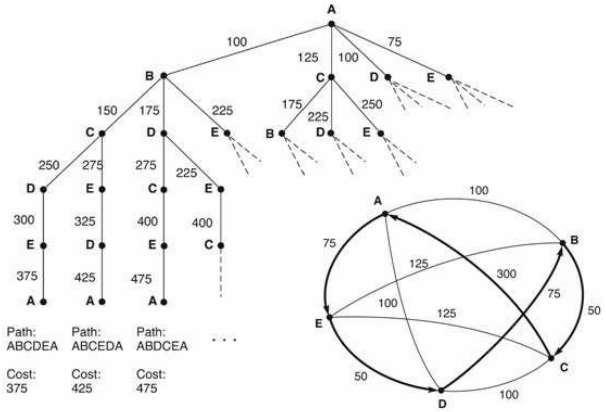

Hình 3.6 – Không gian trạng thái cho quá trình tìm kiếm đường đi (TSP)

Đường đi [A,D,C,B,E,A], với chi phí tương ứng 450 km là ví dụ về một con đường có thể đi. Mô tả đích yêu cầu một con đường có chi phí thấp nhất. Chú ý rằng mô tả đích này là một đặc tính của toàn bộ con đường, không phải là một trạng thái đơn lẻ. Đây là mô tả đích dạng thứ hai trong định nghĩa về tìm kiếm trong không gian trạng thái đã nói ở trên.

Download slide bài giảng <u>tại đây</u>

<!-- page: 46 -->

# CÁC CHIẾN LƯỢC DÙNG CHO TÌM KIẾM TRONG KHÔNG GIAN TRẠNG THÁI (TK-KGTT)

## CÁC CHIẾN LƯỢC DÙNG CHO TÌM KIẾM TRONG KHÔNG GIAN TRẠNG THÁI (TK-KGTT)

## Tìm kiếm hướng dữ liệu và tìm kiếm hướng mục tiêu

Một không gian trạng thái có thể được tìm kiếm theo hai hướng: từ các dữ liệu cho trước của một bài toán hướng đến mục tiêu hay từ mục tiêu hướng ngược về các dữ liệu.

Trong tìm kiếm hướng từ dữ liệu (data-driven search) hay còn gọi là suy diễn tiến (forward chaining), tiến trình giải bài toán bắt đầu với các sự kiện cho trước của bài toán và một tập các luật hợp thức dùng thay đổi trạng thái. Quá trình tìm kiếm được thực hiện bằng cách áp dụng các luật vào các sự kiện để tạo ra các sự kiện mới, sau đó các sự kiện mới này lại được áp dụng các luật để sinh ra các sự kiện mới hơn cho đến khi chúng có thể đưa ra một giải pháp thỏa mãn điều kiện mục tiêu.

Cũng có thể dùng một phương pháp khác: bắt đầu từ mục tiêu mà chúng ta muốn giải quyết, khảo sát xem có thể dùng những luật hợp thức nào để đạt đến mục tiêu này, đồng thời xác định xem các điều kiện nào phải được thỏa mãn để có thể áp dụng được chúng. Các điều kiện này sẽ trở nên những mục tiêu mới, hay còn gọi là các mục tiêu phụ (subgoals) trong tiến trình tìm kiếm. Quá trình tìm kiếm cứ tiếp tục như thế, hoạt động theo chiều ngược, qua hết các đích phụ kế tiếp nhau cho đến khi gặp các sự kiện thực của bài toán. Phương pháp này sẽ tìm ra một chuỗi các bước đi, hay các luật, dẫn từ các dữ liệu đến một đích, mặc dù nó thực hiện theo thứ tự ngược lại. Phương pháp này gọi là tìm kiến hướng từ mục tiêu (goal-driven-reasoning) hay suy diễn lùi (backward chaining) và nó gợi cho chúng ta về một thủ thuật đơn giản khi cố giải bài toán mê cung bằng cách đi ngược từ cuối lên đầu.

Tóm lại, suy luận hướng dữ liệu nắm lấy các sự kiện của bài toán rồi áp dụng các luật và các bước đi hợp thức để tạo ra những sự kiện mới dẫn đến một đích; suy luận hướng mục tiêu thì tập trung vào đích, tìm các luật có thể dẫn đến đích, rồi lần ngược ra các luật và các đích phụ kế tiếp để đi đến các sự kiện cho trước của bài toán.

Trong bước phân tích cuối cùng, các hệ giải bài toán hướng mục tiêu cũng như hướng dữ liệu đều tìm kiếm trong cùng một đồ thị không gian trạng thái; tuy nhiên thứ tự và số lượng trạng thái thực sự cần tìm có thể khác nhau.

<!-- page: 47 -->

Những hệ giải toán đã được biên soạn bằng cách dùng một trong hai phương pháp hướng dữ liệu và hướng mục tiêu quyết định theo cách nào tuỳ thuộc cấu trúc của bài toán phải giải. Nên tìm kiếm hướng mục tiêu nếu:

Mục tiêu hay giả thiết được cho trong phát biểu bài toán hoặc có thể dễ dàng công thức hoá. Trong một hệ chứng minh định lý toán học chẳng hạn, mục tiêu chính là định lý phải chứng minh. Nhiều hệ thống chẩn đoán bệnh cân nhắc các chẩn đoán có tiềm năng theo cách hệ thống hoá, xác nhận hay loại bỏ chúng bằng phép suy luận hướng đích.

Có một số lượng lớn các luật phù hợp với các sự kiện của bài toán, và do đó tạo ra một số lượng ngày càng nhiều các kết luận, tức là các đích. Việc chọn sớm một đích có thể loại bỏ hầu hết các nhánh rẽ này, làm cho việc tìm kiếm hướng mục tiêu có hiệu quả hơn nhờ thu gọn không gian. Trong một hệ chứng minh định lý toán chẳng hạn, số lượng luật chứa trong một định lý cho trước ít hơn rất nhiều so với số lượng luật có thể áp dụng cho toàn bộ tập các tiêu đề.

Các dữ liệu của bài toán không được cho trước, nhưng hệ giải toán yêu cầu phải có. Trong trường hợp này, tìm kiếm hướng đích có thể giúp thu thập các dữ liệu dẫn đường. Trong chương trình chẩn đoán y khoa chẳng hạn, có thể áp dụng hàng loạt các phép thử chẩn đoán. Các bác sĩ chỉ dùng những phép thử nào cần thiết để xác nhận hay loại bỏ một giả thiết cụ thể.

Như vậy tìm kiếm hướng mục tiêu sẽ dùng những hiểu biết về mục tiêu cần có để hướng dẫn quá trình tìm kiếm thông qua các luật thích hợp, đồng thời loại bỏ nhiều nhánh của không gian đó.

Tìm kiếm hướng dữ liệu thích hợp với bài toán thuộc loại:

Tất cả hay hầu hết các dữ liệu đầu được cho trước trong phát biểu ban đầu của bài toán. Các bài toán diễn dịch thường phù hợp với khuôn mẫu này bằng cách đưa ra một tập hợp các dữ liệu và yêu cầu hệ thống cung cấp một cách diễn dịch bậc cao. Các hệ thống dùng để phân tích dữ liệu cụ thể (như các trình PROSPECTOR hay DIPMETER dùng để diễn dịch các dữ liệu địa chất hoặc để tìm xem những khoáng chất nào có nhiều khả năng tìm thấy tại một địa điểm) thích hợp với cách tiếp cận hướng dữ liệu.

Có một số lượng lớn đích có tiềm năng, nhưng chỉ có vài cách sử dụng các sự kiện và các thông tin cho trước trong trường hợp bài toán cụ thể. Chương trình DENDRAL, một hệ chuyên gia dùng để tìm kiếm cấu trúc phân tử của các hợp chất hữu cơ dựa vào công thức của chúng, vào dữ liệu phân tích khối phổ, và vào các kiến thức hóa học, là một ví dụ về trường hợp này. Đối với một hợp chất hữu cơ bất kỳ, có thể có rất nhiều cấu trúc phân tử. Tuy nhiên, dữ liệu phân tích khối phổ của hợp chất sẽ cho phép DENDRAL loại bỏ hầu hết, chỉ giữ lại một ít trong cấu trúc đó.

<!-- page: 48 -->

Rất khó hình thành nên một đích hay một giả thuyết. Trong việc tham vấn hệ chuyên gia DENDRAL chẳng hạn, có rất ít hiểu biết ban đầu về cấu trúc có thể có của một hợp chất.

## Câu hỏi :

Xác định phương pháp tìm kiếm hướng dữ liệu hay tìm kiếm hướng mục tiêu là thích hợp hơn trong việc giải quyết các vấn đề dưới đây. Giải thích sự lựa chọn của bạn :

a) Chẩn đoán các trục trặc về thiết bị trong một xe ô tô.

b) Bạn gặp một người cho biết là anh em họ xa với bạn, có cùng một ông tổ tên là John. Bạn cần kiểm tra lại thông tin này.

c) Một người khác cũng cho biết là anh em họ xa của bạn. Anh ta không biết ông tổ tên gì nhưng biết rằng không quá tám đời. Bạn hãy tìm ông tổ này hoặc xác định không có ông tổ đó.

d) Một chứng minh định lý trong hình học phẳng.

e) Một chương trình dùng để kiểm tra và diễn giải kết quả đọc của máy dò đường biển bằng sóng phản âm, chẳng hạn dùng thông báo cho một tàu ngầm lớn biết sắp có một tàu ngầm nhỏ, một con cá voi hay một đàn cá ở cự ly nào đó.

f) Một hệ chuyên gia giúp cho con người phân loại cây trồng theo đặc tính, chủng loại,

## Các chiến lược tìm kiếm trên đồ thị

Khi giải bài toán bằng tìm kiếm hướng mục tiêu hay hướng dữ liệu, dù dùng phương pháp nào thì hệ giải toán cũng phải tìm một đường đi từ trạng thái xuất phát dẫn đến đích trong đồ thị không gian trạng thái. Trình tự của các cung trong đường đi này tương ứng với các bước theo thứ tự của lời giải. Nếu hệ giải toán đã được cung cấp một “nhà tiên tri” hay một cơ chế không thể sai lầm để chọn đường đi lời giải, thì việc tìm kiếm sẽ không còn cần thiết nữa. Hệ giải toán này sẽ vận hành một cách chính xác qua không gian đó để đến một đích đúng yêu cầu, tạo nên một đường đi khi nó đi qua. Vì không bao giờ có các “nhà tiên tri” như vậy, nên hệ giải toán phải xem xét nhiều đường đi qua không gian cho đến khi tìm được đích. Lần ngược (backtrack) là một kỹ thuật dùng để thử một cách có hệ thống tất cả những đường đi trong một không gian trạng thái.

Trong phần kế tiếp sẽ giới thiệu các thuật toán tìm kiếm giống như thuật toán lần ngược, các thuật toán này sẽ dùng các danh sách để theo dõi các trạng thái trong không gian tìm kiếm. Những thuật toán này bao gồm tìm kiếm sâu (depth-first-search), tìm kiếm rộng

<!-- page: 49 -->

(breadth-first-search),khác với thuật toán lần ngược ở chỗ chúng sẽ cung cấp một cơ chế linh hoạt hơn cho việc thực hiện các chiến lược tìm kiếm đồ thị khác nhau.

## Tìm kiếm sâu và tìm kiếm rộng

Cùng với việc định hướng tìm kiếm (hướng dữ liệu hay hướng mục tiêu), một thuật toán tìm kiếm còn phải xác định thứ tự mà theo đó các trạng thái sẽ được khảo sát trong cây hoặc đồ thị. Phần này sẽ đề cập đến hai khả năng đối với thứ tự xem xét các nút trong đồ thị: Tìm kiếm sâu (DFS) và tìm kiếm rộng (BFS).

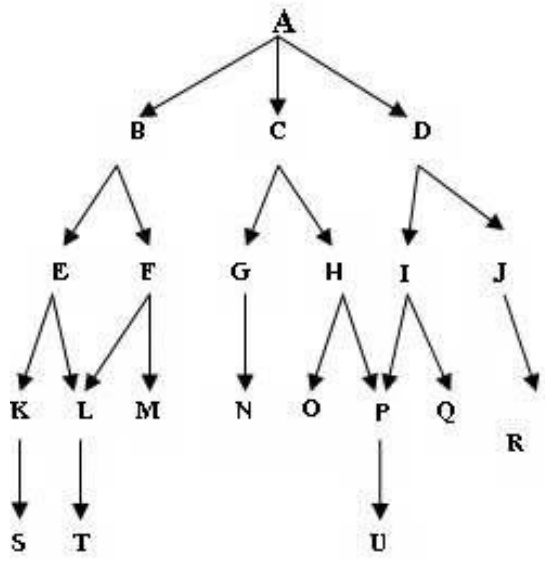

Hình 3.8 – Đồ thị ví dụ cho tìm kiếm rộng và tìm kiếm sâu

Chúng ta cùng khảo sát đồ thị trong hình 3.8. Các trạng thái được ký hiệu $( \mathrm { A , } \mathrm { B , } \mathrm { C , } \ldots )$ sao cho chúng sẽ được tham khảo theo các ký hiệu đó trong quá trình thảo luận này. Trong tìm kiếm sâu, khi một trạng thái được xem xét, tất cả các con của nó được xét đến rồi đến các thế hệ sau của các con đó đều được xem xét ưu tiên trước bất kỳ một trạng thái anh em nào của nó. Tìm kiếm sâu sẽ tiến sâu hơn vào trong không gian tìm kiếm bất kỳ khi nào còn có thể. Chỉ khi nào không tìm được các con cháu xa hơn của trạng thái đó thì mới xem xét đến các trạng thái anh em của nó. Tìm kiếm sâu sẽ tiến hành kiểm tra các trạng thái trong đồ thị hình 3.8 theo thứ tự A, B, E, K, S, L, T, F, M, C, G, N, H, O, P, U, D, I, Q, J, R. Thuật toán lần ngược cũng đã thực hiện theo kiểu tìm kiếm sâu.

Ngược lại, tìm kiếm rộng sẽ khảo sát không gian này theo từng mức. Chỉ đến khi trong một mức cho trước không còn một trạng thái nào để khảo sát thì thuật toán mới chuyển sang mức tiếp theo. Tìm kiếm rộng trong đồ thị hình 3.8 sẽ xem xét các trạng thái theo thứ tự A, B, C, D, E, F, G, H, I, J, K, L, M, O, P, Q, R, S, T, U.

<!-- page: 50 -->

Chúng ta thực hiện tìm kiếm rộng bằng cách dùng các danh sách open (mở) và closed (đóng) để theo dõi tiến độ trong không gian trạng thái đó. Danh sách open sẽ liệt kê các trạng thái vừa được sinh ra, nhưng con của chúng chưa được khảo sát. Thứ tự mà các trạng thái bị loại ra khỏi open sẽ xác định thứ tự tìm kiếm. Danh sách closed thì ghi các trạng thái đã được xem xét rồi.

$\mathrm { O p e n } = [ \mathrm { A } ] ;   \mathrm { c l o s e d } = [ ]$

$\mathrm{Open} = [\mathrm{B}, \mathrm{C}, \mathrm{D}]; \mathrm{closed} = [\mathrm{A}]$

$\mathrm{Open} = [\mathrm{C}, \mathrm{D}, \mathrm{E}, \mathrm{F}]; \mathrm{closed} = [\mathrm{B}, \mathrm{A}]$

$\mathrm{Open} = [\mathrm{D, E, F, G, H}];$ $\mathrm { c l o s e d } = [ \mathrm { C } , \mathrm { B } , \mathrm { A } ]$

$\mathrm{Open} = [\mathrm{E,F,G,H,LJ}];$ $\mathbf { \bar { c l o s e d } } = [ \mathrm { D } , \mathrm { C } , \mathrm { B } , \mathrm { \bar { A } } ]$

$\mathrm { O p e n } = [ \mathrm { F } , \mathrm { G } , \mathrm { H } , \mathrm { L J } , \mathrm { K } , \mathrm { L } ] ;$ $\mathbf { \bar { c l o s e d } } = [ \mathrm { E } , \mathrm { D } , \mathrm { C } , \mathrm { B } , \mathrm { A } ]$

0 $\mathrm{pen} = [\mathrm{G,H,J,K,L,M}];$ (vì L dã có trong open); $\mathrm{closed} = [\mathrm{F}, \mathrm{E}, \mathrm{D}, \mathrm{C}, \mathrm{B}, \mathrm{A}]$

Hình 3.9 – Các bước thực hiện tìm kiếm rộng trên đồ thị 3.8

Thuật toán tìm kiếm rộng (BFS) :

**Procedure** breadth-first-search;

Begin % khởi đầu

Open:= [start];

Closed:= [ ];

While open ≠ [ ] do % còn các trạng thái chưa khảo sát

Begin

Loại bỏ trạng thái ngoài cùng bên trái khỏi open, gọi nó là X;

If X là một đích then trả lời kết quả (thành công) % tìm thấy đích

else begin

<!-- page: 51 -->

Phát sinh các con của X;

Đưa X vào closed;

Loại các con của X trong open hoặc closed; % kiểm tra vòng lặp

Đưa các con còn lại vào đầu bên **phải** của open % hàng chờ

end;

End;

Trả lời kết quả (thất bại); % không còn trạng thái nào

End;

Các trạng thái con sinh ra nhờ các luật suy diễn, các nước đi hợp lệ của trò chơi hoặc các toán tử chuyển trạng thái. Mỗi lần lặp lại sẽ tạo ra tất cả các con của trạng thái X và bổ sung chúng vào danh sách open. Chú ý rằng danh sách open được duy trì dưới dạng một hàng đợi (queue), tức cấu trúc dữ liệu “vào trước ra trước” (first – in – first – out : FIFO). Các trạng thái được bổ sung vào bên phải danh sách và được lấy ra từ bên trái. Cách sắp xếp theo hàng này sẽ sắp xếp việc tìm kiếm đến các trạng thái nằm trong danh sách open lâu nhất, làm cho quá trình trở thành tìm kiếm rộng. Các trạng thái con đã được khảo sát rồi (đã xuất hiện trong danh sách open hoặc danh sách closed) đều bị loại bỏ. Nếu thuật toán kết thúc vì điều kiện của vòng lặp “while” không còn được thoả mãn nữa (open = [ ]) tức là nó đã tìm kiếm xong toàn bộ đồ thị mà không tìm thấy đích mong muốn: Cuộc tìm kiếm thất bại.

Vì tìm kiếm rộng xem xét mọi nút ở từng mức của đồ thị trước khi đi sâu vào không gian đó nên tất cả các trạng thái đều được tiếp cận đến đầu tiên theo con đường ngắn nhất kể từ trạng thái xuất phát. Do đó tìm kiếm rộng sẽ đảm bảo tìm được đường đi ngắn nhất từ trạng thái xuất phát đến trạng thái đích. Hơn nữa, vì tất cả các trạng thái đều được tìm thấy trước theo con đường ngắn nhất cho nên bất kỳ trạng thái gặp lần thứ hai nào cũng được tìm thấy theo con đường có chiều dài bằng hoặc lớn hơn. Vì không có cơ hội để các trạng thái trùng lặp được tìm thấy theo một đường đi tốt hơn, nên thuật toán này sẽ loại bỏ được mọi trạng thái trùng lặp.

Tiếp theo, chúng ta sẽ xây dựng thuật toán tìm kiếm sâu trên không gian trạng thái. Trong khi xem xét thuật toán này, cần lưu ý một điều là các trạng thái con cháu đều được bổ sung vào hay bị loại bỏ ra từ đầu bên trái của danh sách open: Danh sách open được duy trì dưới dạng một ngăn xếp (stack), tức cấu trúc “vào sau ra trước” (last – in – first – out : LIFO). Việc tổ chức danh sách open theo dạng ngăn xếp sẽ hướng quá trình tìm kiếm nhằm vào các trạng thái được sinh ra mới nhất, làm cho tìm kiếm đó phát triển theo chiều sâu.

<!-- page: 52 -->

```matlab
Open = [A]; closed = []
Open = [B,C,D]; closed = [A]
Open = [E,F,C,D]; closed = [B,A]
Open = [K,L,F,C,D];
closed = [E,B,A]
Open = [S,L,F,C,D];
closed = [K,E,B,A]
Open = [L,F,C,D];
closed = [S,K,E,B,A]
Open = [T,F,C,D];
closed = [L,S,K,E,B,A]
Open = [F,C,D];
closed = [T,L,S,K,E,B,A]
...
```

Hình 3.10 – Các bước thực hiện tìm kiếm sâu trên đồ thị 3.8

Tìm kiếm sâu được tiến hành bằng cách cải biến thuật toán đã dùng cho tìm kiếm rộng:

Thuật toán tìm kiếm sâu (BFS) :

**Procedure** depth – first –search;

Begin % khởi đầu

Open:= [start];

Closed:= [ ];

While open ≠ [ ] do % còn các trạng thái chưa khảo sát

Begin

Loại bỏ trạng thái ngoài cùng bên trái khỏi open, gọi nó là X;

If X là một đích then trả lời kết quả (thành công) % tìm thấy đích

else begin

Phát sinh các con của X;

Đưa X vào closed;

<!-- page: 53 -->

Loại các con của X trong open hoặc closed; % kiểm tra vòng lặp

Đưa các con còn lại vào đầu bên **trái** của open % ngăn xếp

end;

End;

Trả lời kết quả (thất bại); % không còn trạng thái nào

End;

Khác với tìm kiếm rộng, tìm kiếm sâu không đảm bảo sẽ tìm được đường đi ngắn nhất đến một trạng thái gặp lần đầu. Vào sâu trong tìm kiếm này, có thể tìm thấy một đường đi khác dẫn đến trạng thái bất kỳ. Nếu độ dài đường đi là quan trọng đối với một trình giải toán, thì khi thuật toán gặp một trạng thái trùng lặp, nó cần giữ lại phiên bản đã gặp theo đường đi ngắn nhất. Có thể thực hiện điều này bằng cách lưu giữ mỗi trạng thái dưới dạng một bộ ba: (trạng thái đó, trạng thái cha, chiều dài đường đi). Khi phát sinh trạng thái con, chỉ cần tăng trị số độ dài đường đi lên một đơn vị và cất giữ lại cùng với trạng thái con đó. Nếu một trạng thái con bắt gặp theo nhiều đường đi, thông tin này có thể được sử dụng để giữ lại phiên bản tốt nhất. Cần chú ý, việc giữ lại phiên bản tốt nhất của một trạng thái trong một tìm kiếm sâu đơn giản sẽ không đảm bảo được việc tìm thấy đích theo đường đi ngắn nhất.

Cũng giống như việc lựa chọn giữa tìm kiếm hướng dữ liệu hay hướng mục tiêu khi đánh giá một đồ thị, việc sử dụng tìm kiếm rộng hay tìm kiếm sâu cũng tùy thuộc vào bài toán cụ thể phải giải. Những đặc trưng quan trọng bao gồm: việc tìm đường đi ngắn nhất dẫn đến đích, việc phân nhánh của không gian trạng thái, các tài nguyên về thời gian và không gian có sẵn, chiều dài trung bình của các đường dẫn đến nút đích và cả việc liệu chúng ta muốn có tất cả các lời giải hay chỉ cần lời giải đầu tiên tìm thấy. Để đưa ra câu trả lời cho các vấn đề này, mỗi cách đều có những ưu điểm và khuyết điểm riêng.

Tìm kiếm rộng: Vì lúc nào cũng xem xét tất cả các nút ở mức n rồi mới chuyển sang mức n+1 nên tìm kiếm rộng bao giờ cũng tìm được đường đi ngắn nhất đến một nút đích. Trong những bài toán nếu biết rõ có một lời giải đơn giản thì lời giải này sẽ được tìm thấy. Tuy nhiên, nếu bài toán có hệ số phân nhánh không gian lớn, nghĩa là các trạng thái có số lượng con cháu trung bình tương đối cao thì sự bùng nổ tổ hợp này có thể gây cản trở cho việc tìm kiếm một lời giải. Lý do là vì tất cả các nút chưa được mở rộng với mỗi mức tìm kiếm đều phải được giữ lại trong danh sách open. Do đó, đối với không gian trạng thái có hệ số phân nhánh cao, điều này có thể trở nên rất phức tạp.

Độ phức tạp của không gian tìm kiếm rộng được đo theo số lượng trạng thái trong danh sách open, đó là một hàm mũ của chiều dài đường đi tại mỗi thời điểm bất kỳ. Nếu mỗi

<!-- page: 54 -->

trạng thái trung bình có B con thì số lượng trạng thái ở một mức sẽ bằng B lần số trạng thái ở mức trước đó. Như vậy sẽ có B<sup>n</sup>trạng thái ở mức n. Tìm kiếm rộng sẽ phải đưa tất cả trạng thái này vào danh sách open khi nó bắt đầu xem xét mức n. Điều này có thể không được phép nếu các đường đi lời giải quá dài.

**Tìm kiếm sâu:** Tìm kiếm sâu sẽ nhanh chóng đi sâu vào không gian tìm kiếm. Nếu biết rõ đường đi lời giải sẽ dài, tìm kiếm sâu sẽ không mất thời gian cho việc tìm kiếm một số lớn các trạng thái “cạn” trong đồ thị. Mặc khác, tìm kiếm sâu cũng có thể sa lầy vào độ sâu “vô ích” khi bỏ qua những đường đi ngắn hơn dẫn đến đích, hay thậm chí có thể bị sa lầy trong một đường đi dài vô tận mà không dẫn đến đích nào cả.

Tìm kiếm sâu hiệu quả hơn nhiều đối với những không gian trạng thái có hệ số phân nhánh lớn vì nó không phải giữ tất cả các nút ứng với một mức trong danh sách open. Độ phức tạp của không gian tìm kiếm sâu là một hàm tuyến tính của độ dài đường đi. Tại mỗi mức, open chỉ chứa con của một tráng thái duy nhất. Nếu đồ thị có số lượng con trung bình là B đối với mỗi trạng thái thì tìm kiếm sâu có độ phức tạp của không gian là B x n trạng thái để đạt đến mức sâu n trong không gian đó.

Câu trả lời tốt nhất cho việc chọn dùng tìm kiếm sâu hay tím kiếm rộng là khảo sát không gian bài toán một cách cẩn thận. Trong cờ vua chẳng hạn, tìm kiếm rộng là không thể được. Trong các trò chơi đơn giản hơn thì tìm kiếm rộng không những là giải pháp có thể mà còn là giải pháp duy nhất để tránh thất bại.

## Câu hỏi :

Giả sử cần viết chương trình tìm ra cách thức xoay một khối rubic 3x3x3 (được ghép bởi 27 nút) về đúng 6 mặt màu. Biết rằng bộ nhớ trong của máy tính bị hạn chế, bạn sẽ chọn giải thuật duyệt đồ thị nào trong hai giải thuật tìm kiếm sâu và tìm kiếm rộng để giải quyết vấn đề? Giải thích ngắn gọn sự lựa chọn của bạn ?

## Tìm kiếm sâu bằng cách đào sâu nhiều lần

Một thoả hiệp thú vị cho hai thuật toán này là sử dụng một giới hạn độ sâu cho quá trình tìm kiếm sâu. Giới hạn sâu sẽ buộc phải chịu thất bại trên một con đường tìm kiếm khi đường đó dẫn tới độ sâu quá một mức nào đó. Điều này gây ra một quá trình quét không gian trạng thái giống như tìm kiếm rộng tại độ sâu đó. Khi biết chắc có một lời giải nằm trong một phạm vi nào đó hoặc khi bị giới hạn về thời gian, như trong không gian quá rộng của cờ vua chẳng hạn, thì biện pháp hạn chế số lượng trạng thái phải được xem xét đến. Lúc đó tìm kiếm sâu với độ sâu giới hạn có thể là thích hợp nhất. Hình sau đây trình bày một tiến trình tìm kiếm sâu của bài toán trò đố 8 ô, trong đó giới hạn sâu bằng năm sẽ tạo ra quá trình quét toàn bộ không gian ở độ sâu này.

<!-- page: 55 -->

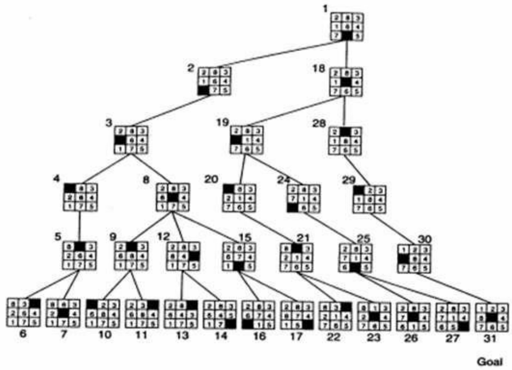

Hình 3.11 – Không gian trạng thái với độ sâu giới hạn bằng 5 cho trò đố 8 ô

Giải pháp này đã đưa đến một thuật toán tìm kiếm khắc phục được nhiều nhược điểm của cả tìm kiếm sâu lẫn tìm kiếm rộng. Phương pháp tìm kiếm sâu đào sâu nhiều lần (depth – first – interactive – deepening Korf 1987) thực hiện tìm kiếm sâu với độ sâu giới hạn bằng một. Nếu không tìm được đích, nó tiếp tục thực hiện tìm kiếm sâu với độ sâu giới hạn bằng hai, … Thuật toán cứ tiếp tục như thế bằng cách mỗi lần lặp thì tăng độ sâu giới hạn thêm một đơn vị. Trong mỗi lần lặp thuật toán áp dụng giải thuật tìm kiếm sâu hoàn chỉnh đến độ sâu giới hạn đó. Giữa hai lần lặp, không có một thông tin nào về không gian trạng thái được giữ lại.

Vì thuật toán tìm kiếm hết không gian từng mức nên vẫn bảo đảm sẽ tìm được con đường ngắn nhất dẫn đến đích. Vì chỉ thực hiện tìm kiếm sâu trong mỗi lần lặp nên độ phức tạp của không gian tại mức n bất kỳ là B x n, trong đó B là số lượng trạng thái con trung bình của một nút.

Điều thú vị là mặc dù phương pháp tìm kiếm sâu đào sâu nhiều lần có vẻ kém hiệu quả về thời gian so với tìm kiếm sâu lẫn tìm kiếm rộng, nhưng thực tế độ phức tạp về thời gian của nó cùng bậc như của hai phương pháp trên: O (B<sup>n</sup>).

<!-- page: 56 -->

# DÙNG KHÔNG GIAN TRẠNG THÁI ĐỂ BIỂU DIỄN QUÁ TRÌNH SUY LUẬN BẰNG PHÉP TÍNH VỊ TỪ

**DÙNG KHÔNG GIAN TRẠNG THÁI ĐỂ BIỂU DIỄN QUÁ TRÌNH SUY LUẬN BẰNG PHÉP TÍNH VỊ TỪ**

**Mô tả không gian trạng thái của một hệ logic:**

Đồ thị không gian trạng thái của logic vị từ bao gồm các nút, mỗi nút biểu diễn cho một trạng thái của quá trình giải bài toán và các luật suy diễn có thể được dùng để hình thành và mô tả các cung giữa các trạng thái này. Theo cách này, các bài toán trong phép tính vị từ, như việc xác định một biểu thức nào đó có phải là hệ quả logic của một tập các khẳng định cho trước hay không, có thể giải quyết bằng phương pháp tìm kiếm.

Thí dụ 3.4: Giả sử p, q, r, … là các mệnh đề, ta có thể giả thuyết có các khẳng định sau :

$$
\begin{array}{l} \mathrm{q} \Rightarrow \mathrm{p} \\ \mathrm{r} \Rightarrow \mathrm{p} \\ \mathrm{v} \Rightarrow \mathrm{q} \\ \mathrm{s} \Rightarrow \mathrm{r} \\ \mathrm{t} \Rightarrow \mathrm{r} \\ \mathrm{s} \Rightarrow \mathrm{u} \\ \mathrm{s} \end{array}
$$

Từ tập các khẳng định này và các modus ponen của các luật suy diễn, một số các mệnh đề nhất định (p, r và u) có thể được suy diễn ra; còn các mệnh đề khác (như v và q) không thể suy diễn được và thực tế chúng không đi theo một cách logic từ các khẳng định này. Quan hệ giữa các khẳng định ban đầu và các suy diễn được biểu diễn trong đồ thị có hướng như hình 3.12.

Với cách biểu diễn này, việc xác định một mệnh đề cho trước có phải là một hệ quả logic của một tập các mệnh đề hay không sẽ trở thành bài toán tìm đường đi từ một nút xuất phát đến nút đích. Nó cũng được quy về bài toán tìm kiếm trên đồ thị. Chiến lược tìm kiếm được dùng ở đây sẽ là tìm kiếm hướng dữ liệu, vì nó đi từ những gì đã biết (các mệnh đề đúng) đến đích. Theo cách khác, chiến lược hướng mục tiêu cũng có thể được áp dụng vào cùng không gian đó bằng cách xuất phát từ mệnh đề cần chứng minh (đích) và đi ngược theo các cung để tìm sự hỗ trợ đối với đích đó trong các mệnh đề đúng. Ngoài ra, chúng ta còn có thể tìm kiếm trên không gian suy diễn này theo chiều sâu hay chiều rộng.

<!-- page: 57 -->

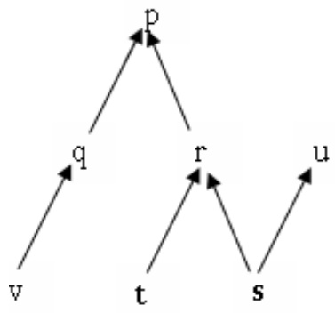

Hình 3.12 – Đồ thị không gian trạng thái cho thí dụ 3.4

## Đồ thị Và / Hoặc (And / Or Graph)

Đồ thị Và / Hoặc là một công cụ quan trọng để mô tả các không gian tìm kiếm trong nhiều bài toán của Trí tuệ nhân tạo, bao gồm cả các bài toán giải quyết bằng cách chứng minh theo định lý logic và các hệ chuyên gia.

Đồ thị Và / Hoặc có sự phân biệt các nút Và (And) với các nút Hoặc (Or):

• Nếu các tiền đề của một mệnh đề được nối với nhau bằng toán tử ∧, chúng được gọi là các nút Và, đồng thời các cung nối với nút này được liên kết với nhau bằng một dấu liên kết cong.

• Nếu các tiền đề của một mệnh đề được nối với nhau bằng toán tử ∨, chúng được xem là các nút Hoặc. Các cung nối từ các nút Hoặc đến nút bố mẹ của chúng sẽ không được liên kết như vậy.

Thí dụ 3.5: Giả sử các mệnh đề sau đây là đúng:

```txt
a
b
c
a ∧ b ⇒ d
a ∧ c ⇒ e
b ∧ d ⇒ f
f ⇒ g
a ∧ e ⇒ h.
Tập các khẳng định này sẽ sinh ra đồ thị Và / Hoặc như trong hình vẽ sau:
```

<!-- page: 58 -->

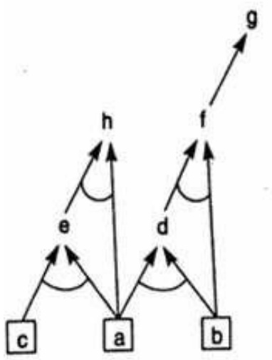

## Hình 3.13 – Đồ thị AND/OR cho bài toán

Các câu hỏi có thể được đặt ra là:

• h là đúng?

• h có còn đúng nếu b sai?

Trong ví dụ trên, chiến lược tìm kiếm hướng mục tiêu để xác định h là đúng trước hết phải chứng minh cả a lẫn e đúng. Nút a đúng là tất nhiên, nhưng muốn e đúng thì cả c lẫn a đều phải đúng, hai nút này đã được cho trước là đúng. Khi chương trình giải bài toán đã xác định tất cả các cung này là các mệnh đề đúng, thì các giá trị đúng sẽ được tổng hợp lại ở các nút Và để kiểm chứng giá trị đúng của h.

Ngược lại, chiến lược tìm kiếm hướng dữ liệu để xác định h đúng phải xuất phát từ các sự kiện đã biết (c, a và b) và bắt đầu bằng việc bổ sung các mệnh đề mới vào tập mệnh đề đã biết này phù hợp theo các qui định của đồ thị Và / Hoặc, e hoặc d sẽ là mệnh đề đầu tiên được bổ sung vào tập sự kiện đó. Những bổ sung này sẽ tạo khả năng suy diễn ra các sự kiện mới. Quá trình này cứ tiếp tục cho đến khi đích được chứng minh.

## TỔNG KẾT CHƯƠNG III:

Chương III đã giới thiệu các cơ sở lý thuyết trong tìm kiếm không gian trạng thái, sử dụng lý thuyết đồ thị để phân tích cấu trúc và mức độ phức tạp của các chiến lược giải quyết vấn đề bài toán. Các cách thức có thể sử dụng để mô hình hóa việc giải quyết vấn đề dưới dạng một tìm kiếm trên đồ thị trạng thái của bài toán đó cũng đã được nêu ra. Đồng thời cũng so sánh giữa hai cách suy luận hướng dữ liậu và hướng mục tiêu, giữa tìm kiếm sâu và tìm kiếm rộng. Phần cuối chương, đồ thị And/Or cho phép chúng ta áp dụng tìm kiếm không gian trạng thái vào việc thực hiện các suy diễn logic. Tuy nhiên, hầu hết các chiến lược này đều mang tính hình thức, chương tiếp theo sẽ đi sâu hơn vào

<!-- page: 59 -->

những “mẹo giải” trong các chiến lược tìm kiếm không hình thức áp dụng cho những không gian bài toán đặc trưng nhằm thu hẹp quá trình tìm kiếm trên các không gian này.

## Bài tập chương III

Xét đồ thị trạng thái sau đây, với mỗi chiến lược tìm kiếm bên dưới hãy liệt kê với danh sách thứ tự các nút được duyệt qua.

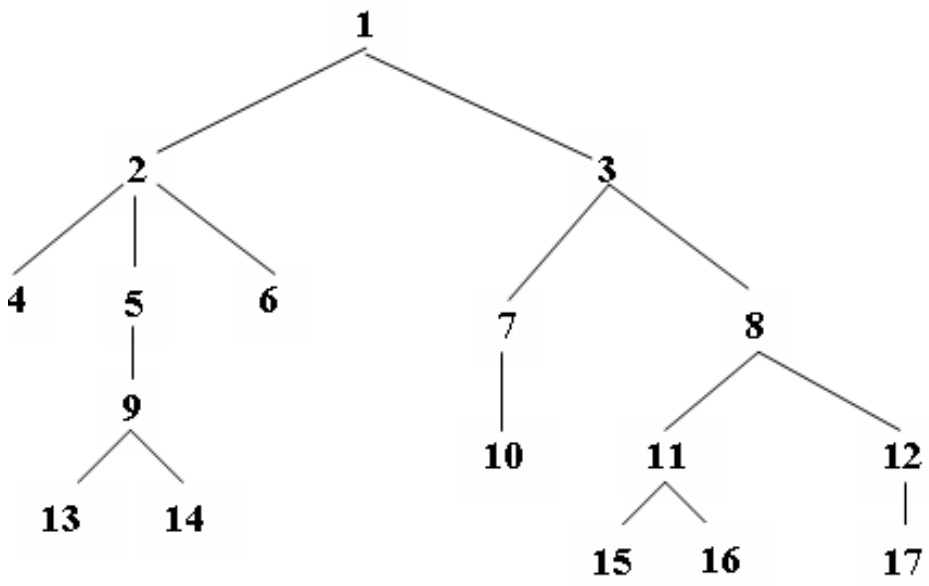

• Tìm kiếm rộng (BFS).

• Tìm kiếm sâu (DFS).

• Tìm kiếm sâu với độ sâu giới hạn là 3.

• Tìm kiếm sâu đào sâu nhiều lần.

Giả sử P là nút mục tiêu của đồ thị bên dưới, nếu dùng giải thuật tìm kiếm sâu đào sâu nhiều lần để duyệt đồ thị không gian trạng thái này, hãy cho biết danh sách thứ tự các nút mà giải thuật đã duyệt qua.

<!-- page: 60 -->

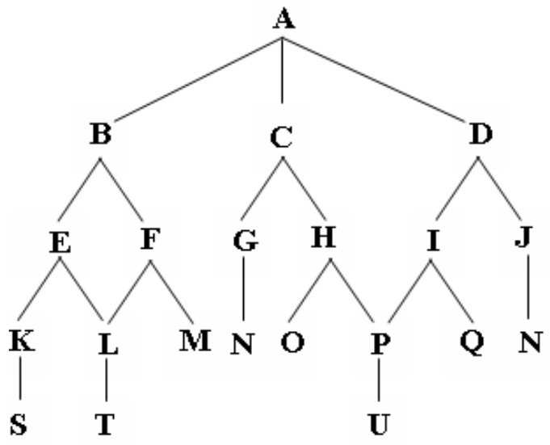

<!-- page: 61 -->

# TÌM KIẾM HEURISTIC

## MỞ ĐẦU

## MỞ ĐẦU

George Polya định nghĩa heuristic là “sự nghiên cứu về các phương pháp và các qui tắc trong việc khám phá và phát minh” (Polya 1945). Nghĩa này có thể xuất phát từ gốc Hy Lạp của động từ eurisco nghĩa là “tôi phát hiện”. Khi Archimedes nhảy ra khỏi bồn tắm và chộp lấy chiếc mũ miện bằng vàng, ông ta đã la lên “Eureka!” có nghĩa “Tôi đã tìm thấy nó!”. Trong tìm kiếm không gian trạng thái, heuristic là các luật dùng để chọn những nhánh nào có nhiều khả năng nhất dẫn đến một giải pháp chấp nhận được.

Các chương trình giải quyết những vấn đề trí tuệ nhân tạo sử dụng heuristic cơ bản theo hai dạng:

• Vấn đề có thể không có giải pháp chính xác vì những điều không rõ ràng trong diễn đạt vấn đề hoặc trong các dữ liệu có sẵn. Chẩn đoán y khoa là một ví dụ. Tập hợp các triệu chứng cho trước có thể do nhiều nguyên nhân gây ra, bác sĩ có thể dùng heuristic để chọn kết quả chẩn đoán nào thích hợp nhất và đưa ra kế hoạch điều trị.

• Vấn đề có thể có giải pháp chính xác, nhưng chi phí tính toán để tìm ra nó không cho phép. Trong nhiều vấn đề (như cờ vua chẳng hạn), không gian trạng thái phát triển rất nhanh và rất rộng vì số lượng các trạng thái có thể xảy ra tăng theo hàm mũ hoặc giai thừa cùng với độ sâu tìm kiếm. Trong những trường hợp này, các kỹ thuật tìm kiếm thô sơ như tìm kiếm sâu hay tìm kiếm rộng sẽ không tìm được giải pháp trong một giới hạn thời gian. Heuristic sẽ giảm bớt độ phức tạp bằng cách hướng việc tìm kiếm theo con đường có nhiều hứa hẹn nhất. Nhờ đã loại bỏ bớt các trạng thái không hứa hẹn và con cháu của chúng ra khỏi việc xem xét nên thuật toán heuristic có thể khắc phục việc bùng nổ trạng thái và tìm ra một giải pháp có thể chấp nhận được.

Giống như tất cả các luật khám phá và phát minh khác, heuristic có thể sai lầm. Heuristic chỉ là một phỏng đoán chứa các thông tin về bước tiếp theo sẽ được chọn dùng trong việc giải quyết một vấn đề. Nó thường dựa vào kinh nghiệm hoặc trực giác. Vì các heuristic sử dụng những thông tin hạn chế nên chúng ít khi có khả năng đoán trước chính xác cách hành xử của không gian trạng thái ở những giai đoạn xa hơn. Heuristic có thể dẫn đến một thuật toán tìm kiếm chỉ đạt được giải pháp gần tối ưu hoặc hoàn toàn không tìm được bất kỳ giải pháp nào. Đây là một hạn chế thuộc về bản chất tìm kiếm heuristic.

<!-- page: 62 -->

Các heuristic và việc thiết kế thuật toán để thực hiện tìm kiếm heuristic từ lâu đã là sự quan tâm chủ yếu của các công trình nghiên cứu trí tuệ nhân tạo. Chơi game và chứng minh định lý là hai ứng dụng lâu đời nhất, cả hai đều cần đến các heuristic để thu giảm bớt không gian giải pháp có thể. Không thể nào kiểm tra hết mọi suy luận có thể sinh ra trong lĩnh vực toán hoặc mọi nước đi có thể có trên bàn cờ vua, tìm kiếm heuristic thường là câu trả lời thực tế duy nhất. Gần đây việc tìm kiếm trong các hệ chuyên gia cũng xác nhận mức độ quan trọng của các heuristic như là một phần không thể thiếu trong quá trình giải quyết vấn đề.

Thuật toán heuristic gồm hai phần: Hàm đánh giá heuristic và thuật toán để sử dụng nó trong tìm kiếm không gian trạng thái.

Xét trò chơi Tic-tac-toe, để tìm kiếm đến hết không gian, số lượng trạng thái sẽ là rất lớn nhưng không phải là không thể vượt qua. Mỗi nước đi trong chín nước đầu tiên đều có tám khả năng đặt quân cờ kế tiếp và đến lượt mình mỗi nước đi này lại có bảy khả năng đặt quân cờ cho nước đi tiếp tục ... Một phân tích đơn giản cho biết số lượng các trạng thái cần được xem xét cho quá trình này là 9 x 8 x 7 x ... x 1 = 9!.

Áp dụng một nhận xét trực quan nhỏ dựa theo tính chất đối xứng của cấu hình bàn cờ có thể làm giảm nhỏ không gian tìm kiếm xuống một ít. Nhiều cấu hình của bài toán tương đương nhau trong các thao tác. Chẳng hạn, thực tế chỉ có ba nước đi cho quân cờ đầu tiên: ô cạnh, ô góc hoặc ô giữa. Các rút gọn đối xứng ở mức thứ hai của các trạng thái sẽ giảm tiếp số lượng đường đi có thể xảy ra trong không gian đó xuống đến tổng số 12 x 7! . Nó đã nhỏ hơn không gian ban đầu nhưng vẫn phát triển theo hàm giai thừa.

<!-- page: 63 -->

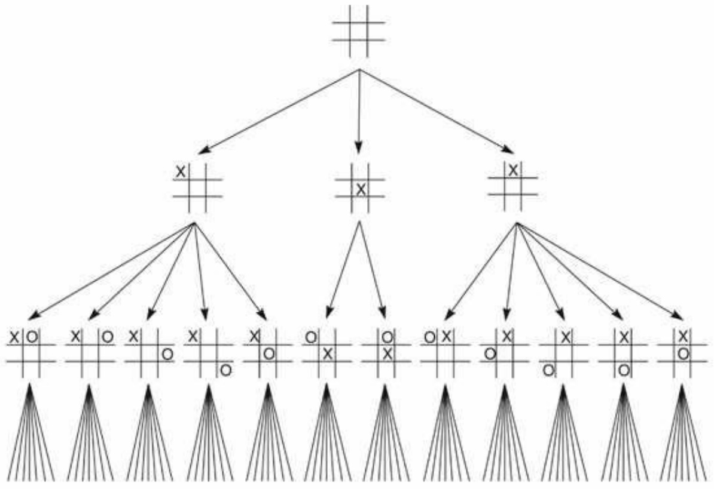

Hình 4.1 – Không gian trạng thái bài toán Tic-tac-toe thu giảm bởi tính đối xứng

Tuy nhiên, một heuristic đơn giản có thể loại bỏ việc tìm kiếm hầu như toàn bộ: heuristic “nước đi chắc thắng nhất”, nghĩa là chọn vị trí đặt quân cờ mà có nhiều đường chắc thắng nhất giao nhau. Trong trường hợp các trạng thái đều có số lượng bằng nhau, chọn trạng thái đầu tiên.

Sau đó thuật toán này sẽ chọn lựa và chuyển đến trạng thái có giá trị heuristic cao nhất (xem hình). Như trong hình vẽ, quân X sẽ chọn đặt vào vị trí trung tâm bàn cờ. Chú ý không chỉ các trạng thái tương đương khác bị loại bỏ mà tất cả con cháu của chúng cũng bị loại. Hai phần ba không gian trạng thái này đã bị loại ngay từ nước đi đầu tiên.

<!-- page: 64 -->

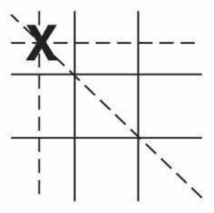

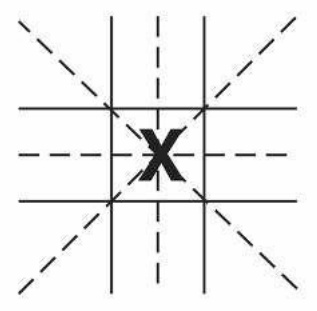

Three wins through a corner square

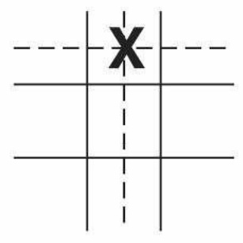

Four wins through the center square

Two wins through a side square

3 nước đi thắng qua ô góc 4 nước đi thắng qua ô giữa 2 nước đi thắng qua ô cạnh Hình 4.2 - Heuristic “nước đi chắc thắng nhất”

Sau nước đi đầu tiên, đối thủ có thể chọn một trong hai nước đi tương đương nhau. Dù chọn nước đi nào, heuristic đó cũng được áp dụng cho các bước tiếp theo. Khi quá trình tìm kiếm tiếp tục, từng bước đi sẽ đánh giá các con của một nút duy nhất mà không yêu cầu tìm kiếm hết không gian. Mặc dù khó tính chính xác số lượng trạng thái phải được kiểm tra theo cách này nhưng vẫn có thể tính phỏng đoán một giới hạn trên. Trong thực tế số lượng sẽ ít hơn 9! rất nhiều.

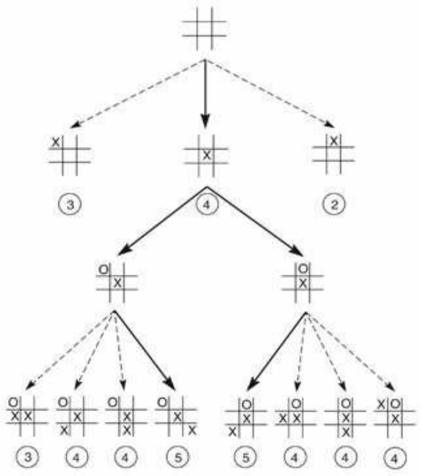

Hình 4.3 – Không gian trạng thái đã được thu giảm bởi heuristic

<!-- page: 65 -->

<!-- page: 66 -->

# THUẬT TOÁN TÌM KIẾM HEURISTIC

## THUẬT TOÁN TÌM KIẾM HEURISTIC

## Tìm kiếm leo núi (Hill climbing – Pearl 1984)

Cách đơn giản nhất để thực hiện tìm kiếm heuristic là tìm kiếm “leo núi”. Chiến lược leo núi phát triển trạng thái con tốt nhất sẽ được chọn cho bước tiếp theo, không lưu giữ lại bất kỳ thông tin nào về các nút anh em lẫn cha mẹ của nó. Quá trình tìm kiếm sẽ dừng lại khi tiếp cận trạng thái tốt hơn so với mọi trạng thái con của nó. Hình dung một người leo núi hăm hở nhưng mù quáng luôn luôn chọn leo lên đỉnh theo con đường dốc nhất có thể có cho đến khi không còn leo tiếp được nữa. Vì không ghi lại thông tin của quá trình đã xảy ra nên thuật toán này không thể phục hồi lại từ những thất bại trong chiến lược của nó.

Hạn chế chủ yếu của chiến lược leo núi là có xu hướng rơi vào “một cực đại cục bộ”. Khi đến được một trạng thái tốt hơn so với mọi trạng thái con của nó, thuật toán dừng lại. Nếu trạng thái này không phải là đích mà chỉ là một điểm cực đại cục bộ, thuật toán sẽ thất bại trong việc tìm lời giải. Như vậy hiệu quả hoạt động chỉ có thể được cải thiện trong một phạm vi giới hạn nào đó, nhưng trong toàn bộ không gian có thể không bao giờ đạt được sự tối ưu tổng thể.

## Tìm kiếm tốt nhất đầu tiên (Best – first – search)

Xét đồ thị không gian tìm kiếm như hình dưới đây (con số cạnh mỗi nút cho biết giá trị ước lượng độ tốt của nút đó trong không gian, giá trị thấp nhất là tốt nhất). Giả sử nút đích cần tìm kiếm là P.

<!-- page: 67 -->

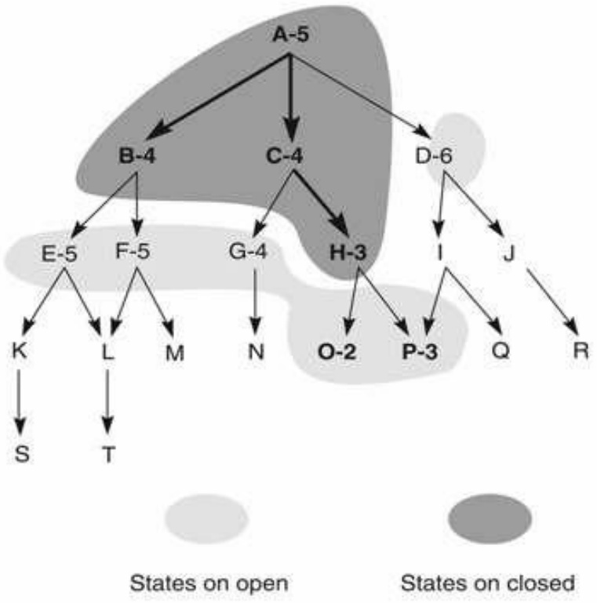

Hình 4.4 – Đồ thị cho giải thuật tìm kiếm tốt nhất đầu tiên

## Câu hỏi :

Trình bày danh sách các nút được duyệt dùng thuật toán leo núi cho $\mathbf { \dot { d } } \mathbf { \dot { \hat { 0 } } }$ thị trong hình 4.4 ?

Giống như các thuật toán tìm kiếm sâu và rộng, tìm kiếm tốt nhất cũng dùng các danh sách để lưu giữ trạng thái: danh sách open chứa các nút được triển khai trong quá trình tìm kiếm và danh sách closed chứa các nút đã xét. Một bước mới được bổ sung vào thuật toán là sắp xếp các trạng thái trong danh sách open phù hợp với giá trị heuristic ước lượng “độ tốt” của chúng so với đích. Như vậy mỗi bước lặp của vòng lặp sẽ xem xét trạng thái “có hứa hẹn nhất” trong danh sách open và loại bỏ trạng thái này ra khỏi open. Nếu gặp trạng thái đích, thuật toán này sẽ cung cấp con đường lời giải đã dẫn đến đích đó. Nếu ngược lại, phần tử đầu tiên của open không phải là đích, thuật toán sẽ áp dụng các luật phù hợp để phát sinh con cháu. Trường hợp một trạng thái con nào đó đã có sẵn trong open hoặc closed, thuật toán cũng sẽ kiểm tra để chắc chắn rằng sẽ chọn được nút cung cấp con đường lời giải ngắn hơn. Các trạng thái lặp hai lần sẽ không được giữ lại. Nhờ cập nhật kịp thời nguồn gốc của các nút trong open và closed nên thuật toán này có nhiều khả năng tìm được đường đi ngắn nhất dẫn đến đích. Khi open được duy trì dưới dạng một danh sách có sắp xếp, nó thường được tổ chức như là một hàng ưu tiên (Priority queue). Dưới đây trình bày các bước áp dụng thuật toán tìm kiếm cho đồ thị trong hình trên.

<!-- page: 68 -->

1. open = [A5]; closed = []2. Đánh giá A5; open = [B4,C4,D6]; closed = [A5]3. Đánh giá B4; open = [C4,E5,F5,D6]; closed = [B4,A5]4. Đánh giá C4; open = [H3,G4,E5,F5,D6]; closed = [C4,B4,A5]5. Đánh giá H3; open = [O2,P3,G4,E5,F5,D6]; closed = [H3,C4,B4,A5]6. Đánh giá O2; open = [P3,G4,E5,F5,D6]; closed [O2,H3,C4,B4,A5]7. Đánh giá P3; Tìm được lời giải!

## Cài đặt hàm đánh giá heuristic (heuristic evaluation function)

Bây giờ ta đánh giá hiệu quả của vài heuristic khác nhau được dùng để giải trò đố 8 ô. Hình dưới đây trình bày trạng thái xuất phát và trạng thái đích của trò chơi cùng với ba trạng thái đầu tiên trong quá trình tìm kiếm.

Heuristic đơn giản nhất sẽ đếm số ô sai khác so với trạng thái đích trong từng trạng thái. Trạng thái có số ô sai khác ít nhất sẽ gần đích hơn và là trạng thái tốt nhất để kiếm tra kế tiếp.

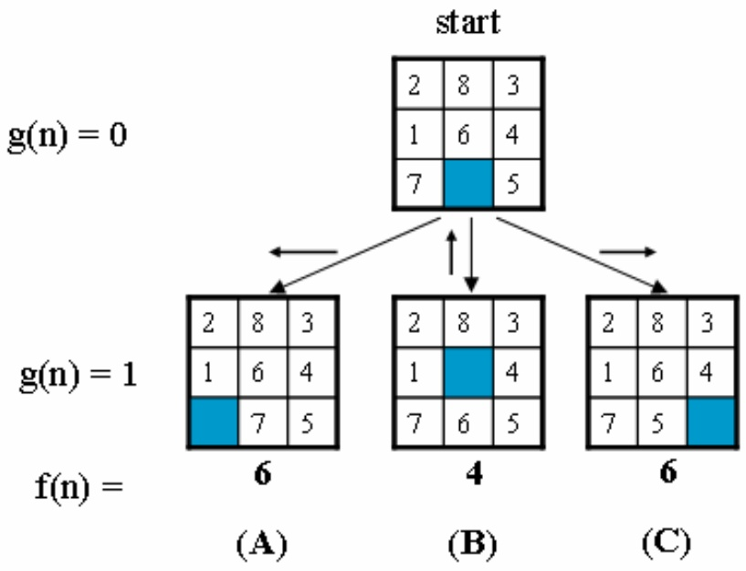

Hình 4.5 – Trạng thái bắt đầu và kết thúc trong trò đố 8 ô

Tuy nhiên heuristic này không sử dụng hết các thông tin trong một cấu hình bàn cờ vì nó không đưa vào khoảng cách mà các ô sai khác. Một heuristic “tốt hơn” là sẽ cộng tất cả các khoảng cách đó lại thành tổng số ô mà một ô phải di chuyển về vị trí đúng của nó trong trạng thái đích (khoảng cách Manhattan).

Cả hai heuristic này đều có hạn chế là không thể biết rõ những khó khăn khi đổi chỗ hai ô. Đó là trường hợp hai ô nằm cạnh nhau và vị trí đúng của chúng là phải đổi chỗ cho nhau, ta phải mất nhiều (chứ không phải hai) nước đi mới đặt chúng lại được đúng vị trí.

<!-- page: 69 -->

Một heuristic muốn tính toán điều này phải nhân ít nhất là gấp đôi khoảng cách đối với mỗi trường hợp có hai ô đổi chỗ trực tiếp.

Heuristic “khoảng cách Manhattan” cho chúng ta một dự đoán có vẻ chính xác hơn so với heuristic số ô sai khác so với trạng thái đích. Mục đích của chúng ta là dùng những thông tin hạn chế có sẵn trong một mô tả trạng thái để đưa ra những chọn lựa thông minh. Việc thiết kế các heuristic tốt là một vấn đề mang tính kinh nghiệm, óc phán đoán và trực giác, nhưng giá trị cuối cùng của một heuristic phải được đo bằng hiệu quả thực sự của nó trong từng tình huống bài toán.

Vì heuristic có thể sai lầm nên có khả năng thuật toán tìm kiếm sẽ dẫn đến một con đường không đưa đến đích. Vấn đề này đã xuất hiện trong tìm kiếm sâu, ở đó một giới hạn độ sâu đã được sử dụng để phát hiện những con đường thất bại. Ý tưởng này cũng có thể áp dụng cho tìm kiếm heuristic. Nếu hai trạng thái có giá trị heuristic bằng nhau thì nên kiểm tra trạng thái nào gần trạng thái gốc của đồ thị hơn. Trạng thái gần gốc hơn sẽ có nhiều khả năng là con đường ngắn nhất dẫn đến đích. Khoảng cách từ trạng thái xuất phát có thể đo được bằng cách duy trì một số đếm chiều sâu cho từng trạng thái đếm. Số đếm này bằng 0 đối với trạng thái xuất phát và tăng lên một đơn vị sau mỗi mức tìm kiếm. Nó ghi lại độ dời thực tế phải thực hiện để đi từ trạng thái xuất phát đến từng trạng thái. Số đếm này có thể cộng thêm vào giá trị heuristic của từng trạng thái để hướng việc tìm kiếm theo khuynh hướng chọn những trạng thái gần trạng thái xuất phát hơn trong đồ thị.

Do đó hàm đánh giá f sẽ bao gồm tổng của hai phần:

$$
\mathrm{f(n)} = \mathrm{g(n)} + \mathrm{h(n)}
$$

trong đó g(n) đo chiều dài thực từ trạng thái n bất kỳ về trạng thái xuất phát và h(n) là ước lượng heuristic cho khoảng cách từ trạng thái n đến trạng thái đích.

Chẳng hạn, trong bài toán trò đố 8 ô trên, chúng ta có thể gọi h(n) là số ô cần phải dời chỗ. Khi hàm đánh giá này được áp dụng cho từng trạng thái con (A), (B), (C) trong hình 4.5, các giá trị cho hàm f lần lượt là 6, 4 và 6.

Một heuristic dùng hàm đánh giá f(n) như trên kết hợp với thuật toán tìm kiếm tốt nhất đầu tiên best-first-search, được gọi là thuật toán A (algorithm A)

## Câu hỏi :

Mật mã Caesar là một cách mã hóa đơn giản dựa vào phép hoán vị vòng

tròn các chữ trong bảng chữ cái, với chữ cái thứ i được thay thế bởi chữ cái

thứ (i + 1). Ví dụ, trong mật mã Caesar dịch 4 bậc, từ “Ceasar” sẽ được mã

<!-- page: 70 -->

hóa thành “Geiwev”. Nêu một heuristic mà bạn nghĩ có thể dùng để giải các

mật mã Ceasar ?

## Tính khả chấp, tính đơn nhất và khả năng cung cấp thông tin của heuristic

Có thể chúng ta phải đánh giá cách hành xử của các heuristic trên một số phương diện. Ví dụ, có thể chúng ta không chỉ cần một giải pháp mà còn cần thuật toán để tìm con đường ngắn nhất dẫn đến đích. Một số tính chất dưới đây là cần xem xét đối với việc đánh giá hiệu quả của một heuristic :

## Tính khả chấp :

Một heuristic dùng để tìm ra con đường dẫn đến đích ngắn nhất bất cứ khi nào nó có tồn tại được gọi là heuristic khả chấp (admissible). Nói cách khác, tính khả chấp của heuristic là nó sẽ bảo đảm tìm thấy đường đi ngắn nhất đến trạng thái đích.

Một thuật toán tìm kiếm có thể chấp nhận được nếu nó được đảm bảo sẽ tìm thấy một đường đi tối thiểu dẫn đến lời giải, bất kỳ lúc nào con đường đó có mặt. Trong việc xác định tính khả chấp của một heuristic, chúng ta định nghĩa hàm đánh giá f\* :

$$
\mathrm{f} ^ {*} (\mathrm{n}) = \mathrm{g} ^ {*} (\mathrm{n}) + \mathrm{h} ^ {*} (\mathrm{n})
$$

Với g\*(n) là giá của đường đi ngắn nhất từ nút bắt đầu đến nút n, còn h\*(n) là giá **thực sự** của đường đi ngắn nhất từ nút n đến nút mục tiêu. Như vậy f\*(n) là chi phí thực của con đường tối ưu từ nút xuất phát đến nút đích đi qua nút n.

Nếu thuật toán A dùng hàm đánh giá f, trong đó $\mathrm { h } ( \mathrm { n } ) \leq \mathrm { h } ^ { * } ( \mathrm { n } )$ thì nó được gọi là thuật toán A\*(algorithm A)

## Tính đơn nhất :

Khi có một trạng thái được phát hiện nhờ sử dụng tìm kiếm heuristic, liệu có bảo đảm rằng về sau sẽ không tìm được một trạng thái như vậy với khoảng cách ngắn hơn tính từ trạng thái xuất phát. Đây chính là thuộc tính của sự đơn nhất (monotocinity). Nói cách khác, tính đơn nhất của một heuristic là nó sẽ bảo đảm đường đi ngắn nhất đến mỗi trạng thái.

Một heuristic h sẽ là đơn nhất nếu :

• Đối với tất cả các trạng thái n và n+1, ta có :

$$
\mathrm{h(n)-h(n+1)} \leq \mathrm{cost(n,n+1)},
$$

<!-- page: 71 -->

trong đó cost(n, n+1) là chi phí thực tính của đường đi từ trạng thái n đến trạng thái n+1.

• Giá trị heuristic của trạng thái đích là 0, tức h(goal) = 0.

## Khả năng cung cấp thông tin :

Chúng ta có thể đặt câu hỏi liệu có một heuristic nào “tốt hơn” những cái khác hay không? Heuristic này tốt hơn heuristic kia theo ý nghĩa nào ? Đây là khả năng cung cấp thông tin (informedness) của một heuristic.

Đối với hai heuristic h1 và h2, nếu h1 $\mathbf { \Lambda } ( \mathbf { n } ) \leq \mathbf { h } _ { 2 } ( \mathbf { n } )$ ứng với tất cả các trạng thái n trong không gian tìm kiếm thì heuristic h2 được gọi là có khả năng cung cấp thông tin nhiều hơn so với h1.

<!-- page: 72 -->

# SỬ DỤNG HEURISTIC TRONG CÁC TRÒ CHƠI SỬ DỤNG HEURISTIC TRONG CÁC TRÒ CHƠI

## Thủ tục minimax

Xét các trò chơi hai đối thủ đối kháng, chẳng hạn trò chơi nim. Để chơi nim, một số token (vật biểu hiện như đồng xu, lá bài, mảnh gỗ, ...) được đặt trên bàn giữa hai đối thủ. Ở mỗi nước đi, người chơi phải chia đống token thành hai đống nhỏ có số lượng khác nhau. Ứng với một số token vừa phải, không gian trạng thái này có thể triển khai đến cùng. Hình sau biểu diễn không gian trạng thái của trò chơi có 7 token.

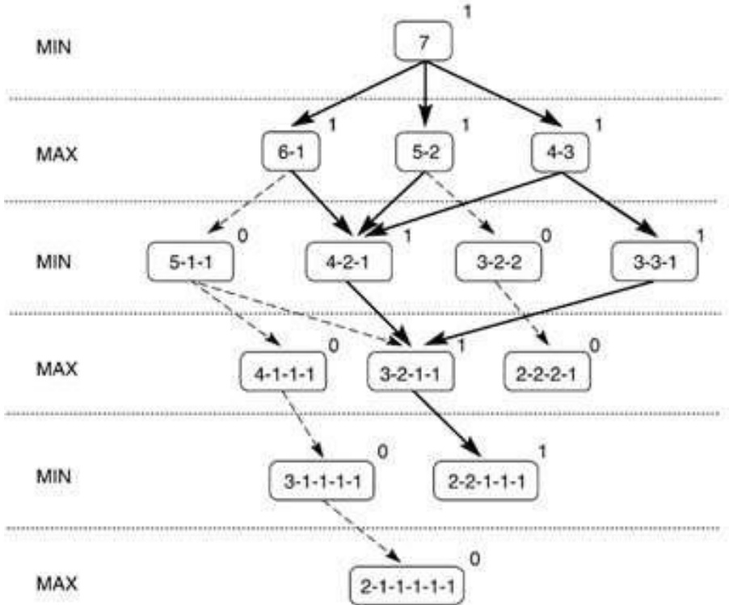

Hình 4.6 – Không gian trạng thái của trò chơi nim

Khi chơi các trò chơi có thể triển khai hết không gian trạng thái, khó khăn chủ yếu là phải tính toán phản ứng của đối thủ. Một cách xử lý đơn giản nhất là giả sử đối thủ của bạn cũng sử dụng kiến thức về không gian trạng thái giống như bạn và áp dụng kiến thức đó kiên định để thắng cuộc. Mặc dù giả thiết này có những hạn chế của nó nhưng nó cũng cho chúng ta một cơ sở hợp lý để dự đoán hành vi của đối thủ. Minimax sẽ tìm kiếm không gian của trò chơi này theo giả thiết đó.

Hai đối thủ trong một trò chơi được gọi là MIN và MAX. MAX đại diện cho đối thủ quyết giành thắng lợi hay cố gắng tối đa hóa ưu thế của mình. Ngược lại MIN là đối thủ

<!-- page: 73 -->

cố gắng tối thiểu hóa điểm số của MAX. Ta giả thiết MIN cũng dùng cùng những thông tin như MAX.

Khi áp dụng thủ tục Minimax, chúng ta đánh dấu luân phiên từng mức trong không gian tìm kiếm phù hợp với đối thủ có nước đi ở mức đó. Trong ví dụ trên, MIN được quyền đi trước, từng nút lá được gán giá trị 1 hay 0 tùy theo kết quả đó là thắng cuộc đối với MAX hay MIN. Minimax sẽ truyền các giá trị này lên cao dần trên đồ thị qua các nút cha mẹ kế tiếp nhau theo luật sau:

\- Nếu trạng thái cha mẹ là nút MAX, gán cho nó giá trị tối đa của các con cháu của nó.

\- Nếu trạng thái cha mẹ là nút MIN, gán cho nó giá trị tối thiểu của các con cháu của nó.

Giá trị được gán cho từng trạng thái bằng cách đó sẽ chỉ rõ giá trị của trạng thái tốt nhất mà đối thủ này có thể hy vọng đạt được. Các giá trị này sẽ được dùng để lựa chọn các nước đi có thể có. Kết quả của việc áp dụng Minimax vào đồ thị không gian trạng thái đối với trò chơi Nim được thể hiện như hình trên. Vì tất cả các nước đi đầu tiên có thể xảy ra cho MIN sẽ dẫn đến các nút có giá trị 1 nên đối thủ MAX luôn có thể bắt trò chơi giành thắng lợi cho mình bất kể nước đi đẩu tiên của MIN là như thế nào (đường đi thắng lợi của MAX được cho theo mũi tên đậm).

## Áp dụng minimax đến độ sâu lớp cố định

Khi áp dụng Minimax cho các trò chơi phức tạp, hiếm khi có khả năng mở rộng đồ thị không gian trạng thái đến các nút lá. Thay vào đó không gian trạng thái này chỉ có thể được triển khai đến một số mức xác định phụ thuộc tiềm năng về thời gian và bộ nhớ chẳng hạn. Chiến lược này được gọi là tính trước n nước đi (n –move lookahead). Vì giá trị các nút trong đồ thị con này không phải là trạng thái kết thúc của trò chơi nên chúng không phản ánh giá trị thắng cuộc hay thua cuộc. Chúng chỉ có thể được gán một giá trị phù hợp với một hàm đánh giá heuristic nào đó. Giá trị được truyền ngược về nút gốc không cung cấp thông tin thắng cuộc hay thua cuộc mà chỉ là giá trị heuristic của trạng thái tốt nhất có thể tiếp cận sau n nước đi kể từ nút xuất phát. Việc tính trước này sẽ làm tăng hiệu quả của heuristic vì nó được áp dụng vào một phạm vi lớn hơn trong không gian trạng thái. Minimax sẽ hợp nhất tất cả các giá trị của các nút con cháu của một trạng thái thành một giá trị duy nhất cho trạng thái đó.

Trong các đồ thị trò chơi được tìm kiếm bằng mức hay lớp, MAX và MIN luân phiên nhau chọn các nước đi. Mỗi nước đi của một đối thủ sẽ xác định một lớp mới trên đồ thị. Các chương trình trò chơi nói chung đều dự tính trước một độ sâu lớp cố định (thường được xác định bằng các giới hạn về không gian hoặc thời gian của máy tính). Các trạng thái trên mức đó được đánh giá theo các heuristic và các giá trị này sẽ được truyền ngược lên bằng thủ tục Minimax, sau đó thuật toán tìm kiếm sẽ dùng các giá trị vừa nhận được để chọn lựa một nước trong số các nước đi kế tiếp. Bằng cách tối đa hóa cho các cha mẹ

<!-- page: 74 -->

MAX và tối thiểu hóa cho các cha mẹ MIN, những giá trị này đi lùi theo đồ thị đến con của trạng thái hiện hành. Sau đó trạng thái hiện hành dùng chúng để tiến hành lựa chọn trong các con của nó. Hình sau trình bày quá trình Minimax trên một không gian trạng thái giả thuyết tính trước bốn lớp.

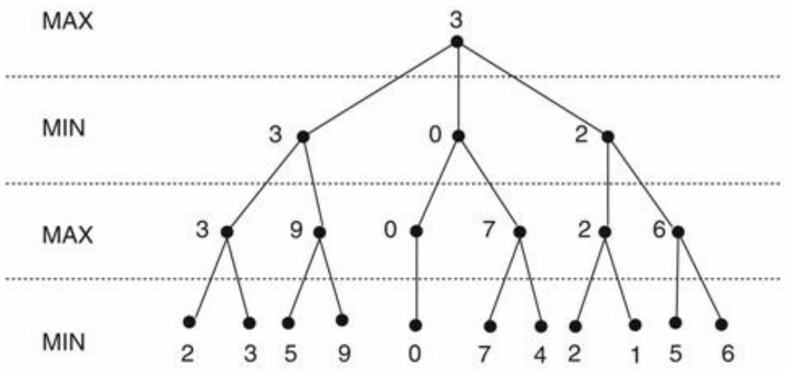

Hình 4.7 – Minimax đối với một không gian trạng thái giả định

Hình 4.8 giới thiệu một ứng dụng của Minimax độ sâu lớp cố định vào trò chơi Tic-tactoe.

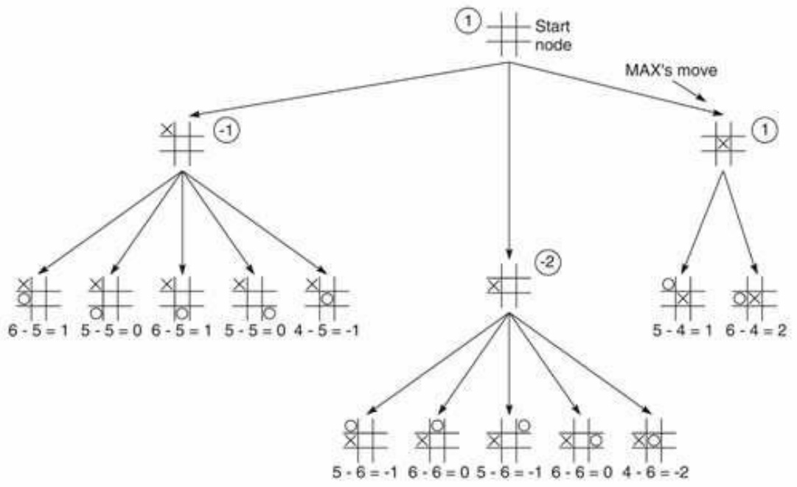

Hình 4.8 – Minimax hai lớp được áp dụng vào nước đi mở đầu trò chơi Tic-tac-toe

<!-- page: 75 -->

Ở đây sử dụng một heuristic hơi phức tạp hơn, nó cố đo mức độ tranh chấp trong trò chơi. Heuristic chọn một trạng thái cần đo, tính tất cả các đường thắng mở ra cho MAX, rồi trừ đi tổng số các đường thắng mở ra cho MIN. Giải thuật tìm kiếm sẽ cố gắng tối đa hóa sự chênh lệch (hiệu số) đó. Nếu có một trạng thái bắt buộc thắng cuộc cho MAX, nó sẽ được đánh giá là +∞, còn với trạng thái bắt buộc thắng cuộc cho MIN thì được đánh giá là -∞. Hình 4.8 trình bày heuristic này được áp dụng cho hai mức bắt đầu không gian trạng thái.

## Câu hỏi :

Khi một máy tính sử dụng giải thuật minimax để chơi cờ, máy tính chơi tốt

hơn khi thời gian cho phép để tính toán cho nước cờ kế tiếp là lâu hơn.

Hãy giải thích một cách ngắn gọn điều này.

## Thủ tục cắt tỉa alpha – beta (alpha-beta prunning)

Minimax yêu cầu phải có sự phân tích qua hai bước đối với không gian tìm kiếm: Bước đầu truyền xuống đến độ sâu của lớp áp dụng heuristic và bước sau để truyền ngược các giá trị trên cây. Minimax lần theo tất cả các nhánh trong không gian bao gồm cả những nhánh mà một thuật toán thông minh hơn có thể bỏ qua hay tỉa bớt. Các nhà nghiên cứu trong lĩnh vực chơi game đã xây dựng một kỹ thuật tìm kiếm gọi là cắt tỉa alpha –beta nhằm nâng cao hiệu quả tìm kiếm trong các bài toán trò chơi hai đối thủ.

Ý tưởng của tìm kiếm alpha – beta rất đơn giản: Thay vì nếu như tìm kiếm toàn bộ không gian đến một độ sâu lớp cố định, tìm kiếm alpha – beta thực hiện theo kiểu tìm kiếm sâu. Có hai giá trị, gọi là alpha và beta được tạo ra trong quá trình tìm kiếm. Giá trị alpha liên quan với các nút MAX và có khuynh hướng không bao giờ giảm. Ngược lại giá trị beta liên quan đến các nút MIN và có khuynh hướng không bao giờ tăng. Giả sử có giá trị alpha của một nút MAX là 6, MAX không cần phải xem xét giá trị truyền ngược nào nhỏ hơn hoặc bằng 6 có liên quan với một nút MIN nào đó bên dưới. Alpha là giá trị thấp nhất mà MAX có thể nhận được sau khi cho rằng MIN cũng sẽ nhận giá trị tốt nhất của nó. Tương tự nếu MIN có giá trị beta là 6 nó cũng không cần xem xét các nút nằm dưới nó có giá trị lớn hơn hoặc bằng 6.

Để bắt đầu thuật toán tìm kiếm alpha – beta, ta đi xuống hết độ sâu lớp theo kiểu tìm kiếm sâu, đồng thời áp dụng đánh giá heuristic cho một trạng thái và tất cả các trạng thái anh em của nó. Giả thuyết tất cả đều là nút MIN. Giá trị tối đa của các nút MIN này sẽ được truyền ngược lên cho nút cha mẹ (là một nút MAX). Sau đó giá trị này được gán cho ông bà của các nút MIN như là một giá trị beta kết thúc tốt nhất. Tiếp theo thuật toán này sẽ đi xuống các nút cháu khác và kết thúc việc tìm kiếm đối với nút cha mẹ của chúng nếu gặp bất kỳ một giá trị nào lớn hơn hoặc bằng giá trị beta này. Quá trình này

<!-- page: 76 -->

gọi là cắt tỉa beta (β cut). Cách làm tương tự cũng được thực hiện cho việc cắt tỉa alpha (α cut) đối với các nút cháu của một nút MAX.

Hai luật cắt tỉa dựa trên các giá trị alpha và beta là:

• Quá trình tìm kiếm có thể kết thúc bên dưới một nút MIN nào có giá trị beta nhỏ hơn hoặc bằng giá trị alpha của một nút cha MAX bất kỳ của nó.

• Quá trình tìm kiếm có thể kết thúc bên dưới một nút MAX nào có giá trị alpha lớn hơn hoặc bằng giá trị beta của một nút cha MIN bất kỳ của nó.

Việc cắt tỉa alpha – beta như vậy thể hiện quan hệ giữa các nút ở lớp n và các nút ở lớp n+2 và do quan hệ đó toàn bộ các cây con bắt nguồn ở lớp n+1 đều có thể loại khỏi việc xem xét. Chú ý rằng giá trị truyền ngược thu được hoàn toàn giống như kết quả Minimax, đồng thời tiết kiệm được các bước tìm kiếm một cách đáng kể.

A có β = 3 (Trị nút A sẽ không lớn hơn 3)B bị cắt tỉa β, vì 5 > 3C có α = 3 (Trị nút C sẽ không nhỏ hơn 3)D bị cắt tỉa α, vì 0 < 3E bị cắt tỉa α, vì 2 < 3Trị nút C là 3

## Hình 4.9 – Thực hiện giải thuật cắt tỉa alpha – beta

TỔNG KẾT CHƯƠNG IV:

<!-- page: 77 -->

Các heuristic tìm kiếm đã được giới thiệu thông qua các trò chơi đơn giản như trò đố 8 ô, Tic-tac-toe, … và cũng đã được phát triển đến các không gian bài toán phức tạp hơn. Chương này cũng đã trình bày việc áp dụng heuristic cho các trò chơi đối kháng có hai người chơi, dùng cách rút gọn tối thiểu trên độ sâu lớp và cắt tỉa alpha - beta để thực hiện việc tính trước các nước đi và dự đoán hành vi của đối thủ. Việc áp dụng các heuristic này đã làm cho không gian bài toán trở nên ngắn gọn hơn, thời gian tìm kiếm một lời giải có thể chấp nhận được là tối thiểu và quá trình tìm kiếm vì thế cũng trở nên đơn giản hơn khá nhiều. Phần chương V tiếp theo, chúng ta sẽ xem xét các kỹ thuật cao câp hơn cho việc cài đặt các thuật toán.

## Bài tập chương IV

Xét bài toán trò đố 8 ô như sau:

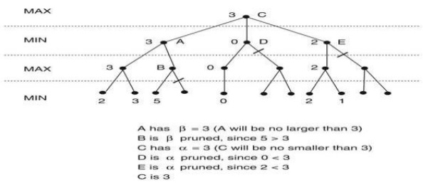

Dùng các hàm lượng giá heuristic sau, hãy triển khai không gian trạng thái của bài toán theo giải thuật leo núi đến mức 5:

• h1 = số lượng các vị trí sai khác so với trạng thái goal.

• h2 = tổng số độ dời ngắn nhất của các ô về vị trí đúng (khoảng cách Manhattan)

Trong cây tìm kiếm dưới đây, mỗi nút có 2 giá trị đi kèm: giá trị bên trái của nút (in nghiêng) thể hiện giá trị heuristic của nút, và giá trị bên phải nút thể hiện thứ tự nút được duyệt qua. Với mỗi chiến lược tìm kiếm dưới đây, hãy viết danh sách thứ tự các nút được duyệt, so sánh và cho biết ta đã dùng giải thuật tìm kiếm nào trên cây :

Start

| 1 | 2 | 3 |
| --- | --- | --- |
| 6 | 7 |  |
| 8 | 5 | 4 |

Goal

| 1 | 2 | 3 |
| --- | --- | --- |
| 8 |  | 4 |
| 7 | 6 | 5 |

<!-- page: 78 -->

• Tìm kiếm rộng BFS

• Tìm kiếm sâu DFS

• Tìm kiếm tốt nhất đầu tiên

• Tìm kiếm leo núi

Thực hiện giải thuật Minimax trên cây sau đây:

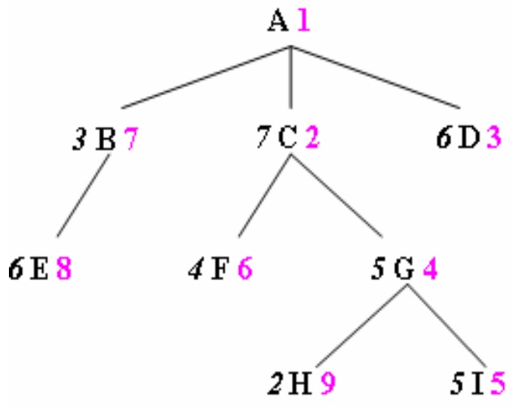

Sẽ có gì khác biệt nếu như ta dùng giải thuật cắt tỉa alpha – beta để định trị nút $\mathbf { g } \mathbf { \hat { \hat { o } } } \mathbf { c }$ cho cây?

Hãy áp dụng giải thuật cắt tỉa alpha-beta cho các cây sau đây. Cho biết các nhánh được cắt là alpha-cut hay beta-cut và giá trị nút gốc sau khi định trị:

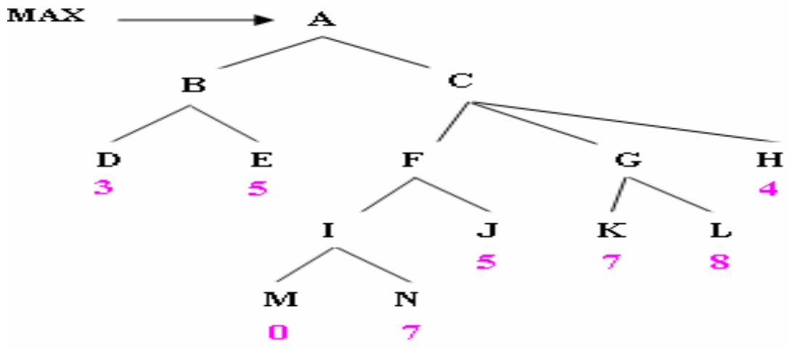

<!-- page: 79 -->

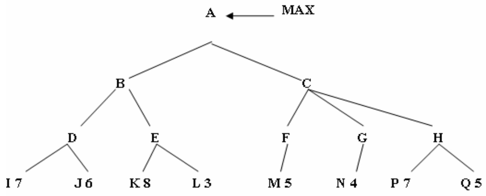

<!-- page: 80 -->

# ĐIỀU KHIỂN VÀ CÀI ĐẶT TÌM KIẾM TRONG KHÔNG GIAN TRẠNG THÁI

**TÌM KIẾM DỰA TRÊN CƠ SỞ ĐỆ QUI**

**TÌM KIẾM DỰA TRÊN CƠ SỞ ĐỆ QUI**

**Tìm kiếm đệ quy**

Một chuyển đổi trực tiếp của thuật toán tìm kiếm sâu thành dạng đệ quy sẽ minh họa cho sự tương đương của đệ quy và lặp lại đơn giản. Thuật toán này sử dụng các biến toàn cục closed và open để duy trì danh sách các trạng thái:

**Function** Depthsearch ; % open và closed toàn cục

Begin

If open rỗng then trả lời (thất bại);

Trạng thái hiện hành := phần tử đầu tiên của open;

If trạng thái hiện hành là trạng thái đích

then trả lời (thành công)

Else

begin

Open := open - phần tử đầu tiên của open;

Closed := closed + trạng thái hiện hành;

For mỗi trạng thái con của trạng thái hiện hành doIf chưa có trong closed hay open % xây dựng ngăn xếp

then bổ sung con đó vào đầu danh sách open

end;

Tìm kiếm sâu; % đệ quy

<!-- page: 81 -->

End;

Tìm kiếm sâu như vừa được trình bày sẽ không sử dụng hết sức mạnh của phép đệ quy. Nó vẫn còn khả năng đơn giản hóa thủ tục bằng cách sử dụng chính phép đệ quy (thay gì một danh sách open) để sắp xếp các trạng thái trong không gian trạng thái. Trong phiên bản này của thuật toán, một danh sách closed toàn cục sẽ được dùng để phát hiện các trạng thái lặp lại, còn danh sách open thì tiềm ẩn trong các mẩu tin hoạt động của môi trường đệ quy.

**Function** Depthsearch **(trạng thái hiện hành);** % closed toàn cục

Begin

If trạng thái hiện hành là trạng thái đích then

trả lời (thành công);

For mỗi trạng thái hiện hành có con chưa được kiểm tra do

begin

Con := con chưa được kiểm tra kế tiếp;

If con không phải là thành viên của closed

thenif depthsearch (con) = thành công

then trả lời (thành công);

end;

Trả lời (thất bại);

End; % tìm kiếm đã đến cùng

Thay vì phát sinh tất cả các con của một trạng thái và đưa chúng vào danh sách open, thuật toán này phát sinh mỗi lần một con và tìm kiếm theo phép đệ quy các nút cháu của từng con đó trước khi phát sinh các anh em của nó. Thuật toán này sẽ gán một thứ tự cho các bước phát sinh trạng thái. Trong tìm kiếm theo đệ quy đối với một trạng thái con, nếu có một con nào đó của trạng thái này là đích, thuật toán đệ quy sẽ trả lời thành công và bỏ qua tất cả các trạng thái anh em. Ngược lại, các trạng thái anh em kế tiếp được phát sinh. Cứ như vậy thuật toán sẽ tìm kiếm toàn bộ đồ thị lần lượt theo từng độ sâu một.

<!-- page: 82 -->

Thuật toán đệ quy cho phép bỏ qua danh sách open trong suốt quá trình thực hiện. Cơ chế mà một ngôn ngữ lập trình sử dụng để cài đặt đệ quy là dùng mẩu tin hoạt động (activation record) cho từng lần gọi đệ quy. Quá trình lần ngược sẽ tác động khi tất cả các con cháu của một trạng thái không phải là đích, làm cho bước đệ quy đó thất bại. Việc thực hiện đệ quy cho phép lập trình viên thu hẹp tầm nhìn của họ vào một trạng thái duy nhất cùng với các con của nó thay vì phải duy trì một danh sách open gồm nhiều trạng thái.

Tìm kiếm trong không gian trạng thái là một quá trình đệ quy. Để tìm đường đi từ trạng thái hiện hành đến đích, bạn chuyển đến một trạng thái con và thực hiện phép đệ quy. Nếu trạng thái con đó không dẫn đến đích, bạn thử lần lượt các trạng thái anh em của nó. Phép đệ quy sẽ chia một bài toán lớn và khó (tìm kiếm khắp không gian) thành các bài toán nhỏ và đơn giản hơn (phát sinh các con của một trạng thái) và áp dụng chiến lược đệ quy cho từng bài toán nhỏ đó. Quá trình cứ tiếp tục như vậy cho đến khi phát hiện được đích hoặc hết không gian.

## Tìm kiếm hướng mẫu (Pattern – directed search)

Trong phần này chúng ta sẽ áp dụng tìm kiếm đệ quy vào không gian các suy diễn logic, kết quả sẽ là một thủ tục tìm kiếm tổng quát dùng cho phép tính vị từ.

Giả sử cần phải viết một thuật toán để xác định xem một biểu thức phép tính vị từ cho trước có phải là kết quả logic của môt tập các khẳng định nào đó hay không. Thuật toán này phải tìm một trình tự suy diễn tạo nên biểu thức đích. Thuật toán sẽ đề nghị một tìm kiếm hướng mục tiêu với câu hỏi ban đầu tạo nên đích và các modus ponens xác định các chuyển tiếp giữa các trạng thái. Cho trước một đích, thuật toán sẽ dùng phương pháp đồng nhất để chọn các phép kéo theo có kết luận phù hợp với đích đó. Sau khi đồng nhất đích với kết luận của phép kéo theo và đã áp dụng các thay thế vừa suy ra được, tiền đề của phép kéo theo sẽ trở thành một đích mới gọi là đích phụ (subgoal). Sau đó thuật toán sẽ thực hiện đệ quy đối với đích phụ này. Nếu đích phụ phù hợp với một sự kiện trong cơ sở tri thức, cuộc tìm kiếm kết thúc. Chuỗi suy diễn dẫn từ đích ban đầu đến các sự kiện cho trước sẽ chứng minh đích xuất phát là đúng.

Phiên bản hoàn chỉnh của thuật toán tìm kiếm hướng mẫu có thể trả lời một tập các đồng nhất thỏa mãn từng đích phụ là:

**Function** pattern\_search **(current\_goal);**

Begin

If current\_goal Î closed then return fail

else Thêm current\_goal vào closed;

<!-- page: 83 -->

while còn dữ kiện hoặc luật đồng nhất do

begin case

current\_goal đồng nhất với dữ kiện:

return tập phép thế;

current goal là ¬p:

pattern\_search(p);

if pattern\_search thất bại then return {}

else return fail

current\_goal đồng nhất với kết luận của luật (q ® p):

begin

áp dụng phép thế đồng nhất mục tiêu vào tiền đề (q);

pattern\_search (q);

if pattern\_search thành công

then return hợp của tập phép thế của p và q;

else return fail;

end;

current\_goal có dạng (p1Ù p2 …):

begin

for mỗi thành phần pido

begin

pattern\_search(p i );

if pattern\_search thất bại then return fail;

<!-- page: 84 -->

else áp dụng các phép thế vào các pi còn lại;

end;

if pattern\_search thành công cho tất cả các pi

then return hợp của các tập phép thế;

else return fail;

end;

current\_goal có dạng (p1Ú p2…):

begin

repeat cho mỗi pi

pattern\_search(p i );

until không còn thành phần pi nào hoặc thành công;

if pattern\_search thành công then return {phép thế};

else return fail;

end;

return fail;

End;

Download slide bài giảng <u>tại đây</u>

<!-- page: 85 -->

# HỆ THỐNG LUẬT SINH (HỆ SINH – PRODUCTION SYSTEM)

## HỆ THỐNG LUẬT SINH (HỆ SINH – PRODUCTION SYSTEM)

## Định nghĩa hệ sinh

Hệ sinh là một mô hình tính toán quan trọng trong trí tuệ nhân tạo về cả hai mặt: thực hiện các thuật toán tìm kiếm và mô hình hóa việc giải các bài toán của con người.

Một hệ sinh được định nghĩa bởi:

• **Tập luật sinh(Production rules):** Mỗi luật sinh có dạng condition → action (điều kiện → hành động). Phần điều kiện của luật là một mẫu cho biết khi nào thì có thể áp dụng luật. Phần hành động quy định các bước giải toán tương ứng điều kiện.

• **Bộ nhớ làm việc (Working memory):** Chứa một mô tả về trạng thái hiện thời của bài toán trong quá trình suy luận. Mô tả này là một mẫu sẽ được đối sánh với phần điều kiện của một luật sinh để chọn ra bước giải thích hợp. Khi phần điều kiện của luật phù hợp với nội dung trong bộ nhớ làm việc, hành động phát sinh từ điều kiện đó sẽ được thực hiện làm thay đổi nội dung bộ nhớ làm việc.

• **Chu trình nhận dạng - hành động (Recognize – act cycle)** : Là cấu trúc điều khiển của hệ sinh.

Cấu trúc điều khiển của một hệ sinh khá đơn giản: Bộ nhớ làm việc được khởi đầu với mô tả của bài toán. Trạng thái hiện hành của việc giải bài toán được duy trì dưới dạng một tập các mẫu trong bộ nhớ làm việc. Các mẫu này được đối sánh với phần điều kiện của các luật sinh, các luật có điều kiện phù hợp với mẫu trong bộ nhớ làm việc được gọi là tập luật tranh chấp (conflict set). Sau đó một trong các luật sinh này sẽ được chọn và được kích hoạt. Để kích hoạt một luật, phần hành động của nó được thục hiện và làm thay đổi nội dung bộ nhớ làm việc. Chu trình điều khiển sẽ lặp lại với nội dung đã được thay đổi trong bộ nhớ làm việc. Quá trình này kết thúc khi nội dung của bộ nhớ làm việc không còn phù hợp với điều kiện của luật nào nữa.

Một quá trình giải quyết tranh chấp (conflict resolution) sẽ chọn một luật từ tập luật tranh chấp để kích hoạt. Chiến lược giải quyết tranh chấp có thể rất đơn giản như chọn luật đầu tiên có điều kiện phù hợp hoặc có thể dựa vào các heuristic chọn luật phức tạp. Đây là một khâu quan trọng để các hệ sinh có thể đưa khả năng điều khiển heuristic vào một thuật toán tìm kiếm.

Một sơ đồ của hệ sinh được mô tả như hình sau:

<!-- page: 86 -->

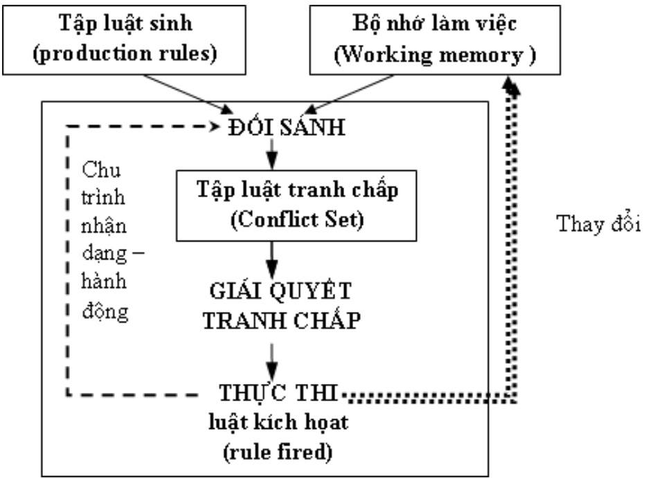

Hình 5.1 – Cấu trúc hệ sinh

Thí dụ 5.1: Một chương trình hệ sinh đơn giản dùng để sắp xếp một dãy các chữ cái a,b,c theo thứ tự từ điển. Trong ví dụ này, một luật sinh sẽ được áp dụng nếu điều kiện của nó phù hợp với một phần của dãy chữ cái trong bộ nhớ làm việc. Khi một luật được kích hoạt, phần dãy phù hợp với điều kiện luật này được thay thế bởi dãy ở phần hành động của luật đó.

<!-- page: 87 -->

<table><tr><td colspan="4">Tập luật sinh</td></tr><tr><td colspan="4">1. ba → ab2. ca → ac3. cb → bc</td></tr><tr><td>Bước</td><td>Bộ nhớ làm việc</td><td>Tập luật tranh chấp</td><td>Luật kích hoạt</td></tr><tr><td>0</td><td>cbaca</td><td>1, 2, 3</td><td>1</td></tr><tr><td>1</td><td>cabca</td><td>2</td><td>2</td></tr><tr><td>2</td><td>acbca</td><td>2, 3</td><td>2</td></tr><tr><td>3</td><td>acbac</td><td>1, 3</td><td>1</td></tr><tr><td>4</td><td>acabc</td><td>2</td><td>2</td></tr><tr><td>5</td><td>aacbc</td><td>3</td><td>3</td></tr><tr><td>6</td><td>aabcc</td><td>∅</td><td>Dùng</td></tr></table>

Hình 5.2 – Các bước thực hiện của một hệ sinh đơn giản

## Một số ví dụ về hệ sinh

## Thí dụ 5.2: Bài toán trò đố 8 ô

Không gian tìm kiếm do trò đố 8 ô sinh ra vừa đủ phức tạp để khảo sát và cũng vừa đủ nhỏ để có thể theo dõi, cho nên ta thường hay sử dụng nó để minh họa cho các chiến lược tìm kiếm khác nhau như tìm kiếm sâu, tìm kiếm rộng, cũng như các chiến lược tìm kiếm heuristic. Nó cũng thích hợp với việc giải bằng hệ sinh. Các nước đi hợp lệ được trình bày như các luật trong hình. Trong trường hợp trạng thái bắt đầu và trạng thái đích của trò chơi được xác định, chúng ta có khả năng áp dụng một hệ sinh cho không gian tìm kiếm của bài toán.

<!-- page: 88 -->

Trąng thái bt đâu:

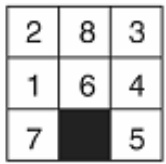

Trąng thái kt thúc:

| 1 | 2 | 3 |
| --- | --- | --- |
| 8 |  | 4 |
| 7 | 6 | 5 |

## Tâp lut sinh:

Điu kin

Hành đng

Trang thái kt thúc trong b nhó làm vic → Dùng

trông không  canh trái

ô trông không  cnh đinh

→ Chuyn ô trồng sang trái

ô trông không  cnh phi

→ Chuyn ô trông 1ên

Ô trông không  canh đái

→ Chuyn ô trông sang phi

→ Chuyn ô trông xuông

## B nh làm vic cha trnh thái bt đu và trng thái kt thúc

## Ca ch kim soát

1. Th mõi lut sinh theo th t

2. Không cho phép, vòng 1âp

3. Dùng khi tim thây trang thái kt thúc

## Hình 5.3 – Trò đố 8 ô dưới dạng một hệ sinh

## Thí dụ 5.3: Bài toán đường đi quân mã (Knight’s tour problem)

Bài toán đường đi quân mã trên bàn cờ vua cũng có thể được giải bằng cách sử dụng hệ sinh. Mỗi nước đi sẽ được biểu diễn bằng một luật mà phần điều kiện của nó là vị trí của quân cờ tại một ô và phần hành động của nó là vị trí hợp lệ sau khi di chuyển quân cờ. Mười sáu luật sinh sẽ biểu diễn cho tất cả các nước đi hợp lệ của quân cờ. Khởi đầu, bộ nhớ làm việc chứa trạng thái bàn cờ hiện tại và trạng thái đích. Vòng lặp điều khiển sẽ áp dụng các luật cho đến khi trạng thái hiện tại giống trạng thái đích rồi dừng lại. Một chiến lược giải quyết tranh chấp sẽ kích hoạt luật đầu tiên và không tạo vòng lặp. Vì quá trình tìm kiếm có thể dẫn đến những kết thúc chết nên chu trình điều khiển cho phép lần ngược.

<!-- page: 89 -->

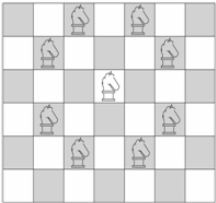

Các buóc đi hp l cůa quân mã

| 1 | 2 | 3 |
| --- | --- | --- |
| 4 | 5 | 6 |
| 7 | 8 | 9 |

Đánh s các ô trong bàn cò 3x3

| LUẬT | ĐIỀU KIỆN | HÀNH ĐỘNG |
| --- | --- | --- |
| 1 | Quân mã ở ô 1 | Di chuyển đến ô 8 |
| 2 | Quân mã ở ô 1 | Di chuyển đến ô 6 |
| 3 | Quân mã ở ô 2 | Di chuyển đến ô 9 |
| 4 | Quân mã ở ô 2 | Di chuyển đến ô 7 |
| 5 | Quân mã ở ô 3 | Di chuyển đến ô 4 |
| 6 | Quân mã ở ô 3 | Di chuyển đến ô 8 |
| 7 | Quân mã ở ô 4 | Di chuyển đến ô 9 |
| 8 | Quân mã ở ô 4 | Di chuyển đến ô 3 |
| 9 | Quân mã ở ô 6 | Di chuyển đến ô 1 |
| 10 | Quân mã ở ô 6 | Di chuyển đến ô 7 |
| 11 | Quân mã ở ô 7 | Di chuyển đến ô 2 |
| 12 | Quân mã ở ô 7 | Di chuyển đến ô 6 |
| 13 | Quân mã ở ô 8 | Di chuyển đến ô 3 |
| 14 | Quân mã ở ô 8 | Di chuyển đến ô 1 |
| 15 | Quân mã ở ô 9 | Di chuyển đến ô 2 |
| 16 | Quân mã ở ô 9 | Di chuyển đến ô 4 |

<table><tr><td rowspan="2">Bước</td><td colspan="2">Bộ nhớ làm việc</td><td rowspan="2">Tập luật tranh chấp</td><td rowspan="2">Luật kích hoạt</td></tr><tr><td>Ô hiện thời</td><td>Ô đi đến</td></tr><tr><td>0</td><td>1</td><td>2</td><td>1, 2</td><td>1</td></tr><tr><td>1</td><td>8</td><td>2</td><td>13, 14</td><td>13</td></tr><tr><td>2</td><td>3</td><td>2</td><td>5, 6</td><td>5</td></tr><tr><td>3</td><td>4</td><td>2</td><td>7, 8</td><td>7</td></tr><tr><td>4</td><td>9</td><td>2</td><td>15, 16</td><td>15</td></tr><tr><td>5</td><td>2</td><td>2</td><td></td><td>Dừng</td></tr></table>

Hình 5.4 – Giải pháp hệ sinh cho bài toán đ ư ờng đi quân mã

<!-- page: 90 -->

## Điều khiển tìm kiếm trong các hệ sinh

Mô hình hệ sinh cho chúng ta có nhiều cơ hội để bổ sung điều khiển heuristic cho một thuật toán tìm kiếm. Những cơ hội đó có thể áp dụng khi chọn chiến lược tìm kiếm hướng dữ liệu hay tìm kiếm hướng mục tiêu, trong cấu trúc các luật hoặc khi chọn chiến lược giải quyết tranh chấp.

## Điều khiển chọn chiến lược tìm kiếm hướng dữ liệu (suy diễn tiến) hay tìm kiếm hướng mục tiêu (suy diễn lùi)

Tìm kiếm hướng dữ liệu bắt đầu với một mô tả bài toán (như một tập các tiền đề logic, các triệu chứng của người bệnh, hay một khối dữ liệu cần suy diễn ...) rồi suy ra các kiến thức mới từ dữ liệu đó. Quá trình này được thực hiện bằng cách áp dụng các luật suy diễn, các nước đi hợp lệ trong một trò chơi hoặc các thao tác sinh ra trạng thái khác vào mô tả hiện hành của bài toán, đồng thời đưa thêm các kết quả vào mô tả bài toán. Quá trình này tiếp tục cho đến khi tiếp cận một mục tiêu.

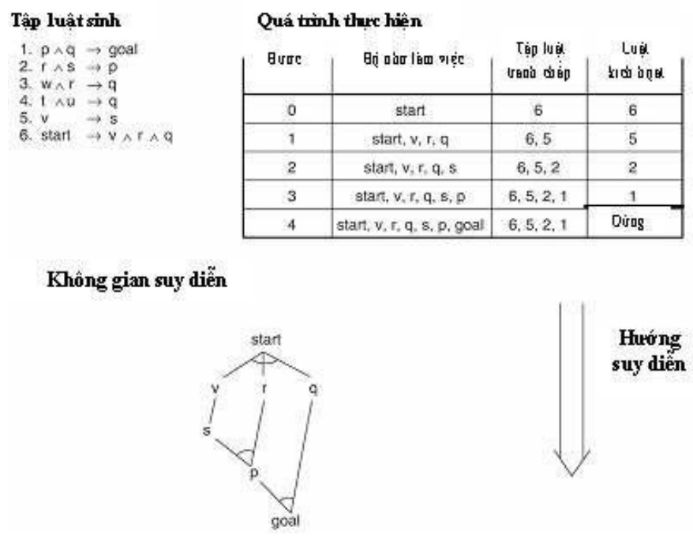

Hình 5.5 – Tìm kiếm hướng dữ liệu trong một hệ sinh

Mô tả của quá trình suy luận hướng mục tiêu này nhấn mạnh sự gần giống của nó với mô hình hệ sinh của việc tính toán. Trạng thái hiện tại của bài toán được đưa vào bộ nhớ làm việc. Chu trình nhận dạng – hành động sẽ đối sánh trạng thái hiện tại với tập luật sinh (theo thứ tự). Khi các dữ liệu này phù hợp với phần điều kiện của một trong các luật sinh đó, phần hành động của luật sinh sẽ bổ sung thêm (bằng cách thay đổi bộ nhớ làm việc) một thông tin mới vào trạng thái hiện tại của bài toán.

<!-- page: 91 -->

Vì tất cả các luật sinh đều có dạng CODITION→ ACTION. Khi CONDITION phù hợp với một số phần nào đó trong bộ nhớ làm việc, ACTION sẽ được thực hiện.

Hình trên trình bày quá trình tìm kiếm hướng dữ liệu đơn giản dựa vào một tập các luật sinh được biểu diễn dưới dạng phép kéo theo của phép tính mệnh đề. Chiến lược giải quyết tranh chấp đơn giản là chọn luật vừa mới được kích hoạt. Theo ràng buộc này, luật đầu tiên sẽ được chọn. Quá trình thực hiện sẽ dừng lại khi tiếp cận một mục tiêu. Hình này cũng giới thiệu trình tự các luật kích hoạt và trạng thái bộ nhớ làm việc trong quá trình thực hiện cùng với đồ thị của không gian tìm kiếm.

Ta cũng có thể áp dụng tìm kiếm hướng mục tiêu trong các hệ sinh. Để thực hiện điều này, mục tiêu được đưa vào bộ nhớ làm việc và được đối sánh với phần ACTION của các luật sinh (bằng phép hợp nhất chẳng hạn) và phần CODITION cuả luật sẽ được bổ sung vào bộ nhớ làm việc và trở thành các mục tiêu mới của quá trình tìm kiếm. Quá trình này cứ tiếp tục cho đến khi một sự kiện được tìm thấy, thường là trong mô tả ban đầu của bài toán. Quá trình tìm kiếm sẽ dừng lại khi các CODITION của tất cả các luật sinh được kích hoạt đều là đúng. Hình sau là một ví dụ về suy luận hướng mục tiêu. Cần chú ý rằng ta sẽ dừng lại khi các CODITION của tất cả các luật sinh được kích hoạt đều là đúng. Tìm kiếm hướng mục tiêu sẽ kích hoạt loạt luật sinh khác và tiến hành quá trình tìm kiếm trên không gian khác so với kiểu hướng dữ liệu.

<table><tr><td colspan="2">Tập luật sinh</td><td colspan="2">Quá trình thực hiện</td></tr><tr><td rowspan="8">1. p ∧ q → goal2. r ∧ s → p3. w ∧ r → p4. t ∧ u → q5. v → s6. start → v ∧ r ∧ q</td><td>Bước</td><td>Bộ nhớ làm việc</td><td>Tập luật tranh chấpLuật kích</td></tr><tr><td>0</td><td>goal</td><td>11</td></tr><tr><td>1</td><td>goal, p, q</td><td>1, 2, 3, 42</td></tr><tr><td>2</td><td>goal, p, q, r, s</td><td>1, 2, 3, 4, 53</td></tr><tr><td>3</td><td>goal, p, q, r, s, w</td><td>1, 2, 3, 4, 54</td></tr><tr><td>4</td><td>goal, p, q, r, s, w, t, u</td><td>1, 2, 3, 4, 55</td></tr><tr><td>5</td><td>goal, p, q, r, s, w, t, u, v</td><td>1, 2, 3, 4, 5, 66</td></tr><tr><td>6</td><td>goal, p, q, r, s, w, t, u, v, start</td><td>1, 2, 3, 4, 5, 6Dùng</td></tr></table>

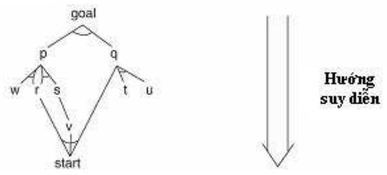

Hình 5.6. – Tìm kiếm hướng mục tiêu trong một hệ sinh

**Câu hỏi :**

<!-- page: 92 -->

Một hệ sinh sử dụng động cơ suy diễn là một chu trình nhận dạng hành động (đối sánh → giải quyết tranh chấp → thi hành luật). Hãy cho biết điểm khác biệt cơ bản tại bước đối sánh (match) khi hệ thống tiến hành suy diễn tiến và suy diễn lùi ?

## Điều khiển tìm kiếm thông qua cấu trúc luật

Cấu trúc của các luật trong một hệ sinh bao gồm sự phân biệt giữa phần điều kiện (CONDITION) với phần hành động (ACTION) và thứ tự mà các điều kiện được thử, sẽ quyết định cách tìm kiếm trong không gian.

Trong biểu diễn của phép tính vị từ, các biểu thức chỉ định nghĩa các quan hệ thực trong một lĩnh vực bài toán chứ không khẳng định về thứ tự diễn dịch các thành phần của chúng do đó có thể có một vài cách biểu diễn khác nhau cho cùng một luật nhưng chúng vẫn tương đương về mặt chân trị. Những cách viết này có thể không dẫn đến cùng một kết quả khi được diễn dịch dưới dạng các luật sinh vì việc cài đặt của hệ sinh phải theo một thứ tự trong việc đối sánh và kích hoạt các luật. Hệ sinh thử các luật theo một thứ tự xác định nên người lập trình có thể điều khiển quá trình tìm kiếm thông qua cấu trúc và thứ tự của các luật trong tập luật sinh. Mặc dù tương đương về mặt logic nhưng hai cách thực hiện không như nhau trong một quá trình tìm kiếm.

Các chuyên gia mã hóa các heuristic quan trọng theo những quy luật chuyên môn của họ. Thứ tự của các tiền đề sẽ mã hóa những thông tin quan trọng về trình tự để giải bài toán. Chẳng hạn khi một kỹ sư cơ khí nói rằng “Nếu động cơ không khởi động được và đèn không sáng thì kiểm tra acquy”, tức là anh ta đã đề nghị một trình tự đặc trưng cho các hành động. Thông tin này sẽ không thể hiểu bởi phát biểu logic tương đương “Động cơ khởi động được hoặc đèn sáng hoặc kiểm tra acquy”. Dạng này của các luật rất quan trong trong việc điều khiển tìm kiếm, nó làm cho hệ thống thực hiện một cách logic, làm cho quá trình theo dõi việc kích hoạt các luật dễ hiểu hơn, ..

## Điều khiển chọn chiến lược giải quyết tranh chấp

Mặc dù các hệ sinh (giống như tất cả các cấu trúc dùng cho những hệ thống dựa vào kiến thức) cho phép các heuristic được mã hóa vào trong nội dung kiến thức của bản thân các luật, nhưng chúng cũng có nhiều cơ hội khác để điều khiển heuristic thông qua các giải pháp giải quyết tranh chấp. Ví dụ các chiến lược giải quyết tranh chấp được hỗ trợ bởi OPS5 (Brownston và cộng sự -1985) gồm có:

• Chiến lược khúc xạ (refraction): Chiến lược này quy định rằng khi một luật đã được kích hoạt, nó không thể được kích hoạt lại trước khi các phần tử trong bộ nhớ làm việc phù hợp với phần điều kiện của nó thay đổi. Chiến lược này giúp ngăn ngừa vòng lặp.

<!-- page: 93 -->

• Chiến lược vừa mới xảy ra (recency): Chiến lược này chọn những luật có phần điều kiện phù hợp với các mẫu vừa mới được bổ sung vào bộ nhớ làm việc. Chiến lược này giúp tập trung việc tìm kiếm vào một dòng suy luận duy nhất.

• Chiến lược tính chi tiết (specificity): Chiến lược này quy định rằng một luật giải toán chi tiết hơn sẽ được ưa thích hơn luật tổng quát. Một luật có tính chi tiết hơn luật khác nếu nó có nhiều điều kiện hơn. Điều này có nghĩa nó sẽ đối sánh với số mẫu ít hơn trong bộ nhớ làm việc.

## Những ưu điểm của hệ sinh dùng cho trí tuệ nhân tạo

Theo các minh họa trên, hệ sinh cho chúng ta một quy tắc chung để thực hiện tìm kiếm. Nhờ tính đơn giản, khả năng cải biến và sự linh hoạt trong việc áp dụng các kiến thức giải toán, hệ sinh đã tỏ ra là một công cụ quan trọng để xây dựng các hệ chuyên gia và các ứng dụng trí tuệ nhân tạo khác. Những ưu điểm chính của các hệ sinh đối với trí tuệ nhân tạo là:

• Tách riêng tri thức và điều khiển: Trong hệ sinh sự điều khiển được cho bởi chu trình nhận dạng – hành động của vòng lặp hệ sinh, còn các kiến thức giải toán được mã hóa vào trong các luật. Ưu điểm của sự tách biệt này là dễ thay đổi loại cơ sở tri thức mà không thay đổi việc điều khiển chương trình và ngược lại.

• Đưa một sắp xếp tự nhiên vào tìm kiếm trong không gian trạng thái: Các phần tử của một hệ sinh sẽ được sắp xếp một cách tự nhiên vào cấu trúc tìm kiếm không gian trạng thái. Các trạng thái kế tiếp của bộ nhớ làm việc sẽ tạo nên các nút của đồ thị. Các luật sinh là các bước chuyển đổi có thể xảy ra giữa các trạng thái cùng với các chiến lược giải quyết tranh chấp sẽ cài đặt việc chọn một nhánh trong không gian trạng thái đó.

• Tính module của luật sinh: Một yếu tố quan trọng của hệ sinh là không có bất kỳ sự tương tác lẫn nhau nào về cú pháp giữa các luật sinh. Các luật chỉ có thể tác động đến việc kích họat các luật khác bằng cách thay đổi mẫu trong bộ nhớ làm việc, chúng không thể “gọi” trực tiếp các luật khác như là một thủ tục con (subroutine), cũng không thể thiết lập giá trị của các biến cho các luật sinh khác. Tính độc lập về cú pháp này đã hỗ trợ cho sự phát triển của các hệ chuyên gia bằng cách liên tục bổ sung, loại bỏ hoặc thay đổi các tri thức (luật) của hệ thống.

• Điều khiển theo mẫu: Các bài toán được chương trình trí tuệ nhân tạo nhằm vào đều yêu cầu phải linh hoạt trong quá trình thực thi chương trình. Mục tiêu này được đáp ứng bởi thực tế là các luật trong hệ sinh có thể kích hoạt theo mọi trình tự. Trong một bài toán, các mô tả tạo nên trạng thái hiện hành sẽ xác định tập luật tranh chấp và do đó cũng sẽ xác định con đường tìm kiếm và lời giải riêng.

• Có cơ hội cho điều khiển heuristic của quá trình tìm kiếm.

<!-- page: 94 -->

• Theo dõi và giải thích: Tính module của các luật và bản chất lặp lại trong quá trình thực thi làm cho nó dễ dàng theo dõi hơn trong một hệ sinh. Ở mỗi giai đoạn của chu trình nhận dạng – hành động, luật được chọn có thể được hiện ra. Vì mỗi luật ứng với một đoạn của quá trình giải toán nên nội dung luật sẽ giải thích đầy đủ ý nghĩa về trạng thái và hành động hiện hành của hệ thống đó.

• Tính độc lập ngôn ngữ: Mô hình điều khiển hệ sinh không phụ thuộc vào cách thể hiện đã được chọn cho các luật và cho bộ nhớ làm việc miễn là cách thể hiện đó hỗ trợ cho việc đối sánh mẫu.

Mô hình hóa việc giải các bài toán của con người: Đây là một trong những ứng dụng đầu tiên của hệ sinh, chúng vẫn còn được dùng làm mô hình cho họat động của con người trong nhiều nghiên cứu khoa học về nhận thức.

<!-- page: 95 -->

# KIẾN TRÚC BẢNG ĐEN (BLACKBOARD ARCHITECTURE)

## KIẾN TRÚC BẢNG ĐEN (BLACKBOARD ARCHITECTURE)

Kiến trúc bảng đen là cơ chế điều khiển cuối cùng được giới thiệu trong chương này. Kiến trúc bảng đen mở rộng các hệ sinh bằng cách cho phép chúng ta sắp xếp bộ nhớ làm việc thành các module riêng, mỗi module tương ứng với một luật sinh khác nhau. Kiến trúc này cũng cho phép chúng ta tích hợp các tập luật sinh khác nhau vào một cấu trúc toàn cục duy nhất.

## Một kiến trúc bảng đen bao gồm:

• Bảng đen (Blackboard): Là một số cơ sở dữ liệu toàn cục tập trung dùng để trao đổi thông tin giữa các nguồn tri thức không đồng bộ độc lập, tập trung vào các mặt có liên quan của một bài toán cụ thể.

Các nguồn tri thức (Knowledge source) KSi: Lấy dữ liệu của mình từ bảng đen, xử lý các dữ liệu đó rồi trả kết quả về cho bảng đen để các nguồn tri thức khác sử dụng. Mỗi KSi đều độc lập theo ý nghĩa là một quá trình riêng biệt, hoạt động theo các đặc trưng riêng, và khi sử dụng một hệ thống đã xử lý hoặc có nhiều bộ xử lý, nó sẽ độc lập với các quá trình xử lý khác của bài toán. Hệ thống không đồng bộ ở chỗ từng KSi sẽ bắt đầu hoạt động của mình khi nào tìm thấy các dữ liệu đầu vào thích hợp được công bố trên bảng đen. Khi kết thúc công việc xử lý của mình, nó sẽ gửi kết quả đi và chờ dữ liệu đầu vào mới.

• Bộ lập lịch trình (scheduler): Tổ chức việc cấp tài nguyên và truy cập bảng đen của các nguồn tri thức.

Hình sau trình bày một sơ đồ về kiểu thiết kế bảng đen:

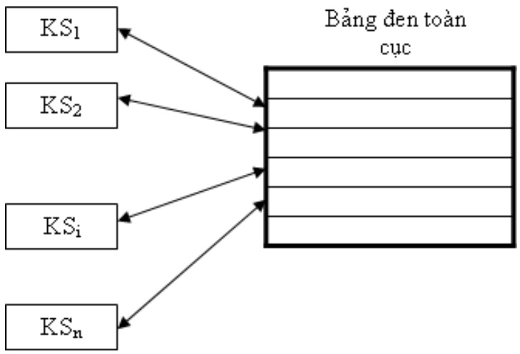

<!-- page: 96 -->

## Hình 5.7 – Kiến trúc bảng đen

Kiến trúc bảng đen dùng trong việc tổ chức một chương trình lớn, lần đầu tiên được giới thiệu trong công trình nghiên cứu HEARSAY-II (Erman và cộng sự, Reddy–1976). HEARSAY–II là một chương trình hiểu lời nói, đầu tiên nó được thiết kế dưới dạng nền cho một cơ sở dữ liệu thư viện về những bài báo khoa học. Những người sử dụng thư viện này phải nói với máy tính những câu như: “Có bài báo nào của Feigenbaum và Feldman hay không?” và máy tính sẽ trả lời câu hỏi đó bằng những thông tin lấy từ cơ sở dữ liệu của thư viện. Quá trình hiểu tiếng nói đòi hỏi chúng ta phải tích hợp một số quá trình khác nhau, có những yêu cầu về kiến thức và thuật toán rất khác nhau, và độ phức tạp có thể tăng theo hàm mũ. Những quá trình xử lý tín hiệu, nhận biết âm vị, âm tiết, từ, phân tích cú pháp và phân tích ngữ nghĩa sẽ chế ngự ràng buộc lẫn nhau khi diễn giải câu nói.

Kiến trúc bảng đen đã cho phép HEARSAY-II tọa độ hóa một số nguồn tri thức khác nhau dùng trong công việc phức tạp này. Kiến trúc bảng đen thường được tổ chức theo hai chiều. Với HEARSAY-II hai chiều đó là thời gian khi lời nói được tạo ra và mức độ phân tích lời nói. Mỗi mức độ phân tích được xử lý bởi một lớp các nguồn tri thức:

KS1 - Dạng sóng của tín hiệu âm thanh

KS2 - Các âm vị hay các đoạn âm của tín hiệu âm thanh

KS3 - Các âm tiết mà các âm vị đó có thể tạo ra

KS4 - Các từ khi được phân tích bởi một KS

KS5 - Các từ khi được phân tích bởi một KS khác

KS6 - Loại KS dùng để phát ra các chuỗi từ

KS7 - Loại KS dùng để đặt các chuỗi từ vào trong câu

Trong việc xử lý lời nói, dạng sóng của tín hiệu âm thanh được đưa vào ở mức độ thấp nhất. Các nguồn tri thức dùng cho việc xử lý ở mức này đều được hiệu lực hóa và gởi các kết quả diễn dịch của chúng cho bảng đen, để sau đó sẽ được chọn lấy ra bởi một quá trình thích hợp. Vì ngôn ngữ nói thường có nhiều chỗ tối nghĩa nên có thể có nhiều giả thiết tranh chấp nhau ở từng mức trong kiến trúc. Các nguồn kiến thức ở mức cao hơn sẽ làm rõ nghĩa cho các giả thiết tranh chấp này.

Sự phân tích của HEARSAY-II không thể xem đơn giản như một mức thấp tạo ra dữ liệu và sau đó các mức cao hơn là phân tích. Quá trình phức tạp hơn nhiều. Nếu KS ở một mức không thể xử lý dữ liệu được đưa đến, thì KS đó có thể yêu cầu KS đã gời dữ

<!-- page: 97 -->

liệu cho nó quay lại với cách xử lý khác hay tạo ra giả thiết khác về dữ liệu đó. Ngoài ra, nhiều KS khác nhau có thể đồng thời hoạt động trên nhiều phần khác nhau của lời nói. Tất cả các quá trình này đều đồng bộ và hướng dữ liệu, chúng hoạt động khi có dữ liệu vào, tiếp tục hoạt động cho đến khi hoàn thành xong nhiệm vụ và sau đó gởi kết quả đi rồi chờ nhiệm vụ tiếp theo.

Bộ lập lịch trình là một trong các KS, sẽ quản lý việc truy cập giữa các KS nếu không có KS nào hoạt động, bộ lập lịch trình sẽ quyết định nhiệm vụ đó kết thúc và đóng lại.

Khi chương trình HEARSAY-II có một cơ sở dữ liệu khoảng 1000 từ, nó làm việc hoàn toàn tốt mặc dù hơi chậm. Khi cơ sở dữ liệu mở rộng hơn, dữ liệu dùng cho các nguồn tri thức này sẽ trở nên rất phức tạp đến mức khó quản lý. HEARSAY-III (Balzer và cộng sự - 1980, Erman và cộng sự - 1981) là sự tổng quát hóa phương pháp mà HEARSAY-II đã dùng. Chiều thời gian của HEARSAY-II không còn cần thiết nữa, nhưng nhiều KS ứng với các mức phân tích thì vẫn giữ nguyên. Bảng đen dùng cho HEARSAY-III được hoạch định để tương tác với một cơ sở dữ liệu quan hệ đa năng. Thực vậy, HEARSAY-III là một khung chung dùng để thiết kế các hệ chuyên gia. Một thay đổi quan trọng trong HEARSAY-III là chia bộ lập lịch trình thành một công cụ điều khiển riêng cho bảng đen.

## TỔNG KẾT CHƯƠNG V:

Chương V đã trình bày một số các thuật toán cũng như các mô hình, kiến trúc phổ biến dùng điều khiển và cài đặt quá trình tìm kiếm trong không gian trạng thái như: tìm kiếm đệ quy, mô hình hệ sinh, kiến trúc bảng đen, … cùng với các bài toán minh họa cho từng giải thuật rất cụ thể. Trong chương VI tiếp theo, chúng ta sẽ thảo luận việc giải quyết vấn đề tri thức chuyên sâu mà điển hình là thiết kế các hệ chuyên gia.

## Bài tập chương V

Trước tình hình dịch cúm gà gần đây, Bộ y tế có đưa ra một số hướng dẫn về thực phẩm an toàn (safe) dưới dạng một tập hợp biểu thức vị từ như sau:

R1. vegetable(X) ∨ fruit(X) ⟶ safe(X)

R2. beef(X) ∨ porc(X) ∨ lamb(X) ⟶ meat(X)

R3. meat(X) ∧ low\_fat(X) ⟶ low\_risk(X)

R4. contains\_fat(X,Y) ∧ (Y<20%) ⟶ low\_fat(X)

R5. certified(X) ∨ low\_risk(X) ⟶ safe(X)

• Vẽ đồ thị AND/OR cho biết “thực phẩm an toàn”.

<!-- page: 98 -->

• Nếu biết lượng chất béo có trong thịt bò (contains\_fat) là nhỏ hơn 20%, biểu diễn các bước suy diễn theo hệ sinh – tìm kiếm hướng dữ liệu để chứng tỏ “thịt bò là thực phẩm an toàn”.

Vẽ đồ thị AND/OR cho các quá trình suy diễn tiến và suy diễn lùi dùng trong hệ tư vấn dưới đây: Hệ tư vấn cho việc chọn hình thức giải trí trong kỳ nghĩ của bạn. Các đề nghị khác nhau mà hệ có thể cung cấp là: ngắm cảnh, trượt tuyết, tắm nắng, bơi lội, lướt ván.

Tập luật suy diễn bao gồm:

R1. IF thích\_nắng THEN nghỉ\_vùng\_biển

R2. IF không\_thích\_nắng AND chơi\_thể thao THEN nghỉ\_vùng\_núi

R3. IF không\_thích\_nắng AND không\_chơi\_thể thao THEN ngắm\_cảnh

R4. IF nghỉ\_vùng\_núi AND ngân\_sách\_nhỏ THEN ngắm\_cảnh

R5. IF nghỉ\_vùng\_núi AND ngân\_sách\_không\_nhỏ THEN trượt\_tuyết

R6. IF nghỉ\_vùng\_biển AND không\_chơi\_thể thao THEN tắm\_nắng

R7. IF nghỉ\_vùng\_biển AND chơi\_thể thao AND ngân\_sách nhỏ THEN bơi\_lội

R8. IF nghỉ\_vùng\_biển AND chơi\_thể thao AND ngân\_sách\_không\_nhỏ THEN lướt\_ván

• **Suy diễn tiến** dùng dữ liệu: Nam, rất thích chơi thể thao, không thích ánh nắng và có ngân sách không nhỏ.

• **Suy diễn lùi** và trả lời các câu hỏi phát sinh từ hệ thống trên dữ liệu sau: Hoa, rất thích chơi thể thao, thích ánh nắng mặt trời và chỉ có ngân sách nhỏ.

<!-- page: 99 -->

# GIẢI QUYẾT VẤN ĐỀ DỰA TRÊN TRI THỨC (KNOWLEDGE – BASED PROBLEM SOLVING)

**GiỚi thiỆu:**

**GiỚi thiỆu:**

Trong cuộc sống, sở dĩ các chuyên gia có thể giải quyết vấn đề ở một mức độ cao vì họ có rất nhiều tri thức về lĩnh vực họ hoạt động. Thực tế hiển nhiên và đơn giản này chính là cơ sở nền tảng cho việc thiết kế các máy giải quyết vấn đề dựa trên tri thức mà ta thường gọi là hệ chuyên gia. Một hệ chuyên gia sử dụng tri thức của một lĩnh vực cụ thể để cung cấp việc giải quyết vấn đề với “chất lượng chuyên gia” trong lĩnh vực đó.

Thông thường, các nhà thiết kế HCG thu thập tri thức này, bao gồm lý thuyết đến cả các kinh nghiệm, kỹ xảo, phương pháp làm tắt, chiến lược heuristic đã tích lũy được của các chuyên gia con người qua quá trình làm việc của họ trong một lĩnh vực chuyên môn. Từ tri thức này, người ta cố gắng cài đặt chúng vào hệ thống để hệ thống có thể mô phỏng theo cách thức các chuyên gia làm việc. Tuy nhiên, không giống với con người, các chương trình hiện tại không tự học lấy kinh nghiệm: mà tri thức phải được lấy từ con người và mã hóa thành ngôn ngữ hình thức. Đây là nhiệm vụ chính mà các nhà thiết kế HCG phải đương đầu.

Do bản chất heuristic và tri thức chuyên sâu của việc giải quyết vấn đề cấp độ chuyên gia, các hệ chuyên gia nói chung:

• Cung cấp sự kiểm tra đối với các quá trình suy luận của chúng, bằng cách hiển thị các bước trung gian và bằng cách trả lời câu hỏi về quá trình giải.

• Cho phép sửa đổi dễ dàng, cả khi thêm và xóa các kỹ năng giải quyết vấn đề vào cơ sở tri thức (knowledge based).

• Suy luận một cách heuristic, sử dụng tri thức (thường là không hoàn hảo) để tìm lời giải hữu ích cho vấn đề.

Người ta đã xây dựng các hệ chuyên gia để giải quyết hàng loạt những vấn đề trong các lĩnh vực như y học, toán học, công nghệ, hóa học, địa chất, khoa học máy tính, kinh doanh, luật pháp, quốc phòng và giáo dục. Các chương trình này đã giải quyết một lớp rộng các loại vấn đề như:

<!-- page: 100 -->

• Diễn giải (interpretation) – hình thành những kết luận hay mô tả cấp cao từ những tập hợp dữ liệu thô.

• Dự đoán (prediction) – tiên đoán những hậu quả có thể xảy ra khi cho trước một tình huống.

• Chẩn đoán (diagnosis) – xác định nguyên nhân của những sự cố trong các tình huống phức tạp dựa trên các triệu chứng có thể quan sát được.

• Thiết kế (design) – tìm ra cấu hình cho các thành phần hệ thống, đáp ứng được các mục tiêu trong khi vẫn thỏa mãn một tập hợp các ràng buộc về thiết kế.

• Lập kế hoạch (planning) – tìm ra một chuỗi các hành động để đạt được một tập hợp các mục tiêu, khi được cho trước các điều kiện khởi đầu và những ràng buộc trong thời gian chạy (run-time).

• Theo dõi (monitoring) – so sánh hành vi quan sát được của hệ thống với hành vi mong đợi.

• Bắt lỗi và sửa chữa (debuging and repair) – chỉ định và cài đặt những phương pháp chữa trị cho các trục trặc.

• Hướng dẫn (instruction) – phát hiện và sửa chữa những thiếu sót trong quan niệm của học viên về một chủ đề lĩnh vực nào đó.

• Điều khiển (control) – chỉ đạo hành vi của một môi trường phức tạp.

Phần II của chương này chúng ta sẽ khảo sát công nghệ đã giúp cho việc giải quyết vấn đề tri thức chuyên sâu trở nên hiện thực. Phần III sẽ trình bày hệ sản xuất như một kiến trúc phần mềm cơ sở cho việc giải quyết vấn đề dựa trên các luật. Phần IV và V khảo sát các kỹ thuật dùng cho suy luận dựa trên mô hình, và suy luận dựa trên tình huống.

## Download slide bài giảng tại đây

<!-- page: 101 -->

# TỔNG QUAN VỀ CÔNG NGHỆ HỆ CHUYÊN GIA

**TỔNG QUAN VỀ CÔNG NGHỆ HỆ CHUYÊN GIA**

## Thiết kế của một HCG dựa trên luật: (Rule–Based ES)

Hình 6\_1 cho thấy các module quan trọng nhất tạo nên một hệ chuyên gia dựa trên luật. Người dùng tương tác với hệ chuyên gia thông qua một giao diện người dùng (user interface), giao diện này đơn giản hóa việc giao tiếp và che giấu phần lớn sự phức tạp của hệ thống (ví dụ như cấu trúc bên trong của cơ sở các luật). Các hệ chuyên gia sử dụng một số lượng phong phú các kiểu giao diện, bao gồm hỏi và trả lời, điều khiển bởi trình đơn, ngôn ngữ tự nhiên, hay đồ họa,… Việc quyết định sử dụng giao diện như thế nào là sự thỏa hiệp giữa nhu cầu của người dùng với những đòi hỏi của cơ sở tri thức và hệ suy diễn.

Trái tim của hệ chuyên gia là cơ sở tri thức tổng quát (general knowledge base), chứa tri thức giải quyết vấn đề của một ứng dụng cụ thể. Trong một hệ chuyên gia dựa trên luật tri thức này được biểu diễn dưới dạng các luật if… then…. Cơ sở tri thức bao gồm tri thức tổng quát (general knowledge) cũng như thông tin của một tình huống cụ thể (case-specific).

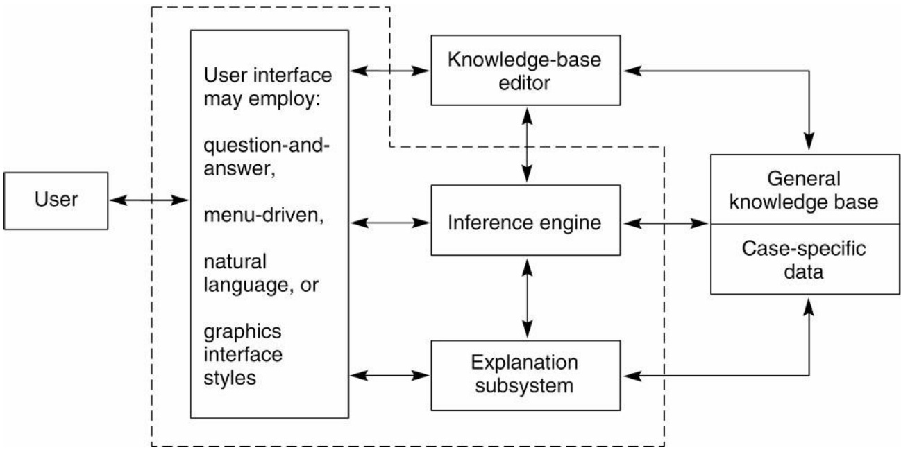

Hình 6\_1. Kiến trúc của một hệ chuyên gia tiêu biểu.

Động cơ suy diễn (inference engine) áp dụng tri thức cho việc giải quyết các bài toán thực tế. Về căn bản nó là một trình thông dịch cho cơ sở tri thức. Trong hệ sinh

<!-- page: 102 -->

(production system), động cơ suy diễn thực hiện chu trình điều khiển nhận dạng – hành động (recognize-act control cycle). Việc tách biệt cơ sở tri thức ra khỏi động cơ suy diễn là rất quan trọng vì nhiều lý do:

• Sự tách biệt của tri thức dùng để giải quyết vấn đề và động cơ suy diễn sẽ tạo điều kiện cho việc biểu diễn tri thức theo một cách tự nhiên hơn. Ví dụ, các luật if…then… gần gũi với cách con người mô tả những kỹ thuật giải quyết vấn đề của họ hơn so với một chương trình đưa luôn tri thức này vào phần mã máy tính cấp thấp.

• Bởi vì cơ sở tri thức được cách ly khỏi các cấu trúc điều khiển cấp thấp của chương trình, các nhà xây dựng HCG có thể tập trung một cách trực tiếp vào việc nắm bắt và tổ chức GQVĐ hơn là phải thực hiện trên các chi tiết của việc cài đặt vào máy tính.

• Sự phân chia tri thức và điều khiển cho phép thay đổi một phần cơ sở tri thức mà không tạo ra các hiệu ứng lề trên các phần khác của chương trình.

• Sự tách biệt này cũng cho phép một phần mềm điều khiển và giao tiếp có thể được sử dụng cho nhiều hệ thống khác nhau. Một trình cốt lõi của HCG (expert system shell) có tất cả các thành phần của hình 61, trừ phần cơ sở tri thức và dữ liệu của tình huống cụ thể. Các nhà lập trình có thể sử dụng “trình cốt lõi rỗng của HCG” và tạo ra một cơ sở tri thức mới thích hợp với ứng dụng của họ. Các đường chấm chấm trong hình 6\_1 biểu thị các module của trình cốt lõi.

• Như đã thảo luận trong chương 5 về hệ sinh, sự module hóa này cho phép chúng ta thử nghiệm nhiều chế độ điều khiển khác nhau trên cùng một cơ sở luật.

Một hệ con giải thích (explanation subsystem) ch phép chương trình giải thích quá trình suy luận của nó cho người dùng. Các giải thích này bao gồm các lập luận biện minh cho các kết luận của hệ thống (trả lời cho câu hỏi how), giải thích vì sao hệ thống cần dữ liệu đó (trả lời cho câu hỏi why),…

Nhiều HCG còn bao gồm một trình soạn thảo cơ sở tri thức (knowledge-base editor). Trình soạn thảo này giúp các nhà lập trình xác định và hiệu chỉnh lỗi trong quá trình làm việc của chương trình, thường là bằng cách truy xuất những thông tin cung cấp bởi hệ con giải thích. Chúng cũng có thể hỗ trợ cho việc bổ sung tri thức mới, giúp duy trì cú pháp luật chính xác, và thực hiện các kiểm tra tính nhất quán trên cơ sở tri thức đã cập nhật.

Việc sử dụng trình cốt lõi HCG có thể giúp ta giảm đáng kể thời gian thiết kế và cài đặt chương trình. Ví dụ, HCG MYCIN dùng để chẩn đoán bệnh viêm màng não xương sống và nhiễm trùng máu được phát triển trong khoảng 20 năm-người (person-year). EMYCIN (Empty MYCIN) là một trình cốt lõi của MYCIN được tạo ra bằng cách loại bỏ tri thức chuyên ngành khỏi chương trình MYCIN. Sử dụng EMYCIN, các kỹ sư tri thức đã cài đặt PUFF, một chương trình phân tích các vấn đề về phổi cho các bệnh nhân,

<!-- page: 103 -->

trong khoảng 5 năm-người. Đây là một sự tiết kiệm đáng kể và là một khía cạnh quan trọng chứng tỏ sức sống trên phương diện thương mại của công nghệ hệ chuyên gia.

Đối với người lập trình, điều quan trọng là phải lựa chọn đúng trình cốt lõi HCG để phát triển một HCG mới. Các bài toán khác nhau đòi hỏi các quá trình lập luận khác nhau: tìm kiếm hướng đích so với tìm kiếm hướng dữ liệu chẳng hạn. Chiến lược điều khiển cung cấp bởi trình cốt lõi cần phải thích hợp với ứng dụng; phương pháp suy luận y học dùng cho ứng dụng PUFF rất giống với phương pháp mà HCG MYCIN sử dụng; điều đó làm cho việc sử dụng trình cốt lõi EMYCIN trở nên thích hợp. Nếu trình cốt lõi có quá trình suy luận không thích hợp, thì việc sử dụng nó có thể là một sai lầm và tệ hơn là bắt đầu từ xây dựng từ đầu.

## Các vấn đề phù hợp để xây dựng HCG

Các HCG thường đòi hỏi sự đầu tư đáng kể về tiền bạc và sức lực con người. Những cố gắng để giải quyết một bài toán quá phức tạp, quá ít hiểu biết, hoặc có những yếu tố không phù hợp khác đối với công nghệ hiện tại có thể dẫn đến những thất bại hao tiền tốn của. Các nhà nghiên cứu đã xây dựng một tập hợp các chỉ dẫn có tính không hình thức cho việc xác định xem khi nào thì một bài toán thích hợp để giải quyết bằng HCG:

• **Sự cần thiết phải có một giải pháp phải biện minh cho chi phí và sức lực của việc xây dựng HCG, vì nếu không đó sẽ là một sự lãng phí.** Công ty máy tính DEC đã bỏ ra tiền và công sức để xây dựng HCG XCON để tự động hóa công tác tạo cấu hình cho máy tính. Kết quả, XCON đã giúp công ty tiết kiệm được tài chính và duy trì lòng tin của khách hàng. Tương tự, người ta đã cây dựng nhiều HCG trong các lĩnh vực như khai thác khoáng sản, kinh doanh quốc phòng, và y học, là những nơi tồn tại tiềm năng to lớn cho việc tiết kiệm tiền bạc, thời gian và sinh mạng con người.

• **Hiểu biết chuyên môn của con người không sẵn có ở mọi nơi cần đến nó**. Có rất nhiều HCG đã được xây dựng trong ngành y, vì sự chuyên môn và tính phức tạp trongkỹ thuật của y học hiện đại đã khiến cho các bác sĩ gặp nhiều khó khăn trong việc theo kịp những tiến bộ của các phương pháp chẩn đoán và điều trị. Số lượng các chuyên gia đáp ứng được các yêu cầu này rất hiếm và phải trả thù lao cao cho công việc của họ, do đó mà các hệ chuyên gia được nhìn nhận như là một cứu cánh. Nhờ có HCG, các bác sĩ ở địa phương có thể chẩn đoán và điều trị bệnh ở mức độ chuyên gia. Trong ngành địa chất, bằng cách bố trí HCG tại những nơi khai thác, nhiều vấn đề có thể được giải quyết mà không cần các chuyên gia con người phải có mặt. Tương tự, sự lãng phí những kiến thức chuyên môn có giá trị do việc chuyển đổi nhân viên hay những người sắp về hưu có thể biện minh cho việc xây dựng các hệ chuyên gia.

• **Vấn đề có thể được giải quyết bằng cách sử dụng các kỹ thuật suy luận ký hiệu**. Những giải pháp vấn đề không nên đòi hỏi sự khéo léo tay chân hay khả năng cảm thụ. Tuy rằng chúng ta đã có những robot và các hệ nhìn, hiện tại

<!-- page: 104 -->

chúng vẫn thiếu khả năng tinh tế và linh hoạt của con người. Các hệ chuyên gia chỉ thích hợp với các vấn đề mà con người có thể giải quyết thông qua sự suy luận trên các ký hiệu.

• **Phạm vi xác định vấn đề được cấu trúc tốt và không đòi hỏi sự suy luận theo lẽ thường tình (commonsense reasoning).** Mặc dù các hệ chuyên gia đã được xây dựng trong nhiều lĩnh vực đòi hỏi tri thức kỹ thuật chuyên môn hóa, nhiều sự suy luận theo lẽ thường của con người vẫn nằm ngoài khả năng hiện tại của chúng. Các lĩnh vực mang tính kỹ thuật cao có ưu điểm là được hiểu biết và hình thức hóa kỹ lưỡng: các thuật ngữ được định nghĩa đấy đủ và các chủ đề đã có sẵn những mô hình khái niệm rõ ràng và cụ thể.

• **Vấn đề có thể không giải quyết được bằng cách sử dụng các phương pháp tính toán truyền thống.** Không nên sử dụng công nghệ HCG để “phát minh lại chiếc bánh xe” (reinvent the wheel). Nếu một bài toán có thể giải quyết một cách thỏa đáng bằng những kỹ thuật truyền thống hơn như các phương pháp số, thống kê, … thì chúng không phải là một cử ứng viên cho việc thiết kế HCG.

**Có sự hợp tác và hiểu ý nhau giữa các chuyên gia.** Tri thức sử dụng bởi các chuyên gia hiếm khi tìm thấy trong các sách giáo khoa mà chỉ có được nhờ kinh nghiệm và sự đánh giá của con người khi làm việc trong lĩnh vực đó. Điều quan trọng là các chuyên gia đó sẵn sàng và có khả năng chia sẻ tri thức. Các chuyên gia có thể sẽ không hợp tác khi họ cảm thấy bị đe dọa bởi hệ thống, sợ rằng hệ thống có thể thay thế họ, hoặc nghĩa rằng đề án không thể thành công, chỉ lãng phí thời gian của họ, khi đó họ sẽ không bỏ ra thời gian và nỗ lực cần thiết.Một điều quan trọng khác là ban quản lý phải hỗ trợ dự án và chi phép các chuyên gia sử dụng thời gian làm việc chính thức của họ để cộng tác với các kỹ sư tri thức.

• **Vấn đề cần giải quyết phải có kích thước và quy mô đúng mức.** Vấn đề không được vượt quá khả năng của công nghệ hiện tại. Ví dụ, một chương trình cố gắng nắm bắt mọi hiểu biết chuyên môn của một bác sĩ y khoa sẽ không khả thi trong khi đó một chương trình cố vấn cho các bác sĩ trong việc sử dụng một phần nào đó của thiết bị chẩn đoán sẽ thích hợp hơn.

Mặc dù một vấn đề lớn có thể không phù hợp với giải pháp của hệ chuyên gia, ta có thể phân chia nó thành các vấn đề nhỏ hơn, độc lập nhau và phù hợp với HCG. Điều này tương ứng với chiến lược phân rã “top-down” sử dụng trong công nghệ phần mềm truyền thống. Một cách giải quyết khác là ta bắt đầu bằng một chương trình đơn giản có khả năng giải quyết một phần của vấn đề rồi từng bước tăng dần chức năng của nó để xử lý phạm vi lớn hơn của vấn đề. Chiến lược này gọi là “đường kẻ mỏng” (thin line), ám chỉ mục tiêu của nó là tạo ra một khuôn mẫu hy sinh bề rộng của khả năng ứng dụng nhằm ưu tiên việc tạo ra một lời giải đầy đủ cho tập hợp nhỏ các bài toán thử nghiệm. Kỹ thuật này tỏ ra hiệu quả để khám phá các vấn đề phức tạp và chưa được hiểu rõ. Người ta sử dụng thành công kỹ thuật này trong việc tạo ra XCON: ban đầu chương trình được thiết kế chỉ để định cấu hình cho các máy tính VAX 780; sau đó nó được mở rộng để xử lý luôn tất cả các hệ máy VAX và hệ máy PDP-11.

<!-- page: 105 -->

## Qui trình công nghệ tri thức

Những người liên quan chủ yếu trong việc xây dựng một HCG là kỹ sư tri thức (knowledge engineer), chuyên gia (domain expert) và người dùng cuối (end-user).

Kỹ sư tri thức là chuyên gia về ngôn ngữ và biểu diễn trong TTNT, với nhiệm vụ chính là chọn các công cụ phần mềm và phần cứng cho đề án, giúp đỡ chuyên gia phát biểu các tri thức cần thiết, và cài đặt các tri thức đó vào một cơ sở tri thức đúng đắn và hiệu quả. Thông thường, kỹ sư tri thức này ban đầu không hiểu biết gì về lĩnh vực ứng dụng.

Chuyên gia cung cấp tri thức về lĩnh vực ứng dụng. Thông thường, đây là một người đã từng công tác trong lĩnh vực ứng dụng và hiểu biết những kỹ thuật giải quyết vấn đề của nó, chẳng hạn như các cách làm tắt, xử lý dữ liệu không chính xác, đánh giá những giải pháp cục bộ, và tất cả những kỹ năng khác chứng tỏ anh ta có đẳng cấp của một chuyên gia. Chuyên gia chịu trách nhiệm chính trong việc giải thích rõ những kỹ năng này với kỹ sư tri thức.

Trong phần lớn các ứng dụng, người dùng cuối quyết định những ràng buộc thiết kế chính. Chừng nào người dùng đó còn chưa hài lòng, thì còn phải đầu tư sức lực cho việc phát triển chương trình. Những kỹ năng và nhu cầu của người dùng cần phải xem xét trong suốt quá trình thiết kế: chương trình có làm cho công việc của người dùng dễ dàng hơn, nhanh hơn, thuận tiện hơn không? Người dùng cần sự giải thích ở mức độ nào? Môi trường làm việc của người dùng có đặt ra những hạn chế nào đó cho việc sử dụng chương trình? Ví dụ như, một giao diện đòi hỏi việc gõ bàn phím sẽ không phù hợp với thao tác trong khoang lái của một máy bay chiến đấu phản lực.

Giống như hầu hết các công việc lập trình trong TTNT, việc xây dựng HCG đòi hỏi một chu trình phát triển theo kiểu không truyền thống dựa trên một bản mẫu được tạo ra ban đầu và việc xem xét lại mã lệnh một cách tăng dần. Phương pháp lập trình này còn gọi là lập trình thăm dò (exploratory programming).

<!-- page: 106 -->

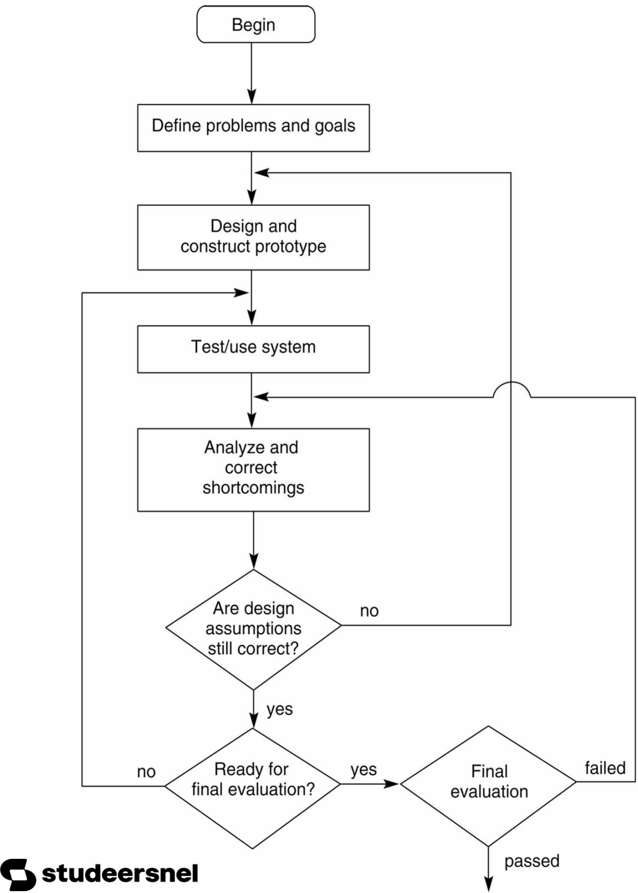

<!-- page: 107 -->

Hình 6\_2. Chu trình phát triển theo kiểm thăm dò.

Hình 6\_2 trình bày một lưu đồ mô tả chu trình phát triển theo kiểu lập trình thăm dò. Nói chung quá trình xây dựng hệ thống bắt đầu với việc kỹ sư tri thức cố gắng làm quen với phạm vi xác định vấn đề (problem domain). Điều này giúp ích cho việc giao tiếp với chuyên gia. Nó được thực hiện bằng những bài phỏng vấn mở đầu với chuyên gia đó, bằng sự quan sát các chuyên gia trong quá trình họ làm việc, hoặc thông qua việc đọc những tài liệu giới thiệu về lĩnh vực chuyên ngành đó. Tiếp theo kỹ sư tri thức và chuyên gia bắt đầu quá trình khai thác những tri thức giải quyết vấn đề của chuyên gia này. Công việc này được thực hiện bằng cách đưa cho chuyên gia một loạt các bài toán ví dụ và yêu cầu anh ta giải thích những kỹ thuật được sử dụng để đạt được lời giải. Trong giai đoạn này, việc sử dụng các băng video hoặc audio là rất quan trọng.

Thông thường, sẽ tốt hơn nếu kỹ sư tri thức là một người mới làm quen với lĩnh vực ứng dụng, vì những chuyên gia có thể quên đề cập đến những bước thao tác đã trở thành hiển nhiên hay thậm chí là tự động đối với họ sau nhiều năm công tác trong lĩnh vực đó. Vì vậy, các kỹ sư tri thức không biết gì về lĩnh vực này có thể sẽ phát hiện những bước nhảy cóc này, và do đó sẽ yêu cầu chuyên gia làm sáng tỏ vấn đề.

Ngay sau khi kỹ sư đã có được cái nhìn tổng quát về lĩnh vực của vấn đề và đã cùng chuyên gia giải quyết một số bài toán, anh ta sẽ bắt tay vào thiết kế hệ thống: chọn phương pháp biểu diễn tri thức, như luật hay frame chẳng hạn, xác định chiến lược tìm kiếm, tiến (forward), lùi (backward), theo chiều sâu (depth-first), tốt nhất (best-first), và thiết kế giao diện người dùng. Sau khi triển khai thiết kế này đến mức có thể hài lòng, kỹ sư tri thức bắt đầu xây dựng một bản mẫu (prototype).

Bản mẫu này cần phải có khả năng giải quyết những bài toán trong một phạm vi nhỏ của lĩnh vực và cung cấp một nền thử nghiệm cho những xác nhận thiết kế sơ bộ. Ngay sau khi bản mẫu được cài đặt xong, kỹ sư tri thức và chuyên gia sẽ thử nghiệm và cải tiến tri thức của nó bằng cách cho nó giải quyết một số bài toán và hiệu chỉnh những khuyết điểm của nó. Sau mỗi lần như vậy, họ thường có một phiên bản chương trình sáng sủa hơn. Nếu những giả thiết trong quá trình thiết kế bản mẫu tỏ ra là đúng đắn, thì bản mẫu có thể được dùng để xây dựng hệ thống cuối cùng. Tuy nhiên, bản mẫu cũng có thể bị loại bỏ nếu nó trở nên cồng kềnh hoặc các nhà thiết kế quyết định thay đổi phương pháp tiếp cận cơ sở đối với vấn đề.

Đặc trưng lớn thứ hai của lập trình HCG là cần xem chương trình như không bao giờ “kết thúc”. Một cơ sở tri thức kiểu heuristic lớn sẽ luôn luôn có những hạn chế của nó, vì tri thức thì luôn đổi mới và vì vậy cần phải được cập nhật.

<!-- page: 108 -->

## Mô hình khái niệm và vai trò của chúng trong việc thu thập tri thức

Trong HCG, tri thức đóng vai trò quyết định cho sự thành công cũng như hiệu quả giải quyết vấn đề của HCG. Tri thức này có được từ quá trình thu thập tri thức của các chuyên gia, tri thức này thường mơ hồ, không chính xác, và chỉ được phát biểu dài dòng theo từng bộ phận. Người kỹ sư tri thức có nhiệm vụ dịch những hiểu biết không hình thức này sang một ngôn ngữ hình thức thích hợp cho máy tính (xem hình 6\_3). Đây là một nhiệm vụ khó khăn, tuy nhiên, khó khăn trước tiên vẫn là việc tích lũy tri thức do nhiều nguyên nhân:

• Các kỹ năng của con người có được thường thông qua thực nghiệm. Sau nhiều năm thực hành, những kỹ năng này tích hợp chặt chẽ với nhau và hoạt động ở một cấp độ vô thức cao. Vì vậy, sẽ rất khó khăn cho các chuyên gia khi phải mô tả chính xác những gì họ làm trong quá trình giải quyết vấn đề.

• Tri thức của con người thường nằm ở dạng là “biết làm thế nào” (how) để đối phó với tình huống hơn là biết cần phải khắc họa trong óc một cách lý trí xem tình huống ấy là cái gì (what). Một ví dụ dễ thấy về đặc điểm này ở người biểu diễn xe đạp một bánh: trong thực tế, một người biểu diễn thành công không thể cùng lúc giải nhiều phương trình sai phân nhằm giữ thế cân bằng; mà thực ra anh ta chỉ phối hợp có tính trực giác những cảm giác về “trọng lực”, “xung lực” và “quán tính” để tạo thành một thủ tục điều khiển thích hợp.

• Tri thức của con người không căn cứ theo sự thật, không khách quan, vì hiểu biết của con người thể hiện một mô hình của cá nhân hay cộng đồng về thế giới. Những mô hình đó bị ảnh hưởng bởi những tập quán, những quá trình xã hội, và những quá trình tiềm ẩn khác…

• Tri thức luôn luôn thay đổi. Điều đó không chỉ do các chuyên gia tiếp nhận thêm những tri thức mới, mà còn do tri thức đang tồn tại có thể trở thành mục tiêu của những cải cách triệt để.

Hệ quả là, công nghệ tri thức là một quá trình khó khăn và cần được xem xét khi kéo dài chu trình sống của bất kỳ HCG nào. Để đơn giản hóa nhiệm vụ này, người ta cài đặt một mô hình khái niệm (conceptual model) nằm giữa hiểu biết chuyên môn của con người với chương trình như trong hình 6\_3. Mô hình khái niệm này thể hiện nhận thức của người kỹ sư tri thức về lĩnh vực đó, nó có thể bao gồm các từ điển dữ liệu, các biểu diễn đồ họa của không gian trạng thái và những lời bình đi kèm đều có thể là một phần của mô hình này.

Mô hình khái niệm không có tính hình thức hoặc có thể thi hành trực tiếp trên máy tính. Nó chỉ là một cấu trúc thiết kế trung gian, một mô hình mẫu để có thể bắt đầu đưa ra các ràng buộc và mã hóa các kỹ năng của con người. Nếu như kỹ sư tri thức sử dụng mô hình phép tính mệnh đề, thì nó có thể bắt đầu như một tập hợp các mạng đaon giản biểu diễn những trạng thái suy luận của người chuyên gia thông qua các tình huống giải

<!-- page: 109 -->

quyết vấn đề điển hình. Chỉ sau khi được cải tiến thêm, mạng này mới trở thành các luật if… then tường minh.

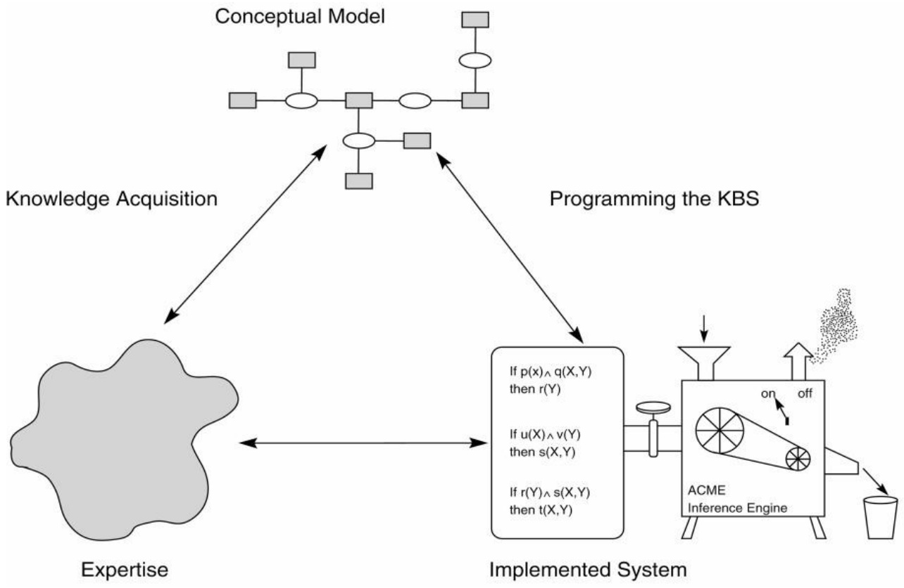

Hình 6\_3. Vai trò của mô hình khái niệm trong giải quyết vấn đề.

<!-- page: 110 -->

# HỆ chuyên gia DỰA trên LUẬT (RULE–BASED ES)

## HỆ chuyên gia DỰA trên LUẬT (RULE–BASED ES)

Các HCG dựa trên luật biểu diễn tri thức dưới dạng các luật if… then. Cách tiếp cận này thích hợp với kiến trúc ở hình 6\_1, và là một trong những kỹ thuật cổ điển và được sử dụng rộng rãi nhất dùng cho biểu diễn tri thức về một lĩnh vực trong HCG. Kiến trúc của HCG này tương tự với mô hình hệ sinh (production system) đã trình bày ở chương 5.

Nếu chúng ta xem kiến trúc HCG ở hình 6\_1 như một hệ sinh thì cơ sở tri thức là tập hợp các luật sinh (if… then). Dữ liệu cho trường hợp cụ thể được giữ trong bộ nhớ làm việc. Động cơ suy diễn thực hiện chu trình nhận dạng – hành động (recognize-act) của hệ sinh; cơ chế điều khiển này có thể là hường từ dữ liệu hay hướng từ mục tiêu.

Việc chọn lựa tiếp cận hướng từ dữ liệu hay hướng từ mục tiêu cũng giống như những thảo luận đã trình bày trong chương 3. Tuy nhiên, đối với một HCG, thì tiếp cận hướng từ mục tiêu sẽ tạo điều kiện cho quá trình giải thích hơn. Vì trong một hệ hướng từ mục tiêu, việc suy luận theo đuổi một mục tiêu cụ thể nào đó, mục tiêu đó bị chia thành nhiều mục tiêu con và cứ như thế; kết quả là việc tìm kiếm luôn luôn được hướng dẫn thông qua sự phân cấp mục tiêu và mục tiêu con này. Trong khi ở tìm kiếm hướng từ dữ liệu không tồn tại điều này, kết quả là quá trình tìm kiếm thường có vẻ dài dòng và không tập trung.

Để có một ví dụ cụ thể hơn về giải quyết vấn đề theo hướng từ mục tiêu, ta xét một HCG nhỏ dùng để chẩn đoán những trục trặc trong xe hơi, gọi tắt là HCG “Chẩn đoán xe hơi”:

Luật 1 **IF** động cơ nhận được xăng **AND** động cơ khởi động được

**THEN** trục trặc là do bugi.

Luật 2 **IF** động cơ không khởi động được **AND** đèn không sáng

**THEN** trục trặc là do ắcquy hoặc dây cáp

Luật 3 **IF** động cơ không khởi động được **AND** đèn sáng

**THEN** trục trặc là do môtơ khởi động

Luật 4 **IF** còn xăng trong bình chứa nhiên liệu **AND** còn xăng trong bộ chế hòa khí

**THEN** động cơ nhận được xăng

<!-- page: 111 -->

Trong chế độ điều khiển hướng từ mục tiêu, đầu tiên mục tiêu cao nhất là “trục trặc là do $\mathrm { X ^ { \flat } }$ sẽ được đưa vào bộ nhớ làm việc như hình 6\_4:

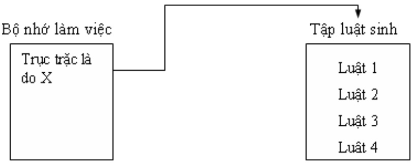

Hình 6\_4. Hệ sinh tại thời điểm ban đầu của một lần chẩn đoán.

Có 3 luật đối sánh (match) với biểu thức này trong bộ nhớ làm việc: luật 1, 2 và 3. Nếu ta chọn luật ưu tiên theo số thứ tự của nó, thì luật 1 sẽ được đốt cháy, khi đó X sẽ được gắn kết (bound) với giá trị bugi và những tiền đề (vế trái) của luật 1 được đặt vào bộ nhớ làm việc như hình 6\_5.

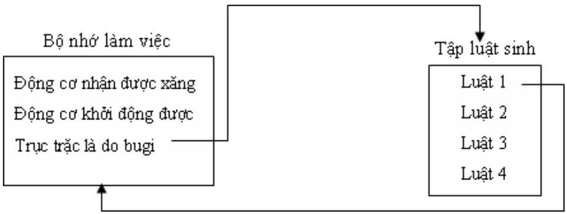

Hình 6\_5. Hệ sinh sau khi luật 1 được đốt cháy.

Để chứng minh mục tiêu con là động cơ nhận được xăng thì luật 4 được đốt cháy, và những tiền đề của luật này được đặt vào bộ nhớ làm việc như hình 6\_6.

<!-- page: 112 -->

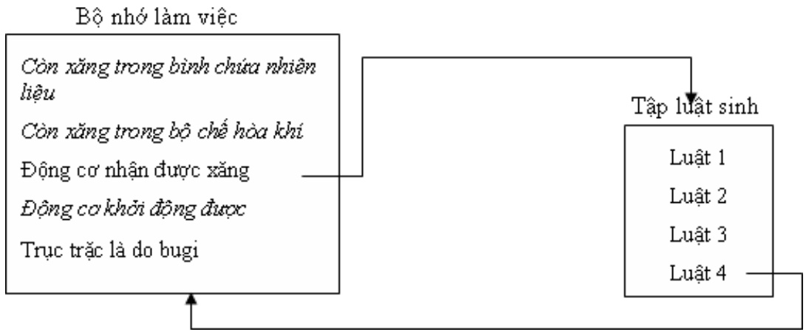

Hình 6\_6. Hệ sinh sau khi đốt cháy luật 4.

Tại thời điểm này, có ba mục trong bộ nhớ làm việc (các mục in nghiêng trong hình 6\_6) là không đối sách với bất kỳ kết luận của luật nào. Trong tình huống này, HCG sẽ truy vấn trực tiếp người dùng về những mục tiêu mới này. Nếu người dùng xác nhận cả ba mục tiêu này đều đúng, thì HCG sẽ xác định một cách thành công rằng trục trặc xe là do bugi. Trong quá trình tìm ra lời giải này, hệ thống đã kiểm tra nhánh trái nhất của đồ thị Và/Hoặc trong hình 6\_7.

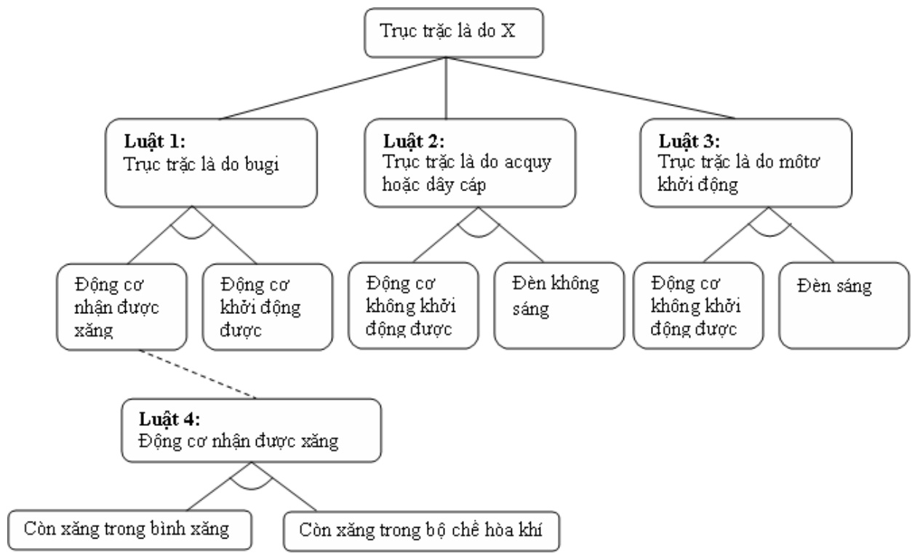

Hình 6\_7. Đồ thị Và/Hoặc được tìm kiếm trong ví dụ chẩn đoán xe ôtô.

<!-- page: 113 -->

## Khả năng giải thích và tính trong suốt của suy luận hướng từ mục tiêu

Để thấy được khả năng giải thích và tính trong suốt của suy luận hướng từ mục tiêu, ta giả định phiên chẩn đoán đang ở giai đoạn của hình 6\_6. Đoạn hội thoại sau đây được bắt đầu bằng việc máy tính yêu cầu người dùng cho biết về các mục tiêu con hiện có trong bộ nhớ làm việc (trả lời của người dùng được gạch dưới):

\- còn xăng trong bình chứa nhiên liệu? yes

\- còn xăng trong bộ chế hòa khí? yes

\- động cơ khởi động được không? <u>why</u>

Đến đây, người dùng đánh vào câu hỏi why, nghĩa là muốn hỏi, tại sao anh cần biết động cơ có khởi động được hay không? Khi đó hệ thống trả lời

Đã xác định được rằng:

1. động cơ nhận được xăng,

Vì vậy nếu

2. động cơ khởi động được ,

Thì có thể kết luận: trục trặc là do bugi

Giả sử người dùng tiếp tục hỏi:

động cơ nhận được xăng như thế nào?

Khi đó, hệ thống sẽ trả lời:

Điều này có từ luật 4

IF còn xăng trong bình chứa nhiên liệu AND còn xăng trong bộ chế hòa khí

THEN động cơ nhận được xăng

Người dùng đã cho biết: còn xăng trong bình chứa nhiên liệu

Người dùng đã cho biết: còn xăng trong bộ chế hòa khí

Một lần nữa, kiến trúc hệ sinh cho chúng ta một cở sở thiết yếu để có những giải thích này. Mỗi chu trình của vòng lặp điều khiển sẽ chọn và đốt cháy một luật khác. Chương

<!-- page: 114 -->

trình có thể dứng lại sau mỗi chu trình và cho phép người dùng kiểm tra. Vì mỗi luật biểu diễn một bó tri thức đầy đủ, nên luật hiện tại cho ta một ngữ cảnh để giải thích. Ngoài ra, tính module của mỗi luật cũng tạo điều kiện cho việc thêm hay sửa đổi một luật được thực hiện một cách dễ dàng mà không hề ảnh hưởng đến các luật khác.

## Hệ chuyên gia R1/XCON

HCG R1 hay XCON được đưa ra vào năm 1982 là một trong những HCG thương mại thành công đầu tiên. Như đã giới thiệu trong các phần trên, ban đầu chương trình được thiết kế chỉ để định cấu hình cho các máy tính VAX 780; sau đó nó được mở rộng để xử lý luôn cho các hệ máy VAX và hệ máy PDP-11. Đầu vào của hệ thống là đơn đặt hàng của khách hàng và sau đó áp dụng các luật để sinh ra một cấu hình hoàn chỉnh, thống nhất cùng với các sơ đồ biểu diễn mối quan hệ về không gian và logic của các bộ phận trong máy (McDermott 1981).

Kiến trúc của HCG XCON được mô tả như hình 6\_8.

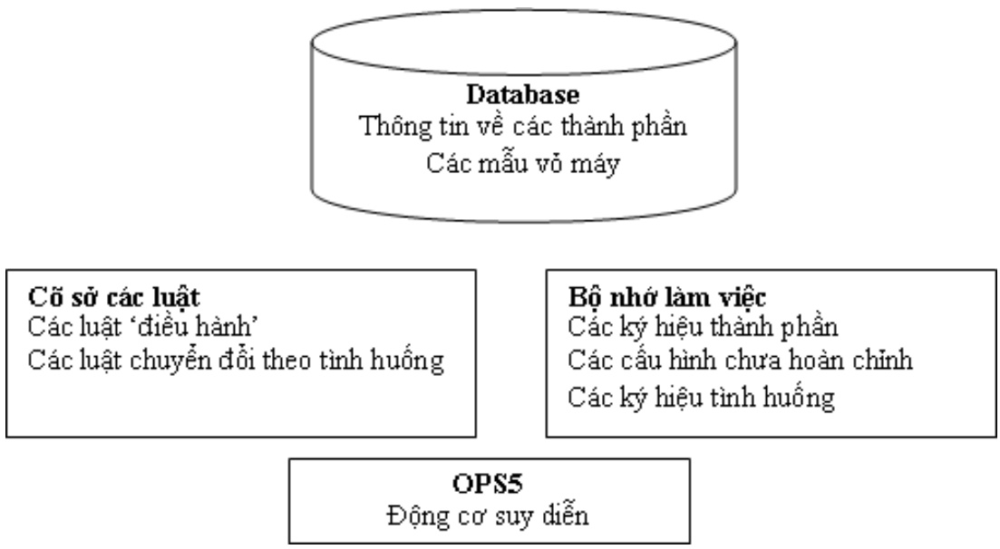

Hình 6\_8. Kiến trúc của HCG XCON

XCON là một HCG dựa trên luật, nó chứa một cơ sở các luật bao gồm khoảng 10000 luật được viết với ngôn ngữ OPS5 (OPS – Official Production System). Các luật này dùng để điều khiển quá trình tạo cấu hình cho máy, nó có một đặc điểm đặc biệt là tiền đề của luật thường bắt đầu bằng một điều kiện kiểm tra tình huống hiện tại, chẳng hạn như:

**IF** the most current active context is distributing Massbus devices

& there is a single port disk drive that has not been assigned to a Massbus

<!-- page: 115 -->

& there are no unassigned dual port disk drives & the number of devices that each Massbus should support is known

& there is a Massbus that has been assigned at least one disk drive and that should support additional disk drives

& the type of cable needed to connect the disk drive to the previous device is known

## THEN assign the disk drive to the Massbus

Trong luật trên, điều kiện đầu tiên (được in nghiêng) là điều kiện kiểm tra xem tình huống mới nhất hiện tại (most current active context) có phải là đang phân phối các thiết bị Massbus hay không? Nếu đúng thì động cơ suy diễn mới kiểm tra các điều kiện kế tiếp, nếu sai thì bỏ qua luật này. Để có thể biết được tình huống hiện tại là gì, hệ thống sẽ truy cập vào bộ nhớ làm việc, nơi có lưu trữ các ký hiệu về tình huống hiện tại. Chính nhờ cấu trúc luật đặc biệt này mà mặc dù cơ sở luật có đến 10000 luật nhưng hệ thống thực hiện quá trình đối sánh để đưa ra các luật khả thi tại một thời điểm là rất nhanh. Với tính chất này, có thể nói công việc tạo cấu hình của R1/XCON được xem như là một hệ thống phân chia thành các công việc nhỏ hơn với sự phụ thuộc thời gian (temporal dependency) rất mạnh, công việc này phải thực hiện trước công việc kia.

Ngoài ký hiệu tình huống, bộ nhớ làm việc của hệ thống còn chứa các thông tin như ký hiệu của các thành phần đang có, ký hiệu các cấu hình đang thực hiện dở dang, chưa hoàn chỉnh. Vì các thành phần của máy thường được đặc trưng bởi nhiều thông số kỹ thuật, nên bộ nhớ làm việc chỉ chứa ký hiệu của nó, còn thông tin về các thông số này sẽ được lưu trong một cơ sở dữ liệu.

Động cơ suy diễn của XCON được phát triển bằng OPS5, sử dụng tiếp cận tìm kiếm hướng từ dữ liệu, hay suy luận tiến. Kết quả của hệ thống có thể nói là tương đương hoặc có khi tốt hơn giải pháp của các chuyên gia con người. Về tốc độ, thì HCG cho ra giải pháp nhanh gấp mười lần chuyên gia, và đã tiết kiệm được cho công ty DEC hàng năm khoảng 25 triệu đôla.

## Kết luận về HCG dựa trên luật

## Ưu điểm của HCG dựa trên luật:

• Khả năng sử dụng trực tiếp các tri thức thực nghiệm của các chuyên gia.

• Tính module của luật làm cho việc xây dựng và bảo trì luật dễ dàng.

• Có thể thực hiện tốt trong các lĩnh vực hạn hẹp.

• Có tiện ích giải thích tốt.

• Các luật ánh xạ một cách tự nhiên vào không gian tìm kiếm trạng thái.

• Dễ dàng theo dõi một chuỗi các luật và sửa lỗi.

<!-- page: 116 -->

• Sự tách biệt giữa tri thức và điều khiển giúp đơn giản hóa quá trình phát triển HCG.

## Khuyết điểm của HCG dựa trên luật:

Các luật đạt được từ các chuyên gia mang tính heuristic rất cao. Chẳng hạn như trong lĩnh vực y học, luật “If sốt-cao Then bị-nhiễm-trùng” là sự kết hợp trực tiếp các triệu chứng quan sát được và các chẩn đoán, mà không thể hiện sự hiểu biết lý thuyết sâu hơn về lĩnh vực chuyên ngành (như cơ chế phản ứng của cơ thể để chống lại vi trùng chẳng hạn), hoặc luật “If sốt-cao Then cho-uống-Aspirin” cũng không thể hiện tri thức về giải quyết vấn đề tức là quá trình chữa bệnh như thế nào.

• Các luật heuristic “dễ vỡ”, không thể xử lý các trường hợp ngoài dự kiến. Vì các luật được tạo ra từ kinh nghiệm của các chuyên gia trên những tình huống đã biết, nên khi gặp phải một tình huống mới không đúng với các kinh nghiệm đó, thì các luật này không giải quyết được.

• Có khả năng giải thích chứ không chứng minh. HCG dựa trên luật chỉ có thể giải thích rằng kết luận này là do suy luận từ các luật như thế nào, chứ không chứng minh được kết luận đó là đúng.

• Các tri thức thường rất phụ thuộc vào công việc. Quá trình thu thập tri thức rất phức tạp và khó khăn, tuy nhiên, tri thức có được không thể sử dụng lại cho một công việc khác.

• Khó bảo trì các cơ sở luật lớn.

<!-- page: 117 -->

# SUY LUẬN DỰA TRÊN MÔ HÌNH: (MODEL–BASED REASONING)

## SUY LUẬN DỰA TRÊN MÔ HÌNH: (MODEL–BASED REASONING)

Với các khuyết điểm của HCG dựa trên luật kể trên, tiếp cận dựa trên mô hình được đưa ra nhằm giải quyết các vấn đề này. Hệ thống suy luận dựa trên mô hình là một hệ thống mà sự phân tích căn cứ trực tiếp trên một mô tả chi tiết và chức năng của một hệ thống vật lý. Trong thiết kế và sử dụng, một hệ suy luận dựa trên mô hình tạo ra một sự mô phỏng bằng phần mềm đối với chức năng của cái mà chúng ta muốn tìm hiểu hay sửa chữa.

Những ứng dụng đầu tiên của tiếp cận này là cho mục đích dạy học. Nhiệm vụ của hệ dạy học này là kiểm tra kiến thức của sinh viên về thiết bị hay mạch điện cũng như truyền đạt bất cứ kiến thức nào mà các sinh viên bỏ sót. Từ mục đích dạy học ban đầu này, các hệ suy luận dựa trên mô hình chuyển sang các hệ tìm hỏng hóc của thiết bị (trouble-shooting system). Để tìm lỗi của một hệ thống vật lý, mô hình sẽ cho người dùng biết là cần phải mong đợi gì từ hệ thống, và khi nào thì cái quan sát được khác với cái mong đợi, và sự khác biệt này dẫn đến lỗi như thế nào.

Một hệ thống chẩn đoán dựa trên mô hình đòi hỏi:

• Một mô tả cho mỗi bộ phận trong thiết bị. Từ những mô tả này mà hệ chẩn đoán có thể mô phỏng hành vi của từng bộ phận.

• Một mô tả cấu trúc bên trong của thiết bị. Đây thường là một biểu diễn của các thành phần và sự nối kết qua lại của chúng. Những thông tin này giúp hệ thống mô phỏng sự tương tác giữa các thành phần của thiết bị.

• Việc chẩn đoán một lỗi cụ thể đòi hỏi sự quan sát việc thực hiện thật sự của thiết bị, thông thường là việc đo các thông số vào/ra của nó.

Vì vậy, nhiệm vụ của hệ sẽ là xác định bộ phận nào có lỗi dựa trên các hành vi quan sát được. Điều này đòi hỏi phải có thêm các luật mô tả các chế độ có lỗi đã biết cho các bộ phận khác nhau và sự nối kết của chúng. Hệ suy luận khi đó cần tìm ra những lỗi có khả năng nhất có thể giải thích hành vi quan sát được của hệ thống.

## Ví dụ hệ chẩn đoán lỗi dựa trên mô hình

Xét một mạch gồm ba bộ nhân (multiplier) và hai bộ cộng liên kết với nhau như trong hình 6.14. Trong ví dụ này những giá trị đầu vào được cho tại các điểm từ A đến E và các giá trị đầu ra tại F và G. Những giá trị đầu ra mong muốn được đặt trong các dấu ()

<!-- page: 118 -->

và giá trị thực được đặt trong các dấu []. Nhiệm vụ đặt ra là xác định xem lỗi nằm ở đâu và nó sẽ giải thích sự không nhất quán này.

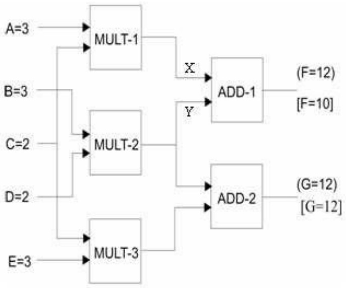

Hình 6\_9. Tận dụng hướng đi của luồng thông tin để chẩn đoán lỗi.

Ta thấy kết quả tại đầu ra F không như mong đợi, mà đầu ra này xuất ra từ bộ cộng ADD-1, bộ cộng này nhận giá trị đầu vào từ MULT-1 và MULT-2. Vậy phải có một trong ba thiết bị có lỗi, và do đó, ta có ba giả thuyết cần xem xét.

Giả thuyết đầu tiên là ADD-1 và MULT-1 đúng, nghĩa là đầu vào X của ADD-1 đúng (6), khi đó đầu vào Y sẽ là 4, nghĩa là bộ nhân MULT-2 có lỗi. Nhưng, nếu là như vậy thì giá trị thực tại G phải là 10, chứ không phải 12 như ta thấy. Vì vậy, có thể nói MULT-2 không thể là bộ phận gây lỗi. Vậy, lỗi chỉ có thể nằm ở MULT-1 hoặc ADD-1. Chúng ta có thể làm thêm một số bước kiểm tra để xác định lỗi nằm ở đâu.

Trong khi suy luận về tình huống của hình 6\_9. Chúng ta có ba nhiệm vụ:

• Phát sinh giả thuyết: cho trước một lỗi, chúng ta giả thuyết những bộ phận nào đó của thiết bị đã gây ra nó.

• Kiểm nghiệm giả thuyết: cho trước một tập các bộ phận có khả năng có lỗi, chúng ta đã xác định xem bộ phận nào trong số đó có thể giải thích hành vi mà chúng ta quan sát được.

• Loại trừ giả thuyết: khi có nhiều hơn một giả thuyết đúng sau pha kiểm nghiệm, như đã xảy ra trong hình 6\_9, chúng ta phải xác định những thông tin bổ sung nào cần được suy ra để tiếp tục tìm kiếm lỗi.

Một điều cần lưu ý rằng trong ví dụ trên, ta chỉ giả định một thiết bị duy nhất có lỗi. Mặc dù giả thiết một lỗi duy nhất là một heuristic hữu ích, thường đúng đắn, nhưng thế giới thực thì không đơn giản như vậy.

<!-- page: 119 -->

## Kết luận về hệ suy luận dựa trên mô hình

Vì dựa trên sự hiểu biết lý thuyết về các thiết bị đang đề cập, các kỹ thuật dựa trên mô hình bù đắp được nhiều hạn chế của những phương pháp có tính heuristic hơn như hệ chuyên gia dựa trên luật. Một số ưu điểm của hệ thống này có thể liệt kê ra như sau:

• Tạo khả năng sử dụng tri thức về cấu trúc và chức năng của lĩnh vực trong giải quyết vấn đề.

• Vượt qua hạn chế của HCG dựa trên luật, HCG này có khuynh hướng mạnh, “khó vỡ”.

• Một số tri thức có thể chuyển tải cho các công việc khác.

• Có khả năng cung cấp các lời giải thích chỉ rõ nguyên nhân. Những giải thích này có thể truyền đạt một sự hiểu biết sâu hơn về lỗi cho người dùng, và cũng đảm nhiệm một vai trò giảng dạy quan trọng.

Tuy nhiên, hệ suy luận này cũng có những hạn chế của nó:

• Mô hình chỉ là một mô hình nghĩa là một sự trừu tượng của hệ thống, vì vậy ở một mức độ chi tiết nào đó có thể không đúng. Như trong ví dụ trên, chúng ta đã xem giá trị tại những dây dẫn đầu vào cũng như các dây dẫn nối kết bên trong là đúng đắn, ta không thể kiểm tra tình trạng của dây dẫn. Điều gì sẽ xảy ra nếu dây dẫn bị đứt, hoặc có sự kết nối lỏng lẻo với các bộ phận?

• Có một giả thiết ngầm hiểu về thế giới đóng, những gì không nằm trong mô hình có nghĩa là không tồn tại. Vì trong mô hình ta không mô tả dây dẫn, nên ta xem như chúng không tồn tại, vì vậy không thể kiểm tra chúng.

• Hệ suy luận này đòi hỏi phải có một mô hình lý thuyết rõ ràng. Nên việc tích lũy tri thức có thể gặp nhiều khó khăn, khó đạt được mô hình tốt, có khi là không tồn tại mô hình rõ ràng như trong một số chuyên ngành y khoa, tài chính…

• Hệ thống tạo ra có thể lớn và chậm, độ phức tạp cao, có nhiều tình huống ngoại lệ.

Mặc dù vậy, HCG dựa trên mô hình là một bổ sung quan trọng cho các công cụ của kỹ sư tri thức.

<!-- page: 120 -->

# SUY LUẬN DỰA TRÊN TRƯỜNG HỢP: (caSe–BASED REASONING)

## SUY LUẬN DỰA TRÊN TRƯỜNG HỢP: (caSe–BASED REASONING)

Các luật heuristic và mô hình lý thuyết là hai kiểu thông tin mà các chuyên gia người sử dụng để giải quyết vấn đề. Một chiến lược mạnh khác mà các chuyên gia sử dụng là suy luận từ những tình huống, là những ví dụ về các bài toán trong quá khứ và lời giải của chúng. Ví dụ, một luật sư sẽ chọn những tình huống luật đã xảy ra trong quá khứ tương tự với tình huống của thân chủ của anh ta và gợi ý cho anh ta một phương pháp thuyết phục tòa hợp lý để bênh vực cho thân chủ. Các nhà lập trình máy tính sử dụng lại mã của họ, khi sửa chữa một chương trình cũ để thích nghi với tình huống mới có cấu trúc tương tự. Các kiến trúc sư sử dụng kiến thức của họ về những tòa nhà tốt và được ưa thích trong quá khứ để thiết kế những tòa nhà mới mà người ta cảm thấy vừa ý và thuận tiện,… Tóm lại, suy luận từ những tình huống đã có là khả năng có tính chất nền tảng của trí thông minh con người. Và suy luận dựa trên tình huống cũng phát triển theo tiếp cận đó.

HCG dựa trên tình huống (Case-based Reasoning – CBR) sử dụng một CSDL riêng biệt chứa giải pháp của các tình huống đã giải quyết để dựa vào đó tìm kiếm giải pháp cho một tình huống mới. Các tình huống thường được lưu lại như là một tập hợp các luật tình huống – hành động (situation – action). Các sự kiện mô tả tình huống của luật là những đặc điểm nổi bật của tình huống được ghi nhận.

Khi giải quyết một vấn đề, một CBR phải:

• Truy vấn các tình huống thích hợp từ bộ nhớ (hay CSDL) của nó, dựa vào sự tương tự của một số đặc điểm nổi bật.

• Sửa đổi tình huống đó để có thể áp dụng trong tính huống hiện tại.

• Áp dụng tình huống đã chuyển đổi vào bài toán mới.

• Lưu lại lời giải và kết quả của nó (thành công hay thất bại).

CBR đưa ra hàng loạt ưu điểm cho việc xây dựng các chuyên gia:

• Đơn giản hóa việc tích lũy tri thức từ các chuyên gia với việc lưu trữ một cách trực tiếp các tri thức có được, đó là những lời giải của chuyên gia cho hàng loạt các bài toán.

• Bằng cách tìm giải pháp của một tình huống tương tự đã có để đưa ra lời giải cho phép rút ngắn thời gian suy luận của hệ thống. Tuy nhiên, điều này cần phải xem xét lại nếu hệ thống có một CSDL tình huống rất lớn.

<!-- page: 121 -->

• Thao tác lưu lại lời giải và kết quả của nó tạo khả năng tự học cho hệ thống: giúp hệ thống tránh lỗi cũ và tận dụng những thành công trong quá khứ

• Việc phân tích tri thức của lĩnh vực chỉ diễn ra một lần, đó là khi tìm kiếm một sự biểu diễn hợp lý cho các tình huống, hay quá trình chọn các đặc điểm nổi bật (salient features) của các tình huống để có thể so sánh và đưa ra kết luận về tính tương đương của hai tình huống nào đó. Đây cũng là khó khăn lớn nhất của tiếp cận này. Vì nếu ta chọn các đặc điểm nổi bật dùng để so sánh hai tình huống không phù hợp, thì kết luận của ta về tính tương đương của hai tình huống có thể sẽ không chính xác, và khi tình huống chọn ra không đúng sẽ không cho ra một lời giải thích hợp.

• Ở đây, ta sẽ không nghiên cứu sâu về vấn đề này, tuy nhiên đọc giả có thể tham khảo thêm về các tài liệu của Kolodner (1993) và các đồng nghiệp khác.

• Việc tích lũy tri thức và lập trình là tương đối đơn giản.

• Các chiến lược sắp xếp (index) thích hợp làm tăng sức mạnh của phương pháp này.

## Tiếp cận này cũng có các khuyết điểm của nó:

• Các tình huống không thể hiện tri thức sâu về lĩnh vực bài toán, do đó khó giải thích tại sao đưa ra lời giải như vậy, hoặc có thể đưa ra lời giải sai hoặc không tốt.

• Một cơ sở chứa các tình huống lớn phải xem xét sự tương xứng giữa tính toán và lưu trữ. Vì khi CSDL lớn lên, thời gian cần đẻ lấy ra một tình huống thích hợp cũng lớn lên. Cuối cùng thì chi phí cho việc tìm kiếm một tình huống sẽ lớn hơn thời gian cần thiết để rút ra một lời giải bằng cách suy luận từ các luật hoặc từ mô hình (hai tiếp cận trước).

• Khó đưa ra tiêu chuẩn đánh giá sự tương tự của các tình huống, và sắp xếp chúng.

## Tóm tẮt

## Nội dung chính của chương này bao gồm:

• Hệ chuyên gia là một hệ thống sử dụng các tri thức thu thập được từ kinh nghiệm của các chuyên gia để giải quyết các vấn đề ở mức độ chuyên gia.

• Không phải vấn đề nào cần giải quyết cũng phù hợp với giải pháp hệ chuyên gia.

• Một HCG được phát triển theo phương pháp lập trình thăm dò.

• Việc thu thập tri thức từ chuyên gia là một việc làm khó khăn và cần có sự hợp tác chặt chẽ giữa kỹ sư tri thức và các chuyên gia.

• Mô hình khái niệm là một công cụ hỗ trợ cho quá trình thu thập tri thức.

<!-- page: 122 -->

• Hệ chuyên gia dựa trên luật có kiến trúc và cơ chế hoạt động tương tự như một hệ sinh, đây là một trong những kỹ thuật đầu tiên và được sử dụng rộng rãi nhất dùng cho biểu diễn tri thức trong lĩnh vực HCG.

Hệ chuyên gia dựa trên mô hình là một hệ thống mà sự phân tích căn cứ trực tiếp trên một mô tả chi tiết và chức năng của một hệ thống vật lý.

• Hệ chuyên gia dựa trên tình huống sử dụng một CSDL để chứa các tình huống đã giải quyết để dựa vào đó tìm kiếm giải pháp cho một tình huống mới.

## Bài tập chương VI

Trong thí dụ 6.1 đã giới thiệu một tập hợp luật dùng cho chẩn đoán các trục trặc trong ô tô. Hãy chỉ ra ai có thể là những kỹ sư tri thức, những chuyên gia chuyên ngành và người dùng cuối cho một ứng dụng như vậy ? Thảo luận các ý kiến này ?

Bổ sung thêm một số luật dưới dạng IF ... THEN ... vào tập luật trong thí dụ 6.1 để mô tả các quan hệ trong lĩnh vực này. Vẽ đồ thị AND/OR biểu diễn những quan hệ giữa các luật trong tập luật vừa mới xây dựng.

Xét đồ thị AND/OR vừa thiết kế trong bài tập 6.2, cho biết bạn đề nghị cơ chế tìm kiếm hướng dữ liệu hay hướng mục tiêu ? Tìm kiếm theo chiều rộng hay theo chiều sâu ? Có thể áp dụng heuristic cho quá trình tìm kiếm không ?

Chọn một lĩnh vực khác thích hợp đối với việc thiết kế một hệ chuyên gia. Xây dựng một tập hợp luật minh họa cho ứng dụng này.

<!-- page: 123 -->

# SUY LUẬN KHÔNG CHẮC CHẮN

**Giới thiệu**

**GIỚI THIỆU:**

Trong các chương trước, các thủ tục suy diễn của chúng ta đã tuân theo mô hình suy luận sử dụng trong phép tính vị từ: từ các tiền đề đúng đắn, các luật suy diễn vững chắc sinh ra những kết luận mới, đảm bảo là đúng đắn. Tuy nhiên, trong thực tế, có rất nhiều tình huống chúng ta phải rút ra những kết luận tốt từ những bằng chứng được xác định nghèo nàn và không chắc chắn thông qua việc sử dụng những suy diễn không vững chắc. Đây không phải là một nhiệm vụ không thể thực hiện được, trái lại chúng ta thực hiện chúng rất thành công trong hầu hết mọi khía cạnh của cuộc sống; chẳng hạn như chúng ta phát biểu những chẩn đoán y học đúng đắn và đề xuất cách điều trị từ những triệu chứng không rõ ràng; phân tích những trục trặc của xe ôtô từ những biểu hiện của nó; nhận ra bạn bè chỉ qua giọng nói hoặc điệu bộ của họ,…

Như vậy, ở đây ta có hai loại thông tin không chắc chắn: một là dữ liệu ban đầu được cho là không chắc chắn, không đủ, không đáng tin cậy,… hai là các luật mà ta sử dụng để suy luận không hợp logic, suy luận ngược từ kết luận về điều kiện, hay có thể gọi là suy luận theo kiểu phỏng đoán (abduction). Suy luận phỏng đoán khác với kiểu suy luận vững chắc đề cập ở chương II. Luật modus ponens phát biểu rằng nếu ta có luật P → Q và có P thì ta có thể kết luận Q, như trong luật sau đây:

If ắc quy hoặc dây cáp bị trục trặc

Then động cơ không khởi động được và đèn không sáng.

Đây là một luật luôn luôn đúng hay một suy diễn vững chắc (sound inference rule), nhưng nó không giúp ích cho quá trình chẩn đoán các trục trặc xe hơi. Tuy nhiên, đảo ngược của nó:

If động cơ không khởi động được và đèn không sáng.

Then ắc quy hoặc dây cáp bị trục trặc

lại rất hữu dụng cho việc chẩn đoán trục trặc xe. Đây là một phỏng đoán (abduction) từ triệu chứng quan sát được suy ngược trở lại nguyên nhân của chúng, nên gọi là luật suy diễn không vững chắc (unsound inference rule) vì cũng có thể là ắc quy và dây cáp bình thường, nhưng chiếc xe chỉ đơn giản là có môtơ khởi động hỏng và đèn pha đã bị đứt.

<!-- page: 124 -->

Mặc dù phỏng đoán là không vững chắc, nhưng nó thường đóng vai trò thiết yếu trong giải quyết vấn đề. Trong chương này, chúng tôi đề cập đến hai tiếp cận xử lý suy diễn phỏng đoán và sự không chắc chắn. Tiếp cận thứ nhất là tiếp cận thống kê, trong hướng tiếp cận này sẽ trình bày hai phương pháp: lý thuyết xác suất Bayesian và đại số hệ số chắc chắn Stanford. Tiếp cận thứ hai là suy luận theo logic mờ.

Download slide bài giảng <u>tại đây</u>

<!-- page: 125 -->

# TIẾP CẬN THỐNG KÊ ĐỐI VỚI TÍNH KHÔNG CHẮC CHẮN

## TIẾP CẬN THỐNG KÊ ĐỐI VỚI TÍNH KHÔNG CHẮC CHẮN

**Suy luận Bayes**

Suy luận Bayes dựa trên lý thuyết xác suất hình thức và được sử dụng rộng rãi trong một số lĩnh vực nghiên cứu hiện nay, bao gồm cả nhận dạng và phân loại. Trước khi đi vào lý thuyết về Bayes, ta hãy cùng nhau xem lại một số khái niệm cơ bản của lý thuyết xác suất.

## Định nghĩa

• Xác suất tiên nghiệm (prior probability) hay xác suất vô điều kiện (unconditional probability): là xác suất của một sự kiện trong điều kiện không có tri thức bổ sung cho sự có mặt hay vắng mặt của nó.

• Xác suất hậu nghiệm (posterior probability) hay xác suất có điều kiện (conditional probability): là xác suất của một sự kiện khi biết trước một hay nhiều sự kiện khác.

$$
\mathrm{P} (\mathrm{e} 1 | \mathrm{e} 2) = \frac {| \mathrm{e} 1 \text {and} \mathrm{e} 2 |}{| \mathrm{e} 2 |} = \frac {\text {Số lần xuất hiện cả hai sự kiện e1 và e2}}{\text {Số lần xuất hiện sự kiện e2}}
$$

Ví dụ, cho trước một căn bệnh d và một triệu chứng s, thì xác suất một người có triệu chứng s bị bệnh d được tính theo:

$$
\mathrm{P} (\mathrm{d} \mid \mathrm{s}) = \frac {| \mathrm{d} \text {and} \mathrm{s} |}{| \mathrm{s} |} = \frac {\text {Số người bị bệnh d có triệu chứng s}}{\text {Số người có triệu chứng s}}
$$

Để tính $\mathbf { P } ( \mathbf { d } \mid \mathbf { s } )$ theo công thức trên thì ta phải thực hiện các cuộc điều tra thống kê trên một phạm vi cộng đồng dân cư rộng lớn mới cho ta được một xác suất chính xác. Bayes đưa ra một công thức tính khác cho phép ta tính được $\mathbf { P } ( \mathbf { d } \mid \mathbf { s } )$ từ những kết quả thống kê đã có trước đó hoặc những kết quả thống kê dễ đạt được hơn.

## Công thức Bayes

Ta ký hiệu $\mathrm { P ( h \mid e ) }$ là xác suất khẳng định giả thuyết h đúng cho trước bằng chứng e. Công thức Bayes được phát biểu như sau:

<!-- page: 126 -->

$$
\mathrm{P(h|e)} = \frac {\mathrm{P(e|h)*P(h)}}{\mathrm{P(e)}}
$$

Công thức này nói rằng xác suất đúng của giả thuyết h khi quan sát được bằng chứng e, bằng với xác xuất cho rằng chúng ta sẽ quan sát được bằng chứng e nếu giả thuyết h là đúng, nhân với xác suất tiên nghiệm của h, tất cả chia cho xác suất tiên nghiệm của việc quan sát được bằng chứng e.

Thí dụ 7.1: Bằng chứng (hay triệu chứng): bệnh nhân bị sốt

Giả thuyết (hay bệnh): bệnh nhân bị cảm cúm

$$
\mathrm{P} (\mathrm{c} \acute {\mathrm{u}} \mathrm{m} | \mathrm{s} \acute {\mathrm{o}} \mathrm{t}) = \frac {\mathrm{P} (\mathrm{c} \acute {\mathrm{u}} \mathrm{m}) * \mathrm{P} (\mathrm{s} \acute {\mathrm{o}} \mathrm{t} | \mathrm{c} \acute {\mathrm{u}} \mathrm{m})}{\mathrm{P} (\mathrm{s} \acute {\mathrm{o}} \mathrm{t})} = \frac {0 . 0 0 1 * 0 . 9}{0 . 0 0 3} = 0. 3
$$

**Câu hỏi :**

Giả sử ta có các thông tin sau:

• 75% trường hợp bệnh nhân mắc bệnh quai bị đều bị cúm

• Cơ hội một người bị bệnh quai bị là 1/15000

• Cơ hội một người bị cúm là 1/1000

Hãy xác định xác suất điều kiện của một bệnh nhân mắc bệnh quai bị biết rằng người này không bị cúm.

\*Công thức Bayes tổng quát:

Trong thực tế có nhiều giả thuyết cạnh tranh nhau, vì vậy công thức Bayes tổng quát nhất là:

$$
\mathrm{P} (\mathrm{h} _ {\mathrm{i}} \mid \mathrm{e}) = \frac {\mathrm{P} (\mathrm{e} \mid \mathrm{h} _ {\mathrm{i}}) * \mathrm{P} (\mathrm{h} _ {\mathrm{i}})}{\sum_ {\mathrm{k} = 1 . . n} (\mathrm{P} (\mathrm{e} \mid \mathrm{h} _ {\mathrm{k}}) * \mathrm{P} (\mathrm{h} _ {\mathrm{k}}))}
$$

P(hi | e) là xác suất mà hi đúng khi biết bằng chứng e.

P(hi) là xác suất mà hi đúng tính trên tất cả các giả thuyết

<!-- page: 127 -->

P(e | hi) là xác suất quan sát được e khi hi đúng. Thông thường, tất cả các P(e | hk) phải độc lập nhau.

## n là số giả thuyết có khả năng

Lấy một ví dụ, giả sử chúng ta muốn khảo sát bằng chứng địa chất tại một địa điểm nào đó để xem nó có thích hợp cho việc tìm kim loại đồng hay không. Chúng ta cần phải biết trước xác suất tìm thấy từng loại trong tập hợp các khoáng sản (chính là các P(hk)) và xác suất của cho sự hiện diện của một bằng chứng nào đó khi từng khoáng sản cụ thể được tìm thấy (chính là các P(e | hk)). Khi đó, chúng ta có thể sử dụng định lý Bayes để xác định khả năng thực sự đồng có ở đó, sau khi thu thập được các bằng chứng tại địa điểm đó. Phương pháp này được sử dụng bởi PROSPECTOR, một hệ chuyên gia được xây dựng tại đại học Standford và tổ chức SRI. Hệ chuyên gia này được dùng trong thăm dò khoáng sản và đã tìm ra nhiều mỏ khoáng sản có giá trị lớn ở một số nơi.

## Tại sao sử dụng luật Bayes

Điểm quan trọng của lý thuyết Bayes là các con số ở vế phải của công thức dễ dàng xác định, ít nhất là khi so sánh với vế trái. Như trong ví dụ trên, do số lượng nhỏ hơn, nên việc xác định số bệnh nhân bị cúm kèm theo triệu chứng sốt dễ hơn là xác định số người có triệu chứng sốt bị cúm.

P (sốt | cúm) chính là tri thức về nguyên nhân (knowledge of causes), tức là xác suất hậu nghiệm ở vế phải, thì dễ dàng có được hơn là tri thức về chẩn đoán (diagnostic knowledge), P(cúm | sốt), tức là xác suất hậu nghiệm ở vế phải. Vì vậy, ta nói luật Bayes cho phép chúng ta sử dụng tri thức về nguyên nhân để suy ra tri thức về chẩn đoán.

## Đại số hệ số chắc chắn Stanford

Một số đề án hệ chuyên gia đã cố gắng cải biên những kỹ thuật Bayes để chúng thích nghi với những nhu cầu giải quyết vấn đề của họ. Một tiếp cận quan trọng trong số những cải tiến đó là đại số hệ số chắc chắn đã được sử dụng tại đại học Stanford trong quá trình phát triển chương trình MYCIN.

Khi suy luận với tri thức heuristic, các chuyên gia có thể đưa ra các ước lượng niềm tin hữu ích về các kết luận. Họ ước lượng các kết luận bằng các thuật ngữ như “có nhiều khả năng”, “không chắc”, “hầu như chắc chắn” hay “có thể”. Những ước lượng này rõ ràng là không dựa trên sự phân tích các xác suất một cách cẩn thận. Thay vào đó, tự chúng là những heuristic được lấy ra từ kinh nghiệm trong quá trình suy luận về lĩnh vực của vấn đề. Vì vậy, sẽ rất hữu ích nếu ta có thể lượng hóa các ước lượng niềm tin này để đưa chúng vào quá trình suy luận.

<!-- page: 128 -->

## Lý thuyết về đại số hệ số chắc chắn Stanford

Lý thuyết về độ chắc chắn Stanford (Stanford certainty theory) đưa ra một số giả thiết đơn giản cho việc tạo ra các độ đo niềm tin và có một số quy tắc đơn giản tương đương cho việc kết hợp những niềm tin này khi chương trình tiến đến kết luận của nó. Giả thiết thứ nhất là tách “niềm tin ủng hộ” ra khỏi “niềm tin chống lại” một quan hệ:

Gọi **MB(H | E)** là độ đo của niềm tin vào khả năng đúng của giả thuyết H, khi có bằng chứng E

Gọi **MD(H | E)** là độ đo của sự hoài nghi vào khả năng đúng của giả thuyết H, khi có bằng chứng E

Giá trị của các độ đo này chỉ rơi vào một trong hai trường hợp:

**0 < MB(H | E) < 1 trong khi MD(H | E) = 0,**

```txt
hoặc: 0 < MD(H | E) < 1 trong khi MB(H | E) = 0
```

Hai độ đo này ràng buộc lẫn nhau ở chỗ một bằng chứng chỉ có thể hoặc là ủng hộ hoặc là chống lại một giả thuyết nào đó. Đây là sự khác biệt quan trọng giữa lý thuyết chắc chắn và lý thuyết xác suất. Ngay khi liên kết giữa các độ đo niềm tin và hoài nghi được thiết lặp xong, chúng được ràng buộc với nhau thêm một lần nữa bởi hệ số chắc chắn CF:

## CF (H | E) = MB(H | E) – MD(H | E)

Như đã thảo luận ban đầu, ta có hai vấn đề không chắc chắn là dữ liệu và luật. Vì vậy, ở đây ta cũng có 2 loại hệ số CF là hệ số chắc chắn cho dữ kiện (fact), và hệ số chắc chắn cho luật (rule). Để dễ phân biệt ta sử dụng ký hiệu CFf cho dữ kiện và CFr cho luật

## Các hệ số chắc chắn Stanford

Hệ số chắc chắn dành cho dữ kiện: dữ kiện ở đây bao gồm dữ liệu ban đầu, dữ liệu suy luận được và kết luận (giả thuyết):

CFf(fact) Î[-1,1]:

• CFf càng tiến về 1 thể hiện sự tin tưởng dữ kiện là đúng càng mạnh

• CFf tiến về -1 thể hiện sự tin tưởng dữ kiện là không đúng càng mạnh

• CFf có giá trị xung quanh 0 cho thấy tồn tại rất ít bằng cớ cho việc ủng hộ hay chống lại dữ kiện. Vì vậy, nếu lấy dữ liệu này đi suy luận thì độ chính xác sẽ rất thấp. Do đó, người ta thường đưa ra một giới hạn (threshold) nhằm tránh việc

<!-- page: 129 -->

suy luận với thông tin không chắc chắn như vậy (vd: 0.2). Nghĩa là nếu dữ kiện nào có CF nhỏ hơn giới hạn, ta sẽ không sử dụng trong quá trình suy luận.

Hệ số chắc chắn dành cho luật:

CFr(rule) Î[-1,1] : thể hiện sự tin tưởng của các chuyên gia vào độ tin cậy của luật.

**Các quy tắc tính toán trên CF**

Quy tắc kết hợp các CFf của các điều kiện:

Thông thường, một luật thường có tiền đề (vế trái) tạo thành từ những kết nối and/or của nhiều điều kiện. Khi một luật sinh được sử dụng, các CF liên kết với mỗi điều kiện của tiền đề sẽ được kết hợp với nhau để tạo ra một độ đo chắc chắn cho toàn bộ tiền đề (toàn bộ vế trái của luật) theo công thức sau:

**CF ( ĐK 1 And ĐK 2 ) = Min[CF(ĐK 1 ), CF(ĐK 2 )]**

CF (ĐK1 Or ĐK2) = Max[CF(ĐK1), CF(ĐK2)]

Thí dụ 7.2: CF(bệnh nhân bị sốt) = 0.9

CF(bệnh nhân bị hắc hơi) = 0.6

=> CF(bệnh nhân bị sốt **And** bệnh nhân bị hắc hơi) = 0.6

=> CF(bệnh nhân bị sốt **Or** bệnh nhân bị hắc hơi) = 0.9

Quy tắc tính CF cho dữ kiện suy ra từ luật:

Khi hệ thống sử dụng các luật không chắc chắn (nghĩa là đi kèm theo một hệ số CF) để suy ra kết luận, thì các hệ số CF của tiền đề cũng sẽ được truyền từ tiền đề sang kết luận thông qua luật theo quy tắc sau:

**CF f (KL) = CF r (luật) \* CF f (ĐK)**

Thí dụ 7.3: CF(bệnh nhân bị sốt) = 0.8

CF(**If** bệnh nhân bị sốt **Then** bệnh nhân bị cúm) = 0.5

=> CF(bệnh nhân bị cúm) = 0.4

Quy tắc kết hợp nhiều CF của các kết luận từ nhiều luật

<!-- page: 130 -->

Khi có nhiều luật cùng đưa ra một kết luận (vế phải) giống nhau, thì các giá trị CF đạt được từ các luật này sẽ được kết hợp theo quy tắc sau:

Nếu KL từ luật 1 có giá trị CFf1(KL)

Nếu KL từ luật 2 có giá trị CFf2(KL)

Thì,

$$
\begin{array}{r l} \mathrm{CF} _ {\mathrm{f}} (\mathrm{KL}) & = \mathrm{CF} _ {\mathrm{f1}} (\mathrm{KL}) + \mathrm{CF} _ {\mathrm{f2}} (\mathrm{KL}) - \mathrm{CF} _ {\mathrm{f1}} (\mathrm{KL}) ^ {*} \mathrm{CF} _ {\mathrm{f2}} (\mathrm{KL}),   \mathrm{n}? \mathrm{u} \mathrm{CF} _ {\mathrm{f1}} (\mathrm{KL}) \& \\ \mathrm{CF} _ {\mathrm{f2}} (\mathrm{KL}) & > 0 \\ & = \mathrm{CF} _ {\mathrm{f1}} (\mathrm{KL}) + \mathrm{CF} _ {\mathrm{f2}} (\mathrm{KL}) + \mathrm{CF} _ {\mathrm{f1}} (\mathrm{KL}) ^ {*} \mathrm{CF} _ {\mathrm{f2}} (\mathrm{KL}),   \mathrm{n}? \mathrm{u} \mathrm{CF} _ {\mathrm{f1}} (\mathrm{KL}) \& \\ & \mathrm{CF} _ {\mathrm{f2}} (\mathrm{KL}) <   0 \\ & = \frac {\mathrm{CF} _ {\mathrm{f1}} (\mathrm{KL}) \& \mathrm{CF} _ {\mathrm{f2}} (\mathrm{KL})}{1 - \operatorname{Min} (| \mathrm{CF} _ {\mathrm{f1}} (\mathrm{KL}) | , | \mathrm{CF} _ {\mathrm{f2}} (\mathrm{KL}) |)} \end{array}
$$

nếu CFf1(KL) & CFf2(KL) trái dấu

Trong đó, |X| là trị tuyệt đối của X

Thí dụ 7.4: CF(bệnh nhân bị sốt) = 1

CF(bệnh nhân bị hắc hơi) = 0.8

CF(If bệnh nhân bị hắc hơi Then bệnh nhân bị cúm) = 0.5

CF(If bệnh nhân bị sốt Then bệnh nhân bị cúm) = 0.6

=> CF1(bệnh nhân bị cúm) = 0.4

=> CF2(bệnh nhân bị cúm) = 0.6

=> CF(bệnh nhân bị cúm) = 0.4 + 0.6 – 0.24 = 0.76

Sơ đồ sau đây minh họa cho các tính toán trên :

<!-- page: 131 -->

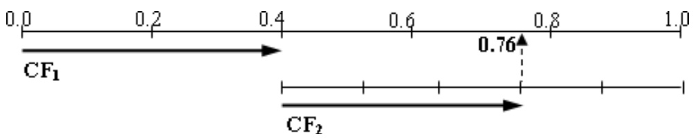

Hình 7.1 – Minh họa tính kết hợp CF

Với cách tính toán này, ta có thể nhận thấy rằng kết quả CF phải luôn nằm trong khoảng [-1,+1]. Kết hợp các CF cùng dấu sẽ làm tăng CF hay phép đo CF kết hợp mang tính tuyến tính, và ngược lại, các CF nghịch nhau sẽ xóa bớt lẫn nhau.

## Câu hỏi :

Ta có các tri thức sau:

• Nếu một người quan sát được UFO thì kết luận có sự xuất hiện của UFO (0.4)

• Nếu một máy rada phát hiện được một UFO thì kết luận có sự xuất hiện của UFO (0.7)

Hãy cho biết giá trị CF của kết luận ‘Có sự xuất hiện của UFO’ là bao nhiêu biết rằng có hai người quan sát được UFO (0.8) và một máy rada phát hiện được một UFO (0.6).

## Ví dụ: Hệ chuyên gia MYCIN

Như đã giới thiệu sơ qua ở chương VI, hệ chuyên gia MYCIN được phát triển tại đại học Stanford vào thập niên 1970 bởi Feigenbaum, Buchanan and Ted Shortliffe (một bác sĩ).

Mục đích của hệ chuyên gia MYCIN là giúp đỡ các bác sĩ trong việc chẩn đoán và điều trị các bệnh viêm màng não và nhiễm trùng máu. Chức năng chủ yếu của MYCIN là nhận dạng các cơ quan bị nhiễm trùng và chọn các loại thuốc khống chế bệnh trên các cơ quan này. Giao diện người dùng của MYCIN là sử dụng đối thoại dạng văn bản với bác sĩ để thu thập dữ liệu bao gồm dữ liệu tổng quát về bệnh nhân, các kết quả xét nghiệm và các triệu chứng của bệnh nhân.

Các vấn đề trong lĩnh vực y khoa thường phải suy luận với các thông tin không đầy đủ, mơ hồ, không chắc chắn. Để đối phó với khó khăn này, MYCIN sử dụng lý thuyết chắc chắn Stanford làm nền tảng cho suy luận của hệ. Vì vậy, mỗi dữ liệu, mỗi luật trong MYCIN đều có một hệ số chắc chắn CF đi kèm

Dữ liệu được mô tả theo cấu trúc sau:

<!-- page: 132 -->

| Thông số | Ngữ cảnh | Giá trị | CF |
| --- | --- | --- | --- |
| Nhận ra | Cơ_quan_1 | Klebsiella | 0.25 |
| Nhạy cầm | Cơ_quan_1 | Penicillin | -1.0 |

Ví dụ luật 50 của MYCIN có dạng:

IF (a) the infection is primary-bacteria, and

(b) the site of the culture is one of the serile sites, and

(c) the suspected portal of entry is gastrointestinal tract

THEN there is suggestive evidence **(0.7)** that infection is bacteroid

Trong luật trên số 0.7 được đặt trong ngoặc chính là hệ số CF của luật.

Cơ sở luật của MYCIN có khoảng 450 luật được viết bằng ngôn ngữ LISP. Động cơ suy diễn của MYCIN được cài đặt với kỹ thuật suy luận hướng từ mục tiêu (goal-driven), nó tìm kiếm gần như là vét cạn để chọn ra mục tiêu có chỉ số CF cao nhất làm kết luận cuối cùng của hệ thống.

Để hiểu rõ hơn cơ chế suy luận của MYCIN, chúng ta hãy xét một ví dụ minh họa sau.

Thí dụ 7.5: MINI-MYCIN là một hệ chuyên gia nhỏ chuyên phân biệt giữa chân bị gãy,chân bị quá mỏi hay chân bị nhiễm trùng.

Nó gồm các luật sau:

1. IF đau và sốt THEN bị nhiễm trùng 0.6

2. IF đau và sưng THEN bị chấn thương 0.8

3. IF quá tải THEN bị nhiễm trùng 0.5

4. IF bị chấn thương AND đỏ THEN bị gãy 0.8

5. IF bị chấn thương AND di chuyển được THEN quá mỏi 1.0

Sử dụng MINI-MYCIN để chẩn đoán tình trạng chân của Minh, biết rằng: chân của Minh đang bị đau (1.0). Khi tôi kiểm tra nó, thấy nó sưng tấy (0.6) and hơi đỏ (0.1). Tôi không có nhiệt kế nhưng tôi nghĩ anh ta có bị sốt (0.4). Tôi biết Minh là một vận động viên marathon, các khớp của anh ta thường xuyên làm việc quá tải (1.0). Minh có thể di chuyển chân của anh ấy.

<!-- page: 133 -->

Hãy vẽ đồ thị And/Or minh họa cho quá trình suy luận để đi đến kết luận của MINI-MYCIN.

## Giải:

Vì MYCIN là hệ thống hoạt động theo cơ chế suy diễn lùi (hay hướng từ mục tiêu), nên hệ thống sẽ lần lượt tính toán giá trị CF của từng mục tiêu. Các đồ thị And/Or sau đây sẽ được trình bày lần lượt theo thứ tự thực hiện của hệ thống:

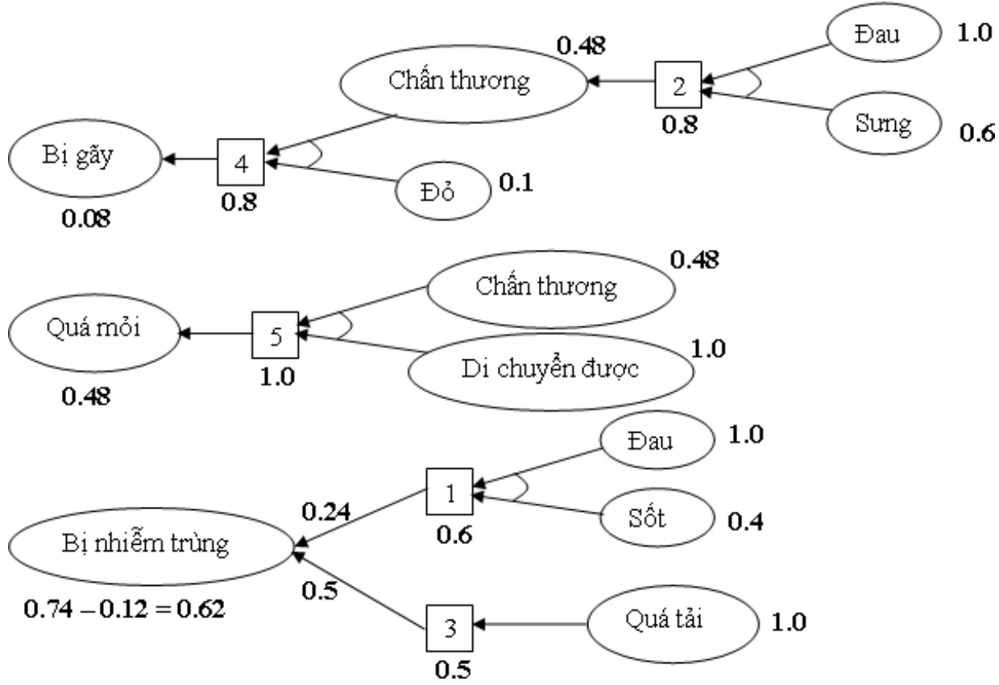

Hình 7.2 – Đồ thị AND/OR cho quá trình suy diễn lùi trong Thí dụ 7.5

Vậy: Bị nhiễm trùng là mục tiêu có giá trị CF cao nhất nên ta kết luận chân của Minh bị nhiễm trùng.

Từ ví dụ minh họa ta thấy MYCIN hầu như kích hoạt tất cả các luật để tìm giá trị CF cho từng mục tiêu.

## Câu hỏi :

Tại sao hệ MYCIN phải kích hoạt hầu như tất cả các luật để có thể đưa ra kết luận ?

<!-- page: 134 -->

## \* Một số nhận xét về các luật của MYCIN:

• Mỗi luật của MYCIN là một sự kết hợp tri thức của nhiều lĩnh vực khác nhau. Ví dụ như luật ‘IF tuổi bệnh nhân < 7 THEN không nên cấp thuốc tetracyline là sự kết hợp của các loại tri thức:

• Tri thức về miền, mà cụ thể ở đây là tri thức về y học: Tetracyline làm đổi màu xương đang phát triển và trẻ em dưới 7 tuổi thì đang mọc răng.

• Tri thức giải quyết vấn đề, cụ thể ở đây là tri thức về trị bệnh: Trước khi kê một loại thuốc phải kiểm tra các chống chỉ định, có hai loại chống chỉ định: chỉ định liên quan đến bệnh và chỉ định liên quan đến bệnh nhân.

• Tri thức về thế giới: Hầu hết mọi người đều cho rằng hàm răng màu nâu thì không đẹp.

◦ Tổng hợp các tri thức trên, các chuyên gia đưa ra một luật hết sức đơn giản. Chính tính heuristic này đã hỗ trợ một phương pháp giải quyết vấn đề hiệu quả.

• Ngoài ra, điều khiển của quá trình suy luận cũng được thể hiện trong các luật của MYCIN. Các điều kiện của vế trái luật được sắp xếp với thứ tự trước sau phù hợp với tri thức của miền. Ví dụ luật sau:

IF sự nhiễm trùng là bệnh viêm màng não

And sự nhiễm trùng là do vi khuẩn

And chỉ có chứng cớ gián tiếp

And tuổi của bệnh nhân > 16

And bệnh nhân là một người nghiện rượu

THEN chứng cớ cho viêm phổi song cầu khuẩn **0.7**

là kết quả của sự tổng hợp nhiều tri thức :

• Tri thức về miền: các bệnh nhân bị nghiện rượu thì đáng nghi ngờ với vi khuẩn viêm phổi song cầu khuẩn

• Tri thức giải quyết vấn đề: lọc sự chẩn đoán theo từng bước; tức là hệ thống sẽ kiểm tra từng điều kiện của vế trái theo thứ tự của nó. Chỉ khi điều kiện còn đúng thì mới tiếp tục kiểm tra điều kiện kế tiếp.

• Tri thức về thế giới: người nghiện rượu thì hiếm khi dưới 17 tuổi. Vì vậy, cần phải kiểm tra tuổi của bệnh nhân trước khi hỏi bệnh nhân có phải là người nghiện rượu hay không. Vì nếu không, thì câu hỏi có thể gây sốc cho cha mẹ của các trẻ nhỏ.

<!-- page: 135 -->

Lý thuyết chắc chắn có thể bị đánh giá như là một giải pháp quá tình thế (ad hoc). Mặc dù nó được định nghĩa ở dạng đại số hình thức, nhưng ý nghĩa của các độ đo chắc chắn không có nền tảng chặt chẽ như lý thuyết xác suất hình thức. Tuy nhiên, lý thuyết chắc chắn không cố gắng tạo ra một kiểu đại số dành cho suy luận “chính xác”. Đúng hơn nó là sự ‘bôi trơn’ cho phép hệ chuyên gia kết hợp những niềm tin khi nó suy luận vấn đề. Mặc dù CF được sử dụng để duy trì chương trình chạy và thu thập thông tin, sức mạnh của chương trình chủ yếu vẫn phụ thuộc vào chất lượng của các luật.

<!-- page: 136 -->

# SUY LUẬN VỚI CÁC TẬP MỜ (fUZZY LOGIC)

## SUY LUẬN VỚI CÁC TẬP MỜ (fUZZY LOGIC)

**Logic truyền thống hay logic ‘giòn’:**

Logic truyền thống chỉ quan tâm đến 2 giá trị tuyệt đối (đúng hoặc sai). Logic truyền thống luôn tuân theo 2 giả thuyết. Một là tính thành viên của tập hợp: Với một phần tử và một tập hợp bất kỳ, thì phần tử hoặc là thuộc tập hợp đó, hoặc thuộc phần bù của tập đó. Giả thiết thứ hai là định luật loại trừ trung gian, khẳng định một phần tử không thể vừa thuộc một tập hợp vừa thuộc phần bù của nó.

Thí dụ 7.6: Nếu nhiệt độ trên 35 độ C thì nóng, ngược lại là không nóng. Hình bên dưới minh họa tập hợp “NÓNG” gồm tất cả các nhiệt độ từ 35 độ C trở lên

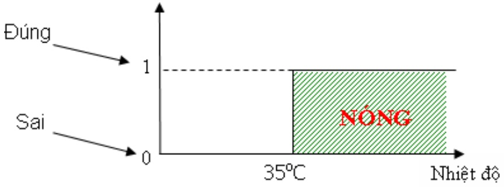

Hình 7.3 - Biểu diễn tập nhiệt độ “NÓNG”.

Từ hình vẽ ta thấy logic giòn không thể hiện được sự khác biệt giữa các thành viên trong cùng một tập hợp. Giữa hai nhiệt độ 45 và 55 độ C, logic này không thể hiện được nhiệt độ nào nóng hơn nhiệt độ nào.

Ngoài ra, logic này còn có một nhược điểm khác quan trọng hơn đó là chúng không thể biểu diễn được các dữ kiện mang tính mơ hồ, không chính xác mà trong thực tế lại có rất nhiều phát biểu bằng ngôn ngữ tự nhiên ở dạng này; chẳng hạn như:

John thì khá cao => như vậy John có thuộc tập hợp những người cao hay không?

Hoặc: John thì rất cao => như thế nào là rất cao?

Vì vậy, logic truyền thống không thể hỗ trợ cho những suy luận trên những thông tin mang tính mơ hồ, thiếu chính xác như vậy.

<!-- page: 137 -->

## Khái niệm Logic mờ:

Để khắc phục khuyết điểm của logic truyền thống, Lotfi Zadeh đã đưa ra lý thuyết mới về logic gọi là logic mờ (fuzzy logic).

Lý thuyết của Zadeh biểu diễn tính mờ hay tính thiếu chính xác trong các phát biểu (như ở mục trên) theo cách định lượng bằng cách đưa ra một hàm tư cách thành viên tập hợp (set membership function) nhận giá trị **thực** giữa 0 và 1.

## Khái niệm về tập mờ:

Cho S là một tập hợp và x là một phần tử của tập hợp đó. Một tập con mờ F của S được định nghĩa bởi một hàm tư cách thành viên μF(x) đo “mức độ” mà theo đó x thuộc về tập F. Trong đó, $0 \leq \mu _ { \mathrm { F } } ( \mathrm { x } ) \leq 1$

Khi μF(x) = 0 nghĩa là x hoàn toàn không thuộc tập F.

Khi μF(x) = 1 nghĩa là x thuộc F hoàn toàn.

Nếu $\mu _ { \mathrm { F } } ( \mathbf { x } ) = 0$ hoặc 1 thì tập F được xem là “giòn”

Thí dụ 7.7: S là tập hợp tất cả các số nguyên dương và F là tập con mờ của S được gọi là “số nguyên nhỏ”. Trong đó: $\mu_{\mathrm{F}}(1)=1.0, \mu_{\mathrm{F}}(2)=1.0, \mu_{\mathrm{F}}(3)=0.9, \mu_{\mathrm{F}}(4)=0.8, \mu_{\mathrm{F}}(50)$ $= 0 . 0 0 1 , \mathrm { v . v . } .$ được biểu diễn như trong hình 7.3:

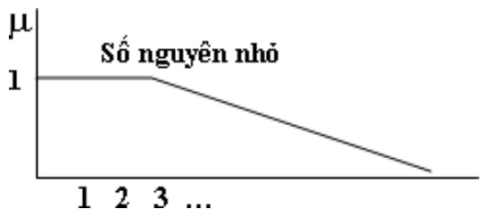

Hình 7.4 - Biểu diễn tập mờ của “các số nguyên nhỏ”

Thí dụ 7.8: Hình bên dưới minh họa hàm thành viên cho các tập mờ thể hiện người đàn ông “Thấp”, “Cao” và “Trung bình”.

Hình 7.5 - Biểu diễn của các tập mờ “Thấp”, “Trung bình”, và “Cao”

Từ hình 7.5, ta thấy những người đàn ông cao 4’ thì hoàn toàn thuộc về tập mờ ‘Thấp’. Còn những người đàn ông có chiều cao $4 ^ { \circ } 8 ^ { \circ }$ thì vừa thuộc tập mờ ‘Thấp’, vừa thuộc tập mờ ‘Trung bình’. Còn những người đàn ông có chiều cao $6 ^ { \circ } 1 ^ { \circ }$ thì chỉ thuộc tập mờ $\mathbf { ^ { \circ } C a o } ^ { \circ }$ với m <1.

<!-- page: 138 -->

## Tính chất:

• Hai tập mờ bằng nhau: A = B nếu ∀x Î X, mA (x) = mB (x)

• Tập con: A Í B nếu ∀x Î X, mA (x) £ mB (x)

• Một phần tử có thể thuộc về nhiều hơn một tập mờ. Như trong ví dụ 2 (hình 7.4), một người đàn ông cao $5 ^ { \circ } 1 0 ^ { \circ }$ thuộc về cả hai tập “trung bình” và “cao”.

• Tổng các giá trị mờ của một phần tử khác 1:

μThấp(<sup>x</sup>) + μTrungbình(x) + μCao(x) ≠ 1

• Từ hàm thành viên cho trước, ta có thể suy ra được mức độ một thành viên thuộc về một tập hợp, hay có thể xác định được giá trị mờ của nó đối với một tập mờ.

Thí dụ 7.9: Một hàm thành viên cho tập mờ thể hiện một người là “Trẻ”, “Trung niên” và “Già”.

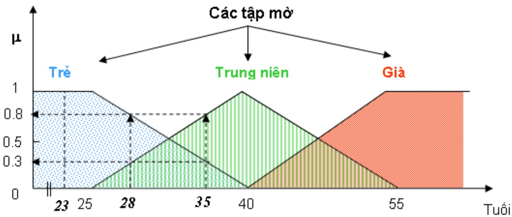

Hình 7.6 - Biểu diễn của các tập mờ “Trẻ”, “Trung niên”, và “Già”

Từ hình trên, nếu cho biết tuổi của một người, ta có thể xác định mức độ người đó thuộc về lớp người trẻ, trung niên và già. Chẳng hạn như:

\- An 28 tuổi => μTre(An) = 0.8 và μTrung niên(An) = 0.3

• Bảo 35 tuổi => μTre(Bảo) = 0.3 và μTrung niên(Bảo) = 0.8

• Châu 23 tuổi => μTre(Châu) = 1.0

**Câu hỏi :**

Hãy cho biết giá trị mờ μTrẻ, μTrung niên, μGià của các dữ liệu sau biết rằng:

<!-- page: 139 -->

1. Tấm 23 tuổi

## 2. Cám 35 tuổi

Ta gọi các con số 0.8, 0.2, 1.0 là các giá trị mờ **(fuzzy values)**. Vậy từ các giá trị chính xác hay giá trị ‘giòn’ (số tuổi: 28, 35, 23…), ta đã suy ra các giá trị mờ tương ứng. Thao tác này gọi là mờ hóa **(fuzzification)** các giá trị giòn.

## Các toán tử logic trên tập mờ:

Logic mờ không quan tâm đến cách thức các tập mờ được tạo ra như thế nào, mà quan tâm đến các luật hỗ trợ cho việc suy luận trên các tập mờ này. Phần này sẽ trình bày các phép toán thao tác trên các tập mờ, đó là phép bù (complement) phép hợp (union), phép giao (intersection).

## Phép hợp hay toán tử OR:

## A ? B

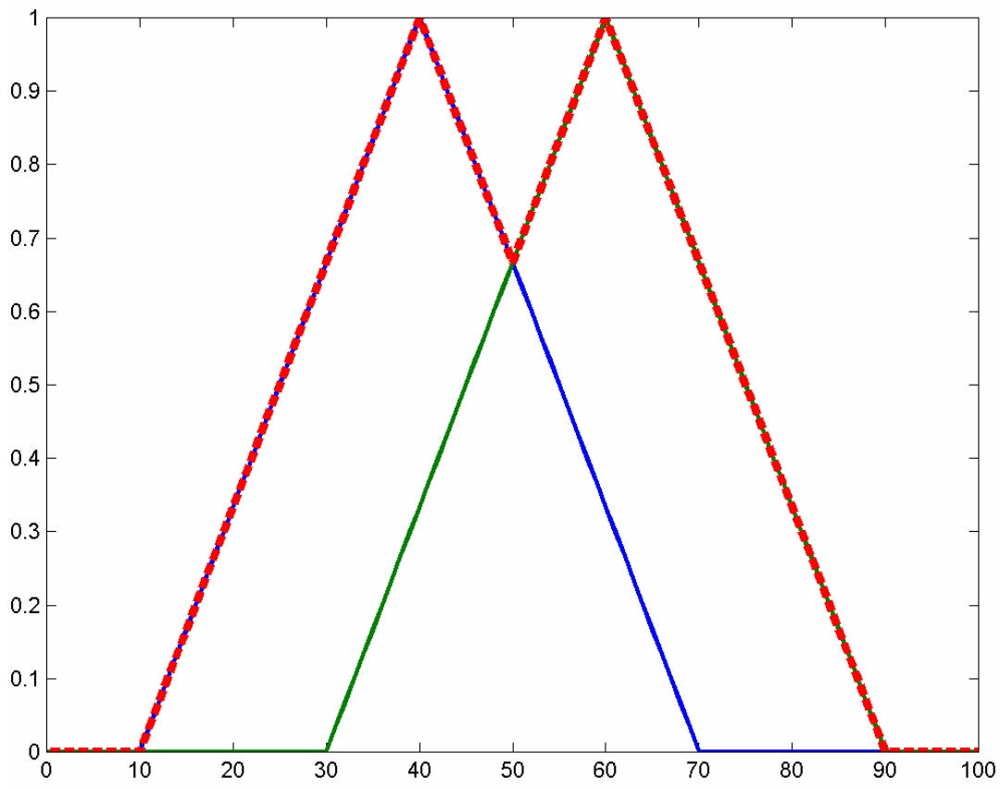

<!-- page: 140 -->

Khái niệm: Hợp của hai tập mờ (A?B) thể hiện mức độ một phần tử thuộc về một trong hai tập là bao nhiêu.

Công thức: MA∨ B(<sup>x</sup>) = max (μA(x) , μB(x) )

Thí dụ 7.10 :

μTre(An) = 0.8 và μTrung niên(An) = 0.3

=> μTre ∨ Trung Niên(An) = max( 0.8, 0.3) = 0.8

## Phép giao hay toán tử AND:

Khái niệm: Giao của hai tập mờ (A?B) thể hiện mức độ một phần tử thuộc về cả hai tập là bao nhiêu.

## A ? B

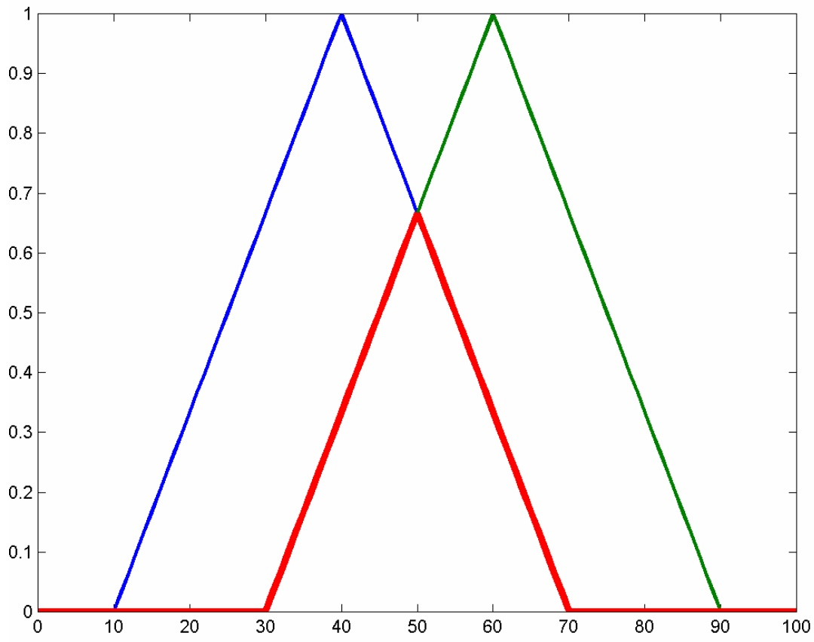

Công thức: $\mathrm{MA} \wedge \mathrm{B}(\mathrm{x}) = \min \left( \mu_{\mathrm{A}}(\mathrm{x}) , \mu_{\mathrm{B}}(\mathrm{x}) \right)$

<!-- page: 141 -->

Thí dụ 7.11 :

μTre(An) = 0.8 và μTrung niên(An) = 0.3

=> μTre ∧ Trung Niên(An) = min( 0.8, 0.3) = 0.3

**Phép bù hay toán tử NOT:**

A’

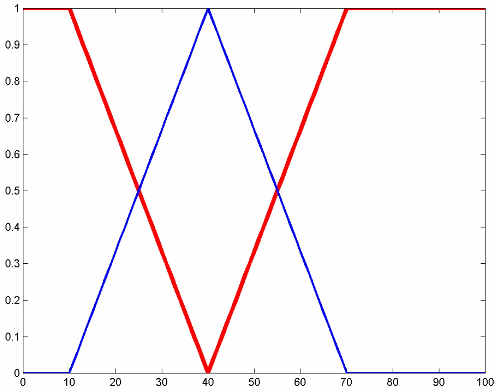

Khái niệm: Bù của một tập mờ thể hiện mức độ một phần tử không thuộc về tập đó là bao nhiêu.

Công thức: M?A(x) = 1 - μA(x)

Thí dụ 7.12: μTrẻ(An) = 0.8

M?Trẻ(An) = 1 – 0.8 = 0.2

<!-- page: 142 -->

Nhận xét: Logic mờ không tuân theo các luật về tính bù của logic truyền thống: M?A∨ A(<sup>x</sup>) ? 1 và M?A ∧ A(<sup>x</sup>) ? 0

Thí dụ 7.13: M?A∨ A(<sup>x</sup>) = max (0.8, 0.2) = 0.8

M?A ∧ A(<sup>x</sup>) = min( 0.8, 0.2) = 0.2

## Luật mờ

Một luật mờ là một biểu thức if- then được phát biểu ở dạng ngôn ngữ tự nhiên thể hiện sự phụ thuộc nhân quả giữa các biến.

Thí dụ 7.14:**if**nhiệt độ là lạnh và giá dầu là rẻ**then**sưởi ấmnhiều.

Trong đó: - ‘nhiệt độ’, ‘giá dầu’ và ‘sưởi ấm’ là các biến

\- ‘lạnh’, ‘rẻ’, ‘nhiều’ là các giá trị hay chính là các tập mờ.

Hoặc: **if** một người có chiều cao là cao và cơ bắp là lực lưỡng**then**chơi bóng rổ hay.

Các biến ở đây sẽ là: ‘chiều cao’, ‘cơ bắp’, ‘chơi bóng rổ’

Các giá trị hay tập mờ là: ‘cao’, ‘lực lưỡng’, ‘hay’.

**Thủ tục ra quyết định mờ: (fuzzy decision making procedure)**

Để hệ thống mờ có thể suy luận bằng các luật mờ và đưa ra kết luận từ các số liệu chính xác ở đầu vào, hệ thống thực hiện 3 bước:


• **Mờ hóa**: Tính toán các giá trị mờ từ các giá trị chính xác ở đầu vào.

• **Suy luận mờ**: Áp dụng tất cả các luật mờ có thể áp dụng để tính ra giá trị mờ cho kết luận, sau đó kết hợp các kết quả đầu ra.

• **Phi mờ hóa**: Xác định giá trị chính xác từ kết quả mờ có được ở bước 2. Có nhiều kỹ thuật phi mờ hóa có thể áp dụng được, phương pháp thông dụng nhất là phương pháp trọng tâm (centriod method).

Thí dụ 7.15: Cho hệ thống mờ dùng trong điều trị bệnh gồm các luật sau đây:

• IF sốt nhẹ THEN liều lượng asperine thấp

• IF sốt THEN liều lượng asperine bình thường

<!-- page: 143 -->

• IF sốt cao THEN liều lượng asperine cao

• IF sốt rất cao THEN liều lượng asperine cao nhất

Và các tập mờ được biểu diễn như sau:


Hình 7.7 - Biểu diễn của các tập mờ trong Thí dụ 7.15

Một bệnh nhân sốt ở 38.7 độ, hãy xác định liều lượng asperince cần thiết để cấp cho bệnh nhân.

Giải:

**Bước 1**: Mờ hóa giá trị x = 38.7 đã cho: ta thấy 38.7 thuộc về các tập mờ như sau:


μSốt nhẹ (x) = 0.3 μSốt (x) = 0.7 μSốt cao (x) = 0 μSốt rất cao $\mathbf { \rho } ( \mathbf { x } ) = 0$

Bước 2: Ta thấy có 2 luật 1 và 2 có thể áp dụng cho ra hai liều lượng aspirine:

μThấp (x) = 0.3 μBình thường (x) = 0.7

<!-- page: 144 -->

Kết hợp các giá trị mờ này lại ta được vùng được tô màu sau đây:


Bước 3: Phi mờ hóa kết quả bằng cách tính trọng tâm của diện tích được tô trong hình trên, chiếu xuống trục hoành ta được giá trị ±480mg, đây chính là liều lượng aspirine cần cấp cho bệnh nhân.

## TỔNG KẾT CHƯƠNG VII :

Nội dung chính của chương này bao gồm:

• Mặc dù phỏng đoán là không vững chắc, nhưng nó thường đóng vai trò thiết yếu trong giải quyết vấn đề. Có nhiều tiếp cận đã được đưa ra nhằm tạo ra các hệ thống có thể suy luận trên những thông tin không chắc chắn hoặc không đầy đủ để đưa ra các kết luận hữu ích.

• Luật Bayes dựa trên lý thuyết xác suất hình thức cho phép chúng ta sử dụng tri thức về nguyên nhân để suy ra tri thức về chẩn đoán.

• Lý thuyết về yếu tố chắc chắn Standford đưa ra khái niệm hệ số chắc chắn CF cho phép các chuyên gia kết hợp những niềm tin của mình vào dữ liệu và các luật khi phát biểu. Đồng thời đại số chắc chắn Standford cũng cung cấp các quy tắc và công thức sử dụng để tính các giá trị CF cho các kết luận trong quá trình suy luận.

• Lý thuyết mờ đưa ra khái niệm tập mờ và hàm thành viên thể hiện mức độ một thành viên thuộc vào tập mờ, đồng thời đưa ra các quy tắc tính toán giá trị mờ khi suy luận trên các luật mờ.

## Bài tập chương VII

Giả sử có một phương pháp xét nghiệm HIV.

• Gọi TP là sự kiện xét nghiệm cho kết quả dương tính.

• Gọi TN là sự kiện xét nghiệm cho kết quả âm tính.

• Gọi HP là sự kiện người đang được xét nghiệm có HIV dương tính.

• Gọi HN là sự kiện người đang được xét nghiệm có HIV âm tính.

Kết quả được gọi là ‘sai dương tính’ khi xét nghiệm cho kết quả dương tính trong khi người đó thực sự không bị nhiễm HIV

<!-- page: 145 -->

Kết quả được gọi là ‘sai âm tính’ khi xét nghiệm cho kết quả âm tính trong khi người đó thực sự có nhiễm HIV

Cho một số dữ liệu sau:

• Tỉ lệ ‘sai dương tính’ là: P(TP|HN) = 0.02

• Tỉ lệ ‘sai âm tính’ là: P(TN|HP) = 0.01

• Tỉ lệ người bị nhiễm HIV trong cộng đồng là 0.10

Nếu một người nhận được kết quả xét nghiệm dương tính, thì xác suất người đó thật sự bị HIV là bao nhiêu?

Sử dụng ví dụ nhỏ dưới đây để minh họa cơ chế suy luận của EMYCIN bằng đồ thị AND/OR để cho thấy thứ tự sử dụng các luật, thứ tự các câu hỏi được đặt ra và thứ tự các kết luận được đưa ra như thế nào,...

MINI-MINI-MYCIN là một hệ chuyên gia chuyên phân biệt bệnh dị ứng, sởi, hoặc sốt vàng da. Nó bao gồm các luật sau:

• IF cảm-thấy-khó-chịu AND chấm-đỏ THEN dị-ứng (0.6)

• IF cảm-thấy-khó-chịu AND sốt THEN nhiễm-trùng (0.8)

• IF du-lịch-nước-ngoài THEN sốt-vàng-da (0.5)

• IF nhiễm-trùng AND chấm-đỏ THEN sởi (0.6)

• IF nhiễm-trùng AND vàng-mắt THEN sốt-vàng-da (0.5)

Sử dụng các dữ liệu sau: John cảm thấy khó chịu (0.1). Có những chấm đỏ trên khắp người (0.8). Tôi không có nhiệt kế nhưng tôi nghĩ anh ta bị sốt (0.5). Tôi biết John vừa đi du lịch nước ngoài về (1.0). Mắt anh ta có vẻ vàng (0.4).

Hãy cho biết các phát biểu sau đây thuộc loại không chắc chắn, mờ, cả hai hay không có loại nào:

• Cảnh sát phạt một chiếc xe đang tăng tốc

• An thì cao hơn Bảo nhiều.

• Chỉ có 20% khách đến tham dự thích biểu triển lãm.

• Một nhóm rất đông sinh viên đã tham gia cuộc diễu hành.

• Ăn quá nhiều muối có thể gây bệnh huyết áp cao.

<!-- page: 146 -->

# CÁC CHỦ ĐỀ NÂNG CAO

## Giới thiệu

## GIỚI THIỆU:

Như đã giới thiệu trong chương I, suy luận tự động có thể xem là nhánh nghiên cứu lâu đời nhất của AI, bắt nguồn từ Logic Theorist và General Problem Solver của Newell và Simon.

Sức hấp dẫn của suy luận tự động nằm trong tính chặt chẽ và tổng quát của logic. Bởi vì logic là một hệ thống hình thức, nên ta có thể tự động hóa nó. Rất nhiều vấn đề khác nhau có thể giải quyết được bằng cách biểu diễn các mô tả vấn đề và các thông tin liên quan ở dạng các tiên đề luận lý và xem bài toán như là các định lý cần chứng minh.

Nổ lực của các nhà khoa học trong lĩnh vực này là tự động hóa quá trình chứng minh các định lý dựa vào các tiên đề cơ sở. Mặc dù cho đến nay vẫn chưa đạt được mục tiêu ban đầu, nhưng nhánh nghiên cứu này đã tạo ra nhiều kết quả rất quan trọng trong việc hình thức hóa các giải thuật tìm kiếm và phát triển các ngôn ngữ biểu diễn hình thức như Đại số quan hệ mà ta đã học ở chương II.

Trong chương này ta sẽ tiếp tục khảo sát một trong những thành quả của lĩnh vực này, đó là phương pháp chứng minh Hợp Giải (resolution). Một ứng dụng quan trọng của hợp giải đó là làm nền tảng cho trình thông dịch của ngôn ngữ PROLOG đang được sử dụng hiện nay.

Hợp giải là một kỹ thuật chứng minh định lý được biểu diễn bằng đại số mệnh đề hay đại số vị từ. Hợp giải được phát triển vào giữa thập niên 60 do Robinson đề xướng. Hợp giải sử dụng phản chứng để chứng minh một vấn đề. Hay nói cách khác, để chứng minh một câu (nghĩa là chứng minh câu này đúng), hợp giải sẽ chỉ ra rằng phủ định của câu sẽ tạo ra một mâu thuẫn với các câu đã biết. Tiếp cận này trái ngược với kỹ thuật mà chúng ta đã sử dụng để chứng minh ở chương II, chương III, tức là sử dụng phép dẫn xuất để chứng minh.

Trước khi đi vào phương pháp chứng minh hợp giải, chúng ta sẽ xem một ví dụ sử dụng Logic Vị Từ để biểu diễn tri thức và sử dụng phép dẫn xuất ở chương II để chứng minh.

Thí dụ 8.1: Xét ví dụ với tập hợp các câu như sau:

• Marcus was a man.

• Marcus was a Pompeian.

<!-- page: 147 -->

• All Pompeians were Romans.

• Caesar was a ruler.

• All Romans were either loyal to Caesar or hated him.

• Everyone is loyal to someone.

• People only try to assasinate rulers they are not loyal to.

• Marcus tried to assasinate Caesar.

Hãy chứng minh ‘Was Marcus loyal to Caesar?’

Các câu trên có thể được biểu diễn dưới dạng các câu hay công thức dạng chuẩn (wff) trong ngôn ngữ Phép tính vị từ như sau:

. man (marcus)

. pompeian (marcus)

. ∀X pompeian (X) → roman(X)

\- ruler (caesar)

∀X roman(X) → 1oyalto (X, caesar) v hate(X, caesar)

. ∀X, ∃Y loyalto (X,Y)

∀X, ∀Y person(X) ∧ ruler(Y) ∧ trytoassasinate(X) → —loyalto (X,Y) trytoassasinate (marcus, caesar)

Chứng minh ?loyalto(marcus, caesar)

Để chứng minh mục tiêu trên, chúng ta sử dụng luật suy diễn để biến đổi thành mục tiêu mới (hay nhiều mục tiêu con mới), và cứ tiếp tục cho đến khi không còn mục tiêu nào chưa thỏa mãn.

Quá trình này có thể biểu diễn bằng một đồ thị AND/OR. Ở đây, để đơn giản ta chỉ vẽ một đường duy nhất.

Hình bên dưới minh họa một cách chứng minh cho mục tiêu trên:

—loyalto (marcus, caesar) ↑ (câu 7, {marcus/X, ceasar/Y })

person (marcus) ∧ ruler (caesar) ∧ trytoassasinate (marcus, caesar) ↑ (câu 4)

person (marcus) ∧ trytoassasinate (marcus, caesar) ↑ (câu 8)

person (marcus)

<!-- page: 148 -->

Đến đây ta gặp phải một vấn đề là mặc dù chúng ta biết Marcus là một người đàn ông (man), chúng ta không có cách nào kết luận Marcus là một người (person). Vì vậy, ta phải thêm vào cơ sở tri thức một câu như sau:

∀X man (X) ∨ woman (X) → person(X)

Với câu 9 vừa thêm vào, ta có thể chứng minh thành công mục tiêu trên.

Từ chứng minh trên, chúng ta có nhận xét như sau:

• Thậm chí các kết luận rất đơn giản cũng đòi hỏi phải chứng minh qua nhiều bước.

• Quá trình tạo ra một chứng minh có liên quan đến nhiều quá trình khác nhau như quá trình đối sánh, thay thế, áp dụng luật Modus Ponens. Quá trình này sẽ phức tạp hơn nếu như các luật có nhiều từ hai mục ở vế phải hay vế trái gồm nhiều biểu thức phức tạp And hay Or với nhau.

Từ những nhận xét này cho thấy việc xây dựng một chương trình có thể chứng minh được như con người là không dễ dàng chút nào. Vì vậy, ta cần một phương pháp chứng minh đơn giản hơn. Và Hợp Giải (resolution) ra đời như là một công cụ chứng minh hiện đại và mạnh mẽ hơn cho ngành suy luận tự động. Sự đơn giản trong phép chứng minh của hợp giải xuất phát từ nguyên nhân: Thay vì suy luận trên các câu vị từ, hợp giải thao tác trên các câu đã được chuyển thành một dạng chuẩn trước khi bắt đầu quá trình chứng minh để làm giảm tính phức tạp của vấn đề. Phần còn lại của chương này sẽ giới thiệu về thủ tục Hợp giải này.

Download slide bài giảng <u>tại đây</u>

<!-- page: 149 -->

# NHẬN XÉT VỀ PHƯƠNG PHÁP HỢP GIẢI

**NHẬN XÉT VỀ PHƯƠNG PHÁP HỢP GIẢI:**

Các kết quả của Robinson đã đặt nền móng cho một loạt các nghiên cứu có liên quan đến việc vận dụng phương pháp hợp giải và các phương pháp tương tự trong lĩnh vực chứng minh định lý tự động. Những ưu điểm chính của phương pháp hợp giải là tính tổng quát, tính phổ dụng, khả năng áp dụng tốt đối với các dạng câu Horn (tức là câu có dạng A1 ∧ A2 ∧ … An -> B), song nó cũng có hai nhược điểm chủ yếu:

• Trong quá trình tư duy, thông thường con người không sử dụng chiến lược suy diễn này. Vì vậy một người khó có thể giao tiếp với chương trình chứng minh sử dụng phương pháp hợp giải, để có thể cho nó một lời khuyên hay nhận lời khuyên từ nó. Việc chứng minh các vấn đề khó vẫn còn là một điều khó khăn đối với máy tính, vì vậy về mặt thực tế, nếu con người và máy tính có thể tương tác với nhau cũng là điều rất quan trọng .

• Trong khi chuyển các câu về dạng mệnh đề, chúng ta đã đánh mất các thông tin kinh nghiệm có giá trị chứa trong các câu ban đầu.

<u>Ví dụ:</u> Với câu ‘Người am hiểu và không quanh co là người được giáo dục tốt’

$$
\forall \mathrm{X} \text { judge } (\mathrm{X}) \land \neg \text { crooked } (\mathrm{X}) \rightarrow \text { educated } (\mathrm{X})
$$

Chuyển về dạng mệnh đề:

—judge(X) V crooked(X)V educated(X)

Câu này cũng có thể diễn dịch thành ‘một người không phải là người am hiểu nếu như anh ta không quanh co và không được giáo dục tốt’! Điều này cho thấy ý nghĩa của câu phát biểu ban đầu đã bị mất hoàn toàn.

TỔNG KẾT CHƯƠNG VIII :

Nội dung chính của chương này bao gồm:

• Hợp giải (hay còn gọi là thủ tục Robinson) là một kỹ thuật chứng minh định lý được biểu diễn bằng đại số mệnh đề hay đại số vị từ. Hợp giải sử dụng phản chứng để chứng minh một vấn đề.

• Trước khi áp dụng thủ tục Robinson, các câu phải được chuyển về dạng chuẩn hay dạng mệnh đề. Một mệnh đề là một tuyển của các biến mệnh đề.

<!-- page: 150 -->

• Thủ tục hợp giải là một quá trình lặp đơn giản. Ở mỗi lần lặp, ta tìm hai mệnh đề có chứa hai biến mệnh đề bù nhau để hợp giải và cho ra mệnh đề mới. Quá trình này cứ tiếp tục cho đến khi ta được một mệnh đề rỗng.

Trong logic vị từ, nếu biến mệnh đề có đối số là biến, thì muốn biết hai biến mệnh có bù nhau hay không ta phải đối sánh chúng theo giải thuật đồng nhất đã học ở chương 2. Sau khi hợp giải chúng, ta phải giữ lại tập phép thế trả ra bởi giải thuật đồng nhất này.

• Hợp giải có thể phát hiện trường hợp không tồn tại sự mâu thuẫn, khi đó một mệnh đề kết quả sẽ xuất hiện lặp lại.

• Để hỗ trợ tốt hơn cho quá trình chứng minh, hợp giải có thể sử dụng hàm tính toán, vị từ tính toán hay mối quan hệ bằng.

• Có thể sử dụng hợp giải cho các bài toán dạng trả lời câu hỏi bằng cách sử dụng thêm biểu thức phụ hay biểu thức ‘câm’.

## Bài tập chương VIII

Đưa câu vị từ sau về dạng mệnh đề:

$$
\forall \mathrm{X} ([ \mathrm{a} (\mathrm{X}) \land \mathrm{b} (\mathrm{X}) ] \rightarrow [ \mathrm{c} (\mathrm{X}, \mathrm{I}) \land \exists \mathrm{Y} (\exists \mathrm{Z} [ \mathrm{c} (\mathrm{Y}, \mathrm{Z}) ] \rightarrow \mathrm{d} (\mathrm{X}, \mathrm{Y})) ]) \lor \forall \mathrm{X} (\mathrm{e} (\mathrm{X}))
$$

Ta có các tri thức như sau:

• Ngón tay là bộ phận của bàn tay

• Bàn tay là bộ phận của cánh tay

• Cánh tay là bộ phận của cơ thể

Sử dụng hợp giải hãy chứng minh ngón tay là bộ phận của cơ thể

Giả sử các hiểu biết của một chuyên gia trong một tình huống nào đó được phát biểu dưới dạng các biểu thức logic mệnh đề sau đây :

1. $\mathbf { a } \wedge ( ( \mathbf { a } \wedge \mathbf { x } ) \to \mathbf { d } )$

2. $( \mathsf { a } \to ( \mathsf { b } \land \mathsf { c } ) ) \land \mathsf { x }$

3. $( \mathsf { c } \to \mathsf { a } ) \to ( \mathsf { d } \land \mathsf { e } )$

4. b → ((d∧ x) → f)

5. $( \mathsf { e } \land \mathsf { b } ) \to \mathbf { f }$

6. $( \mathbf { e } \wedge \mathbf { y } ) \rightarrow \mathbf { g }$

7. $\mathbf { d } \rightarrow \mathbf { f }$

8. $\mathbf { f } \rightarrow ( \neg \mathbf { a } \lor \mathbf { g } )$

<!-- page: 151 -->

Hãy chứng minh g đúng bằng thủ tục hợp giải.

Sử dụng các tri thức đã cho ở bài tập 2.3:

• John thích mọi loại thức ăn.

• Táo là thức ăn.

• Gà là thức ăn.

• Tất cả mọi thứ ăn được mà vẫn còn sống thì đó là thức ăn.

• Bill ăn đậu phộng và Bill vẫn còn sống.

• Sue ăn mọi thứ mà Bill ăn.

• Hãy biểu diễn tri thức trên theo logic vị từ.

• Hãy sử dụng hợp giải để chứng minh “John thích đậu phộng”

• Sử dụng hợp giải để trả lời câu hỏi : “Sue ăn gì ?”

Giải lại bài tập 2.4 bằng thủ tục hợp giải.

<!-- page: 152 -->

# HỌC MÁY (MACHINE LEARNING)

## Giới thiệu

## GIỚI THIỆU:

Khi được hỏi về những kỹ năng thông minh nào là cơ bản nhất đồng thời khó tự động hóa nhất của con người ngoài các hoạt động sáng tạo nghệ thuật, hành động ra quyết định mang tính đạo đức, trách nhiệm xã hội thì người ta thường đề cập đến vấn đề ngôn ngữ và học. Trãi qua nhiều năm, hai lĩnh vực này vẫn là mục tiêu, thách thức của khoa học TTNT.

Tầm quan trọng của việc học thì không cần phải tranh cãi, vì khả năng học chính là một trong những thành tố quan trọng của hành vi thông minh. Mặc dù tiếp cận hệ chuyên gia đã phát triển được nhiều năm, song số lượng các hệ chuyên vẫn còn hạn chế. Một trong những nguyên nhân chủ yếu là do quá trình tích lũy tri thức phức tạp, chi phí phát triển các hệ chuyên gia rất cao, nhưng chúng không có khả năng học, khả năng tự thích nghi khi môi trường thay đổi. Các chiến lược giải quyết vấn đề của chúng cứng nhắc và khi có nhu cầu thay đổi, thì việc sửa đổi một lượng lớn mã chương trình là rất khó khăn. Một giải pháp hiển nhiên là các chương trình tự học lấy cách giải quyết vấn đề từ kinh nghiệm, từ sự giống nhau, từ các ví dụ hay từ những ‘chỉ dẫn’, ‘lời khuyên’,...

Mặc dù học vẫn còn là một vấn đề khó, nhưng sự thành công của một số chương trình học máy thuyết phục rằng có thể tồn tại một tập hợp các nguyên tắc học tổng quát cho phép xây dựng nên các chương trình có khả năng học trong nhiều lĩnh vực thực tế.

Chương này sẽ giới thiệu sơ lược về lĩnh vực nghiên cứu này, đồng thời đi vào chi tiết một số giải thuật học quan trọng.

## Định nghĩa ‘học’

Theo Herbert Simon: ‘Học được định nghĩa như là bất cứ sự thay đổi nào trong một hệ thống cho phép nó tiến hành tốt hơn trong lần thứ hai khi lặp lại cùng một nhiệm vụ hoặc với một nhiệm vụ khác rút ra từ cùng một quần thể các nhiệm vụ đó’

Định nghĩa này mặc dù ngắn nhưng đưa ra nhiều vấn đề liên quan đến việc phát triển một chương trình có khả năng học. Học liên quan đến việc khái quát hóa từ kinh nghiệm: hiệu quả thực hiện của chương trình không chỉ cải thiện với ‘việc lặp lại cùng một nhiệm vụ’ mà còn với các nhiệm vụ tương tự. Vì những lĩnh vực đáng chú ý thường có khuynh hướng là to lớn, nên các chương trình học – CTH (learner) chỉ có thể khảo sát một phần nhỏ trong toàn bộ các ví dụ có thể; từ kinh nghiệm hạn chế này, CTH vẫn phải khái quát

<!-- page: 153 -->

hóa được một cách đúng đắn những ví dụ chưa từng gặp trong lĩnh vực đó. Đây chính là bài toán quy nạp (induction), và nó chính là trung tâm của việc học. Trong hầu hết các bài toán học, dữ liệu luyện tập sẵn có thường không đủ để đảm bảo đưa ra được một khái quát hóa tối ưu, cho dù CTH sử dụng giải thuật nào. Vì vậy, các giải thuật học phải khái quát hóa theo phương pháp heuristic, nghĩa là chúng sẽ chọn một số khía cạnh nào đó mà theo kinh nghiệm là cho hiệu quả trong tương lai để khái quát. Các tiêu chuẩn lựa chọn này gọi là thiên lệch quy nạp (inductive bias).

Có nhiều nhiệm vụ học (learning task) khác nhau. Ở đây chỉ trình bày nhiệm vụ học quy nạp (inductive learning), đây là một trong những nhiệm vụ học cơ bản. Nhiệm vụ của CTH là học một khái quát (generalization) từ một tập hợp các ví dụ. Học khái niệm (concept learning) là một bài toán học quy nạp tiêu biểu: cho trước một số ví dụ của khái niệm, chúng ta phải suy ra một định nghĩa cho phép người dùng nhận biết một cách đúng đắn những thể hiện của khái niệm đó trong tương lai.

## Các tiếp cận học:

Có ba tiếp cận học: tiếp cận ký hiệu (symbol-based learning), tiếp cận mạng neuron hay kết nối (neural or connectionist networks) và tiếp cận nổi trội (emergent) hay di truyền và tiến hóa (genetic and evolutionary learning).

Các CTH thuộc tiếp cận dựa trên ký hiệu biểu diễn vấn đề dưới dạng các ký hiệu (symbol), các giải thuật học sẽ tìm cách suy ra các khái quát mới, hợp lệ, hữu dụng và được biểu diễn bằng các ký hiệu này. Có nhiều giải thuật được đưa ra theo tiếp cận học này, tuy nhiên phần II của chương này chỉ trình bày một giải thuật được sử dụng rộng rãi trong số đó, đó là giải thuật quy nạp cây quyết định ID3.

Ngược lại với tiếp cận ký hiệu, tiếp cận kết nối không học bằng cách tích lũy các câu trong một ngôn ngữ ký hiệu. Giống như bộ não động vật chứa một số lượng lớn các tế bào thần kinh liên hệ với nhau, mạng neuron là những hệ thống gồm các neuron nhân tạo liên hệ với nhau. Tri thức của chương trình là ngầm định trong tổ chức và tương tác của các neuron này. Phần III sẽ đi vào chi tiết của tiếp cận này.

Tiếp cận thứ ba là tiếp cận nổi trội mô phỏng cách thức các hệ sinh học tiến hóa trong tự nhiên, nên còn được gọi là tiếp cận di truyền và tiến hóa. Phần IV sẽ đi vào chi tiết của tiếp cận này.

Download slide bài giảng <u>tại đây</u>

<!-- page: 154 -->

# TIẾP CẬN KÝ HIỆU: gIẢI THUẬT QUY NẠP CÂY QUYẾT ĐỊNH ID3

**TIẾP CẬN KÝ HIỆU: gIẢI THUẬT QUY NẠP CÂY QUYẾT ĐỊNH ID3**

## Giới thiệu

Giải thuật quy nạp cây ID3 (gọi tắt là ID3) là một giải thuật học đơn giản nhưng tỏ ra thành công trong nhiều lĩnh vực. ID3 là một giải thuật hay vì cách biểu diễn tri thức học được của nó, tiếp cận của nó trong việc quản lý tính phức tạp, heuristic của nó dùng cho việc chọn lựa các khái niệm ứng viên, và tiềm năng của nó đối với việc xử lý dữ liệu nhiễu.

ID3 biểu diễn các khái niệm (concept) ở dạng các cây quyết định (decision tree). Biểu diễn này cho phép chúng ta xác định phân loại của một đối tượng bằng cách kiểm tra các giá trị của nó trên một số thuộc tính nào đó.

Như vậy, nhiệm vụ của giải thuật ID3 là học cây quyết định từ một tập các ví dụ rèn luyện (training example) hay còn gọi là dữ liệu rèn luyện (training data). Hay nói khác hơn, giải thuật có:

• **Đầu vào:** Một tập hợp các ví dụ. Mỗi ví dụ bao gồm các thuộc tính mô tả một tình huống, hay một đối tượng nào đó, và một giá trị phân loại của nó.

• **Đầu ra:** Cây quyết định có khả năng phân loại đúng đắn các ví dụ trong tập dữ liệu rèn luyện, và hy vọng là phân loại đúng cho cả các ví dụ chưa gặp trong tương lai.

Ví dụ, chúng ta hãy xét bài toán phân loại xem ta ‘có đi chơi tennis’ ứng với thời tiết nào đó không. Giải thuật ID3 sẽ học cây quyết định từ tập hợp các ví dụ sau:

<!-- page: 155 -->

| Ngày | Quang cảnh | Nhiệt độ | Độ ẩm | Gió | Chơi Tennis |
| --- | --- | --- | --- | --- | --- |
| D1 | Nắng | Nóng | Cao | nhẹ | Không |
| D2 | Nắng | Nóng | Cao | Mạnh | Không |
| D3 | Âm u | Nóng | Cao | Nhẹ | Có |
| D4 | Mưa | ẩm áp | Cao | nhẹ | Có |
| D5 | Mưa | Mát | TB | nhẹ | Có |
| D6 | Mưa | Mát | TB | Mạnh | Không |
| D7 | Âm u | Mát | TB | Mạnh | Có |
| D8 | Nắng | ẩm áp | Cao | nhẹ | Không |
| D9 | Nắng | Mát | TB | nhẹ | Có |
| D10 | Mưa | ẩm áp | TB | nhẹ | Có |
| D11 | Nắng | ẩm áp | TB | Mạnh | Có |
| D12 | Âm u | ẩm áp | Cao | Mạnh | Có |
| D13 | Âm u | Nóng | TB | nhẹ | Có |
| D14 | Mưa | ẩm áp | Cao | Mạnh | không |

Bảng 9.1 - Tập dữ liệu rèn luyện cho khái niệm ‘Có đi chơi tennis không?’

Tập dữ liệu này bao gồm 14 ví dụ. Mỗi ví dụ biểu diễn cho tình trạng thời tiết gồm các thuộc tính quang cảnh, nhiệt độ, độ ẩm và gió; và đều có một thuộc tính phân loại ‘chơi Tennis’ (có, không). ‘Không’ nghĩa là không đi chơi tennis ứng với thời tiết đó, ‘Có’ nghĩa là ngược lại. Giá trị phân loại ở đây chỉ có hai loại (có, không), hay còn ta nói phân loại của tập ví dụ của khái niệm này thành hai lớp (classes). Thuộc tính ‘Chơi tennis’ còn được gọi là thuộc tính đích (target attribute).

Mỗi thuộc tính đều có một tập các giá trị hữu hạn. Thuộc tính quang cảnh có ba giá trị (âm u, mưa, nắng), nhiệt độ có ba giá trị (nóng, mát, ấm áp), độ ẩm có hai giá trị (cao, TB) và gió có hai giá trị (mạnh, nhẹ). Các giá trị này chính là ký hiệu (symbol) dùng để biểu diễn bài toán.

Từ tập dữ liệu rèn luyện này, giải thuật ID3 sẽ học một cây quyết định có khả năng phân loại đúng đắn các ví dụ trong tập này, đồng thời hy vọng trong tương lai, nó cũng sẽ phân loại đúng các ví dụ không nằm trong tập này. Một cây quyết định ví dụ mà giải thuật ID3 có thể quy nạp được là:

<!-- page: 156 -->

## Hình 9.1 - Cây quyết định cho khái niệm ‘Có đi chơi tennis không?’

Các nút trong cây quyết định biểu diễn cho một sự kiểm tra trên một thuộc tính nào đó, mỗi giá trị có thể có của thuộc tính đó tương ứng với một nhánh của cây. Các nút lá thể hiện sự phân loại của các ví dụ thuộc nhánh đó, hay chính là giá trị của thuộc tính phân loại.

Sau khi giải thuật đã quy nạp được cây quyết định, thì cây này sẽ được sử dụng để phân loại tất cả các ví dụ hay thể hiện (instance) trong tương lai. Và cây quyết định sẽ không thay đổi cho đến khi ta cho thực hiện lại giải thuật ID3 trên một tập dữ liệu rèn luyện khác.

Ứng với một tập dữ liệu rèn luyện sẽ có nhiều cây quyết định có thể phân loại đúng tất cả các ví dụ trong tập dữ liệu rèn luyện. Kích cỡ của các cây quyết định khác nhau tùy thuộc vào thứ tự của các kiểm tra trên thuộc tính.

Vậy làm sao để học được cây quyết định có thể phân loại đúng tất cả các ví dụ trong tập rèn luyện? Một cách tiếp cận đơn giản là học thuộc lòng tất cả các ví dụ bằng cách xây dựng một cây mà có một lá cho mỗi ví dụ. Với cách tiếp cận này thì có thể cây quyết định sẽ không phân loại đúng cho các ví dụ chưa gặp trong tương lai. Vì phương pháp này cũng giống như hình thức ‘học vẹt’, mà cây không hề học được một khái quát nào của khái niệm cần học. Vậy, ta nên học một cây quyết định như thế nào là tốt?

Occam’s razor và một số lập luận khác đều cho rằng ‘giả thuyết có khả năng nhất là giả thuyết đơn giản nhất thống nhất với tất cả các quan sát’, ta nên luôn luôn chấp nhận những câu trả lời đơn giản nhất đáp ứng một cách đúng đắn dữ liệu của chúng ta. Trong trường hợp này là các giải thuật học cố gắng tạo ra cây quyết định nhỏ nhất phân loại một cách đúng đắn tất cả các ví dụ đã cho. Trong phần kế tiếp, chúng ta sẽ đi vào giải thuật ID3, là một giải thuật quy nạp cây quyết định đơn giản thỏa mãn các vấn đề vừa nêu.

<!-- page: 157 -->

## Giải thuật ID3 xây dựng cây quyết định từ trên–xuống

ID3 xây dựng cây quyết định (cây QĐ) theo cách từ trên xuống. Lưu ý rằng đối với bất kỳ thuộc tính nào, chúng ta cũng có thể phân vùng tập hợp các ví dụ rèn luyện thành những tập con tách rời, mà ở đó mọi ví dụ trong một phân vùng (partition) có một giá trị chung cho thuộc tính đó. ID3 chọn một thuộc tính để kiểm tra tại nút hiện tại của cây và dùng trắc nghiệm này để phân vùng tập hợp các ví dụ; thuật toán khi đó xây dựng theo cách đệ quy một cây con cho từng phân vùng. Việc này tiếp tục cho đến khi mọi thành viên của phân vùng đều nằm trong cùng một lớp; lớp đó trở thành nút lá của cây.

Vì thứ tự của các trắc nghiệm là rất quan trọng đối với việc xây dựng một cây QĐ đơn giản, ID3 phụ thuộc rất nhiều vào tiêu chuẩn chọn lựa trắc nghiệm để làm gốc của cây. Để đơn giản, phần này chỉ mô tả giải thuật dùng để xây dựng cây QĐ, với việc giả định một hàm chọn trắc nghiệm thích hợp. Phần kế tiếp sẽ trình bày heuristic chọn lựa của ID3.

Ví dụ, hãy xem xét cách xây dựng cây QĐ của ID3 trong hình sau từ tập ví dụ rèn luyện trong bảng 9.1.


Hình 9.2 - Một phần cây quyết định xây dựng được

Bắt đầu với bảng đầy đủ gồm 14 ví dụ rèn luyện, ID3 chọn thuộc tính quang cảnh để làm thuộc tính gốc sử dụng hàm chọn lựa thuộc tính mô tả trong phần kế tiếp. Trắc nghiệm này phân chia tập ví dụ như cho thấy trong hình 9.2 với phần tử của mỗi phân vùng được liệt kê bởi số thứ tự của chúng trong bảng.

\* <u>ID3 xây dựng cây quyết định theo giải thuật sau:</u>

Function induce\_tree(tập\_ví\_dụ, tập\_thuộc\_tính)

<!-- page: 158 -->

if mọi ví dụ trong tập\_ví\_dụ đều nằm trong cùng một lớp then

return một nút lá được gán nhãn bởi lớp đó

else iftập\_thuộc\_tính là rỗng then

return nút lá được gán nhãn bởi tuyển của tất cả các lớp trong tập\_ví\_dụ

else begin

chọn một thuộc tính P, lấy nó làm gốc cho cây hiện tại;

xóa P ra khỏi tập\_thuộc\_tính;

với mỗi giá trị V của P

begin

tạo một nhánh của cây gán nhãn V;

Đặt vào phân\_vùngV các ví dụ trong tập\_ví\_dụ có giá trị V tại thuộc tính P;

Gọi induce\_tree(phân\_vùngV, tập\_thuộc\_tính), gắn kết quả vào nhánh V

end

end

end

ID3 áp dụng hàm induce\_tree một cách đệ quy cho từng phân vùng. Ví dụ, phân vùng của nhánh “Âm u” có các ví dụ toàn dương, hay thuộc lớp ‘Có’, nên ID3 tạo một nút lá với nhãn là lớp ‘Có’. Còn phân vùng của hai nhánh còn lại vừa có ví dụ âm, vừa có ví dụ dương. Nên tiếp tục chọn thuộc tính “Độ ẩm” để làm trắc nghiệm cho nhánh Nắng, và thuộc tính Gió cho nhánh Mưa, vì các ví dụ trong các phân vùng con của các nhánh cây này đều thuộc cùng một lớp, nên giải thuật ID3 kết thúc và ta có được cây QĐ như hình 9.3.

<!-- page: 159 -->


Hình 9.3 - Cây quyết định đã xây dựng xong.

Lưu ý, để phân loại một ví dụ, có khi cây QĐ không cần sử dụng tất cả các thuộc tính đã cho, mặc dù nó vẫn phân loại đúng tất cả các ví dụ.

\* <u>Các khả năng có thể có của các phân vùng (partition):</u>

Trong quá trình xây dựng cây QĐ, phân vùng của một nhánh mới có thể có các dạng sau:

• Có các ví dụ thuộc các lớp khác nhau, chẳng hạn như có cả ví dụ âm và dương như phân vùng “Quang cảnh = Nắng” của ví dụ trên => giải thuật phải tiếp tục tách một lần nữa.

• Tất cả các ví dụ đều thuộc cùng một lớp, chẳng hạn như toàn âm hoặc toàn dương như phân vùng “Quang cảnh = Âm u” của ví dụ trên => giải thuật trả về nút lá với nhãn là lớp đó.

• Không còn ví dụ nào => giải thuật trả về mặc nhiên

• Không còn thuộc tính nào => nghĩa là dữ liệu bị nhiễu, khi đó giải thuật phải sử dụng một luật nào đó để xử lý, chẳng hạn như luật đa số (lớp nào có nhiều ví dụ hơn sẽ được dùng để gán nhãn cho nút lá trả về).

<!-- page: 160 -->

Từ các nhận xét này, ta thấy rằng để có một cây QĐ đơn giản, hay một cây có chiều cao là thấp, ta nên chọn một thuộc tính sao cho tạo ra càng nhiều các phân vùng chỉ chứa các ví dụ thuộc cùng một lớp càng tốt. Một phân vùng chỉ có ví dụ thuộc cùng một lớp, ta nói phân vùng đó có tính thuần nhất. Vậy, để chọn thuộc tính kiểm tra có thể giảm thiểu chiều sâu của cây QĐ, ta cần một phép đo để đo tính thuần nhất của các phân vùng, và chọn thuộc tính kiểm tra tạo ra càng nhiều phân vùng thuần nhất càng tốt. ID3 sử dụng lý thuyết thông tin để thực hiện điều này.

## Thuộc tính nào là thuộc tính dùng để phân loại tốt nhất?

Quinlan (1983) là người đầu tiên đề xuất việc sử dụng lý thuyết thông tin để tạo ra các cây quyết định và công trình của ông là cơ sở cho phần trình bày ở đây. Lý thuyết thông tin của Shannon (1948) cung cấp khái niệm entropy để đo tính thuần nhất (hay ngược lại là độ pha trộn) của một tập hợp. Một tập hợp là thuần nhất nếu như tất cả các phần tử của tập hợp đều thuộc cùng một loại, và khi đó ta nói tập hợp này có độ pha trộn là thấp nhất. Trong trường hợp của tập ví dụ, thì tập ví dụ là thuần nhất nếu như tất cả các ví dụ đều có cùng giá trị phân loại.

Khi tập ví dụ là thuần nhất thì có thể nói: ta biết chắc chắn về giá trị phân loại của một ví dụ thuộc tập này, hay ta có lượng thông tin về tập đó là cao nhất. Khi tập ví dụ có độ pha trộn cao nhất, nghĩa là số lượng các ví dụ có cùng giá trị phân loại cho mỗi loại là tương đương nhau, thì khi đó ta không thể đoán chính xác được một ví dụ có thể có giá trị phân loại gì, hay nói khác hơn, lượng thông tin ta có được về tập này là ít nhất. Vậy, điều ta mong muốn ở đây là làm sao chọn thuộc tính để hỏi sao cho có thể chia tập ví dụ ban đầu thành các tập ví dụ thuần nhất càng nhanh càng tốt. Vậy trước hết, ta cần có một phép đo để đo độ thuần nhất của một tập hợp, từ đó mới có thể so sánh tập ví dụ nào thì tốt hơn. Phần kế tiếp sẽ trình bày công thức tính entropy của một tập hợp.

## Entropy đo tính thuần nhất của tập ví dụ

Khái niệm entropy của một tập S được định nghĩa trong Lý thuyết thông tin là số lượng mong đợi các bít cần thiết để mã hóa thông tin về lớp của một thành viên rút ra một cách ngẫu nhiên từ tập S. Trong trường hợp tối ưu, mã có độ dài ngắn nhất. Theo lý thuyết thông tin, mã có độ dài tối ưu là mã gán –log2p bits cho thông điệp có xác suất là p.

Trong trường hợp S là tập ví dụ, thì thành viên của S là một ví dụ, mỗi ví dụ thuộc một lớp hay có một giá trị phân loại.

Entropy có giá trị nằm trong khoảng [0..1],

Entropy(S) = 0 tập ví dụ S chỉ toàn ví dụ thuộc cùng một loại, hay S là thuần nhất.

Entropy(S) = 1 tập ví dụ S có các ví dụ thuộc các loại khác nhau với độ pha trộn là cao nhất.

<!-- page: 161 -->

0 < Entropy(S) < 1 ? tập ví dụ S có số lượng ví dụ thuộc các loại khác nhau là không bằng nhau.

Để đơn giản ta xét trường hợp các ví dụ của S chỉ thuộc loại âm (-) hoặc dương (+).

Hình 9.4 minh họa sự phụ thuộc của giá trị entropy vào xác suất xuất hiện của ví dụ dương.

Hình 9.4 - Entropy(S)


Cho trước:

• Tập S là tập dữ liệu rèn luyện, trong đó thuộc tính phân loại có hai giá trị, giả sử là âm (-) và dương (+)

• p+ là phần các ví dụ dương trong tập S.

• p\_ là phần các ví dụ âm trong tập S.

Khi đó, entropy đo độ pha trộn của tập S theo công thức sau:

Một cách tổng quát hơn, nếu các ví dụ của tập S thuộc nhiều hơn hai loại, giả sử là có c giá trị phân loại thì công thức entropy tổng quát là:

$$
E n t r o p y (S) = \sum_ {i = 1} ^ {c} - p _ {i} \log_ {2} p _ {i}
$$

**Lượng thông tin thu được đo mức độ giảm entropy mong đợi**

Entropy là một số đo đo độ pha trộn của một tập ví dụ, bây giờ chúng ta sẽ định nghĩa một phép đo hiệu suất phân loại các ví dụ của một thuộc tính. Phép đo này gọi là lượng thông tin thu được, nó đơn giản là lượng giảm entropy mong đợi gây ra bởi việc phân chia các ví dụ theo thuộc tính này.

<!-- page: 162 -->

Một cách chính xác hơn, Gain(S,A) của thuộc tính A, trên tập S, được định nghĩa như sau:

$$
G a i n (S, A) = E n t r o p y (S) - \sum_ {v \in V a l u e s (A)} \frac {| S _ {v} |}{| S |} E n t r o p y (S) _ {v}
$$

trong đó Values(A) là tập hợp có th $1 \dot { \hat { e } }$ có các giá trị của thuộc tính A, và $\mathbf { S } _ { \mathbf { V } }$ là tập con của S chứa các ví dụ có thuộc tính A mang $\mathbf { g i \acute { a } }$ trị v.

## Câu hỏi :

$\acute { \mathbf { A } } \mathbf { p }$ dụng giải thuật ID3 kết hợp với công thức entropy và gain để tạo ra cây quyết định

đơn giản nhất cho bài toán phân loại xem ta ‘có đi chơi tennis’ từ tập dữ liệu rèn luyện

đã cho trong bảng 9.1.

## Tìm kiếm không gian giả thuyết trong ID3

Cũng như các phương pháp học quy nạp khác, ID3 cũng tìm kiếm trong một không gian các giả thuyết một giả thuyết phù hợp với tập dữ liệu rèn luyện. Không gian giả thuyết mà ID3 tìm kiếm là một tập hợp các cây quyết định có thể có. ID3 thực hiện một phép tìm kiếm từ đơn giản đến phức tạp, theo giải thuật leo-núi (hill climbing), bắt đầu từ cây rỗng, sau đó dần dần xem xét các giả thuyết phức tạp hơn mà có thể phân loại đúng các ví dụ rèn luyện. Hàm đánh giá được dùng để hướng dẫn tìm kiếm leo núi ở đây là phép đo lượng thông tin thu được.

**Hình 9.5** - Không gian tìm kiếm của ID3.

<!-- page: 163 -->

Từ cách nhìn ID3 như là một giải thuật tìm kiếm trong không gian các giả thuyết, ta có một số nhận xét như sau:

• Không gian giả thuyết các cây quyết định của ID3 là một không gian đầy đủ các cây quyết định trên các thuộc tính đã cho trong tập rèn luyện. Điều này có nghĩa là không gian mà ID3 tìm kiếm chắc chắn có chứa cây quyết định cần tìm.

• Trong khi tìm kiếm, ID3 chỉ duy trì một giả thuyết hiện tại. Vì vậy, giải thuật này không có khả năng biểu diễn được tất cả các cây quyết định khác nhau có khả năng phân loại đúng dữ liệu hiện có.

• Giải thuật thuần ID3 không có khả năng quay lui trong khi tìm kiếm. Vì vậy, nó có thể gặp phải những hạn chế giống như giải thuật leo núi, đó là hội tụ về cực tiểu địa phương.

• Vì ID3 sử dụng tất cả các ví dụ ở mỗi bước để đưa ra các quyết định dựa trên thống kê, nên kết quả tìm kiếm của ID3 rất ít bị ảnh hưởng bởi một vài dữ liệu sai (hay dữ liệu nhiễu).

• Trong quá trình tìm kiếm, giải thuật ID3 có xu hướng chọn cây quyết định ngắn hơn là những cây quyết định dài. Đây là tính chất thiên lệch quy nạp của ID3.

## Đánh giá hiệu suất của cây quyết định:

Một cây quyết định sinh ra bởi ID3 được đánh giá là tốt nếu như cây này có khả năng phân loại đúng được các trường hợp hay ví dụ sẽ gặp trong tương lai, hay cụ thể hơn là có khả năng phân loại đúng các ví dụ không nằm trong tập dữ liệu rèn luyện.

Để đánh giá hiệu suất của một cây quyết định người ta thường sử dụng một tập ví dụ tách rời, tập này khác với tập dữ liệu rèn luyện, để đánh giá khả năng phân loại của cây

<!-- page: 164 -->

trên các ví dụ của tập này. Tập dữ liệu này gọi là tập kiểm tra (validation set). Thông thường, tập dữ liệu sẵn có sẽ được chia thành hai tập: tập rèn luyện thường chiếm 2/3 số ví dụ và tập kiểm tra chiếm 1/3.

## Chuyển cây về các luật

Thông thường, cây quyết định sẽ được chuyển về dạng các luật để thuận tiện cho việc cài đặt và sử dụng. Ví dụ cây quyết định cho tập dữ liệu rèn luyện trong bảng 9.1 có thể được chuyển thành một số luật như sau :

If (Quang-cảnh =nắng) ∧ (Độ ẩm = Cao) Then Chơi-Tennis = No

If (Quang-cảnh =nắng) ∧ (Độ ẩm = TB) Then Chơi-Tennis = Yes

If (Quang-cảnh =Âm u) Then Chơi-Tennis = Yes

## Khi nào nên sử dụng ID3

Giải thuật ID3 là một giải thuật học đơn giản nhưng nó chỉ phù hợp với một lớp các bài toán hay vấn đề có thể biểu diễn bằng ký hiệu. Chính vì vậy, giải thuật này thuộc tiếp cận giải quyết vấn đề dựa trên ký hiệu (symbol – based approach).

Tập dữ liệu rèn luyện ở đây bao gồm các ví dụ được mô tả bằng các cặp “Thuộc tính – giá trị”, như trong ví dụ ‘Chơi tennis’ trình bày trong suốt chương này, đó là ‘Gió – mạnh’, hay ‘Gió – nhẹ’,… và mỗi ví dụ đều có một thuộc tính phân loại, ví dụ như ‘chơi\_tennis’, thuộc tính này phải có giá trị rời rạc, như có, không.

<!-- page: 165 -->

Tuy nhiên, khác với một số giải thuật khác cũng thuộc tiếp cận này, ID3 sử dụng các ví dụ rèn luyện ở dạng xác suất nên nó có ưu điểm là ít bị ảnh hưởng bởi một vài dữ liệu nhiễu. Vì vậy, tập dữ liệu rèn luyện ở đây có thể chứa lỗi hoặc có thể thiếu một vài giá trị ở một số thuộc tính nào đó. Một giải pháp thường được áp dụng đối với các dữ liệu bị thiếu là sử dụng luật đa số, chương trình tiền xử lý dữ liệu sẽ điền vào các vị trí còn trống giá trị có tần số xuất hiện cao nhất của thuộc tính đó.

Bên cạnh các vấn đề cơ bản được trình bày trong phần này, ID3 còn được thảo luận nhiều vấn đề liên quan như làm sao để tránh cho cây quyết định không bị ảnh hưởng quá nhiều (overfitting) vào dữ liệu rèn luyện, để nó có thể tổng quát hơn, phân loại đúng được cho các trường hợp chưa gặp. Có nhiều giải pháp đã được đưa ra như cắt tỉa lại cây quyết định sau khi học, hoặc cắt tỉa các luật sau khi chuyển cây về dạng luật. Một vấn đề khác nữa đó là nếu như một vài thuộc tính nào đó có giá trị liên tục thì sao. Giải quyết các vấn đề này dẫn đến việc sinh ra nhiều thế hệ sau của ID3, một giải thuật nổi bật trong số đó là C4.5 (Quinlan 1996). Ngoài ra, một số kỹ thuật được tạo ra để thao tác trên dữ liệu nhằm tạo ra các cây quyết định khác nhau trên cùng tập dữ liệu rèn luyện đã cho như kỹ thuật bagging and boosting.

<!-- page: 166 -->

# TIẾP CẬN KẾT NỐI: MẠNG NEURON

## TIẾP CẬN KẾT NỐI: MẠNG NEURON

## Giới thiệu

Các mô hình học theo tiếp cận này bắt chước theo cách học của các hệ thần kinh sinh vật. Các hệ thống theo mô hình này có khi còn được gọi là các hệ kết nối (connectionist systems), tính toán neural (Neural computing), mạng neural (Neural Networks), các hệ xử lý phân tán song song (parallel distributed processing – PDP).

Không giống như các giải thuật của tiếp cận ký hiệu, các mô hình này không sử dụng ký hiệu một cách tường minh để giải quyết vấn đề. Thay vào đó, chúng giữ cho trí tuệ phát triển trong các hệ thống gồm các thành phần (neuron sinh học hay neuron nhân tạo) đơn giản, tương tác thông qua một quá trình học hay thích nghi mà nhờ đó kết nối giữa các thành phần này được điều chỉnh. Việc xử lý của các hệ thống này được phân tán trên một tập hợp các lớp neuron. Các hệ thống này giải quyết vấn đề song song theo nghĩa rằng tất cả các neuron trong tập hợp hay trong các lớp sẽ xử lý tín hiệu vào một cách đồng thời và độc lập.

Trong khi các giải thuật của tiếp cận ký hiệu sử dụng ký hiệu để mô tả các mẫu của bài toán như ta đã thấy trong giải thuật ID3 thì những nhà thiết kế mạng neuron phải tạo ra một sơ đồ mã hóa các mẫu (pattern) của bài toán thành các đại lượng số để đưa vào mạng. Việc chọn lựa một sơ đồ mã hóa thích hợp đóng vai trò quyết định cho sự thành công hay thất bại trong việc học của mạng.

Các mẫu (pattern) của bài toán được mã hóa thành các vector số. Các kết nối giữa các thành phần, hay neuron, cũng được biểu diễn bằng các giá trị số. Cuối cùng, sự biến đổi của các mẫu cũng là kết quả của các phép toán số học, thông thường là phép nhân ma trận. Sự chọn lựa kiến trúc kết nối của nhà thiết kế mạng neuron góp phần vào tính thiên lệch quy nạp (inductive bias) của hệ thống.

Các giải thuật và kiến trúc dùng để cài đặt mạng neuron thường được huấn luyện (trained) hay tạo điều kiện (conditioned) chứ không được lập trình một cách tường tận. Và đây chính là sức mạnh chủ yếu của tiếp cận này.

Các phương pháp của tiếp cận này phát huy sức mạnh của chúng trong các bài toán mà khó có thể giải quyết bằng các mô hình ký hiệu. Tiêu biểu là các bài toán đòi hỏi các kỹ năng dựa vào nhận thức, hay các bài toán thiếu một cú pháp định nghĩa rõ ràng.

Các bài toán thích hợp với tiếp cận kết nối thường là:

<!-- page: 167 -->

• Bài toán phân loại (classification): quyết định một giá trị đưa vào thuộc loại hay nhóm nào,

• Bài toán nhận dạng mẫu (pattern recognition): nhận dạng cấu trúc trong các dữ liệu có thể là bị nhiễu.

• Bài toán dự đoán (prediction): chẳng hạn như nhận dạng bệnh từ các triệu chứng, nhận dạng tác nhân từ các hiệu ứng,…

• Bài toán tối ưu (optimization): tìm một tổ chức ràng buộc tốt nhất

Bài toán lọc nhiễu (Noise filtering): hay phân biệt các tín hiệu với nền, tìm ra các thành phần không quan trọng trong một tín hiệu.

## Cơ bản về mạng kết nối:

Thành phần cơ bản của một mạng neuron là một neuron nhân tạo, như mô tả trong hình 9.6 sau đây.

## Một neuron nhân tạo

Hình 9. 6 minh họa một neuron nhân tạo bao gồm:


• **Các tín hiệu đầu vào**, x<sub>i</sub>. Các dữ liệu này có thể đến từ môi trường, hay được kích hoạt từ các neuron khác. Các mô hình khác nhau có thể có miền giá trị của đầu vào khác nhau; thông thường các giá trị đầu vào này là các số rời rạc (discrete) lấy từ tập {0,1} hay {-1,1} hay số thực.

• **Một tập các trọng số** (weight) có giá trị thực, w<sub>i</sub>. Các trọng số này dùng để mô tả sức mạnh kết nối, hay sức mạnh của các kết nối thiên lệch (bias link)

<!-- page: 168 -->

• **Một mức kích hoạt** (activation level) hay hàm kích hoạt Σwixi. Mức kích hoạt của một neuron được xác định bởi sức mạnh tích lũy từ các tín hiệu đầu vào của nó nơi mà mỗi tín hiệu đầu vào được tỷ lệ lại bằng trọng số kết nối wi ở đầu vào đó. Vì vậy, mức kích họat được tính toán bằng cách lấy tổng các giá trị đầu vào sau khi được tỉ lệ hóa, Σwixi.

• **Một hàm ngưỡng** (threshold function), f. Hàm này tính kết quả đầu ra của neuron bằng cách xác định xem mức kích hoạt nằm dưới hay trên một giá trị ngưỡng là ít hay nhiều. Hàm ngưỡng này có khuynh hướng tạo ra trạng thái tắt/ mở của các neuron.

## Các đặc trưng của một mạng Neuron

Ngoài các tính chất của một neuron đơn lẻ, một mạng neuron còn được đặc trưng bởi các tính chất toàn cục như sau:

**- Hình thái mạng** (network topology): là mô hình hay mẫu kết nối giữa các neuron đơn lẻ.


Hình 9.7 - Các hình thái mạng neuron khác nhau.

• **Giải thuật học** (learning algorithm): là giải thuật dùng để điều chỉnh các trọng số ở các đầu vào của các neuron. Trong các phần tiếp theo của chương này sẽ trình bày một số giải thuật học tiêu biểu.

• **Sơ đồ mã hóa** (encoding schema): Bao gồm việc thông dịch dữ liệu thực tế thành các giá trị đầu vào của mạng, và việc thông dịch giá trị đầu ra của mạng thành một kết quả có ý nghĩa.

## Mạng neuron McCulloch-Pitts

Ví dụ đầu tiên về tính toán neural được MacCulloch và Pitts đưa ra vào 1943. Đầu vào của một neuron McCulloch-Pitts là +1 (kích thích) hoặc –1 (ức chế). Hàm kích hoạt nhân mỗi đầu vào với giá trị trọng số tương ứng và cộng chúng lại; nếu tổng lớn hơn hay bằng không, thì neuron trả về 1, ngược lại, là –1.

<!-- page: 169 -->

McCulloch-Pitts cho thấy các neuron này có thể được xây dựng để tính toán bất cứ hàm logic nào, chứng minh rằng các hệ thống gồm các neuron này cung cấp một mô hình tính toán đầy đủ.

Hình 9.8 minh họa các neuron McCulloch-Pitts dùng để tính hàm logic and và or.


Hình 9.8 - Các neuron McCulloch-Pitts dùng để tính toán các hàm logic and và or .

Các neuron này có 3 đầu vào: x và y là các giá trị cần đưa vào, còn đầu vào thứ ba, đôi khi còn được gọi là một thiên lệch (bias), có giá trị hằng là +1.

Ba đầu vào của neuron and có 3 trọng số tương ứng là +1, +1 và –2. Vì vậy, với các giá trị bất kỳ của x, y, neuron tính giá trị x+y-2; nếu giá trị này nhỏ hơn 0, nó trả về –1. Ngược lại trả về 1.

Bảng bên dưới minh họa cho tính toán neuron x and y.

| x | y | x + y - 2 | Output |
| --- | --- | --- | --- |
| 1 | 1 | 0 | 1 |
| 1 | 0 | -1 | -1 |
| 0 | 1 | -1 | -1 |
| 0 | 0 | -2 | -1 |

Bảng 9.2 - Mô hình McCulloch-Pitts cho logic and.

<!-- page: 170 -->

Mặc dù McCulloch-Pitts chứng minh cho sức mạnh của tính toán neural, nhưng sức hấp dẫn của tiếp cận này chỉ thực sự bắt đầu khi các giải thuật học thực tế bắt đầu phát triển. Phiên bản đầu tiên của mạng neuron có kèm giải thuật học được Frank Rosenblatt đưa ra vào cuối thập niên 1950, có tên gọi là perceptron.

## Học perceptron

## Giải thuật học perceptron

Perceptron là mạng neuron đơn tầng. Cách lan truyền tín hiệu của perceptron tương tự với neuron McCulloch-Pitts. Các giá trị đầu vào và các mức kích hoạt của perceptron là -1 hoặc 1; trọng số là các số thực. Mức kích hoạt được xác định qua tổng tổngwixi. Perceptron sử dụng một hàm ngưỡng giới hạn cứng, khi một kích hoạt nằm bên trên ngưỡng, hàm sẽ cho kết quả là 1, và -1 nếu ngược lại. Cho trước các giá trị đầu vào x<sub>i</sub>, các trọng số w<sub>i</sub>, và một ngưỡng, t, hàm ngưỡng f của perceptron sẽ trả về:

## 1 nếu ∑wixi >= t -1 nếu ∑wixi < t

Perceptron sử dụng một hình thức đơn giản của học có giám sát (supervised learning). Sau khi perceptron cố gắng giải quyết một mẫu bài toán (mẫu này rút ra từ tập dữ liệu rèn luyện – training data), chương trình đóng vai trò như một người thầy giáo sẽ cung cấp cho nó kết quả đúng của mẫu bài toán đó (giá trị này cũng lấy từ tập dữ liệu rèn luyện). Dựa vào sự khác biệt giữa kết quả đúng được cung cấp và kết quả mà perceptron tính toán được, nó sẽ tự điều chỉnh các trọng số của nó để làm thu hẹp khoảng cách lỗi. Perceptron sử dụng luật như sau: với c là một hằng số cho trước, hằng số này thể hiện tốc độ học và d là giá trị đầu ra mong muốn, perceptron sẽ điều chỉnh trọng số trên thành phần thứ i của vectơ đầu vào một lượng deltawi:

<!-- page: 171 -->

• Nếu giá trị đầu ra thực là 1 và -1 là giá trị mong muốn, thì giảm trọng số của đường thứ i -2cxi

Sở dĩ c được gọi là hằng số thể hiện tốc độ học vì nếu c lớn thì các giá trị điều chỉnh deltawi sẽ lớn, như vậy, đẩy nhanh quá trình w<sub>i</sub> hội tụ về giá trị đúng của nó.

Sau khi được huấn luyện bằng một tập hợp khá lớn các ví dụ rèn luyện cho trước, thủ tục này sẽ sinh ra một tập các trọng số có tính chất làm giảm thiểu trung bình lỗi trên toàn tập ví dụ rèn luyện. Theo Minsky và Papert 1969, nếu tồn tại một tập hợp các trọng số đem lại đầu ra đúng cho mọi ví dụ rèn luyện, thì thủ tục học perceptron sẽ học được nó.

**Sử dụng mạng perceptron cho bài toán phân loại**

**Bài toán phân loại**


Hình 9.9 - Một hệ thống phân loại đầy đủ.

Hình trên đưa ra một cái nhìn khái quát về bài toán phân loại. Dữ liệu thô từ một không gian các điểm có thể có sau khi qua bộ chuyển đổi (transducer) sẽ được chọn và chuyển đổi thành một không gian các dữ liệu hay mẫu mới. Trong không gian mẫu mới này, bộ trích lọc đặc trưng (feature extractor) sẽ chọn ra các đặc trưng của dữ liệu, và cuối cùng, dữ liệu thể hiện qua các đặc trưng sẽ được đưa vào máy phân loại (classifier) để cho ra kết quả lớp phân loại (class) của dữ liệu đó.

Trong dây chuyền này, mạng perceptron nói riêng và mạng neuron nói chung đóng vai trò như một máy phân loại.

<!-- page: 172 -->

Một dữ liệu đầu vào sẽ được biểu diễn như một vectơ gồm n thành phần (thể hiện cho n đặc trưng) x<sub>1</sub>, x<sub>2</sub>, …, x<sub>n</sub>. Các dữ liệu này có thể thuộc 1 trong m lớp class1, class2, classm. Máy phân loại sẽ có nhiệm vụ xác định xem dữ liệu đầu vào thuộc về lớp nào.

## Ví dụ perceptron

Trong ví dụ đơn giản dưới đây, bộ chuyển đổi và bộ trích lọc đặc trưng đã chuyển thông tin của bài toán thành các tham số của không gian hai chiều. Bảng 9.3 thể hiện dữ liệu rèn luyện của perceptron gồm có 2 đặc trưng (x<sub>1</sub> và x<sub>2</sub>) mang giá trị thực, và kết quả mong muốn (output) gồm hai giá trị 1 hoặc -1, thể hiện cho hai lớp phân loại của dữ liệu. Hình 9.10 thể hiện hình ảnh của các điểm dữ liệu trong bảng 9.3 cùng với đường phân cách hai lớp dữ liệu được tạo ra sau khi mạng percpetron được huấn luyện trên tập dữ liệu này.


Perceptron dùng để phân loại bài toán này được thiết kế như sau:

Hình 9.11- Mạng perceptron cho ví dụ của bảng 9.3.Tín hiệu đầu vào: 2 tham số x<sub>1</sub> và x<sub>2</sub>, cùng với một đầu vào thiên lệch (bias) luôn có giá trị 1.

Mức kích hoạt:

<!-- page: 173 -->

$$
\mathrm{net} = \mathrm{w} _ {1} \mathrm{x} _ {1} + \mathrm{w} _ {2} \mathrm{x} _ {2} + \mathrm{w} _ {3}
$$

Hàm ngưỡng f(net) là một hàm dấu, hay còn gọi là hàm ngưỡng hai cực tuyến tính

$$
\mathrm{f} (\text {net}) = + 1, \text {neu net} > 0 \mathrm{f} (\text {net}) = - 1, \text {neu net} <   = 0
$$

Tín hiệu thiên lệch phục vụ cho việc chuyển dịch hàm ngưỡng trên trục tung. Phạm vi của chuyển dịch này sẽ được học bằng cách điều chỉnh trọng số w<sub>3</sub> trong khi huấn luyện mạng.

Bây giờ chúng ta sử dụng các điểm dữ liệu của bảng 9.3 để luyện tập perceptron của hình 9.6.

Giả thiết ban đầu các trọng số w<sub>i</sub> có giá trị ngẫu nhiên lần lượt là: [0.75,0.5,-0.6]

Sử dụng giải thuật học perceptron trình bày ở trên với tốc độ học c được chọn là một số dương nhỏ 0.2

Chúng ta bắt đầu bằng ví dụ đầu tiên trong bảng 9.3:

$$
\mathrm{f} (\text {net}) ^ {1} = \mathrm{f} (0. 7 5 * 1 + 0. 5 * 1 - 0. 6 * 1) = \mathrm{f} (0. 6 5) = 1
$$

Ta thấy f(net)<sup>1</sup>có giá trị đúng với giá trị đầu ra mong muốn, nên ta không điều chỉnh trọng số. Cho nên $\mathbf { W } ^ { 2 } = \mathbf { W } ^ { 1 }$ , W là vectơ trọng số đại diện cho 3 trọng số w<sub>1</sub>,w<sub>2</sub>,w<sub>3</sub>.

Đến ví dụ thứ 2:

$$
\mathrm{f} (\text {net}) ^ {2} = \mathrm{f} (0. 7 5 * 9. 4 + 0. 5 * 6. 4 - 0. 6 * 1) = \mathrm{f} (9. 6 5) = 1
$$

Nhưng giá trị mong đợi ở đây là -1, vì vậy, ta cần điều chỉnh trọng số theo luật học:

$$
\mathrm{W} ^ {\mathrm{t}} = \mathrm{W} ^ {\mathrm{t-1}} + \mathrm{c} (\mathrm{d} ^ {\mathrm{t-1}} - \mathrm{f} (\mathrm{net}) ^ {\mathrm{t-1}}) \mathrm{X} ^ {\mathrm{t-1}}
$$

trong đó: c là hằng số học

W, X: là vectơ trọng số, và vectơ dữ liệu đầu vào

<!-- page: 174 -->

## t là thời điểm

Trong trường hợp này: $c = 0.2, \mathrm{d}^2 = -1$ , và $\mathrm { f ( n e t ) } ^ { 2 }   =   1$

$\acute { \mathbf { A } } \mathbf { p }$ dụng luật học trên, ta có:


Bây giờ chúng ta xét ví dụ thứ 3:


$$
\mathrm{f} (\text {net}) ^ {3} = \mathrm{f} (- 3. 0 1 * 2. 5 - 2. 0 6 * 2. 1 - 1. 0 * 1) = \mathrm{f} (- 1 2. 8 4) = - 1
$$

Trong khi giá trị mong đợi của ví dụ này là 1, nên các trọng số tiếp tục được điều chỉnh


Cứ tiếp tục như thế, sau 10 lần lặp, đường phân cách tuyến tính như trong hình 9.10 xuất hiện. Sau khi lặp lại việc huấn luyện perceptron trên tập dữ liệu đã cho, khoảng 500 lần lặp tổng cộng, vectơ trọng số hội tụ về giá trị [-1.3, -1.1, 10.9]. Và đây chính là các hệ số của phương trình đường phân cách tuyến tính trong hình 9.10:

$$
- 1. 3 * \mathrm{x} _ {1} - 1. 1 * \mathrm{x} _ {2} + 1 0. 9 = 0.
$$

## Giới hạn của perceptron – tính tách rời tuyến tính của bài toán

Ban đầu, mạng perceptron được chào đón một cách nhiệt tình. Tuy nhiên, Nils Nilsson (1965) và những người khác đã phân tích những giới hạn của mô hình perceptron. Họ chứng minh rằng perceptron không thể giải quyết một lớp các bài toán khó, cụ thể là các bài toán mà các điểm dữ liệu không thể tách rời tuyến tính. Một ví dụ cho bài toán phân loại không tuyến tính đó là phép toán ex-or. Ex-or có bảng chân lý như sau:

<!-- page: 175 -->


Từ đồ thị hình 9.12, ta thấy không thể tìm được bất cứ một đường thẳng nào có thể tách rời các điểm dữ liệu của lớp 0: {(0,0), (1,1)} ra khỏi các điểm dữ liệu của lớp 1: {(0,1),(1,0)}.

Chúng ta có thể quan niệm tập hợp các giá trị dữ liệu đối với một mạng neuron như dùng để định nghĩa một không gian. Mỗi tham số của dữ liệu đầu vào tương ứng với một chiều trong không gian, và mỗi giá trị đầu vào sẽ định nghĩa một điểm trong không gian đó. Trong bài toán ex-or trên, bốn giá trị đầu vào, được đánh chỉ số theo các tọa độ x<sub>1</sub>, x<sub>2</sub>, tạo thành các điểm dữ liệu trong hình 9.12. Bài toán học một phân loại nhị phân của các dữ liệu rèn luyện rút lại thành bài toán tách các điểm này thành hai nhóm. Như vậy, đối với một không gian n chiều, một sự phân loại là phân tách được một cách tuyến tính nếu như các lớp của nó có thể được tách ra bởi một mặt phẳng n-1 chiều. (Trong không gian hai chiều thì mặt siêu phẳng n-1 chiều là một đường thẳng, trong không gian 3 chiều thì nó là một mặt phẳng, …).

## Luật Delta

Một cách dễ dàng để tổng quát hóa mạng perceptron là thay hàm ngưỡng giới hạn cứng bằng một hàm kích hoạt kiểu khác. Chẳng hạn như, hàm kích hoạt liên tục (để có khả năng lấy vi phân) tạo điều kiện cho các giải thuật học phức tạp hơn.

<!-- page: 176 -->

$$
\mathrm{W} ^ {3} = \mathrm{W} ^ {2} + 0. 2 (- 1 - 1) \mathrm{X} ^ {2} = \left[ \begin{array}{c} 0. 7 5 \\ 0. 5 \\ - 0. 6 \end{array} \right] - 0. 4 \left[ \begin{array}{c} 9. 4 \\ 6. 4 \\ 1. 0 \end{array} \right] = \left[ \begin{array}{c} - 3. 0 1 \\ - 2. 0 6 \\ - 1. 0 0 \end{array} \right]
$$

Hình 9.13 - Các hàm ngưỡng.

Hình 9.13 minh họa $\mathbf { \dot { d } } \mathbf { \dot { \hat { 0 } } }$ thị của một $s \hat { 0 }$ hàm ngưỡng: hình 9.13a là một hàm ngưỡng hai cực, hình 9.13b minh họa một hàm kích hoạt sigmoidal thông dụng (hàm sigmoidal là hàm có hình cong như chữ S), được gọi là hàm logistic, hàm này có công thức như sau:

$$
\mathrm{f} (\text {net}) = 1 / \left(1 + \mathrm{e} ^ {- 1 * \text {net}}\right) \text {vói net} = \text {tổngi wixi}
$$

Cũng như các hàm định nghĩa trước đây, $\mathbf { X i }$ là đầu vào của đường thứ i, $\mathbf { W i }$ là trọng số trên đường vào i, và λ là “tham số nén” được sử dụng để điều chỉnh độ cong của đường. Khi λ càng lớn, thì đường cong càng tiệm cận với hàm ngưỡng tuyến tính (trong hình 9.13a). Khi càng tiến gần đến 1, nó càng gần như là một đường thẳng.

Hàm logistic có một tính chất đặc biệt là, đạo hàm của hàm này có một công thức rất đơn giản:

$$
\mathrm{f} ^ {\prime} (\mathrm{net}) = \mathrm{f} (\mathrm{net}) * (1 - \mathrm{f} (\mathrm{net})) (1 - 1)
$$

Từ hình 9.13 ta thấy với các hàm ngưỡng liên tục, neuron sẽ cho kết quả chính xác hơn nhờ vào việc điều chỉnh tham số $\lambda .$

Việc đưa ra các hàm kích hoạt liên tục đã làm đề xuất các tiếp cận mới để làm giảm lỗi trong khi học. Qui luật học do Widrow-Hoff đưa ra vào khoảng 1960 độc lập với hàm kích hoạt, tối thiểu hóa bình phương của lỗi giữa giá trị đầu ra mong muốn và kích hoạt của neuron, neti = WXi. Một trong số luật học quan trọng cho các hàm kích hoạt liên tục là luật delta (Rumelhart et al. 1986).

<!-- page: 177 -->

Để sử dụng luạt delta, mạng phải sử dụng mootj hàm ngưỡng liên tục để có thể lấy vi phân. Hàm logistic đã trình bày bên trên có được tính chất này. Khi đó công thức học theo luật delta cho việc điều chỉnh trọng số ở đầu vào thứ j của nút thứ i là:

$$
\mathrm{deltaw} = \mathrm{c} (\mathrm{d} _ {\mathrm{i}} - \mathrm{O} _ {\mathrm{i}}) \mathrm{f} ^ {\prime} (\mathrm{neti}) \mathrm{x} _ {\mathrm{j}}
$$

trong đó, c là hằng số điều khiển tốc độ học, di và Oi là các giá trị đầu ra thực sự và mong muốn của nút thứ i. f’(neti) là đạo hàm của hàm kích hoạt cho nút thứ i, và xj là đầu vào thứ j của nút thứ i. Thay thế công thức đạo hàm (1-1) của hàm logistic f’(net), ta được công thức để điều chỉnh trọng số như sau:

$$
\mathrm{deltaw} = \mathrm{c} (\mathrm{d} _ {\mathrm{i}} - \mathrm{O} _ {\mathrm{i}}) \mathrm{O} _ {\mathrm{i}} (1 - \mathrm{O} _ {\mathrm{i}}) \mathrm{x} _ {\mathrm{j}} (1 - 2)
$$

Từ công thức này cho thấy, công thức điều chỉnh trọng số này chỉ có thể áp dụng cho các nút của mạng perceptron đơn tầng, vì tại đó ta mới có các giá trị đầu ra mong muốn di.

## Học Lan truyền ngược:

Như đã phân tích ở trên, ta thấy các mạng perceptron đơn tầng có khả năng giới hạn, chúng không thể phân loại được các bài toán không tách rời tuyến tính. Trong phần tiếp theo, chúng ta sẽ thấy rằng các mạng đa tầng có thể giải quyết được các bài toán này.

$$
\mathrm{W} ^ {4} = \mathrm{W} ^ {3} + 0. 2 (1 - (- 1)) \mathrm{X} ^ {3} = \left[ \begin{array}{c} - 3. 0 1 \\ - 2. 0 6 \\ - 1. 0 \end{array} \right] + 0. 4 \left[ \begin{array}{c} 2. 5 \\ 2. 1 \\ 1. 0 \end{array} \right] = \left[ \begin{array}{c} - 2. 0 1 \\ - 1. 2 2 \\ - 0. 6 0 \end{array} \right]
$$

<!-- page: 178 -->

Các neuron trong một mạng đa tầng (xem hình 9.14) được kết nối với nhau theo từng lớp, trong đó các neuron ở tầng k sẽ truyền kích hoạt của chúng chỉ cho các neuron ở tầng k+1. Xử lý tín hiệu đa tầng có nghĩa là các lỗi nằm sâu bên trong mạng có thể lan ra và phát triển một cách phức tạp thông qua các tầng liên tiếp. Vì vậy, việc phân tích nguyên nhân gây ra lỗi ở tầng ra (output layer) là rất phức tạp. Giải thuật học lan truyền ngược sẽ cung cấp một phương pháp điều chỉnh trọng số trong trường hợp này.

## Giải thuật học lan truyền ngược

Từ lập luận cho rằng tại các nút của một mạng đa tầng, lỗi mà một nút phải chịu trách nhiệm cũng phải được chia phần cho các nút ở tầng ẩn trước nó và vì vậy các trọng số phải được điều chỉnh một cách phù hợp.

Giải thuật lan truyền ngược bắt đầu tại tầng ra và truyền các lỗi ngược về xuyên qua các tầng ẩn (như hình 9.14).

| x1 | x2 | Output |
| --- | --- | --- |
| 1 | 1 | 0 |
| 1 | 0 | 1 |
| 0 | 1 | 1 |
| 0 | 0 | 0 |

Bāng 9.4 - Bång chân lý cůa phép toán logic ex-or.


Hinh 9.12 - Đ thi th hin càc đim dt liu cúa bài toán Ex-Or

Hình 9.15 - tổng j –delta j \*w ij là tổng đóng góp của nút i vào lỗi ở tầng ra.

Luật delta tổng quát để điều chỉnh trọng số của đầu vào thứ k của nút thứ i:

deltaw $\mathrm{v_{k}=c(di_{i}-O_{i})O_{i}(1-O_{i})x_{k}}$ cho nút ở tầng ra

deltawk = c tổngj (deltaj wij) $\mathrm { O _ { i } \left( 1 - O _ { i } \right) x k }$ cho nút ở tầng ẩn

$$
\text {vói delta} _ {\mathrm{j}} = \left(\mathrm{d} _ {\mathrm{j}} - \mathrm{O} _ {\mathrm{j}}\right) \mathrm{O} _ {\mathrm{j}} \left(1 - \mathrm{O} _ {\mathrm{j}}\right)
$$

<!-- page: 179 -->

j chạy trên các nút của tầng kế tiếp mà tại đó nút i truyền các đầu ra của nó.

Đối với mạng có nhiều hơn một tầng ẩn, ta cũng áp dụng thủ tục tương tự một cách đệ quy để truyền lỗi từ tầng ẩn thứ n vào tầng ẩn thứ n-1.

## Ví dụ 1: Mạng NetTalk

Mạng NETtalk là một ví dụ hay cho việc sử dụng giải pháp mạng neuron để giải quyết một vấn đề học khó. NETtalk học để đọc được văn bản tiếng Anh. Đây là một nhiệm vụ khó khăn đối với tiếp cận học dựa trên ký hiệu, vì phát âm trong tiếng Anh mang tính bất quy tắc. Mặc dù có các chương trình dựa trên luật (rule-based) đã được viết để giải quyết vấn đề này, nhưng chúng đều phức tạp và thực hiện chưa hoàn hảo.

NETtalk học để đọc một chuỗi văn bản và trả về một âm vị cùng với trọng âm liên hệ cho mỗi chữ cái trong chuỗi. Vì phát âm của một chữ cái đơn nhất phụ thuộc vào các chữ cái xung quanh nó, người ta đưa vào NETtalk một cửa sổ gồm 7 ký tự. Khi văn bản dịch chuyển qua cửa sổ này, NETtalk trả về một cặp âm vị/trọng âm cho mỗi chữ cái.

Hình 9.15 minh họa kiến trúc của mạng NETtalk. Mạng gồm có 3 tầng neuron. Các neuron đầu vào tương ứng với cửa sổ 7 ký tự của văn bản. Mỗi vị trí trong cửa sổ được biểu diễn bởi 29 neuron đầu vào, 26 neurons cho 26 ký tự alphabet, và 3 neurons cho dấu và khoảng trắng. Ký tự ở mỗi ví trí trong cửa sổ sẽ kích hoạt neuron tương ứng. Các neuron đầu ra mã hóa âm sử dụng 21 đặc điểm khác nhau của cách phát âm của con người. 5 neurons còn lại mã hóa dấu nhấn và giới hạn âm tiết. NETtalk có 80 neuron ở tầng ẩn, 26 giá trị đầu ra và 18.629 kết nối.


a. A hard limiting and bipolar linear threshold.


b. A sigmoidal and unipolar threshold.


c. The sigmoidal, biased and squashed. Asλ gets larger the sigmoid approximates a linear threshold.

<!-- page: 180 -->

Kết quả của NETtalk là có thể phát âm đúng 60% sau khi rèn luyện với một tập dữ liệu rèn luyện gồm 500 ví dụ và lặp lại 100 lượt.

Ngoài kết quả đạt được trên, NETtalk còn cho thấy một số tính chất đáng chú ý của mạng neuron, có nhiều tính chất trong số đó phản ánh bản chất tự nhiên của việc học ở người. Chẳng hạn như, việc học, khi được đo bằng phần trăm câu trả lời đúng, sẽ tiến triển nhanh lúc đầu, sau đó chậm dần khi tỉ lệ đúng tăng lên. Và cũng như con người, khi neuron càng học phát âm được nhiều từ, thì nó càng phát âm đúng các từ mới nhiều hơn.

## Ví dụ 2: Exclusive–or

Một ví dụ khác cho mạng đa tầng là dùng để giải quyết bài toán Ex-or mà mạng đơn tầng không thể phân loại được.

Hình 9.16 minh họa mạng với hai đầu vào, một nút ẩn và một nút đầu ra. Mạng cũng có hai đầu vào thiên lệch (bias), một đi vào nút ẩn và một đi vào nút đầu ra. Một điểm đặc biệt là các đầu vào cũng được nối trực tiếp vào nút đầu ra. Liên kết thêm vào này cho phép nhà thiết kế mạng neuron đạt được một mạng với ít nút hơn trên tầng ẩn và hội tụ nhanh hơn.

Giá trị net cho nút ẩn và nút đầu ra cũng được tính như cách thông thường, là tổng của các tích giữa giá trị đầu nhân với trọng số. Các trọng số được điều chỉnh theo giải thuật học lan truyền ngược và sử dụng hàm kích hoạt sigmoidal.

Thật ra, mạng neuron trong hình 9.16 không phải là một mạng duy nhất có thể giải quyết bài toán này.


Hình 9.16 - Một mạng lan truyền ngược dùng để giải quyết bài toán exclusive-or.

<!-- page: 181 -->

Mạng này được rèn luyện với 4 ví dụ: (0,0) → 0; (1,0) → 1; (0,1) → 1; (1,1) → 0

Sau khi được huấn luyện 1400 lượt với 4 dữ liệu trên, các trọng số hội tụ về các giá trị như sau:

$$
\mathrm{W} _ {\mathrm{H} 1} = - 7. 0 \mathrm{W} _ {\mathrm{HB}} = 2. 6 \mathrm{W} _ {\mathrm{O} 1} = - 5. 0 \mathrm{W} _ {\mathrm{H} 2} = - 7. 0
$$

$$
\mathrm{W} _ {\mathrm{OB}} = 7. 0 \mathrm{WO} _ {2} = - 4. 0 \mathrm{WHO} = - 1 1. 0
$$

Với giá trị đầu vào là (0,0), giá trị đầu ra của nút ẩn sẽ là:

$$
\mathrm{f} (0 * (- 7. 0) + 0 * (- 7. 0) + 1 * 2. 6) = \mathrm{f} (2. 6) \rightarrow 1
$$

Kết quả trả về của nút đầu ra cho (0,0) sẽ là:

$$
\mathrm{f} (0 * (- 5. 0) + 0 * (- 4. 0) + 1 * (- 1 1. 0) + 1 * (7. 0)) = \mathrm{f} (- 4. 0) \rightarrow 0
$$

Như vậy, ta thấy rằng mạng lan truyền ngược đã phân loại được các điểm dữ liệu không tuyến tính.

## Nhận xét chung về mạng neuron

Nói chung các mạng đa tầng là đầy đủ về mặt tính toán (computationally complete), có nghĩa là có thể giải quyết được mọi bài toán. Tuy nhiên, để thiết kế một mạng neuron đa tầng thì nhà thiết kế phải giải quyết được những vấn đề sau:

• Làm sao để chọn số nút ẩn và số tầng ẩn thích hợp?

• Khi nào sử dụng các nút thiên lệch?

• Cách chọn một tập rèn luyện?

• Điều chỉnh các trọng số như thế nào?

• Nên chọn tốc độ học như thế nào?

Nói chung, không có một quy luật nào về tất cả những điều này, nó phụ thuộc vào kinh nghiệm của nhà thiết kế, cũng như là kết quả của quá trình thử-sai lặp đi lặp lại.

<!-- page: 182 -->

# TIẾP CẬN XÃ HỘI VÀ NỔI TRỘI: GIẢI THUẬT DI TRUYỀN (GENETIC ALGORITHM - GA)

## TIẾP CẬN XÃ HỘI VÀ NỔI TRỘI: GIẢI THUẬT DI TRUYỀN (GENETIC ALGORITHM - GA)

## Giới thiệu

Cũng như các mạng neuron, các thuật toán di truyền cũng dựa trên một ẩn dụ sinh học: Các thuật toán này xem việc học như là sự cạnh tranh trong một quần thể gồm các lời giải ứng viên đang tiến hóa của bài toán. Một hàm ‘thích nghi’ (fitness function) sẽ đánh giá mỗi lời giải để quyết định liệu nó có đóng góp cho thế hệ các lời giải kế tiếp hay không. Sau đó, thông qua các phép toán tương tự với biến đổi gene trong sinh sản hữu tính, giải thuật sẽ tạo ra một quần thể các lời giải ứng viên mới.

## Giải thuật


Hình 9.17 - Giải thuật di truyền.

Hình 9.17 mô tả giải thuật di truyền tổng quát. Tùy theo từng bài toán mà nhà thiết kế giải thuật sẽ phải mô tả chi tiết hơn về:

<!-- page: 183 -->

• Phương pháp biểu diễn một cá thể trong quần thể các lời giải ứng viên của bài toán, hay nói khác hơn là hình thức biểu diễn một lời giải tiềm năng của bài toán. Không phải lời giải của mọi bài toán đều có thể được mã hóa một cách dễ dàng và tự nhiên dưới dạng biểu diễn mức bit như trong bài toán thỏa mãn CNF dưới đây.

• Độ lớn của quần thể là số lượng ứng viên có trong quần thể. Thông thường các ứng viên của quần thể ban đầu được chọn một cách ngẫu nhiên. Độ lớn của quần thể là không đổi qua các thế hệ, vì vậy, sẽ có một quá trình chọn lọc và loại bỏ một số lời giải ứng viên có độ thích nghi thấp.

• Điều kiện dừng của vòng lặp: có thể là chương trình đạt tới một số lần lặp nhất định nào đó, hay đạt tới trung bình độ tốt nào đó của quần thể,…

• Hàm đánh giá (fitness function): Dùng để đánh giá một ứng viên có tốt hay không. Một ứng viên càng tốt nghĩa là độ thích nghi của nó càng cao và tiến đến trở thành lời giải đúng của bài toán. Việc thiết kế một hàm đánh giá tốt là rất quan trọng trong thuật toán di truyền. Một hàm đánh giá không chính xác có thể làm mất đi các ứng viên tốt trong quần thể.

• Chọn lựa bao nhiêu phần trăm lời giải tốt để giữ lại? Hay chọn bao nhiêu lời giải ứng viên để kết hợp với nhau và sinh ra lời giải con?

• Phương pháp tạo thành viên mới từ thành viên hiện có, còn gọi là toán tử di truyền (genetic operators): Các toán tử di truyền phổ biến là

◦ Lai ghép (cross-over): Toán tử lai ghép lấy hai lời giải ứng viên và chia từng lời giải ra thành hai phần, sau đó trao đổi các phần với nhau để tạo ra ứng viên mới. Ví dụ xem hình 9.18.

◦ Đột biến (mutation): Đột biến lấy một ứng viên đơn lẻ và thay đổi một cách ngẫu nhiên một khía cạnh nào đó của nó. Ví dụ xem hình 9.18.

Độ thích nghi(fitness)


Hình 9.18 - Ví dụ minh họa giải thuật và toán tử di truyền.

<!-- page: 184 -->

Trong ví dụ minh họa bằng hình 9.18, ta thấy tại thế hệ thứ n ta có một lời giải có độ thích nghi rất thấp (2), và vì vậy, nó không được sử dụng trong quá trình tái sản xuất. Thay vào đó, lời giải có độ thích nghi cao nhất (13) sẽ được nhân đôi và đưa vào quá trình tái sản xuất.

Hoặc ít phổ biến hơn là các toán tử di truyền:

• Đảo ngược (inversion): Đảo ngược thứ tự các bit trong mẫu lời giải.

• Trao đổi (Exchange): Trao đổi hai bit bất kỳ trong mẫu lời giải với nhau.


Một toán tử di truyền tốt đóng một vai trò quan trọng trong thuật toán di truyền. Toán tử di truyền phải bảo toàn những mối quan hệ cốt yếu trong quần thể; ví dụ, sự có mặt và sự duy nhất của tất cả các thành phố trong hành trình của người bán hàng trong bài toán người đi bán hàng.

• Thay thế thành viên mới cho các thành viên hiện có như thế nào?

## Ví dụ 1: Bài toán thỏa CNF

Bài toán thỏa mãn dạng chuẩn hội (Conjunctive normal form – CNF) là một bài toán đơn giản: Một biểu thức của các mệnh đề (clause) ở dạng chuẩn hội hay CNF khi nó là một dãy các biến mệnh đề được kết nối với nhau bởi toán tử quan hệ and (∧). Mỗi mệnh đề có dạng là một tuyển (disjunction), gồm các toán tử quan hệ or (∨) trên các biến mệnh đề (literal).

<u>Ví dụ</u> : Nếu ta có 6 biến mệnh đề a, b, c, d, e và f, thì biểu thức sau đây là một CNF:

$$
(\neg \mathbf {a} \lor \mathbf {c}) \land (\neg \mathbf {a} \lor \mathbf {c} \lor \neg \mathbf {e}) \land (\neg \mathbf {b} \lor \mathbf {c} \lor \mathbf {d} \lor \neg \mathbf {e}) \land (\mathbf {a} \lor \neg \mathbf {b} \lor \mathbf {c}) \land (\neg \mathbf {e} \lor \mathbf {f})\tag{1-3}
$$

Thỏa mãn CNF có nghĩa rằng chúng ta phải tìm ra một phép gán true hoặc false (1 hoặc 0) cho mỗi biến mệnh đề a, b, c, d, e, f sao cho biểu thức CNF có giá trị là TRUE.

Một cách biểu diễn tự nhiên cho lời giải của bài toán này là một dãy sáu bit, mỗi bit theo thứ tự a, b, c, d, e, f biểu diễn true (1) hoặc false (0) cho mỗi biến mệnh đề. Như vậy mẫu bit:

<!-- page: 185 -->

cho biết a, c, và e là true và b, d, và f là false, và do đó khi thay các giá trị này vào biểu thức (1-3), thì cho giá trị false.

Chúng ta muốn rằng các toán tử di truyền sinh ra các thế hệ lời giải sao cho biểu thức CNF mang trị true, vì vậy mỗi toán tử phải sinh ra một mẫu 6-bit của phép gán true cho biểu thức. Cách biểu diễn lời giải dưới dạng một mẫu các bit như trên mang lại cho ta rất một điều rất thuận lợi là bất kỳ toán tử di truyền nào (lai ghép, đột biến, đảo ngược, hay trao đổi) đều tạo ra một mẫu bit mới là một lời giải khả dĩ hợp lệ.

Việc chọn lựa một hàm thích nghi cho quần thể các chuỗi bit này không phải hoàn toàn dễ dàng. Thoạt nhìn chuỗi bit, ta khó có thể xác định một hàm thích nghi để đánh giá được chất lượng của nó như thế nào, nghĩa là khó đoán được độ tốt của nó so với đáp án đúng. Đáp án đúng ở đây chính là chuỗi bit sao cho biểu thức CNF có giá trị true.

Tuy nhiên có một số cách khác. Nếu ta chú ý đến biểu thức CNF (1-3), thì ta thấy rằng nó được tạo thành từ hội của 5 mệnh đề. Do đó chúng ta có thể thiết lập một hệ phân hạng cho phép chúng ta sắp hạng các lời giải (mẫu bit) tiềm năng trong khoảng giá trị từ 0 đến 5, tùy thuộc vào số mệnh đề mà mẫu đó thỏa mãn. Do đó mẫu:

1 1 0 0 1 0 có độ thích nghi là 1

0 1 0 0 1 0 có độ thích nghi là 2

0 1 0 0 1 1 có độ thích nghi là 3

1 0 1 0 1 1 có độ thích nghi là 5, và nó chính là một lời giải.

## Ví dụ 2: Bài toán người đi bán hàng TSP

Bài toán người bán hàng (traveling salesperson problem – TSP) là một bài toán cổ điển đối với AI và khoa học máy tính

Phát biểu của bài toán TSP: Một người bán hàng có nhiệm vụ ghé thăm N thành phố như là một phần của lộ trình bán hàng. Đường đi giữa mỗi cặp thành phố có một chi phí (ví dụ như độ dài đoạn đường, giá vé máy bay). Hãy tìm ra đường đi có chi phí thấp nhất cho người bán hàng để bắt đầu lên đường tại một thành phố, thăm tất cả các thành phố khác chỉ đúng một lần rồi quay lại thành phố xuất phát.

. Như chúng đã giới thiệu ở chương III, toàn bộ không gian trạng thái của nó đòi hỏi phải xem xét N! trạng thái để có thể tìm ra lời giải tối ưu, trong đó N là số thành phố cần đi qua. Khi N khá lớn thì bài toán sẽ bị bùng nổ tổ hợp, vì vậy người ta đặt vấn đề là có cần thiết hay không cho việc chạy một máy trạm làm việc đắt tiền trong nhiều giờ để cho một lời giải tối ưu hay chỉ nên chạy một PC rẻ tiền trong vài phút để có được

<!-- page: 186 -->

những kết quả “đủ tốt”. Giải thuật di truyền chính là một giải pháp cho lựa chọn thứ hai.

Ở bài toán này, dùng mẫu bit để biểu diễn cho lời giải của bài toán không phải là một cách hay. Chẳng hạn, ta có chín thành phố cần ghé thăm 1, 2, …9, ta xem mỗi thành phố như một mẫu 4 bit 0001, 0010,… 1001. Khi đó một lời giải khả dĩ sẽ có hình thức như sau:

## 0001 0010 0011 0100 0101 0110 0111 1000 1001

Với cách biểu diễn như vậy, việc thiết kế các toán tử di truyền sẽ trở nên rất khó khăn. Toán tử lai ghép nhất định là không được, vì chuỗi mới được tạo từ hai cha mẹ khác nhau hầu như sẽ không biểu diễn một đường đi trong đó ghé thăm mỗi thành phố đúng một lần. Trong thực tế, với lai ghép, một số thành phố có thể bị xóa bỏ trong khi các thành phố khác được ghé thăm nhiều hơn một lần, và vì vậy đó không phải là một lời giải hợp lệ. Còn toán tử đột biến thì thế nào? Giả sử bit trái nhất của thành phố thứ sáu, 0110, được đột biến thành 1? 1110, hay là 14, thì nó không còn là một thành phố hợp lệ.

Một cách tiếp cận khác là sẽ bỏ qua biểu diễn dạng mẫu bit và đặt cho mỗi thành phố một tên theo bảng chữ cái hoặc số, ví dụ 1, 2, …9; xem đường đi qua các thành phố là một sự sắp thứ tự của chín ký số này, và sau đó chọn toán tử di truyền thích hợp để tạo ra các đường đi mới. Ở đây ta thấy phép trao đổi (exchange) ngẫu nhiên hai thành phố trong đường đi có thể sử dụng được, còn phép toán lai ghép (crossover) thì không. Việc trao đổi các đoạn của một đường đi với những đoạn khác của cùng đường đi đó, hoặc bất cứ toán tử nào sắp xếp lại các chữ cái của đường đi ấy (mà không xóa bỏ, thêm, hay nhân đôi bất cứ thành phố nào) đều có thể sử dụng được. Tuy nhiên, những phương pháp này gây khó khăn cho việc đưa vào thế hệ con cháu những thành phần “tốt hơn” của các mẫu trong các đường đi qua của các thành phố của hai cha mẹ khác nhau.

Nhiều nhà nghiên cứu đã đưa ra các toán tử lai ghép có khả năng khắc phục những vấn đề này, trong đó có toán tử lai ghép có thứ tự (order crossover) do Davis đưa ra vào năm 1985. Lai ghép có thứ tự xây dựng con cháu bằng cách chọn một dãy con các thành phố trong đường đi của một mẫu cha mẹ. Nó cũng bảo toàn thứ tự tương đối các thành phố từ cha mẹ kia. Đầu tiên, chọn hai điểm cắt, biểu thị bởi dấu “|”, điểm cắt này được chen vào một cách ngẫu nhiên vào cùng một vị trí của mỗi mẫu cha mẹ. Những điểm cắt này là ngẫu nhiên, nhưng một khi được chọn, thì những vị trí như nhau sẽ được sử dụng cho cả hai cha mẹ. Ví dụ, có hai mẫu cho mẹ p1 và p2, với các điểm cắt sau thành phố thứ ba và thứ bảy:

$$
\mathrm{p} 1 = (1 9 2 \mid 4 6 5 7 \mid 8 3)
$$

$$
\mathrm{p} 2 = (4 5 9 \mid 1 8 7 6 \mid 2 3)
$$

<!-- page: 187 -->

Hai mẫu con c1 và c2 sẽ được sinh ra theo cách sau. Đầu tiên, các đoạn giữa hai điểm cắt sẽ được chép vào các mẫu con:

c1 = (x x x | 4 6 5 7 | x x)

c2 = (x x x | 1 8 7 6 | x x)

Bước kế tiếp là bắt đầu từ điểm cắt thứ hai của một trong hai mẫu cha mẹ, nếu ta đang muốn hoàn tất mẫu c1, thì ta sẽ bắt đầu từ điểm cắt thứ hai của mẫu p2, ta chép các thành phố từ điểm cắt này theo thứ tự vào các chỗ còn trống của c1, bỏ qua những thành phố mà c1 đã có (các ký số được in đậm và nghiêng trong sơ đồ bên dưới). Khi đến cuối mẫu p2, thì quay lại đầu mẫu p2 tiếp tục chép sang c1 cho đến khi c1 đủ.


p1 = (192|4657|83)

Với giải thuật lai ghép này, các đường đi của thế hệ con sẽ được đảm bảo là các đường đi hợp lệ, đi qua mỗi thành phố một lần duy nhất.

Tóm lại, trong lai ghép thứ tự, các mảnh của một đường đi được truyền từ một cha mẹ, p1, sang một con, c1, trong khi sắp xếp của các thành phố còn lại của con c1 được thừa kế từ cha mẹ kia, p2. Điều này ủng hộ cho trực giác hiển nhiên là thứ tự của các thành phố đóng vai trò quan trọng trong việc tạo ra đường đi với chi phí thấp nhất, và vì vậy việc truyền lại các đoạn thông tin có thứ tự này từ các cha mẹ có độ thích nghi cao sang con cái là một điều rất quan trọng.

Ngoài toán tử lai ghép thứ tự trên, còn có rất nhiều toán tử lai ghép và đột biến khác được đưa ra để giải quyết bài toán này. Bảng 9.5 liệt kê các toán tử lai ghép, bảng 9.6 liệt kê các toán tử đột biến.

Năm Tác giả

Alternating Position Crossover (AP) (1999) Larranaga, Kuijpers, Poza, Murga

Cycle Crossover (CX) (1987) Oliver, Smith and Holland

Distance Preserving Crossover (DPX) (1996) Freisbein and Merz

Edge Assembly Crossover (EAX) (1997) Nagata and Kobayashi

Edge Recombination Crossover (ER) (1989) Whitley, Timothy, Fuquay

<!-- page: 188 -->

Heuristic Crossover (HEU) (1987) Grefenstette

Inver-over Operator (IOO) (1998) Tao and Michalewicz

Maximal Preservative Crossover (MPX) (1988) Mühlenbein, Schleuter and Krämer

Position Based Crossover (POS) (1991) Syswerda

Order Crossover (OX1) (1985) Davis

Order Based Crossover (OX2) (1991) Syswerda

Partially mapped Crossover (PMX) (1985) Goldberg and Lingle

Voting Recombination Crossover (VR) (1989) Mühlenbein

Bảng 9.5 - Danh sách các toán tử lai ghép cho bài toán TSP.

<table><tr><td>Tên toán tử</td><td>Năm</td><td>Tác</td></tr><tr><td colspan="3">giả</td></tr><tr><td>Displacement Mutation (DM)</td><td>(1992)</td><td></td></tr><tr><td>Michalewicz</td><td></td><td></td></tr><tr><td>Exchange Mutation (EM)</td><td>(1990)</td><td></td></tr><tr><td>Banzhaf</td><td></td><td></td></tr><tr><td>Insertion Mutation (ISM)</td><td>(1988)</td><td>Fogel</td></tr><tr><td>Inversion Mutation (IVM)</td><td>(1990)</td><td>Fogel</td></tr><tr><td>Scramble Mutation (SM)</td><td>(1991)</td><td></td></tr><tr><td>Syswerda</td><td></td><td></td></tr><tr><td>Simple Inversion Mutation (SIM)</td><td>(1975)</td><td></td></tr><tr><td>Holland</td><td></td><td></td></tr></table>

Bảng 9.6 - Danh sách các toán tử đột biến cho bài toán TSP.

## Đánh giá giải thuật

Các ví dụ vừa nêu trên làm nổi bật những vấn đề mang tính duy nhất của thuật toán di truyền về biểu diễn tri thức, chọn toán tử di truyền, và thiết kế hàm thích nghi. Biểu diễn được chọn phải hỗ trợ cho các toán tử di truyền. Một điểm dáng lưu ý nữa là các toán tử di truyền phải được thiết kế sao cho bảo lưu được những mảnh thông tin có ý nghĩa trong lời giải tiềm năng từ thế hệ này sang các thế hệ tiếp theo.

Một sức mạnh quan trọng của thuật toán di truyền là bản chất song song trong tìm kiếm của nó. Các thuật toán này thực hiện một dạng mạnh của leo núi (hill climbing) trong đó duy trì nhiều lời giải (trong quần thể các lời giải), loại bỏ những lời giải không có triển vọng, và nâng cao chất lượng của những lời giải tốt. Hình 9.19 phỏng theo Holland

<!-- page: 189 -->

(1986), cho thấy nhiều lời giải hội tụ về các điểm tối ưu trong không gian tìm kiếm. Trong hình này, trục hoành biểu diễn các điểm có thể có trong không gian lời giải, trong khi trục tung phản ánh chất lượng của những lời giải đó. Các điểm chấm nằm trên cung là các thành viên của quần thể hiện tại. Khởi đầu, những lời giải được rải trong không gian những lời giải có thể có. Sau một vài thế hệ, chúng có khuynh hướng cụm lại xung quanh những vùng có chất lượng lời giải cao hơn.

Hình 9.19- Các thuật toán di truyền được xem là leo núi song song (theo Holland 1986)Tuy nhiên, với sức mạnh như vậy, giải thuật genetic cũng không thể áp dụng cho tất cả các bài toán có thể có. Vì như ta thấy qua hai ví dụ trên, lời giải của bài toán phải được biểu diễn dưới một dạng mẫu thích hợp cho các toán tử di truyền hoạt động. Trong thực tế có nhiều bài toán không thể làm được điều này. Vì vậy, khi nghiên cứu về giải thuật này, có rất nhiều câu hỏi đã được đưa ra nhằm hiểu rõ hơn nữa về bản chất hoạt động của nó:

• Liệu chúng ta có thể đưa ra những đặc điểm về các loại bài toán mà giải thuật di truyền (GA) có thể thực hiện tốt

• Các loại bài toán nào thì không thích hợp với GA.

• Dựa vào đâu để ta có thể nói là GA thực hiện tốt hay không tốt đối với một loại bài toán nào đó?

• Liệu có những qui luật nào mô tả hành vi của GA ở mức vĩ mô? Hay cụ thể hơn, là liệu có bất kỳ sự phán đoán nào về sự thay đổi của độ thích nghi của các nhóm con trong quần thể theo thời gian?

• Có cách nào để mô tả các hiệu ứng khác nhau của các toán tử di truyền như lai ghép, đột biến, đảo ngược, v.v…

• Trong những trường hợp nào (bài toán nào, toán tử di truyền nào) thì GA sẽ thực hiện tốt hơn các phương pháp nghiên cứu của TTNT truyền thống.

Những câu hỏi này (và còn nhiều hơn nữa) vẫn đã và đang được các nhà khoa học như Holland, Mitchell, Golderg,… nghiên cứu.

<!-- page: 190 -->

## TỔNG KẾT CHƯƠNG IX

Nội dung chính của chương này bao gồm:

• Giới thiệu tổng quát về một nhánh nghiên cứu mới của Trí Tuệ Nhân Tạo, đó là Học máy. Học được định nghĩa như là bất cứ sự thay đổi nào trong một hệ thống cho phép nó tiến hành tốt hơn trong lần thứ hai khi lặp lại cùng một nhiệm vụ hoặc với một nhiệm vụ khác rút ra từ cùng một quần thể các nhiệm vụ đó.

• Có ba tiếp cận học: Tiếp cận thứ nhất là tiếp cận ký hiệu, hai là tiếp cận mạng neuron hay kết nối và tiếp cận thứ ba là tiếp cận nổi trội haydi truyền và tiến hóa.

• Các chương trình học theo tiếp cận ký hiệu sẽ biểu diễn vấn đề dưới dạng các ký hiệu. Chương này trình bày một giải thuật được sử dụng rộng rãi của tiếp cận này, đó là ID3. ID3 sẽ học từ tập dữ liệu rèn luyện bao gồm rất nhiều ví dụ, mỗi ví dụ bao gồm một tập các cặp ‘thuộc tính – giá trị’. Thuộc tính và giá trị ở đây là các ký hiệu. Sau khi học xong, ID3 biểu diễn khái niệm học được bằng một cây quyết định.

• Tiếp cận kết nối hay mạng neuron mô phỏng hệ thần kinh của con người để học được các khái niệm mà không sử dụng ký hiệu để biểu diễn vấn đề. Mạng đơn tầng perceptron cho thấy sức mạnh của mạng neuron, tuy nhiên khả năng áp dụng của chúng chỉ hạn chế cho các bài toán có tính tách rời tuyến tính. Mạng đa tầng áp dụng giải thuật học lan truyền ngược đã vượt qua những hạn chế của mạng perceptron, chứng tỏ được sức mạnh thực sự của tiếp cận này.

• Tương tự như tiếp cận kết nối, tiếp cận di truyền và tiến hóa có cảm hứng bắt nguồn từ tri thức của con người về sự tiến hóa của sinh vật: chỉ có những cá thể có khả năng thích nghi với sự thay đổi của môi trường thì mới tồn tại và phát triển. Thuật toán di truyền mô phỏng theo nguyên lý đó.

## Bài tập chương IX

Cho một tập hợp các ví dụ rèn luyện như sau:


An muốn áp dụng giải thuật ID3 để xây dựng cây quyết định với tập dữ liệu rèn luyện trên. Áp dụng các công thức tính entropy và gain, hãy giúp An xác định thuộc tính nào

<!-- page: 191 -->

(A1, A2, hay A3) là thuộc tính tốt nhất để hỏi đầu tiên nhằm tạo ra một cây quyết định đơn giản nhất. (Lưu ý: phải trình bày các tính toán entropy và gain để đi đến kết luận).

Ứng dụng giải thuật di truyền để tìm giá trị của các biến x, y, z sao cho hàm $f ( x , y , z ) =$ ysin(zcos(x)) – xcos(zsin(y)) đạt giá trị lớn nhất. Biết rằng $0 < x < 1 0 , \; 0 < y < 1 0 , \; 0 < z$ $\leq I { \cal O } .$

Cho một tập hợp gồm 10 ví dụ rèn luyện như sau:

| STT | Phân loại | $A_1$ | $A_2$ | $A_3$ |
| --- | --- | --- | --- | --- |
| 1 | + | T | T | F |
| 2 | + | T | F | T |
| 3 | - | F | T | T |
| 4 | - | F | F | T |
| 5 | + | F | T | F |
| 6 | + | F | F | F |

Tập dữ liệu trên thể hiện quyết định sẽ chờ bàn hay không của một người khi bước vào một nhà hàng đông khách không còn bàn trống. Quyết định của anh ta sẽ phụ thuộc vào một số yếu tố như hôm đó có phải là ngày cuối tuần không (cuối-tuần) – A1, anh ta có đang đói không (đang-đói) – A2, thời gian chờ bàn (TG-chờ) – A3: dưới 10 phút (0-10), từ 10 đến 30 phút (10-30) hay trên 30 phút (>30).

Áp dụng các công thức tính **entropy** và **gain**, để xác định thuộc tính tốt nhất để hỏi kế tiếp nhằm tạo ra một cây quyết định đơn giản nhất theo giải thuật ID3. Trình bày các tính toán entropy và gain ở mỗi bước.

<!-- page: 192 -->

# TÀI LIỆU THAM KHẢO

## TÀI LIỆU THAM KHẢO

## SÁCH

George F. Luger, William A. Stubblefield – Artificial Intelligence - Structure and Strategies for Complex Problem Solving(3rd edition) - Wesley Publishing Company, 1997

Bùi Xuân Toại, Trương Gia Việt (Biên dịch) – Trí tuệ nhân tạo – Các cấu trúc và chiến lược giải quyết vấn đề - NXB Thống kê, 2000

Elaine Rich, Kevin Knight – Artificial Intelligence (Second Edition) – McGraw-Hill, 1991.

Tom M. Mitchell – Machine Learning – McGraw Hill, Inc, 1997

Jean-Louis Laurière – Problem solving methods and Artificial Intelligence - Prentice Hall, 1987,1990

Judea Pearl – Heuristics – Intelligent Search Strategies for Computer Problem Solving – Addison-Wesley Publishing company, 1984

Stuart J. Russell and Peter Norvig – ArtificalIntelligence: A Modern Approach– Prentice Hall. Second edition, 2002

Bạch Hưng Khang, Hoàng Kiếm – Trí tuệ nhân tạo – Các phương pháp và ứng dụng - NXB Khoa học kỹ thuật, 1989

PTS. Nguyễn Thanh Thủy – Trí tuệ nhân tạo – Các phương pháp giải quyết vấn đề và kỹ thuật xử lý tri thức– NXB Giáo dục, 1995.

Nguyễn Trung Tuấn – Trí tuệ nhân tạo (tài liệu dùng cho sinh viên, kỹ sư, cử nhân ngành CNTT) - NXB Giáo dục, 1998

## TRANG WEB

Wikipedia – Bách khoa toàn thư mở - Lịch sử ngành Trí tuệ nhân tạo

[http://en.wikipedia.org/wiki/Artificial\_intelligence](http://en.wikipedia.org/wiki/Artificial_intelligence)

<!-- page: 193 -->

# Artificial Intelligence: A Modern Approach (Second Edition) by Stuart Russell and Peter Norvig : Introduction on AI

[http://aima.cs.berkeley.edu/](http://aima.cs.berkeley.edu/)

Heuristic search

[http://www.macs.hw.ac.uk/\~alison/ai3notes/subsection2\_6\_2\_3.html](http://www.macs.hw.ac.uk/~alison/ai3notes/subsection2_6_2_3.html)

Blackboard Architecture

[http://www.nb.net/\~javadoug/bb.htm](http://www.nb.net/~javadoug/bb.htm)

Wikipedia – Bách khoa toàn thư mở - Hệ chuyên gia

[http://en.wikipedia.org/wiki/Expert\_system](http://en.wikipedia.org/wiki/Expert_system)

Hệ chuyên gia

[http://www.macs.hw.ac.uk/\~alison/ai3notes/chapter2\_5.html](http://www.macs.hw.ac.uk/~alison/ai3notes/chapter2_5.html)

Hệ chuyên gia MYCIN

[http://www.cs.cf.ac.uk/Dave/AI1/mycin.html](http://www.cs.cf.ac.uk/Dave/AI1/mycin.html)

Fuzzy Logic

[http://pandora.compsci.ualr.edu/](http://pandora.compsci.ualr.edu/) milanova/7399-11/week14/ FuzzyLogic.ppt

Wikipedia – Bách khoa toàn thư mở - Học máy: [http://en.wikipedia.org/wiki/Machine\_learning](http://en.wikipedia.org/wiki/Machine_learning)

<!-- page: 194 -->

## Tham gia đóng góp

Tài liệu: Trí tuệ nhân tạo

Biên tập bởi: Trần Ngân Bình

URL: [http://voer.edu.vn/c/764b3239](http://voer.edu.vn/c/764b3239)

Giấy phép: [http://creativecommons.org/licenses/by/3.0/](http://creativecommons.org/licenses/by/3.0/)

Module: Lời nói đầu

Các tác giả: Huynh Tram Vo

URL: [http://www.voer.edu.vn/m/9091b0ec](http://www.voer.edu.vn/m/9091b0ec)

Giấy phép: [http://creativecommons.org/licenses/by/3.0/](http://creativecommons.org/licenses/by/3.0/)

Module: GIỚI THIỆU TỔNG QUAN VỀ TRÍ TUỆ NHÂN TẠO

Các tác giả: Huynh Tram Vo

URL: [http://www.voer.edu.vn/m/69497232](http://www.voer.edu.vn/m/69497232)

Giấy phép: [http://creativecommons.org/licenses/by/3.0/](http://creativecommons.org/licenses/by/3.0/)

Module: GIỚI THIỆU VỀ TRÍ TUỆ NHÂN TẠO

Các tác giả: Huynh Tram Vo

URL: [http://www.voer.edu.vn/m/be6c71bf](http://www.voer.edu.vn/m/be6c71bf)

Giấy phép: [http://creativecommons.org/licenses/by/3.0/](http://creativecommons.org/licenses/by/3.0/)

Module: LỊCH SỬ HÌNH THÀNH VÀ PHÁT TRIỂN CỦA TRÍ TUỆ NHÂN TẠO

Các tác giả: Huynh Tram Vo

URL: [http://www.voer.edu.vn/m/2c2f7092](http://www.voer.edu.vn/m/2c2f7092)

Giấy phép: [http://creativecommons.org/licenses/by/3.0/](http://creativecommons.org/licenses/by/3.0/)

Module: ĐỊNH NGHĨA TRÍ TUỆ NHÂN TẠO

Các tác giả: Huynh Tram Vo

URL: [http://www.voer.edu.vn/m/bc02d3a0](http://www.voer.edu.vn/m/bc02d3a0)

Giấy phép: [http://creativecommons.org/licenses/by/3.0/](http://creativecommons.org/licenses/by/3.0/)

Module: KHÁI QUÁT CÁC LĨNH VỰC ỨNG DỤNG CỦA TTNT

Các tác giả: Huynh Tram Vo

URL: [http://www.voer.edu.vn/m/0022c3a8](http://www.voer.edu.vn/m/0022c3a8)

<!-- page: 195 -->

Giấy phép: [http://creativecommons.org/licenses/by/3.0/](http://creativecommons.org/licenses/by/3.0/)

Module: MỘT SỐ TỔNG KẾT VỀ TTNT Các tác giả: Huynh Tram Vo URL: [http://www.voer.edu.vn/m/e868b119](http://www.voer.edu.vn/m/e868b119)Giấy phép: [http://creativecommons.org/licenses/by/3.0/](http://creativecommons.org/licenses/by/3.0/)

Module: LOGIC HÌNH THỨC Các tác giả: Huynh Tram Vo URL: [http://www.voer.edu.vn/m/9dce2657](http://www.voer.edu.vn/m/9dce2657)Giấy phép: [http://creativecommons.org/licenses/by/3.0/](http://creativecommons.org/licenses/by/3.0/)

Module: ĐỐI SÁNH MẪU VÀ PHÉP HỢP NHẤT Các tác giả: Huynh Tram Vo URL: [http://www.voer.edu.vn/m/7e324e08](http://www.voer.edu.vn/m/7e324e08)Giấy phép: [http://creativecommons.org/licenses/by/3.0/](http://creativecommons.org/licenses/by/3.0/)

Module: MỞ ĐẦU Các tác giả: Huynh Tram Vo URL: [http://www.voer.edu.vn/m/70515552](http://www.voer.edu.vn/m/70515552)Giấy phép: [http://creativecommons.org/licenses/by/3.0/](http://creativecommons.org/licenses/by/3.0/)

Module: CÁC CHIẾN LƯỢC DÙNG CHO TÌM KIẾM TRONG KHÔNG GIAN TRẠNG THÁI (TK-KGTT) Các tác giả: Huynh Tram Vo URL: [http://www.voer.edu.vn/m/83f45674](http://www.voer.edu.vn/m/83f45674)Giấy phép: [http://creativecommons.org/licenses/by/3.0/](http://creativecommons.org/licenses/by/3.0/)

Module: DÙNG KHÔNG GIAN TRẠNG THÁI ĐỂ BIỂU DIỄN QUÁ TRÌNH SUY LUẬN BẰNG PHÉP TÍNH VỊ TỪ Các tác giả: Huynh Tram Vo URL: [http://www.voer.edu.vn/m/5e57f683](http://www.voer.edu.vn/m/5e57f683)Giấy phép: [http://creativecommons.org/licenses/by/3.0/](http://creativecommons.org/licenses/by/3.0/)

Module: MỞ ĐẦU Các tác giả: Huynh Tram Vo URL: [http://www.voer.edu.vn/m/2ab0f63d](http://www.voer.edu.vn/m/2ab0f63d)

<!-- page: 196 -->

Giấy phép: [http://creativecommons.org/licenses/by/3.0/](http://creativecommons.org/licenses/by/3.0/)

Module: THUẬT TOÁN TÌM KIẾM HEURISTIC

Các tác giả: Huynh Tram Vo

URL: [http://www.voer.edu.vn/m/90488a73](http://www.voer.edu.vn/m/90488a73)

Giấy phép: [http://creativecommons.org/licenses/by/3.0/](http://creativecommons.org/licenses/by/3.0/)

Module: SỬ DỤNG HEURISTIC TRONG CÁC TRÒ CHƠI

Các tác giả: Huynh Tram Vo

URL: [http://www.voer.edu.vn/m/a66239c3](http://www.voer.edu.vn/m/a66239c3)

Giấy phép: [http://creativecommons.org/licenses/by/3.0/](http://creativecommons.org/licenses/by/3.0/)

Module: TÌM KIẾM DỰA TRÊN CƠ SỞ ĐỆ QUI

Các tác giả: Huynh Tram Vo

URL: [http://www.voer.edu.vn/m/2b04cc7e](http://www.voer.edu.vn/m/2b04cc7e)

Giấy phép: [http://creativecommons.org/licenses/by/3.0/](http://creativecommons.org/licenses/by/3.0/)

Module: HỆ THỐNG LUẬT SINH (HỆ SINH – PRODUCTION SYSTEM)

Các tác giả: Huynh Tram Vo

URL: [http://www.voer.edu.vn/m/23be6661](http://www.voer.edu.vn/m/23be6661)

Giấy phép: [http://creativecommons.org/licenses/by/3.0/](http://creativecommons.org/licenses/by/3.0/)

Module: KIẾN TRÚC BẢNG ĐEN (BLACKBOARD ARCHITECTURE)

Các tác giả: Huynh Tram Vo

URL: [http://www.voer.edu.vn/m/13967c0c](http://www.voer.edu.vn/m/13967c0c)

Giấy phép: [http://creativecommons.org/licenses/by/3.0/](http://creativecommons.org/licenses/by/3.0/)

Module: GiỚi thiỆu:

Các tác giả: Huynh Tram Vo

URL: [http://www.voer.edu.vn/m/e66281f2](http://www.voer.edu.vn/m/e66281f2)

Giấy phép: [http://creativecommons.org/licenses/by/3.0/](http://creativecommons.org/licenses/by/3.0/)

Module: TỔNG QUAN VỀ CÔNG NGHỆ HỆ CHUYÊN GIA

Các tác giả: Huynh Tram Vo

URL: [http://www.voer.edu.vn/m/50e51387](http://www.voer.edu.vn/m/50e51387)

Giấy phép: [http://creativecommons.org/licenses/by/3.0/](http://creativecommons.org/licenses/by/3.0/)

<!-- page: 197 -->

Module: HỆ chuyên gia DỰA trên LUẬT (RULE–BASED ES)

Các tác giả: Huynh Tram Vo

URL: [http://www.voer.edu.vn/m/cb7ee57c](http://www.voer.edu.vn/m/cb7ee57c)

Giấy phép: [http://creativecommons.org/licenses/by/3.0/](http://creativecommons.org/licenses/by/3.0/)

Module: SUY LUẬN DỰA TRÊN MÔ HÌNH: (MODEL–BASED REASONING)

Các tác giả: Huynh Tram Vo

URL: [http://www.voer.edu.vn/m/62b77327](http://www.voer.edu.vn/m/62b77327)

Giấy phép: [http://creativecommons.org/licenses/by/3.0/](http://creativecommons.org/licenses/by/3.0/)

Module: SUY LUẬN DỰA TRÊN TRƯỜNG HỢP: (caSe–BASED REASONING)

Các tác giả: Huynh Tram Vo

URL: [http://www.voer.edu.vn/m/339b82be](http://www.voer.edu.vn/m/339b82be)

Giấy phép: [http://creativecommons.org/licenses/by/3.0/](http://creativecommons.org/licenses/by/3.0/)

Module: Giới thiệu

Các tác giả: Huynh Tram Vo

URL: [http://www.voer.edu.vn/m/8b9fa2d1](http://www.voer.edu.vn/m/8b9fa2d1)

Giấy phép: [http://creativecommons.org/licenses/by/3.0/](http://creativecommons.org/licenses/by/3.0/)

Module: TIẾP CẬN THỐNG KÊ ĐỐI VỚI TÍNH KHÔNG CHẮC CHẮN

Các tác giả: Huynh Tram Vo

URL: [http://www.voer.edu.vn/m/205e7423](http://www.voer.edu.vn/m/205e7423)

Giấy phép: [http://creativecommons.org/licenses/by/3.0/](http://creativecommons.org/licenses/by/3.0/)

Module: SUY LUẬN VỚI CÁC TẬP MỜ (fUZZY LOGIC)

Các tác giả: Huynh Tram Vo

URL: [http://www.voer.edu.vn/m/016c4f61](http://www.voer.edu.vn/m/016c4f61)

Giấy phép: [http://creativecommons.org/licenses/by/3.0/](http://creativecommons.org/licenses/by/3.0/)

Module: Giới thiệu

Các tác giả: Huynh Tram Vo

URL: [http://www.voer.edu.vn/m/f5812ee3](http://www.voer.edu.vn/m/f5812ee3)

Giấy phép: [http://creativecommons.org/licenses/by/3.0/](http://creativecommons.org/licenses/by/3.0/)

Module: NHẬN XÉT VỀ PHƯƠNG PHÁP HỢP GIẢI

<!-- page: 198 -->

Các tác giả: Huynh Tram Vo

URL: [http://www.voer.edu.vn/m/0ed5547f](http://www.voer.edu.vn/m/0ed5547f)

Giấy phép: [http://creativecommons.org/licenses/by/3.0/](http://creativecommons.org/licenses/by/3.0/)

Module: Giới thiệu

Các tác giả: Huynh Tram Vo

URL: [http://www.voer.edu.vn/m/203bcc4e](http://www.voer.edu.vn/m/203bcc4e)

Giấy phép: [http://creativecommons.org/licenses/by/3.0/](http://creativecommons.org/licenses/by/3.0/)

Module: TIẾP CẬN KÝ HIỆU: gIẢI THUẬT QUY NẠP CÂY QUYẾT ĐỊNH ID3

Các tác giả: Huynh Tram Vo

URL: [http://www.voer.edu.vn/m/cb4f35f8](http://www.voer.edu.vn/m/cb4f35f8)

Giấy phép: [http://creativecommons.org/licenses/by/3.0/](http://creativecommons.org/licenses/by/3.0/)

Module: TIẾP CẬN KẾT NỐI: MẠNG NEURON

Các tác giả: Huynh Tram Vo

URL: [http://www.voer.edu.vn/m/d120b932](http://www.voer.edu.vn/m/d120b932)

Giấy phép: [http://creativecommons.org/licenses/by/3.0/](http://creativecommons.org/licenses/by/3.0/)

Module: TIẾP CẬN XÃ HỘI VÀ NỔI TRỘI: GIẢI THUẬT DI TRUYỀN (GENETIC ALGORITHM - GA)

Các tác giả: Huynh Tram Vo

URL: [http://www.voer.edu.vn/m/0499fa55](http://www.voer.edu.vn/m/0499fa55)

Giấy phép: [http://creativecommons.org/licenses/by/3.0/](http://creativecommons.org/licenses/by/3.0/)

Module: TÀI LIỆU THAM KHẢO

Các tác giả: Huynh Tram Vo

URL: [http://www.voer.edu.vn/m/6ad41374](http://www.voer.edu.vn/m/6ad41374)

Giấy phép: [http://creativecommons.org/licenses/by/3.0/](http://creativecommons.org/licenses/by/3.0/)

<!-- page: 199 -->

## Chương trình Thư viện Học liệu Mở Việt Nam

Chương trình Thư viện Học liệu Mở Việt Nam (Vietnam Open Educational Resources – VOER) được hỗ trợ bởi Quỹ Việt Nam. Mục tiêu của chương trình là xây dựng kho Tài nguyên giáo dục Mở miễn phí của người Việt và cho người Việt, có nội dung phong phú. Các nội dung đểu tuân thủ Giấy phép Creative Commons Attribution (CC-by) 4.0 do đó các nội dung đều có thể được sử dụng, tái sử dụng và truy nhập miễn phí trước hết trong trong môi trường giảng dạy, học tập và nghiên cứu sau đó cho toàn xã hội.

Với sự hỗ trợ của Quỹ Việt Nam, Thư viện Học liệu Mở Việt Nam (VOER) đã trở thành một cổng thông tin chính cho các sinh viên và giảng viên trong và ngoài Việt Nam. Mỗi ngày có hàng chục nghìn lượt truy cập VOER ([www.voer.edu.vn)](http://www.voer.edu.vn/) để nghiên cứu, học tập và tải tài liệu giảng dạy về. Với hàng chục nghìn module kiến thức từ hàng nghìn tác giả khác nhau đóng góp, Thư Viện Học liệu Mở Việt Nam là một kho tàng tài liệu khổng lồ, nội dung phong phú phục vụ cho tất cả các nhu cầu học tập, nghiên cứu của độc giả.

Nguồn tài liệu mở phong phú có trên VOER có được là do sự chia sẻ tự nguyện của các tác giả trong và ngoài nước. Quá trình chia sẻ tài liệu trên VOER trở lên dễ dàng như đếm 1, 2, 3 nhờ vào sức mạnh của nền tảng Hanoi Spring.

Hanoi Spring là một nền tảng công nghệ tiên tiến được thiết kế cho phép công chúng dễ dàng chia sẻ tài liệu giảng dạy, học tập cũng như chủ động phát triển chương trình giảng dạy dựa trên khái niệm về học liệu mở (OCW) và tài nguyên giáo dục mở (OER) . Khái niệm chia sẻ tri thức có tính cách mạng đã được khởi xướng và phát triển tiên phong bởi Đại học MIT và Đại học Rice Hoa Kỳ trong vòng một thập kỷ qua. Kể từ đó, phong trào Tài nguyên Giáo dục Mở đã phát triển nhanh chóng, được UNESCO hỗ trợ và được chấp nhận như một chương trình chính thức ở nhiều nước trên thế giới.
