<!-- page: 1 -->

GIÁO TRÌNH
TRÍ TUÊ NHÂN TẠO

<!-- page: 2 -->

Biên soạn: TS. PHẠM NGUYÊN KHANG (Chủ biên)
ThS. PHẠM GIA TIẾN

GIÁO TRÌNH
TRÍ TUÊ NHÂN TẠO

<!-- page: 3 -->


BIÊN MỤC TRƯỚC XUẤT BẢN THỰC HIỆN BỔI
TRUNG TÂM HỌC LIỆU TRƯỜNG ĐẠI HỌC CẦN THƠ

Phạm, Nguyên Khang
Giáo trình trí tuệ nhân tạo / Pham Nguyên Khang, Phạm Gia Tiến – Cần Thơ : Nxb. Đại học Cần Thơ, 2016.
172 tr. : minh họa ; 24 cm
Sách có danh mục tài liệu tham khảo
ISBN: 9786049196560
I. Artificial intelligence 2. Trí tuệ nhân tạo
I. Nhan đề- II. Phạm, Gia Tiến
006.3 – DDC 23 MFN 208290
Kh106

<!-- page: 4 -->

# LỜI GIỚI THIỆU

Nhảm góp phần làm phong phú nguồn tư liệu phục vụ nghiên cứu, học tập cho bạn đọc và sinh viên Khoa Công nghệ Thông tin và Truyền thông - Trường Đại học Cần Thơ, Nhà Xuất bản Đại học Cần Thơ ấn hành và giới thiệu cùng bạn đọc giáo trình “Trí tuệ nhân tạo” do Tiến sĩ Phạm Nguyên Khang và Thạc sĩ Phạm Gia Tiến biên soạn.

Giáo trình gồm 06 chương, nội dung chương đầu giúp chúng ta hiểu rõ hơn về trí tuệ nhân tạo, các chương tiếp theo trình bày về các phương pháp giải quyết vấn đề bằng phương pháp tìm kiếm, và các vấn đề của trí tuệ nhân tạo; các kỹ thuật tìm kiếm nâng cao, các vấn đề biểu diễn tri thức. Thêm vào đó, cuối mỗi chương còn có nhiều bài tập hữu ích cho bạn đọc. Giáo trình là tài liệu học tập có giá trị cho sinh viên các ngành có liên quan đến Khoa học máy tính.

Nhà Xuất bản Đại học Cần Thơ chân thành cám on các tác giả và sự đóng góp ý kiến của quý thầy cô trong Hội đồng thẩm định trường Đại học Cần Thơ để giáo trình “Trí tuệ nhân tạo” được ra mất bạn đọc.

Nhà Xuất bản Đại học Cần Thơ trận trọng giới thiệu đến sinh viên, giảng viên và bạn đọc giáo trình này.

## NHÀ XUẤT BẢN ĐẠI HỌC CẦN THỐ

<!-- page: 5 -->

| NHÀ XUÁT BẢNĐẠI HỌC CẢN THƠ' |
| --- |

<!-- page: 6 -->

# LỜI NÓI ĐẦU

Chúng ta tự gọi mình (loài người) là Homo sapiens (tiếng Latinh có nghĩa là người có trí tuệ - wise man) vì trí thông minh là thứ quan trọng nhất của chúng ta mà các loài khác không có được. Hàng ngân năm qua, chúng ta đã cổ gắng hiểu “cách ta nghĩ”. Các câu hỏi tự đặt ra là “chúng ta suy nghĩ như thế nào?”, “Cái gì diễn ra trong não chúng ta trong quá trình ta suy nghĩ?”, “Làm thế nào ta có thể nhận biết được đồ vật này với đồ vật kia, phân biệt được người này với người kia, ... ?” Lĩnh vực trí tuệ nhân tạo (Artificial intelligence – AI) mong muốn không những hiểu được cách trí thông minh là gì mà còn có thể xây dựng được các hệ thống thông minh nhân tạo. Trí tuệ nhân tạo và một trong những lĩnh vực mới mê (so với toán hay logic) trong khoa học và công nghệ. Người ta bắt đầu nghiên cứu từ sau thế chiến thứ 2 và tên gọi Trí tuệ nhân tạo được ra đời vào năm 1956. Trí tuệ nhân tạo ngày nay bao gồm rất nhiều lĩnh vực nhỏ trải dài từ tổng quát (học và cảm nhận) đến cụ thể như: chơi cờ, chứng minh định lý tự động, làm thơ, lái xe, chẩn đoán bệnh, v.v. Trí tuệ nhân tạo phù hợp với các tác vụ cần đến “thông minh”. Điều này có thể khẳng định rằng trí tuệ nhân tạo là phần rất quan trọng của ngành Khoa học máy tính. Chính vì lý do đó, chúng tôi đã thực hiện biện soạn quyền giáo trình “Trí tuệ nhân tạo” nhằm mục đích cung cấp thêm tài liệu tham khảo bằng tiếng Việt đến độc giả là sinh viên chuyên ngành Khoa học máy tính.

Giáo trình được soạn dựa trên kiến thức, kinh nghiệm học tập nghiên cứu, giảng dạy của chúng tôi trong suốt từ năm 2000 đến nay và các tài liệu tham khảo chính được trình bày trong mục tài liệu tham khảo của từng chương. Chúng tôi chỉ cung cấp các kiến thức cơ bản và các ví dụ minh họa rất phong phú từ đơn giản đến phức tạp. Cuối mỗi chương có bài tập giúp độc giả ôn tập lại kiến thức của chương và trau đổi kỹ năng thực hành. Giáo trình được tổ chức thành sáu chương:

Chương 1 giới thiệu về trí tuệ nhân tạo, các lĩnh vực liên quan đến thông minh nhân tạo, các ứng dụng.

Chương 2 trình bày tóm lược về các phương pháp giải quyết vấn đề bằng phương pháp tìm kiếm, hệ thống luật sinh và các vấn đề của trí tuệ nhân tạo.

Chương 3 trình bày các kỹ thuật tìm kiếm nâng cao. Tìm kiểm heuristic cho phép đưa tri thức của của lĩnh vực liên quan đến bài toán vào quá trình tìm kiếm, làm giảm thời gian tìm kiếm. Tìm kiểm cục bộ và mô phỏng tôi luyện cho phép tìm kiếm lời giãn tốt trong thời gian ngắn nhất có thể. Bài toán thỏa mãn ràng buộc mở rộng mô hình biểu diễn và tìm trong chương hai thành bài toán tìm kiếm có sử dụng thông tin về cấu trúc của các trạng thái.

<!-- page: 7 -->

Chương 4 tập trung vào các vấn đề biểu diễn tri thức bao gồm các phương pháp biểu diễn tri thức, các phương pháp suy diễn dựa trên biểu diễn.

Chương 5 dành để giới thiệu về sử dụng logic vị từ để biểu diễn tri thức. Chương 5 cũng trình bày phương pháp suy diễn tự động dựa trên logic vị từ bằng thuật toán hợp giải Robinson.

Chương 6 trình bày phương pháp biểu diễn tri thức dựa trên luật/quy tắc và các phương pháp suy luận tự động dựa trên phương pháp này.

Nội dung giáo trình được giảng dạy cho sinh viên trình độ cử nhân, kỹ sư Khoa học máy tính và các ngành khác có liên quan trong thời lượng 30 tiết lý thuyết và 30 tiết thực hành. Giảng viên có thể phân bổ thời gian dạy lý thuyết và thực hành như sau: 2 tiết lý thuyết cho chương 1, 7 tiết lý thuyết và 20 tiết thực hành cho chương 2, 8 tiết lý thuyết và 20 tiết thực hành cho chương 3, 3 tiết lý thuyết cho chương 4, 10 tiết lý thuyết và 20 tiết thực hành cho chương 5 và 6. Trong phần thực hành, sinh viên nên sử dụng C++ để thực hiện cải đặt các thuật toán trong phần lý thuyết và bài tập trong giáo trình. Phần thực hành của chương 5 và 6 có thể thực hiện với Prover9 cho hợp giải và Prolog cho phần suy diễn dựa trên luật.

Trong thời gian biên soạn tài liệu, chúng tôi nhận được sự hỗ trợ quý báu về vật chất, tỉnh thần từ Khoa Công nghệ thông tin và Truyền thông, Trường Đại học Cần Thơ. Chúng tôi đặc biệt gửi lời cảm on đến Quý Thầy Cổ thuộc Bộ môn Khoa học máy tính, Mạng máy tính và Truyền thông đã nhiệt tình góp ý cho bản thảo.

Do thời gian có hạn và lần đầu tiên biên soạn, tài liệu không thể tránh khởi những thiểu sót. Chúng tôi mong nhận được sự góp ý chân thành từ quy độc giả để quyền sách ngày được hoàn thiện hơn.

Cần Thơ, tháng 12 năm 2015

NHÓM TÁC GIẢ

<!-- page: 8 -->

## MỤC LỤC

- Chương 1. TRÍ TUỆ NHÂN TẠO LÀ GÌ? 1
- 1.1 CÁC VĂN ĐỀ CỦA TRÍ TUỆ NHÂN TẠO 1
- 1.2 GIẢ THIỂT NỀN 2
- 1.3 KỸ THUẬT TRÍ TUỆ NHÂN TẠO 2
- 1.4 MỨC MÔ HÌNH 6
- 1.5 TIÊU CHUÂN THÀNH CÔNG 7
- CÂU HỜI ÔN TẬP VÀ BÀI TẬP 7
- TÀI LIỆU THAM KHẢO 8
- Chương 2. BÀI TOÁN, KHÔNG GIAN BÀI TOÁN VÀ TİM KIỂM 9
- 2.1 XÁC ĐỊNH BÀI TOÁN NHƯ TİM KIỂM TRONG KHÔNG GIAN TRẠNG THÁI 9
- 2.1.1 Định nghĩa hình thức không gian trạng thái 14
- 2.1.2 Một số ví dụ biểu diễn bài toán trong không gian trạng thái 15
- 2.2 CÁC KỸ THUẬT TİM KIỂM 22
- 2.2.1 Cấu trúc dữ liệu cho các giải thuật tìm kiếm 27
- 2.2.2 Đánh giá hiệu quả giải quyết vấn đề 31
- 2.2.3 Các chiến lược tìm kiếm 32
- 2.2.4 Tìm kiểm theo chiều rộng (Breadth-first search) 34
- 2.2.5 Tìm kiểm chi phí đồng nhất (Uniform-cost search) 38
- 2.2.6 Tìm kiểm theo chiều sâu (Depth-first search) 40
- 2.2.7 Tìm kiểm với độ sâu giới hạn (Depth-limited search) 41
- 2.2.8 Tìm kiểm sâu đàn (Iterative deepening depth-first search) 41
- 2.2.9 Tìm kiểm hai chiều (Bidirectional search) 43
- 2.2.10 So sánh các chiến lược tìm kiếm không có thông tin bổ sung 45
- 2.3 CÁC HỆ THÔNG LUẬT SINH 45
- 2.3.1 Định nghĩa hệ thống luật sinh 45
- 2.3.2 Chiến lược điều khiển 46
- 2.3.3 Tìm kiểm heuristic 47
- 2.4 CÁC ĐẶC TRUNG CỦA BÀI TOÁN 49
- 2.4.1 Bài toán có thể phân tích? 50
- 2.4.2 Các bước giải có thể bỏ lor hay có thể huy bỏ? 51
- 2.4.3 Vũ trụ có thể tiên đoán? 52
- 2.4.4 Lời giải tốt nhất hay tương đối? 52
- 2.4.5 Lời giải là một trạng thái hay một đường đi? 53
- 2.4.6 Vai trò của tri thức? 54
- 2.4.7 Nhiệm vụ đời hồi tương tác với con người? 54

<!-- page: 9 -->

- 2.5 CÁC ĐẶC TRUNG CỦA HỆ SẢN XUẤT 54
- 2.6 CÁC VĂN ĐỀ TRONG THIỂT KẾ CHƯƠNG TRÌNH TÌM KIỂM 55
- CÂU HỒI ÔN TẬP VÀ BÀI TẬP 56
- TÀI LIỆU THAM KHẢO 58
- Chương 3. KỸ THUẬT TÌM KIỂM NÂNG CAO 59
- 3.1 TÌM KIỂM VỚI THÔNG TIN BỔ SUNG 59
- 3.1.1 Tìm kiểm háu ăn 61
- 3.1.2 Tìm kiểm A\* 61
- 3.1.3 Tính tối ưu của A\* 64
- 3.1.4 Hàm heuristic 70
- 3.1.5 Ảnh hưởng của độ chính xác hàm heuristic lên hiệu quả tìm kiếm 71
- 3.1.6 Sinh hàm heuristic khả chấp từ bài toán nói lòng ràng buộc 72
- 3.1.7 Sinh heuristic khả chấp từ các bài toán con: cơ sở dữ liệu mẫu 74
- 3.1.8 Học heuristic từ kinh nghiệm 75
- 3.2 TÌM KIỂM CỤC BỘ VÀ BÀI TOÁN TỔI UÙ 76
- 3.2.1 Tìm kiểm leo đổi (Hill-climbing search) 78
- 3.2.2 Mỏ phòng tôi luyện 81
- 3.3 BÀI TOÁN THOẠ MÂN RÀNG BUỘC 83
- 3.3.1 Định nghĩa bài toán thỏa mãn ràng buộc 83
- 3.3.2 Bài toán ví dụ: tô màu bán đồ 84
- 3.3.3 Lan truyền ràng buộc: suy diễn trong bài toán CSP 86
- CÂU HỒI ÔN TẬP VÀ BÀI TẬP 93
- TÀI LIỆU THAM KHẢO 95
- Chương 4. CÁC VĂN ĐỀ BIỀU DIỄN TRI THỨC 96
- 4.1 BIỀU DIỄN VÀ ÁNH XẠ 96
- 4.2 CÁC PHƯƠNG PHÁP TIỂP CÂN BIỀU DIỄN TRI THỨC 100
- 4.2.1 Tri thức quan hệ 100
- 4.2.2 Tri thức có thể kế thừa 101
- 4.2.3 Tri thức suy diễn 102
- 4.2.4 Tri thức thủ tục 103
- 4.3 CÁC VĂN ĐỀ TRONG BIỀU DIỄN TRI THỨC 104
- 4.3.1 Các thuộc tính quan trọng 105
- 4.3.2 Mối quan hệ giữa các thuộc tính 105
- 4.3.3 Lựa chọn mức chi tiết của biểu diễn 107
- 4.3.4 Biểu diễn tập các đối tượng 109
- 4.3.5 Tìm cấu trúc thích hợp 110
- 4.4 VĂN ĐỀ KHUNG 112
- CÂU HỒI ÔN TẬP VÀ BÀI TẬP 114

<!-- page: 10 -->

- TÀI LIỆU THAM KHẢO 117
- Chương 5. SỬ DỤNG LOGIC VỊ TỬ 118
- 5.1 BIỂU DIỀN CÁC SỰ KIỆN ĐƠN GIẢN TRONG LOGIC 118
- 5.2 BIỂU DIỀN CÁC QUAN HỆ "LÀ THỂ HIỆN CỦA – INSTANCE" VÀ "LÀ MỘT – ISA" 121
- 5.3 HỢP GIẢI 123
- 5.3.1 Chuyển sang dạng clause 123
- 5.3.2 Cơ sở hợp giải 126
- 5.3.3 Hợp giải trong logic mệnh đề 127
- 5.3.4 Thuật toán hợp nhất 129
- 5.3.5 Hợp giải trong logic vị tử 131
- 5.3.6 Trà lời câu hỏi 137
- 5.4 SUY DIỀN TỰ NHIÊN 138
- CÂU HỜI ÔN TẬP VÀ BÀI TẬP 138
- TÀI LIỆU THAM KHẢO 141
- Chương 6. BIỂU DIỀN TRI THỨC SỬ DỤNG LUẬT 142
- 6.1 TRI THỨC THÙ TỤC VÀ TRI THỨC KHAI BẢO 142
- 6.2 LẬP TRÌNH LOGIC 144
- 6.3 SUY DIỀN TIỀN VÀ SUY DIỀN LỬI 147
- 6.3.1 Hệ quy tắc dây chuyển lủi 149
- 6.3.2 Hệ quy tắc dây chuyển tiến 149
- 6.3.3 Tổ hợp suy diễn tiến và suy diễn lủi 150
- 6.4 TƯỜNG HỢP 150
- 6.4.1 Lập chỉ mục 151
- 6.4.2 Tương hợp với biến 151
- 6.4.3 Tương hợp phức tạp và tương hợp xắp xỉ 152
- 6.4.4 Phân giải xung đột 152
- 6.5 TRI THỨC ĐIỀU KHIỂN 154
- CÂU HỜI ÔN TẬP VÀ BÀI TẬP 156
- TÀI LIỆU THAM KHẢO 157

<!-- page: 11 -->

## DANH MỤC HÌNH

- Hình 2.1 Đồ thị trạng thái của bài toán dong đầu 15
- Hình 2.2 Bài toán 8 quân hậu 19
- Hình 2.3 Bản đồ các con đường nối các thành phố của Rumani 22
- Hình 2.4 Cây tìm kiếm được sinh ra trong quá trình tìm kiếm lời giải của bài toán dong đầu 23
- Hình 2.5 Giải thuật treeSearch 25
- Hình 2.6 Giải thuật graphSearch 27
- Hình 2.7 Cấu trúc dữ liệu cho nút trong cây tìm kiếm 28
- Hình 2.8 Khai báo cấu trúc dữ liệu cho nút trong cây tìm kiếm 28
- Hình 2.9 Hàm childNode sinh ra nút con từ nút cha và hành động 29
- Hình 2.10 Khai báo cấu trúc dữ liệu cho bài toán dong đầu 29
- Hình 2.11 Giải thuật tìm kiếm theo chiều rộng 35
- Hình 2.12 Minh hoạ quá trình tìm kiếm theo chiều rộng trên cây nhị phân 36
- Hình 2.13 Chứng minh tính chất “đường đi đến nút được chọn để triển khai là đường đi tối ưu” 39
- Hình 2.14 Tìm kiếm sâu đàn trên cây nhị phân 42
- Hình 2.15 Tìm kiếm hai chiều 44
- Hình 3.1 Giải thuật tìm kiếm tốt nhất đầu tiên 60
- Hình 3.2 Giải thuật A\* 62
- Hình 3.3 Tính chất của heuristic nhất quán 64
- Hình 3.4 Hàm f(n) không giảm trên đường đi 66
- Hình 3.5 Giải thuật A\* với tái triển khai nút 68
- Hình 3.6 Các đường biển với chi phí f(n) khác nhau trong bài toán tìm đường đi từ Arad đến Bucharest 69
- Hình 3.7 Bài toán 8-puzzle 70
- Hình 3.8 Một bài toán con của bài toán 8-puzzle 74
- Hình 3.9 Không gian trạng thái một chiều và hàm mục tiêu 77
- Hình 3.10 Giải thuật leo đổi tìm trạng thái có giá trị lớn nhất 78
- Hình 3.11 Trạng thái của bài toán 8 quân hậu có giá 17 79
- Hình 3.12 Minh hoạ tại sao các mom gây khó khăn cho giải thuật leo đổi 80
- Hình 3.13 Giải thuật mô phỏng tôi luyện, phiên bản ngẫu nhiên của giải thuật leo đổi 82
- Hình 3.14 Bản đồ các bang chính của nước Úc. Tô màu bản đồ này có thể xem như bài toán thỏa mãn ràng buộc 85
- Hình 3.15 Giải thuật nhất quán cung AC-3 88
- Hình 3.16 Bài toán Sudoku 92
- Hình 4.1 Các phép ánh xạ giữa các sự kiện và các biểu diễn 97

<!-- page: 12 -->

- Hình 4.2 Quy trình xây dựng một chương trình trí tuệ nhân tạo 99
- Hình 4.3 Quy trình xây dựng một chương trình trí tuệ nhân tạo 101
- Hình 4.4 Chứng minh R bằng suy diễn lùi 103
- Hình 5.1 Chứng minh Marcus không trung thành với Ceasar bằng suy diễn lùi 120
- Hình 5.2 Chứng minh R bằng hợp giải 128
- Hình 5.3 Giải thuật hợp nhất 131
- Hình 6.1 Quá trình tìm kiếm apartmentpet(X) trong cơ chế suy diễn của Prolog 146
- Hình 6.2 Biểu diễn siêu tri thức bằng siêu quy tắc 155

<!-- page: 13 -->

## DANH MỤC BĂNG

- Bảng 2.1 Các toán từ biến đổi trạng thái trong bài toán con khi và quả chuối 19
- Bảng 2.2 Các hành động chuyên đầu trong bài toán dong đầu 30
- Bảng 2.3 Thời gian và bộ nhớ cần thiết cho chiến lược tìm kiếm theo chiều 37
- Bảng 2.4 Đánh giá các chiến lược tìm kiếm không có thông tin bổ sung 45
- Bảng 3.1 So sánh chi phí tìm kiếm và hệ số phân nhánh hiệu quả của tìm kiếm sâu đần (IDS) và A\* 72


<!-- page: 14 -->

## DANH MỤC THUẬT NGỮ VÀ TỪ VIẾT TẮT

| A* | A star: Giải thuật A sao, một giải thuật tìm kiếm heuristic sử dụng hàm heuristic và kết quả tối ưu nếu heuristic khả chấp. |
| --- | --- |
| AI | Artificial intelligence: Trí tuệ nhân tạo, trí thông minh nhân tạo. |
| Suy diễn tiến/Lập luận tiến | Forward chaining: Quá trình suy diễn bắt đầu giả thiết, sử dụng các quy tắc đề suy diễn đến mục tiêu. |
| Suy diễn lùi/Lập luận lùi | Backward chaining: Quá trình suy diễn bắt đầu từ mục tiêu, áp dụng các quy tắc theo chiều ngược để đến các giả thiết. |
| Trạng thái/Không gian trạng thái | State/State space: Một cấu hình của thế giới của bài toán đang xem xét. Không gian trạng thái là tập tất cả các trạng thái có thể của bài toán đang xét. |
| Phép toán | Operator: Còn gọi là phép toán hay hành động (action). Cách thức để mô tả phép biến đổi từ trạng thái này sang trạng thái khác trong không gian trạng thái. |
| Mô tả mục tiêu/đích | Goal description: Một bộ mô tả mục tiêu tìm kiếm, thông thường mục tiêu được mô tả bằng các tính chất dùng để phân biệt đầu là trạng thái mục tiêu đầu không phải là trạng thái mục tiêu. Mô tả mục tiêu có thể được cải đặt bằng một phép kiểm tra mục tiêu (goal test). |
| Hậu duệ trực tiếp | Successor: Trạng thái được sinh ra từ một trạng thái khác thông qua một phép toán. |
| Tiền bối | Ancestor: Trạng thái sinh ra một trạng thái khác từ một hay nhiều trạng thái. |

<!-- page: 15 -->

| NHÀ XUÁT BẢNĐẠI HỌC CẢN THƠ' |
| --- |

<!-- page: 16 -->

## Chương 1 TRÍ TƯỆ NHÂN TẠO LÀ GÌ?

Định nghĩa chính xác và đầy đủ “trí tuệ nhân tạo là gì?” là rất khó và chưa cần thiết. Tuy nhiên, cần có một cái nhìn bao quát những cái trí tuệ nhân tạo đã, đang và sẽ làm được.

Elaine Rich & Kevin Knight đề nghị định nghĩa: “Artificial intelligence (AI) is the study of how to make computers do things which at the moment, people do better” – Trí tuệ nhân tạo là sự nghiên cứu làm thể nào để máy tính làm được những cái mà hiện tại con người làm tốt hơn.

Dưới góc nhìn thực tế, George Luger cho ra định nghĩa: “An AI approach problem-solving is one which: uses domain-specific knowledge to find a good-enough solution to a hard problem in a reasonable amount of time”– Một giải pháp tiếp cận trí tuệ nhân tạo là một giải pháp sử dụng tri thức lĩnh vực để tìm một lời giải “đủ tốt” cho một vấn đề khó trong một khoảng thời gian hợp lý.

Các vấn đề của trí tuệ nhân tạo thường không có thuật toán giải. Một chương trình trí tuệ nhân tạo ít nhiều đều hàm chứa một lượng “tri thức”.

## 1.1 CÁC VĂN ĐỀ CỦA TRÍ TƯỆ NHÂN TẠO

Nghiên cứu của trí tuệ nhân nhằm làm cho máy tính có thể hoàn thành được các công việc sau:

Các công việc thế tục

\- Nhận thức: khả năng nhìn, khả năng nói

\- Ngôn ngữ tự nhiên: hiểu, phát sinh ngôn ngữ, dịch

\- Lập luận thông thường

\- Điều khiển robot ...

Các công việc hình thức

\- Trò chơi: cò vua, cò tương, cò Go, cò thỏ cáo, cò đam, ...

\- Toán học: hình học, logic, phép tính tích phân, chứng minh các tính chất chương trình, ...

<!-- page: 17 -->

Các công việc chuyên gia

\- Kỹ nghệ: thiết kế, phát hiện lỗi, lập kế hoạch sản xuất,...

\- Phân tích khoa học

\- Chẩn đoán y khoa

\- Phân tích tài chính, ...

## 1.2 GIẢ THIẾT NỀN

Một hệ ký hiệu vật lý (Physical Symbol System - PSS) là một tập các thực thể, được gọi là các ký hiệu, chúng là các mẫu vật lý có thể xuất hiện như thành phần của kiểu thực thể khác, được gọi là biểu thức hay cấu trúc ký hiệu. Tại mỗi thời điểm, hệ thống chứa một tập các quá trình hoạt động trên các biểu thức để sinh ra các biểu thức khác: các quá trình tạo, sửa đổi, tái sinh và phá hủy. Một hệ ký hiệu vật lý là một cổ máy sản sinh qua thời gian một bộ các cấu trúc ký hiệu tiến hóa.

Giả thuyết hệ ký hiệu vật lý: Một hệ ký hiệu vật lý có các phương tiện cần và đủ cho hoạt động trí tuệ chung

Các hành vi thông minh đạt được bằng việc sử dụng:

\- Các ký hiệu đề biểu diễn các khóa cạnh quan trọng của các thực thể trong lĩnh vực vấn đề.

\- Các phép toán trên những ký hiệu này để sinh ra các lời giải tiềm năng của vấn đề.

\- Tìm kiểm một lời giải trong số các các lời giải tiềm năng này.

Hiện nay, thực nghiệm là phương tiện duy nhất để kiểm chứng tính chân thực của giả thuyết hệ ký hiệu vật lý. Các hệ ký hiệu vật lý có thể chỉ chứng minh khả năng mô hình hoá một vài khóa cạnh của trí tuệ con người. Thời gian và hiệu quả sẽ trả lời.

Sự quan trọng của giả thuyết hệ ký hiệu vật lý là: nó mang ý nghĩa lý thuyết về bản chất của trí tuệ con người. Nó tạo cơ sở cho sự tin tưởng rằng có thể tạo ra các chương trình thực hiện các nhiệm vụ trí tuệ.

## 1.3 KỸ THUẬT TRÍ TUỆ NHÂN TẠO

Các vấn đề trí tuệ nhân tạo trải rất rộng, chúng có rất ít điểm chung ngoại trừ đều khó. Có kỹ thuật nào thích hợp để giải quyết tính đa dạng của các vấn đề trí tuệ nhân tạo? Dưới góc nhìn giả thuyết hệ ký hiệu vật lý, ta có

<!-- page: 18 -->

thể phác hoạ một kỹ thuật chung để giải quyết các vấn đề trí tuệ nhân tạo là: mô hình hoá vấn đề như một hệ ký hiệu vật lý.

Kết quả nghiên cứu về trí tuệ nhân tạo trong nhiều năm chỉ ra rằng trí tuệ đồi hỏi tri thức. Tri thức có một số tính chất:

1. Số lượng lớn

2. Khó mô tả chính xác

3. Thay đổi thường xuyên

4. Tri thức khác với dữ liệu bởi được tổ chức theo cách tương ứng với cách nó được sử dụng.

Điều này ép buộc kỹ thuật AI phải là phương pháp khai thác tri thức. Phương pháp này có thể được trình bày như sau:

1. Tri thức nấm bắt những cái khái quát: không cần thiết biểu diễn riêng biệt các tỉnh huống cụ thể. Các tỉnh huống chia sẻ các tính chất quan trọng được nhóm lại.

2. Tri thức phải hiểu được bởi người đã cung cấp nó. Trong nhiều lĩnh vực AI, tri thức được cung cấp bởi con người trong thuật ngữ họ hiểu.

3. Tri thức có thể dễ dàng sửa đổi để hiệu chỉnh lỗi và phản ánh các thay đổi trong thể giới và trong cách nhìn của con người về thế giới.

4. Tri thức được dùng trong đa dạng tình huống thệm chí khi nó không hoàn toàn chính xác hay đầy đủ

5. Tri thức được dùng để trợ giúp thu hẹp khoảng “các khả năng được sử dụng” trong tập “khổng lồ” các “biểu thức ký hiệu”, biểu thức nào sẽ được khai thác và khai thác thể nào để có thể đạt tới “mục đích” mau chóng?

Ta xét trò chơi Tic-Tac-Toe như một ví dụ minh hoạ cho tính phức tạp, tính khái quát hoá, tri thức cần thiết và khả năng mở rộng cách tiếp cận của các giải pháp.

Trò chơi Tic-Tac-Toe: Hai người chơi trên một lưới 3 × 3 ô, hai người luân phiên đặt vào các ô trống ký hiệu của mình, một người đặt ký hiệu X, người kia đặt ký hiệu O. Người nào đặt được ba ký hiệu của mình “thắng hàng” (ngang, đọc, chéo) là người thắng. Nếu không còn ô trống mà không ai thắng là trò chơi hoà.

Ta xét một vài lời giải cho bài toán:

<!-- page: 19 -->

## Chương trình 1:

Biểu diễn cấu hình bàn cờ: bàn cờ được biểu diễn bằng một véc-tơ 9 phần tử, Board[n] với n = 9, chỉ số phần tử của véc-tơ tương ứng với vị trí trên bảng như sau:

| 1 | 2 | 3 |
| --- | --- | --- |
| 4 | 5 | 6 |
| 7 | 8 | 9 |

Phần tử nhận giá trị 0 tương ứng với ô trồng, nhận giá trị 1 nếu ô được đặt ký hiệu X và nhận giá trị 2 nếu ô được đặt ký hiệu O.

Bảng di chuyển: một véc-tơ 19.683 (3$^{9}$) phần tử, mỗi phần tử là một véc-tơ 9 phần tử, nội dung của véc-tơ này được chọn để cho thuật toán hoạt động.

Thuật toán: một nước đi được tiến hành như sau:

1. Xem véc-tơ như một số tam phân (gồm 9 chữ số). Chuyển nó sang số thập phân.

2. Sử dụng số được tính trong bước 1 như chỉ số trong bảng di chuyển và truy xuất véc-to được lưu trừ ở đó.

3. Véc-tơ được chọn ở bước 2 xác định phép di chuyển.

4. Chương trình này rất hiệu quả về mặt thời gian, về lý thuyết nó có thể chơi tối ưu. Tuy nhiên có một vài bắt lợi:

\- Cần nhiều không gian để lưu trữ bảng xác định di chuyển đúng cho mỗi vị trí bảng.

\- Phải xác định tất cả các đầu vào của bảng di chuyển

\- Mở rộng trò chơi, chẳng hạn tăng số chiều lên 3 (bàn cờ là khối lập phương $3 \times 3 \times 3$), ta phải bắt đầu lại từ đầu, hơn nửa không gian lưu trữ cho bảng di chuyển tăng lên $3^{27}$ phần tử ! Quá lớn đối với khả năng lưu trữ của máy tính.

## Chương trình 2:

Biểu diễn bàn cờ: như trong chương trình 1 với các thay đổi: giá trị 2 cho ô trống, giá trị 3 cho ô X và giá trị 5 cho ô O.

Luột đi (turn): một số nguyên xác định lượt đi của trò chơi: 1 chỉ ra lượt đi đầu tiên, 9 lượt đi cuối cùng.

<!-- page: 20 -->

Thuật toán: sử dụng các thủ tục sau

1. Make2: hàm trả về 5 nếu ô trung tâm là trống (board [5] = 2). Nếu không, trả về một “chỉ số” trong các ô trống không nằm ở góc (các ô 2, 4, 6, 8).

2. Posswin(p): hàm trả về 0 nếu người chơi p không thể thắng trong nước đi kế tiếp, ngược lại, trả về chỉ số ô tạo nên chiến thắng. Posswin kiểm tra các dòng (tương ứng cột, đường chéo) bằng cách nhân các phần tử của dòng (tương ứng cột, đường chéo) đó nếu giá trị của tích là 18 X sẽ thắng (hai ô X và một ô trống), là 50 O sẽ thắng (2 ô O và một ô trống). Nếu xác định được dòng (tương ứng cột, đường chéo) thắng, xác định chỉ số ô trống trong dòng (tương ứng cột, đường chéo) đó và trả về.

3. Go(n): Thực hiện nước đi vào ô chỉ số n. Nếu turn là lẻ đặt Board[n] là 3, nếu lượt đi chẩn đặt Board[n] là 5 và tăng turn thêm 1.

Chương trình này kém hiệu quả về thời gian nhưng hiệu quả về không gian. Nó phản ánh một chiến lược chơi của người lập trình tuy nhiên chiến lược chơi này không thể khái quát hoá chẳng hạn cho Tic-Tac-Toe ba chiều!

Chương trình 3:

Biểu diễn bàn cờ: véc-tơ 9 phần tử, mỗi phần tử nhận một giá trị trong tập {0, 1, 2}.

Danh sách các phép di chuyển: mỗi cấu hình bàn cờ kết hợp với một danh sách các cấu hình bàn cờ có thể nhận được từ cấu hình đó qua một nước đi.

Dánh giá: mỗi cấu hình bản cờ được gán với một con số ước lượng khả năng cấu hình nằm trên đường đi dẫn đến thắng lợi.

Thủ tục đánh giá một cấu hình bàn cờ (thuật toán minimax):

Người đi đầu tiên, gọi là người đi max, người đi sau gọi là người đi min.

## Thủ tục maxmin (đánh giá cho người đi max)

1. Nếu cấu hình là cấu hình “max thẳng” gán giá trị là 1. Nếu cấu hình “max thua” gán giá trị -1. Nếu cầu hình hoà gán giá trị 0.

2. Nếu không, xét tất cả các nước đi có thể của đối thù, tính minmax của mỗi cấu hình, gán giá trị max của các giá trị minmax đó cho cấu hình.

<!-- page: 21 -->

## Thủ tục minmax (đánh giá cho người đi min)

1. Nếu cấu hình là cấu hình “max thẳng” gán giá trị là 1. Nếu cấu hình “max thua” gán giá trị -1. Nếu cầu hình hoà gán giá trị 0.

2. Nếu không, xét tất cả các nước đi có thể của đối thù, tính maxmin của mỗi cấu hình, gán giá trị min của các giá trị maxmin đó cho cấu hình.

## Thuật toán:

Người đi đầu (người đi max) chọn nước đi dẫn đến cấu hình được đánh giá lớn nhất. Người đi sau chọn (người đi min) nước đi dẫn đến cấu hình được đánh giá thấp nhất.

Chương trình 3 trình bày kỹ thuật của trí tuệ nhân tạo: xét bài toán như không gian các trạng thái, mỗi trạng thái phản ánh “cấu hình” thế giới bài toán, trong ví dụ, một trạng thái được biểu diễn bởi một véc-tơ 9 phần tử, mỗi phần từ nhận một giá trị trong tập {0, 1, 2}, xác định các trạng thái bắt đầu, các trạng thái đích. Với mỗi trạng thái kết hợp với một danh sách các phép biến đổi có thể. Mỗi trạng thái được gán một giá trị phản ánh khả năng trạng thái đó là một trạng thái “hướng” tới đích, giá trị này giúp định hướng tìm kiếm đường đi tới đích.

## 1.4 MỨC MÔ HÌNH

Các nổ lực xây dựng chương trình thực hiện những nhiệm vụ theo cách con người làm có thể chia thành hai lớp.

Lớp thứ nhất bao gồm các chương trình giải quyết những vấn đề không thực sự ăn khớp với định nghĩa về nhiệm vụ trí tuệ nhân tạo. Ví dụ kinh điện của lớp này là bộ nhận thức và ghi nhớ sơ cấp (Elementary Perceiver And Memorizer - EPAM), nó ghi nhớ cặp kết hợp các đơn tiết. Đề tìm lại đơn tiết đáp ứng khi cho đơn tiết kích thích, đơn giản là quét tìm đơn tiết kích thích, và trả lời bởi đơn tiết kết hợp.

Lớp thúc hai bao gồm các chương trình mô hình hoá hiệu năng con người. Các chương trình này tiến hành các công việc nằm trong định nghĩa về nhiệm vụ trí tuệ nhân tạo. Có nhiều động cơ để phát triển lớp các chương trình này: kiểm thử lý thuyết tâm lý về hiệu năng con người, cho phép máy tính hiểu cách lập luận của con người, cho phép con người hiểu cách lập luận của máy tính, khai thác tri thức con người. Động cơ khai thác tri thức con người là động cơ bao trùm. Nhiều hệ thống được phát triển để thử sinh ra các ứng xử bắt chức con người (perceptrons, connectionist). Các hệ thống nhận dạng, hiểu ngôn ngữ tự nhiên, ...

<!-- page: 22 -->

## 1.5 TIÊU CHUẢN THÀNH CÔNG

Làm thể nào để đánh giá một chương trình máy tính là có trí tuệ?

Phép thử Turing: Cần hai người và một máy. Một người giữ vai trò người chất vấn, đặt ra các câu hỏi cho cả người và máy và nhận các trả lời “giấu mặt”. Nếu máy làm cho người chất vấn tin rằng nó là người, ta kết luận máy biết nghĩ.

Trong một số lĩnh vực hẹp hơn, có các đo lường để đánh giá sự thành công của trí tuệ nhân tạo:

1. Trong cò vua, hệ số elo có thể được dùng làm độ đo cho một chương trình chơi cò. Hệ số elo được tính dựa trên các hệ số của các người chơi bị đánh bại.

2. Trong các lĩnh vực kỹ thuật, có thể so sánh thời gian hoàn thành của máy với thời gian hoàn thành của người trên cùng một nhiệm vụ.

3. Đối với nhiều nhiệm vụ thông thường, phép thử thường là chương trình trả lời theo cách trả lời có thể của một người hay không.

Nếu đích của một chương trình là bắt chức hiệu năng con người khi thực hiện một nhiệm vụ, khi đó độ đo thành công là phạm vi ứng xử của chương trình tương ứng với hiệu năng đó.

Khi thiết kế một chương trình trí tuệ nhân tạo, xác định các tiêu chuẩn thành công cho chương trình cụ thể đó và trong lĩnh vực hạn chế của nó. Đó là cách tốt nhất hiện nay chúng ta có thể làm.

## CÂU HỒI ÔN TẬP VÀ BÀI TẬP

1. Với gọi ý của chương trình 3, hãy phân tích và thiết kế chương trình cho trò chơi tic-tac-toe ba chiều.

2. Hây mô hình hoá dưới hệ ký hiệu vật lý trò chơi Tic-Tac-Toe.

3. Hãy tìm hiểu về hệ số Elo. Tìm hiểu lý do Arpad Elo đưa ra quy tắc tính hệ số đó.

4. Hãy liệt kê các “hiều biết” cần thiết cho trò chơi Tic-Tac-Toe. Mở rộng cho trò chơi cờ ca-rô.

5. Khi xây dựng một chương trình thông minh để giải quyết một vấn đề, ví dụ như chân đoán bệnh trong y khoa, các tri thức lĩnh vực được người xây dựng trang bị cho chương trình được thu lưỡm từ đâu? Làm thế nào để thu lưỡm được các tri thức này? Làm thế nào đề đánh giá mức thành

<!-- page: 23 -->

công của chương trình? Tìm hiểu các thuận lợi và khó khăn khi thực hiện công việc này.

6. Hây nêu các vấn đề mà anh/chị biết nằm trong phạm vi của trí tuệ nhân tạo, nêu rõ tại sao anh/chị xếp chúng vào lĩnh vực trí tuệ nhân tạo.

7. Hây thảo luận để đưa ra các “biểu hiện thông minh” của một hệ thống/hệ thống máy tính. Những biểu hiện nào mang tính cốt yếu?

## TÀI LIỆU THAM KHẢO

[1] Bellman, R. E. (1978). An Introduction to Artificial Intelligence: Can Computers Think? Boyd & Fraser Publishing Company.

[2] Bringsjord, S. (2008). If I were judge. In Epstein, R., Roberts, G., and Beber, G. (Eds.), Parsing the Turing Test. Springer.

[3] Crockett, L. (1994). The Turing Test and the Frame Problem: AI's Mistaken Understanding of Intellis gence. Ablex.

[4] Luger, G. F. (Ed.). (1995). Computation and intelligence: Collected readings. AAAI Press.

[5] Russell, S. and Norvig, P. (2009). Artificial Intelligence: A Modern Approach, (third edition), Prentice Hall.

<!-- page: 24 -->

## Chương 2 BÀI TOÁN, KHÔNG GIAN BÀI TOÁN VÀ TÌM KIỂM

Chương này trình bày một phương pháp giải quyết vấn đề bằng tìm kiếm (solving problems by searching). Một hệ thống giải quyết vấn đề bằng tìm kiếm sử dụng biểu diễn nguyên tố (atomic representation). Trong biểu diễn nguyên tố, mỗi trạng thái (state) của bài toán được xem như một khối nguyên tố không thể phân rã. Các giải thuật giải quyết vấn đề không truy xuất được các thành phần bên trong của trạng thái. Các hệ thống tìm kiếm sử dụng biểu diễn nâng cao hơn như biểu diễn cấu trúc (structured representation) thường được gọi là các hệ lập kế hoạch (planning systems hay planners).

Phần đầu chương trình bày phương pháp mô tả, biểu diễn bài toán/vấn đề (problems) và các lời giải/giải pháp (solutions) của nó cùng một số ví dụ minh hoạ cho các cách biểu diễn này. Phần kế tiếp mô tả một số giải thuật tìm kiếm có thể sử dụng đề giải quyết các vấn đề. Chúng ta sẽ thảo luận về các các giải thuật tìm kiếm không có thông tin bổ sung (uninformed search). Phần cuối chương trình bày một số điểm cần chú ý khi giải quyết vấn đề bao gồm: phân tích vấn đề, phân lập và biểu diễn tri thức nhiệm vụ cần thiết cho giải quyết vấn đề, chọn lựa kỹ thuật giải quyết vấn đề tốt nhất và áp dụng nó cho các vấn đề cụ thể.

## 2.1 XÁC ĐỊNH BÀI TOÁN NHƯ TÌM KIỂM TRONG KHÔNG GIAN TRẠNG THÁI

Bài toán dong dầu: một cửa hàng bán đầu có 3 bình dung tích lần lượt là 7 lít, 5 lít và 3 lít (không phân độ). Ban đầu bình 7 lít chứa đầy đầu, hai bình còn lại rỗng. Thao tác động đầu có thể là chuyên đầu¹ từ một bình (có đầu) sang một bình (chưa đầy). Đề xác định chính xác số đầu được chứa trong các bình, việc chuyên đầu chỉ có thể thực hiện theo kiểu chuyên đầy: “rót đầu từ bình A sang bình B đến khi bình B đầy” hoặc chuyên rỗng: “chuyên đầu từ bình A sang bình B đến khi bình A rỗng”. Một người đến mua 1 lít đầu, người bán đầu phải làm thế nào để đồng được đúng 1 lít đầu bán cho khách?

Chúng ta xem xét một quá trình “phân tích, thiết kế” chương trình giải bài toán.

<small><span class="docvortex-page-footnote" data-block-type="page_footnote" style="color:#6b7280">$^{1}$  Chuyên đầu: rót đầu từ bình này sano bình một bình khác.</span></small>

<!-- page: 25 -->

Trạng thái của bài toán (state) phản ánh hiện trạng của bài toán. Đối với bài toán đang xét một trạng thái có thể được biểu diễn bởi bộ 3 số (x, y, z); với x, y z lần lượt là số đầu hiện có trong các bình 7, 5 và 3 lít. Hoạt động chuyên đầu làm biến đổi trạng thái (x, y, z) sang trạng thái (x', y', z'). Ví dụ, thao tác chuyên đầu từ bình 7 lít sang bình 5 lít sẽ chuyển từ trạng thái (7, 0, 0) sang trạng thái (2, 5, 0).

Thông thường, để lưu vết người ta sử dụng một con trô (pointer) trô từ trạng thái đáng xét về trạng thái cha (parent state) – trạng thái sinh ra nó sau một thao tác chuyên đầu.

Như vây, ta có thể biểu diễn trạng thái như sau:

```c
typedef struct State *PState;
typedef struct State {
    int x, y, z;
    PState parent;  /* con trở về trạng thái "cha" */
};
```

Trạng thái ban đầu (initial state): (7, 0, 0)

```c
PState pStart = new State;
pStart->x = 7; pstart->y = 0; pstart->z = 0;
pStart->parent = NULL;
```

Trạng thái đích (goal state) có một trong các dạng:

```javascript
(1, y, z), (x, 1, z) hay (x, y, 1)
```

Thủ tục kiểm tra trạng thái đích (goal test):

```c
bool goalcheck(PState s) {
    if (( s->x == 1) || (s->y == 1) || (s->z == 1))
        return true;
    return false;
}
```

Các thao tác chuyên dầu:

Cxy: chuyên dầu từ bình 7 lít sang bình 5 lít. Thao tác này chuyển trạng thái (x, y, z) sang trạng thái (x', y', z')

<!-- page: 26 -->

Điều kiện: bình 7 lít phải không rỗng: x > 0, bình 5 lít phải chưa đầy hay y < 5.

$$
\text {Két} \quad \text {qua:} \mathrm{x} ^ {\prime} = \max (\mathrm{x} + \mathrm{y} - 5, 0), \mathrm{y} ^ {\prime} = \min (\mathrm{x} + \mathrm{y}, 5), \mathrm{z} ^ {\prime} = \mathrm{z}
$$

Thao tác có thể được xem như toán từ biến đổi từ trạng thái (x, y, z) sang trạng thái (x', y', z'). Ta diễn tả phép biến đổi này bởi một hàm nhận vào một trạng thái (trạng thái bị biến đổi) và trả về trạng thái kết quả:

```c
PState cxy(PState s) {
    if ((s->x > 0) && (s->y < 5)) {
        PState result = new State;
        result->x=max(s->x + s->y - 5, 0);
        result->y=min(s->x + s->y, 5) ;
        result->z = s->z;
        result->parent = s;
        return result;
    }
    return NULL;
}
```

Cxz: chuyên đầu từ bình 7 lít sang bình 3 lít. Thao tác này chuyển trạng thái (x, y, z) sang trạng thái (x', y', z').

Điều kiện: bình 7 lít phải không rỗng: x > 0, bình 3 lít phải chưa đầy hay z < 3

<div class="docvortex-algorithm" style="white-space: pre-wrap; font-family:monospace;">
Kết quả:  $x' = \max(x + z - 3, 0)$ ,  $y' = y$ ,  $z' = \min(x + z, 3)$
</div>

Hàm tương ứng là:

```c
PState cxz(PState s) {
    if ((s->x > 0) && (s->z<3)) {
        PState result = new State;
        result->x = max(s->x + s->z - 3, 0);
        result->y = s->y;
        result->z = min(s->x + s->z, 3);
        result->parent = s;
        return result;
    }
    return NULL;
}
```

<!-- page: 27 -->

Cyx: chuyên dầu từ bình 5 lít sang bình 7 lít. Thao tác này chuyển trạng thái (x, y, z) sang trạng thái (x', y', z')

Điều kiện: bình 5 lít phải không rỗng: y > 0

Kết quả: thu được là x' = x + y, y' = 0, z' = z (vì tổng số đầu chỉ có 7 lít)

Hàm tương ứng:

```c
PState cyx(PState s) {
    if ((s->y> 0) && (s->x < 7)) {
        PState result = new State;
        result->x=s->y + s->x;
        result->y = 0;
        result->z = s->z;
        result->parent = s;
        return result;
    }
    return NULL;
}
```

Cyz: chuyên dầu từ bình 5 lit sang bình 3 lit. Thao tác này chuyển trạng thái (x, y, z) sang trạng thái (x', y', z')

Điều kiện: bình 5 lít phải không rỗng: y > 0, bình 3 lít phải chưa đầy hay x < 3

Kết quả: thu được là x' = x, y' = max(y + z - 3, 0), z' = min(y + z, 3)

Hàm tương ứng:

```c
PState cyz(PState s) {
    if ((s->y > 0) && (s->z < 3)) {
        PState result = new State;
        result->x = s->x;
        result->y = max(s->y + s->z - 3, 0);
        result->z = min(s->y + s->z, 3);
        result->parent = s;
        return result;
    }
    return NULL;
}
```

<!-- page: 28 -->

Czx: chuyên đầu từ bình 3 lít sang bình 7 lít. Thao tác này chuyển trạng thái (x, y, z) sang trạng thái (x', y', z')

Điều kiện: bình 3 lít phải không rỗng: z > 0

Kết quả: thu được là x' = x + z, y' = y, z' = 0

Hàm tương ứng là:

```c
PState czx(PState s) {
    if (s->z > 0) {
        PState result = new State;
        result->x = s->x + s->z;
        result->y = y;
        result->z = 0;
        result->parent = s;
        return result;
    }
    return NULL;
}
```

Czy: chuyên đầu từ bình 3 lít sang bình 5 lít. Thao tác này chuyển trạng thái (x, y, z) sang trạng thái (x', y', z')

Điều kiện: bình 3 lít phải không rộng: z > 0, bình 5 lít phải chưa đầy hay y < 5

Kết quả: thu được là x' = x, y' = min(y + z, 5), z' = max(y + z - 5, 0)

Hàm tương ứng:

```c
PState czy(PState s) {
    if((s->z > 0)&&(s->y < 5)) {
        PStateresult = new State;
        result->x = s->x;
        result->y = min(s->y + s->z, 5);
        result->z = max(s->y + s->z - 5, 0);
        result->parent = s;
        return result;
    }
    return NULL;
}
```

<!-- page: 29 -->

Quá trình “phân tích, thiết kế” trên dựa trên phương pháp tiếp cận tổng quát giải quyết vấn đề (phương pháp tiếp cận có thể áp dụng lên một lớp rất rộng các bài toán):

1. Biểu diễn bài toán trong không gian các trạng thái. Mỗi trạng thái phản ánh một “cấu hình” của thế giới bài toán.

2. Xác định các trạng thái khởi đầu, các trạng thái đích.

3. Xác định các thao tác cho phép và biểu diễn chúng: các thao tác được biểu diễn bởi các toán từ biến đổi trạng thái (dưới góc nhìn lập trình, một toán từ thường được biểu diễn như một thủ tục/một hàm).

## 2.1.1 Định nghĩa hình thức không gian trạng thái

Không gian trạng thái (state space) là một bộ bốn (N, S, GD, Op), trong đó N là tập các trạng thái (được xem như tập các nút dưới góc nhìn đồ thị), S là tập không rỗng các trạng thái ban đầu, GD (Goal description – Bộ mô tả mục tiêu) là tập không rỗng các trạng thái đích và Op là tập các toán từ biến đổi trạng thái (dưới góc nhìn đồ thị, mỗi toán từ được xem như một cung từ trạng thái trước biến đổi đến trạng thái sau biến đổi).

Đường di lời giải (solution path) là một đường di trong đô thị trạng thái dẫn từ một trạng thái bắt đầu đến một trạng thái thỏa mãn mục tiêu/trạng thái đích (tương đương với một dãy các toán từ nếu áp dụng nó bắt đầu từ một trạng thái bắt đầu, kết quả của dãy áp dụng là một trạng thái đích).

Trong nhiều trường hợp, tập các trạng thái đích không thể biểu diễn bằng cách liệt kê mà chỉ có thể biểu diễn bằng một tập các tính chất. Trạng thái / đường đi thỏa mãn các tính chất đó là trạng thái đích / đường đi tới đích.

Một toán từ có thể không áp dụng được trên một số trạng thái. Nó chỉ có thể áp dụng lên các trạng thái thỏa mãn một số điều kiện nhất định. Toán từ thường được viết dưới dạng:

$$
\langle \text {diều kiện} \rangle \rightarrow \langle \text {hành động} \rangle
$$

với ý nghĩa là nếu trạng thái làm thỏa mãn <điều kiện> thì &lt;hành động&gt; có thể được thực thi.

Khi kết quả hành động được xác định tường minh, toán từ được viết:

$$
\langle \text {diều kiện} \rangle \rightarrow \langle \text {kết quả của hành động} \rangle
$$

Trạng thái s làm thỏa mãn điều kiện của toán tử o, toán tử o được gọi là có thể áp dụng lên s.

<!-- page: 30 -->

Nếu tồn tại toán từ có thể áp dụng lên $s_1$ và cho ra kết quả là $s_2$, trạng thái $s_1$ được gọi là có thể đi trực tiếp đến $s_2$, $s_2$ được gọi là có thể đạt tới trực tiếp từ $s_1$

Nếu tồn tại dãy toán từ khi áp dụng bắt đầu từ s₁ cho ra kết quả là s₂, s₁ được gọi là có thể đi tới s₂, s₂ được gọi là có thể đạt tới từ s₁

Khi bài toán đã được biểu diễn bởi không gian trạng thái, câu hỏi đặt ra là “làm thế nào giải quyết bài toán thông qua cách biểu diễn này?”

Mục tiêu của bài toán có thể là tìm một đường đi lời giải hoặc tìm trạng thái đích thỏa mãn các điều kiện bổ sung. Điều này dẫn đến việc tìm kiếm trong đồ thị trạng thái một đường đi lời giải / một trạng thái đích mong ước.

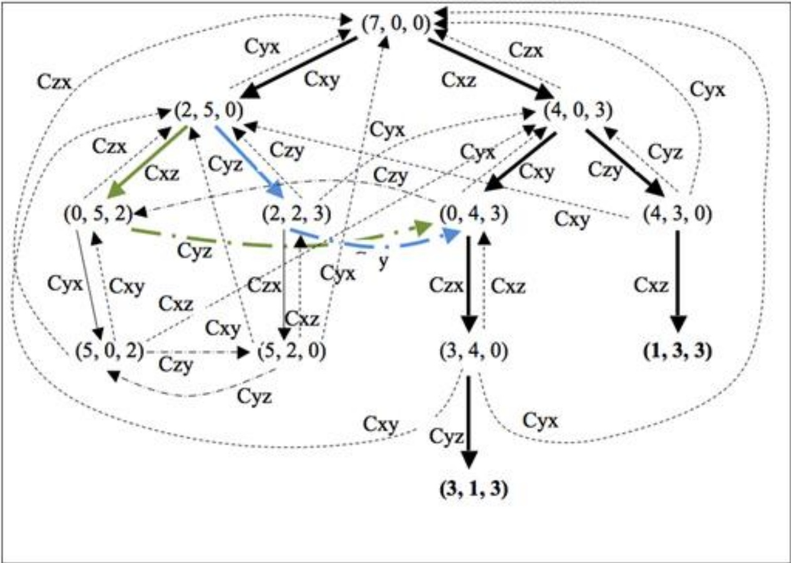

Hình 2.1 Đồ thị trạng thái của bài toán dong dầu

## 2.1.2 Một số ví dụ biểu diễn bài toán trong không gian trạng thái

Ví dụ 1: Xét bài toán 15-puzzle: một lưới 4 × 4 ô vuông, 15 ô chứa các số nguyên 1, 2, ..., 15 (ô số), ô còn lại trống (ô trống). Quy tắc chơi: đổi chỗ một ô số với ô trống kê cạnh với nó. Xuất phát từ một cấu hình đã cho, áp dụng quy tắc chơi để đạt tới một cấu hình cho trước.

Giả sử cấu hình xuất phát là:

<!-- page: 31 -->

| 11 | 14 | 4 | 7 |
| --- | --- | --- | --- |
| 10 | 6 |  | 5 |
| 1 | 2 | 13 | 15 |
| 9 | 12 | 8 | 3 |

cấu hình đích là:

| 1 | 2 | 3 | 4 |
| --- | --- | --- | --- |
| 12 | 13 | 14 | 5 |
| 11 |  | 15 | 6 |
| 10 | 9 | 8 | 7 |

Biểu diễn “bàn cò”

Bàn cò có thể biểu diễn như một màng 4 × 4, các phần tử của nó chứa các số từ 0 đến 15. Phần tử chứa giá trị 0 biểu diễn ô trống. Trong cách biểu diễn này, cấu hình xuất phát và cấu hình đích khá rõ ràng và trực tiếp.

Biểu diễn quy tắc chơi

Ô trống kê cạnh với 4 ô số khi nó nằm bên trong bàn cờ, kể cạnh với 3 ô số nếu nó nằm ở cạnh bàn cờ (nhưng không ở góc) và kể cạnh với 2 ô số nếu nó nằm ở góc. Như vậy quy tắc chơi có thể biểu diễn bời bốn phép di chuyển, ta gọi là:

• UP : đôi chỗ ô trống với ô bên trên nó (đưa ô trống lên trên)

• DOWN : đổi chỗ ô trống với ô bên dưới nó

\- LEFT : đổi chỗ ô trống với ô bên trái nó

• RIGHT : đôi chỗ ô trống với ô bên phải nó

Chú ý rằng, các phép di chuyển này không phải lúc nào cũng có thể áp dụng vào một câu hình, ví dụ nếu câu hình có ô trống nằm ở dòng đầu tiên, phép di chuyển UP không áp dụng được. Ta tỉnh chế các phép dịch chuyển dưới dạng hàm trong giả ngôn ngữ C/C++,

Giả sử ta có các hàm:

<!-- page: 32 -->

\- row(c) trả lại chỉ số của dòng chứa ô trống trong cấu hình c

\- col (c) trả lại chỉ số của cột chứa ô trống trong cấu hình c

Các phép di chuyển có thể biểu diễn như sau:

```c
UP(c): if(row(c) > 0) {
    int cc[4][4], r=row(c), c=col(c);
    for (i = 0; i < 4; i++)
        for (j = 0; j < 4; j++)
            cc[i][j] = c[i][j];
    temp = cc[r][c];
    cc[r][c] = cc[r-1][c];
    cc[r-1][c] = temp;
    return cc;
}
```

```c
DOWN(c): if(row(c) < 3) [
    int cc[4][4], r=row(c), c=col(c);
    for (i = 0; i < 4; i++)
        for (j = 0; j < 4; j++)
            cc[i][j] = c[i][j];
    temp = cc[r][c];
    cc[r][c] = cc[r+1][c];
    cc[r+1][c] = temp;
    return cc;
}
```

```c
LEFT(c): if(col(c) > 0) {
    int cc[4][4], r=row(c), c=col(c);
    for (i = 0; i < 4; i++)
        for (j = 0; j < 4; j++)
            cc[i][j] = c[i][j];
    temp = cc[r][c];
    cc[row][c] = cc[r][c-1];
    cc[r][c-1] = temp;
    return cc;
}
```

<!-- page: 33 -->

```c
RIGHT(c): if(col(c) < 3) {
    int cc[4][4], r=row(c), c=col(c);
    for (i = 0; i < 4; i++)
        for (j = 0; j < 4; j++)
            cc[i][j] = c[i][j];
    temp = cc[r][c];
    cc[r][c] = cc[r][c+1];
    cc[r][c+1] = temp;
    return cc;
}
```

Ví dụ 2: Trong phòng có một con khí (đang thêm ăn), một quả chuối được treo ở trên trần, một cái bàn, một cái gây. Con khí muốn lấy được quả chuối, nó phải đứng trên cái bàn ở vị trí quả chuối, cảm cây gây chọc quả chuối cho rơi và nhật ăn. Con khí có thể thực hiện các thao tác: đi từ một vị trí đến một vị trí, đầy cái bàn từ một vị trí đến một vị trí, nhật một vật nhỏ (cây gây, quả chuối) lên với điều kiện trên tay không cảm vật gì, bỏ vật nhỏ đang cầm trên tay xuống, leo lên bàn, leo xuống bàn, chọc quả chuối cho rơi.

Ta sử dụng logic vị từ để biểu diễn các trạng thái. Trước tiên ta định nghĩa các vị từ cơ sở cần thiết cho việc mô tả bài toán. Một trạng thái khi đó có thể được mô tả bằng hội của các vị từ cơ sở.

\- at(X, Y) = "X ở vị trí Y"

\- on(X, Y) = "X ở trên Y"

\- armempty = “tay con khi không cầm gì”

\- holding(X) = "con khi cẩm vật X"

\- large(X) = "X là vật lớn"

\- small(X) = "X là vật nhỏ"

Ta sẽ sử dụng ký hiệu dấu phầy ',’ thay cho ký hiệu ∧

Tráng thái ban đầu: “con khi, cái bàn, cây gây, quả chuối ở vị trí tương ứng của chúng, con khi ở trên sàn, cây gây ở trên sàn, cái bàn ở trên sàn, quả chuối ở trên trần, tay con khi không cảm gì”:

at(khi, k), at(bàn, b), at(gây, g), at(chuối, c), on(khi, sàn), on(gây, sàn), on(bàn, sàn), on(chuối, trần), large(bàn), small(gây), small(chuối), armempty.

Ta xét trạng thái kết thúc là trạng thái con khi cầm quả chuỗi, các mô tả khác không quan trọng:

```txt
...,holding(chuôi), ...
```

<!-- page: 34 -->

Bảng 2.1 mô tả các phép toán với tiền điều kiện và kết quả. Quy ước, trong các cột kết quả chỉ ghi các thuộc tính bị thay đổi, các thuộc tính không được nhắc lại là các thuộc tính không thay đổi.

Băng 2.1 Các toán từ biến đổi trạng thái trong bài toán con khí và quả chuối

| Tên toán tử | Giải thích | Điều kiện | Kết quả |
| --- | --- | --- | --- |
| walk(p) | Con khi đi đến vị trí p | on(khi, sàn) | at(khi, p) |
| push(X, p) | Con khi đầy vật lớn X đến vị trí p | at(khi, V), at(X, V), large(X), armempty | at(khi, p), at(X, p) |
| pick-up(X) | Con khi nhật lên vật nhỏ X | at(khi, V), at(X, V), small(X), armempty | holding(X) |
| put-down(X) | Con khi đặt vật nhỏ X xuống | holding(X) | armempty |
| climb-up | Con khi leo lên bàn | at(khi, V), at(bàn, V), on(khi, sàn) | on(khi, bàn) |
| climb-down | Con khi leo xuống bàn | on(khi, bàn) | on(khi, sàn) |
| thrust | Con khi chọc quả chuối | at(bàn, V), at(chuổi, V), on(khi, bàn), holding(gây), on(chuổi, trần) | on(chuổi, sàn) |

Ví dụ 3. Bài toán 8 quân hậu: hãy tìm cách đặt 8 quân hậu lên bàn cờ vua sao cho không có quân nào bị không chế.

Hình 2.2 minh hoạ một phần (7 quân hậu) lời giải của bài toán này.

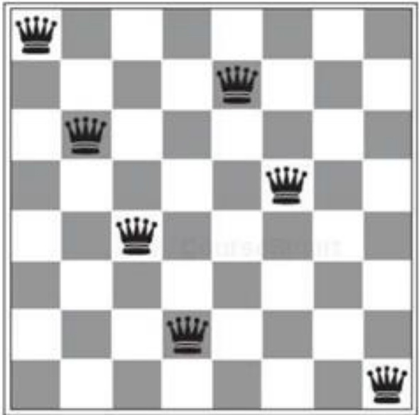

Hình 2.2 Bài toán 8 quân hậu

<!-- page: 35 -->

Có nhiều cách để biểu diễn bài toán 8 quân hậu.

Cách 1:

Trạng thái:

\- Mỗi trạng thái là vị trí của kquân hậu được đặt trên bàn cò, mỗi quân hậu được đặt ở một ô (k = 0, 1, ..., 8)

Trạng thái ban đầu:

\- Bàn cờ không có quân hậu nào.

Phép toán:

\- Chọn 1 ô trống bất kỳ trên bàn cờ và đặt thêm một quân hậu lên bàn cờ Hàm kiểm tra mục tiêu:

\- Kiểm tra xem có đủ 8 quân hậu trên bàn cờ chưa và có quân hậu nào bị không chế không.

Rõ ràng cách này sẽ có nhiều bất lợi vì số đường đi phải xem xét lên đến 64 × 63 × … × 57 = 1.8 × 10$^{14}$!

Nhận xét:

\- Do quân hậu sẽ không chế hàng, cột và 2 đường chéo, nên mỗi cột/hàng có đúng một quân hậu. Một cột đã có quân hậu rời sẽ không đặt quân hậu mới vào cột đó nửa.

Với nhận xét trên, ta có thể cải tiến một chút mô hình.

Cách 2:

Trạng thái:

\- Môi trạng thái là vị trí của k quân hậu được đặt trên k cột đầu tiên của bàn cò, mỗi quân hậu trên 1 cột, k = 0, 1, ..., 8. Các quân hậu này không không chế lẫn nhau.

Trạng thái ban đầu:

\- Bản cờ không có quân hậu nào

Phép toán:

<!-- page: 36 -->

\- Chọn 1 vị trí trên cột trống đầu tiên (xét từ trái sang phải) sao cho nó không cùng hàng và đường chéo với các hậu được đặt trước đó và đặt thêm một quân hậu lên vị trí đó

Hàm kiểm tra mục tiêu:

\- Kiểm tra xem có đủ 8 quân hậu trên bàn cờ chưa.

Tổng số đường đi phải xem xét giảm từ 1.8 × 10$^{14}$ xuống chỉ còn 2.057.

Hàm kiểm tra mục tiêu cũng đơn giản hơn: ta chỉ cần kiểm tra xem đủ 8 quân hậu chưa thời vì mỗi khi đặt quân hậu mới ta đã kiểm tra nó không bị các quân hậu trước đó không chế rời.

Cách 3:

Trạng thái:

\- Mỗi trạng thái là vị trí của 8 quân hậu được đặt trên bàn cò, mỗi quân hậu trên 1 cột.

Phép toán:

\- Chọn một quân hậu bị không chế và di chuyển đến một vị trí khác trong cùng cột sao cho nó không bị không chế nửa.

Hàm kiểm tra mục tiêu:

\- Kiểm tra xem có quân hậu nào còn bị không chế không.

Ví dụ 4: Bài toán tìm đường đi từ thành phố Arad đến thành phố Bucharest, ở Rumani. Bài toán này được trích từ quyền “Artificial Intelligence: A Modern Approach” của [Russel & Norvig, 2009]. Hình 2.3 mô tả bản đồ đơn giản của những con đường nối các thành phố của Rumani. Các con số trên mỗi con đường mô tả chiều dài của con đường (tính bằng km). Giả sử ta đang ở thành phố Arad và muốn tìm đường đi để đến thành phố Bucharest.

## Trạng thái:

\- Các thành phố của Rumani. Ta có thể sử dụng tên của các thành phố để mô tả trạng thái. Ta cũng có thể sử dụng vị từ in (X) để mô tả ta đang ở thành phố X.

Trạng thái ban đầu:

<!-- page: 37 -->

\- Ta đang ở Arad: Arad hay in (Arad) nếu sử dụng vị từ để mô tả trạng thái.

Phép toán:

\- Đi từ thành phố hiện tại đến thành phố khác có đường nối trực tiếp. Nếu có đường đi trực tiếp từ thành phố X đến thành phố khi, thì ta có phép toán biến đổi trạng thái X thành trạng thái Y. Ví dụ nếu X = Arad, ta có thể đi đến 1 trong 3 thành phố: Zerind, Sibiu hay Timisoara.

Hàm kiểm tra mục tiêu:

\- Thành phố đang xét có phải là Bucharest không

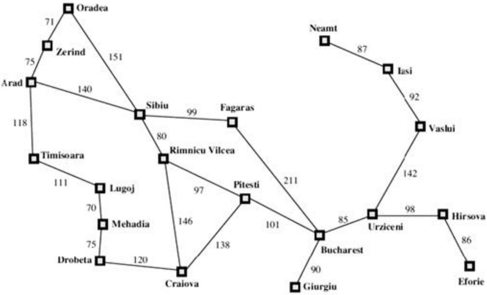

Hình 2.3 Bản đồ các con đường nối các thành phố của Rumani

## 2.2 CÁC KỸ THUẬT TÌM KIỂM

Sau khi đã mô hình hoá bài toán, vấn đề kế tiếp là cần phải giải nó. Một lời giải (solution) là một chuỗi các hành động (action sequence), vì thế các giải thuật tìm kiếm làm việc bằng cách xem xét các chuỗi hành động khả đĩ. Các chuỗi các hành động khả đĩ bắt đầu từ trạng thái ban đầu tạo nên một cây tìm kiếm (search tree) có nút gốc là trạng thái ban đầu; nhánh là các hành động và nút (nodes) tương ứng với các trạng thái trong không gian trạng thái của vấn đề.

<!-- page: 38 -->

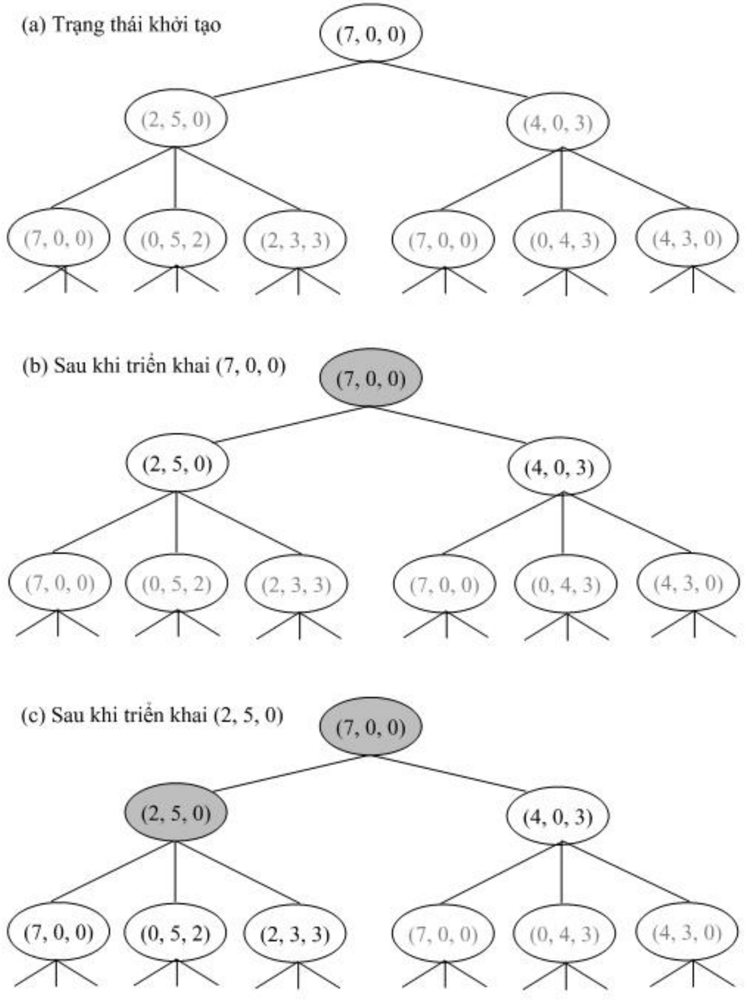

Hình 2.4 Cây tìm kiếm được sinh ra trong quá trình tìm kiếm lời giải của bài toán dong đầu

<!-- page: 39 -->

Hình 2.4 minh hoạ một số bước trong quá trình tìm kiếm lời giải trong bài toán dong đầu. Nút gốc của cây tương ứng với trạng thái bắt đầu, (7, 0, 0). Bước đầu tiên là kiểm tra xem trạng thái hiện tại có phải là trạng thái kết thúc chưa. Sau đó, ta xem xét các hành động có thể thực hiện được lên trạng thái hiện tại, và sinh ra (generate) một tập các trạng thái mới. Trong trường hợp này, ta có 2 nhánh xuất phát từ nút cha (parent node) (7, 0, 0) dẫn đến 2 nút con (child node): (2, 5, 0) và (4, 0, 3). Bây giờ đến lượt ta phải chọn nút con nào để xem xét xem có thể sinh ra các nút “chấu” nào nửa không.

Vấn đề chọn nút kế tiếp để xem xét là vấn đề quan trọng nhất của các giải thuật tìm kiếm: phải chọn nút nào để xem xét trước. Giả sử ta chọn (2, 5, 0) để xem xét trước. Ta sẽ kiểm tra xem nó có phải là trạng thái kết thúc chưa và triển khai/mở rộng (expand) nó để được các nút mới: (7, 0, 0), (0, 5, 2), và (2, 3, 3). Sau đó, ta có thể chọn 1 trong 4 nút này để xem xét hoặc ta cũng có thể để 3 nút đó lại và quay chọn (4, 0, 3). Tất cả 4 nút này đều là nút lá (leaf node) – nút không có nút con. Tập các nút lá sẵn sàng để triển khai tại một thời điểm nào đó được gọi là đường biên (frontier) của cây tìm kiếm. Một số tác giả khác gọi là danh sách mở (open list). Tuy nhiên cách gọi này không chính xác cả về mặt địa lý và ý nghĩa vì ta có thể sử dụng cấu trúc dữ liệu khác hiệu quả hơn danh sách (list). Trong hình 2.4 đường biên của cây là các nút nền trắng viên đen.

Quy trình triển khai các nút trên đường biên cứ tiếp tục cho đến khi tìm thấy một lời giải hoặc không thể triển khai được nửa. Giải thuật tìm kiếm tổng quát treeSearch được trình bày trong hình 2.5. Các giải thuật tìm kiếm đều có chung cấu trúc này. Khác biệt chính giữa các giải thuật là cách chọn nút kế tiếp để triển khai – vấn đề này gọi là chiến lược tìm kiếm (search strategy).

Nếu tinh mất một chút ta có thể nhận thấy có một chỗ đặc biệt của cây tìm kiếm trong hình 2.2: nó gồm cả đường đi từ (7, 0, 0) đến (2, 5, 0) và trở lại (7, 0, 0). Ta nói rằng trạng thái (7, 0, 0) là trạng thái bị lắp lại (repeated state) trong cây tìm kiếm, và sinh ra đường đi lắp (loopy path). Xem xét các đường đi lắp như thế có nghĩa là cây tìm kiếm đầy đủ sẽ vô hạn (infinite) vì không có ràng buộc nào về số lần lắp. Mặt khác, trong ví dụ này không gian trạng thái ít hơn 20 trạng thái. Như sẽ phân tích ở phần sau, các vòng lắp có thể làm cho các giải thuật thất bại (lặp vô tận), làm một số vấn đề có thể giải được trở nên không giải được! May thay, ta không cần phải xem xét các đường đi lắp. Ta có thể dựa trên một nhận xét trực quan như sau: vì chi phí đường đi có tính cộng (additive) và chi phí từng bước không âm nên một đường đi lắp không bao giờ tốt hơn một đường đi đã được khử lắp.

<!-- page: 40 -->

```cpp
PNode treeSearch(PState initial_state) {
    //Nút gốc biểu diễn trạng thái bắt đầu
    PNode root = new Node;
    root->state = initial_state;
    root->parent = NULL;
    //Khởi tạo đường biên chứa nút gốc
    insert(root, frontier);
    while (!frontier.isEmpty()) {
        //Lấy l nút từ đường biên và loại bỏ nó
        //ra khởi đường biên
        PNode node = pop(frontier);
        //Nểu node là một nút mục tiêu, trả về node
        //Lần vết từ node theo con trở parent đề tìm
        //đường đi từ gốc đến node.
        if (node là nút mục tiêu)
            return node;
        for each (child là nút con của node)
            if (child->state không thuộc frontier) {
                child->parent = node;
                insert(child, frontier);
            }
        }
        //Thất bại, không tìm thấy lời giải
    return NULL;
}
```

Hình 2.5 Giải thuật treeSearch

Các đường đi lắp là một trường hợp đặc biệt của một khái niệm tổng quát hơn: đường đi thừa (redundant paths). Đường đi thừa tồn tại khi có nhiều hơn một cách để di từ một trạng thái này đến một trạng thái khác. Xem xét đường đi (7, 0, 0) – (4, 0, 3) và (7, 0, 0) – (2, 5, 0) – (2, 2, 3) – (4, 0, 3). Rô ràng là đường đi thứ hai là thừa, đường đi dài nhất để đến cùng một trạng thái (trường hợp xấu nhất). Nếu ta chỉ quan tâm đến việc đi đến trạng thái đích, không có lý do gì phải giữ lại nhiều hơn một đường đi.

Trong một số trường hợp, ta có thể định nghĩa vấn đề để bản thân nó đã loại bỏ được các đường đi thừa. Ví dụ, Nếu ta mô hình hoá bài toán 8 quân hậu để mỗi quân hậu có thể được đặt trên bất cứ cột nào, thì mỗi trạng thái n quân hậu có thể có đến n! đường đi khác nhau để đến nó. Nhưng nếu ta mô hình hoá bài toán sao cho mỗi quân hậu mới chỉ có thể đặt trên cột trống đầu tiên thì chỉ có duy nhất một đường đi đến một trạng thái bất kỳ.

<!-- page: 41 -->

Trong các trường hợp khác, vấn đề đường đi thừa là không thể tránh khởi. Điều này bao gồm cả các vấn đề trong đó các hành động đều khả đảo (reversible), ví dụ như bài toán tìm đường đi trên bản đồ và bài toán 15-puzzles. Bài toán tìm đường đi trên một lưới chữ nhật là một ví dụ quan trọng trong các trò chơi máy tính. Trong một lưới như thế, mỗi trạng thái có 4 trạng thái con, vì thế một cây có độ sâu $d$ gồm luôn cả các trạng thái bị lập lại có $4^{d}$ nút lá, nhưng chỉ có $2d^{2}$ trạng thái phân biệt trong $d$ bước. Với $d = 20$, điều này có nghĩa là khoảng 1 tỷ nút nhưng chỉ có 800 trạng thái khác nhau. Vì thế, đi theo các đường đi thừa có thể làm một vấn đề có thể giải được (tractable) trở nên không thể giải được (untractable)! Điều này vẫn còn đúng ngay cả khi giải thuật biết cách tránh các vòng lập vô tận.

Nói một cách khác, nếu giải thuật không lưu lại lịch sử thì có thể sinh ra đường đi lập. Cách tránh triển khai các đường đi thừa là phải nhớ (lưu trữ) những nơi đã đi qua. Đề làm điều này, ta tăng cường thêm cho giải thuật treeSearch một cấu trúc dữ liệu gọi là tập các nút đã triển khai (explored set, cũng được gọi là danh sách đóng – closed list) lưu trữ các nút đã triển khai². Khi một nút mới sinh ra, nếu trạng thái của nó đã có mặt trong tập các trạng thái đã triển khai hoặc nằm trên đường biên, ta có thể bỏ qua thay vì thêm nó vào đường biên. Giải thuật mới, graphSearch, được trình bày trong hình 2.4.

Rõ ràng, cây tìm kiếm xây dựng bằng giải thuật graphSearch chứa nhiều nhất một bản sao của mỗi trạng thái. Giải thuật này có một tính chất thú vị: đường biên phân chia đồ thị không gian trạng thái thành 2 vùng: đã khám phá (explored) và chưa khám phá (unexplored), vì thế mỗi đường đi từ trạng thái bắt đầu đến một trạng thái trong vùng chưa khám phá phải đi qua một trạng thái trên đường biên. Mỗi bước lập trong vòng lập while chuyển một trạng thái từ đường biên sang vùng đã khám phá và chuyển một số trạng thái từ vùng chưa khám phá sang đường biên. Ta có thể thấy rằng giải thuật xem xét các trạng thái một cách có hệ thống trong không gian trạng thái cho đến khi tìm được lời giải.

<small><span class="docvortex-page-footnote" data-block-type="page_footnote" style="color:#6b7280">² Thực chất ta chỉ cần lưu các tramo thái của các nút đã triển khai.</span></small>

<!-- page: 42 -->

```c
PNode graphSearch(PState init_state) {
    //Nút gốc biểu diễn trạng thái ban đầu
    PNode root = new Node;
    root->state = init_state;
    root->parent = NULL;
    //Khởi tạo đường biên chứa nút gốc
    insert(root, frontier);
    //Khởi tạo tập nút đã triển khai bằng rỗng
    clear(explored);
    while (!empty(frontier)) {
        //Lấy 1 nút từ đường biên và loại bỏ nó
        //ra khởi đường biên
        Node* node = frontier.pop();
        //Nếu node là một nút mục tiêu, trả về node
        //Lần vết từ node theo con trở parent để tìm
        //đường đi từ gốc đến node.
        if (node là nút mục tiêu)
            return node;
        //node là nút đã triển khai, đưa nó vào explored
        insert(node, explored);
        for (child là nút con của node)
            //Đưa child vào đường biên nếu nó
            //không nằm trên đường biên và cũng
            //không nằm trongtập đã triển khai
            if (child->state không thuộc frontier và
                child->state không thuộc explored) {
                child->parent = node;
                insert(child, frontier);
            }
        }
        //Thất bại, không tìm thấy lời giải
        return NULL;
}
```

Hình 2.6 Giải thuật graphSearch

## 2.2.1 Câu trúc dữ liệu cho các giải thuật tìm kiếm

Các giải thuật tìm kiếm cần một cấu trúc dữ liệu để lưu vết cây tìm kiếm đang được xây dựng.

Mỗi nút n trên cây tìm kiếm gồm 4 thành phần:

<!-- page: 43 -->

\- state: trạng thái trong không gian trạng thái tương ứng với nút này;

\- parent: nút cha (nút chứa trạng thái sinh ra trạng thái của nút n);

\- action: hành động áp dụng lên trạng thái của nút cha đề sinh ra n;

\- path\_cost: chi phí, thường được ký hiệu g(n), chi phí đường đi từ nút gốc đến nút n.

Cấu trúc của một nút được mô tả trong hình 2.7. Chú ý rằng nhờ vào con trở trở về nút cha mà ta có thể lần ngược để tìm ra đường đi của lời giải. Cho trước các thuộc tính của một nút cha, ta dễ dàng tính được các thuộc tính của nút con. Cho đến lúc này ta vẫn chưa phân biệt rõ ràng giữa nút và trạng thái. Nhưng khi viết giải thuật chi tiết ta cần phải phân biệt rõ hai khái niệm này. Nút là một cấu trúc dữ liệu dùng để biểu diễn cây tìm kiếm. Trạng thái tương ứng với một cấu hình (configuration) của bài toán. Vì vậy, nút nằm trên đường đi (path) còn trạng thái thì không. Hơn nữa hai nút khác nhau có thể chứa hai trạng thái y hết nhau nếu trạng thái đó được sinh ra từ hai đường đi khác nhau.

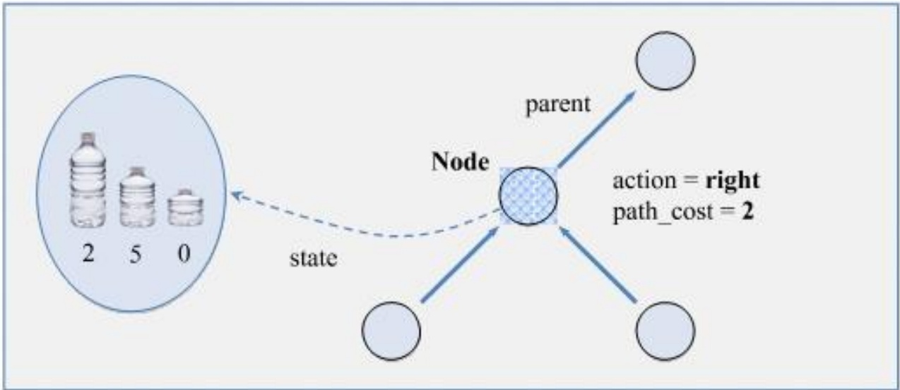

Hình 2.7 Cấu trúc dữ liệu cho nút trong cây tìm kiếm

Cấu trúc dữ liệu của nút được khai báo tổng quát như trong hình 2.8.

```c
typedef struct Node* PNode;
typedef struct {
    PState state;
    PNode parent;
    Action action;
    int path_cost;
} Node;
```

Hình 2.8 Khai báo cấu trúc dữ liệu cho nút trong cây tìm kiếm

<!-- page: 44 -->

Hàm childNode nhận vào hai tham số – nút n và hành động action – và trả về một nút con của n (xem Hình 2.9). Hàm result nhận vào một trạng thái và một hành động, trả về trạng thái mới được sinh ra nếu áp dụng hành động action lên trạng thái hiện tại. Hàm stepCost trả về chi phí của hành động action áp dụng lên trạng thái hiện tại.

```c
PNode childNode(PNode parent, Action action) {
    PNode n = new Node;
    n->state= result(parent->state, action);
    if (n->state == NULL)
        return NULL;
    n->parent = parent;
    n->action = action;
    n->path_cost = parent->path_cost +
        stepCost(parent->state, action);
    return n;
}
```

Hình 2.9 Hàm childNode sinh ra nút con từ nút cha và hành động

Trở lại bài toán dong dầu, mỗi trạng thái là bộ 3 (x, y, z) với x, y, z: là số đầu hiện có trong các bình 7, 5 và 3 lít. Ta có thể khai báo cấu trúc dữ liệu cho trạng thái và nút cùng với các hàm cần thiết như trong hình 2.10.

```c
typedef struct {
    int x, y, z;
} State;
typedef State* PState;

typedef struct Node* PNode;

typedef int Action;
typedef struct {
    PState state;
    PNode parent;
    Action action;
    int path_cost;
} Node;
```

Hình 2.10 Khai báo cấu trúc dữ liệu cho bài toán đồng đầu

<!-- page: 45 -->

Con trở trở đến nút cha (parent) của một nút được lưu trữ trong cấu trúc Node thay vì cấu trúc State như trước đây. Mỗi hành động chuyên đầu được mã hoá bằng một số nguyên (trường action trong cấu trúc State). Mã và ý nghĩa các hành động được cho trong Bảng 2.1.

Băng 2.2 Các hành động chuyên đầu trong bài toán dong đầu

| Mã hành động | Tên hành động | Ý nghĩa |
| --- | --- | --- |
| 1 | cxy | Chuyên đầu từ bình 7 lít sang bình 5 lít |
| 2 | cxz | Chuyên đầu từ bình 7 lít sang bình 3 lít |
| 3 | cyx | Chuyên đầu từ bình 5 lít sang bình 7 lít |
| 4 | cyz | Chuyên đầu từ bình 5 lít sang bình 3 lít |
| 5 | czx | Chuyên đầu từ bình 3 lít sang bình 7 lít |
| 6 | czy | Chuyên đầu từ bình 3 lít sang bình 5 lít |

Hàm result áp dụng hành động action lên trạng thái hiện tại để sinh ra một trạng thái mới hoặc NULL nếu không thể áp dụng.

```txt
PState result(PState state, Action action) {
    switch (action) {
        case 1:
            return cxy(state);
        case 2:
            return cxz(state);
        case 3:
            return cyx(state);
        case 4:
            return cyz(state);
        case 5:
            return czx(state);
        case 6:
            return czy(state);
        default:
            return NULL;
    }
}
```

Hàm stepCost luôn trả về 1.

<!-- page: 46 -->

```txt
int stepCost(PState state, Action action) {
    return 1;
}
```

Giờ đây khi có nút, ta cần nơi để lưu trữ chứng. Đường biên cần phải được lưu trữ sao cho giải thuật tìm kiếm có thể dễ dàng chọn nút kế tiếp để triển khai tuỷ thuộc vào chiến lược tìm kiếm được sử dụng. Cấu trúc dữ liệu thường dùng để lưu trữ đường biên là hàng đợi (queue). Các phép toán trên hàng đợi bao gồm:

• empty(queue): kiểm tra hàng đội rỗng

\- pop (queue): loại bỏ phần tử đầu tiên trong hàng đợi và trả về phần tử đó.

\- insert (element, queue): thêm phần tử element vào hàng đội queue và trả về hàng đội sau khi đã thêm phần tử.

Các hàng đội có thể được phân biệt bằng thứ tự lưu trữ các nút mới. Ba kiểu hàng đội thường gặp là: FIFO (vào trước ra trước), LIFO (vào sau ra trước) và hàng đội ưu tiên (priority queue): lấy phần tử có độ ưu tiên cao nhất ra trước theo một hàm ưu tiên nào đó.

Tập hợp các nút đã khám phá/triển khai có thể được cải đặt dưới dạng một bằng băm để giúp kiểm tra trạng thái lập một cách hiệu quả. Nếu cải đặt tốt, độ phức tạp thời gian của phép toán xen và tìm kiếm một nút (thực ra là tìm trạng thái) có thể là hàng số (không cần quan tâm đến số lượng trạng thái đã được khám phá).

## 2.2.2 Đánh giá hiệu quả giải quyết vấn đề

Trước khi đi vào thiết kế các giải thuật tìm kiếm cụ thể, ta cần xem xét các tiêu chí có thể dùng để lựa chọn giải thuật. Có thể đánh giá hiệu quả của giải thuật theo 4 tiêu chí sau:

\- Tính đầy đủ (competeness): giải thuật có đảm bảo tìm kiếm được lời giải nếu nó tôn tại không?

\- Tính tối ưu (Optimality): chiến lược tìm kiếm có cho ra lời giải tối ưu không?

\- Độ phức tạp thời gian (Time complexity): mất bao lâu đề tìm ra lời giải?

\- Độ phức tạp không gian (Space complexity): cần bao nhiêu bộ nhớ để thực hiện quá trình tìm kiếm?

<!-- page: 47 -->

Độ phức tạp thời gian và không gian luôn có thể tính được theo một số độ đo về độ khó của bài toán. Trong khoa học máy tính, độ đo tiêu biểu là kích thước của đồ thị không gian trạng thái, |V| + |E|, trong đó V là tập các nút và E là tập các cạnh/cung (edges/links) của đồ thị. Độ đo này phù hợp khi đồ thị là một cấu trúc dữ liệu tường minh được xem như đầu vào của giải thuật tìm kiếm. Trong trí tuệ nhân tạo, đồ thị thường được biểu diễn không tường minh (implicitly) bằng trạng thái bắt đầu, các hành động và mô hình biến đổi. Các đồ thị thường vô hạn. Vì các lý do này mà độ phức tạp được thể hiện dưới dạng 3 tham số: b – hệ số phân nhánh (branching factor) hay số con tối đa của các nút, d – độ sâu của nút mục tiêu cận nhất (số bước đi từ gốc đến nút mục tiêu cận nhất) và m – chiều dài lớn nhất của các đường đi trong không gian trạng thái. Độ phức tạp thời gian thường được đo theo số nút được sinh ra trong quá trình tìm kiếm trong khi độ phức tạp không gian được đo theo số lượng nút được lưu trữ trong bộ nhớ. Đa số các trường hợp, ta mô tả độ phức tạp thời gian và không gian cho phiên bản tìm kiếm trên cây (treeSearch). Đối với phiên bản tìm kiếm trên đồ thị (graphSearch), câu trả lời còn phụ thuộc vào các đường đi thừa trong không gian trạng thái như thế nào nữa.

Đế đánh giá tính hiệu quả của một giải thuật tìm kiếm, chúng ta có thể chỉ xem xét chi phí tìm kiếm (search cost) – phụ thuộc vào độ phức tạp thời gian nhưng cũng có thể phụ thuộc vào bộ nhớ sử dụng – hoặc ta có thể dùng chi phí tổng (total cost): kết hợp chi phí tìm kiếm và chi phí đường đi của lời giải. Trong bài toán tìm đường di trên bản đồ, chi phí tìm kiếm là thời gian thực hiện tìm kiếm (đo bằng mili giây chẳng hạn) và chi phí lời giải là tổng chiều dài của đường (tính theo đơn vị km chẳng hạn). Như thế, để tính chi phí tổng ta cần phải cộng mili giây và km ! Không có một cách chính thức nào để đổi km ra giây. Tuy nhiên ta ca cũng có thể đổi km sang mili giây bằng cách ước lượng vận tốc trung bình của xe ô-tô. Điều này cho phép dung hoà giữa chi phí tính toán để tìm lời giải và chi phí của lời giải.

## 2.2.3 Các chiến lược tìm kiếm

Các chiến lược tìm kiếm trong trong không gian trạng thái có thể chia thành ba loại :

Tìm kiểm tiến (forward chaining) - Tìm kiểm trạng thái đích. Quá trình tìm kiếm xuất phát từ tập các trạng thái bắt đầu. Đầu tiên tìm kiếm trạng thái đích trong tập các trạng thái bắt đầu, nếu tìm thấy, quá trình tìm kiếm dùng, nếu không xây dựng một tập các trạng thái có thể đạt tới từ các trạng thái bắt đầu và xét nó như tập các “trạng thái bắt đầu” mới, lập lại quá trình tìm kiếm với tập các “trạng thái bắt đầu” mới.

Quá trình tìm kiếm có thể được tiến hành theo hai kiểu:

<!-- page: 48 -->

\- Đồng thời: tìm kiếm trong toàn bộ tập các “trạng thái bắt đầu” trước khi chuyển sang tìm kiếm trong tập các “trạng thái bắt đầu” mới.

\- Chọn lọc: chọn ra một trạng thái trong tập các “trạng thái bắt đầu”, xem xét nó, tạm thời bổ qua các “trạng thái ban đầu” còn lại, xây dựng tập các “trạng thái bắt đầu” mới, chuyển sang tìm kiếm trong tập các “trạng thái bắt đầu” mới, theo kiểu “chọn lọc”.

Tìm kiểm lùi (backward chaining) - Tìm kiểm trạng thái bắt đầu. Quá trình tìm kiếm xuất phát từ tập các trạng thái đích. Đầu tiên xem xét có trạng thái đích nào là trạng thái bắt đầu không? Nếu đúng quá trình tìm kiếm dùng nếu không, xác định các trạng thái có thể đi trực tiếp tới trạng thái đích, tập các trạng thái này được xem như tập các “trạng thái đích” mới, lập lại quá trình tìm kiếm với tập các “trạng thái đích” mới.

Tìm kiểm hai hướng - Kết hợp tìm kiếm dây chuyển tiến và tìm kiếm dây chuyển lùi. Quá trình tìm kiếm dùng lại khi tập các “trạng thái ban đầu” trong tìm kiếm dây chuyển tiến và tập các “trạng thái đích” trong tìm kiếm dây chuyển lùi có phần tử chung.

Một số gọi ý cho chọn lựa hướng tìm kiếm:

Tìm kiểm dây chuyển tiến phù hợp khi:

• Tập các trạng thái bắt đầu xác định tường minh

\- Có nhiều đích, nhưng chỉ có một số nhỏ các phép toán có thể áp dụng vào một trạng thái (bậc cộng của mỗi nút nhỏ: $d^{+}$ nhỏ).

Tìm kiểm dây chuyển lùi phù hợp khi:

\- Tập các trạng thái đích xác định tường minh, tập các trạng thái bắt đầu không được cho trước.

\- Có nhiều toán tử có thể áp dụng lên một trạng thái ($d^{+}$ lớn), nhưng có một số nhỏ hơn các cung đến một nút ($d^{-}$ nhỏ)

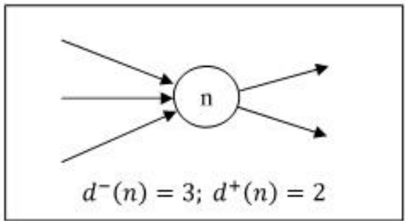

Tuy nhiên, đối với rất nhiều bài toán, khó xác định được từ ban đầu chiến lược tìm kiếm nào hiệu quả hơn!

<!-- page: 49 -->

Phần tiếp theo đây sẽ trình bày cụ thể các chiến lược tìm kiếm chỉ dựa vào thông tin mô tả của bài toán. Vì thế họ các giải thuật này còn có tên gọi là tìm kiếm không có thông tin bổ sung (uninformed search) hay tìm kiếm màu (blind search). Thuật ngữ tìm kiếm không có thông tin bổ sung có nghĩa là các chiến lược tìm kiếm không có thông tin gì khác ngoài các trạng thái được cung cấp trong định nghĩa vấn đề (problem definition). Tất cả những gì có thể làm là sinh ra các trạng thái tiếp theo (successors) từ trạng thái hiện tại (current state) và phân biệt được đầu là trạng thái mục tiêu (goal state) đầu không phải là trạng thái mục tiêu (no-goal state). Người ta phân biệt các chiến lược tìm kiếm dựa trên thứ tự triển khai các nút trong quá trình tìm kiếm. Các chiến lược tìm kiếm nào “biết” được trạng thái (không phải trạng thái đích) này “nhiều hứa hạn” hơn các trạng thái khác gọi là chiến lược tìm kiếm có thông tin bổ sung (informed search) hay chiến lược tìm kiếm heuristic (heuristic search); các chiến lược này được trình bày trong chương 3.

## 2.2.4 Tîm kiểm theo chiều rộng (Breadth-first search)

Tìm kiểm theo chiều rộng là một chiến tìm kiếm đơn giản trong đó nút gốc (tương ứng với trạng thái bắt đầu) được triển khai trước, kế tiếp tất cả các nút con của nút gốc được triển khai, sau đó đến lượt các nút con của các nút con này, và cứ tiếp tục như thế. Nói một cách tổng quát là tất cả các nút được triển khai theo độ sâu (depth) của chúng trong cây tìm kiếm.

## 2.2.4.1 Giải thuật tìm kiếm theo chiều rộng

Tìm kiểm theo chiều rộng là một thể hiện của giải thuật tìm kiếm tổng quát trên đồ thị (general graph-search algorithm) trong đó nút chưa triển khai có độ sâu nhớ nhất (shallowest node) sẽ được chọn để triển khai trước. Chiến lược tìm kiếm này có thể cải đặt dễ dàng bằng cách sử dụng một hàng đợi FIFO (vào trước ra trước) để lưu trữ các nút sắp sửa triển khai. Như thế, các nút mới (có độ sâu lớn hơn độ sâu của cha nó) sẽ nằm cuối hàng đợi và các nút cũ (có độ sâu nhớ hơn nút mới), sẽ được triển khai trước. Chỉ có một sự khác biệt nhỏ so với giải thuật tìm kiếm tổng quát trên đồ thị là việc kiểm tra một nút có phải là trạng thái kết thúc không được thực hiện khi nó được sinh ra chú không phải khi chọn nó để triển khai. Lý do cho sự quyết định này được giải thích trong phần phần bên dưới khi ta thảo luận về độ phức tạp thời gian. Cũng cần phải chú ý rằng: theo mô hình tìm kiếm tổng quát, giải thuật sẽ bỏ qua tất cả các đường đi mới đi đến một trạng thái đã có trong hàng đợi hoặc đã được triển khai rời (các nút nằm trong hàng đợi là các nút nằm trên đường biên phân chia các nút đã được triển khai và các nút chưa được duyệt đến). Dễ dàng thấy rằng các đường đi mới này luôn có chiều dài ít nhất là bằng với chiều dài đường đi đã tìm thấy. Vì thể, chiến lược tìm kiếm theo chiều rộng luôn có đường đi ngắn nhất (có số cung đi qua ít nhất) từ nút gốc đi đến các nút nằm trên đường biên. Mã giả cho giải thuật tìm kiếm theo chiều rộng được cho

<!-- page: 50 -->

trong Hình 2.11. Hình 2.12 minh hoạ quá trình tìm kiếm trên một cây nhị phân đơn giản.

```c
PNode breadthFirstSearch(PState initial_state) {
    //Nút gốc biểu diễn trạng thái bắt đầu
    PNode root = (PNode)malloc(sizeof(Node));
    root->state = initial_state;
    root->path_cost = 0;
    root->parent = NULL;
    //Kiểm tra mục tiêu
    if (goalCheck(root->state))
        return root;
    //Đường biên là hàng đợi FIFO
    insert(root, frontier);
    //Khởi tạo tập nút đã triển khai bằng rỗng
    while (!empty(frontier)) {
        //Lấy nút cạn nhất từ đường biên và
        //loại bỏ nó ra khối đường biên
        //ra khởi đường biên, gắn vào node.
        Node* node = pop(frontier);
        //node là nút đã triển khai
        //đưa nó vào explored
        insert(node, explored);
        for each action{
            child = childNode(node, action)
            if (chils != NUL và
                child->state không có trong frontier và
                child->state không có trong explored) {
                if (goalCheck(child->state))
                    returnchild; //tìm thấy
                insert(child, frontier);
            }
        }
        //Thất bại, không tìm thấy lời giải
        return NULL;
    }
```

Hình 2.11 Giải thuật tìm kiếm theo chiều rộng

<!-- page: 51 -->

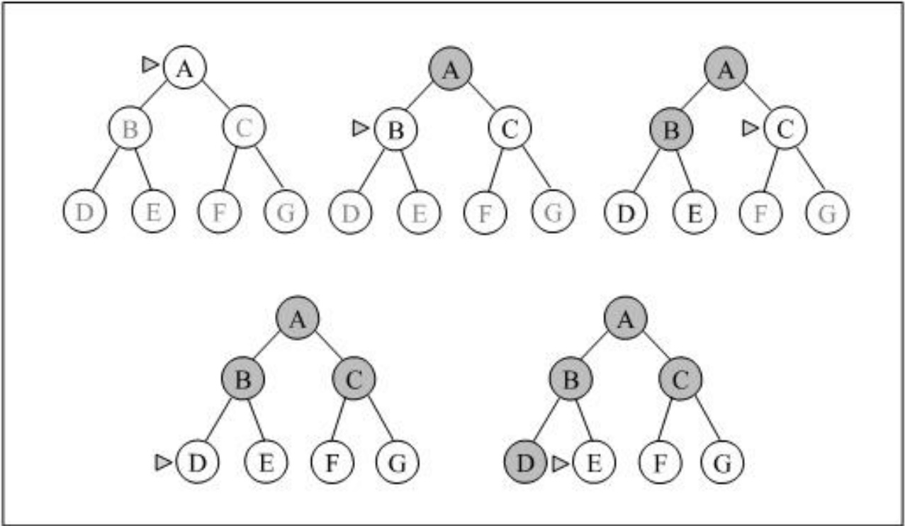

Hình 2.12 Minh hoạ quá trình tìm kiếm theo chiều rộng trên cây nhị phân

## 2.2.4.2 Đánh giá tìm kiếm theo chiều rộng

Có thể dễ dàng thấy rằng tìm kiếm theo chiều rộng là đầy đủ. Nếu nút mục tiêu cận nhất (có độ sâu nhỏ nhất) có độ sâu d, chiến lược tìm kiếm theo chiều rộng sẽ tìm thấy nó sau khi đã sinh ra tất cả các nút cận (nông) hơn nó (với điều kiện hệ số phân nhánh b hữu hạn). Chủ ý rằng ngay khi nút mục tiêu được sinh ra, ta luôn biết rằng nó là nút cận nhất vì tất cả các nút cận hơn đều đã được sinh ra và đã được kiểm tra rời. Nút mục tiêu cận nhất chưa chắc là nút tối ưu. Về mặt kỹ thuật, tìm kiếm theo chiều rộng sẽ tối ưu nếu chi phí đường đi là một hàm không giảm theo độ sâu của nút. Trường hợp dễ gặp nhất là tất cả các hành động đều có chi phí như nhau.

Giả sử ta đang thực hiện tìm kiếm trên một cây đồng nhất với tất cả các nút đều có đúng b nút con. Nút gốc của cây tìm kiếm sinh ra b nút con có độ sâu 1, mỗi nút này lại sinh ra b nút con có độ sâu 2. Tổng số nút có độ sâu 2 là $b^{2}$. Mỗi nút ở độ sâu 2 sinh ra b nút có độ sâu 3, dẫn đến tổng số nút có độ sâu 3 là $b^{3}$. Tiếp tục như thể, tổng số nút có độ sâu d là $b^{d}$. Giả sử, nút mục tiêu nằm ở độ sâu d. Trong trường hợp xấu nhất, nút mục tiêu sẽ là nút cuối cùng được sinh ra tại độ sâu này. Như thế tổng số nút được sinh ra là:

$$
b ^ {0} + b ^ {1} + b ^ {2} + \dots + b ^ {d}\tag{2.1}
$$

Nếu giải thuật tìm kiếm thực hiện việc kiểm tra mục tiêu khi nút được chọn triển khai thay vì kiểm tra khi nút được sinh ra, thì tất cả các nút có độ

<!-- page: 52 -->

sâu $d$ phải được triển khai trước khi tìm thấy nút mục tiêu. Điều này dẫn đến độ phức tạp thời gian là $O(b^{d+1})$.

Độ phức tạp không gian: với bắt kỳ chiến lược tìm kiếm trên đồ thị nào mà lưu các nút đã được triển khai, độ phức tạp không gian luôn là b lần độ phức tạp thời gian. Trong trường hợp tìm kiếm theo chiều rộng, tất cả các nút đã sinh ra đều nằm trong bộ nhớ. Có $O(b^{d-1})$ nút trong tập hợp các nút đã được triển khai và $O(b^{d})$ nút nằm trên đường biên. Vì thể độ phức tạp không gian là $O(b^{d})$ có nghĩa là độ phức tạp không gian phụ thuộc vào số nút trên đường biên.

Một độ phức tạp có cận lũy thừa như $O(b^{d})$ là rất lớn. Bảng 2.3 mô tả thời gian và không gian cần thiết tại một số giá trị độ sâu trong tìm kiếm theo chiều rộng với hệ số phân nhánh $b = 10$. Trong bảng này ta giả sử ràng trong một giấy có thể sinh ra 1 triệu nút và mỗi nút cần 1000 bytes để lưu trữ.

Bảng 2.3 Thời gian và bộ nhớ cần thiết cho chiến lược tìm kiếm theo chiều

| Độ sâu | Số nút | Thời gian | Bộ nhớ |
| --- | --- | --- | --- |
| 2 | 110 | 0.11 mili giây | 107 kilobytes |
| 4 | 11,110 | 11 mili giây | 10.6 megabytes |
| 6 | $10^6$ | 1.1 giây | 1 gigabytes |
| 8 | $10^8$ | 2 phút | 103 gigabytes |
| 10 | $10^{10}$ | 3 giờ | 10 terabytes |
| 12 | $10^{12}$ | 13 ngày | 1 petabytes |
| 14 | $10^{14}$ | 3.5 năm | 99 petabytes |
| 16 | $10^{16}$ | 350 năm | 10 exabytes |

Có hai bài học được rút ra từ bảng 2.3. Trước hết ta có thể thấy rằng yêu cầu về bộ nhớ là vấn đề lớn hơn là thời gian thực thi. Ta có thể chờ 13 ngày để nhận được kết quả cho một vấn đề quan trọng tại độ sâu 12, nhưng không một máy tính nào có đủ 1 petabyte bộ nhớ. May mặn thay, các chiến lược tìm kiếm khác đời hỏi bộ nhớ ít hơn. Bài học thứ hai là thời gian thực thi vẫn là một vấn đề quan trọng. Nếu bài toán của chúng ta có lời giải nằm ở độ sâu 16, cần khoảng 360 năm chiến lược tìm kiếm theo chiều rộng (và các chiến lược tìm kiếm không có thông tin khác) mới có thể tìm thấy nó. Tóm lại, các vấn đề tìm kiếm có độ phức tạp lũy thừa không thể giải quyết được bằng các phương pháp thiếu thông tin ngoại trừ các vấn đề rất nhỏ.

<!-- page: 53 -->

## 2.2.5 Tîm kiểm chi phí đồng nhất (Uniform-cost search)

Khi tất cả các bước (hoặc các hành động) đều có chi phí như nhau, tìm kiếm theo chiều rộng sẽ tối ưu vì nó luôn triển khai các nút cạn nhất. Mở rộng chiến lược này một chút, ta có thể tìm một được giải thuật tối ưu với bất kỳ hàm chi phí nào. Thay vì triển khai các nút cạn nhất, chiến lược tìm kiếm chi phí phí đồng nhất sẽ triển khai các nút có chi phí đường đi thấp nhất từ gốc đến nó, $g(n)$. Điều này có thể thực hiện bằng cách lưu trữ đường biên như một hàng đợi ưu tiên sắp xếp theo $g(n)$.

Đế có thể duy trì thứ tự của các nút trong hàng đợi theo chi phí đường đi của chúng, có hai sự khác biệt lớn so với tìm kiếm theo chiều rộng. Đầu tiên là việc kiểm tra mục tiêu được thực hiện khi chọn nút để triển khai chữ không phải khi nút được sinh ra. Lý do là vì nút mục tiêu đầu tiên được sinh ra có thể chi là nút gần tối ưu (suboptimal) chức chưa phải phải nút tối ưu. Có thể còn đường đi khác đi đến nút này với chi phí đường đi nhỏ hơn. Khác biệt thứ hai là thêm một phép kiểm tra nửa trong trường hợp tìm được một đường đi tốt hơn đến một nút đang nằm trên đường biên.

Dễ dàng thấy rằng tìm kiếm chi phí đồng nhất luôn tối ưu. Đề chứng minh điều này, trước hết, ta nhận thấy rằng mỗi khi chọn một n để triển khai, ta đã tìm được đường đi tối ưu từ nút gốc đến nó.

Chứng minh điều này bằng phản chứng như sau: Giả sử đường đi hiện tại đến n chưa phải là đường đi tối ưu. Như thế phải tồn tại một đường đi khác đến n chứa nút n' (n' nằm trên đường biên) có chi phí:

$$
g ^ {*} (n) <   g (n)\tag{2.2}
$$

Ta có thể tách chi phí $g^{*}(n)$ thành hai thành phần:

$$
g ^ {*} (n) = g (n ^ {\prime}) + d (n ^ {\prime}, n)\tag{2.3}
$$

trong đó, $g(n')$ là chi phí đường đi từ nút gốc đến $n'$ và $d(n', n)$ là tổng chi phí các bước từ nút $n'$ đến nút $n$ trên đường đi mới.

Mặt khác, theo quy tắc chọn nút có chi phí g(n) nhỏ nhất để triển khai, với mọi n' nằm trên đường biên ta có:

$$
g (n) \leq g (n ^ {\prime})\tag{2.4}
$$

Hơn nửa, vì chi phí các bước đều không âm, tổng chi phí từ n' đến n trên đường đi mới phải không âm hay:

<!-- page: 54 -->

$$
d (n ^ {\prime}, n) \geq 0\tag{2.5}
$$

Kết hợp (2.3), (2.4) và (2.5) ta có $g^{*}(n) \geq g(n)$. Điều này màu thuẫn với (2.2). Vì thế đường đi hiện tại đến $n$ với chi phí $g(n)$ là đường đi tối ưu. Hình 2.9 minh hoạ cho chứng minh này.

Chính vì ta luôn triển khai nút có chi phí đường đi nhỏ nhất trước, nên nếu nút mục tiêu đầu tiên được triển khai thì nó sẽ là nút tối ưu.

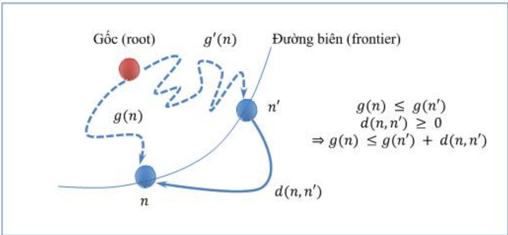

Hình 2.13 Chứng minh tính chất “đường đi đến nút được chọn để triển khai là đường đi tối ưu”

Trong khi chiến lược tìm kiếm theo chiều rộng triển khai các nút theo thứ tự độ sâu của nút, chiến lược tìm kiếm theo chi phí đồng nhất sẽ triển khai các nút theo thứ tự của đường đi tối ưu đi đến nó.

Chiến lược tìm chi phí đồng nhất không quan tâm đến số bước trên đường đi mà chỉ quan tâm đến tổng chi phí của các bước trên đường đi. Vì thế nó có thể rơi vào vòng lập vô tận nếu có đường đi chứa một chuỗi vô hạn các hành động với chi phí bằng không, ví dụ một chuỗi các hành động NoOp (NoOp có nghĩa là không làm gì cả). Tìm kiểm chi phí đồng nhất sẽ đầy đủ nếu chi phí của tất cả các bước/hành động đều lớn hơn một hàng số dương nhỏ ε nào đó.

Tìm kiểm theo chi phí đồng nhất sẽ được điều khiển bằng chi phí đường đi đến nút chữ không phải độ sâu của nút. Vì thể rất khó biểu diễn độ phức tạp theo hệ số phân nhánh b và độ sâu d. Gọi C\* là chi phí của lời giải tối ưu (chi phí của đường đi từ gốc đến nút tối ưu), và giả sử răng chi phí của mỗi hành động ít nhất là bằng ε (dương) thì độ phức tạp thời gian trong trường xấu nhất và độ phức tạp không gian là $O(b^{1+C*/\varepsilon})$. Độ phức tạp này có thể lớn hơn $O(b^{d})$ rất nhiều. Đó là bởi vì tìm kiếm chi phí đồng nhất có thể mở rộng

<!-- page: 55 -->

cây tìm kiếm theo nhánh có nhiều bước với chi phí nhỏ trước khi mở rộng nhánh có ít bước nhưng chi phí lớn hơn. Tuy nhiên nhánh này lại có thể hữu ích hơn. Trong trường hợp chi phí các bước là như nhau, $b^{1+C*/\varepsilon}$ chính là $b^{1+d}$. Khi đó, tìm kiếm chi phí đồng nhất chính là tìm kiếm theo chiều rộng, ngoại trừ một điểm khác biệt duy nhất: phép kiểm tra mục tiêu được thực hiện khi chọn nút để triển khai.

## 2.2.6 Tîm kiểm theo chiều sâu (Depth-first search)

Tìm kiểm theo chiều sâu sẽ luôn chọn nút sâu nhất trên đường biên cây tìm kiếm để triển khai. Giải thuật tìm kiếm theo chiều sâu là một thể hiện của giải thuật tìm kiếm trên đồ thị; trong khi tìm kiếm theo chiều rộng sử dụng hàng đợi FIFO để lưu trữ các nút trên đường biên, tìm kiếm theo chiều sâu sử dụng một ngăn xếp LIFO (Last In First Out, vào sau ra trước). Ngoài phương pháp cải đặt tìm kiếm theo chiều sâu bằng phương pháp tìm kiếm tổng quát trên đồ thị, ta có thể cải đặt tìm kiếm theo chiều sâu bằng phương pháp đề quy.

Các tính chất của tìm kiếm theo chiều sâu phụ thuộc rất nhiều vào phiên bản tìm kiếm trên đồ thị (graph search) hay tìm kiếm trên cây (tree search). Nếu sử dụng phương pháp tìm kiếm trên đồ thị (có sử dụng tập explored), tìm kiếm theo chiều sâu sẽ đầy đủ trong không gian hữu hạn các trạng thái. Phương pháp tìm kiếm trên cây sẽ không đầy đủ vị có thể rơi vòng lập vô tận. Tìm kiếm trên cây theo độ sâu có thể thay đổi chút ít để tránh trường hợp này: mỗi khi sinh ra một nút mới ta kiểm tra nó đã tồn tại trên đường đi từ gốc đến nút hiện tại chưa. Làm như thế giúp ta có thể tránh được vòng lập vô tận trong không gian trạng thái hữu hạn. Tuy nhiên, vẫn không tránh khởi được các đi dư thừa. Nếu không gian trạng thái vô hạn, cả hai phương pháp đều thất bại nếu ta rời vào một đường đi vô hạn mà không dẫn đến mục tiêu. Cũng vì các lý do giống nhau, cả hai phương pháp đều không tối ưu.

Độ phức tạp thời gian của tìm kiếm trên đồ theo chiều sâu bị chặn trên bằng kích thước của không gian trạng thái (có thể vô hạn) trong khi độ phức tạp của tìm kiếm trên cây theo chiều sâu có thể sinh ra $O(b^{m})$ nút trong cây tìm kiếm với m là độ sâu của nút sâu nhất. Độ phức tạp này có thể lớn hơn rất nhiều so với kích thước của không gian trạng thái. Chú ý là m có thể lớn hơn rất nhiều so với d (độ sâu của nút mục tiêu cận nhất) và là vô hạn nếu cây không bị chặn.

Như thế, tìm kiếm theo chiều sâu đường như không có ưu điểm nào so với tìm kiếm theo chiều rộng, vậy tại sao ta sử dụng nó? Câu trả lời là do độ phức tạp không gian. Với phương pháp tìm kiếm trên đồ thị, ta không có thuận lợi nào nhưng với phương pháp tìm kiếm trên cây ta chi cần lưu trữ một đường đi từ gốc đến nút lá, kèm theo các nút anh em của các nút trên đường đi này. Khi một nút được triển khai, nó sẽ được loại khởi bộ nhớ nếu các nút hậu duệ

<!-- page: 56 -->

của nó đã được triển khai hoàn toàn. Với một không gian trạng thái có hệ số phân nhánh b và độ sâu tối đa m, tìm kiếm theo chiều sâu chỉ cần lưu trữ O(bm) nút.

## 2.2.7 Tîm kiểm với độ sâu giới hạn (Depth-limited search)

Thất bại của tìm kiếm theo chiều sâu trong không gian trạng thái vô hạn có thể được tránh bằng cách giới hạn độ sâu tối đa $l$. Có nghĩa là nút có độ sâu $l$ được xem như nút lá (không có hậu nút duệ). Tiếp cận này gọi là tìm kiếm với độ sâu giới hạn. Giới hạn về độ sâu giúp giải quyết được vấn đề đường đi vô hạn. Nhưng cũng thật không may, đây cũng là nguyên nhân làm cho phương pháp này không đầy đủ nếu ta chọn $l < d$, có nghĩa là mục tiêu cận nhất vẫn nằm ngoài phạm vi tìm kiếm. Tìm kiếm với độ sâu giới hạn có thể không tối ưu nếu $l > d$. Độ phức tạp thời gian là $O(b^{l})$ và độ phức tạp không gian là $O(bl)$. Tìm kiếm theo chiều sâu có thể được xem là trường hợp đặc biệt của tìm kiếm với độ sâu giới hạn với $l = \infty$.

## 2.2.8 Tîm kiểm sâu đàn (Iterative deepening depth-first search)

Tìm kiểm sâu dân là một chiến lược tìm kiếm tổng quát thường dùng với tìm kiếm (trên cây) theo chiều sâu cho phép tìm được độ sâu giới hạn tốt nhất. Thực hiện điều này bằng cách tăng dân độ sâu giới hạn – đầu tiên là 0, sau đó là 1, 2, 3, … cho đến khi tìm thấy mục tiêu. Ta sẽ tìm thấy mục tiêu khi độ sâu giới hạn đạt đến d, độ sâu của nút mục tiêu cận nhất (gần với gốc nhất). Chiến lược tìm kiếm sâu dân tận dụng được thế mạnh của cả hai chiến lược tìm kiếm theo chiều rộng và tìm kiếm theo chiều sâu. Giống như tìm kiếm theo chiều sâu, bộ nhớ yêu cầu ít nhất $O(bd)$. Giống như tìm kiếm theo chiều rộng, chiến lược này sẽ đầy đủ khi hệ số phân nhánh hữu hạn và sẽ tối ưu khi chi phí đường đi là một hàm không giảm theo độ sâu của nút. Hình 2.14 trình bày 4 bước lập của chiến lược tìm kiếm sâu dân trên một cây nhị phân, lời giải được tìm thấy trong bước lập 4.

<!-- page: 57 -->

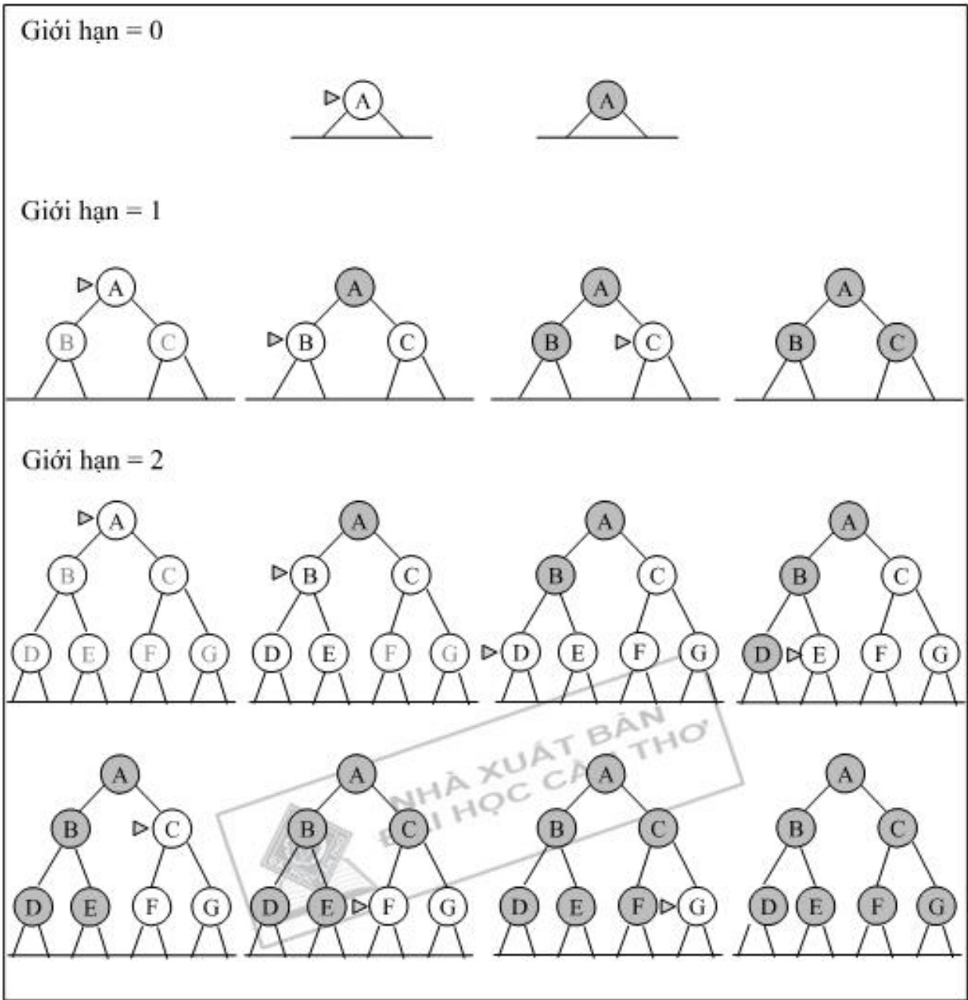

Hình 2.14 Tîm kiểm sâu dàn trên cây nhị phân

Tìm kiểm sâu dân có về như rất lăng phí vì ta phải bắt đầu việc tìm kiếm từ nút gốc sau mỗi bước lập. Tuy nhiên, chi phí cho việc lập lại này không quá cao. Lý do là vì trong một cây tìm kiếm có cùng hệ số phân nhánh tại các nút (hoặc hệ số phân nhánh của các nút gần như bằng nhau), hầu hết các nút đều nằm ở mức cuối cùng (độ sâu d). Như vậy, ta không cần quan tâm đến việc các nút ở trên được sinh ra nhiều lần. Trong tìm kiếm sâu dân, các nút có độ sâu d chỉ được sinh ra đúng 1 lần. Các nút ở độ sâu d – 1 được sinh ra 2 lần, và cứ như thế cho đến các nút con của nút gốc. Và như thế trong trường hợp xấu nhất, tổng số nút được sinh ra là:

$$
d b + (d - 1) b ^ {2} + \dots + 2 b ^ {d - 1} + b ^ {d}
$$

<!-- page: 58 -->

và độ phức tạp thời gian là $O(b^{d})$ tương đương với tìm kiếm theo chiều rộng. Thực ra tìm kiểm sâu đần có thêm ít chỉ phí do việc các nút được sinh ra nhiều lần, tuy nhiên chi phí này không đáng kể. Ví dụ, với $b = 10$ và $d = 5$

$$
\mathrm{N(IDS)} = 5 0 + 4 0 0 + 3, 0 0 0 + 2 0, 0 0 0 + 1 0 0, 0 0 0 = 1 2 3, 4 5 0
$$

$$
\mathrm{N(BFS)} = 1 0 + 1 0 0 + 1, 0 0 0 + 1 0, 0 0 0 + 1 0 0, 0 0 0 = 1 1 1, 1 1 0
$$

Nếu quan tâm đến chi phí này, ta có thể sử dụng tiếp cận lai: chạy tìm kiếm theo chiều rộng cho đến khi hết bộ nhớ và sau đó thực hiện tìm kiếm sâu đần từ các nút nằm trên đường biên. Nói chung, tìm kiếm sâu dàn là phương pháp tìm kiếm không có thông tin bổ sung được ura thích khi không gian trạng thái lớn và không biết trước độ sâu của lời giải.

Tìm kiểm sâu dân tương tự như tìm kiếm theo chiều rộng ở chỗ nó triển khai đầy đủ các nút theo từng mức trước khi đi xuống mức kể tiếp. Ta có thể phát triển chiến lược này cho tìm kiếm với chi phí đồng nhất. Ý tưởng chính là sử dụng giới hạn về chi phí đường đi thay vì giới hạn về độ sâu. Kết quả cho ta giải thuật tìm kiếm xa dần (iterative lengthening search). Tuy nhiên, khi so sánh với giải thuật tìm kiếm chi phí đồng nhất, tìm kiếm xa dần có độ phức tạp thời gian lớn hơn.

## 2.2.9 Tîm kiểm hai chiều (Bidirectional search)

Ý tưởng phía sau chiến lược tìm kiếm hai chiều là tìm kiếm đồng thời từ 2 phía: tìm kiếm xuôi từ trạng thái bắt đầu và tìm kiếm ngược từ trạng thái mục tiêu với hy vọng rằng sẽ gặp nhau ở giữa đường. Động lực chính của ý tưởng này là $b^{d/2} + b^{d/2}$ nhỏ hơn $b^d$ rất nhiều. Trên hình 2.15 tổng diện tích hai hình tròn nhỏ nhỏ hơn diện tích của hình tròn lớn với tâm là start và bán kính là khoảng cách từ start đến goal.

Tìm kiểm hai chiều được cải đặt bằng cách thay phép kiểm tra mục tiêu bằng việc kiểm tra hai đường biên có giao nhau không. Nếu giao nhau, ta sẽ tìm thấy lời giải. Cần phải chú ý rằng lời giải đầu tiên tìm theo phương pháp này có thể không tối ưu, ngay cả khi cả hai tìm kiếm đều là tìm kiếm theo chiều rộng. Việc kiểm tra có thể được thực hiện ngay khi mỗi nút được sinh ra hoặc khi được chọn để triển khai. Với một bảng băm độ phức tạp thời gian của phép kiểm tra này là hằng số. Ví dụ, nếu bài toán có lời giải ở độ sâu 6, và mỗi tìm kiếm sử dụng tìm kiếm theo chiều rộng, thì trong trường hợp xấu nhất hai giải thuật tìm kiếm sẽ gặp nhau khi chúng sinh ra tất cả các nút ở độ sâu 3. Với $b = 10$, có tất cả 2,220 nút được sinh ra, so với 1,111,110 nút trong trường hợp tìm kiếm theo chiều rộng chuẩn. Vì thế, độ phức tạp thời gian của tìm kiếm hai chiều sử dụng tìm kiếm theo chiều rộng theo hai hướng là $O(b^{d/2})$. Độ phức tạp không gian cũng là $O(b^{d/2})$. Ta có thể giảm bột độ phức tạp

<!-- page: 59 -->

không gian đi một nửa nếu cả hai chiều tìm kiếm sử dụng chiến lược tìm kiếm sâu dân, nhưng phải lưu trữ ít nhất một đường biên để kiểm tra giao nhau. Yêu cầu về bộ nhớ không phải là điểm yếu chính của tìm kiếm hai chiều.

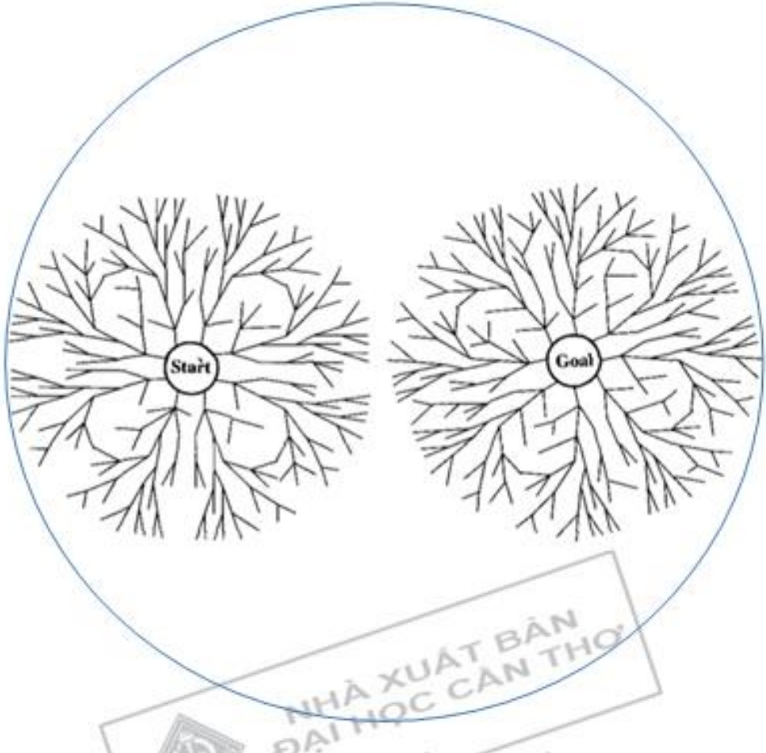

Hình 2.15 Tím kiểm hai chiều

Giảm bót đáng kể độ phức tạp thời gian trong tìm kiếm hai quả là hấp dẫn. Tuy nhiên làm thể nào để tìm kiếm theo chiều ngược? Không dễ dàng như ta nghĩ chút nào. Gọi các tiền bối (predecessors) của trạng thái x là tất cả các trạng thái có hậu bối (successors) là x. Tìm kiểm hai chiều đời hỏi phải có cách nào đó tính các tiền bối của một trạng thái. Nếu các hành động trong không gian trạng thái đều khả đảo (reversible), các tiền bối của x cũng chính là các hậu bối của nó. Trong các trường hợp khác, đời hỏi phải có cách nào đó định nghĩa các hành động đảo.

Xét câu hỏi “mục tiêu là gì?” trong tìm kiếm ngược bắt đầu từ trạng thái mục tiêu. Đối với bài toán 15-puzzles hay bài toán tìm đường đi ở Rumani, câu trả lời đơn giản là trạng thái mong muốn. Nếu tồn tại nhiều trạng thái mục tiêu tường minh, ta có thể xây dựng một trạng thái mục tiêu giả (dummy goal) có tiền bôi là các trạng thái mục tiêu này. Nếu mục tiêu chỉ là một mô tả trừu tượng như: “không có quân hậu nào không chế quân hậu nào” trong bài toán 8 quân hậu, thì rất khó sử dụng chiến lược tìm kiếm hai chiều.

<!-- page: 60 -->

## 2.2.10 So sánh các chiến lược tìm kiếm không có thông tin bổ sung

Bảng 2.4 So sánh các chiến lược tìm kiếm theo bốn tiêu chí được trình bày trong phần trên. Các so sánh này được thực hiện trên phiên bản tìm kiếm trên cây. Với tìm kiếm trên đồ thị, khác nhau chính là tìm kiếm theo chiều sâu sẽ đầy đủ với không gian trạng thái hữu hạn và độ phức tạp không gian và thời gian bị chặn bởi kích thước của không gian trạng thái. Ý nghĩa các ký tự $^{a,b,d}$ , trong dấu ngoặc (trong hai tiêu chí đầy đủ và tối ưu) như sau:  $^{a}$  đầy đủ nếu hệ số phân nhánh b hữu hạn;  $^{b}$  đầy đủ nếu chí phí từng bước ≥ ε;  $^{c}$  tối ưu nếu chi phí từng bước như nhau;  $^{d}$  nếu cả hai hướng đều dùng tìm kiếm theo chiều rộng.

Băng 2.4 Đánh giá các chiến lược tìm kiếm không có thông tin bổ sung

| Tiêu chí | Tìm kiểm theo chiều rộng | Tìm kiểm chi phí đồng nhất | Tìm kiểm theo chiều sâu | Tìm kiểm độ sâu giới hạn | Tìm kiểm sâu đần | Tìm kiểm hai chiều |
| --- | --- | --- | --- | --- | --- | --- |
| Đầy đủ? | $Có^{(a)}$ | $Có^{(a, b)}$ | Không | Không | $Có^{(a)}$ | $Có^{(a, d)}$ |
| Tối ưu? | $Có^{(c)}$ | Có | Không | Không | $Có^{(c)}$ | $Có^{(c, d)}$ |
| Thời gian | $O(b^{d})$ | $O(b^{1+[C*/\varepsilon]})$ | $O(b^{m})$ | $O(b^{l})$ | $O(b^{d})$ | $O(b^{d/2})$ |
| Không gian | $O(b^{d})$ | $O(b^{1+[C*/\varepsilon]})$ | $O(bm)$ | $O(b^{l})$ | $O(b^{d})$ | $O(b^{d/2})$ |

## 2.3 CÁC HỆ THỐNG LUẬT SINH

Tìm kiểm là cốt lõi của nhiều quá trình trí tuệ. Các hệ thống luật sinh (production system hay production rule system) còn gọi là hệ sinh cung cấp các cấu trúc tạo thuận lợi cho việc mô tả và thực hiện quá trình tìm kiếm.

## 2.3.1 Định nghĩa hệ thống luật sinh

Luật sinh (production rule) làm một cấu trúc gồm hai phần có dạng:

$$
\langle \text {diều kiện} \rangle \rightarrow \langle \text {hành động} \rangle
$$

vế trái xác định điều kiện áp dụng luật (với điều kiện nào thì có thể áp dụng luật này), vé phải mô tả hành động được thực hiện khi luật được áp dụng.

Một hệ thống luật sinh bao gồm:

1. Một tập các luật sinh (production rules) bao gồm tất cả các luật sinh có thể áp dụng được đối với bài toán đang xét. Các luật sinh được lưu trữ trong một vùng bộ nhớ được gọi là bộ nhớ luật sinh (production memory).

<!-- page: 61 -->

2. Một tập các tri thức/cơ sở dữ liệu chứa thông tin thích hợp cho nhiệm vụ xác định. Thông tin trong cơ sở dữ liệu này có thể được cấu trúc một cách thích hợp. Một số phần của cơ sở dữ liệu liên quan đến giải quyết bài toán hiện hành được lưu trữ trong một vùng bộ nhớ được gọi là bộ nhớ làm việc (working memory), các phần còn lại có thể được lưu trữ trong bộ nhớ ngoài.

3. Một chiến lược điều khiển, xác định thứ tự các luật được so sánh với cơ sở dữ liệu và phương pháp giải quyết xung đột khi một vài luật cùng tương hợp (các luật có vé trái được làm thỏa mãn bởi trạng thái hiện hành).

4. Một bộ áp dụng luật: thực thi luật do chiến lược điều khiển chọn ra.

## 2.3.2 Chiến lược điều khiển

Trong quá trình tìm kiếm lời giải cho một bài toán, thông thường có nhiều luật có thể áp dụng lên cùng một trạng thái, chọn lựa luật nào trong chúng để có thể đầy nhanh tới trạng thái đích? Chiến lược điều khiển được xem như bộ quyết định trong chọn lựa luật. Một chiến lược điều khiển tốt sẽ mang lại hiệu quả tìm kiếm cao.

Một chiến lược điều khiển tốt phải thỏa mãn hai tiêu chuẩn:

1. Tạo ra sự vận động. Trong bài toán dong đầu, nếu chiến lược điều khiển là áp dụng luật tương hợp với trạng thái hiện hành gặp đầu tiên trong dây Cxy, Cyx, Cxz, Czx, Cyz, Czy. Trạng thái ban đầu (7, 0, 0) luật đầu tiên tương hợp là Cxy, áp dụng luật cho ra trạng thái (2, 5, 0) luật đầu tiên trong dây tương hợp với trạng thái này là Cyx, áp dụng luật cho ra trạng thái (7, 0, 0) ... chiến lược điều khiển này không tạo ra sự vận động!

2. Có hệ thống. Trong bài toán đồng đầu, nếu chiến lược điều khiển là chọn ngẫu nhiên một quy tắc tương hợp với trạng thái hiện hành, chiến lược này tốt hơn chiến lược trên vì nó tạo ra sự vận động. Tuy nhiên, việc chọn lựa ngẫu nhiên này có thể dẫn đến việc “gặp lại một trạng thái nhiều lần” hoặc “không gặp một trạng thái nào đó một lần nào cả” trong quá trình tìm kiếm do chiến lược chọn ngẫu nhiên thiếu tính hệ thống. Một chiến lược điều khiển phải cho phép mọi luật đều có khả năng được áp dụng. Hơn nữa, mục tiêu là tìm kiếm trạng thái đích, do vậy những luật đưa đến một trạng thái đã được xét đến không cần thiết được áp dụng.

<!-- page: 62 -->

## 2.3.3 Tîm kiểm heuristic

Heuristic là một kỹ thuật cải thiện tính hiệu quả của quá trình tìm kiếm, có thể phải hy sinh đời hỏi về tính đầy đủ. Heuristic giống như người hướng dẫn du lịch. Heuristic tốt có thể hướng dẫn tìm thấy một lời giải tốt cho một bài toán khó trong một thời gian ngắn hơn. Heuristic có ưu điểm là chỉ ra hướng có lợi trong toàn thể nhưng cũng có thể bổ sót những lợi thế của các cá nhân đặc biệt.

Có heuristic tốt chung cho nhiều lĩnh vực bài toán, chẳng hạn heuristic lân cận gần nhất (nearest neighbor) làm việc bằng cách ở mỗi bước chọn ra ứng viên nổi trội cục bộ. Có thể xây dựng các heuristic khai thác tri thức lĩnh vực để giải quyết các bài toán cá biệt. Không có heuristics, giải quyết vấn đề bùng nổ tổ hợp trở nên vô vọng.

Tìm kiểm heuristics hiểm khi cho ra lời giải tối ưu mà thường chỉ là một lời giải tốt. Tuy nhiên, trong thực tế hiểm khi bài toán đồi hỏi một lời giải tối ưu, một lời giải xấp xi tốt thường được chấp nhận. Con người thường chỉ tìm kiếm một giải pháp tốt cho vấn đề hơn là tìm kiếm giải pháp tốt nhất.

Ví dụ, giải phương trình sin3x + sin6x + sin9x = 0. Làm thế nào để giải phương trình này? Với “tri thức kinh nghiệm” thu nhận được trong khi giải các phương trình “đặng tương tự”, định hướng ta đi theo con đường biến đổi thành tích: sin3x + sin9x + sin6x = 2sin6xcos3x + sin6x = sin6x(2cos3x + 1). Tri thức định hướng tìm kiếm lời giải này chính là tri thức heuristic.

Tri thức heuristic thường được kết hợp với thủ tục tìm kiếm dựa trên quy tắc thông qua:

1. Các luật, chỉ ra luật nào hứa hạn hơn các luật khác trong việc hướng tới đích

2. Hàm heuristic đánh giá các trạng thái và chỉ ra tính “hứa hẹn nằm trên đường đi lời giải” / “hứa hẹn sắp tới đích” của chúng. Hàm heuristic là một ánh xạ từ tập các trạng thái đến tập độ đo tính hóa hạn (thường được biểu diễn bởi số)

Xét ví dụ, bài toán 15-puzzle:

Giả sử cấu hình xuất phát là:

<!-- page: 63 -->

| 11 | 14 | 4 | 7 |
| --- | --- | --- | --- |
| 10 | 6 |  | 5 |
| 1 | 2 | 13 | 15 |
| 9 | 12 | 8 | 3 |

câu hình đích là:

| 1 | 2 | 3 | 4 |
| --- | --- | --- | --- |
| 12 | 13 | 14 | 5 |
| 11 |  | 15 | 6 |
| 10 | 9 | 8 | 7 |

Có thể biểu diễn trạng thái bài toán như một màng hai chiều 4 × 4 nhận giá trị nguyên, với quy ước phần từ màng có giá trị 0 là ô trống. Ta “nhận thấy” ràng trạng thái có số các ô sai vị trí so với trạng thái đích càng nhỏ cảng hóa hạn nó cảng ở gần đích, như vậy trước tiên ta sẽ khai thác các trạng thái có ít ô sai vị trí với hy vọng sẽ mau chóng hơn đạt tới đích. Ta xây dựng được một hàm heuristic:

$h_{1}(trạng thái) = số các ô sai vị trí so với đích$

ta có h₁(trạng thái ban đầu) = 14

ô 0: sai, ô 1: sai, ô 2: sai, ô 3: sai, ô 4: sai, ô 5: đúng, ô 6: sai, ô 7: sai, ô 8: đúng, ô 9: sai, ô 10: sai, ô 11: sai, ô 12: sai, ô 13: sai, ô 14: sai, ô 15: sai.

Tìm kiểm theo hướng “khai thác” trạng thái có giá trị  $h_{1}$  nhỏ.

“Hiểu biết về luật di chuyển các ô” cho ta nhận thức “một ô ở toạ độ (x, y) muốn di chuyển đến ô ở toạ độ (x', y') cần ít nhất |x - x'| + |y - y'| bước chuyển chỗ”.

Hiểu biết này cho phép ta xây dựng hàm heuristic h₂:

$h_{2}(trạng thái) = tổng d_{m}(vị trí của ô trong trạng thái, vị trí của ô tương ứng trong trạng thái đích)$

khoảng cách Manhattan từ điểm A(x, y) đến điểm B(x', y') ký hiệu $d_m$ và được tính bởi công thức: $d_m(A, B) = |x - x'| + |y - y'|$. ta ký hiệu khoảng cách mahattan của vị trí ô số i đến vị trí của nó trong trạng thái đích là md(i).

<!-- page: 64 -->

$h_{2}(trạng thái ban đầu)=\sum_{i=0}^{15}md(i)=30$

$md(\hat{o} \text{ số } 0) = 2, md(\hat{o} \text{ số } 1) = 2, md(\hat{o} \text{ số } 2) = 2, md(\hat{o} \text{ số } 3) = 4, md(\hat{o} \text{ số } 4) = 1, md(\hat{o} \text{ số } 5) = 0, md(\hat{o} \text{ số } 6) = 3, md(\hat{o} \text{ số } 7) = 3, md(\hat{o} \text{ số } 8) = 0, md(\hat{o} \text{ số } 9) = 1, md(\hat{o} \text{ số } 10) = 2, md(\hat{o} \text{ số } 11) = 2, md(\hat{o} \text{ số } 12) = 3, md(\hat{o} \text{ số } 13) = 2, md(\hat{o} \text{ số } 14) = 2, md(\hat{o} \text{ số } 15) = 1.$

Tìm kiểm theo hướng “khai thác” trạng thái có  $h_{2}$  nhỏ.

$h_{2}$  chứa “lượng hiểu biết” về bài toán nhiều hơn  $h_{1}$  vì nó bổ sung hiểu biết về luật dịch chuyển vào hiểu biết về sai khác giữa hai trạng mà  $h_{1}$  khai thác. Câu hỏi đặt ra là heuristic nào tốt hơn,  $h_{1}$  hay  $h_{2}$ ? Heuristic chứa lượng tri thức về lĩnh vực nhiều hơn thường là heuristic tốt hơn:  $h_{2}$  tốt hơn  $h_{1}$ .

Một hàm heuristic được thiết kế tốt có thể giữ một phần quan trọng trong việc định hướng một quá trình tìm kiếm hướng tới lời giải. Mục tiêu của hàm heuristic là định hướng quá trình tìm kiếm theo hướng có lợi nhất bằng cách gọi ý con đường phải đi theo đầu tiên khi có nhiều hơn một con đường.

Sử dụng hàm heuristic giúp ngắn thời gian tìm kiếm nhưng cũng làm nầy sinh phí tổn “thời gian tính giá trị heuristic của các trạng thái”. Nếu hàm heuristic quá phức tạp, thời gian cho tính các giá trị trở nên quan trọng. Cần có một sự thỏa hiệp giữa thời gian tính giá trị hàm heuristic và sự tiết kiệm thời gian tìm kiếm do hàm heuristic cung cấp. Việc sử dụng heuristic trong tìm kiếm sẽ được trình bày chi tiết hơn trong chương 3.

## 2.4 CÁC ĐẶC TRUNG CỦA BÀI TOÁN

Tìm kiểm heuristic là một phương pháp chung có thể áp dụng cho một lớp rộng các bài toán, bao gồm các kỹ thuật đặc trưng, mỗi một kỹ thuật có hiệu quả riêng biệt đối với một lớp nhỏ các bài toán. Đề lựa chọn phương pháp thích hợp nhất cho một bài toán cụ thể, cần phân tích bài toán theo một số hướng chủ đạo:

1. Bài toán có thể phân tích thành các bài toán nhỏ hơn hoặc dễ hơn không?

2. Các bước giải có thể bỏ lơ hay ít nhất có thể huy bỏ nếu chúng tò ra thiếu triển vọng?

3. Vũ trụ của bài toán có thể tiên đoán?

4. Bài toán đời hỏi tìm lời giải tốt nhất hay chỉ cần tìm một lời giải?

5. Yêu cầu của bài toán là tìm một đường đi lời giải hay một trạng thái?

6. Lượng tri thức cần thiết để giải quyết bài toán?

7. Đề giải quyết bài toán có đồi hỏi sự tương tác với con người?

<!-- page: 65 -->

## 2.4.1 Bài toán có thể phân tích?

Ví dụ, ta muốn tìm nguyên hàm

$$
I = \int (x ^ {2} + 3 x + \sin^ {2} x. \cos^ {2} x) d x
$$

Bài toán có thể được giải bằng cách phân tích thành ba bài toán nhỏ hơn:

$I = \int x^{2}dx + \int 3xdx + \int sin^{2}xcos^{2}xdx$ bài toán tìm nguyên hàm $\int x^{2}dx$ được xem là có thể giải được, bài toán $\int 3xdx$ có thể được phân tích thành 3 $\int xdxvới \int xdx$ được xem là giải được. Bài toán $\int sin^{2}xcos^{2}xdx$ có thể phân tích thành $\int (1 - cos^{2}x)cos^{2}xdx$ hoặc $\int (sinx.cosx)^{2}dx$ ...

Mỗi một bài toán tạo ra một định của đồ thị, sự phân tích tạo ra các cung nổi bài toán “lớn” với các bài toán “con”. Có hai loại cung nổi, cung nổi “đơn” chỉ ra rằng bài toán phân tích thành bài toán “để hơn”, cung nổi bội chỉ ra bài toán được phân tích thành một vài bài toán con với nghĩa là “bài toán lớn sẽ được giải quyết nếu tất cả các bài toán con là được giải quyết”. Cung nổi bội được nổi lại với nhau bởi một “cung liên kết”.

Quá trình phân tích dùng lại khi đạt tới các bài toán “con” có thể nhận biết là “giải được” hoặc “không giải được”.

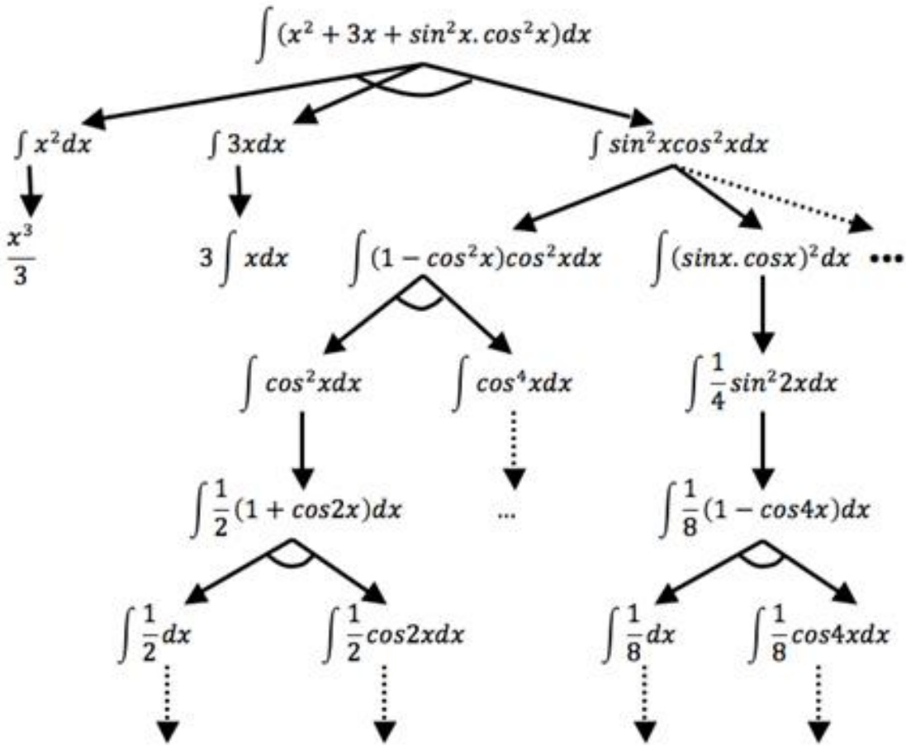

<!-- page: 66 -->

Quá trình phân tích như vậy xây dựng nên một đồ thị

Đồ thị AND-OR: AO-Graph là cặp < V, E >, trong đó

• V là tập các đỉnh

\- Tập các cung E là hợp rời rạc của hai kiểu cung, các “cung AND” A và các “cung OR” O : E = A ∪ O; A ∩ O = ∅

\- A, tập các cung AND, mỗi cung AND có nhiều hơn một successor (được biểu diễn bởi “liên kết” các đường nổi từ nút xuất đến các successors của nó bởi một “cung tròn”), ý nghĩa là: nút xuất của một cung AND là “giải được” nếu và chi nếu tất cả các successors của nó là “giải được”

\- O, tập các cung OR, mỗi cung OR chỉ có đúng một successor, ý nghĩa là: nút xuất của một cung OR là “giải được” nếu successor của nó là “giải được”

Một bộ các quy tắc phân tích được sử dụng trong quá trình phân tích. Quá trình phân tích có tính để quy: ở mỗi bước, xét bài toán đang được phân tích, nếu bài toán được nhận biết là giải được hay không giải được việc phân tích bài toán dùng, nếu không lập lại việc sử dụng quy tắc phân tích để phân tích bài toán. Sử dụng kỹ thuật phân tích bài toán, ta có thể giải quyết dễ dàng các bài toán lớn.

## 2.4.2 Các bước giải có thể bỏ lor hay có thể huỷ bỏ?

Giả sử chúng ta đang chứng minh một định lý toán học, đầu tiên chứng ta tiến hành bằng chứng minh một bổ đề mà chứng ta nghĩ là hữu dụng, nhưng thực tế bổ đề này không giúp ích gì cho việc chứng minh định lý. Điều này có gây phiên phức gì cho việc chứng minh định lý? Không. “Hoạt động chứng minh bổ đề” được gọi là bước có thể bổ lor, sự hiện diện của nó không làm ảnh hưởng tới việc tìm chứng minh cho định lý.

Xét bài toán 15-puzzle, sau khi thực hiện một (một vải) bước di chuyển, ta nhận thấy bước di chuyển này không mang lại lợi ích, ta có thể “huy bổ” bước đi này bằng (các) di chuyển ngược lại để nhận lại trạng thái trước khi thực hiện (các) bước di chuyển vô dụng. Cơ chế điều khiển có thể áp dụng cho tình huống này là sử dụng kỹ thuật “lưu vết”: các trạng thái sinh ra của một vải bước di chuyển được lưu lại theo đúng thứ tự sinh ra của chúng, muốn huy bổ một số di chuyển ta phục hồi lại trạng thái trước khi các bước di chuyển này được thực hiện.

Xét bài toán điều khiển robot, sau một bước điều khiển “sai làm”, giả sử robot bị phá huy. Bước đi này trở thành “không thể cứu văn” được. Kỹ thuật được áp dung cho bài toán “không được phép sai làm” là “lập kế hoạch”

<!-- page: 67 -->

Một kế hoạch là công thức hoá chi tiết và hệ thống các hành động. Nó là một tập các hành động (toán từ) nhóm lại trong một cấu trúc mệnh lệnh xác định. Cấu trúc có thể là dãy, chọn lựa, lập, độ quy, song song, và ở dạng không xác định trước. Một kế hoạch có thể được phân tích thành các kế hoạch con. Kế hoạch con lại có thể được phân tích thành các kế hoạch con nhỏ hơn, ...

## 2.4.3 Vũ trụ có thể tiên đoán?

Trong bài toán dong dầu, mỗi khi thực hiện một toán tử, trạng thái kết quả là xác định chính xác. Điều đó có nghĩa là có thể lập một kế hoạch tổng thể một dãy các toán tử và biết chắc chắn rằng kết quả của nó sẽ là trạng thái gì. Lập kế hoạch nhằm tránh “huy bò, làm lại”. Tuy nhiên trong quá trình lập kế hoạch có thể không tránh khởi “quay lui”. Cấu trúc điều khiển cho phép quay lui là cần thiết.

Xét trò chơi bài poker, người chơi phải quyết định bỏ đi một số quân bài, thay thế bởi các quân bài mới được rút ngẫu nhiên trong tập các quân bài còn lại với “hy vọng” sẽ được bài tốt hơn. “Toán tử” này không xác định chính xác trạng thái kết quả và do vậy không thể lập được một kế hoạch chính xác, tuy nhiên có thể lập ra một vài kế hoạch và chọn kế hoạch có kết quả với ước lượng xác suất cao nhất. Trở ngại lớn nhất là phải trả giá cho việc xây dựng nhiều kế hoạch.

## 2.4.4 Lời giải tốt nhất hay tương đối?

Xét bài toán trả lời câu hỏi dựa trên một cơ sở dữ liệu các sự kiện sau:

1. Marcus là một con người

2. Marcus là một người Pompei

3. Marcus sinh năm 40 sau công nguyên

4. Mợi người đều phải chết

5. Mợi người Pompei đều bị chết vào năm 79 sau công nguyên do núi lửa phun trào

6. Không người nào sống lâu hơn 150 năm

7. Năm nay là năm 2000 sau công nguyên

Câu hỏi đặt ra “Marcus còn sống không?”

Ta có thể suy diễn:

1. Marcus sinh năm 40 sau công nguyên (Giả thiết 3.)

2. Năm nay là năm 2000 sau công nguyên (Giả thiết 7.)

<!-- page: 68 -->

3. Tuổi của Marcus bảy giờ là 1960 năm (1&2)

4. Không người nào sông lâu hơn 150 (Giả thiết 6.)

5. Marcus không còn sống (3 & 4)

## Hoặc

1. Mợi người Pompei đều bị chết vào năm 79 sau CN (Giả thiết 5.)

2. Marcus là người Pompei (Giả thiết 2.)

3. Marcus chết vào năm 79 sau công nguyên (1 & 2)

4. Năm nay là năm 2000 sau công nguyên (Giả thiết 7.)

5. Marcus không còn sống (3 & 4)

Mục tiêu là trả lời câu hỏi nên sau một dãy lập luận, câu hỏi được trả lời. Không có lý do gì phải tìm một dãy lập luận khác. Ví dụ này minh hoạ cho bài toán tìm một lời giải.

Xét bài toán TSP (Traveling Saleman Problem): Một người giao hàng cho n cơ sở tại n thành phố. Ông ta xuất phát từ thành phố nơi ông cư trú, đi đến các thành phố để giao hàng (mỗi thành phố đúng một lần) xong việc ông ta quay về thành phố cư trú. Chi phí di chuyển giữa hai thành phố bất kỳ đã biết. Hành trình của người giao hàng phải diễn ra như thế nào để chi phí cho chuyển đi của ông ta là nhỏ nhất?

Giả sử ta tìm được một hành trình. Điều gì đảm bảo là hành trình đó có chi phí nhỏ nhất? Ta chỉ có thể kết luận hành trình đó là tốt nhất, sau khi so sánh nó với tất cả các hành trình có thể khác. Ví dụ này minh hoạ cho bài toán tìm lời giải tối ưu.

Nói chung, bài toán tìm lời giải tối ưu đồi hỏi tính toán nhiều hơn bài toán tìm một lời giải. Bài toán tìm một lời giải có thể sử dụng heuristic để giảm thiểu thời gian tìm kiếm. Không có một heuristic nào đảm bảo tìm thấy lời giải tốt nhất.

## 2.4.5 Lời giải là một trạng thái hay một đường đi?

Xét bài toán dong dầu, mục tiêu là tìm một dãy các bước chuyên dầu để đạt được một trạng thái đích. Bài toán như vậy đời hỏi tìm một đường đi lời giải. Trong trường hợp này không tránh khởi sử dụng kỹ thuật lưu vết.

Xét bài toán dịch từ tiếng anh sang tiếng việt. Nhiệm vụ là tìm từ / cụm từ trong tiếng việt phù hợp với từ/cụm từ trong tiếng anh (phụ thuộc vào phạm trừ bài viết, ngữ cảnh, ...), rõ ràng con đường để tìm ra từ/cụm từ không giữ

<!-- page: 69 -->

vai trò quan trọng trong quá trình dịch. Đời hồi của bài toán là một trạng thái. Kỹ thuật lưu vết không cần thiết sử dụng trong trường hợp này.

## 2.4.6 Vai trò của tri thức?

Xét bài toán dong dầu, lượng tri thức cần thiết cho giải quyết bài toán chi là hiểu biết về luật chuyên dầu: để chuyên được đầu từ bình a sang bình b thì bình a phải có đầu và bình b phải chưa đầy, để biết chính xác mỗi bình chứa bao nhiêu lít đầu thì việc chuyên phải được tiến hành theo kiểu hoặc là chuyên đến khi bình b đầy hoặc là chuyên đến khi bình a rỗng.

Xét bài toán dịch một bài viết từ tiếng Anh sang tiếng Việt. Một từ (cụm từ) trong tiếng Anh có thể tương ứng với nhiều từ (cụm từ) trong tiếng Việt, với ý nghĩa rất khác nhau tuỷ theo ngữ cảnh. Đề có được bản dịch sát nghĩa, ít nhất cần các kiến thức : hiểu biết về việc gom các từ đơn thành một cụm từ (ví dụ in order to nếu tách riêng từng từ mà dịch sẽ không sát nghĩa !), hiểu biết về lĩnh vực mà bài viết thuộc vào (ví dụ trong lĩnh vực toán học, tin học từ function thường mang nghĩa là “hàm” chữ không mang nghĩa “chức năng” !), hiểu biết về lịch sử và hoàn cảnh ra đời của bài viết, hiểu biết về cách “choi chữ” của tác giả bài viết, ... một lượng rất lớn trí thức là cần thiết đề có được một bài dịch sát nghĩa.

## 2.4.7 Nhiệm vụ đời hồi tương tác với con người?

Xét bài toán dong dầu, sau khi thiết kế chương trình giải bài toán, cho chạy chương trình và nhận được lời giải của bài toán, không cần sự tương tác, trao đổi với con người.

Xét bài toán bản vé tự động: Xây dựng một chương trình máy tính bán vé vận chuyển. các thông tin cần thiết là nơi đi, nơi đến của khách hàng, phương tiện khách chọn lựa, thời gian khởi hành, số lượng vé, ... Một khách hàng mua vé có thể không cung cấp đầy đủ các thông tin cần thiết, ví dụ khách đưa ra yêu cầu “tôi muốn đi Hà nội”, chương trình cần phải hỏi lại khách hàng về nơi xuất phát, phương tiện lựa chọn (máy bay, tàu hoả, tàu thuy, xe bus...), về thời gian khởi hành, về số lượng vé cần mua... Trong bài toán này, sự tương tác, trao đổi với con người là không thể tránh khởi.

## 2.5 CÁC ĐẶC TRƯNG CỦA HỆ SẢN XUẤT

Các hệ sản xuất cung cấp cấu trúc tốt để mô tả và thực hiện quá trình tìm kiếm lời giải cho bài toán. Một bài toán có lời giải, có một tập vô hạn các hệ sản xuất mô tả cách tìm kiếm lời giải. Một số hệ sản xuất bản chất hơn hoặc hiệu quả hơn. Các hệ sản xuất có thể được mô tả bởi một tập các đặc trưng, các đặc trưng này có thể làm hé lộ chiến lược thực thi thích hợp.

<!-- page: 70 -->

Các định nghĩa về một số đặc trưng của các hệ sản xuất

Hệ sản xuất đơn điệu là hệ sản xuất thỏa mãn tính chất “nếu có nhiều quy tắc có thể áp dụng, việc áp dụng một quy tắc được lựa chọn không ngăn cần việc áp dụng muộn hơn của các quy tắc còn lại”. Nếu tính chất này không được thỏa mãn, hệ sản xuất được gọi là không đơn điệu.

Hệ sản xuất giao hoán bộ phận là hệ sản xuất thỏa mãn tính chất “một dãy các quy tắc, nếu áp dụng nó sẽ làm biến đổi trạng thái x thành trạng thái y, thì mọi hoán vị cho phép của dãy quy tắc này (hoán vị mà các điều kiện của các quy tắc trong dãy hoán vị đều được thỏa mãn) khi được áp dụng cũng biến đổi trạng thái x thành trạng thái y”.

Hệ sản xuất giao hoán là hệ sản xuất đơn điệu và giao hoán bộ phận.

Đối với các bài toán giải được bất kỳ, có một số vô hạn các hệ sản xuất mô tả cách tìm lời giải. Trong đó có một số hệ tự nhiên hơn hoặc hiệu quả hơn, xác định hệ sản xuất như vậy làm tăng hiệu quả của quá trình tìm kiếm.

Các hệ sản xuất đơn điệu và giao hoán bộ phận là dáng quan tâm dưới quan điểm thực thi vì chúng có thể thực thi không cần quay lui lại các trạng thái trước đó khi phát hiện ra con đường đang đi theo là không đúng. Tuy nhiên, thực thi các hệ thống như vậy với quay lui vẫn là hữu dụng trong việc đảm bảo một sự tìm kiếm hệ thống, cơ sở dữ liệu hiện hành biểu diễn trạng thái bài toán không cần thiết được lưu trữ. Điều này làm tăng đáng kể hiệu quả.

Các hệ sản xuất không đơn điệu, giao hoán bộ phận có thể được dùng cho các bài toán trong đó các thay đổi xảy ra có thể được bảo tồn và thứ tự các phép toán là không quan trọng. Các bài toán thao tác vật lý thường thỏa mãn các tính chất này.

Các hệ sản xuất không giao hoán bộ phận có thể được dùng cho những bài toán trong đó các thay đổi không thể đảo ngược được. Ví dụ, bài toán xác định quá trình sản xuất một hợp chất hoá học. Các toán từ có thể là “thêm hoá chất x vào bình” hoặc “thay đổi nhiệt độ t độ”. Các toán từ này gây ra các thay đổi không thể đảo ngược được (hoá chất trong bình đã bị thay đổi thành chất khác). Lập kế hoạch có thể được dùng để giải quyết các bài toán với các thay đổi không thể đảo ngược và vũ trụ có thể tiên đoán.

## 2.6 CÁC VĂN ĐỀ TRONG THIẾT KẾ CHƯƠNG TRÌNH TÌM KIỂM

Quá trình tìm kiếm có thể được xem như một phép duyệt của một cấu trúc cây trong đó mỗi nút biểu diễn một trạng thái bài toán, mỗi cung biểu diễn toán từ thay đổi trạng thái. Về phương diện lý thuyết, cây này có thể được xây dựng tường minh, và sự tìm kiếm được tiến hành trên nó. Tuy nhiên, cây tìm

<!-- page: 71 -->

kiểm tường minh thường rất lớn và hầu như không cần khảo sát. Về phương diện thực tế, các chương trình tìm kiếm, tại một thời điểm của quá trình tìm kiếm, chỉ khảo sát một bộ phận tường minh của cây, người ta gọi nó là cây lời giải tiềm năng. Cây lời giải tiềm năng lớn dần lên theo quá trình tìm kiếm.

Trước khi xây dựng một chương trình tìm kiếm, cần phải xét đến một số vấn đề quan trọng sau:

• Hướng tìm kiếm (suy diễn tiến/lui)

\- Chọn quy tắc áp dụng: những quy tắc nào có thể áp dụng vào trạng thái hiện hành? (tương hợp - matching). Trong các quy tắc có thể áp dụng chọn quy tắc nào là thích hợp? (giải quyết xung đột – conflict solution)

\- Biểu diễn các nút của quá trình tìm kiếm (biểu diễn tri thức và bài toán khung).

Quá trình tìm kiếm được thực hiện trên đồ thị biểu diễn không gian trạng thái. Điều này này sinh hai vấn đề, thứ nhất một nút có thể được xét hơn một lần, thứ hai tìm kiếm rơi vào chu trình.

Kỹ thuật để tránh xét lập lại và chu trình: mỗi khi một nút mới được sinh ra, kiểm tra nút đó có nằm trong tập hợp các nút đã được sinh ra chưa, nếu chưa nó mới được đưa vào tập các nút sẽ được xem xét (kỹ thuật sử dụng Open và Closed). Chủ ý rằng kỹ thuật này giúp tránh xét lập lại và rơi vào chu trình, nhưng phải trả giá bằng phí tồn “kiểm tra mỗi nút mới được sinh ra có thuộc tập các nút đã được sinh ra?”.

## CÂU HỒI ÔN TẬP VÀ BÀI TẬP

1. Cho một ví dụ trong đó tìm kiếm rộng làm việc tốt hơn tìm kiếm sâu.

2. Cho một ví dụ trong đó tìm kiếm sâu làm việc tốt hơn tìm kiếm rộng.

3. Viết chương trình giải quyết bài toán đong đầu, sử dụng tìm kiếm rộng/sâu.

4. Viết chương trình giải quyết bài toán 8-puzzle, sử dụng tìm kiếm rộng/sâu.

Với mỗi bài toán bên dưới, biểu diễn bài toán trong không gian trạng thái và tìm heuristic tốt đối với mỗi bài toán. Chủ ý: khi phân tích, cần tôn trọng bảy đặc trưng bài toán.

5. Bài toán “Đong nước”: Có hai bình không phân độ, một bình dung tích 4 lít, một bình dung tích 3 lít. Ta có thể làm đầy nước trong một bình bằng một vòi nước, ta có thể làm rỗng một bình bằng cách đồ hết nước trong bình đó đi, ta cũng có thể chuyên nước từ một bình sang bình khác theo

<!-- page: 72 -->

kiểu “chuyên đầy” hoặc “chuyên rỗng” như trong bài toán “đong dầu”. Làm thế nào để nhận được một bình chứa đúng 2 lít nước.

6. Bài toán “Con sói, con dê và cái bắp cải”: Một người nông dân đất theo ba vật: một con sói, một con dê và một cái bắp cải. Đến một bờ sông, có một con thuyền nhỏ, người nông dân sử dụng con thuyền đó để chuyên chờ các vật đi theo mình sang bên kia sông. Mỗi lần chuyên chờ, ông chỉ có thể chuyên chờ được một vật. Nhưng khó khăn cho ông là, nếu bên một bờ có con sói và con dê / con dê và cái bắp cải mà không có ông ở đó thì con sói ăn thịt con dê / con dê ăn cái bắp cải. Làm thế nào để người nông dân chuyên chờ được cả ba vật qua sông an toàn?

7. Bài toán “Các thấy tu và các kê ăn thịt người”: ba ông thấy tu và ba kê ăn thịt người ở trên một bờ sông cùng muốn qua sông. Có một con thuyền nhỏ, một chuyển chỉ có thể chờ được hai người. Nếu trên một bờ nào đó, số kê ăn thịt người nhiều hơn số thấy tu, chúng sẽ xấu xẻ các ông thấy tu. Làm thế nào để chuyên chờ mọi người qua sông mà các ông thấy tu không ai bị ăn thịt?

8. Bài toán “Tháp Hà Nội”: Trên một cọc A, có ba chiếc đĩa kích thước đôi một khác nhau, được xếp chồng lên nhau theo thứ tự kích thước từ lớn đến nhỏ. Có hai cọc trống B và C. Người ta muốn di đời cọc đĩa từ A sang B. Thao tác di đời: mỗi lần chỉ di đời được một đĩa nằm trên đỉnh của một cọc. Khi sắp xếp đĩa lên một cọc chỉ được phép đặt đĩa kích thước nhỏ hơn lên trên đĩa có kích thước lớn hơn. Làm thế nào để thực thi công việc di đời, cho phép sử dụng cọc C làm trung gian?

9. Bài toán “Cò ca-rô”: Một lưới ô vuông kích thước nxm. Hai người chơi luận phiên đặt vào một ô trống một ký hiệu của mình (chẳng hạn, một người sử dụng ký hiệu X, người kia sử dụng ký hiệu O). Một người chơi sắp được liên tiếp và thẳng hàng (ngang, dọc, chéo) ít nhất năm ký hiệu của mình là người thắng.

10. Bài toán “Thế giới các khối”: Trên bàn có một chồng ba khối gỗ lập phương, mỗi khối được ký hiệu bởi các ký tự A, B, C. Một cánh tay robot có thể gặp một khối trên định của một chồng, đặt nó lên bàn hoặc chồng nó lên định của một chồng khác. Nhiệm vụ của cánh tay robot là sắp xếp lại thứ tự các khối gỗ theo một thứ tự đã cho. Ví dụ:

<table><tr><td>Thứ tự các khối ban đầu:</td><td>Thứ tự các khối kết thúc:</td></tr><tr><td>A</td><td rowspan="3">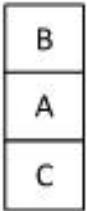</td></tr><tr><td>C</td></tr><tr><td>B</td></tr></table>

<!-- page: 73 -->

11. Bài toán “Số học mật mã”: Gán các chữ các bởi các chữ số, thỏa mãn điều kiện: hai chữ cái khác nhau được gán với hai chữ số khác nhau, một chữ cái được gán với đúng một chữ số, sao cho phép tính đã cho là đúng. Ví dụ:

| + S E N D | + D O N A L D | + C R O S S |
| --- | --- | --- |
| M O R E | G E R A L D | R O A D S |
| M O N E Y | R O B E R T | D A N G E R |

## TÀI LIỆU THAM KHẢO

[1] Bellman, R. E. (1957). Dynamic Programming. Princeton University Press.

[2] Newell, A. and Simon, H. A. (1961). GPS, a program that simulates human thought. In Billing, H. (Ed.), Lernende Automaten, pp. 109–124. R. Oldenbourg.

[3] Nilsson, N. J. (1971). Problem-Solving Methods in Artificial Intelligence. McGraw-Hill.

[4] Russell, S. and Norvig, P. (2009). Artificial Intelligence: A Modern Approach, (third edition), Prentice Hall.

[5] Slate, D. J. and Atkin, L. R. (1977). CHESS 4.5—Northwestern University chess program. In Frey, P. W. (Ed.), Chess Skill in Man and Machine, pp. 82–118. Springer-Verlag.

[6] Slocum, J. and Sonneveld, D. (2006). The 15 Puzzle. Slocum Puzzle Foundation.

<!-- page: 74 -->

# Chương 3 KỸ THUẬT TÌM KIỂM NÂNG CAO

Trong chương hai chúng ta đã tìm hiểu phương pháp giải quyết vấn đề bằng phương pháp tìm kiếm. Các kỹ thuật tìm kiếm ở chương hai chỉ sử dụng duy nhất thông tin của bài toán. Trong chương này chúng ta sẽ tiếp tục phân tích các kỹ thuật tìm kiếm nâng cao. Chúng ta bắt đầu bằng kỹ thuật tìm kiếm với thông tin liên quan đến bài toán nhưng không được định nghĩa trong bài toán. Phương pháp tìm kiếm cục bộ sẽ được đề cập ngay sau đó. Chương này được kết thúc bằng việc mở rộng kỹ thuật tìm kiếm bằng cách xem xét cấu trúc của các trạng thái. Tiêu biểu cho kỹ thuật này là giải thuật giải bài toán thỏa mãn ràng buộc.

## 3.1 TİM KIỂM VỚI THÔNG TIN BỔ SUNG

Tìm kiểm với thông tin bổ sung (informed search) hay tìm kiếm heuristic sử dụng các kiến thức có liên quan đến vấn đề nhưng không được định nghĩa trong bài toán.

Tiếp cận tổng quát mà ta xem xét có tên gọi tìm kiếm tốt nhất đầu tiên (best-first search). Tìm kiểm tốt nhất đầu tiên có thể là một thể hiện của giải thuật tìm kiếm trên cây (treeSearch) hay tìm kiếm trên đồ thị (graphSearch) tổng quát. Việc chọn nút để triển khai dựa trên một hàm lượng giá (evaluation function): $f(n)$. Hàm lượng giá được xây dựng dựa trên việc ước lượng chi phí và nút có giá ước lượng nhỏ nhất được ưu tiên triển khai trước. Cải đặt giải thuật tìm kiếm tốt nhất đầu tiên trên đồ thị y hết như tìm kiếm chi phí đồng nhất ngoại trừ việc sử dụng $f(n)$ thay vì $g(n)$ để sắp xếp thứ tự các nút trong hàng đợi ưu tiên.

Giải thuật tìm kiếm tốt nhất đầu tiêu được trình bày trong hình 3.1 Đường biên frontier là một hàng đợi ưu tiên. Các phần tử trong đường biên được sắp xếp theo $f(n)$. Giải thuật bắt đầu từ nút gốc chứa trạng thái khởi tạo. Mỗi lần lập, giải thuật chọn nút $n$ có $f(n)$ nhỏ nhất trên đường biên và triển khai nó. Với mỗi nút con child, nếu trạng thái của nó, child->state, chưa có trong frontier lẫn explorer, ta sẽ đưa child vào đường biên. Nếu child->state đã tồn tại trên đường biên và nút chứa nó có giá trị $f$ lớn hơn giá trị $f$ của child, ta cập nhật giá trị $f$ của nút tương ứng trên đường biên (trường hợp (\*) của giải thuật trong hình 3.1). Nếu child->state nằm trong explored và nút tương ứng có $f$ lớn hơn $f$ của child, ta loại bỏ nút này ra khởi expolored và đưa child vào frontier (trường hợp (\*\*\*) của giải thuật trong hình 3.1). Trường hợp này được gọi là tái triển khai nút (re-expanding node).

<!-- page: 75 -->

```c
PNode bestFirstSearch(PState init_state) {
    PNode root = new Node();
    root->state = init_state;
    root->parent = NULL;
    root->f = 0;
    frontier.insert(root);
    explored.clear();
    while (!empty(frontier)) {
        //Lấy 1 nút từ đường biên có f(n) nhỏ nhất
        //và loại bỏ nó ra khởi đường biên
        Node* node = frontier.pop();
        if (node là nút mục tiêu)
            return node;
        insert(node, explored);
        for (child là nút con của node) {
            Tính child->f;
            if (child->state không thuộc frontier và
                    child->state không thuộc explored) {
                child->parent = node;
                frontier.insert(child);
(*) } else if (child->state nằm trống đường biên
                            và có f lớn hơn child->f)
                            Thay thế nút nằm trên đường biên bằng child
(**) else if (child->state nằm trong explored
                            và có f lớn hơn child->f) {
                Loại bỏ nút chứa child->state
                                ra khởi explored
                frontier.insert(child);
            }
        }
    }
    return NULL; //Thất bại, không tìm thấy lời giải
}
```

Hình 3.1 Giải thuật tìm kiếm tốt nhất đầu tiên

Sự lựa chọn hàm $f$ sẽ quyết định chiến lược tìm kiếm. Đa số các giải thuật tìm kiếm tốt nhất đầu tiên đều sử dụng một hàm heuristic (heuristic function), $h(n)$ để xây dựng $f$.

Hàm $h(n)$ là chi phí ước lượng của đường đi tốt nhất từ trạng thái của nút $n$ đến trạng thái mục tiêu. Không giống như $g(n)$, hàm $h(n)$ chỉ phụ thuộc vào trạng thái của nút $n$ mà không phụ thuộc vào đường đi từ nút gốc đến $n$.

<!-- page: 76 -->

Hàm heuristic là cách thường dùng nhất để sử dụng kiến thức bổ sung trong quá trình tìm kiếm. Ta sẽ nghiên cứu kỹ hơn về hàm heuristic trong các phần kế tiếp. Hiện tại, ta có thể xem $h(n)$ là một hàm không âm bất kỳ và phụ thuộc vào vấn đề đang giải quyết. Nếu $n$ là nút mục tiêu thì $h(n)=0$.

Hai giải thuật tiêu biểu của tìm kiếm tốt nhất đầu tiên là tìm kiếm hâu ăn và tìm kiếm A\*.

## 3.1.1 Tîm kiểm háu ăn

Tìm kiểm háu ăn (greedy best-first search) hay còn gọi là tìm kiếm chỉ sử dụng heuristic (pure heuristic search) có gắng triển khai nút “gần” với mục tiêu nhất. Vì thể, nó chỉ dùng hàm heuristic $h(n)$ để lượng giá các nút hay:

$$
f (n) = h (n)\tag{3.1}
$$

Do $f$ được xây dựng chỉ dựa trên $h$ và $h$ chỉ phụ thuộc vào trạng thái của $n$ nên ta không cần phải cập nhật $f$ trong trường hợp trạng thái của $n$ đã có trong frontier hay trong explored.

Tìm kiểm háu ăn phiên bản treeSearch có thể không đầy đủ, ngay cả trong không gian trạng thái hữu hạn vì nút mục tiêu có thể nằm ở một nhánh khác mà đề đi qua đến phải vượt qua một nút có $h(n)$ lớn. Nhung do không lưu lại các nút đã triển khai, giải thuật rơi vào vòng lập vô hạn. Tìm kiểm háu ăn phiên bản graphSearch sẽ đầy đủ trong không gian trạng thái đầy đủ, những sẽ không đầy đủ khi không gian trạng thái vô hạn.

## 3.1.2 Tîm kiểm A\*

Giải thuật tìm kiếm tốt nhất đầu tiên được sử dụng nhiều nhất là giải thuật tìm kiếm A\* (A\* search, đọc là A sao). Giải thuật A\* là một sự kết hợp hoàn hảo của tìm kiếm chi phí đồng nhất và tìm kiếm chi sử dụng heuristic. Giải thuật ước lượng chi phí của một nút bằng cách kết hợp $g(n)$: chi phí thực tế đi từ gốc đến $n$ và $h(n)$: chi phí ước lượng đi từ $n$ đến nút mục tiêu:

$$
f (n) = g (n) + h (n)\tag{3.2}
$$

Vì $g(n)$ là chi phí từ nút bắt đầu (nút gốc) đến $n$, và $h(n)$ là chi phí ước lượng của đường đi tốt nhất từ n đến nút mục tiêu, nên:

$$
f (n) = \text {chi phí ước lượng của lời giải đi qua nút } n.
$$

Như thể, nếu ta muốn tìm lời giải có chi phí thấp nhất, ta sẽ ưu tiên triển khai nút có $g(n) + h(n)$ nhỏ nhất trước. Không những chiến lược tìm kiếm này nghe có về hợp lý mà còn hơn thế nửa: nếu hàm $h(n)$ thỏa mãn một số ràng buốc, tìm kiếm A\* sẽ đầy đủ và tối ưu!

<!-- page: 77 -->

## 3.1.2.1 Giải thuật A\*

Giải thuật A\* phiên bản đồ thị³ được trình bày trong hình 3.2. Giải thuật này tương đối giống giải thuật tìm kiếm tốt nhất đầu tiên tổng quát. Điểm khác biệt là giải thuật A\* sử dụng hàm $f(n) = g(n) + h(n)$ thay vì $f(n)$ tổng quát. Vì $h(n)$ chỉ phụ thuộc vào trạng thái của $n$ nên $f(n)$ chỉ thay đổi khi $g(n)$ thay đổi: khi ta tìm được một đường đi mới đến $n$ tốt hơn đường đi cũ. Chính vì thể ta sẽ cập nhật lại $g$ khi đường đi mới tốt hơn (xem hình 3.2).

```txt
PNode AStarSearch(PState init_state) {
    PNode root = new Node();
    root->state = init_state;
    root->parent = NULL;
    root->f = 0;
    frontier.insert(root);
    explored.clear();
    while (!empty(frontier)) {
        //Lấy 1 nút từ đường biên có f(n) nhỏ nhất
        //và loại bỏ nóra khối đường biên
        Node* node = frontier.pop();
        if (node là nút mục tiêu)
            return node;
        insert(node, explored);
        for (child là nút con của node) {
            child->g = node->g + stepCost(node, child);
            child->h = estimate(child->state);
            child->f = child->g + child->h;
            if (child->state không thuộc frontier và
                child->state không thuộc explored) {
                child->parent = node;
                frontier.insert(child);
            } else if (child->state nằm trong đường biên
                và có g lớn hơn child->g)
(*)          Thay thể nút nằm trên đường biên bằng child
        }
    }
    return NULL; //Thất bại, không tìm thấy lời giải
}
```

Hình 3.2 Giải thuật A\*

<small><span class="docvortex-page-footnote" data-block-type="page_footnote" style="color:#6b7280">³ Phiên bản cây của giải thuật A\* có được bằng cách bỏ tập hợp explored và các lệnh có liên quan đến nó trong phiên bản đồ thi.</span></small>

<!-- page: 78 -->

## 3.1.2.2 Điều kiện tối ưu của A\*: tính khả chấp và tính nhất quán

Điều kiện đầu tiên mà ta cần cho tính tối ưu của A\* là hàm $h(n)$ phải là một hàm heuristic khả chấp (admissible heuristic). Một heuristic được gọi là khả chấp nếu như nó không bao giờ ước lượng vượt quá chi phí thực sự (overestimate) để đi từ n đến nút mục tiêu. Vì $g(n)$ là chi phí thực sự từ nút gốc đến nút $n$ theo đường đi hiện tại, và $f(n) = g(n) + h(n)$, nên $f(n)$ không bao giờ ước lượng quá vượt quá chi phí thực sự của lời giải theo đường đi hiện tại thông qua $n$.

Heuristic khả chấp về bản chất là lạc quan vì ta nghĩ chi phí của lời giải nhỏ hơn chi phí thực sự. Một ví dụ trực quan cho hàm heuristic khả chấp là sử dụng khoảng cách theo đường chim bay để ước lượng chiều dài của đường đi từ nút hiện tại đến nút mục tiêu trong bài toán tìm đường đi ngắn nhất trên bản đồ. Khoảng cách theo đường chim bay là một heuristic khả chấp vì đường thẳng là đường nói hai điểm trong không gian Euclid có chiều dài ngắn nhất.

Điều kiện thứ hai cho hàm heuristic là tính nhất quán (consistency hay còn gọi là tính đơn điều – monotonicity). Điều kiện này chỉ cần khi áp dụng giải thuật A\* cho phiên bản tìm kiếm trên đồ thị. Một hàm heuristic $h(n)$ được gọi là nhất quán nếu với mỗi nút $n$ và với mỗi nút $n'$ được sinh ra từ $n$ bằng hành động $a$, chi phí ước lượng từ $n$ đến mục tiêu không bao giờ lớn hơn chi phí ước lượng từ $n'$ đến mục tiêu cộng với chi phí hành động $a$:

$$
h (n) \leq c (n, a, n ^ {\prime}) + h (n ^ {\prime})\tag{3.3}
$$

Đây là một dạng của bất đẳng thức tam giác tổng quát: tổng hai cạnh của tam giác luôn lớn hơn cạnh còn lại. Với một heuristic khả chấp, bất đẳng thức này có một ý nghĩa hoàn hảo: nếu có một đường đi từ n đến G (trạng thái mục tiêu) thông qua n' mà có chi phí nhỏ hơn h(n), điều này sẽ vi phạm tính chất h(n) luôn nhỏ hơn chi phí thực sự từ n đến G. Hình 3.3 minh hoạ tính nhất quán của heuristic.

Có thể dễ dàng thấy rằng tất cả các hàm heuristic nhất quán đều khả chấp (chứng minh xem như bài tập). Vì thế tính nhất quán chặt hơn tính khả chấp. Tuy nhiên cũng khá khó để tạo ra một hàm heuristic khả chấp nhưng không nhất quán. Tất cả heuristic khả chấp mà ta thảo luận trong chương này đều nhất quán.

<!-- page: 79 -->

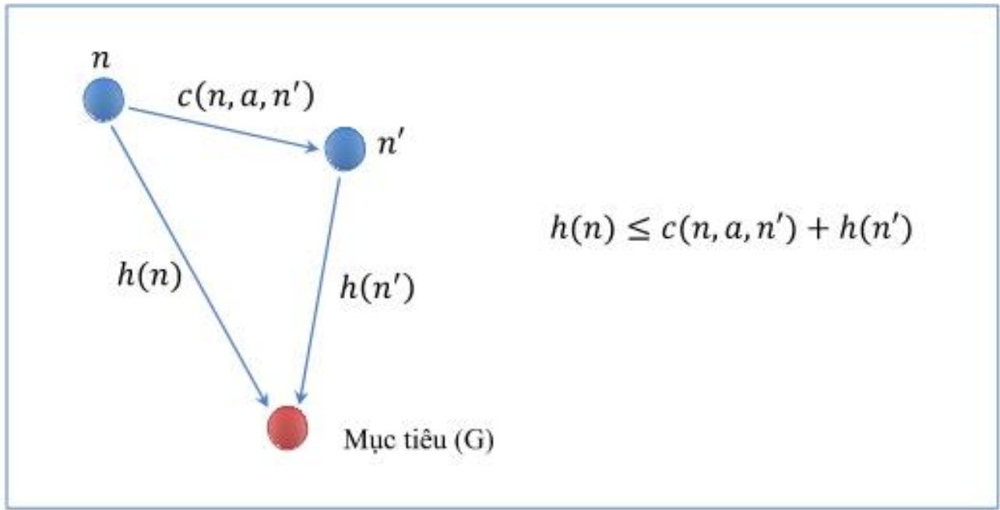

Hình 3.3 Tính chất của heuristic nhất quán

## 3.1.3 Tính tối ưu của A\*

Như đã đề cập bên trên, A\* có các tính chất sau: phiên bản tìm kiếm trên cây (treeSearch) của A\* sẽ tối ưu nếu $h(n)$ khả chấp, trong khi phiên bản tìm kiếm trên đồ thị (graphSearch) sẽ tối ưu nếu $h(n)$ nhất quán.

## 3.1.3.1 Tính tối ưu của A\* phiên bản treeSearch

Nếu $h(n)$ khả chấp, giải thuật A\* phiên bản treeSearch sẽ tối ưu. Điều này có thể được chứng minh đơn giản như sau:

Gọi $G'$ là nút mục tiêu gần tối ưu ($G'$ ->state là một trạng thái mục tiêu và đường đi từ gốc đến $G'$ không phải là đường đi tối ưu), ta có:

$$
f (G ^ {\prime}) = g (G ^ {\prime}) + h (G ^ {\prime}) > C ^ {*}\tag{3.4}
$$

$\text{vì } g(G') > C^* \text{ và } h(G') = 0.$

Gọi n là một nút bất kỳ trên đường đi tối ưu, do $h(n)$ khả chấp nên:

$$
f (n) = g (n) + h (n) \leq g (n) + h ^ {*} (n) = C ^ {*}\tag{3.4}
$$

Như thế, tất cả các nút $n$ trên đường đi tối ưu sẽ được triển khai trước $G'$. Chính vì vậy mà giải thuật A\* phiên bản treeSearch sẽ tìm được đường đi tối ưu.

<!-- page: 80 -->

## 3.1.3.2 Tính tối ưu của A\* phiên bản graphSearch

Nếu $h(n)$ nhất quán (hoặc đơn điệu) thì giải thuật A\* phiên bản graphSearch sẽ tối ưu. Cơ sở để chứng minh tính tối ưu của giải thuật A\* trong trường hợp này cũng tương tự như tìm kiếm với giá thành đồng nhất, với g được thay bằng f.

Trước hết ta cần chứng minh:

Nếu hàm heuristic $h(n)$ nhất quán thì giá trị $f(n)$ của các nút trên một đường di bất kỳ từ gốc đến $n$ sẽ không giảm.

Điều này có nghĩa là nếu  $P = (r, n_{1}, n_{2}, ..., n_{k-1}, n)$  là một đường đi từ gốc đến n thì:

$$
f (n) \geq f (n _ {k}) \geq \dots f (n _ {2}) \geq f (n _ {1}) \geq f (r)\tag{3.4}
$$

Ta chứng minh trực tiếp từ định nghĩa của tính nhất quán. Giả sử n' là nút con của n ta cần chứng minh:

$$
f (n) \leq f (n ^ {\prime})\tag{3.5}
$$

Do n' là nút con của nút n nên:

$$
g (n ^ {\prime}) = g (n) + c (n, a, n ^ {\prime})\tag{3.6}
$$

Hon nửa, từ định nghĩa tính nhất quán:

$$
\begin{array}{r l} & h (n) \leq c (n, a, n ^ {\prime}) + h (n ^ {\prime}) \\ \Leftrightarrow & g (n) + h (n) \leq g (n) + c (n, a, n ^ {\prime}) + h (n ^ {\prime}) \\ \Leftrightarrow & f (n) \leq f (n ^ {\prime}) \end{array}\tag{3.7}
$$

Hình 3.4 minh họa cho điều này. Chi phí $f(n)$ và $f(n')$ có chung phần $g(n)$.

<!-- page: 81 -->

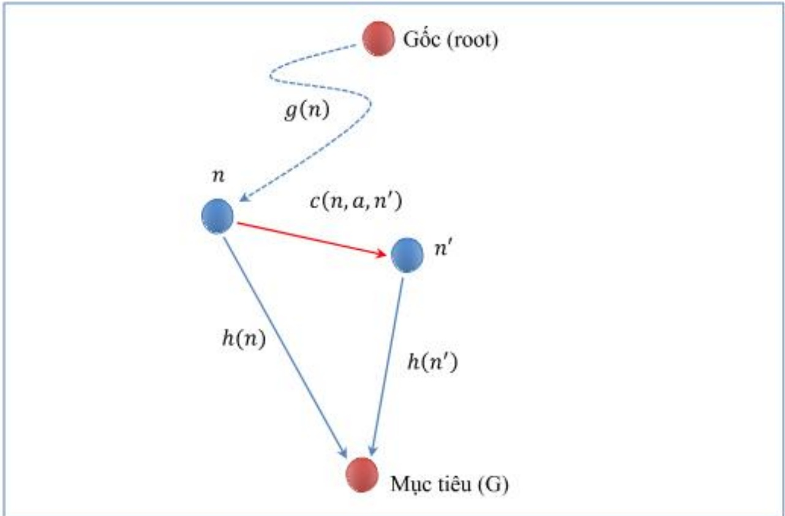

Hình 3.4 Hàm f(n) không giảm trên đường đi

Bước thứ hai là cần phải chứng minh:

Mỗi khi A\* chọn nút n để triển khai, ta đã tìm thấy được đường đi ngắn nhất từ nút gốc đến n.

Ta chứng minh bằng phân chứng:

Giả sử, khi ta chọn n để triển khai, đường đi hiện tại từ nút gốc đến n chưa phải là đường đi tối ưu.

Như thế sẽ tồn tại một đường đi khác đi từ nút gốc đến một nút chưa được triển khai nằm trên đường biên và đi đến nút n với chi phí nhỏ hơn chi phí của đường đi hiện tại từ gốc đến nút n. Vì $f$ không giảm trên đường đi, nên $f(n') < f(n)$. Điều này trái với giả thiết là $n$ có $f(n)$ nhỏ nhất trong các nút trên đường biên.

Từ hai nhận xét trên, ta suy ra chuỗi các nút được triển khai bằng giải thuật A\* không giảm theo $f(n)$. Vì thể, nút mục tiêu đầu tiên được tìm thấy sẽ là nút mục tiêu có $f(G)$ nhỏ nhất. Hơn nữa, vì $h(G)=0$ nên $f(G)=g(G)$ hay $f(G)$ chính là chi phí thực sự từ nút gốc đến $G$.

Trường hợp $h(n)$ là một hàm heuristic khả chấp nhưng không nhất quán ta có thể mở rộng giải thuật A\* phiên bản graphSearch để cho phép một nút trong explored có thể được triển khai lai nếu ta tìm thấy một đường đi

<!-- page: 82 -->

mới tốt hơn đi đến nó. Giải thuật mở rộng này được trình bày trong hình 3.5. Trường hợp (\*\*) trong giải thuật này sẽ không bao giờ xảy ra nếu $h(n)$ nhất quán. Nếu $h(n)$ nhất quán, theo chứng minh trên khi chọn một n để triển khai $g(n)$ đã tối tối ưu. Vi thế không tồn tại một đường đi nào khác nửa tốt hơn nửa nên một khi n đã được đưa vào expolored, nó sẽ không “bj” mang ra để triển khai lại.

Chú ý: một số tác giả phát biểu rằng nếu $h(n)$ khả chấp nhưng không nhất quán, có thể tạo ra một heuristic nhất quán bằng cách sử dụng kỹ thuật pathmax.

$$
f (n ^ {\prime}) = \max \bigl (g (n ^ {\prime}) + h (n ^ {\prime}), f (n) \bigr)
$$

Hay xây dựng hàm heuristic $h'(n)$ từ $h(n)$ như sau:

$$
h ^ {\prime} (n ^ {\prime}) = \max \bigl (h (n ^ {\prime}), h ^ {\prime} (n) - c (n, a, n ^ {\prime}) \bigr)
$$

Kỹ thuật này không làm một heuristic không nhất quán trở nên nhất quán. Tuy nhiên, kỹ thuật này có thể đảm bảo $f(n)$ không giảm trên một đường đi bất kỳ.

Ví dụ bên dưới cho thấy lời giải tìm được sẽ không tối ưu mặc dù đã áp dụng kỹ thuật pathmax. Ta thấy rằng nút p sẽ được triển khai trước do $f(p) = 5 + 6 = 11$ nhỏ hơn $f(q) = 2 + 10 = 12$ và p được đưa vào explored. Nút p không còn “cơ hội” để cập nhật lại $g(p) = g(q) + 2 = 4$.

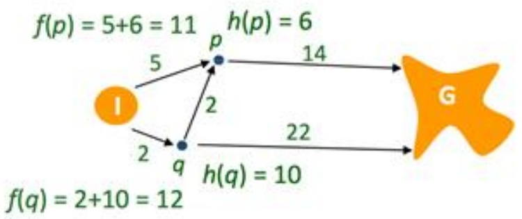

<!-- page: 83 -->

```txt
PNode AStarSearch(PState init_state) {
    PNode root = new Node();
    root->state = init_state;
    root->parent = NULL;
    root->f = 0;
    frontier.insert(root);
    explored.clear();
    while (!empty(frontier)) {
        //Lấy 1 nút từ đường biên có f(n) nhỏ nhất
        //và loại bỏ nó ra khởi đường biên
        Node* node = frontier.pop();
        if (node là nút mục tiêu)
            return node;
        insert(node, explored);
        for (child là nút con của node) {
            child->g = node->g + stepCost(node, child);
            child->h = estimate(child->state);
            child->f = child->g + child->h;
            if (child->state không thuộc frontier và
                child->state không thuộc explored) {
                child->parent = node;
                frontier.insert(child);
            } else if (child->state nằm trong đường biên
                và có g lớn hơn child->g)
                Thay thể nút nằm trên đường biên bằng child
            else if (child->state nằm trong explored
                và có g lớn hơn child->g) {
                Loại bỏ nút chứa child->state
                    ra khởi explored
                frontier.insert(child);
            }
        }
    }
    return NULL; //Thất bại, không tìm thấy lời giải
}
```

Hình 3.5 Giải thuật A\* với tái triển khai nút

Việc hàm chi phí $f$ không giảm trên đường đi cũng có nghĩa là chúng ta có thể về các đường biên trong không gian trạng thái. Hình 3.6 minh hoạ điều này. Bên trong đường biên nhân 400, tất cả các nút đều có $f(n) \leq 400$, và tương tự như vậy cho các đường biên khác. Vì A\* luôn triển khai nút trên

<!-- page: 84 -->

dường biên có $f(n)$ nhỏ nhất, nên ta có thể thấy rằng A\* sẽ mở rộng từ nút gốc, thêm các nút trong các vòng đồng tâm với bán kính chỉ phí $f$ tăng dần.

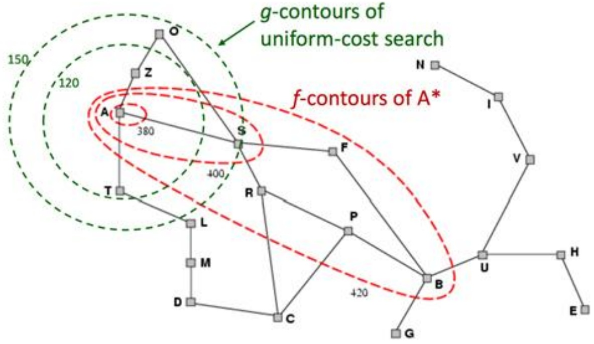

Hình 3.6 Các đường biên với chi phí f(n) khác nhau trong bài toán tìm đường đi từ Arad đến Bucharest

Với giải thuật tìm kiếm chi phí đồng nhất (A\* với h = 0), các vòng đồng tâm có “hình tròn” bao quanh nút gốc. Với các hàm heuristic càng chính xác, các vòng này sẽ bị kéo về phía nút mục tiêu và tập trung vào đường đi tối ưu. Nếu C\* là chi phí của đường đi của lời giải tối ưu ta có thể phát biểu rằng:

• A\* triển khai tất cả các nút có $f(n) < C^{*}$

\- A\* có thể triển khai một số nút trên “đường biên mục tiêu” với $f(n) = C^{*}$ trước khi chọn nút mục tiêu để triển khai.

Tính đầy đủ của A\* đời hồi số nút có chi phí nhỏ hơn hoặc bằng C\* phải hữu hạn. Nếu không có thể ta sẽ không chọn được nút mục tiêu để triển khai vì chưa triển khai hết các nút có $f \leq C^*$. Điều kiện này sẽ đúng nếu tất cả các chi phí của hành động đều lớn hơn epsilon và hệ số phân nhánh b hữu hạn.

Chú ý rằng A\* sẽ không triển khai các nút có $f > C^{*}$ mặc dù có thể nó là nút con của nút gốc. Ta nói rằng trong trường hợp này, cây con có nút gốc là nút này đã bị cắt tia (pruned). Khái niệm cắt tia – loại bỏ một số trường hợp mà ta nghĩ rằng nó không dẫn đến lời giải tối ưu – là một khái niệm rất quan trọng trong nhiều lĩnh vực trí tuệ nhân tạo.

Nhận xét cuối cùng là trong số các giải thuật cùng loại – các giải thuật mở rộng các đường đi từ gốc và sử dụng cùng thông tin heuristic – A\* là hiệu

<!-- page: 85 -->

quả nhất với bất cứ hàm heuristic nhất quán nào. Điều này có nghĩa là, không có giải thuật tối ưu nào đảm bảo triển khai ít nút hơn A\*. Bời vì bất cứ giải thuật nào không triển khai các nút có $f(n) < C^{*}$ sẽ có nguy cơ bỏ qua lời giải tối ưu.

Không có nghĩa rằng A\* là câu trả lời cho các yêu cầu về tìm kiếm của chúng ta. Với hầu hết các bài toán, số trạng thái nằm trên đường biên mục tiêu lũy thừa với chiều dài đường đi đến lời giải. Với các vấn đề có chi phí cho các hành động là hằng số, độ tăng trưởng khi thực thi là một hàm theo độ sâu của lời giải, $d$ được phân tích theo lỗi tuyệt đối (absolute error) hoặc lỗi tương đối (relative error) của hàm heuristic. Lỗi tuyệt đối được định nghĩa bằng $h^{*} - h$ trong đó $h^{*}$ là chi phí thực để đi từ gốc đến mục tiêu và lỗi tương đối được định nghĩa bằng $(h^{*} - h)/h^{*}$.

## 3.1.4 Hàm heuristic

Trong phần này, chúng xem xét các heuristic cho bài toán 8-puzzle, một phiên bản đơn giản hơn của bài toán 15-puzzle, để soi rội vào bản chất của các heuristic trong trường hợp tổng quát. Bài toán 8-puzzle là một trong những bài toán tìm kiếm heuristic sớm nhất. Tương tự như bài toán 15-puzzle, mục đích của bài toán là đầy cả ô vào ô trống theo chiều ngang và đọc cho đến khi đạt được được câu hình mong muốn. Hình 3.7 trình bày một trường hợp của bài toán này. Lời giải của bài toán gồm 26 bước di chuyển.

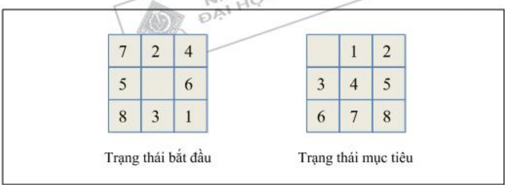

Hình 3.7 Bài toán 8-puzzle

Chi phí lời giải trung bình với khởi tạo ngẫu nhiên là 22 bước. Hệ số phân nhánh trung bình là 3. Khi ô trồng ở chính giữa, có 4 phép di chuyển, nhưng nếu nó ở góc, chỉ có 2 phép di chuyển hợp lệ và khi nó ở cạnh có 3 phép di chuyển hợp lệ. Điều này có nghĩa là nếu tìm kiếm vét cạn trên cây có độ sâu 22, ta sẽ duyệt qua khoảng $3^{32} \approx 3.1 \times 10^{10}$ trạng thái. Nếu sử dụng phiên bản graphSearch, số trạng thái sẽ giảm xuống khoảng 170,000 lần vì chi có $9!/2 = 181.440$ trạng thái phân biệt có thể đi đến từ trạng thái bắt đầu. Con số này còn có thể xử lý được, nhưng nếu bài toán mở rộng đến 15 ô, số

<!-- page: 86 -->

trạng thái sẽ khoảng 10$^{13}$. Vì thế, việc kế tiếp của chúng ta là tìm một hàm heuristic tốt. Nếu ta muốn tìm lời giải tốt nhất bằng giải thuật A\*, ta cần một hàm heuristic khả chấp (không bao giờ ước lượng quá số bước cần thiết để đạt đến mục tiêu). Có một lịch sử khá dài về các hàm heuristic như vậy cho bài toán 8-puzzle. Có hai hàm heuristic thường được sử dụng là:

\- $h_{1} =$ số ô đặt sai vị trí. Ví dụ như trong hình 3.7, tất cả 8 ô đều sai vị trí, vì vậy trạng thái bắt đầu có $h_{1} = 8$. $h_{1}$ là hàm heuristic khả chấp vì rõ ràng mỗi ô sai vị trí cần phải di chuyển ít nhất một lần để về đúng vị trí.

\- $h_{2} =$ tổng khoảng cách của các ô đến vị trí đúng của nó trong trạng thái mục tiêu. Vì các ô không thể di chuyển theo đường chéo, khoảng cách ta sử dụng là tổng khoảng cách theo chiều ngang và khoảng cách theo chiều dọc. Khoảng cách này còn được gọi là khoảng cách Manhattan hay khoảng cách L$_{1}$. h$_{2}$ cũng khả chấp vì mỗi lần di chuyển ta chỉ có thể di chuyển một ô một bước theo hướng gần với vị trí đúng của nó nhất. Trong hình 3.7 tổng khoảng cách Manhattan của các ô trong trạng thái bắt đầu đến vị trí đúng của nó trong trạng thái kết thúc là:

$$
h _ {2} = 3 + 1 + 2 + 2 + 2 + 3 + 3 + 2 = 1 8\tag{3.8}
$$

Như mong đợi, không có hàm nào cho kết quả vượt quá 26.

## 3.1.5 Ảnh hưởng của độ chính xác hàm heuristic lên hiệu quả tìm kiếm

Một cách để đặc trưng chất lượng của hàm heuristic là hệ số phân nhánh thực sự (effective branching factor) b\*. Nếu tổng số nút được sinh ra bằng giải thuật A\* cho một bài toán là N và độ sâu của lời giải là d, thì b\* là hệ số phân nhánh mà một cây đồng nhất có cùng độ sâu d phải có để chứa N + 1 nút. Vi vậy:

$$
N + 1 = 1 + b ^ {*} + (b ^ {*}) ^ {2} + \dots + (b ^ {*}) ^ {d}\tag{3.9}
$$

Ví dụ, nếu A\* tìm được lời giải ở độ sâu 5 và sinh ra 52 nút, thì hệ số phân nhánh thực sự của nó là 1.92. Hệ số phân nhánh thực sự thay đổi tuỷ theo bài toán, nhưng thường khá ổn định đối với các bài toán đủ khó. Sự tồn tại của hệ số phân nhánh thực sự được suy ra từ kết quả đã được đề cập trong phần trước là số nút được triển khai bằng A\* tăng lũy thừa theo độ sâu của lời giải. Vì thế, các thực nghiệm tính toán giá trị b\* trên các tập nhỏ của bài toán có thể cung cấp một hướng dẫn đủ tốt đến tính hữu dụng của hàm heuristic. Một hàm heuristic được thiết kế tốt sẽ có hệ số phân nhánh thực sự, b, gần với 1 cho phép giải các bài toán lớn với chi phí tính toán hợp lý.

<!-- page: 87 -->

Đế kiểm tra hai hàm heuristic $h_1$ và $h_2$, người ta đã sinh ra 1200 bài toán ngẫu nhiên chiều dài lời giải từ 2 đến 24 và giải chúng với tìm kiếm sâu đần và tìm kiếm A\* trên cây dùng $h_1$ và $h_2$. Bảng 3.1 cho số nút trung bình được sinh ra theo từng chiến lược. Kết quả cho thấy rằng $h_2$ tốt hơn $h_1$ và nhanh hơn rất nhiều so với tìm kiếm sâu đần. Thậm chí với bài toán có $d = 12$, A\* với $h_2$ nhanh hơn tìm kiếm sâu đần đến 50,000 lần.

Bảng 3.1 So sánh chi phí tìm kiếm và hệ số phân nhánh hiệu quả của tìm kiếm sâu dàn (IDS) và A\*

<table><tr><td></td><td colspan="3">Chi phí tìm kiếm</td><td colspan="3">Hệ số phân nhánh hiệu quả</td></tr><tr><td>d</td><td>IDS</td><td>A*(h1)</td><td>A*(h2)</td><td>IDS</td><td>A*(h1)</td><td>A*(h2)</td></tr><tr><td>2</td><td>10</td><td>6</td><td>6</td><td>2.45</td><td>1.79</td><td>1.79</td></tr><tr><td>4</td><td>112</td><td>13</td><td>12</td><td>2.87</td><td>1.48</td><td>1.45</td></tr><tr><td>6</td><td>680</td><td>20</td><td>18</td><td>2.73</td><td>1.34</td><td>1.30</td></tr><tr><td>8</td><td>6384</td><td>39</td><td>25</td><td>2.80</td><td>1.33</td><td>1.24</td></tr><tr><td>10</td><td>47127</td><td>93</td><td>39</td><td>2.79</td><td>1.38</td><td>1.22</td></tr><tr><td>12</td><td>364404</td><td>227</td><td>73</td><td>2.78</td><td>1.42</td><td>1.24</td></tr><tr><td>14</td><td>3473941</td><td>539</td><td>113</td><td>2.83</td><td>1.44</td><td>1.23</td></tr><tr><td>16</td><td>-</td><td>1301</td><td>211</td><td>-</td><td>1.45</td><td>1.25</td></tr><tr><td>18</td><td>-</td><td>3056</td><td>363</td><td>-</td><td>1.46</td><td>1.26</td></tr><tr><td>20</td><td>-</td><td>7276</td><td>676</td><td>-</td><td>1.47</td><td>1.27</td></tr><tr><td>22</td><td>-</td><td>18094</td><td>1219</td><td>-</td><td>1.48</td><td>1.28</td></tr><tr><td>24</td><td>-</td><td>39135</td><td>1641</td><td>-</td><td>1.48</td><td>1.26</td></tr></table>

Ta cũng có thể tự hỏi là “$h_2$ có luôn tốt hơn $h_1$ không?”. Câu trả lời là “về bản chất là có”. Thật dễ thấy từ định nghĩa của hai heuristic, với mỗi nút $h_2(n) \geq h_1(n)$. Vì thế ta nói rằng $h_2$ trội hơn (dominate) $h_1$. Tính trội dẫn trực tiếp đến tính hiệu quả: A\* dùng $h_2$ sẽ không bao giờ triển khai nhiều nút hơn A\* dùng $h_1$ (ngoại trừ một vài nút có $f(n) = C^*$). Lập luận cho vấn này khá đơn giản. Cần phải nhớ lại là tất cả các nút có $f(n) < C^*$ chắc chắn phải được triển khai. Điều này tương đương với việc nói tất cả các nút có $h(n) < C^* - g(n)$ phải được triển khai. Nhưng vì $h_1 \leq h_2$, nên mỗi nút mà A\* dùng $h_2$ phải triển khai thì A\* dùng $h_1$ cũng triển khai nó. Vì vậy, ta nên sử dụng các hàm heuristic có giá trị lớn với điều kiện không quá lớn để vẫn đảm bảo tính khả chấp và nhất quán. Các hàm heuristic như thế sẽ rút ngắn thời gian tính toán.

## 3.1.6 Sinh hàm heuristic khả chấp từ bài toán nói lỏng ràng buộc

Như ta đã thấy cả $h_1$ và $h_2$ đều là heuristic tốt cho bài toán 8-puzzle và $h_2$ tốt hơn. Làm thể nào ta có thể có $h_2$? Có cách nào máy tính có thể tự phát minh ra hàm như thể không?

<!-- page: 88 -->

$h_{1}$  và  $h_{2}$  đều là hàm ước lượng chiều dài đường đi còn lại từ trạng thái hiện tại đến trạng thái mục tiêu của bài toán 8-puzzle. Ngoài ra chúng còn chiều dài đường đi chính xác cho các phiên bản đơn giản hoá của bài toán. Nếu luật của bài toán được thay đổi sao cho một ô có thể di chuyển đến bất cứ nơi nào thay vì chi di chuyển qua ô trống cạnh nó, thì  $h_{1}$  sẽ cho số bước chính xác trong lời giải ngắn nhất. Tương tự như vậy, nếu một ô có thể di chuyển một bước sang ô bên cạnh theo chiều ngang hoặc chiều đọc, ngay cả trong trường hợp ô bên cạnh không phải ô trống, thì  $h_{2}$  sẽ cho số bước chính xác trong lời giải ngắn nhất. Một bài toán có ít ràng buộc hơn bài toán gốc được gọi là bài toán được nói lỏng ràng buộc (relaxed problem). Đồ thị không gian trạng thái của bài toán nói lỏng ràng buộc là một đồ thị cha (supergraph) của đồ thị không gian trạng thái gốc vì loại bỏ các ràng buộc sẽ tạo thêm các cung trên đồ thị gốc.

Vì bài toán được nói lỏng ràng buộc thêm một số cung vào không gian trạng thái, bất cứ lời giải tối ưu nào trong bài toán gốc, theo định nghĩa, cũng là một lời giải trong bài toán được nói lỏng ràng buộc; nhưng bài toán nói lỏng ràng buộc có thể có lời giải tốt hơn nếu cung mới thêm vào tạo nên đường tất. vì thể, chi phí lời giải tối ưu của bài toán được nói lỏng ràng buộc sẽ là một heuristic khả chấp cho bài toán gốc. Hơn nửa, vì heuristic được sinh ra này là chi phí chính xác của bài toán được nói lỏng ràng buộc, nó phải tuân theo bất đẳng thức tam giác và vì vậy sẽ nhất quán.

Nếu một định nghĩa của bài toán được viết bằng ngôn ngữ hình thức (formal language), ta có thể xây dựng tự động bài toán được nói lòng ràng buộc. Ví dụ, nếu các hành động của bài toán 8-puzzle được mô tả như sau:

Một ô có thể di chuyển từ vị trí A đến vị trí B nếu A kể với B theo chiều ngang hoặc chiều đọc và B là trống.

Ta có thể sinh ra 3 bài toán được nói lỏng ràng buộc bằng cách loại bỏ 1 trong 2 hoặc cả 2 ràng buộc:

(a) Một ô có thể di chuyển từ vị trí A sang vị trí B nếu A kể với B.

(b) Một ô có thể di chuyển từ vị trí A sang vị trí B nếu B rỗng.

(c) Một ô có thể di chuyển từ vị trí A sang vị trí B.

Từ (a) ta suy ra $h_2$ (khoảng cách Manhattan). Lý do là $h_2$ sẽ là chi phí chính xác nếu mỗi lần ta di chuyển 1 ô đến vị trí đúng của nó. Heuristic sinh ra từ (b) sẽ được thảo luận sau trong phần bài tập. Từ (c), ta sinh ra $h_1$ vì nó là chi phí chính xác nếu ta đưa một ô sai vị trí đến vị trí đúng của nó trong một bước di chuyển. Chú ý rằng các bài toán được nói lỏng ràng buộc sinh ra bằng kỹ thuật này có thể được giải mà không cần tìm kiếm, các luật được nói lỏng cho phép bài toán phân chia thành 8 bài toán con độc lập. Nếu bài toán được

<!-- page: 89 -->

nói lòng ràng buộc vẫn còn quá khó, thì có nghĩa là các heuristic tương ứng rất khó mà có được.

Có một chương trình tên ABSOLVER có thể sinh tự động các heuristic từ định nghĩa của bài toán dùng phương pháp “bài toán nói lỏng ràng buộc” và các kỹ thuật khác [Prieditis, 1993]. ABSOLVER đã sinh ra một heuristic cho bài toán 8-puzzle tốt hơn các heuristic đã có và tìm được heuristic hữu ích đầu tiên cho bài toán xoay Rubik.

Một vấn đề liên quan đến việc sinh heuristic là ta thường thất bại trong việc tìm được một heuristic tốt hơn rõ ràng. Nếu họ các heuristic khả chấp h₁, h₂, ..., hm tồn tại cho một bài toán nào đó và không có cái nào trội hơn cái nào, vậy ta phải chọn hàm nào ? Ta không cần phải chọn gì cả. Ta có thể có được một hàm tốt nhất bằng cách định nghĩa:

$$
h (n) = \max \{h _ {1} (n), h _ {2} (n), \dots , h _ {m} (n) \}\tag{3.10}
$$

Hàm heuristic hợp (composite heuristic) này sẽ sử dụng hàm tốt nhất tại mỗi nút. Vì các hàm heuristic thành phần đều khả chấp, vì thế $h(n)$ cũng khả chấp. Hơn nửa, $h$ trội hơn tất cả các hàm thành phần.

## 3.1.7 Sinh heuristic khả chấp từ các bài toán con: cơ sở dữ liệu mẫu

Hàm heuristic khả chấp cũng có thể sinh ra từ chi phí lời giải của một bài toán con của một bài toán đã cho. Ví dụ, hình 3.8 chỉ ra rằng một bài toán con của một trường hợp của bài toán 8-puzzle ở hình 3.7. Bài toán con đời hỏi đưa các ô 1, 2, 3, 4 về vị trí đúng của nó. Rỗ ràng, chi phí của lời giải tối ưu của bài toán con này là cận dưới của chi phí lời giải cho bài toán đầy đủ. Điều này cho thấy nó chính xác hơn khoảng cách Manhattan trong một số trường hợp.

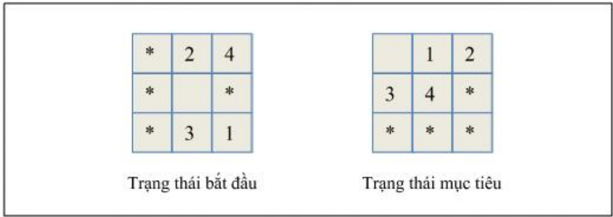

Hình 3.8 Một bài toán con của bài toán 8-puzzle

<!-- page: 90 -->

Ý tưởng phía sau cơ sở dữ liệu mẫu (pattern database) là lưu các chi phí lời giải chính xác cho một số bài toán con. Trong ví dụ của chúng ta, mỗi cấu hình có thể của 4 ô và ô trống. Sau đó ta tính heuristic khả chấp $h_{DB}$ cho mỗi trạng thái đầy đủ bằng cách tìm cấu hình bài toán con tương ứng trong cơ sở dữ liệu. Bản thân cơ sở dữ liệu được xây dựng bằng cách tìm ngược từ trạng thái mục tiêu và lưu lại chi phí của mỗi mẫu mới; chi phí của việc tìm kiếm này giảm dần qua nhiều lần tìm kiếm.

Việc chọn các ô 1, 2, 3, 4 là ngẫu nhiên; ta cũng có thể xây dựng cho các ô 5, 6, 7, 8 hay 2, 4, 6, 8 hay các ô khác. Mỗi cơ sở dữ liệu sinh ra một heuristic khả chấp, và các heuristic này có thể kết hợp lại với nhau, bằng cách lấy giá trị lớn nhất như đã trình bày ở trên. Một heuristic kết hợp theo kiểu này chính xác hơn nhiều so với khoảng cách Manhattan; số nút sinh ra khi giải bài toán 15-puzzle có thể giảm xuống đến 1000 lần.

Ta cũng có thể tự hồi heuristic sinh ta từ cơ sở dữ liệu 1, 2, 3, 4 và từ cơ sở dữ liệu 5, 6, 7, 8 có thể cộng lại với nhau được không, vì hai bài toán con này dưỡng như không chồng lắp lên nhau. Heuristic tổng này có khả chấp không? Câu trả lời là KHÔNG vì các lời giải của bài toán con 1, 2, 3, 4 và bài toán con 5, 6, 7, 8 của một trạng thái nào đó chắc chắn sẽ có chung một số bước di chuyển nào đó – điều này cũng giống như việc 1, 2, 3, 4 có thể di chuyển mà không dụng chậm đến 5, 6, 7, 8 và ngược lại. Nhưng điều gì sẽ xảy ra nếu ta không đếm các di chuyển đó? Có nghĩa là ta không lưu chi phí tổng của việc giải các bài toán con 1, 2, 3, 4 mà lưu số bước di chuyển của 1, 2, 3, 4. Dễ dàng thấy rằng tổng của hai chi phí vẫn còn là cận dưới của chi phí giải toàn bài toán. Đây là ý tưởng của cơ sở dữ liệu mẫu rời nhau (disjoint pattern databases). Với các cơ sở dữ liệu như vậy, có thể giải bài toán 15-puzzle trong vài mili giây – số nút sinh ra giảm 10,000 lần so với việc dùng khoảng cách Manhattan. Với bài toán 24-puzzle, ta có thể tăng tốc 1 triệu lần.

Cơ sở dữ liệu mẫu rời nhau chạy được với bài toán di chuyển ô số vì bài toán có thể được chia nhỏ ra theo cách thức mỗi bước di chuyển chỉ tác động lên 1 bài toán con – vì tại mỗi thời điểm chỉ có một ô được di chuyển. Với bài toán xoay Rubik, chia kiểu này rất khó vì mỗi bước di chuyển tác động lên 8 hoặc 9 khối. Các cách định nghĩa hàm heuristic cộng tính khả chấp tổng quát hơn được đề nghị để áp dụng vào bài toán xoay Rubik [Yang et al., 2008], nhưng vẫn không sinh ra được heuristic tốt hơn heuristic không cộng tính tốt nhất cho bài toán này.

## 3.1.8 Học heuristic từ kinh nghiệm

Hàm heuristic $h(n)$ được giả sử là ước lượng chi phí của lời giải từ trạng thái $n$. là thể nào một tác từ có thể xây dựng hàm như thế? Một giải pháp đã được đưa ra trong phần trước – bài toán được nói lòng ràng buộc mà lời

<!-- page: 91 -->

giải tối ưu được tìm thấy dễ dàng. Một giải pháp khác là học từ kinh nghiệm. Ví dụ, “kinh nghiệm” ở đây được hiểu là giải nhiều bài bài toán 8-puzzle. Mỗi lời giải tối ưu cho một bài toán 8-puzzle cung cấp một ví dụ mà từ đó ta có thể học được hàm $h(n)$. Từ các mẫu ví dụ này, một giải thuật học có thể được sử dụng để xây dựng hàm $h(n)$ để có thể dự báo chi phí lời giải từ một trạng thái bất kỳ phát sinh trong quá trình tìm kiếm. Các kỹ thuật có thể áp dụng bao gồm: mạng nơ-ron, cây quyết định và các phương pháp học tự động khác nửa.

Các phương pháp học quy nạp làm việc tốt nhất khi được cung cấp các đặc trưng (features) của trạng thái. Các đặc trưng này phải tốt để có thể dự đoán chính xác giá trị cho mỗi trạng thái chú không phải đơn thuần là cung cấp một mô tả thô của các trạng thái cho giải thuật học. Ví dụ, đặc trưng “số ô sai vị trí” có thể hữu ích cho việc dự báo khoảng cách thực sự từ một trạng thái đến mục tiêu. Gọi đặc trưng này là $x_{1}(n)$. ta có thể sinh ra ngẫu 100 cấu hình cho bài toán 8-puzzle và thống kê chi phí lời giải thực sự của chúng. Ta có thể thấy rằng khi $x_{1}(n) = 5$, chi phí lời giải trung bình khoảng 14. Cho trước các dữ liệu này, các giá trị của $x_{1}(n)$ có thể dùng để dự đoán $h(n)$. Dĩ nhiên, ta có thể dùng nhiều đặc trưng hơn. Một đặc trưng thứ hai $x_{2}(n)$ có thể là “số cặp các ô kể nhau nhưng không kể nhau trong trạng thái mục tiêu.” Ta nên kết hợp $x_{1}(n)$ và $x_{2}(n)$ như thế nào để dự đoán $h(n)$? Một tiếp cận thông thường là sử dụng tổ hợp tuyến tính:

$$
h (n) = c _ {1} x _ {1} (n) + c _ {2} x _ {2} (n)
$$

Các hàng số $c_1$ và $c_2$ được điều chỉnh để cho kết quả tốt nhất, gần với chi phí thực sự nhất. Chứng ta mong muốn cả $c_1$ và $c_2$ đều dương vì các ô sai vị trị và các cặp kè nhau không đúng chỗ làm bài toán khó giải hơn. Chú ý là hàm heuristic này thỏa mãn điều kiện $h(n) = 0$ khi $n$ là trạng thái mục tiêu, nhưng không chắc là có khả chấp hay nhất quán hay không.

## 3.2 TİM KIỂM CỤC BỘ VÀ BÀI TOÁN TỔI UU

Các giải thuật tìm kiếm mà ta vừa thấy được thiết kế để khám phá không gian tìm kiếm một cách hệ thống. Tính hệ thống này được thực hiện bằng cách giữ một hay nhiều đường đi trong bộ nhớ và lưu giữ các phương án phụ đã được khám phá rời tại các điểm trên đường đi. Khi tìm thấy mục tiêu, đường đi từ mục tiêu đó tạo thành lời giải của bài toán. Tuy nhiên, trong nhiều bài toán, đường đi đến mục tiêu không thực sự cần thiết. Ví dụ trong bài toán 8 quân hậu, thứ mà ta quan tâm là cấu hình cuối cùng của các quân hậu, chữ không phải là thứ tự các quân hậu được thêm vào. Tính chất tổng quá này cũng đúng trong nhiều ứng quan trọng như thiết kế IC (integrated-circuit design), bổ trí vật dụng trong nhà máy, lập lịch biểu, lập trình tự động, tối ưu hoá mang viễn thông, chỉ đường cho ô tô...

<!-- page: 92 -->

Nếu đường đi đến mục tiêu không quan trọng, ta có thể xem xét một lớp các giải thuật khác không quan tâm đến đường đi. Các giải thuật tìm kiếm cục bộ (local search) hoạt động dựa trên một nút hiện tại (current node) hơn là nhiều đường đi khác nhau và di chuyển đến các nút lân cận của nút đó. Thông thường các đường đi sinh ra khi tìm kiếm không được lưu giữ lại. Mặc dù các giải thuật tìm kiếm cục bộ không có hệ thống (không xét hết các trường hợp), nhưng chúng có hai ưu điểm chính: (i) cần rất ít bộ nhớ và (ii) tìm được lời giải chấp nhận được trong không gian trạng thái lớn, thệm chí vô hạn mà các giải thuật có hệ thống không thể nào thực hiện được.

Ngoài việc tìm kiếm mục tiêu, các giải thuật tìm kiếm cục bộ hữu ích cho các toán tối ưu hoá thuần tuý trong đó mục tiêu chính là tìm trạng thái tốt nhất theo một hàm mục tiêu (objective function) nào đó. Nhiều bài toán tối ưu tối ưu không phù hợp với mô hình tìm kiếm “chuẩn” được giới thiệu trong phần trên. Ví dụ, thiên nhiên đã cung cấp một hàm mục tiêu – khả năng thích nghi – mà thuyết tiến hoá của Darwin có thể thấy được khi tối ưu nó, nhưng không tồn tại phép “kiểm tra mục tiêu” nào và cũng không có “chi phí đường đi” cho bài toán này.

Đế hiều tìm kiếm cục bộ, ta xét không gian trạng thái như hình 3.9 Một điểm mốc có “vị trí” (định nghĩa bằng trạng thái) và “độ cao” (định nghĩa bằng giá trị của hàm heuristic hoặc hàm mục tiêu). Nếu độ cao tương ứng với chi phí, thì mục đích của chúng ta là tìm thung lũng thấp nhất – cực tiểu toàn cục (global mimimum); nếu độ cao tương ứng với hàm mục tiêu, thì mục đích chúng ta là tìm đình cao nhất – cực đại toàn cục (global maximum). Các giải thuật tìm kiếm cục bộ khám phá bản đồ cao độ này. Một giải thuật tìm kiếm cục bộ đầy đủ luôn tìm thấy mục tiêu nếu nó tôn tại và một giải thuật tối ưu luôn tìm thấy một cực tiểu/cực đại toàn cục.

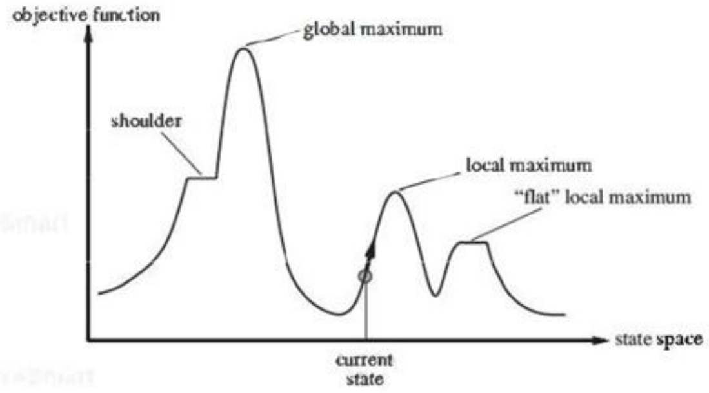

Hình 3.9 Không gian trạng thái một chiều và hàm mục tiêu

<!-- page: 93 -->

## 3.2.1 Tîm kiểm leo đồi (Hill-climbing search)

Giải thuật tìm kiếm leo đổi (đốc đúng – steepest-ascent) được trình bày trong hình 3.10. Đơn giản chỉ có một vòng lập mà nó tiếp tục di chuyển về hướng làm tăng giá trị của hàm mục tiêu – có nghĩa là leo lên đổi. Giải thuật kết thúc khi nó đạt đến một “đỉnh” (peak) mà xung quanh nó không có ai cao hơn. Giải thuật không lưu giữ cây tìm kiếm, vì thế cấu trúc dữ liệu cho nút hiện tại chỉ cần lưu trạng thái và giá trị của hàm mục tiêu. Leo đổi không nhìn ra khởi các lân cận ngay bên cạnh nút hiện tại (các nút được sinh ra trực tiếp từ nút hiện tại).

```c
PState hillClimbing(PState init_state) {
    PNode current = new Node ;
    current->state = init_state;
    current->h = estimated_cost(current->state);
    while (true) {
        PNode neighbor = successor có giá trị cao nhất
                                của current
        if (neighbor.h ≤ current.h)
            return current.state;
        current = neighbor;
    }
}
```

Hình 3.10 Giải thuật leo đổi tìm trạng thái có giá trị lớn nhất

Đề minh hoạ giải thuật leo đổi, ta sẽ xem xét bài toán 8 quân hậu. giải thuật tìm kiếm cục bộ sử dụng cách biểu diễn trạng thái dùng mô hình trạng thái đầy đủ, trong đó mỗi trạng thái có 8 quân hậu trên bàn cờ, mỗi quân trên một cột. Trạng thái con của một trạng thái là tất cả các trạng thái được sinh ra bằng cách di chuyển một quân hậu sang một ô khác trong cùng một cột (như vậy mỗi trạng thái có $8 \times 7 = 56$ hậu bối). Hàm chi phí heuristic h là số cặp quân hậu không chế lẫn nhau. Giá trị cực tiểu toàn cục của hàm này là 0, chỉ xảy ra tại lời giải. Hình 3.11(a) trình bày một trạng thái có h = 17, và các hậu bối của nó, hậu bối tốt nhất có h = 12. Giải thuật leo đổi chọn ngẫu nhiên trong tập các hậu bối tốt nhất nếu có nhiều hơn một.

<!-- page: 94 -->

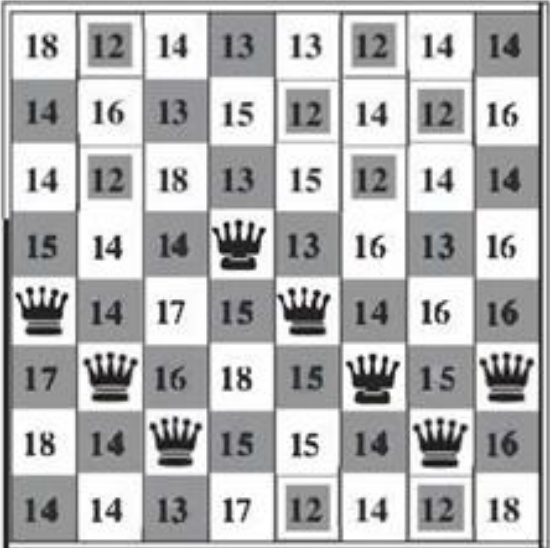

(a)

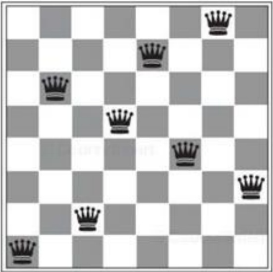

(b)

Hình 3.11 Trạng thái của bài toán 8 quân hậu có giá 17

Tìm kiểm leo đổi đôi khi còn được gọi là tìm kiếm cục bộ háu ăn (greedy local search) vì nó chọn trạng thái lân cận tốt nhất mà không nghĩ gì đến con đường phía trước mà nó sẽ phải đi qua. Leo đổi thường di chuyển rất nhanh về lời giải và thường cải tiến một trạng thái xấu khá dễ dàng. Ví dụ trong hình 3.11(a), chỉ cần 5 bước là đạt đến trạng thái trong hình 3.11(b) có h = 1 và rất gần với lời giải. Tuy nhiên, không may là leo đổi thường mặc kẹt vì các lý do sau:

\- Cực trị cục bộ (local maxima): cực trị cục bộ là một định cao hơn lân cận nó nhưng thấp hơn cục trị toàn cục. Các giải thuật leo đổi khi đạt đến cực trị cục bộ sẽ đi lên về phía đình và sau đó bị kẹt lại đó vì không còn chỗ để đi tiếp nửa. Hình 3.9 minh hoạ điều này. Cụ thể hơn, trạng thái trong hình 3.11(b) là tối ưu cục bộ; mỗi bước di chuyển đều làm cho tình hình tệ hơn.

\- Chôm núi (ridges): như minh hoạ trong hình 3.12 các chôm núi tạo ra một chuỗi các cực trị cực bộ mà các giải thuật háu ăn rất khó giải quyết. Không có đường đi trực tiếp từ chôm núi (điểm tối ưu cục bộ) này sang chôm núi khác. Đề di được đến chôm núi khác cao hơn cần phải “leo xuống” và sao đó “leo lên” tiếp (theo các đường mũi tên in đậm).

\- Cao nguyên (Plaleaux): cao nguyên là một vùng bằng phẳng trong bản đồ không gian trạng thái. Nó có thể là một tối ưu cục bộ phẳng, không có lôi leo lên cao hơn nửa hoặc là một bờ vai (shouder) mà có thể leo lên cao hơn nửa (xem hình 3.9). Giải thuật leo đổi có thể bị lạc lôi trên cao nguyên.

<!-- page: 95 -->

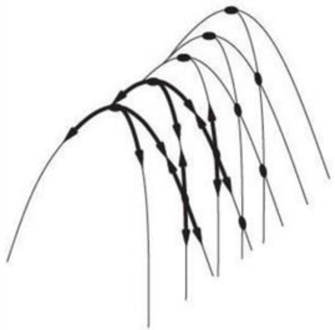

Hình 3.12 Minh hoạ tại sao các mom gây khó khăn cho giải thuật leo đổi

Trong mỗi trường hợp, giải thuật đạt đến một điểm không thể đi được nữa. Bất đầu từ một trạng thái ngẫu nhiên của bài toán 8 quân hậu, leo đổi đốc đứng sẽ mắc kết khoảng 86%, chỉ giải được 14% trong số các trường hợp, nó chạy rất nhanh, chỉ cần 4 bước trong trường hợp thành công và 3 bước trong trường hợp thất bại (bị kết lại) – không quá tệ trong không gian $8^{8} \approx 17$ triệu trạng thái. Giải thuật trong hình 3.10 bị đứng khi nó leo đến một cao nguyên trong đó các lần cận tốt nhất có cùng giá trị với trạng thái hiện tại. Có phải là ý tưởng tốt không nếu ta tiếp tục di chuyển – cho phép di chuyển một phía với hy vọng cao nguyên này là một bờ vai? Thường thì câu trả lời là “có”, nhưng phải thật cần thận. Nếu ta cho phép di chuyển về một phía khi không còn chỗ di chuyển, có thể xảy ra vòng lập vô tận khi cao nguyên thật sự là một cực đại phẳng. Một giải pháp thông thường là đặt giới hạn cho số lần di chuyển một phía. Ví dụ, ta có thể cho phép di chuyển một phía 100 lần liên tục, nếu tình hình không cải tiến, ta dùng lại. Với bài toán 8 quân hậu, điều này làm tăng tỉ lệ giải được từ 14% lên 94%. Thành công này phải trả một giá: số bước trung bình tăng lên 21 bước cho trường hợp thành công và 64 bước trong trường hợp thất bại.

Nhiều biến thể của giải thuật leo đổi cũng đã được đề xuất. Leo đổi ngẫu nhiên (stochastic hill climbing) chọn ngẫu nhiên một hướng di chuyển đi lên; xác suất chọn có thể thay đổi tuỷ theo độ đốc của hướng di chuyển. phương pháp này thường hội tự chậm hơn phương pháp leo đổi đốc đúng, nhưng trong một số trường hợp, nó cho kết quá tốt hơn. Leo đổi với lựa chọn đầu tiên (first-choice hill climbing) cải đặt giải thuật leo đổi ngẫu nhiên bằng cách sinh ngẫu nhiên các trạng con từ trạng thái hiện tại cho đến khi tìm được một trạng thái con tốt hơn trạng thái hiện tại. Dây là một chiến lược tốt khi một trạng thái có quá nhiều (ví dụ như hàng ngân) trạng thái con.

<!-- page: 96 -->

Các giải thuật leo đổi được trình bày trong phần trên đều không đầy đủ – chứng thường kết lại tại một cực đại cục bộ ngay cả khi tồn tại mục tiêu. Phương pháp leo đổi khởi động lại ngẫu nhiên (random-restart hill climbing) sở hữu một tính chất nổi tiếng: “Nếu lần đầu không thành công, hãy thử và thử lại.” điều này dẫn đến một chuỗi các tìm kiếm leo đổi từ nhiều trạng thái bắt đầu được sinh ra ngẫu nhiên, cho đến khi tìm thấy mục tiêu. Chiến lược này sẽ đầy đủ với xác suất tiến đàn về 1, vì đôi khi ta sẽ sinh ra trạng thái mục tiêu ngay từ đầu. Nếu mỗi lần tìm kiếm leo đổi có xác suất thành công $p$, thì số lần khởi động lại trung bình là 1/p. Với bài toán 8-puzzle không cho phép di chuyển ngang, xác suất thành công $p \approx 0.14$, vì vậy ta cần khoảng 7 lần khởi động mới có thể tìm thấy mục tiêu (6 lần thất bại và 1 lần thành công). Số bước trung bình (chi phí trung bình để giải bài toán) là chi phí của lần thành công cộng với $(1 - p)/p$ lần chi phí thất bại, tổng cộng khoảng 22 bước di chuyển. Khi ta cho phép di chuyển theo chiều ngang, ta cần trung bình khoảng $1/0.94 \approx 1.06$ lần khởi động và chi phí trung bình để tìm lời giải là $(1 \times 21) + (0.06/0.96) \times 64 \approx 25$ bước di chuyển các ô. Với bài toán 8 quân hậu, leo đổi khởi động lại ngẫu nhiên rất hiệu quả. Thậm chí với 3 triệu quân hậu, tiếp cận này có thể tìm thấy lời giải trong thời gian dưới 1 phút [Luby et al., 1993].

Thành công của leo đổi phụ thuộc vào hình dáng của bản đồ không gian trạng thái: nếu có ít cực đại cực bộ và cao nguyên, leo đổi khởi động lại ngẫu nhiên sẽ tìm được lời giải tốt rất nhanh. Ngược lại, các bài toán thực tế có bản đồ không gian trạng thái có hình dạng giống như một con nhóm ở trên sàn nhà, trên mỗi cái lông nhóm lại có một con nhóm thu nhỏ ở trên đó, và cứ như thể. Các bài toán NP-khó thường có số cực đại cực bộ lũy thừa. Mặc dù thể, ta có thể tìm thấy được một cực đại cực bộ tốt sau một ít bước lập.

## 3.2.2 Mô phỏng tôi luyện

Các giải thuật leo đổi mà không bao giờ “tuột đốc” để di chuyển đến một trạng thái có giá trị thấp hơn giá trị của trạng thái hiện tại chắc chắn sẽ không đầy đủ vì có thể nó sẽ kết lại ở các cực đại cực bộ. Ngược lại, giải thuật di chuyển hoàn toàn ngẫu nhiên (purely random walk) – di chuyển đến một trạng thái con được chọn ngẫu nhiên (theo phân phối đều) từ tập các trạng thái con – thì đầy đủ nhưng cực kỳ không hiệu quả. Vì vậy, dưỡng như cũng hợp lý nếu ta thử kết hợp leo đổi với di chuyển ngẫu nghiên theo một cách nào đó để có được một giải thuật đầy đủ và hiệu quả. Mô phỏng tôi luyện (simulated annealing) là một giải thuật như vậy. Trong lĩnh vực luyện kim, tôi luyện (annealing) là quy trình thường sử dụng để làm thay đổi độ cứng của kim loại và thuỷ tỉnh (tăng/giảm độ cứng) bằng cách đốt nóng chúng đến nhiệt độ cao sau đó làm lạnh từ từ. Quá trình này cho phép vật liệu đạt đến một trạng thái kết tỉnh năng lượng thấp. Đề giải thích giải thuật mô phỏng tôi luyện, ta chuyển góc nhìn của chúng ta từ leo đổi sang giảm gradient (gradient descent,

<!-- page: 97 -->

nhảm cực tiểu hoá chi phí thay vì cực đại hoá hàm mục tiêu như trong giải thuật leo đổi) và tưởng tượng nhiệm vụ của chúng ta là thả một quả bóng bàn (ping-pong ball) xuống một sàn nhà lời lỗm sao cho quả bóng rơi xuống tận vị trí thấp nhất. Nếu ta để quả bóng lăn, nó sẽ di chuyển và sau cùng sẽ dùng lại ở một vị trí cực tiểu cục bộ. Nếu ta rung sàn nhà, quả bóng sẽ bị nảy lên rời khởi vị trí cực tiểu cục bộ và tiếp tục di chuyển. Mấu chốt ở đây là rung vừa đủ mạnh để quả bóng rời khởi vị trí cực tiểu cục bộ, nhưng không quá mạnh để đánh bật nó ra khởi vị trí cực tiểu toàn cục. Giải pháp mô phỏng tôi luyện bắt đầu rung mạnh (nhiệt độ cao) và sau đó giảm dần cường độ rung (giảm nhiệt độ).

Vòng lặp trong cùng nhất của giải thuật mô phỏng tôi luyện (hình 3.13) tương tự như giải thuật leo đồi. Tuy nhiên, thay vì chọn bước di chuyển tốt nhất, ta chọn ngẫu nhiên một bước di chuyển. Nếu việc di chuyển cải thiện được tỉnh hình (đạt đến một trạng tốt hơn), nó luôn luôn luôn được chấp nhận. Ngược lại, giải thuật sẽ chấp nhận bước đi này với một xác suất nào đó. Xác suất giảm lũy thừa theo “độ xấu” (badness) của bước đi, ký hiệu: ΔElà độ chênh lệch giá trị giữa trạng thái mới và trạng thái hiện tại. Xác suất cũng giảm khi “nhiệt độ” T giảm: các bước đi “xấu” có thể được phép chọn khi T cao, nhưng khi T giảm chúng cảng khó được chọn hơn. Nếu lịch tôi luyện (schedule) giảm T đủ chậm, giải thuật sẽ tìm được tối ưu toàn cục với xác suất dần về 1.

```txt
PState simulatedAnnealing(PState init_state, schedule) {
    PNode current = new Node ;
    current->state = init_state;
    current->h = estimated_cost(current->state);
    for (int t = 1; t <∞; t++) {
        T = schedule(t);
        if (T == 0) return current->state;
        next = một successor ngẫu nhiên của current;
        ΔE = next.h - current.h;
        if (ΔE> 0) current = next;
        else current = next với xác suất e^ΔE/T
    }
}
```

Hình 3.13 Giải thuật mô phòng tôi luyện, phiên bản ngẫu nhiên của giải thuật leo đổi

Mô phỏng tôi luyện được dùng đầu tiên để giải quyết bài toán bổ trí mạch IC trong những năm đầu thập niên 1980. Phương pháp này được áp dụng rộng rãi trong xếp lịch sản xuất và các bài toán tối ưu lớn khác.

<!-- page: 98 -->

## 3.3 BÀI TOÁN THOẢ MÃN RÀNG BUỘC

Trong phần các phần trên ta đã xem xét ý tưởng giải quyết vấn đề bằng phương pháp tìm kiếm trong không gian trạng thái. Các trạng thái này có thể được đánh giá bằng các heuristic chuyên ngành và kiểm tra xem có phải là mục tiêu không. Tuy nhiên, theo quan điểm giải thuật tìm kiếm, mỗi trạng thái là nguyên tố hoặc không thể phân chia được – một hợp đen không có cấu trúc bên trong. Nói cách khác, các giải thuật tìm kiếm không khai thác thông tin về cấu trúc bên trong của các trạng thái.

Trong phần này chúng ta sẽ tìm hiểu cách thức giải quyết một họ các bài toán một cách hiệu quả hơn. Ta sử dụng phương pháp biểu diễn có cấu trúc (structured/ factored representation) để biểu diễn các trạng thái: mỗi trạng thái là một tập các biến, mỗi biến có một giá trị. Một bài toán được giải khi mỗi biến đều có giá trị thỏa mãn tất cả các ràng buộc trên biến. Một bài toán được mô tả bằng cách này được gọi là bài toán thỏa mãn ràng buộc (constrain satisfaction problem) hay CSP.

Các giải thuật tìm kiếm CSP tận dụng ưu thế về cấu trúc của các trạng thái và dùng các heuristic tổng quát (general-purpose heuristics) hơn là sử dụng heuristic chuyên ngành phụ thuộc vào bài toán (problem-specific heuristics) đề tìm được lời giải cho các bài toán phức tạp. Ý tưởng chính là loại bổ một phần lớn không gian trạng thái một lần bằng cách xác định các sự kết hợp biến/giá trị vi phạm ràng buộc.

## 3.3.1 Định nghĩa bài toán thỏa mãn ràng buộc

Một bài toán thỏa mãn ràng buộc gồm ba thành phần: X, D, và C trong đó:

• X: tập hợp các biến  $\{X_{1}, X_{2}, \ldots, X_{n}\}$

\- $D$: tập hợp các miền giá trị $\{D_1, D_2, ..., D_n\}$ tương ứng với các biến

• C: tập hợp các ràng buộc mô tả các sự kết hợp cho phép

Mỗi miền giá trị $D_i$ là một tập hợp các giá trị cho phép $\{v_1, v_2, ..., v_k\}$ gán vào biến $X_i$ tương ứng. Mỗi ràng buộc $C_i$ là một cặp &lt;scope, rel&gt;, trong đó scope là một bộ biến tham gia vào quan hệ rel và một quan hệ định nghĩa các giá trị nào có thể được gán cho các biến. Một quan hệ có thể được biểu diễn như một danh sách các bộ giá trị tường minh thỏa mãn ràng buộc, hoặc như một quan hệ trừu tượng hỗ trợ hai phép toán: kiểm tra một bộ giá trị có thuộc quan hệ không và liệt kê các phần tử của quan hệ. Ví dụ, nếu $X_1$ và $X_2$ đều có chung miền giá trị là $\{A, B\}$, thì ràng buộc “hai biến phải có giá trị khác nhau” có thể được viết như sau: $\langle(X_1, X_2), [(A, B), (B, A)] \rangle$ hoặc $\langle X_1, X_2), X_1! = X_2 \rangle$.

<!-- page: 99 -->

Đế giải bài toán CSP, ta cần định nghĩa không gian trạng thái và cấu trúc lời giải. Mỗi trạng thái trong CSP được định nghĩa như một phép gán (assignment) các giá trị cho một số biến, $\{X_i = v_i, X_j = v_j, \ldots\}$. Một phép gán không vi phạm bất cứ ràng buộc nào được gọi là phép gán phù hợp (consistent) hay hợp lệ (legal). Một phép gán đầy đủ (complete assignment) là phép gán trong đó tất cả các biến đều được gán giá trị. Một lời giải của bài toán CSP là một phép gán đầy đủ và hợp lệ. Phép gán thành phần (partial assignment) là phép gán mà chỉ có một số biến được gán giá trị.

## 3.3.2 Bài toán ví dụ: tô màu bản đồ

Giả sử ta xem xét bản đồ các bang của nước Úc như hình 3.14(a) Nhiệm vụ của chúng ta là tô màu các bang với ba màu đỏ, xanh và vàng sao cho hai bang cạnh nhau được tô màu khác nhau. Đề mô hình hoá bài toán này thành bài toán thỏa mãn ràng buộc, ta định nghĩa các biến tương ứng với các bang:

$$
X = \{W A, N T, Q, N S W, V, S A, T \}
$$

Miền giá trị của mỗi biến là tập $D_{i} = \{red, blue, yellow\}$ tương ứng với 3 màu đỏ, xanh, vàng. Các ràng buộc đồi hỏi các vùng cạnh nhau có màu khác nhau. Vì có 9 vùng có đường biên tiếp giáp nên có 9 ràng buộc:

$$
C = \left\{ \begin{array}{l l} S A \neq W A \\ S A \neq N T \\ S A \neq Q \\ S A \neq N S W \\ S A \neq V \\ W A \neq N T \\ N T \neq Q \\ Q \neq N S W \\ N S W \neq V \end{array} \right\}
$$

Ô đây, ta đã dùng ký pháp viết tất $SA \neq WA$ là viết tất của $\langle (SA, WA), SA \neq WA\rangle$, trong đó $SA \neq WA$ có thể được liệt kê đầy đủ như sau:

$$
\left\{ \begin{array}{c} (r e d, b l u e), (r e d, y e l l o w), (b l u e, r e d), \\ (b l u e, y e l l o w), (y e l l o w, r e d), (y e l l o w, b l u e) \end{array} \right\}
$$

Có nhiều lời giải cho bài toán này, ví dụ:

<!-- page: 100 -->

$$
\left\{ \begin{array}{c c c} W A & \neq & r e d \\ N T & \neq & b l u e \\ Q & \neq & r e d \\ N S W & \neq & b l u e \\ V & \neq & r e d \\ S A & \neq & y e l l o w \\ T & \neq & r e d \end{array} \right\}
$$

Có thể biểu diễn bài toán thỏa mãn ràng buộc như một đồ thị ràng buộc như hình 3.14(b) Các nút của đồ thị tương ứng với các biến và một cung nối hai biến tham gia vào ràng buộc.


(a)

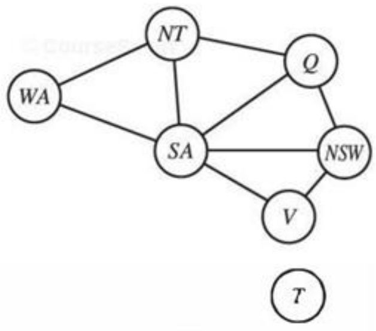

(b)

Hình 3.14 Bản đồ các bang chính của nước Úc. Tô màu bản đồ này có thể xem như bài toán thỏa mãn ràng buộc

Tại sao ta mô hình hoá vấn đề về bài toán CSP? Một trong các lý do là CSP cho ta một cách biểu diễn tự nhiên một lớp rộng các bài toán. Nếu ta có một hệ thống giải CSP, sẽ dễ dàng hơn nhiều nếu giải bài toán dùng hệ thống này hơn là thiết kế một giải pháp riêng dùng kỹ thuật tìm kiếm khác. Thêm vào đó, các bộ giải CSP có thể nhanh hơn các bộ tìm kiếm trong không gian trạng thái. Ví dụ, một khi ta đã chọn {SA = yellow} trong bài toán tô màu bản đồ, ta có thể kết luận rằng năm biến láng giếng của nó sẽ không được nhận giá trị yellow. Nếu không sử dụng ưu điểm của lan truyền ràng buộc, một thuật toán tìm kiếm sẽ phải xét $3^{5} = 243$ phép gán cho 5 biến láng giếng; với lần truyền ràng buộc ta sẽ không cần phải quan tâm đến giá trị vàng nữa, vì thế ta chỉ có $2^{5} = 32$ phép gán để xem xét, giảm 87%.

Trong tìm kiếm trong không gian trạng thái thông thường, chúng ta chỉ có thể hỏi: “trạng thái này có phải là trạng thái đích không?”. Nếu câu trả là lời là không ta lại hỏi tiếp trạng thái khác. Với CSP, một khi ta đã thấy rằng một

<!-- page: 101 -->

phép gán thành phần không phải là lời giải, ta có thể bổ qua các phép gán bổ sung trên phép gán thành phân này. Hon mưa, ta có thể biết được phép gán có phải là lời giải hay không – ta biết được (các) biến nào vi phạm ràng buộc – vì thế ta có thể quan tâm trên những biến có vấn đề. Và kết quả là, nhiều bài toán không giải được đối với tìm kiếm trong không gian trạng thái thông thường có thể giải được dễ dàng và nhanh chóng khi được mô hình hoá về CSP.

## 3.3.3 Lan truyền ràng buộc: suy diễn trong bài toán CSP

Trong tìm kiếm không trong không gian trạng thái, một giải thuật chỉ có thể làm được một việc duy nhất: tìm kiếm. Trong các bài toán thỏa mãn ràng buộc, ta có thể lựa chọn: tìm kiếm (chọn một phép gán mới trong nhiều phép gán có thể) hoặc thực hiện một kiểu suy diễn (inference) gọi là lan truyền ràng buộc (constraint propagation): dùng các ràng buộc để giảm số giá trị hợp lệ cho một biến, các giá trị này đến lược nó lại có thể làm giảm các giá trị hợp lệ cho biến khác, và cứ như thế. Lan truyền ràng buộc có thể sử dụng luận phiên với tìm kiếm, hoặc có thể sử dụng như bước tiền xử lý, trước khi tìm kiếm. Đôi khi phép tiền xử lý này có thể giải luôn được bài toán, và không cần tìm kiếm nửa.

Ý tưởng chính của lan truyền ràng buộc là tính nhất quán cục bộ (local consistency). Nếu ta xử lý mỗi biến như một nút trong đô thị và mỗi ràng buộc nhị phân (ràng buộc trên 2 biến) như một cung thì quá trình ép buộc tính nhất quán cục bộ trong mỗi phần của đô thị có thể tạo ra các giá bất hợp lệ cần phải loại bỏ thông qua đô thị. Có nhiều loại nhất quán cục bộ khác nhau, ta sẽ lần lược xét đến chúng.

## 3.3.3.1 Tính nhất quán nút (node consistency)

Một biến đơn (tương ứng với một nút trong mạng CSP) được gọi là nhất quán nút (node-consistent) nếu tất cả các giá trị trong miền giá trị đều thỏa tất cả các ràng buộc đơn (ràng buộc chỉ phụ thuộc vào biến đang xét) trên biến này. Ví dụ, trong bài toán biến thể của bài toán tô màu bản đồ trong đó những người Ức ở miền nam (South Australians) không thích màu xanh, biến SA bắt đầu với miền giá trị {red, blue, yellow}, ta có thể làm cho biến này trở nên nhất quán nút bằng cách loại bỏ giá trị xanh ra khởi miền giá trị. Như vậy SA có miền giá trị {red, yellow}. Ta nói ràng một mạng là nhất quán nút nếu tất cả các biến trong mạng đều nhất quán nút.

Ta luôn có thể loại bỏ tất cả các ràng buộc đơn biến trong bài toán CSP bằng cách kiểm tra tính nhất quán nút. Ta cũng luôn có thể biến đổi tất cả các ràng buộc đa biến thành các ràng buộc 2 biến. Chính vì điều này, ta thường định nghĩa các bộ giải quyết bài toán thỏa mãn ràng buộc (CSP solvers) chỉ làm việc trên các ràng buộc nhị phân.

<!-- page: 102 -->

## 3.3.3.2 Tính nhất quán cung (arc consistency)

Một biến trong bài toán CSP được gọi là nhất quán cung (arc-consistent) nếu mỗi giá trị trong miền giá trị thỏa mãn tất cả các ràng buộc nhị phân. Hình thức hơn, biến $X_i$ là nhất quán cung với biến$X_j$ nếu với mỗi giá trị trong miền giá trị hiện tại $D_i$ có một giá trị trong miền $D_j$ thỏa mãn ràng buộc nhị phân trên cung $(X_i, X_j)$. Một mạng được gọi là tương thích cung nếu mỗi biến đều tương thích cung với tất cả các biến khác. Ví dụ, xét ràng buộc $Y = X^2$ trong đó cả hai miền giá trị $X$ và $Y$ là các số nguyên từ 0 đến 9. Biểu diễn ràng buộc một cách tường minh như sau:

$$
<   (X, Y), \{(0, 0), (1, 1), (2, 4), (3, 9) \} >
$$

Đề làm cho X nhất quán cung với Y, ta giảm miền giá trị của X thành {0,1,2,3}. Nếu ta làm Y nhất quán cung với X, miền giá trị của Y sẽ là {0,1,4,9} và bài toán CSP sẽ nhất quán cung.

Mặt khác, tính nhất quán cung có thể không ảnh hưởng đến bài toán tô màu bản đồ nước Úc. Xét ràng buộc “khác nhau” (inequality) trên cung (SA, WA):

$$
\left\{ \begin{array}{c} (r e d, b l u e), (r e d, y e l l o w), (b l u e, r e d), (b l u e, y e l l o w), \\ (y e l l o w, r e d), (y e l l o w, b l u e) \end{array} \right\}
$$

Không quan tâm đến việc chọn giá trị nào cho SA (hoặc cho WA), có một giá trị hợp lệ cho biến kia.

Giải thuật phổ biến nhất cho tính nhất quán cung, AC-3 được mô tả trong hình 3.15. Đề làm cho tất cả các biến đều nhất quán cung, giải thuật AC-3 sử dụng một hàng đợi để lưu các cung phải xem xét. Thực tế, thứ tự các cung không quan trọng vì thế ta có thể sử dụng cấu trúc dữ liệu tập hợp để lưu trữ. Khởi tạo, hàng đợi chứa tất cả các cung của bài toán CSP. Sau đó AC-3 chọn một cung ($X_i$, $X_j$) bất kỳ, làm cho $X_i$ nhất quán cung với $X_j$ và loại cung này ra khởi hàng đợi. Nếu $D_i$ không đổi sau bước này, giải thuật xét cung kể tiếp. Nếu $D_i$ thay đổi (số phần tử của $D_i$ giảm), ta thêm tất cả các cung ($X_k$, $X_i$) vào hàng đợi với $X_k$ là các nút kể với $X_i$. Ta làm điều này vì khi $D_i$ giảm, $D_k$ có thể giảm theo, ngay cả khi $X_k$ đã được xét rời. Nếu $D_i$ giảm về rỗng, bài toán CSP không có lời giải, và AC-3 trả về thất bại ngay lập tức. Ngược lại, ta tiếp tục kiểm tra, cổ gắng giảm bớt các giá trị trong miền giá trị của các biến cho đến khi không còn cung nào trong hàng đợi. Lức này, ta sẽ có bài toán CSP tương đương với bài toán ban đầu (cả hai đều có cùng lời giải). Trong hầu hết các trường hợp, tìm kiếm lời giải cho bài toán CSP nhất quán cung sẽ nhanh hơn nhiều so với bài toán ban đầu vì các miền giá trị nhỏ hơn.

<!-- page: 103 -->

```txt
boolAC-3(csp) {
    while (queue chua rõng) {
        (Xi, Xj) = remove-first(queue);
        if (revise(csp, Xi, Xj))
            if (size of Di == 0) return false;
            for each Xk in Xi.neighbors \ {Xj} do
                add (Xk, Xi) to queue;
            return true;
        }
}

bool revise (csp, Xi, Xj) {
    result = false;
    for each x in Di do {
        if (no value y in Dj cho allows (x, y)
            to satisfy the constraint between Xi và Xj)
            delete x from Di;
            result = true;
    }
    return result;
}
```

## Hình 3.15 Giải thuật nhất quán cung AC-3

Độ phức tạp của giải thuật AC-3 có thể phân tích như sau. Giả sử bài toán CSP có n biến, miền giá trị của các biến có kích thước nhiều nhất là d, và có c ràng buộc nhị phân (tương ứng với c cung). Mỗi cung ($X_k$, $X_i$) có thể được xen vào hàng đội nhiều nhất là d lần vì $X_i$ có d giá trị khác nhau. Kiểm tra tính nhất quán của các cung được thực hiện trong $O(d^2)$. Vì thế độ phức tạp thời gian trong trường hợp xấu nhất của giải thuật là $O(cd^3)$.

Ta có thể mở rộng khái niệm nhất quán cung để xử lý các ràng buộc đa biến. Điều này gọi là tính nhất quán cung tổng quát hoá hoặc đôi khi được gọi là tính nhất quán siêu cung (hyperarc consistency). Một biến $X_i$ được gọi là nhất quán cung tổng quát hoá với một ràng buộc đa biến nếu với mọi giá trị $v$ trong miền giá trị của $X_i$ tồn tại một bộ các giá trị thuộc ràng buộc. Tất cả các giá trị này được lấy từ miền giá trị của các biến có trong ràng buộc. Ví dụ, nếu tất cả các biến có miền giá trị $\{0, 1, 2, 3\}$, để làm $X$ nhất quán cung với ràng buộc $X < Y < Z$, ta phải loại bỏ 2 và 3 ra khởi miền giá trị của $X$.

<!-- page: 104 -->

## 3.3.3.3 Tính nhất quán đường đi (path consistency)

Tính nhất quán cung có thể đi theo một đường dài để giảm miền giá trị của các biến, đôi khi tìm thấy lời giải (miền giá trị của các biến chứa đúng 1 phần tử) và đôi khi phát hiện ra bài toán không có lời giải (miền giá trị của một biến nào đó rỗng). Nhung với nhiều mạng CSP, tính nhất quán cung sẽ thất bại trong suy diễn vì không thể suy diễn tiếp nửa được nhưng vẫn chưa tìm được lời giải hay phát hiện bài toán không có lời giải.

Tính nhất quán cung làm giảm miền giá trị (các ràng buộc đơn biến) sử dụng cung (ràng buộc nhị phân). Đề phát triển tiếp trên các bài toán trên bài toán tô màu bản đồ, ta cần các khái niệm mạnh hơn về tính nhất quát. Tính nhất quán đường đi làm giảm các ràng buộc nhị phân bằng cách sử dụng các ràng buộc ẩn (implicit) được suy diễn bằng cách xem xét các bộ ba biến.

Một tập hai biến $\{X_{i}, X_{j}\}$ là nhất quán đường đi với biến thứ ba $X_{m}$ nếu với mỗi phép gán $\{X_{i} = a, X_{j} = b\}$ nhất quán với ràng buộc trên $\{X_{i}, X_{j}\}$ có một phép gán cho $X_{m}$ thỏa mãn các ràng buộc trên $\{X_{i}, X_{j}\}$ và $\{X_{m}, X_{j}\}$. Đây gọi là tính nhất quán đường đi vì ta có thể nghĩ đến việc quan sát đường đi từ $X_{i}$ đến $X_{j}$ thông qua $X_{m}$.

Chúng ta sẽ xem xét tính nhất quán đường đi hoạt động như thế nào thông qua bài toán tô màu bản đồ nước Ức bằng hai màu. Ta sẽ làm cho tập {WA, SA} nhất quán đường đi với NT. Ta bắt đầu bằng cách liệt kê các phép gán hợp lệ cho tập hợp này. Trong trường hợp này, chỉ có hai phép gán: {WA = red, SA = yellow} và {WA = yellow, SA = red}. Ta có thể thấy rằng với cả hai phép gán này NT đều không thể chọn được “đỏ” hoặc “vàng” (vì sẽ dụng độ với WA hoặc SA). Và vì không có lựa chọn hợp lệ nào cho NT, ta loại bỏ cả hai phép gán, và ta kết thúc luôn quá trình diễn vì không còn phép gán hợp lệ nào nửa cho {WA, SA}. Vì thế, ta phát hiện ra rằng bài toán không có lời giải. Giải thuật PC-2 [Mackwork, 1977] đạt được tính nhất quán đường đi tương tự như giải thuật AC-3 cho tính nhất quán cung.

## 3.3.3.4 Nhất quán k (k-consistency)

Các dạng lan truyền ràng buộc mạnh hơn nửa có thể được định nghĩa với khái niệm k-consistency. Một bài toán CSP được gọi là nhất quán k, nếu với mỗi tập $k - 1$ biến và với mỗi phép gán hợp lệ cho các biến này, tồn tại một giá trị hợp lệ để gán cho biến thứ $k$. Nhất quán 1 (1-consistency) nói rằng, với một tập rộng, ta có thể làm bất kỳ bất cứ tập một phần từ nào trở nên nhất quán (đầy chính là nhất quán nút). Nhất quán 2 (2-consistency) chính là nhất quán cung. Với các mạng ràng buộc nhị phân, nhất quán 3 (3-consistency) là nhất quán đường đi.

<!-- page: 105 -->

Một bài toán CSP được gọi là nhất quán $k$ mạnh (strongly k-consistency) nếu nó nhất quán $k$ và cũng nhất quán ($k - 1$), nhất quán ($k - 2$), ... Bây giờ giả sử ta có một bài toán CSP với $n$ nút và làm nó nhất quán $k$ mạnh (nhất quán $k$ mạnh với $k = n$). Ta có thể giải bài toán như sau: trước hết, ta chọn một giá trị hợp lệ cho $X_1$. Sau đó, ta chọn giá trị hợp lệ cho $X_2$, cho $X_3$, ... (ta luôn luôn làm được điều này vì mạng nhất quán 2, nhất quán 3, ...) Với mỗi biến $X_i$, ta chỉ cần tìm trong d giá trị trong miền giá trị để tìm một giá trị nhất quán với $X_1, X_2, ..., X_{i-1}$. Ta luôn tìm được lời giải trong $O(n^2d)$ thời gian. Dĩ nhiên, không có bữa ăn nào miễn phí cả: bất cứ giải thuật làm bài toán nhất quán-n mạnh đều có độ phức tạp thời gian lũy thừa theo n trong trường hợp xấu nhất. Tệ hơn nửa, tính nhất quán $n$ mạnh cần không gian lưu trữ lũy thừa theo $n$. Vấn đề về bộ nhớ nghiệm trọng hơn vấn đề thời gian. Trong thực tế, xác định mức độ kiểm tra tính nhất quán phù hợp hầu như là thực nghiệm. Thường người ta kiểm tra tính nhất quán 2 và ít khi kiểm tra tính nhất quán 3.

## 3.3.3.5 Ràng buộc toàn cục

Cần phải nhớ lại rằng một ràng buộc toàn cục là ràng buộc có số biến bất kỳ (nhưng không cần thiết phải ràng buộc trên tất cả các biến). Các ràng buộc toàn cục thường xảy ra trong các bài toán thực tế và có thể được xử lý bằng các giải thuật chuyên dụng (specific purpose algorithms) hơn là các giải thuật tổng quát (general purpose algorithms). Ví dụ ràng buộc Alldiff nói rằng tất cả các biến phải có giá trị khác nhau (như trong bài toán đại số mật mã chăng hạn). Một dạng đơn giản của việc phát hiện tính không nhất quán cho các ràng buộc dạng Alldiff làm việc như sau: nếu ràng buộc có $m$ biến và nếu chúng có $n$ giá trị khác nhau và $m > n$, thì ràng buộc không thể nào được thỏa mãn.

Điều này dẫn đến giải thuật đơn giản sau: trước hết loại bỏ biến mà miền giá trị chỉ có một phần tử, và xoá giá trị của biến đó ra khởi miền giá trị của các biến còn lại. Lặp lại quá trình này nếu vẫn còn biến có miền giá trị một phần tử. Nếu có một biến nào đó có miền giá trị rỗng hoặc số biến nhiều hơn số giá trị thì ràng buộc này sẽ không được thỏa mãn.

Phương pháp này có thể phát hiện sự không nhất quán trong phép gán $\{WA = red, NSW = red\}$ trong hình 3.14.

Chú ý là các biến SA, NT và Q liên quan với nhau bằng ràng buộc Alldiff vì mỗi cặp phải có hai màu khác nhau. Sau khi áp dụng giải thuật AC-3 bằng các phép gán một phần, miền giá trị của mỗi biến giảm xuống còn {blue, yellow}. Có nghĩa là ta có 3 biến nhưng chi có hai màu, vì vậy ràng buộc Alldiff bị vi phạm. Một thủ tục kiểm tra tính nhất quán đơn giản cho ràng buộc bậc cao đôi khi hiệu quả hơn việc áp dụng tính nhất quán cung cho một

<!-- page: 106 -->

tập các ràng buộc nhị phân tương đương. Còn nhiều giải thuật suy diễn phức tạp hơn để xử lý ràng buộc Alldiff [van Hoeve and Katriel, 2006]. Các giải thuật này lan truyền nhiều ràng buộc hơn nhưng lại có độ phức tạp thời gian cao hơn.

Một ràng buộc bậc cao quan trọng khác là ràng buộc tài nguyên (resource constraint), đôi khi được gọi là ràng buộc tối đa (atmost constraint). Ví dụ, trong bài toán xếp lịch biểu, gọi P₁, ..., P₄ là số người gán cho bốn công việc. Ràng buộc “tổng số người không vượt quá 10” được viết như Atmost(10, P₁, P₂, P₃, P₄). Ta có thể phát triển tính không nhất quán bằng cách kiểm tra tổng của bốn giá trị nhỏ nhất của miền giá trị hiện tại. Ví dụ nếu mỗi biến có miền giá trị là {3, 4, 5, 6}, ràng buộc Atmost không thể thỏa mãn.

Ta cũng có thể gia tăng tính nhất quán bằng cách xoá bỏ các giá trị lớn nhất của một biến nếu nó không nhất quán với các giá trị nhỏ nhất của các biến còn lại. vì thế, nếu các biến của ví dụ có miền giá trị {2, 3, 4, 5, 6}, giá trị 5 và 6 có thể loại bỏ ra khởi miền giá trị của các biến.

Với các bài toán hạn chế tài nguyên lớn với các giá trị nguyên như bài toán vận tải (logistical problems), có đến hàng ngân người và hàng trăm xe. Thông thường ta không thể biểu diễn miền giá trị của các biến bằng một tập hợp lớn các số nguyên và giảm kích thước từ từ bằng phương pháp kiểm tính nhất quán. Thay vì vậy, các miền giá trị được biểu diễn bằng cận trên và cận dưới và được quản lý bằng lan truyền cận (bound propagation). Ví dụ, trong bài toán xếp lịch bay, giả sử có 2 chuyển bay $F_1$ và $F_2$ có sức chứa lần lượt là 185 và 385 người. Miền giá trị khởi tạo cho số hành khách trên mỗi chuyển bay là:

$$
D _ {1} = [ 0, 1 6 5 ] \quad \text {va} \quad D _ {2} = [ 0, 3 8 5 ]
$$

Giả sử ta có thêm ràng buộc bổ sung “cả hai chuyển bay phải chỗ 420 người”: $F_{1} + F_{2} = 420$. Bằng cách lan truyền cận, ta rút gọn miền giá trị thành:

$$
D _ {1} = [ 3 5, 1 6 5 ] \quad \text {va} \quad D _ {2} = [ 2 2 5, 3 8 5 ]
$$

Ta nói ràng bài toán CSP nhất quán cận (bound consistent) nếu với mỗi biến X, và với cận dưới và cận trên của X, có một giá trị nào đó của Y thỏa mãn ràng buộc giữa X và Y với mọi biến Y. Loại lan truyền cận này được sử dụng rộng rãi trong các bài toán CSP thực.

## 3.3.3.6 Bài toán sudoku

Bài toán Sudoku phổ biến mang đến cho hàng triệu người chơi bài toán thỏa mãn ràng buộc, mặc dù có thể họ không nhận ra. Bằng Sudoku gồm 81 ô vuông, một số trong đó được điều bằng các con số từ 1 đến 9. Nhiệm vụ của

<!-- page: 107 -->

người chơi là tìm số điều vào các ô còn lại sao cho không có con số nào xuất hiện 2 lần trên cùng một hàng, trên cùng một cột hay trong cùng một khối 3 × 3 (xem hình 3.16).

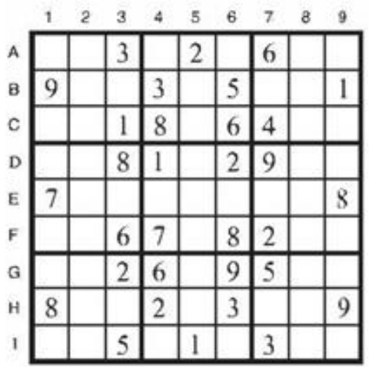

(a)

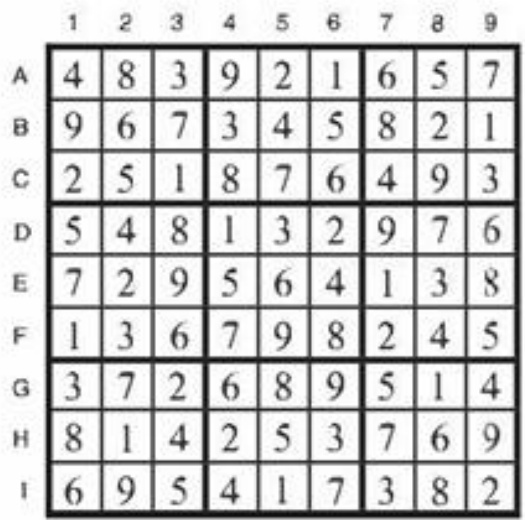

(b)

Hình 3.16 Bài toán Sudoku

Một hàng, một cột hay một khối 3 × 3 được gọi chung là một đơn vị (unit).

Các bài toán Sudoku thường được in trên báo và sách trò chơi và có tính chất đặc biệt là mỗi bài toán chi có một lời giải duy nhất. Mặc dù một bài toán người chơi có khả năng giải thủ công trong vòng vài chục phút, bài toán khó nhất của Sudoku nếu chuyển sang bài toán CSP có thể được giải trong thời gian ít hơn 0.1 giây.

Một bài toán Sudoku có thể xem như bài toán CSP có 81 biến, mỗi biến ứng với một ô vuông. Ta đặt tên cho các biến là A1 đến A9 cho hàng đầu tiên và từ I1 đến I9 cho hàng cuối cùng. Các ô trống có miền giá trị {1, 2, 3, 4, 5, 6, 7, 8, 9} các ô đã được điều trước có miền giá trị chỉ có một giá trị duy nhất. Ngoài ra còn có thêm 27 ràng buộc Alldiff khác nhau cho 9 hàng, 9 cột và 9 khối 3 × 3.

Alldiff(A1, A2, A3, A4, A5, A6, A7, A8, A9)
Alldiff(B1, B2, B3, B4, B5, B6, B7, B8, B9)
...
Alldiff(A1, B1, C1, D1, E1, F1, G1, H1, I1)
Alldiff(A2, B2, C2, D2, E2, F2, G2, H1, I2)
...
Alldiff(A1, A2, A3, B1, B2, B3, C1, C2, C3)
Alldiff(A4, A5, A6, B4, B5, B6, C4, C5, C6)

<!-- page: 108 -->

Giả sử các ràng buộc Alldiff đã được mở rộng thành các ràng buộc nhị phân ví dụ như $A1 \neq A2$. Vì thể ta có thể áp dụng giải thuật AC-3 trực tiếp. Xét biến $E6$ (ô trống giữa 2 và 8 trong khối $3 \times 3$ chính giữa). Dựa vào ràng buộc trong khối này, ta loại bỏ các giá trị 1, 2, 7, 8 ra khởi miền giá trị của $E6$. Và do ràng buộc cột, ta loại bỏ các giá trị 5, 6, 9, 3 ra khởi miền giá trị của $E6$. Như vậy miền giá trị của $E6$ chỉ còn lại {4}. Nói cách khác, câu trả lời là $E6 = 4$.

Tiếp tục xét 16. Áp dụng tính nhất quán cung lên cột của nó, ta loại bỏ 5, 6, 2, 4, 8, 9, 3. Ta loại bỏ 1 bằng tính nhất quán cung với 15. Cuối cùng miền giá trị của 16 chỉ còn lại 1 giá trị là7.

Giờ đây đã có 8 giá trị đã biết trong cột 6, nhờ vào tính nhất quán cung trong cột 6, ta có thể suy ra giá trị cho cột A6 phải là 1. Quá trình suy diễn tiếp tục như. Đôi khi AC-3 có thể tìm ra luôn được lời giải: tất cả các biến đều có miền giá trị có 1 phần tử.

Dĩ nhiên là Sudoku sẽ không còn hay nửa nếu bài toán nào cũng có thể giải được bằng giải thuật AC-3. AC-3 chỉ chạy được trên các bài toán Sudoku dễ. Các bài toán khó hơn có thể giải bằng PC-2, nhưng với một chi phí tính toán lớn hơn: có 225,960 ràng buộc đường đi khác nhau cần phải xem xét trong một bài toán Sudoku. Đề giải các bài toán khó nhất và làm quá trình giải hiệu quả hơn ta cần phải thông minh hơn.

## CÂU HỒI ÔN TẬP VÀ BÀI TẬP

1. Giả sử có hai người bạn sống ở hai thành phố khác nhau trên bản đồ như bản đồ Rumaní. Mỗi lượt đi, ta di chuyển đồng thời mỗi người bạn đến một thành phố lân cận của họ trên bản đồ. Thời gian cần thiết để đi từ thành phố i đến thành phố j (lân cận) bằng với khoảng cách d(i, j) giữa các thành phố, nhưng mỗi lượt đi người đến trước phải chờ cho đến khi người kia đến đích của mình trước khi bắt đầu lượt đi kế tiếp. Ta muốn rằng hai người bạn gặp nhau nhanh nhất có thể.

a. Mô hình hoá bài toán về bài toán tìm kiếm.

b. Gọi D(i, j) là khoảng cách đường chim bay giữa hai thành phố i và j. Hàm heuristic nào sau đây khả chấp?

i. D(i, j)

ii. 2D(i, j)

iii. D(i, j)/2

c. Có bản đồ nào liên thông đầy đủ mà không có lời giải không?

<!-- page: 109 -->

d. Có bản đồ mà tất cả lời giải đều phải yêu cầu một người bạn đến một thành phố hai lần không?

2. Hây chỉ ra rằng các trạng thái của bài toán 8-puzzle được chia ra thành hai tập rời nhau: với hai trạng thái bất kỳ trong cùng tập luôn tồn tại đường đi từ trạng thái này đến trạng thái kia; với hai trạng thái thuộc hai tập khác nhau, sẽ không tồn tại đường đi từ trạng thái này đến trạng thái kia và ngược lại. Gọi ý: xem (Berlerkamp et al., 1982). Thiết kế một thuật toán xác định xem một trạng thái thuộc về tập nào.

3. Xét bài toán n quân hậu sử dụng mô hình 3 trong chương 2. Giải thích tại sao không gian trạng thái có ít nhất $\sqrt[3]{n!}$ trạng thái và ước lượng số n lớn nhất mà phương pháp tìm kiếm vét cạn có thể thực hiện được. Gọi ý: thiết lập một cận dưới trên hệ số phân nhánh bằng cách xem xét số ô lớn nhất mà một quân hậu có thể tấn công trong một cột bất kỳ.

4. Các phát biểu dưới đây đúng hay sai? Giải thích?

a. Tìm kiểm theo chiều sâu luôn triển khai nhiều nút hơn (ít nhất là bằng) tìm kiếm A\* với một hàm heuristic khả chấp.

b. h(n) = 0 là heuristic khả chấp cho bài toán 8-puzzle.

c. Giả sử một quân xe trên bàn cờ vua chỉ có thể di chuyển theo đường thẳng (ngang hoặc dọc) nhưng không thể nhảy qua một quân khác. Khoảng cách Manhattan là một heuristic khả chấp cho bài toán di chuyển quân xe từ ô A đến ô B với số lần di chuyển nhỏ nhất.

5. Chứng minh hoặc cho phản ví dụ với các phát biểu sau:

a. Tím kiểm theo chiều rộng là một trường hợp đặc biệt của tìm kiếm chi phí đồng nhất.

b. Tìm kiểm theo chiều sâu là một trường hợp đặc biệt của tìm kiếm tốt nhất phiên bản treeSearch.

c. Tîm kiểm chi phí đồng nhất là một trường hợp đặt biệt của tìm kiếm A\*.

6. Áp dụng giải thuật A\* tìm đường đi từ Lugo đến Bucharest sử dụng heuristic đường chim bay. Vẽ cây tìm kiểm với g, f và h của mỗi nút.

7. Nghĩ ra một không gian trạng thái mà khi áp dụng giải thuật A\* phiên bản graphSearch sẽ trả về một lời giải không tối ưu với hàm heuristic khả chấp nhưng không nhất quán.

8. Chứng minh ràng nếu một heuristic nhất quán thì khả chấp. Xây dựng một heuristic khả chấp nhưng không nhất quán.

9. Lập trình giải bài toán 8-puzzle với các heuristic: khoảng cách Manhattan và số ô sai vị trí. Có thể tìm thêm các heuristic khác trong (Nilson, 1971),

<!-- page: 110 -->

(Mostow and Prieditis, 1989) và (Hanson et al., 1992). So sánh hiệu quả của các heuristic.

10. Lập trình giải bài toán 8 quân hậu bằng giải thuật leo đổi.

11. Xét bài toán đặt k quân mã lên bàn cờ nxn ô sao cho không quân nào không chế quân nào.,  $k < n^{2}$ .

a. Mô hình hoá bài toán về dạng CSP.

b. Xác định miền giá trị của các biến.

c. Xác định các ràng buộc.

## TÀI LIỆU THAM KHẢO

[1] Mackworth, A. K. (1977). Consistency in networks of relations. Artificial Intelligence Journal, 8(1), 99–118.

[2] Luby, M., Sinclair, A., and Zuckerman, D. (1993). Optimal speedup of Las Vegas algorithms. Information Processing Letters, 47, 173–180.

[3] Prieditis, A. E. (1993). Machine discovery of effective admissible heuristics. Machine Learning, 12(1–3), 117–141.

[4] Russell, S. and Norvig, P. (2009). Artificial Intelligence: A Modern Approach, (third edition), Prentice Hall.

[5] Van Hoeve, W.-J. and Katriel, I. (2006). Global constraints. In Rossi, F., van Beek, P., and Walsh, T. (Eds.), Handbook of Constraint Processing, pp. 169–208. Elsevier.

[6] Yang, F., Culberson, J., Holte, R., Zahavi, U., and Felner, A. (2008). A general theory of additive state space abstractions. Journal of Artificial Intelligence Research, 32, 631–662.

<!-- page: 111 -->

# Chương 4 CÁC VẤN ĐỀ BIỂU DIỄN TRI THỨC

Tri thức giữ vai trò quan trọng trong các chương trình trí tuệ nhân tạo. Tri thức được sử dụng trong biểu diễn bài toán, trong tìm kiếm lời giải của bài toán. Con người sử dụng ngôn ngữ để biểu diễn tri thức và trao đổi tri thức, họ suy nghĩ, lập luận dựa trên ngôn ngữ. Cần nhân mạnh lên vai trò của lập luận: lập luận là quá trình thao tác tri thức, vận dụng tri thức, không có lập luận tri thức chỉ là “tri thức chết”. Tri thức có thể được phân thành hai lớp: tri thức sự kiện và tri thức suy diễn. Tri thức sự kiện mô tả các sự kiện xảy ra trong thể giới. Tri thức suy diễn mô tả các “quy luật” của thế giới, tri thức này thể hiện mối quan hệ giữa các sự kiện, thông thường là mối quan hệ nhân-quả. Mục tiêu của biểu diễn tri thức là làm sao cho máy tính có thể thao tác trên các tri thức được biểu diễn đó đề tìm kiếm lời giải cho bài toán. Tiếp theo chương 2 và chương 3 trình bày về phương pháp giải quyết vấn đề bằng tìm kiếm, chương này sẽ thảo luận về các phương pháp biểu diễn tri thức bao gồm cả các phương pháp biểu diễn vấn đề bằng trạng thái ở chương 2.

## 4.1 BIÊU DIÊN VÀ ÁNH XẠ

Đề giải quyết các bài toán của trí tuệ nhân tạo, cần một lượng tri thức và các cơ chế thao tác các tri thức này nhằm tạo ra lời giải cho bài toán mới. Nhiều cách biểu diễn tri thức được khai thác trong các chương trình trí tuệ nhân tạo. Hai kiểu thực thể phải xử lý:

\- Các sự kiện: các sự thật trong thế giới nào đó – Những cái muốn được biểu diễn

\- Biểu diễn các sự kiện dưới hình thức nào đó – Những cái có thể thao tác

\- Các thực thể này được cấu trúc thành hai mức:

\- Mức tri thức, ở đó các sự kiện được mô tả

\- Mức biểu tượng, ở đó các biểu diễn của các đối tượng ở mức tri thức được định nghĩa dưới thuật ngữ biểu tượng mà các chương trình có thể thao tác.

Biểu diễn tri thức nhằm thiết lập sự tương ứng hai chiều giữa các thực thể ở mức tri thức và các thực thể ở mức biểu tượng. Sự tương ứng các thực thể sự kiện với các thực thể biểu tượng xác định ánh xạ “xuôi”. Tương ứng các thực thể biểu tượng với các thực thể sự kiện xác định ánh xạ ngược. Sự kiện được thu lươn bởi con người và được biểu diễn trong ngôn ngữ (tự nhiên) mà họ sử dụng. Do vậy, thực chất của biểu diễn tri thức là xác lập ánh xạ hai chiều

<!-- page: 112 -->

giữa tập các biểu diễn tri thức trong ngôn ngữ và tập các thực thể biểu tượng thường được gọi là biểu diễn trong.

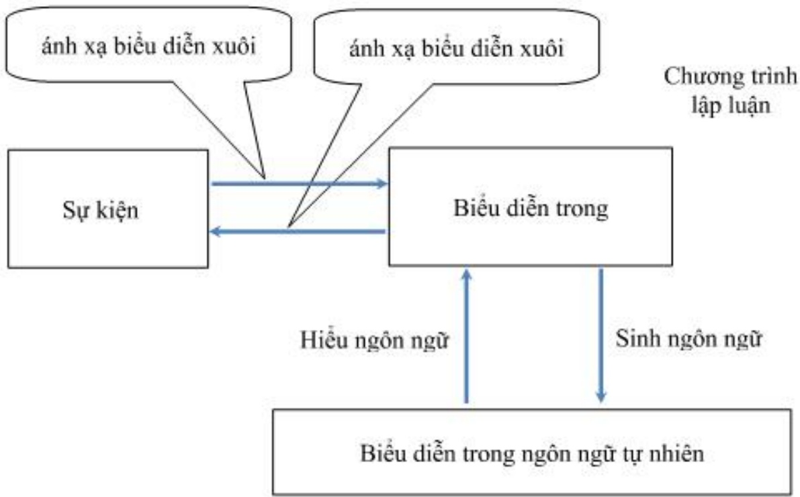

Hình 4.1 Các phép ánh xạ giữa các sự kiện và các biểu diễn

Xét ví dụ: ta có các sự kiện được biểu diễn trong ngôn ngữ tiếng Việt:

• Hồ-Ly-Tinh là một con cáo.

\- Mọi con cáo đều có một cái đuôi.

Ta có thể sử dụng logic vị từ để biểu diễn các sự kiện trên như sau:

Trước tiên ta định nghĩa các vị từ cần thiết:

\- cáo(X) = "X là một con cáo."

• có-đuôi(X) = "X có một cái đuôi."

Biểu diễn các sự kiện:

\- Sự kiện “Hồ-Ly-Tinh là một con cáo” bảy giờ được biểu diễn bởi:

$$
\text {cáo(Hồ - Ly - Tinh)}.
$$

\- Mợi con cáo đều có đuôi được biểu diễn bởi:

$$
\forall \mathrm{X}: \text {cáo} (\mathrm{X}) \rightarrow \text {có - duói} (\mathrm{X}).
$$

Sử dụng cơ chế suy diễn logic, sinh ra biểu diễn mới:

$$
\text {có - duôi(Hồ - Ly - Tinh).}
$$

<!-- page: 113 -->

Sử dụng ánh xạ ngược, sinh ra câu “Hồ-Ly-Tinh có một cái đuôi.”

Chú ý rằng các ánh xạ biểu diễn thường không là một-một. Thực tế cho thấy mối quan hệ tương ứng giữa tập các thực thể sự kiện và tập các thực thể biểu tượng là mối quan hệ nhiều-nhiều: một thực thể sự kiện có thể tương ứng với nhiều thực thể biểu tượng và một thực thể biểu tượng có thể tương ứng với nhiều thực thể sự kiện.

Xét ví dụ: hai câu “mỗi con cáo đều có một cái đuôi”, “mọi con cáo đều có một cái đuôi”, “mọi con cáo đều có đuôi” là các câu khác nhau nhưng cùng có thể được biểu diễn bởi:

$$
\forall X: \text {cáo} (X) \rightarrow \text {có - duói} (X).
$$

Ngược lại vị từ có-đuôi(Hồ-Ly-Tinh) có thể được “dịch” là “Hồ-Ly-Tinh có một cái đuôi” hoặc “Hồ-Ly-Tinh có ít nhất một cái đuôi” hoặc “Hồ-Ly-Tinh có đuôi”. Như vậy khi thiết lập ánh xạ, trước tiên phải quyết định các câu biểu diễn các sự kiện và chuyển đổi các sự kiện đó thành biểu diễn mới.

Một biểu diễn tốt hỗ trợ mạnh cho hoạt động lập luận. Xét ví dụ “bài toán bàn cờ cắt góc” như sau: Xét bàn cờ vua, bị cắt bỏ hai ô góc đối diện. Nhiệm vụ là phù kín bàn cờ bởi các quân domino. Mỗi quân domino có thể phủ được hai ô bàn cờ. Yêu cầu là các quân domino không được gói đầu lên nhau, không được lời ra khởi bàn cờ.

Xét ba biểu diễn của bàn cờ cắt góc:

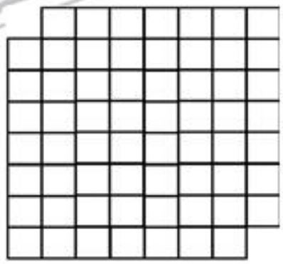

Biểu diễn 1

Biểu diễn 1 không gọi ý trực tiếp lời giải của bài toán, trong biểu diễn này đánh mất thông tin về màu của ô

<!-- page: 114 -->

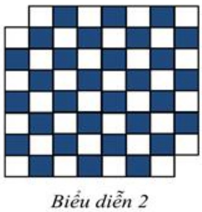

Biểu diễn 2 tăng cường thêm thông tin về màu của ô. Luật phủ cho thấy để phù kín bàn cờ, một quân domino phải phù đúng một ô trắng và một ô đen. Như vậy, biểu diễn 3 “gọi ý” trực tiếp lời giải của bài toán

$$
\begin{array}{l} \text {Số ô trắng = 32} \\ \text {Số ô đen = 30} \end{array}
$$

Một biểu diễn “tốt” sẽ cải thiện đáng kể hiệu quả giải quyết bài toán.

Hình 4.2 diễn giải quy trình xây dựng một chương trình trí tuệ nhân tạo.

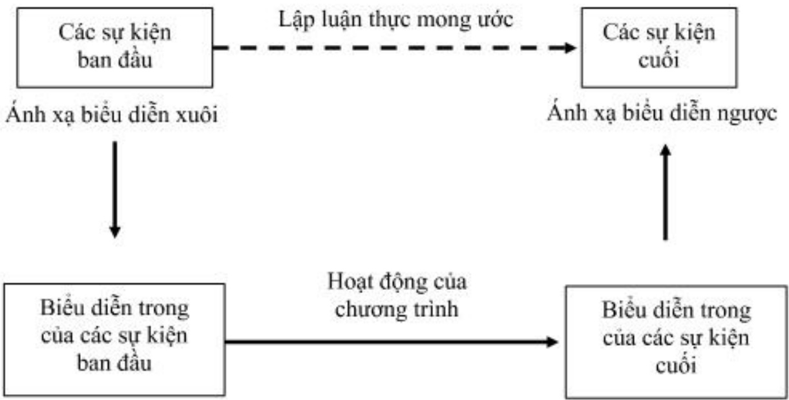

Hình 4.2 Quy trình xây dựng một chương trình trí tuệ nhân tạo

\- Sử dụng ánh xạ biểu diễn xuôi, biểu diễn các sự kiện của lĩnh vực cần giải quyết (các sự kiện ban đầu/các sự kiện giả thiết/tiền đề) sang dạng biểu diễn trong (dạng mà chương trình lập luận có thể thao tác).

\- Xây dựng chương trình lập luận trên các sự kiện ở dạng biểu diễn trong đề sinh ra các sư kiện cuối (mong ước) ở dạng biểu diễn trong.

<!-- page: 115 -->

\- Sử dụng biểu diễn ngược, biểu diễn các sự kiện kết quả ở dạng biểu diễn trong sang dạng đối tượng sử dụng (con người/ hệ thống) có thể "hiểu được".

## 4.2 CÁC PHƯƠNG PHÁP TIẾP CẬN BIỀU DIỂN TRI THỨC

Một hệ thống tốt cho biểu diễn tri thức trong một lĩnh vực cụ thể có bốn tính chất sau:

1. Tính thích hợp biểu diễn – khả năng biểu diễn tất cả các kiểu tri thức cần thiết trong lĩnh vực

2. Tính thích hợp suy diễn – Khả năng thao tác các cấu trúc biểu diễn theo cách sao cho dẫn xuất các cấu trúc mới tương ứng với tri thức mới được suy diễn từ tri thức cũ

3. Tính hiệu quả suy diễn – khả năng kết hợp vào cấu trúc tri thức thông tin bổ xung, thông tin này có thể được dùng để định hướng cơ chế suy diễn theo hướng hứa hạn nhất

4. Tính hiệu quả thu nhận – khả năng thu nhận dễ dàng thông tin mới. Trường hợp đơn giản nhất là xen thức mới vào cơ sở tri thức tri trực tiếp bởi con người. Lý tưởng là chương trình tự nó có khả năng điều khiển việc thu nhận tri thức.

Thiếu may mặn là đến nay vẫn chưa tìm thấy một hệ thống nào tối ưu hoá tất cả các khả năng đối với tất cả các kiểu tri thức. Nhiều kỹ thuật cho biểu diễn tri thức đã được đề nghị. Trong các chương sau, các kỹ thuật quan trọng nhất được mô tả chi tiết. Trong phần này, chỉ trình bày các ý tưởng quan trọng.

## 4.2.1 Tri thức quan hệ

Cách đơn giản nhất để biểu diễn các sự kiện là biểu diễn như tập các quan hệ được sử dụng trong các hệ cơ sở dữ liệu. Ví dụ:

<table><tr><td colspan="2">Ho_ten</td><td>Nu</td><td>Ng_sinh</td><td>M_nganh</td><td>B_nam</td><td>Lop</td></tr><tr><td>Mai Phạm Hoàng</td><td>Khang</td><td>0</td><td>11-04-87</td><td>56</td><td>2005</td><td>DI0556A4</td></tr><tr><td>Trương Văn</td><td>Khoa</td><td>0</td><td>30-08-88</td><td>58</td><td>2006</td><td>DI0658B1</td></tr><tr><td>Nguyễn Hoàng</td><td>Sang</td><td>0</td><td>05-04-87</td><td>56</td><td>2006</td><td>DI0656A3</td></tr><tr><td>Lê Ngọc</td><td>Thảo</td><td>1</td><td>01-02-88</td><td>96</td><td>2007</td><td>DI0796A1</td></tr><tr><td>Nguyễn Mai</td><td>Khanh</td><td>1</td><td>02-01-90</td><td>96</td><td>2008</td><td>DI0896A3</td></tr><tr><td>Trần Hiếu</td><td>Nghĩa</td><td>0</td><td>05-11-92</td><td>48</td><td>2010</td><td>DI1048A1</td></tr></table>

Mỗi một mẫu tin biểu diễn một đối tượng (sinh viên) gồm các thuộc tính Ho\_ten, Nu, Ng\_sinh, M\_nganh, B\_nam, Lop.

<!-- page: 116 -->

Biểu diễn này, nếu đúng riêng lẻ, cung cấp khả năng suy diễn suy diễn rất yếu. Tri thức được biểu diễn dưới dạng này được dùng như dữ liệu đầu vào cho các động cơ suy diễn mạnh hơn. Trong ví dụ, không thể trả lời cho câu hỏi “sinh viên nào lớn tuổi nhất?”. Đề trả lời cho câu hỏi đó, một thủ tục tìm kiếm người có Ng\_sinh nhỏ nhất phải được cung cấp. Nhiều hệ cơ sở dữ liệu đã được thiết kể, cung cấp sự hỗ trợ khả năng suy diễn.

## 4.2.2 Tri thức có thể kế thừa

Trong biểu diễn tri thức quan hệ, một tập các thuộc tính và các giá trị kết hợp mô tả các đối tượng của một cơ sở tri thức. Có thể tăng cường cho biểu diễn cơ sở này một cơ chế suy diễn mà nó hoạt động trên cấu trúc của biểu diễn. Đề hiệu quả, cấu trúc phải được thiết kế tương ứng với cơ chế suy diễn mong muốn. Một trong các dạng suy diễn thường dùng nhất là kế thừa tính chất – các phần tử của một lớp đặc biệt kế thừa các thuộc tính và giá trị của các lớp tổng quát hơn, bao hàm lớp đặc biệt này.

Đề hỗ trợ kế thừa tính chất, các đối tượng phải được tổ chức thành các lớp và các lớp phải được sắp xếp theo một phân cấp khái quát hoá. Một ví dụ về phương pháp biểu diễn này được minh hoạ trong hình 4.3.

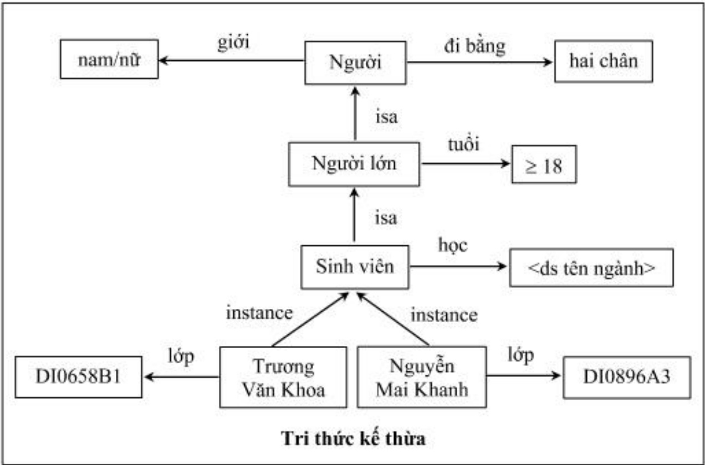

Hình 4.3 Quy trình xây dựng một chương trình trí tuệ nhân tạo

Trong cách biểu diễn này, các lớp/đối tượng được biểu diễn như các nút (chữ nhật), các quan hệ giữa các đối tượng được biểu diễn bởi các cung được gán nhân bởi “tên” quan hệ. Một số quan hệ mang tính chất là thuốc tính của

<!-- page: 117 -->

đối tượng. Có hai quan hệ đáng quan tâm là qua hệ instance và quan hệ isa. Quan hệ instance chỉ ra mối quan hệ thành viên. Quan hệ isa chỉ ra mối quan hệ bao hàm. Trong ví dụ “Trương Văn Khoa là thành viên của Sinh viên”, “Sinh viên là tập con của tập người lớn”. Cấu trúc biểu diễn trên có tên gọi là slot-and-filler/ mạng ngữ nghĩa/bộ khung. Ưu điểm của cấu trúc biểu diễn là hỗ trợ cho kế thừa tính chất. Đối tượng Trương Văn Khoa sẽ kế thừa tính chất học của Sinh viễnthông qua quan hệ instance, thông qua các quan hệ isa, kể thừa tính chất tuổi của Người lớn, tính chất đi và giới tính của Người. Chú ý rằng, kể thừa tính chất có thể được thực hiện bằng cách “chạy theo” các cung quan hệ instance và isa. Các giá trị của các thuộc tính bảy giờ trở thành các ràng buộc về giá trị thuộc tính đó của các đối tượng kế thừa. Ví dụ Trương Văn Khoa kể thừa thuộc tính tuổi và giá trị của thuộc tính tuổi của Trương Văn Khoa bị ràng buộc bởi ≥ 18, kể thừa tính chất giới tính và giá trị của thuộc tính giới tính bị ràng buộc trong tập hai giá trị nam/nữ.

## 4.2.3 Tri thức suy diễn

Kế thừa tính chất là một dạng suy diễn mạnh. Tuy nhiên nó không phải là dạng hữu dụng duy nhất. Các tri thức ở dạng &lt;các sự kiện&gt; suy ra &lt;các sự kiện&gt; (mô tả các quy luật của thế giới lĩnh vực và được gọi là tri thức suy diễn) là cần thiết cho suy diễn. Tuy nhiên các tri thức này sẽ là vô dụng nếu thiếu thủ tục suy diễn, thủ tục này sử dụng các luật suy diễn logic chuẩn để khai thác các tri thức suy diễn (các luật suy diễn như: cộng, rút gọn, modus ponens, modus tollens, tam đoạn luận giả định, tam đoạn luận tuyển, ...).

Có nhiều thủ tục suy diễn. Một số thủ tục tiến hành quá trình suy diễn bắt đầu từ các sự kiện tiền đề để đi đến kết luận – suy diễn tiến. Một số thủ tục tiến hành quá trình suy diễn bắt đầu từ kết luận mong muốn, tìm các sự kiện tiền đề chứng minh cho sự “ đúng đắn” của kết luận đó – suy diễn lùi.

Ví dụ
Các tri thức sự kiện

1. P

2. T
Các tri thức suy diễn

1. $(\mathrm{P}\wedge \mathrm{Q})\rightarrow \mathrm{R}$

2. $\mathrm{S}\rightarrow \mathrm{Q}$

3. T → S.
Điều phải chứng minh là R

<!-- page: 118 -->

Suy diễn tiến (xuất phát từ các tiền đề/giả thiết):

1. S (modus ponens của 2 & 5)

2. Q (modus ponens của 6 & 4)

3. P∧Q (1&7)

4. R (modus ponens của 8 & 3)

Suy diễn lùi (đi từ kết luận, tìm “chứng cứ”)

Đề chứng minh R, ta cần chứng minh P và Q (quy tắc 3). P được chứng minh (giả thiết 1), vậy còn lại là phải chứng minh Q. Đề chứng minh Q, ta chứng minh S (quy tắc 4), Đề chứng minh S ta chứng minh T (quy tắc 5), T được chứng minh (giả thiết 2). Quá trình lập luận này có thể được biểu diễn như trong hình 4.4.

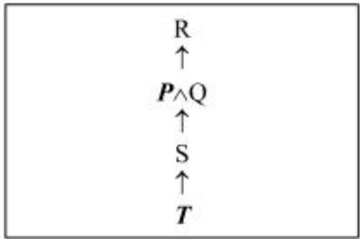

Hình 4.4 Chứng minh R bằng suy diễn lùi

Suy diễn lùi được PROLOG lấy làm chiến lược suy diễn.

## 4.2.4 Tri thức thủ tục

Tri thức thủ tục xác định cái gì phải làm khi các sự kiện làm thỏa mãn điều kiện nào đó. Tri thức thủ tục còn được gọi là tri thức hoạt động/ tri thức toán tử.

Ví dụ:

Nếu Có nhu cầu sử dụng xe hơi và có đủ tiền và có nơi bán xe hơi

Thì Mua một chiếc xe hơi

Kỹ thuật thông dụng nhất để biểu diễn tri thức thủ tục là sử dụng các luật sinh/quy tắc sản xuất (production rules). Các luật sinh có thể được tăng cường thông tin về làm thế nào để sử dụng nó và thường được viết dưới dạng:

$$
\langle \text {diều kiện} \rangle \rightarrow \langle \text {hành động} \rangle
$$

<!-- page: 119 -->

Ví dụ:

Nếu Có nhu cầu về nhà ở và có đủ tiền và có nơi bán nhà

Thì Mua một cái nhà

Giả dụ, nhu cầu về nhà ở bức thiết hơn nhu cầu có xe hơi. Khi đó, ta có thể gán cho luật sinh này một “độ ưu tiên” cao hơn “độ ưu tiên” của luật sinh về mua xe hơi. Thông tin này định hướng sử dụng luật nào khi có nhiều luật cùng có thể được áp dụng.

Phân biệt giữa tri thức thủ tục và tri thức suy diễn rất khó. Ô mức trực giác, sự tách biệt này có thể tạo ra một vài ý nghĩa, nhưng ở mức hình thức, sự tách biệt này không còn nửa. Kết quả của hoạt động “mua một chiếc xe hơi” là sự kiện “có một chiếc xe hơi”. Như vậy tri thức thủ tục

Nếu Có nhu cầu sử dụng xe hơi và có đủ tiền và có nơi bán xe hơi

Thì Mua một chiếc xe hơi

Trong nhiều trường hợp có thể thay bằng tri thức suy diễn

Nếu Có nhu cầu sử dụng xe hơi và có đủ tiền và có nơi bán xe hơi

Thì Có một chiếc xe hơi

Tuy nhiên khi kết quả của hoạt động là không “xác định trước được” thì tri thức thủ tục biểu diễn “tổng quát” hơn trị thức suy diễn.

## 4.3 CÁC VÁN ĐỀ TRONG BIỆU DIỄN TRI THỨC

Một số vấn đề cần được thảo luận trước khi thảo luận về các cơ chế xác định được dùng để biểu diễn tri thức thế giới thực:

1. Thuộc tính cơ sở - thuộc tính xuất hiện trong hầu hết mọi lĩnh vực bài toán. Có thuộc tính nào của đối tượng là cơ sở? Nếu có chúng là gì? Nếu tồn tại các thuộc tính cơ sở, ta cần quản lý chúng một cách thích hợp theo mỗi một trong các cơ chế được đề xuất.

2. Có những mối quan hệ quan trọng giữa các thuộc tính?

3. Tri thức được biểu diễn ở mức nào? Có một tập các “tri thức nguyên thuỷ” mà mọi tri thức có thể “biểu diễn” thông qua chúng? Sử dụng tri thức nguyên thuỷ có lợi không?

4. Tập các đối tượng được biểu diễn như thế nào?

5. Một lượng lớn tri thức được lưu trong cơ sở dữ liệu, Các phần cần thiết được truy xuất như thế nào khi chúng cần đến?

<!-- page: 120 -->

## 4.3.1 Các thuộc tính quan trọng

Có hai thuộc tính quan trọng rất phổ biến là instance và isa (chú ý rằng tên của thuộc tính có thể thay đổi và không quan trọng). Các thuộc tính này quan trọng vì chúng hỗ trợ kế thừa tính chất. Thuộc tính instance chỉ ra mối quan hệ “đối tượng là phần tử của lớp”. Thuộc tính isa chỉ ra mối quan hệ “lớp con của lớp”.

## 4.3.2 Môi quan hệ giữa các thuộc tính

Các thuộc tính được sử dụng đề mô tả đối tượng, chính bản thân chúng là các thực thể được biểu diễn. Các thuộc tính này có các tính chất độc lập với tri thức được mã hoá? Bốn tính chất cần được nêu lên:

1. Nghịch đảo

2. Tồn tại trong phân cấp isa

3. Các kỹ thuật lập luận về giá trị

4. Các thuộc tính đơn trị.

## Nghịch đảo

Các thực thể liên hệ với các thực thể khác theo nhiều cách khác nhau. Khi chúng ta biểu diễn các mối quan hệ này như thuộc tính, ta chú trọng vào một đối tượng và tìm kiếm quan hệ nhị phân giữa nó và các đối tượng khác. Trong biểu diễn mạng ngữ nghĩa/slot-and-filler, các thuộc tính này được biểu diễn bởi một cung đi từ đối tượng được chú trọng đến đối tượng quan hệ. Ví dụ, đối tượng tên An có giá trị thuộc tính tuổi là 20 được biểu diễn:

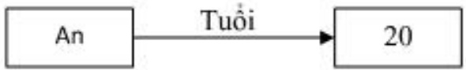

Tuy nhiên, có những mối quan hệ giữa các đối tượng mang tính đối xứng, ví dụ quan hệ anh\_em. Nếu ta biểu diễn quan hệ An là anh em với Bình bởi

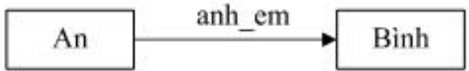

Biểu diễn “thiên vị” này sẽ làm mất đi một phần thông tin của mối quan hệ vì ta cũng có:

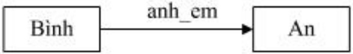

<!-- page: 121 -->

Trong nhiều trường hợp, biểu diễn các góc nhìn khác nhau của quan hệ là quan trọng. Có hai cách để làm điều này:

Thứ nhất: biểu diễn cả hai mối quan hệ trong một biểu diễn, không chú trọng đối tượng nào. Ví dụ: “Mai Phạm Hoàng Khang thuộc lớp DI0556A1” có thể được biểu diễn bởi lop(Mai Phạm Hoàng Khang, DI0556A1).

Khi quan hệ có tính đối xứng, một khai báo sự kiện, ví dụ anh\_em(An, Bình), không thể suy ra sự kiện anh\_em(Bình, An). Trong trường hợp đó hoặc là phải khai báo cả hai anh\_em(An, Bình) và anh\_em(Bình, An) hoặc phải có trong tập luật, quy tắc ∀X∀Y: anh\_em(X, Y) → anh\_em(Y, X).

Thứ hai: biểu diễn bởi một cặp thuộc tính, một là nghịch đảo của cái kia. Ví dụ:

Tên\_lóp = DI0556A1

Thành viên = Mai Phạm Hoàng Khang

Các hệ thống mạng ngữ nghĩa/khung sử dụng phương pháp biểu diễn này. Khi phương pháp này được dùng, thường đi kèm với một công cụ thu lươm tri thức. Công cụ này đảm bảo tính nhất quán của các slots nghịch đảo bằng cách ép buộc chúng phải được khai báo và kiểm tra mỗi khi một giá trị được thêm vào một trong hai thuộc tính nghịch đảo nhau.

## Phân cấp isa các thuộc tính

Có các lớp đối tượng và các lớp con đặc biệt hoá của các lớp này, có các thuộc tính và các đặc biệt hoá của các thuộc tính. Các mối quan hệ tổng quát hoá – đặc biệt hoá là quan trọng đối với các thuộc tính cũng như đối với lập luận. Chứng hỗ trợ kế thừa tính chất. Đối với các thuộc tính, nó hỗ trợ thông tin kế thừa: ràng buộc trên giá trị, cơ chế tính toán trên các giá trị này.

## Các kỹ thuật lập luận về giá trị

Một số giá trị của thuộc tính được xác định tường minh khi cơ sở tri thức được tạo ra. Thông thường hệ thống lập luận phải lập luận về những giá trị không được cho tường minh. Một số kiểu thông tin có vai trò quan trọng trong lập luận:

• Thông tin về kiểu của giá trị

\- Các ràng buộc trên giá trị

\- Các quy tắc tính toán giá trị. Các quy tắc này được gọi là các quy tắc lui/if-needed

\- Các quy tắc mô tả các hành động sẽ được tiến hành nếu giá trị được biết. Các quy tắc này được gọi là các quy tắc tiến/if-added.

<!-- page: 122 -->

## Các thuộc tính đơn trị

Có các thuộc tính, giá trị của nó là duy nhất. Nếu thuộc tính có tính chất như vậy đã có giá trị, bảy giờ một giá trị khác được xác nhận, hai tình huống có thể là: hoặc có sự thay đổi trong thế giới bài toán hoặc có màu thuẫn trong cơ sở tri thức. Đề xử lý tình huống này, một số hệ biểu diễn tri thức sử dụng các phương pháp sau:

\- Đưa vào một chú giải về khoảng thời gian. Nếu hai giá trị cùng được xác nhận trong cùng khoảng thời gian, báo hiệu một màu thuẫn.

\- Nếu khoảng thời gian là tức thời, giá trị mới thay thế giá trị cũ

\- Không cung cấp một hỗ trợ tường minh nào

## 4.3.3 Lựa chọn mức chi tiết của biểu diễn

Câu hỏi được đặt ra khi biểu diễn tri thức là “Thế giới lĩnh vực được biểu diễn sẽ chi tiết đến mức nào?” / “Các tri thức nguyên thuỷ là gì?”. Tri thức nguyên thuỷ được hiểu là các tri thức mà tất cả các tri thức trong lĩnh vực có thể dẫn xuất ra từ chúng. Tập các tri thức nguyên thuỷ phản ánh mức chi tiết của biểu diễn.

Ví dụ: Xét cơ sở tri thức

1. An là anh của Bình.

2. Bình là cha của Khánh.

3. Khánh là em của Hoà.

4. Kiên là con của An.

5. Anh của cha là bác.

6. Em của cha là chú.

Sử dụng logic vị từ bậc nhất, ta định nghĩa các vị từ

\-  $\text{anh}(X, Y) = “X là anh của Y”$

\- em(X, Y) = "X là em của Y"

\- cha(X, Y) = "X là cha của Y"

\- con(X, Y) = "X là con của Y"

\- bác(X, Y) = "X là bác của Y"

\- chú(X, Y) = "X là chú của Y"

<!-- page: 123 -->

Biểu diễn 1:

Xét tập các tri thức nguyên thuy:

\-  $\text{anh}(X, Y) = “X là anh của Y”$

\- em(X, Y) = "X là em của Y"

\- cha(X, Y) = "X là cha của Y"

\- con(X, Y) = "X là con của Y"

Các tri thức trong cơ sở tri thức bảy giờ có thể biểu diễn thông qua các tri thức nguyên thuỷ này:

\- anh(An, Binh).

\- cha(Bình, Khánh).

\- em(Khánh, Hoà).

\- con(Kiên, An).

\- $\forall X \forall Y \forall Z: \text{anh}(X, Y) \land \text{cha}(Y, Z) \rightarrow \text{bác}(X, Z)$

\- $\forall X \forall Y \forall Z: \mathrm{em}(X, Y) \land \mathrm{cha}(Y, Z) \rightarrow \mathrm{chú}(X, Z)$

Biểu diễn 2:

Nếu tập các nguyên thuỷ là

\- $\mathrm{anh}(\mathrm{X},\mathrm{Y}) =$ "X là anh của Y"

\- cha(X, Y) = "X là cha của Y"

khi đó cơ sở tri thức có thể được biểu diễn :

\- anh(An, Binh)

\- cha(Bình, Khánh)

\- anh(Hoà, Khánh)

\- cha(An, Kiên)

\- $\forall X \forall Y: \text{anh}(X, Y) \to \text{em}(Y, X)$

\- $\forall X \forall Y: \mathrm{cha}(X, Y) \to \mathrm{con}(Y, X)$

\- $\forall X \forall Y \forall Z: \text{anh}(X, Y) \land \text{cha}(Y, Z) \rightarrow \text{bác}(X, Z)$

\- $\forall X \forall Y \forall Z: \text{anh}(X, Y) \land \text{cha}(Y, Z) \rightarrow \text{chú}(X, Z)$

<!-- page: 124 -->

Biểu diễn 1 sử dụng bốn nguyên thuỷ. Biểu diễn 2 chỉ sử dụng hai nguyên thuỷ. Biểu diễn 1 bao hàm biểu diễn 2, biểu diễn 1 chỉ tiết hơn biểu diễn 2. Tuy nhiên, để trả lời cho câu hỏi “Khánh là em của Hoà?”, trong biểu diễn thứ nhất, câu trả lời là trực tiếp, trong biểu diễn thứ hai, phải thông qua một quá trình suy luận : anh(Hoà, Khánh) ⇒ em(Khánh, Hoà).

Không phải mọi lĩnh vực đều có thể xác định được tập các tri thức nguyên thuỷ. Nếu có thể xác định các tri thức nguyên thuỷ cho lĩnh vực, việc lựa chọn bộ tri thức thức nguyên thuỷ ở mức chi tiết hợp lý sẽ hỗ trợ rất lớn cho quá trình lập luận, suy diễn.

Ưu điểm của biểu diễn thông qua tri thức nguyên thuy thứ nhất là tiết kiệm lưu trữ vì các tri thức “có thể được suy ra” không cần thiết được lưu trữ, thứ hai là các tri thức suy diễn/tri thức thủ tục được viết dưới dạng chỉ bao gồm các nguyên thuy.

Khi biểu diễn tri thức, có những tri thức đối với con người là “hiền nhiên” nhưng phải được biểu diễn.

Ví dụ: xét cơ sở tri thức

1. Hoàng là một người đàn ông

2. Mọi người đều phải chết

Sử dụng logic vị từ với các vị từ cơ sở

\- man(X) = "X là một người đàn ông"

\- person(X) = "X là một con người"

\- mortal(X) = "X phải chết"

cơ sở tri thức được biểu diễn là:

\- man(Hoàng)

\- $\forall X: person(X) \to mortal(X)$

Câu hỏi đặt ra “Hoàng phải chết?”. Với biểu diễn trên không có câu trả lời. Đề có thể trả lời cho câu hỏi trên, tri thức hiển nhiên “một người đàn ông là một con người” phải được biểu diễn:

$\forall X : \text{man}(X) \rightarrow \text{person}(X).$

## 4.3.4 Biểu diễn tập các đối tượng

Biểu diễn tập các đối tượng là cần thiết do

<!-- page: 125 -->

\- Có một số tính chất chỉ đúng đối với tập hợp nhưng không đúng với thành viên cá nhân. Ví dụ “Các người nói tiếng Anh có thể được tìm thấy chấp nơi trên thế giới” là đúng nhưng “không một người nói tiếng Anh nào có thể được tìm thấy chấp nơi trên thế giới”.

\- Có một tính chất là đúng với tất cả/hầu như tất cả mọi thành viên của một tập hợp. Khi đó sẽ hiệu quả hơn là kết hợp tính chất đó với tập hợp hơn là kết hợp nó với từng thành viên. Ta đã gặp phương pháp biểu diễn cho trường hợp như vậy: trong logic, sử dụng lượng từ phổ dụng. Trong cấu trúc slot-and-filler sử dụng nút/lớp để biểu diễn tập hợp và sử dụng tính kể thừa để lan truyền các xác nhận mức tập hợp xuống các thành viên.

## Ba phương pháp biểu diễn tập hợp:

1. Biểu diễn bởi một cái tên. Ví dụ, trong cấu trúc slot-and-filler, tập các sinh viên được biểu diễn bởi một nút tên Sinh viên. Trong logic, tập các con người có thể được biểu diễn là person(X). Phương pháp này đơn giản nhưng cung cấp quá ít thông tin về tập hợp mà nó biểu diễn, nó không nói lên làm thể nào để xác định một đối tượng là thành viên của tập hợp hay không.

2. Liệt kê các phần tử (extensional definition). Ví dụ, {1, 3, 6, 10, 15, 21}

3. Cung cấp một quy tắc xác định thành viên của tập hợp (intensional definition). Ví dụ, {x | x là số nguyên & x chia hết cho 2} biểu diễn tập các số nguyên chắn.

## 4.3.5 Tîm cấu trúc thích hợp

Đề có một cấu trúc đúng cho mô tả một tình huống cụ thể cần giải quyết tất cả các vấn đề sau:

\- Làm thể nào để thực hiện một chọn lựa khởi đầu có cấu trúc thích hợp nhất.

\- Làm thế nào để lắp đầy các chi tiết thích hợp từ tỉnh huống hiện hành.

\- Làm thế nào để tìm ra câu trúc tốt hơn nếu câu trúc được chọn ban đầu tổ ra không còn thích hợp.

\- Phải làm gì nếu không cấu trúc sẵn có nào là thích hợp.

\- Khi nào tạo ra và ghi nhớ câu trúc mới.

Không có phương pháp chung để giải quyết tất cả các vấn này. Một số kỹ thuật biểu diễn tri thức giải quyết một vài vấn đề trong các vấn đề được nêu. Phần này trình bày một số giải pháp cho hai vấn đề: làm thế nào để chọn cấu trúc ban đầu và làm thế nào để tìm thấy cấu trúc tốt hơn.

<!-- page: 126 -->

Xét đoạn mô tả: “Tối hôm qua, Long đi đến Bò và Bia, gọi một bi-tết lớn và một vại bia, trả tiền hoá đơn rời ra đi”

Trong đoạn mô tả, không nêu tường minh nơi Long đến là đầu, ăn cái gì, uống cái gì. Câu hỏi “Tối hôm qua Long ăn tối ở quán ăn?” rõ ràng có câu trả lời là “Đúng”, nhưng biểu diễn tri thức cho đoạn mô tả như thế nào để có thể dẫn xuất câu trả lời?

## Chọn cấu trúc khởi đầu

Chọn cấu trúc tri thức tương hợp tình huống giải quyết bài toán cụ thể là một vấn đề khó. Có ba cách tiếp cận:

1. Lập bảng chú dẫn các cấu trúc trực tiếp bởi các từ quan trọng được dùng để mô tả chứng. Ví dụ, mỗi động từ kết hợp với một cấu trúc mô tả ý nghĩa của nó. Cách tiếp cận này xuất phát từ lý thuyết phụ thuộc khái niệm. Cách tiếp cận này có nhiều điểm không thích hợp, thứ nhất một từ có thể có nhiều nghĩa. Thứ hai, nó chỉ hữu dụng khi có “văn bản” đặc tả vấn đề cần giải quyết.

2. Xét mỗi khái niệm trọng yếu như một con trở trở đến tất cả các cấu trúc trong đó nó liên quan tới. Việc này có thể sinh ra một số tập hợp các cấu trúc tương lai. Ví dụ, khái niệm bi-tết trở đến các kịch bản quán ăn, siêu thị, chợ, khái niệm hoá đơn trở đến kịch bản quán ăn, cửa hiệu, siêu thị. Lấy giao của các tập hợp này nhận được một vài cấu trúc (trường hợp tốt nhất là nhận được đúng một cấu trúc) bao gồm toàn bộ nội dung từ. Con trở trở đến các kịch bản giao gọi lên các kịch bản thích hợp. Phương pháp này này sinh một vấn đề nghiệm trọng là khi giao của các kịch bản là rỗng. Một vướng mắc thứ hai là thời gian cho tính toán các kịch bản và tính giao của chúng có thể là rất lớn.

3. Xác định một đầu mối trọng yếu trong mô tả bài toán, sử dụng nó chọn cấu trúc khởi đầu. Khi các đầu mối khác xuất hiện, sử dụng chúng để tỉnh chế lựa chọn ban đầu hoặc tạo ra một cấu trúc mới đầy đủ. Vấn đề nổi trội của phương pháp này là trong một số tình huống không dễ dàng xác định đầu mối trọng yếu. Một vấn đề thứ hai là lan truyền những đầu mối trọng yếu nào.

Không có một đề nghị nào là câu trả lời đầy đủ cho vấn đề. Các câu trúc tri thức càng phức tạp, càng khó để nói câu trúc nào là thích hợp.

## Xét lại sự lựa chọn khi cần thiết

Mỗi khi cấu trúc tri thức được tìm thấy, ta cần phải thử tiến hành sự tương hợp chi tiết nó với bài toán. Các chi tiết của quá trình tương hợp thay đổi tuỷ theo sự biểu diễn đang được sử dụng. Nó có thể đời hồi các biến bị hạn

<!-- page: 127 -->

chế đổi với các đối tượng. Nó có thể đời hỏi các thuộc tính có giá trị phải được so sánh. Trong bất kỳ trường hợp nào, nếu các giá trị thỏa mãn các hạn chế đời hỏi được tìm thấy. Chúng được bố trí một vị trí thích hợp trong cấu trúc. Nếu không giá trị thích hợp nào được tìm thấy, một cấu trúc mới cần phải được chọn lựa. Nếu các giá trị thích hợp có thể được tìm thấy, cấu trúc hiện hành được xem như là thích hợp cho mô tả tình huống hiện hành. Tỉnh huống này có thể thay đổi, Thông tin về những gì đã xảy ra là hữu dụng trong việc lựa chọn cấu trúc mới cho mô tả tình huống bị xét lại.

Quá trình thuyết minh một cấu trúc trong một tình huống cụ thể thường không là một quá trình bằng phẳng. Khi quá trình gặp trở ngại, có thể tiến hành các việc sau:

\- Chọn các đoạn của cấu trúc hiện hành tương ứng với tình huống và đối sánh chúng với các đoạn thay thế ứng viên. Chọn đối sánh tốt nhất. Nếu cấu trúc hiện hành là thích hợp hơn cả, toàn bộ công việc được tiến hành để xây dựng các cấu trúc con được bảo tồn.

\- Tha thứ cho thất bại của cấu trúc hiện hành và tiếp tục sử dụng nó. Ví dụ, một cái ghế được dua ra có ba chân, do một chân bị gãy hoặc một chân bị che khuất. Phần cấu trúc sẽ chứa thông tin về những đặc điểm có thể chấp nhận tha thứ. Có các heuristic chung, chẳng hạn một cấu trúc, nếu một đặc điểm mong muốn bị thiếu khuyết, có về thỏa dáng hơn nếu một đặc điểm không thích hợp hiện diện, Ví dụ một người có một chân hợp lý hơn một người có đuôi.

\- Tham khảo đến các nổi kết được lưu trữ giữa các cấu trúc để gọi ý các hướng khảo sát mới.

Nếu cấu trúc tri thức được lưu trữ ở dạng phân cấp isa, duyệt lên đến tận khi tìm thấy một cấu trúc đủ tổng quát và không xung khác với chứng cứ. hoặc sử dụng cấu trúc này nếu nó đủ cụ thể để cung cấp các tri thức đời hồi hoặc tạo ra một cấu trúc tương hợp mới ngay bên dưới.

## 4.4 VĂN ĐỀ KHUNG

Các phương pháp biểu diễn tri thức cho phép tạo ra các mô tả trạng thái phức tạp cho chương trình tìm kiếm. Một vấn đề được đặt ra liên quan đến việc biểu diễn hiệu quả dãy các trạng thái phát sinh trong quá trình tìm kiếm. Đối với các vấn đề phức tạp, có cấu trúc yếu, vấn đề này là một chủ đề nghiệm trọng.

Trong quá trình tìm kiếm, các trạng thái được sinh ra và được lưu trữ. Mỗi trạng thái có thể được lưu trữ như một danh sách các sự kiện, khi danh sách này dài, đời hỏi một không gian bộ nhớ lớn đề lưu trữ. Trong quá trình biến đổi trạng thái, phần lớn các sự kiện của trạng thái bị biến đổi không thay đổi, chỉ một bộ phận nhỏ sự kiện bị thay đổi. Mô tả trạng thái bị biến đổi và

<!-- page: 128 -->

mô tả trạng thái kết quả chỉ sai khác nhau ở các sự kiện thay đổi. Tạo ra trạng thái kết quả bằng cách sao chép tất cả các sự kiện không thay đổi, thay thế các sự kiện thay đổi bằng các sự kiện mới là một sự lãng phí bộ nhớ trầm trọng và chi phí sao chép.

Vấn đề biểu diễn các sự kiện thay đổi cũng như các sự kiện không thay đổi được gọi là vấn đề khung (frame problem). Xét ví dụ, một cái bàn ở dưới cửa sở trên bàn có một châu cây, khi cái bàn được di chuyển vào giữa phòng, phải suy ra được châu cây bày giờ cũng ở giữa phòng, nhưng của số thì không. Đề hỗ trợ cho kiểu suy diễn như vậy, một số hệ thống sử dụng một tập hợp tường minh các tiên đề, được gọi là các tiên đề khung (frame axioms). Các tiên đề khung mô tả tất cả những gì không thay đổi khi một toán từ cụ thể được áp dụng lên trạng thái n để sinh ra trạng thái n + 1 (những cái không thay đổi phải được nếu lên như bộ phận của toán tử). Không may mán là, đối với lĩnh vực phức tạp, cần thiết một lượng không lò các tiên đề khung! Một cách tiếp cận khác là giả thiết rằng chỉ các sự kiện thay đổi là các sự kiện hoặc do được đồi hỏi tường minh bởi các tiên đề mô tả toán từ hoặc tuân theo một thay đổi đã xác định rõ ràng một cách logic.

Vấn đề biểu diễn sự thay đổi trạng thái bài toán có thể được tiến hành như sau: khởi đầu với một mô tả trạng thái bắt đầu sau đó tạo ra các thay đổi với sự mô tả đó như được chỉ ra bởi các luật được áp dụng. Vấn đề phát sinh khi cần phải quay lại một nút nào đó trước đó. Làm thế nào để biết những thay đổi nào trong mô tả trạng thái bài toán cần phải huy bỏ? Có hay phương pháp giải quyết vấn đề này:

\- Giữ bắt động mô tả trạng thái bắt đầu. Tại mỗi nút, lưu trữ một chỉ dẫn của các thay đổi cụ thể tạo ra nút đó. Mỗi khi cần tham khảo đến mô tả của trạng thái hiện hành, xem xét mô tả trạng thái bắt đầu cũng như các nút trên đường đi từ trạng thái bắt đầu đến trạng thái hiện hành. Phương pháp này hỗ trợ cho quay lui nhưng đời hỏi tham khảo đến mô tả trạng thái khá phức tạp.

\- Thay đổi mô tả trạng thái bắt đầu. Ghi lại ở mỗi nút một chỉ dẫn những gì phải làm để huy bổ sự di chuyển trạng thái, nó sẽ cần thiết cho quay lui. Khi cần quay lui, thực hiện các hoạt động được chỉ dẫn lên mô tả trạng thái của các nút bắt đầu từ mô tả trạng thái hiện hành.

Đôi khi các giải pháp này vẫn không đủ. Cần phải thêm vào biểu diễn của mỗi sự kiện một chỉ dẫn về thời điểm sự kiện là đúng. Chi dẫn này được gọi là biến trạng thái (state variable).

Không có câu trả lời trọn vẹn cho vấn đề biểu diễn tri thức cũng như vấn đề khung. Quan trọng là cần chú ý đến các vấn đề này khi xem xét các chiến lược tìm kiếm, vì biểu diễn tri thức và quá trình tìm kiếm phụ thuộc chặt với nhau.

<!-- page: 129 -->

## CÂU HỒI ÔN TẬP VÀ BÀI TẬP

1. Cho các phát biểu
• An là anh của Bình
• Yên là vợ của An
• Bình là chồng của Hoà
• Hoà là mẹ của Khang
• Khang là em gái của Thịnh
• Thịnh là em trai của Cường
• Cường là con trai của Bình
• Lành là con gái của An và là chỉ của Dung
• Hạnh là em gái của Dung và Lành
• Dung là con gái của Yên
• Anh của cha là bác trai
• Em trai của cha là chú
• Em gái của cha là cô
• Có cùng cha, cùng mẹ là anh chỉ em ruột
• Con trai của bác là anh họ
• Con gái của bác là chỉ họ
• Con trai của chú là em trai họ
• Con gái của chú là em gái họ

a. Định nghĩa các vị từ cơ sở cần thiết và biểu diễn các phát biểu trên dựa trên các vị từ cơ sở đã định nghĩa

b. Tìm tất cả các nguyên thuỷ có thể trong tập các vị từ đã định nghĩa và sử dụng nguyên thuỷ đó để biểu diễn các phát biểu.

c. Giả sử đã định nghĩa các nguyên thuỷ
nam(X) = “X là một nam nhân”
nu(X) = “X là một nữ nhân”
cha\_mệ(X, Y) = “X là cha mẹ của Y”
chồng(X, Y) = “X là chồng của Y”
anh(X, Y) = “X là anh của Y”
chi(X, Y) = “X là chỉ của Y”

<!-- page: 130 -->

Biểu diễn các phát biểu trên qua các nguyên thuy được chọn (Chú ý các tri thức mặc nhiên, ví dụ X là chồng của Y thì Y là vợ của X).

d. Có thể trả lời câu hỏi “Dung là con gái của An?” ? Nếu có thể, chỉ ra lập luận, nếu không, giải thích tại sao và cần phải thêm vào các biểu diễn tri thức mặc nhiên nào?

e. Sử dụng cấu trúc slot-and-filler, biểu diễn các phát biểu trên.

2. Một đồ thị khái niệm là một đồ thị hữu hạn, định hướng, liên thông và hai phía. Các nút của đồ thị là hợp rời rạc của tập các nút “khái niệm” (được ký hiệu bởi hình vuông) và các nút “quan hệ” (được ký hiệu bởi hình tròn). Chỉ có các cung nối một nút “khái niệm” với một nút “quan hệ” hoặc ngược lại. Các nút “khái niệm” biểu diễn các đối tượng cụ thể (vị dụ con mèo, chiếc điện thoại, nhà hàng, ...) hoặc trừu tượng (ví dụ yêu, đẹp, trung thành, ...). Nút “quan hệ” biểu diễn mối quan hệ giữa các khái niệm. Nút khái niệm có thể biểu diễn một một lớp đối tượng, ví dụ lớp con người được biểu diễn bởi:

person

Mary là một thể hiện của lớp này được biểu diễn

person: mary

Một đồ thị khái niệm biểu diễn một mệnh đề. Một cơ sở tri thức là một tập các đồ thị khái niệm.

Ví dụ, ta có các mệnh đề sau:

\- Con chim bay

\- Con chó màu vàng

\- Con chó milou màu vàng

• Đứa con của cha mẹ

\- Mary cho John cuôn sách

Được biểu diễn bởi các đồ thị khái niệm tương ứng sau

<!-- page: 131 -->

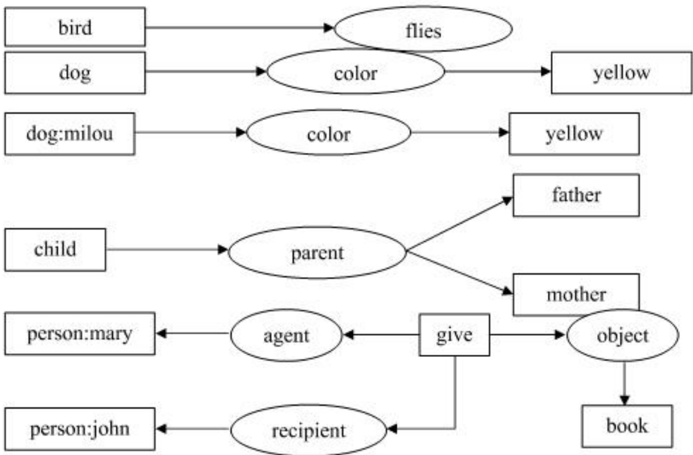

Cho các câu sau

• Jane đã cho Tom một cây kem

\- Các câu thủ đã câu đều cao lớn

• Paul đôn cái cây bằng một cái rìu

\- Cho tất cả các nguyên liệu vào một cái tô và trộn kỹ
Yêu cầu:

a. Sử dụng logic vị từ, biểu diễn các câu
b. Sử dụng đồ thị khái niệm, biểu diễn các câu
c. Sử dụng cấu trúc slot-and-filler, biểu diễn các câu

3. Dựa trên bốn tiêu chí đánh giá một biểu diễn tri thức, hãy phân tích đánh giá phương pháp sử dụng logic để biểu diễn tri thức, biểu diễn tri thức theo cấu trúc slot-and filler, đô thị khái niệm.

4. Khi tri thức mới xuất hiện, làm này sinh màu thuẫn với tri thức đã biết.
Hãy đề nghị giải pháp giải quyết xung đột này.

5. Giả sử ràng trong lĩnh vực cần giải quyết, tri thức heuristic có được rất nghèo nàn. Hây đề nghị giải pháp giải quyết tình huống này.

6. Vấn đề được đặt ra là “thu lυợm các tri thức lĩnh vực cần giải quyết”. Hãy đề nghị giải pháp để giải quyết vấn đề này.

<!-- page: 132 -->

## TÀI LIỆU THAM KHẢO

[1] Enderton, H. B. (1972). A Mathematical Introduction to Logic. Academic Press.

[2] Herbrand, J. (1930). Recherches sur la Théorie de la Démonstration. Ph.D. thesis, University of Paris.

[3] Robinson, J. A. (1965). A machine-oriented logic based on the resolution principle. Journal of the Association for Computing Machinery, 12, 23–41.

[4] Skolem, T. (1920). Logisch-kombinatorische Untersuchungen über die Erfullbarkeit oder Beweisbarkeit mathematischer Satze nebst einem Theoreme über die dichte Mengen. Videnskapsselskapets skrifter, I. Matematisk-naturvidenskabelig klasse, 4.

[5] Russell, S. and Norvig, P. (2009). Artificial Intelligence: A Modern Approach, (third edition), Prentice Hall.

[6] Turing, A. (1936). On computable numbers, with an application to the Entscheidungs problem. Proceedings of London Mathematical Society, 2nd series, 42, 230–265.

<!-- page: 133 -->

# Chương 5 SỬ DỤNG LOGIC VỊ TỬ

Logic cung cấp phương pháp mạnh để dẫn xuất tri thức mới từ tri thức đã biết – suy diễn toán học. Dưới hình thức biểu diễn này, có thể kết luận rằng một phát biểu là đúng nếu nó là kết quả của một quá trình duy diễn hợp lý từ những tri thức đã biết, cũng có thể suy diễn để dẫn xuất câu trả lời cho các câu hỏi và các lời giải cho các bài toán.

## 5.1 BIỂU DIỄN CÁC SỰ KIỆN ĐƠN GIẢN TRONG LOGIC

Logic cung cấp một phương pháp lập luận tốt. Sự dụng các phát biểu logic để biểu diễn tri thức, có thể được hướng phương pháp lập luận sẵn có này. Do logic mệnh đề có nhiều hạn chế trong biểu diễn tri thức, ta chủ yếu chixem xét việc sử dụng logic vị từ trong biểu diễn tri thức.

Ta bắt đầu với một ví dụ. Xét một cơ sở tri thức được biểu diễn bởi các câu trong ngôn ngữ tự nhiên:

1. Marcus là một người đàn ông

2. Marcus là một người Pompei

3. Mọi người Pompei là người La mã

4. Ceasar là một nhà thống trị

5. Mợi người La mã hoặc trung thành với Ceasar hoặc căn ghét ông ta

6. Mỗi người trung thành với một người nào đó

7. Người ta chỉ tìm cách ám sát nhà thống trị mà họ không trung thành với

8. Marcus tim cách ám sát Ceasar

Trước tiên, ta định nghĩa các vị từ cần thiết

(1) Phát biểu 1 đời hỏi vị từ mô tả khái niệm người đàn ông, ta đặt tên vị từ này là man(X) với nghĩa là X là một người đàn ông. Như vậy phát biểu 1 có thể được biểu diễn:

## man(Marcus)

(2) Đối với phát biểu 2, ta sử dụng vị từ được đặt tên pompeian(X) với ý nghĩa “X là một người Pompei”. Vì thế phát biểu 2 sẽ được biểu diễn:

Pompeian(Marcus)

<!-- page: 134 -->

(3) Vị từ roman(X) với nghĩa “X là một người La mã” được thêm vào cho phép biểu diễn phát biểu 3

$$
\forall X: p o m p e i a n (X) \to r o m a n (X)
$$

(4) Sử dụng vị từ ruler(X) = “X là nhà thống trị”, phát biểu 4 được biểu diễn:

$$
\text {Ruler} (\text {Ceasar})
$$

(5) Phát biểu 5 cần hai vị từ diễn tả hai khái niệm “trung thành” và “căm ghét”, ta sẽ đặt tên cho các vị từ này lần lượt là loyalto(X, Y) = “X trung thành với Y” và hate(X, Y) = “X căn ghét Y”.

$\forall X: roman(X) \rightarrow loyalto(X, Ceasar) \lor hate(X, Ceasar)$

(6) Phát biểu 6 được biểu diễn:

## $\forall X\exists Y:loyalto(X,Y)$

(7) Phát biểu 7 cần thêm các vị từ biểu diễn khái niệm con người và tìm cách ám sát, ta đặt tên cho các vị từ này là person(X) = “X là một con người”, try\_assassinate(X, Y) = “X tìm cách ám sát Y”

$\forall X \forall Y : person(X) \land ruler(Y) \land try\_assassinate(X, Y) \rightarrow \negloyalto(X, Y)$

(8) Phát biểu 8 bảy giờ được viết

## try\_assassinate(Marcus, Ceasar)

Giả sử ta có câu hỏi “Marcus có trung thành với Ceasar?”. Trực giác nói là không: “Marcus không trung thành với Ceasar” phát biểu này được viết

—loyalto(Marcus, Ceasar)

Ta sẽ sử dụng biểu diễn tri thức trên, các luật suy diễn trong logic và chiến lược suy diễn lùi để thử chứng minh điều khẳng định trên (chú ý, ta sẽ sử dụng ký hiệu a/X để chi ra a thay cho biến X):

Đế chứng minh:¬loyalto(Marcus, Ceasar)

Theo (7), thay thế biến X bởi Marcus, biến Y bởi Ceasar, ta phải chứng minh

person(Marcus) ∧ ruler(Ceasar) ∧try\_assassinate(Marcus, Ceasar)

<!-- page: 135 -->

Do (4) ruler(Ceasar) được chứng minh, như vậy có thể rút nó khởi danh sách các đích phải chứng minh, danh sách các đích phải chứng minh bảy giờ còn

## person(Marcus)∧ try\_assassinate(Marcus, Ceasar)

Do (8) try\_assassinate(Marcus, Ceasar) được chứng minh nên danh sách đích phải chứng minh chỉ cònperson(Marcus).

Các bước chứng minh được trình bày trong hình 5.1.

<div class="docvortex-algorithm" style="white-space: pre-wrap; font-family:monospace;">
$\neg$ loyalto(Marcus, Ceasar)  
$\uparrow$ 7. Marcus/X, Ceasar/Y  
person(Marcus) $\land$ ruler(Ceasar) $\land$ try_assassinate(Marcus, Ceasar)  
$\uparrow$ 4. Suy giàm đích con ruler(Ceasar)  
person(Marcus)$\land$try_assassinate(Marcus, Ceasar)  
$\uparrow$ 8. Suy giàm try_assassinate(Marcus, Ceasar)  
person(Marcus)
</div>

Hình 5.1 Chứng minh Marcus không trung thành với Ceasar bằng suy diễn lùi

Đến dây, quá trình suy diễn bị “tắc”: trong cơ sở tri thức không có tri thức person(Marcus). Đối với chúng ta, tri thức “một người đàn ông là một con người” là hiển nhiên. Nhung tri thức hiển nhiên này cần phải được biểu diễn trong cơ sở tri thức:

## (9) Ta bổ sung thêm:

$$
\forall \mathrm{X}: \operatorname{man} (\mathrm{X}) \rightarrow \operatorname{person} (\mathrm{X})
$$

Với tri thức bổ xung, ta có thể tiếp tục: Sử dụng(9)với phép thay thế Marcus/X cho ta để chứng minh person(Marcus) ta chứng minh man(Marcus). (1) cho phép xoá bỏ đích con này và ta được danh sách các đích phải chứng minh là rộng tương đương với cách nói tất cả các đích đã được chứng minh.

Qua ví dụ trên ta thấy ba vấn đề quan trọng phải được quan tâm trong quá trình chuyển đổi từ các câu trong ngôn ngữ tự nhiên sang phát biểu logic và sử dụng các phát biểu này đề suy diễn:

\- Nhiều câu trong ngôn ngữ rất mở hồ. Chọn chuyển đổi có thể gặp khó khăn.

<!-- page: 136 -->

\- Thường có sự chọn lựa biểu diễn tri thức. Các biểu diễn đơn gian thường được ura chuộng, nhưng chúng cũng có thể cần trở một số kiểu lập luận. Một biểu diễn thích hợp cho một tập cụ thể các câu phụ thuộc vào nội dung tri thức chứa trong các câu.

\- Tập các câu không chứa toàn bộ thông tin cần thiết cho lập luận. Đề sử dụng tập các phát biểu một cách hiệu quả, cần truy cập đến tập các phát biểu khác, biểu diễn các sự kiện mà con người xét là quá hiển nhiên.

Một vấn đề này sinh là quyết định đích chứng minh: như trong ví dụ với câu hỏi “Marcus trung thành với Ceasar?”, chọn đích chứng minh là loyalto(Marcus, Ceasar) hay ¬loyalto(Marcus, Ceasar).

Khi chiến lược suy diễn tiến được chọn, một vấn đề phát sinh là khi có nhiều quy tắc (tri thức suy diễn) có thể áp dụng, chọn quy tắc nào để áp dụng? Có hai chiến lược có thể được lựa chọn. Một là thử áp dụng tất cả các quy tắc (vét cạn), tuy nhiên trong nhiều lĩnh vực chiến lược này dẫn đến hiện tượng bùng nổ tổ hợp, hậu quả là thời gian tìm kiếm quá lớn, không thể chấp nhận được. Hai là sử dụng heuristic, được xem như tri thức dẫn đường, tuy nhiên, không phải lĩnh vực nào cũng tìm thấy heuristic tốt. Một vấn đề quan trọng là quá trình tìm kiếm (lập luận) có thể kéo dài vô hạn nếu điều phải chứng minh là không đúng. Giải pháp cho tình huống này là thực hiện đồng thời cả hai quá trình: chứng minh điều phải chứng minh và chứng minh điều phù định của nó, và dùng khi một trong hai quá trình thành công. Một chiến lược khác có thể được áp dụng là phối hợp: áp dụng cả hai quá trình chứng minh và sử dụng thông tin thu được từ một trong chứng dẫn đất quá trình kia.

## 5.2 BIỆU DIỄN CÁC QUAN HỆ "LÀ THỂ HIỆN CỦA - INSTANCE" VÀ "LÀ MỘT - ISA"

Các thuộc tính instance và isa giữ một vai trò quan trọng trong lập luận – kế thừa tính chất. Trong ví dụ đề cập đến Marcus và Ceasar, ta đã không sử dụng biểu diễn tường minh các quan hệ instance và isa này. Nhắc lại là thuộc tính instance biểu diễn mối quan hệ liên thuộc – một phần từ của một tập hợp, và thuộc tính isa biểu diễn mối quan hệ bao hàm – một tập là tập con của một tập. Trong ví dụ, ta đã biểu diễn tập các người La mã bởi tên roman(X), tập các người pompei bởi pompeian(X), tập các con người bởi person(X) và tập các người đàn ông bởi man(X). Ta cũng đã biểu diễn quan hệ isa giữa pompeian(X) và roman(X) bởi ∀X: pompeian(X) → roman(X), biểu diễn quan hệ instance bởi ví dụ pompeian(Marcus). Bây giờ ta sẽ biểu diễn cơ sở tri thức đó, sử dụng các vị từ instance(X, Y) = “X là một thể hiện/phần từ của tập Y” và isa(X, Y) = “X là tập con của Y” và sử dụng cách biểu diễn tập hợp bởi tên.

<!-- page: 137 -->

Biểu diễn chỉ sử dụng instance

| man(Marcus) | instance(Marcus, man) |
| --- | --- |
| pompeian(Marcus) | instance(Marcus, pompeian) |
| $\forall X: \text{pompeian}(X) \rightarrow \text{roman}(X)$ | $\forall X : \text{instance}(X, \text{pompeian}) \rightarrow \text{instance}(X, \text{roman})$ |
| ruler(Ceasar) | instance(Ceasar, ruler) |
| $\forall X : \text{roman}(X) \rightarrow \text{loyalto}(X, \text{Ceasar}) \lor \text{hate}(X, \text{Ceasar})$ | $\forall X : \text{instance}(X, \text{roman}) \rightarrow \text{loyalto}(X, \text{Ceasar}) \lor \text{hate}(X, \text{Ceasar})$ |
| $\forall X \exists Y: \text{loyalto}(X, Y)$ | $\forall X \exists Y: \text{loyalto}(X, Y)$ |
| $\forall X \forall Y : \text{person}(X) \land \text{ruler}(Y) \land \text{try\_assassinate}(X, Y) \rightarrow \neg \text{loyalto}(X, Y)$ | $\forall X \forall Y : \text{instance}(X, \text{person}) \land \text{instance}(Y, \text{ruler}) \land \text{try\_assassinate}(X, Y) \rightarrow \neg \text{loyalto}(X, Y)$ |
| try_assassinate(Marcus, Ceasar) | try_assassinate(Marcus, Ceasar) |
| $\forall X: \text{man}(X) \rightarrow \text{person}(X)$ | $\forall X: \text{instance}(X, \text{man}) \rightarrow \text{instance}(X, \text{person}))$ |

Biểu diễn sử dụng cả instance và isa

| (1) | man(Marcus) | instance(Marcus, man) |
| --- | --- | --- |
| (2) | pompeian(Marcus) | instance(Marcus, pompeian) |
| (3) | $\forall X: \text{pompeian}(X) \rightarrow \text{roman}(X)$ | isa(pompeian, roman) |
| (4) | ruler(Ceasar) | instance(Ceasar, ruler) |
| (5) | $\forall X : \text{roman}(X) \rightarrow \text{loyalto}(X, \text{Ceasar}) \lor \text{hate}(X, \text{Ceasar})$ | $\forall X : \text{instance}(X, \text{roman}) \rightarrow \text{loyalto}(X, \text{Ceasar}) \lor \text{hate}(X, \text{Ceasar})$ |
| (6) | $\forall X \exists Y: \text{loyalto}(X, Y)$ | $\forall X \exists Y: \text{loyalto}(X, Y)$ |
| (7) | $\forall X \forall Y : \text{person}(X) \land \text{ruler}(Y) \land \text{try\_assassinate}(X, Y) \rightarrow \neg \text{loyalto}(X, Y)$ | $\forall X \forall Y : \text{instance}(X, \text{person}) \land \text{instance}(Y, \text{ruler}) \land \text{try\_assassinate}(X, Y) \rightarrow \neg \text{loyalto}(X, Y)$ |
| (8) | try_assassinate(Marcus, Ceasar) | try_assassinate(Marcus, Ceasar) |
| (9) | $\forall X: \text{man}(X) \rightarrow \text{person}(X)$ | isa(man, person) |

Có nhiều cách biểu diễn cùng một sự kiện. Lựa chọn cách biểu diễn phụ thuộc một mặt vào những cái mà các suy diễn cần để được hỗ trợ hiệu quả nhất một mặt vào sở thích. Một chú ý quan trọng là sự nhất quán biểu diễn trong một cơ sở tri thức. Quy tắc suy diễn được thiết kế để làm việc trên dạng cụ thể của biểu diễn, cần thiết là tất cả các tri thức mà các quy tắc dự kiến áp dụng phải ở dạng mà các quy tắc đời hồi.

Bây giờ giả sử ta có thêm tri thức “Paulus là người pompei, ông ta không trung thành với Ceasar, nhưng cũng không căm ghét Ceasar”

<!-- page: 138 -->

(10) pompeian(Paulus) ∧—loyalto(Paulus, Ceasar) ∧—hate(Paulus, Ceasar)

Nếu thêm vào cơ sở tri thức sự kiện này, hệ cơ sở tri thức trở nên không nhất quán (mâu thuẫn giữa 10. và 5.). Đề tránh sự không nhất quán này 5. cần phải được sửa đổi với vị từ bổ xung eq(X, Y) = “X là Y”

$\forall X: \text{roman}(X) \land \neg eq(X, \text{Paulus}) \rightarrow \text{loytalto}(X, \text{Ceasar}) \lor \text{hate}(X, \text{Ceasar})$

Ví dụ này nêu lên một hiện tượng là khi thêm vào một cơ sở tri thức một tri thức mới, cơ sở tri thức có thể trở nên không nhất quán. Như vậy cần phải sửa đổi các tri thức cũ để nhận được một hệ thống nhất quán.

## 5.3 HỢP GIẢI

Hợp giải là kỹ thuật lập luận dựa trên nguyên lý chứng minh phần chứng: để chứng minh một phát biểu, hợp giải thử chứng tờ rằng phù định của phát biểu đó làm phát sinh một màu thuẫn với những phát biểu đã biết.

## 5.3.1 Chuyển sang dạng clause

Mộtclause của các vị từ $p_1, p_2, ..., p_k$ là một công thức được định dạng tốt (well-formed formula – wff) có dạng $q_1 \vee q_2 \vee ... \vee q_k$ trong đó $q_i = p_i$ hoặc $\neg p_i$. mỗi $q_i$ được gọi là literal của clause.

Thuật toán chuyển đổi một công thức được định dạng tốt (wff) sang dạng clause bao gồm một dãy các bước. Thứ tự thực hiện các bước là quan trọng.

## Thuật toán

1. Khử bỏ kéo theo (→)

Sử dụng biến đổi tương đương: a → b ≡¬a ∨ b biến đổi tất cả các phép toán kéo theo.

Ví dụ

<div class="docvortex-algorithm" style="white-space: pre-wrap; font-family:monospace;">
$\forall X : [roman(X) \land know(X, Marcus)] \rightarrow [hate(X, Ceasar) \lor (\forall Y : (\exists Z : hate(Y, Z)) \rightarrow thinkcrazy(X, Y))]$
</div>

Được biến đổi thành

$\forall X : \neg[\text{roman}(X) \land \text{know}(X, \text{Marcus})] \lor [\text{hate}(X, \text{Ceasar}) \lor (\forall Y : \neg(\exists Z : \text{hate}(Y, Z)) \lor \text{thinkcrazy}(X, Y))]$

<!-- page: 139 -->

2. Đầy sâu toán từ phù định (−) đến sát vị từ

Sử dụng các biến đổi tương đương

Luật De Morgan: ¬(a ∨ b) ≡¬a ∧¬b ; ¬(a ∧ b) ≡¬a ∨¬b

Luật phù định:  $\neg(\neg p) \equiv p$

$\neg(\forall X: P(X)) \equiv \exists X: \neg P(X)$

$\neg(\exists X: P(X)) \equiv \forall X: \neg P(X)$

Thực hiện các biến đổi trên kết quả của bước 1.

Ví dụ

$\forall X: \neg[\text{roman}(X) \land \text{know}(X, \text{Marcus})] \lor [\text{hate}(X, \text{Ceasar}) \lor (\forall Y: \neg(\exists Z: \text{hate}(Y, Z)) \lor \text{thinkcrazy}(X, Y))]$

Được biến đổi thành

$\forall X: \neg \text{roman}(X) \lor \neg \text{know}(X, \text{Marcus}) \lor [\text{hate}(X, \text{Ceasar}) \lor (\forall Y: (\forall Z: \neg \text{hate}(Y, Z)) \lor \text{thinkcrazy}(X, Y))]$

3. Chuẩn hoá tên biến cục bộ: chuẩn hoá tên biến trong một công thức sao cho mỗi lượng từ gắn với một tên biến duy nhất

Ví dụ ∀X : P(X) ∨∀X : Q(X) được biến đổi thành ∀X : P(X) ∨∀Y :
Q(Y)

4. Chuyển các lượng tử về đầu công thức: chú ý bảo tồn thứ tự xuất hiện của chúng

Ví dụ

$\forall X: \neg \text{roman}(X) \lor \neg \text{know}(X, \text{Marcus}) \lor [\text{hate}(X, \text{Ceasar}) \lor (\forall Y: (\forall Z: \neg \text{hate}(Y, Z)) \lor \text{thinkcrazy}(X, Y))]$

Được chuyển về

$\forall X \forall Y \forall Z: \neg \text{roman}(X) \lor \neg \text{know}(X, \text{Marcus}) \lor [\text{hate}(X, \text{Ceasar}) \lor (\neg \text{hate}(Y, Z) \lor \text{thinkcrazy}(X, Y))]$

Công thức dạng này được gọi là ở dạng chuẩn prenex: gồm tiền tố là các lượng từ theo sau là một ma trận phi lượng tử

<!-- page: 140 -->

## 5. Khử bỏ các lượng từ tồn tại

## Sử dụng các hàm Skolem

∃X : P(X) được biến đổi thành P(s()) trong đó s() là hàm Skolem không tham số, được gọi là hằng Skolem

$\forall X_{1}:\ldots:\forall X_{k}:\exists Y:P(X_{1},\ldots,X_{k},Y)$ được biến đổi thành $\forall X_{1}:\ldots:\forall X_{k}:P(X_{1},\ldots,X_{k},s(X_{1},\ldots,X_{k}))$, trong đó $s(X_{1},\ldots,X_{k})$ là hàm Skolem của các biến phổ dụng đứng trước lượng từ tồn tại.

6. Xoá bô tiền tố sau bước 5. Tiền tố chỉ còn lại các lượng từ phổ dụng, ta có thể xoá bò nó đi và xét tất cả các biến trong công thức được lượng từ hoá phổ dụng.

Ví dụ:

$\forall X \forall Y \forall Z: \neg \text{roman}(X) \lor \neg \text{know}(X, \text{Marcus}) \lor [\text{hate}(X, \text{Ceasar}) \lor (\neg \text{hate}(Y, Z) \lor \text{thinkcrazy}(X, Y))]$

Được viết dưới dạng

$\neg$ roman(X) $\lor$ $\neg$ know(X, Marcus) $\lor$ [hate(X, Ceasar) $\lor$ ( $\neg$ hate(Y, Z) $\lor$ thinkcrazy(X, Y))]

## 7. Biến đổi phần ma trận sang dạng chuẩn hội

Sử dụng các luật phân phối, kết hợp của các phép toán ∨ và ∧ để biến đổi các công thức về dạng chuẩn hội (hội của các clause)

Ví dụ

$\neg$ roman(X) $\lor$ $\neg$ know(X, Marcus) $\lor$ [hate(X, Ceasar) $\lor$ ( $\neg$ hate(Y, Z) $\lor$ thinkcrazy(X, Y))]

Do luật kết hợp được viết lại là

$\neg$ roman(X) $\lor$ -know(X, Marcus) $\lor$ hate(X, Ceasar) $\lor$ -hate(Y, Z) $\lor$ thinkcrazy(X, Y)

(season(winter) ∧ wearing(sweater)) ∨ (season(summer) ∧ wearing(shirt))

Do luật phân phối được viết lại là

(season(winter) ∨ season(summer)) ∧ (season(winter) ∨ wearing(shirt))
∧ (wearing(sweater) ∨ season(summer)) ∧ (wearing(sweater) ∨ wearing(shirt))

<!-- page: 141 -->

8. Viết tách các clause: mỗi clause trong một công thức ở dạng chuẩn hội được viết tách ra một clause trên một dòng.

```txt
Ví dụ
```

(season(winter) ∨ season(summer)) ∧ (season(winter) ∨ wearing(shirt))
∧ (wearing(sweater) ∨ season(summer)) ∧ (wearing(sweater) ∨ wearing(shirt))

Được viết tách ra thành

season(winter) ∨ season(summer)

season(winter) ∨ wearing(shirt)

wearing(sweater) ∨ season(summer)

wearing(sweater) ∨ wearing(shirt)

9. Chuẩn hoá tên biến toàn cục: thay đổi tên biến sao cho các biến trên các dòng khác nhau là khác nhau.

Sau thuật toán chuẩn hoá, ta nhận được một tập các clause (mỗi clause được viết trên một dòng).

## 5.3.2 Cơ sở hợp giải

Thủ tục hợp giải (resolution) là một quá trình lập, ở mỗi bước lập, hai clause được gọi là các clause cha được so sánh (được hợp giải) để sinh ra một clause mới, clause mới này là kết quả suy diễn từ các clause cha.

Cơ sở của hợp giải:

Giả sử ta có hai clause, giá trị chân trị của chúng là true:

p ∨ remainder₁ và ¬p ∨ remainder₂

Néu p là true ⇒ ¬p là false ⇒ remainder₂ là true ⇒ remainder₁√
remander₂ là true

Néu p là false $\Rightarrow$ remainder1 là true $\Rightarrow$ remainder1$\vee$ remainder2 là true

Như vậy với các giả thiết p ∨ remainder₁ và ¬p ∨ remainder₂ ta suy ra được remainander₁ ∨ remainder₂. Clause remainder₁ ∨ remainder₂ là clause mới, kết quả hợp giải của hai clause cha p ∨ remainder₁ và ¬p ∨ remainder₂

<!-- page: 142 -->

Chú ý rằng remainder₁, remainder₂ có thể là các clause rỗng (clause có chân trị hằng sai), khi hợp giải của hai clause sinh ra một clause rỗng, điều này phản ánh có màu thuẫn.

Cơ sở lý thuyết của thủ tục hợp giải trong logic vị từ là định lý Herbrand:

\- Đế chứng tổ một tập các clause S là không thể làm thỏa mãn được (unsatisfiable), chỉ cần xem xét các sự giải thích trên một tập cụ thể được gọi là vũ trụ Herbrand của S.

\- Một tập các clause được là không thể làm thỏa mãn được nếu và chỉ nếu một tập con hữu hạn của các thể hiện nền (tất cả các biến buộc trong chúng có giá trị thay thế) là không thể làm thỏa mãn được.

Định lý Herbrand đề nghị một phương pháp tìm màu thuẫn là thử một cách có hệ thống các phép thay thế có thể và xét xem có thay thế nào làm phát sinh màu thuẫn không. Nguyên lý hợp giải được đề nghị đầu tiên bởi Robinson. Nó cung cấp một phương pháp tìm màu thuẫn bằng cách thử một số tối thiểu các phép thay thế. Y tưởng là giữ các clause ở dạng tổng quát lâu như có thể và chỉ đưa vào các phép thay thế xác định khi chúng được yêu cầu.

## 5.3.3 Hợp giải trong logic mệnh đề

Bài toán: sinh ra một chứng minh bằng hợp giải cho mệnh đề P với một tập các tiền đề F.

## Thuật toán

1. Biến đổi tất cả các mệnh đề trong F sang dạng clause

2. Lấy phù định của P và biến đổi phù định đó sang dạng clause. Thêm nó vào tập các clause nhận được ở bước 1. Tập các clause này được gọi là tập các clause của thủ tục hợp giải, ta ký hiệu nó là F+.

3. Lặp lại đến khi hoặc màu thuẫn được phát hiện hoặc không thể tiến triển được nửa (không một clause mới nào được thêm vào F+)

a. Chọn hai clause, gọi là p và q, sao cho p và q chứa các literal bù của nhau có nghĩa là nếu p chứa literal L thì q chứa literal ¬L, nếu p chứa literal ¬L thì q chứa literal L.

b. Hợp giải: sinh ra clause, được gọi là clause phân giải (resolvent clause), nólà tuyển các phần còn lại của p và q.

c. Nếu clause phân giải là rỗng phát hiện màu thuẫn. Nếu không, thêm clause phân giải vào F+.

<!-- page: 143 -->

Ví dụ

| Các tiền đề | Dạng clause |  |
| --- | --- | --- |
| P | P | (1) |
| T | T | (2) |
| (P∧Q) → R | $\neg P \lor \neg Q \lor R$ | (3) |
| (S∨T) → Q | $\neg S \lor Q$$\neg T \lor Q$ | (4)(5) |

Phải chứng minh R
Quá trình hợp giải

1. Lấy phù định của R và chuyển nó sang dạng clause:
(6)¬R.

2. Thêm nó vào tập các clause tiền đề. Tập các clause của thủ tục hợp giải là các clause được đánh số từ 1 đến 6.

3. Chọn (6) và (3) hợp giải chúng, ta nhận được
(7)¬P ∨¬Q thêm vào tập các clause của thủ tục hợp giải

4. Chọn (7) và (1), hợp giải chứng ta nhận được
(8)→Q thêm vào tập các clause của thủ tục hợp giải

5. Chọn (8) và (5) hợp giải chúng ta nhận được
(9)—T thêm vào tập các clause của thủ tục hợp giải

6. Chọn (9) và (2) hợp giải chúng ta nhận được clause rỗng (phát hiện màu thuẫn)

Quá trình hợp giải để chứng minh R được minh họa trong hình 5.2.

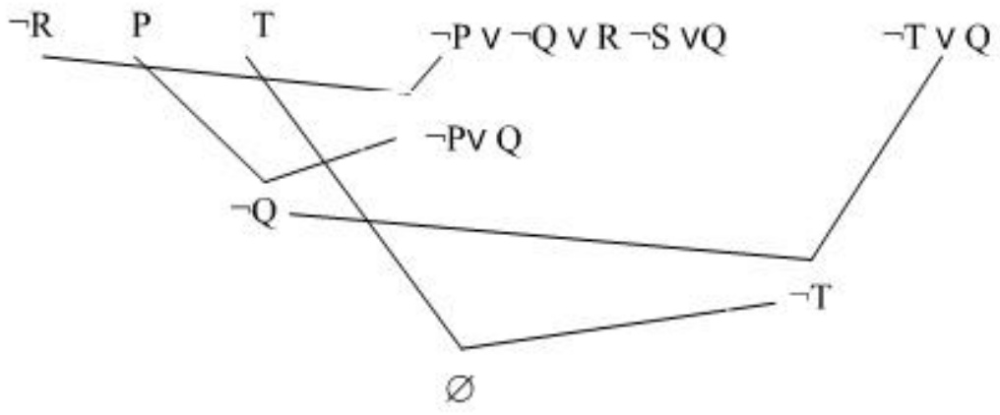

Hình 5.2 Chứng minh R bằng hợp giải

<!-- page: 144 -->

## 5.3.4 Thuật toán hợp nhất

Trong logic mệnh đề, dễ dàng xác định hai literal bù của nhau. Trong logic vị từ quá trình tương hợp (matching) này phức tạp hơn vì phải xét đến các đối số của các vị từ. Ta cần một thủ tục tương hợp, nó so sánh hai literal và phát hiện có hay không một đầy các phép thay thế làm cho chúng đồng nhất. Thuật toán hợp nhất (unification algorithm) dưới đầy thực hiện công việc đó.

Ý tương cơ sở của thuật toán hợp nhất là đầu tiên kiểm tra tên của hai vị từ. Nếu chúng không đồng nhất, chúng không thể hợp nhất. Nếu tên vị từ đồng nhất, kiểm tra đôi một các đối số của hai vị từ. Nếu cặp đối số đầu tiên không thể tương hợp, hai vị từ không thể tương hợp. Nếu cặp đối số đầu tiên có thể tương hợp, xét cặp thứ hai và cứ như vậy. Nếu số đôi số của hai vị từ bằng nhau và tất cả các cặp đối số tương ứng đều có thể tương hợp, hai vị từ là có thể tương hợp.

Nếu hai đối số tương ứng của hai vị từ là các hàng, chúng tương hợp khi và chỉ khi chúng đồng nhất.

Nếu một trong hai đổi số tương ứng là biến, đối số tương ứng kia là một hằng, một biến khác hoặc một biểu thức vị từ không chứa biển đó, chúng có thể tương hợp, sự tương hợp nhận được qua phép thay thế biến bởi đối số tương ứng.

Ta sẽ ký hiệu sự thay thế biến X bởi A là A/X, đọc là thay thế X bởi A, X được thay thế bởi A hoặc thay thế A cho X. Chú ý rằng, nếu một cặp đối số tương hợp thông qua phép thay thế biến, phép thay thế này phải tác động lên mọi thể hiện của biến trong vị tử.

Ví dụ, ta muốn hợp nhất hai vị từ P(X, X) và P(Y, Z). Hai vị từ trùng tên. Xét cặp đối số đầu tiên, chúng là các biến X và Y, chúng có thể tương hợp thông qua phép thay thế X/Y hoặc Y/X. Giả sử phép thay thế Y/X được sử dụng, khi đó vị từ thứ nhất qua phép thay thế này là P(Y, Y). Khi xét tương hợp cặp đổ số thứ hai, các đối số này sẽ là Y và Z tương ứng. chúng tương hợp thông qua phép thay thế Y/Z hoặc Z/Y. Như vậy hai vị từ tương hợp qua hợp thành của hai phép thay thế (Y/Z)(Y/X) hoặc (Z/Y)(Y/X).

$$
P (X, X) \xrightarrow {(Y | X)} P (Y, Y) \xrightarrow {(Y | Z)} P (Y, Y)
$$

$$
P (Y, Z) \xrightarrow {(Y | X)} P (Y, Z) \xrightarrow {(Y | Z)} P (Y, Y)
$$

<!-- page: 145 -->

Bản chất của phép thay thế là một ánh xạ từ tập các tên biến vào tập các giá trị thay thế, các giá trị thay thế có thể là một hàng, một biến khác hoặc là một biểu thức vị từ. Ký hiệu (a₁/X₁, a₂/X₂, ..., aₖ/Xₖ) được hiểu là phép thay thế thực hiện thay thế biến X₁ bởi a₁, X₂ bởi a₂, ..., Xₖ bởi aₖ, các tên biến không xuất hiện trong liệt kê giữ nguyên không thay đổi.

Trong ví dụ trên

$$
(\mathrm{Y/X}): \{\mathrm{X,Y,Z} \} \to \{\mathrm{X,Y,Z} \}
$$

$$
\mathrm{X} \mid \rightarrow \mathrm{Y}
$$

$$
\mathrm{Y} \mid \rightarrow \mathrm{Y}
$$

$$
Z \mid \rightarrow Z
$$

Do vây, ta ký hiệu hợp thành của các phép thay thế như ký hiệu hợp thành của các ánh xạ: phép thay thế thực hiện trước được viết bên phải các thay thế được thực hiện sau. Mục tiêu của thủ tục hợp nhất là phát hiện phép thay thế làm cho hai literal tương hợp.

Thủ tục hợp nhất unify(L1, L2) (xem hình 5.3) trả lại một danh sách biểu diễn hợp thành của các phép thay thế đã được thực hiện trong quá trình tương hợp. Danh sách rỗng, NIL chỉ ra rằng tương hợp không cần phép thay thế. Danh sách chứa giá trị FAIL chỉ ra thủ tục hợp nhất thất bại.

Thuật toán: unify(L₁, L₂)

<!-- page: 146 -->

```txt
if (L1 và L2 cả hai là các biến hoặc hàng)
    if(L1 và L2 đồng nhất)return NIL
    elseif(L1 là biến)
        if (L1 xuất hiện trong L2) return {FAIL}
        elsereturn(L2/L1)
    elseif (L2 là biến)
        if (L2 xuất hiện trong L1)return {FAIL}
        elsereturn (L1/L2)
    elsereturn {FAIL}
if (ký hiệu vị tustrong L1 và L2 không đồng nhất)
    return {FAIL}
if (L1 và L2 có số các đối số khác nhau)
    return {FAIL}
Khởi động SUBT là NILL
for (i =1, i <= số đối số của L1)
    S ← unify(arg(i, L1), arg(i, L2))
    if (S chúa FAIL)return {FAIL}
    if (S <> NILL)
        Áp dụng S lên phần còn lại của L1 và L2
        SUBT = APPEND(S, SUBT)
return (SUBT)

Trong đó arg(i, L) trả lại đối số thứ i của vị từ L APPEND(list1, list2): trả lại danh sách nổi hai danh sách list1 và list2
```

Hình 5.3 Giải thuật hợp nhất

## 5.3.5 Hợp giải trong logic vị từ

Hai literal được gọi là bù nhau nếu một trong chúng hợp nhất với phù định của literal kia thông qua một phép thay thế.

Bài toán: cho một tập các phát biểu tiền đề F, một phát biểu phải chứng minh P

Tìm một chứng minh cho P với các giả thiết F

Thuật toán hợp giải:

1. Chuyển đổi tất cả các phát biểu của F sang dạng clause

<!-- page: 147 -->

2. Lấy phù định của P và chuyển nó sang dạng clause, thêm nó vào tập các clause nhận được từ 1, nhận được tập các clause được gọi là tập các clause của thủ tục.

3. Lặp lại đến tận khi phát hiện màu thuẫn hoặc không tiến triển được nửa hoặc số bước lập vượt quá một ngưỡng định sẵn

a. Chọn hai clause C₁ và C₂, sao cho C₁ chứa một literal L₁ : C₁ = L₁ ∨ R₁ , C₂ chứa literal L₂ : C₂ = L₂ ∨ R₂, L₁ và L₂ là các literal bù nhau thông qua phép thay thế σ

b. Hợp giải : xây dựng clause phân giải σ(R₁ ∨ R₂), bằng cách áp dụng phép thay thế σ lên tuyển của R₁ và R₂

c. Nếu clause phân giải là clause rỗng, phát hiện màu thuẫn, nếu không thêm nó vào tập các clause của thủ tục.

Nếu chọn các clause để hợp giải được tiến hành một cách có hệ thống, thủ tục hợp giải sẽ tìm thấy màu thuẫn, nếu nó tôn tại. Tuy nhiên, thời gian để tìm thấy màu thuẫn có thể rất dài. Tồn tại một vài chiến lược chọn lựa làm tăng tốc độ dáng kể quá trình hợp giải:

• Chi hợp giải các clause có chứa các literal bù

\- Loai bổ một số clause ngay khi nó được sinh ra. Hai loại clause bị loại bỏ là clause hằng đúng (ví dụ P(X) ∨ ¬P(X)) và clause hệ quả của các clause khác (ví dụ đã có clause P(X) các clause dạng P(X) ∨ ... có thể loại bỏ).

\- Môi khi có thể, hợp giải hoặc với một trong các clause là bộ phận của clause phù định của clause phải chứng minh hoặc với clause sinh ra bởi hợp giải với các clause như thế. Chiến lược này được gọi là chiến lược tập hỗ trợ (set-of-support strategy).

\- Mỗi khi có thể, hợp giải với clause chỉ có một literal. Các hợp giải như vậy sẽ sinh ra các clause phân giải có ít literal hơn cha của chúng và như thế tiến sát hơn đến clause rộng. Chiến lược này được gọi là chiến lược ưu tiên cô đơn (unit-preference strategy)

Ta minh họa thủ tục hợp giải qua ví dụ “thông tin về Marcus” của phần trước

<!-- page: 148 -->

| Các tiền đề |
| --- |
| man(marcus) |
| pompeian(marcus) |
| $\forall X : \text{pompeian}(X) \rightarrow \text{roman}(X)$ |
| ruler(ceasar) |
| $\forall X : \text{roman}(X) \rightarrow \text{loyalto}(X, \text{ceasar}) \lor \text{hate}(X, \text{ceasar})$ |
| $\forall X, \exists Y : \text{loyalto}(X, Y)$ |
| $\forall X, \forall Y : \text{person}(X) \land \text{ruler}(Y) \land \text{try\_assassinate}(X, Y) \rightarrow \neg \text{loyalto}(X, Y)$ |
| $\text{try\_assassinate(marcus, ceasar)}$ |
| $\forall X : \text{man}(X) \rightarrow \text{person}(X)$ |

Điều phải chúng minh là “Marcus căm ghét Ceasar”

1. Chuyển các phát biểu tiền đề sang dạng clause, ta được:

|  | Các tiền đề ở dạng clause |
| --- | --- |
| 1) | man(marcus) |
| 2) | pompeian(marcus) |
| 3) | $\neg$ pompeian($X_1$) $\lor$ roman($X_1$) |
| 4) | ruler(ceasar) |
| 5) | $\neg$ roman($X_2$) $\lor$ loyalto($X_2$, ceasar) $\lor$ hate($X_2$, ceasar) |
| 6) | loyalto($X_3$, $f_1(X_3)$) |
| 7) | $\neg$ person($X_4$) $\lor$ ruler(Y) $\lor$ try_assassinate($X_4$, Y) $\lor$ $\neg$ loyalto($X_4$, Y) |
| 8) | try_assassinate(marcus, ceasar) |
| 9) | $\neg$ man($X_5$) $\lor$ person($X_5$) |

2. Điều phải chứng minh là hate(Marcus, Ceasar). Lấy phù định của nó, ta được —hate(Marcus, Ceasar), thêm nó vào tập các clause tiền đề để nhận được tập ban đầu các clause của thủ tục.

<!-- page: 149 -->

|  | Tập các clause phải chứng tổ có màu thuẫn |
| --- | --- |
| 1) | man(marcus) |
| 2) | pompeian(marcus) |
| 3) | $\neg$ pompeian(X1) $\lor$ roman(X1) |
| 4) | ruler(ceasar) |
| 5) | $\neg$ roman(X2) $\lor$ loyalto(X2, ceasar) $\lor$ hate(X2, ceasar) |
| 6) | loyalto(X3, f1(X3)) |
| 7) | $\neg$ person(X4) $\lor$ $\neg$ ruler(Y) $\lor$ $\neg$ try_assassinate(X4, Y) $\lor$ $\neg$ loyalto(X4, Y) |
| 8) | try_assassinate(marcus, ceasar) |
| 9) | $\neg$ man(X5) $\lor$ person(X5) |
| 10) | $\neg$ hate(marcus, ceasar) |

## 3. Quá trình hợp giải

11) —roman(Marcus) ∨ loyalto(Marcus, Ceasar): kết quả hợp giải của 10 & 5 với phép thay thế Marcus/X₂

12) ¬pompeian(Marcus) ∨ loyalto(Marcus, Ceasar): kết quả hợp giải của 11 & 3 với phép thay thế Marcus/X₁

13) loyalto(Marcus, Ceasar): kết quả hợp giả của 12 & 2

14) ¬person(Marcus) ∨ ¬ruler(Ceasar) ∨ ¬try\_assassinate(Marcus, Ceasar): kết quả hợp giải của 13 & 7 với phép thay thế Marcus/X₄, Ceasar/Y

15) ¬person(marcus) ∨ ¬try\_assassinate(marcus, ceasar): kết quả hợp giải của 14 & 4

16) ¬man(marcus) ∨ ¬try\_assassinate(marcus, ceasar): kết quả hợp giải của 15 & 9 với phép thay thế Marcus/X₅

17) —try\_assassinate(marcus, ceasar): kết quả hợp giải của 16 & 1

18) □ kết quả hợp giải của 17 & 8 ⇒ phát hiện màu thuẫn

<!-- page: 150 -->

Quy tắc thay thế bằng “Nếu thay thế một giá trị trong một clause bởi một giá trị khác bằng nó, nhận được một clause mới cùng chân trị với clause ban đầu”

Quy tắc suy giảm “Nếu trong một clause có chứa literal có chân trị là false, thì có thể xoá bō literal đó khởi clause”

Ví dụ: xét cơ sở tri thức

1. Marcus là một người đàn ông

2. Marcus là một người Pompei

3. Marcus được sinh ra vào năm 40 (sau công nguyên)

4. Mọi người đều phải chết

5. Tất cả người Pompei đều bị chết khi núi lửa phun trào vào năm 79 (sau công nguyên)

6. Không cái gì phải chết sống lâu hơn 150 năm

7. Bây giờ là năm 2000

8. Còn sống nghĩa là không chết

9. Nếu một người bị chết, người đó chết từ đó về sau

Ta định nghĩa các vị từ cơ sở sau:

\- man(X) = "X là một người đàn ông"

\- pompeian(X) = "X là một người Pompei

\- born(X, Y) = "X được sinh ra vào năm Y"

\- person(X) = "X là một con người"

\- mortal(X) = "X phải chết"

\- erupted(volcano, Y) = «Núi lừa phun trào vào năm Y”

\- dead(X, T) = "X ở trạng thái chết ở thời điểm T»

\- died(X, T) = "X bị chết vào thời điểm T"

• alive(X, T) = "X còn sống ở thời điểm T"

\- gt(T1, T2) = "T₁ lón hon T₂"

Cơ sở tri thức bảy giờ được biểu diễn trong logie vị từ qua các vị từ cơ sở:

1. man(Marcus)

2. pompeian(Marcus)

<!-- page: 151 -->

3. born(Marcus, 40)

4.  $\forall X : person(X) \rightarrow mortal(X)$

5. erupted(volcano, 79) ∧ (∀X : pompeian(X) → died(X, 79))

6.  $\forall X\forall T1\forall T2:$  mortal(X)  $\land$  born(X, T1)  $\land$  gt(T2 - T1, 150)  $\rightarrow$  dead(X, T2)

7. now = 2000

8.  $\forall X\forall T: \text{alive}(X, T) \leftrightarrow \neg \text{dead}(X, T)$

9.  $\forall X\forall T1\forall T2:died(X,T1)\land gt(T2,T1)\rightarrow dead(X,T2)$

Tri thức mặc nhiên “một người đàn ông là một con người”

10. ∀X : man(X) → person(X)
Chuyển đổi sang dạng clause, ta được

1) man(Marcus)

2) pompeian(Marcus)

3) born(Marcus, 40)

4)  $\neg\text{person}(X) \vee \text{mortal}(X1)$

5) erupted(volcano, 79)

6)  $\neg$ pompeian(X2) ∨ died(X2, 79)

7)  $\neg$ mortal(X3)  $\vee$   $\neg$ born(X3, T1)  $\vee$   $\neg$ gt(T2 - T1, 150)  $\vee$  dead(X3, T2)

8) now = 2000

9)  $\neg$ alive(X4, T3) ∨  $\neg$ dead(X4, T3)

10) dead(X5, T4) ∨ alive(X5, T4)

11)  $\neg$ died(X6, T5)  $\lor$   $\neg$ gt(T6, T5)  $\lor$  dead(X6, T6)

12)  $\neg\text{man}(X7) \lor \text{person}(X7)$

Điều phải chứng minh là “Marcus bảy giờ không còn sống” = —alive(Marcus, now).

Lấy phù định của điều phải chứng minh, chuyển nó sang dạng clause và thêm vào tập các clause, ta được

13) alive(Marcus, now)

Quá trình hợp giải

<!-- page: 152 -->

14) —dead(Marcus, now): hợp giải 13 & 9 với Marcus/X4, now/T3

15) ¬died(Marcus, T5) ∨ ¬gt(now, T5): hợp giải 14 & 11 với Marcus/X6, now/T6

16) ¬pompeian(Marcus) ∨ ¬gt(now, 79): hợp giải 15 & 6 với Marcus/X2, 79/T5

17) ¬pompeian(Marcus) ∨ ¬gt(2000, 79): thay thế now bôi 2000

18) ¬pompeian(Marcus): suy giám literal ¬gt(2000, 79)

19) □ hợp giải 18 & 2 ⇒ phát hiện màu thuẫn

## 5.3.6 Trả lời câu hỏi

Câu hỏi đặt ra cho cơ sở tri thức trên là “Marcus chết vào năm nào?”.

Phương pháp “lập đầy khoảng trống” sử dụng phát biểu giả định:

Để trả lời cho câu hỏi này, ta giả định là Marcus chết vào năm Y nào đó:

∃Y: died(Marcus, Y)

và chứng minh điều giả định là đúng và thực hiện chứng minh bằng hợp giải

Lấy phù định của điều phải chứng minh:

$\neg(\exists Y: \text{died}(\text{Marcus}, Y)) \equiv \forall Y: \neg\text{died}(\text{Marcus}, Y))$

20) $\neg$ died(Marcus, Y))

21) ¬pompeian(Marcus): hợp giải 20 & 6 với Marcus/X2, 79/Y

22) □ hợp giải của 21 & 2 (phát hiện màu thuẫn)

Trong quá trình hợp giải biến Y được thay thế bằng 79. Câu trả lời cho câu hỏi là “Marcus chết vào năm 79”

Phương pháp “lập đầy khoảng trống” sử dụng phát biểu hàng đúng: died(Marcus, Y) ∨-died(Marcus, Y)

23) died(Marcus, Y) ∨ ¬died(Marcus, Y)

24) -pompeian(Marcus) $\vee$ died(marcus, 79): hợp giải 23 & 6 với Marcus/X2, 79/Y

25) died(Marcus, 79) hợp giải 24 & 2

Mệnh đề 25) là phát biểu đúng và cho ta câu trả lời “Marcus chết vào năm 79”.

<!-- page: 153 -->

## 5.4 SUY DIÊN TỰ NHIÊN

Hợp giải là một thủ tục chứng minh có thể thực thi dễ dàng. Tính dễ dàng, đơn giản dựa vào biểu diễn đều của các phát biểu. Không may mắn là tính đều này phải trả giá của nó. Các sự kiện được xem “trọng” như nhau, không có cách nào để chọn các phát biểu “hứa hạn hơn” trong việc giải quyết bài toán cụ thể. Hơn nữa, khi chuyển đổi sang dạng clause làm mất đi các thông tin heuristic giá trị hàm chứa trong biểu diễn gốc.

Một vấn đề nửa đối với hợp giải là cách làm của nó khác với suy nghĩ của con người. Do vậy, con người khó tương tác với bộ chứng minh định lý hợp giải, hoặc cho nó một lời khuyến hoặc nhận từ nó một lời khuyến.

Việc tìm kiếm một phương pháp chứng minh định lý tương ứng hoặc sát với quá trình được dùng bởi con người dẫn đến một phương pháp suy diễn được gọi là suy diễn tự nhiên (natural deduction).

Suy diễn tự nhiên mô tả một sự pha trộn các kỹ thuật, được tổ hợp lại để giải quyết các bài toán mà khó kiểm soát nếu chỉ dùng một phương pháp. Một kỹ thuật chung là sắp xếp tri thức không phải theo các vị từ mà theo các đối tượng bao hàm trong các vị từ. Một kỹ thuật khác là sử dụng một tập các quy tắc viết lại (rewrite rule), chúng không chỉ mô tả các kéo theo logic mà còn gọi ý cách các kéo theo này có thể được khai thác trong chứng minh. Trong khuôn khổ của giáo trình, chỉ một số ý tưởng chính của các kỹ thuật suy diễn tự nhiên được trình bày. Các bạn có thể tham khảo sâu hơn trong các bài viết của Bledsoe [1977], Boyer và Moore [1988].

## CÂU HÔI ÔN TẬP VÀ BÀI TẬP

## 1. Xét các câu sau

• John thích tất cả các loại thực phẩm

• Táo là thực phẩm

• Gà là thực phẩm

\- Bất cứ thứ gì, một ai đó ăn và không bị chết bởi nó, là thực phẩm

\- Bill ăn đậu phộng và hãy còn sống

\- Sue ăn mọi thứ mà Bill ăn

a) Dịch các câu trên sang logic vị từ

b) Chứng minh, bằng lập luận dây chuyển ngược, John thích đậu phộng

c) Chuyển đổi các công thức vị từ ở câu a) sang dạng clause

<!-- page: 154 -->

d) Chứng minh John thích đậu phọng bằng hợp giải

e) Sử dụng hợp giải để trả lời câu hỏi “Sue ăn thực phẩm gì?”

## 2. Xét các câu sau

\- Các thành viên của câu lạc bộ tennis là Long, Trinh, Hùng và Anh

\- Long đã cuối Trinh

• Hùng là anh trai của Anh

\- Vợ của mọi thành viên có vợ trong câu lạc bộ cũng tham gia câu lạc bộ

\- Cược hợp gần đây nhất của câu lạc bộ diễn ra ở nhà của Long

a) Biểu diễn các câu sang logic vị từ

b) Chứng minh bằng hợp giải “cuộc hợp gần đây nhất diễn ra ở nhà Trinh”

c) Chứng minh bằng hợp giải “Anh chưa cuối”

Chú ý: cần phải bổ sung các tri thức mặc nhiên cần thiết.

## 3. Xét các câu sau

• Tuấn chi thích các học phần dễ

\- Học phần trí tuệ nhân tạo là học phần khó

\- Tất cả các học phần về sử dụng công nghệ đều dễ

• TC333 là một học phần sử dụng công nghệ

Sử dụng hợp giải trả lời câu hỏi “Tuấn thích học phần nào?

## 4. Giá sử đã cho các sự kiện

\- $\forall X \forall Y \forall Z: \mathrm{gt}(X, Y) \land \mathrm{gt}(Y, Z) \rightarrow \mathrm{gt}(X, Z)$
Dạng clause:
1) $\neg \mathrm{gt}(X, Y) \lor \neg \mathrm{gt}(Y, Z) \lor \mathrm{gt}(X, Z)$

\- $\forall A, B: \operatorname{succ}(A, B) \rightarrow \operatorname{gt}(A, B)$
Dạng clause:
2) $\neg \operatorname{succ}(A, B) \lor \operatorname{gt}(A, B)$

\- $\forall T: \neg gt(T, T)$
Dạng clause:
3) $\neg gt(T, T)$

<!-- page: 155 -->

\- Ta chứng minh

4) gt(5, 2)

\- bằng hợp giải như sau

5)  $\neg\mathrm{gt}(5,\mathrm{Y})\lor\neg\mathrm{gt}(\mathrm{Y},2):\mathrm{hop~giài~4}\&1)$  với phép thay thế 5/X, 2/Z

6)  $\neg\mathrm{gt}(5,\mathrm{Y})\lor\neg\mathrm{succ}(\mathrm{Y},2):\mathrm{hop~giài~5)}$  & 2) với phép thay thế Y/A, 2/B

7) ¬gt(5, Y) ∨¬gt(Y, Y) ∨¬succ(Y, 2): hợp giải 6) & 1) với phép thay thế 5/X, Y/Z

Clause 7) có chân trị TRUE!

a) Tại sao clause lại có chân trị TRUE?

b) Cần thêm vào thủ tục hợp giải cái gì để điều này không xảy ra?

## 5. Tîm chỗ sai trong lập luận

\- Các người đàn ông được phân tán trên khắp trái đất

• Socrates là một người đàn ông

\- Như vậy, Socrates được phân tán trên khắp trái đất

Biểu diễn các sự kiện bởi các câu và trong logic như thế nào để vấn đề này không xảy ra?

## 6. Các vấn đề gì gặp phải khi thử biểu diễn các phát biểu sau trong logic vị từ? Có thể suy diễn phát biểu sau cùng từ những phát biểu còn lại?

• John chỉ thích xem phim Pháp

\- An toàn để giả thiết một phim là phim Mỹ đến tận khi điều khác đi được nói rõ ràng

\- Rạp Playhouse hiểm khi chiếu phim nước ngoài

\- Người ta không làm cái mà đưa họ vào tỉnh huống họ không thích

• John thường không đi đến Playhouse

<!-- page: 156 -->

## TÀI LIỆU THAM KHẢO

[1] Enderton, H. B. (1972). A Mathematical Introduction to Logic. Academic Press.

[2] Herbrand, J. (1930). Recherches sur la Théorie de la Démonstration. Ph.D. thesis, University of Paris.

[3] Robinson, J. A. (1965). A machine-oriented logic based on the resolution principle. Journal of the Association for Computing Machinery, 12, 23–41.

[4] Skolem, T. (1920). Logisch-kombinatorische Untersuchungen über die Erfullbarkeit oder Beweisbarkeit mathematischer Satze nebst einem Theoreme über die dichte Mengen. Videnskapsselskapets skrifter, I. Matematisk-naturvidenskabelig klasse, 4.

[5] Russell, S. and Norvig, P. (2009). Artificial Intelligence: A Modern Approach, (third edition), Prentice Hall.

[6] Turing, A. (1936). On computable numbers, with an application to the Entscheidungs problem. Proceedings of London Mathematical Society, 2nd series, 42, 230–265.

<!-- page: 157 -->

# Chương 6 BIỂU DIỄN TRI THỨC SỬ DỤNG LUẬT

Chương này trình bày cách sử dụng luật/quy tắc (rule) để mã hoá tri thức. Các hệ thống lập luận dựa trên luật giữ một vai trò rất quan trọng trong sự phát triển của trí tuệ nhân tạo.

Tập luật là cơ sở cho các chương trình tìm kiếm. Trong các phần trước, tri thức điều khiển tìm kiếm được duy trì hoàn toàn tách biệt với các luật. Trong chương này, luật được dùng để biểu diễn cả tri thức về các mối quan hệ trong thế giới cũng như tri thức về làm thế nào để giải quyết vấn đề sử dụng nội dung của luật.

## 6.1 TRI THỨC THỦ TỤC VÀ TRI THỨC KHAI BÁO

Trong chương trước, ta xem các khẳng định logic như biểu diễn tri thức khai báo tri thức. Một sự biểu diễn khai báo là sự biểu diễn trong đó tri thức được chỉ rõ nhưng việc sử dụng các tri thức đó như thế nào không được nói rõ. Đề sử dụng một biểu diễn khai báo, ta phải bổ sung một chương trình chỉ rõ cái gì được làm đối với tri thức đó và làm như thể nào. Ví dụ, một tập các khẳng định logic cùng với bộ hợp giải cho ra một chương trình đầy đủ đề giải quyết các bài toán.

Một phương pháp khác, trong đó các khẳng định logic được xem như một chương trình. Dưới góc nhìn này, các phát biểu kéo theo xác định các con đường lập luận hợp thức, các khẳng định nguyên tử (các khẳng định chi gồm một vị từ đơn) cung cấp các điểm khởi đầu hoặc điểm kết thúc của các con đường đó. Các con đường lập luận này xác định các con đường thực hiện có thể của chương trình theo cùng cách mà điều khiển truyền thống xây dựng. Ta có thể xem các khẳng định logic như biểu diễn thủ tục tri thức. Biểu diễn thủ tục là biểu diễn trong đó thông tin điều khiển, cần thiết cho việc sử dụng tri thức, được nhưng trong bản thân tri thức. Đề dùng một biểu diễn thủ tục, ta cần bổ sung một bộ thông dịch (interpreter). Bộ thông dịch này đi theo các chỉ thị đã cho trong tri thức.

Sự khác biệt thực sự giữa các góc nhìn khai báo và góc nhìn thủ tục là ở chỗ thông tin điều khiển cư trú ở đầu. Ví dụ sau minh hoạ cho sự khác nhau của các góc nhìn này.

Xét cơ sở tri thức

man(Marcus)

man(Ceasar)

<!-- page: 158 -->

person(Cleopatra)

$\forall \mathrm{X}:\mathrm{man}(\mathrm{X})\rightarrow \mathrm{person}(\mathrm{X})$

Câu hỏi đặt ra cho cơ sở tri thức là ∃Y: person(Y). đồi hỏi gán một giá trị cụ thể cho Y sao cho person là đúng. Cơ sở tri thức chứng minh bằng trả lời bắt kỳ trong các câu trả lời sau:

$\mathrm{Y} =$ Marcus

$\mathrm{Y} =$ Ceasar

$$
\mathrm{Y} = \text {Cleopatra}
$$

Ta chỉ cần một giá trị. Giá trị của câu trả lời cho câu hỏi phụ thuộc vào thứ tự kiểm tra các khẳng định trong khi tìm kiếm câu trả lời.

Nếu xem các khẳng định như khai báo, các khẳng định được kiểm tra như thế nào không được xác định (phụ thuộc vào chương trình bổ sung).

Theo truyền thống, thứ tự thực hiện các “chi thị” của một thủ tục được thực hiện theo kiểu “từ trên xuống dưới, từ trái qua phải”. Nếu xem các khẳng định như thủ tục, mỗi khẳng định được xét như các chỉ thị và được kiểm tra theo thứ tự xuất hiện của chúng trong chương trình. Nếu như vậy, tìm kiếm câu trả lời được tiến hành như sau: tìm person theo thứ tự xuất hiện, gặp person(Cleopatra), hợp nhất hai vị từ với phép thay thế Cleopatra/Y và cho câu trả lời là Y = Cleopatra.

Bây giờ ta xét cơ sở tri thức

man(Marcus)

man(Ceasar)

$\forall \mathrm{X}:\mathrm{man}(\mathrm{X})\rightarrow \mathrm{person}(\mathrm{X})$

person(Cleopatra)

Nó nhận được từ cơ sở tri thức cũ bằng cách đổi thứ tự xuất hiện của các khẳng định. Ta thực hiện tìm kiếm câu trả lời, dưới góc nhìn thủ tục: tìm person theo thứ tự xuất hiện, gặp $\forall X : man(X) \to person(X)$, thay thế đích person(Y) bởi man(Y), tiếp tục tìm kiếm minh chứng cho man(Y) và được $Y = Marcus$

Thông tin điều khiển việc tìm kiếm “ẩn nắp” trong “kiểm tra các khẳng định theo thứ tự xuất hiện của chúng”.

Như vậy, dưới góc nhìn thủ tục, hai cơ sở tri thức trên là khác nhau.

<!-- page: 159 -->

Thứ tự xuất hiện của các khẳng định là rất quan trọng trong biểu diễn thủ tục. Bạn đọc nên ghi nhớ điều này khi lập trình trong PROLOG vì PROLOG sử dụng biểu diễn thủ tục cho tri thức.

## 6.2 LẬP TRÌNH LOGIC

Lập trình logic là một kiểu ngôn ngữ lập trình trong đó các khẳng định logic được xem như chương trình. Có một số hệ ngôn ngữ lập trình logic, nhưng thông dụng nhất là PROLOG. PROLOG (là viết tất của PROgrammation en LOGic / PROGramming in LOGic). Một chương trình PROLOG được mô tả như một dây các khẳng định logic, mỗi một ở dạng Horn clause. Một Horn clause là một clause có nhiều nhất một literal dương. $p_0 \vee \neg p_1 \vee \neg p_2 \vee \dots \vee \neg p_k$ là một Horn clause, trong PROLOG dạng này thường được viết dưới dạng tương đương ($p_1 \wedge p_2 \wedge \dots \wedge p_k$) → $p_0$, và giữ vai trò biểu diễn quy tắc, nó phải chứa biến. Horn clause chi chứa literal dương giữ vai trò biểu diễn sự kiện, nó chỉ chứa các hàng (không chứa biến) và được hiểu là có chân trị là TRUE. Trong PROLOG literal dương được viết trước phân cách với phần còn lại bởi ký dấu :-

Biểu diễn trong logic:

```txt
∀X: (pet(X) ∧ small(X) → apartmentpet(X)
∀X: (cat(X) ∨ dog(X) → pet(X)
∀X: poodle(X)) → dog(X) ∧ small(X)
poodle(fluffy)
```

Biểu diễn trong PROLOG:

```prolog
apartmentpet(X):- pet(X), small(X).
pet(X) :- cat(X).
pet(X) :- dog(X).
dog(X) :- poodle(X))
small(X) :- poodle(X).
poodle(fluffy).
```

Một vài điểm khác nhau giữa biểu diễn trong logic và biểu diễn trong PROLOG:

\- Trong logic, các biến được lượng từ hoá tường minh. Trong PROLOG, lượng từ hoá ẩn. Phân biệt giữa biến và hằng trong PROLOG bởi biến thì phải bắt đầu là chữ viết hoa hoặc dấu gạch dưới (\_), hằng bắt đầu phải là chữ thường hoặc chữ số.

<!-- page: 160 -->

\- Trong logic, sử dụng ký hiệu ∧ cho toán tử và, ký hiệu ∨ cho toán tử hoặc. Trong PROLOG chỉ sử dụng tường minh ký tiêu dấu phay (,) cho toán tử và, không có ký hiệu cho toán tử hoặc. Thay vào đó các tuyến phải được biểu diễn thành danh sách các phát biểu thay thế.

\- Trong logic toán từ kéo theo được ký hiệu bởi →. Trong PROLOG, ký hiệu cho toán từ kéo theo là :- và được viết ngược: kết luận viết trước, tiền đề viết sau. Ví dụ, “p kéo theo q”, trong logic được viết p → q, trong PROLOG được viết q :- p, q được gọi là đầu của quy tắc.

\- Kết thúc một Horn clause bởi dấu chấm (.)

Ví dụ trong PROLOG

pet(X) :- cat(X). được hiểu là mọi X

p(X) :- q(X, Y). được hiểu là với mọi X, tồn tại Y (∀X∃Y : q(X, Y) → p(X))

Chiến lược điều khiển trong PROLOG

• PROLOG áp dụng suy diễn lùi

\- Bất đầu với phát biểu đích, được biểu diễn như một danh sách các literal đích, nó được xem như các điều phải chứng minh. Literal đầu tiên trong danh sách được chứng minh trước. Tìm các khẳng định chứng minh cho literal này. Việc tìm kiếm được tiến hành từ trên xuống dưới, từ trái qua phải. Nếu tìm thấy một sự kiện có thể hợp nhất với nó thông qua một thay thế, xoá literal này khởi danh sách các đích và áp dụng phép thay thế lên các literal còn lại trong danh sách. Nếu tìm thấy một quy tắc, đầu của nó có thể hợp nhất với literal thông qua phép một thay thế, thay thế literal bởi danh sách các literal ở về phải của quy tắc và áp dụng phép thay thế lên tất cả các literal trong danh sách. Nếu không sự kiện nào, không quy tắc nào được tìm thấy thông báo FAIL.

\- Tìm kiểm được tiến hành theo chiều sâu: khi có đích mới thêm vào danh sách đích, đích mới được theo đuôi ngay, và quay lui: nếu tìm kiếm chứng minh cho một literal bị thất bại, quay trở lại nơi làm phát sinh ra literal đó và thử con đường tìm kiếm khác. Nếu tất cả các con đường tìm kiếm đều thất bại, thông báo FAIL.

Ví dụ, ta có chương trình trong PROLOG sau

<!-- page: 161 -->

```prolog
apartmentpet(X):- pet(X), small(X).
pet(X) :- cat(X).
pet(X) :- dog(X).
dog(X) :- poodle(X))
small(X) :- poodle(X).
poodle(fluffy).
```

Chương trình sau khi chuẩn hoá tên biến

```prolog
apartmentpet(X1):- pet(X1), small(X1).
pet(X2) :- cat(X2).
pet(X3) :- dog(X3).
dog(X4) :- poodle(X4))
small(X5) :- poodle(X5).
poodle(fluffy).
```

Già sử đích là apartmentpet(X). Được viết trong PROLOG như

?- apartmentpet(X).

Quá trình tìm kiếm để trả lời câu hỏi apartmentpet(X) trong Prolog được minh họa trong hình 6.1.

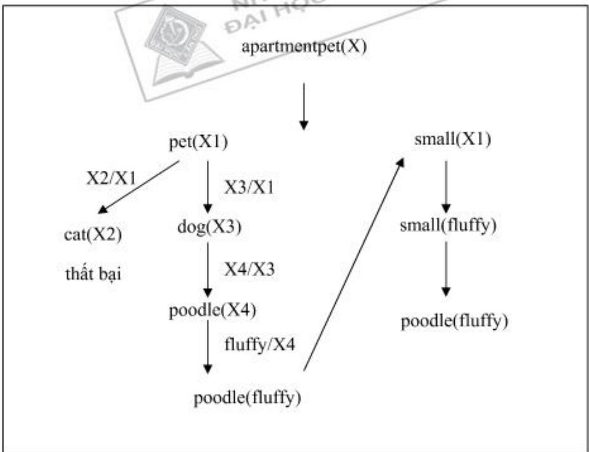

Hình 6.1 Quá trình tìm kiếm apartmentpet(X) trong cơ chế suy diễn của Prolog

<!-- page: 162 -->

Danh sách các literal đích ban đầu { apartmentpet(X) }

Tìm đọc theo chương trình, tìm thấy quy tắcapartmentpet(X1):-pet(X1), small(X1) có đầu có thể hợp nhất với literal đích qua phép thay thế X1/X. Thay apartmentpet(X) trong danh sách đích bởi về phải của quy tắc, được danh sách đích {pet(X1), small(X1)}.

Dích pet(X1) được theo đuôi, pet(X2):- cat(X2) được tìm thấy (phép thay thế X2/X1), cat(X2) thay cho pet(X1) được danh sách các đích {cat(X2), small(X2)}.

Dích cat(X2) được theo đuôi và thất bại, quay lại điểm sinh ra cat(X2), danh sách đích {pet(X1), small(X1)}. Tìm kiểm tiếp tục cho pet(X1) bắt đầu từ “chi thị” ngay sau pet(X2):-cat(X2), tìm thấy pet(X3):-dog(X3) (phép thay thế X3/X1), thay dog(X3) cho pet(X1) trong danh sách đích và áp dụng phép thay thế lên danh sách các đích, được {dog(X3), small(X3)}.

Đích dog(X3) được theo đuôi. dog(X4) :- poodle(X4) được tìm thấy (phép thay thế X4/X3), danh sách đích mới là {poodle(X4), small(X4)}.

Dích poodle(X4) được theo đuôi. poodle(fluffy) được tìm thấy với fluffy/X4, danh sách đích bảy giờ là {small(fluffy)}.

Dích small(fluffy) được theo đuôi, tìm thấy small(X5) :- poodle(X5) (phép thay thế fluffy/X5), danh sách đích bảy giờ là {poodle(fluffy)}.

Đích poodle(fluffy) được theo đuôi, tìm thấy poodle(fluffy), danh sách đích là rỗng, tìm kiểm hoàn tất.

## 6.3 SUY DIỄN TIẾN VÀ SUY DIỄN LÙI

Mục tiêu của các thủ tục tìm kiếm là phát hiện một đường đi qua không gian trạng thái từ một cấu hình khởi đầu đến một trạng thái kết thúc. Có hai hướng tìm kiếm có thể được tiến hành trong tiến trình tìm kiếm:

\- Tiến (forward): xuất phát từ các trạng thái ban đầu

\- Lùi (backward): xuất phát từ các trạng thái đích

Mô hình hệ sản xuất của quá trình tìm kiếm cung cấp một cái nhìn đối xứng cho suy diễn tiến và suy diễn lùi.

Ta xét bài toán 8-puzzle. Các quy tắc được dùng để giải quyết có thể được viết dưới dạng:

<!-- page: 163 -->

| 1 | 2 | 3 |
| --- | --- | --- |
| 4 | 5 | 6 |
| 7 | 8 | 9 |

ô 1 trống, ô 2 chứa n → ô 2 trống, ô 1 chứa n

ô 1 trống, ô 4 chứa n → ô 4 trống, ô 1 chứa n

ô 2 trống, ô 1 chứa n → ô 1 trống, ô 2 chứa n

ô 2 trống, ô 5 chứa n → ô 5 trống, ô 2 chứa n

Sử dụng các quy tắc này, ta có thể giải bài toán theo hai con đường:

\- Suy diễn tiến từ các trạng thái ban đầu: xây dựng một cây với gốc là cấu hình ban đầu. Đề sinh ra các nút ở mức kế tiếp của một nút n, tìm các quy tắc có vế trái tương hợp với nút n, sử dụng vế phải của các quy tắc đó, tạo ra các cấu hình mới. Tiếp tục đến khi một cấu hình tương hợp với trạng thái đích được sinh ra.

\- Suy diễn lùi từ các trạng thái đích: Xây dựng cây với gốc là là câu hình đích. Đề sinh ra các nút ở mức kể tiếp của một nút n, tìm các quy tắc có vé phải tương hợp với nút n, sử dụng vé trái của các quy tắc đó, tạo ra các câu hình mới. Tiếp tục đến khi một cấu hình mới được sinh ra tương hợp với một trạng thái đích.

Đối với bài toán 8-puzzle, không có nhiều khác biệt giữa suy diễn tiến và suy diễn lùi vì số các quy tắc có thể được sử dụng để xây dựng trạng thái mới là tương tự. Trong trường hợp tổng quát, điều đó là không đúng. Tùy theo hình thái của không gian trạng thái, tìm kiếm theo một hướng có hiệu quả cao hơn theo hướng khác.

Các nhân tố ảnh hưởng đến tính hiệu quả tìm kiếm theo hướng:

\- Có nhiều trạng thái bắt đầu hơn hay nhiều trạng thái đích hơn? Đi từ một tập nhỏ hơn đến một tập lớn hơn các trạng thái thường mang lại hiệu quả hơn.

\- Nhân tử rẽ nhánh theo hướng tìm kiếm nào nhỏ hơn? Hướng tìm kiếm có nhân từ rẽ nhánh nhỏ hơn có xu hướng đem lại hiệu quả cao hơn.

\- Chương trình có phải bày tờ quá trình lập luận của nó cho người dùng không? Nếu phải, tốt nhất là đi theo hướng tương ứng với suy nghĩ của người dùng.

<!-- page: 164 -->

\- Kiểu biến cố gì sẽ khởi sự một tình tiết giải quyết bài toán? Nếu nó tới từ sự kiện mới, suy diễn tiến phù hợp hơn. Nếu nó là một vấn tin đời hỏi một câu trả lời, suy diễn lùi phù hợp hơn.

Ta có thể tìm kiếm theo cả hai hướng tiến và lùi đồng thời đến khi hai con đường gặp nhau tại một điểm nào đó. Chiến lược tìm kiếm này được gọi là tìm kiếm hai hướng. Khi số nút phát triển theo số mũ của số bước, kết quả thực nghiệm gọi ý rằng, với tìm kiếm mù, chiến lược “chia để trị” này là hiệu quả, nhưng với tìm kiếm heuristic với thông tin, chiến lược tìm kiếm hai hướng này kém hiệu quả vì hai con đường tìm kiếm của hai hướng có thể “qua mặt” nhau mà không “ gặp gỗ”, như thế tìm kiếm sẽ làm tăng đôi “độ phức tạp”.

Về mặt nguyên lý, một tập quy tắc có thể được sử dụng cho cả suy diễn tiến và suy diễn lùi. Nhưng thực tế chứng minh rằng tách các quy tắc thành hai lớp, mỗi một lớp mã hoá kiểu tri thức riêng là hữu dụng.

\- Các quy tắc tiến: mã hoá tri thức hướng tới làm thể nào để trả lời cho các cấu hình đầu vào xác định.

\- Các quy tắc lùi: mã hoá các tri thức hương tới làm thể nào để đạt được đích.

Tách các quy tắc thành hai lớp, cốt yếu là thêm vào mỗi quy tắc những thông tin về nó được sử dụng như thể nào trong giải quyết bài toán.

## 6.3.1 Hệ quy tắc dây chuyên lùi

Hệ quy tắc dây chuyển lùi phù hợp đối với giải quyết bài toán định hướng đích. Một hệ vấn tin chắc chắn sử dụng dây chuyển lùi để lập luận và trả lời các câu hỏi người dùng.

Trong PROLOG, các quy tắc hạn chế ở các Horn clause. Lập chỉ mục các quy tắc theo đầu của các quy tắc cho phép tăng tốc quá trình tương hợp. Các quy tắc trong một chương trình PROLOG được tương hợp theo thứ tự xuất hiện của chúng.

Các hệ dây chuyển lùi phức tạp hơn, như MYCIN, các quy tắc có thể được tăng cường các nhân từ chắc chắn, các nhân từ này phần ánh sự kiện “một số quy tắc đáng tin hơn các quy tắc khác”

## 6.3.2 Hệ quy tắc dây chuyên tiến

Trong hệ dây chuyển tiến, vé trái của các quy tắc được xét tương hợp với mô tả trạng thái. Các quy tắc tương hợp được gọi là được kích hoạt hoặc có thể khai hoả. Trong các quy tắc có thể khai hoả, chọn ra một quy tắc để áp

<!-- page: 165 -->

dụng, quy tắc được chọn được gọi là quy tắc khai hoả. Khi khai hoả, quy tắc đồ các khẳng định về phải của nó vào trạng thái. Chu kỳ tương hợp quy tắc, chọn quy tắc và thực hiện quy tắc được chọn được gọi là chu kỳ nhận biết-hành động. Quá trình lập luận dây chuyển tiến là quá trình lập của chu kỳ nhận biết-hành động.

Tương hợp trong các hệ dây chuyển tiến thông thường phức tạp hơn so với trong các trong các hệ dây chuyển lùi. Hầu hết các hệ dây chuyển tiến thực thi các bộ tương hợp hiệu quả cao và cung cấp một số cơ chế về quy tắc ưu tiên.

## 6.3.3 Tổ hợp suy diễn tiến và suy diễn lùi

Đôi khi một số khóa cạnh của bài toán được xử lý tốt nhất thông qua dây chuyển tiến, một số khóa cạnh khác thông qua dây chuyển lùi. Xét một chương trình chẩn đoán y khoa dây chuyển tiến. Nó nhận vào một tập các sự kiện về bệnh nhân, khi đó dây chuyển tiến trên các sự kiện có gắng suy diễn bản chất/nguyên nhân của bệnh. Giả sử tại một điểm nào đó, về trái của một quy tắc “gần” được thỏa mãn, chẳng hạn chín trong mươi tiền điều kiện của quy tắc được thỏa mãn, sẽ hiệu quả nếu áp dụng dây chuyển lùi để trực tiếp làm thỏa mãn tiền điều kiện sau cùng hơn là chờ dây chuyển cung cấp sự kiện bởi ngẫu nhiên. Có thể tiền điều kiện cuối cùng đó đời hỏi các xét nghiệm y khoa bổ sung, nếu như vậy, suy diễn lùi có thể đặt ra yêu cầu đó đối với người dùng.

Việc có thể sử dụng cùng các quy tắc cho cả suy diễn tiến và suy diễn lùi hay không phụ thuộc vào dạng của luật. Nếu cả hai về của quy tắc chỉ chứa các khẳng định, suy diễn tiến có thể tương hợp các khẳng định về trái và thêm các khẳng định về phải vào mô tả trạng thái. Nhưng nếu về phải của luật là một thủ tục, khi đó luật không thể đảo ngược. Khi luật không thể đảo ngược được dùng, việc định hướng tìm kiếm phải được thiết lập tại thời điểm các luật được định nghĩa.

## 6.4 TU'ONG HỢP

Chúng ta đã mô tả quá trình sử dụng tìm kiếm để giải quyết bài toán như là sự áp dụng các quy tắc thích hợp vào các trạng thái bài toán để sinh ra các trạng thái mới. Quy tắc thích hợp đổi với một trạng thái bài toán trước tiên phải là có thể áp dụng lên trạng thái bài toán, có nghĩa là các tiền điều kiện của quy tắc phải được làm thỏa mãn bởi mô tả trạng thái bài toán. Trong các quy tắc có thể áp dụng lên trạng thái bài toán, sẽ là “khôn ngoan” khi chọn ra quy tắc “hứa hen” nhất, quy tắc này hứa hạn rằng nếu được áp dụng sẽ sinh ra trạng thái mới gần với đích.

Vấn đề đặt ra là làm thế nào để tìm ra các quy tắc có thể áp dụng vào một trạng thái bài toán cụ thể? Vấn đề này dẫn đến việc tương hợp giữa trạng

<!-- page: 166 -->

thái hiện hành với tiền điều kiện của các quy tắc. Việc tương hợp này giữ một vai trò quan trọng đối với sự thành công của các hệ dựa trên quy tắc.

## 6.4.1 Lập chỉ mục

Một phương pháp đề lựa chọn các quy tắc có thể áp dụng lên trạng thái là với mỗi quy tắc, so sánh các tiền điều kiện của nó với trạng thái, nếu tương hợp, quy tắc đó được chọn. Tuy nhiên có hai vấn đề này sinh

\- Số lượng các quy tắc có thể rất lớn, việc duyệt qua tất cả chúng ở mỗi bước để phát hiện các quy tắc có thể áp dụng là rất thiếu hiệu quả.

\- Không phải luôn luôn hiển nhiên các tiền điều kiện của một quy tắc được làm thỏa mãn bởi một trạng thái cụ thể.

Giải pháp cho vấn đề thứ nhất: thay vì tìm kiếm thông qua duyệt các quy tắc, ta thiết lập một bảng các cặp (&lt;cấu hình trạng thái&gt;, &lt;danh sách các quy tắc có thể áp dụng trên trạng thái&gt;), bảng các cặp này tạo nên một chỉ mục cho các quy tắc. Mỗi khi cần xác định các quy tắc có thể áp dụng lên một trạng thái, tra bảng ta có ngay danh sách các quy tắc mong muốn. Chú ý rằng một cấu hình trạng thái được biểu diễn ở mức thấp trong máy tính bởi một dây bit, như vậy có thể xem như một số (nguyên). Ta có thể sử dụng các cấu trúc dữ liệu hỗ trợ việc tra bảng nhanh như cấu trúc thứ tự, cấu trúc băm, cấu trúc B-cây.

Tuy nhiên, sơ đồ chỉ mục đơn giản chỉ có thể làm việc dưới giả thiết tiền điều kiện của các quy tắc so khớp chính xác với cấu hình trạng thái. Trong trường hợp, tiền điều kiện được phát biểu ở dạng tổng quát, sơ đồ chỉ mục tổ ra rất thiếu hiệu quả.

Trong PROLOG và nhiều hệ chứng minh định lý, các quy tắc được chỉ mục bởi vị từ ở phần đầu (head) của các Horn clause. Như vậy, các quy tắc có thể áp dụng vào chứng minh cho một sự kiện cụ thể có thể được truy xuất rất nhanh chóng.

Chỉ mục ở một số dạng có vai trò rất quan trọng cho hoạt động hiệu quả của nhiều hệ dựa trên luật.

## 6.4.2 Tương hợp với biến

Vấn đề chọn lựa các quy tắc có thể áp dụng trở nên khó khăn hơn khi tiền điều kiện không được phát biểu như mô tả chính xác các tình huống cụ thể mà bởi mô tả các tính chất tình huống cần phải có.

Nếu ta muốn tương hợp một điều kiện với một phần tử trong mô tả trạng thái, khi đó một thủ tục hợp nhất là đủ. Tuy nhiên, trong nhiều hệ dựa trên quy tắc, ta cần tính toán toàn bộ tập các luật tương hợp với mô tả trạng

<!-- page: 167 -->

thái hiện hành. Có thể áp dụng hợp nhất một cách lập lại trên tích chéo của các tiền điều kiện và các phần tử mô tả trạng thái. Như vậy, vấn đề tương hợp có thể xem như quan hệ nhiều-nhiều giữa các tiền điều kiện của các quy tắc và các phần tử mô tả trạng thái.

Thuật toán RETE, một thuật toán hiệu quả trong tương hợp với biến. Một số ý tưởng chính của thuật toán:

\- RETE duy trì một mạng các điều kiện quy tắc, sử dụng các thay đổi trong các mô tả trạng thái để xác định các quy tắc mới nào có thể áp dụng (các quy tắc chưa được áp dụng). Tương hợp đầy đủ chỉ được theo đuôi đổi với các ứng viên bị ảnh hưởng bởi dữ liệu vào/ra.

\- RETE lưu trữ các quy tắc sao cho chúng chia sẻ cấu trúc trong bộ nhớ, tập hợp các điều kiện, xuất hiện trong một vài quy tắc, và chúng được tương hợp nhiều nhất một lần trong một chu kỳ (nhận biết-hành động).

\- RETE ghi nhớ các tính toán đã làm và trộn hiệu quả các thông tin ràng buộc mới trên các biến.

Bạn đọc có thể tham khảo thuật toán RETE đầy đủ tại:

https://synrc.com/publications/workflow/rules/RETE%20Match%20Al
gorithm%20-%20Forgy%20OCR.pdf

## 6.4.3 Tương hợp phức tạp và tương hợp xấp xỉ

Quá trình tương hợp trở nên phức tạp hơn khi các tiền điều kiện của một quy tắc, đặc tả các tính chất đời hỏi, không được phát biểu tường minh trong mô tả trạng thái hiện hành. Trong trường hợp đó, cần một tập các quy tắc mô tả một số tính chất có thể được suy ra từ những tính chất khác như thế nào.

Sự phức tạp của quá trình tương hợp tăng thêm khi các quy tắc có các tiền điều kiện tương hợp xấp xỉ với tình huống hiện hành. Điều này đời hỏi một sự lượng thứ: chấp nhận một ngưỡng “sai lệch” giữa tiền điều kiện và tình huống.

Một số kỹ thuật cho tương hợp xấp xỉ được phát triển: kỹ thuật ký hiệu hoá, mạng nơ-ron, ...

## 6.4.4 Phân giải xung đột

Kết quả của quá trình tương hợp là một danh sách các quy tắc có thể áp dụng (các quy tắc có về trái được làm thỏa mãn bồi mô tả trạng thái với các ràng buộc biển cần thiết). Công việc tiếp theo của phương pháp tìm kiếm là quyết định thứ tự các quy tắc được áp dụng. Đôi khi việc tạo quyết định được sát nhập vào quá trình tương hợp. Giai đoạn đưa ra quyết định của quá trình tương hợp được goi là phân giải xung đột (conflict resolution).

<!-- page: 168 -->

Có ba cách tiếp cận chính cho phân giải xung đột trong một hệ sản xuất:

\- Gán một độ ưu tiên dựa trên quy tắc được tương hợp.

\- Gán một độ ưu tiên dựa trên các đối tượng được tương hợp.

\- Gán một độ ưu tiên dựa trên hành động mà quy tắc được tương hợp sẽ thực hiện.

## 6.4.4.1 Độ ưu tiên dựa trên quy tắc

Có hai phương pháp gán độ ưu tiên dựa trên quy tắc:

\- Thứ nhất, và đơn giản nhất, là xét các quy tắc trong một thứ tự cụ thể, chẳng hạn thứ tự chứng hiện diện trong hệ thống. Độ ưu tiên gán cho quy tắc là thứ tự xuất hiện của nó. Sơ đồ này được sử dụng trong PROLOG.

\- Thứ hai, gán độ ưu tiên cho các quy tắc đặc biệt cao hơn các quy tắc tổng quát hơn. Làm thế nào để bộ tương hợp quyết định một quy tắc là tổng quát hơn các quy tắc khác? Có một vài phương pháp.

\- Nếu các tiền điều kiện của quy tắc thứ nhất chứa tất cả các tiền điều kiện của quy tắc thứ hai, thì quy tắc thứ hai là tổng quát hơn quy tắc thứ nhất.

\- Nếu các tiền điều kiện của quy tắc thứ nhất tương tự như các tiền điều kiện của quy tắc thứ hai ngoại trừ trong quy tắc thứ nhất là biến được xác định, trong quy tắc thứ hai là hàng, khi đó quy tắc thứ nhất tổng quát hơn quy tắc thứ hai.

Quy tắc nào có tiền điều kiện “khó làm thỏa mãn” hơn là quy tắc có độ ưu tiên cao hơn.

## 6.4.4.2 Độ ưu tiên dựa trên đối tượng

Các đối tượng tương hợp được gán một độ ưu tiên phản ánh tầm quan trọng của đối tượng. Độ ưu tiên của quy tắc được tính qua các đối tượng được tương hợp chứa trong về trái của nó. Ví dụ, ta có các quy tắc

&lt;nhà cháy&gt;, &lt;có một chiếc TV trong nhà&gt; → &lt;cứu TV&gt;

$$
\langle \text {nhà cháy} \rangle , \langle \text {có một đá tre trong nhà} \rangle \rightarrow \langle \text {círu đá tre} \rangle
$$

Trạng thái hiện hành là &lt;nhà cháy&gt;, &lt;có một chiếc TV trong nhà&gt;, &lt;có một dứa trẻ trong nhà&gt;. Cả hai quy tắc đều có vé trái tương hợp với trạng thái.

<!-- page: 169 -->

Đối tượng tương hợp &lt;có một đứa trẻ trong nhà&gt; có tầm quan trọng cao hơn đối tượng tương hợp &lt;có một chiếc TV trong nhà&gt;, quy tắc thứ hai có độ ưu tiên cao hơn quy tắc thứ nhất.

Nếu độ ưu tiên của đối tượng tương hợp được gắn với “tính mới xuất hiện”: độ ưu tiên của các đối tượng mới xuất hiện trong mô tả trạng thái có độ ưu tiên cao hơn các đối tượng cũ. Khi đó các quy tắc được ưu tiên thực hiện là các quy tắc được làm thỏa mãn bởi các đối tượng mới.

## 6.4.4.3 Độ ưu tiên dựa trên trạng thái

Già sử có một vài luật chờ được kích hoạt (fired). Một phương pháp chọn luậtđể kích hoạt là: kích hoạt tất cả các luật đó để sinh ra các trạng thái kết quả tương ứng, so sánh tính “uru viết” của các kết quả (thông qua một hàm heuristic đánh giá trạng thái). Chọn luật sinh ra kết quả “uru viết” nhất.

Ưu tiên dựa trên trạng thái là đồng nhất với thủ tục tìm kiếm tốt nhất đầu tiên.

## 6.5 TRI THỨC ĐIỀU KHIỀN

Tìm kiểm là thành phần cốt lôi của một chương trình trí tuệ nhân tạo. Nó giúp tìm lời giải cho bài toán. Trong quá trình tìm kiếm, có thể có rất nhiều con đường lập luận. Con đường nào sẽ mau chóng dẫn đến đích? Làm thể nào để xác định con đường đó? Tri thức hướng dẫn con đường lập luận được gọi là tri thức điều khiển tìm kiếm.

Có nhiều dạng tri thức điều khiển tìm kiếm:

\- Tri thức về trạng thái “hứa hẹn”: trạng thái hóa hạn là gần đích, trạng thái hóa hạn là năm trên đường đi lời giải.

\- Tri thức về quy tắc đề áp dụng trong tình huống đã cho: với tình huống xác định, áp dụng quy tắc nào là “hop lý” nhất?

\- Tri thức về thứ tự theo đuôi các đích con

\- Tri thức về các dây hữu dụng các quy tắc cho áp dụng

Có nhiều phương pháp biểu diễn tri thức điều khiển tìm kiếm. Trong chương 3, ta đã xem xét cách biểu diễn tri thức điều khiển tìm kiếm thông qua các hàm đánh giá heuristic.

Biểu diễn tri thức điều khiển thông qua gán nhân và phân hoạch: ví dụ, xét một hệ chẩn đoán y khoa, trong đó có một tập các quy tắc cho lập luận về bệnh nhiễm khuẩn, một tập các quy tắc cho lập luận về bệnh miễn dịch. Nếu hệ thống thử chứng minh một sự kiện bởi dây chuyển lùi, nó có thể loại bổ một trong hai tập quy tắc tùy theo sự kiện này là gì.

<!-- page: 170 -->

Biểu diễn tri thức điều khiển thông qua gán giá và xác suất thành công cho các quy tắc: Bộ giải quyết bài toán sử dụng tri thức điều khiển để chọn quy tắc có xác suất thành công cao với giá hiệu quả tại mỗi thời điểm trong quá trình tìm kiếm.

Tri thức điều khiển tìm kiếm còn được gọi là siêu tri thức (meta-knowledge). Davis [1990] đề nghị biểu diễn siêu tri thức như các quy tắc (siêu quy tắc – meta-rules) với cứ pháp như hình 6.2.

```txt
Trong các điều kiện A và B,
Các quy tắc đề cập đến X
{
    khấp nơi,
    ở về trái của chúng
    ở về phải của chúng }
sẽ
{
    xác định là vô dụng
    hầu như là vô dụng
    ...
    hầu như là hữu dụng đặc biệt
    xác định là hữu dụng đặc biệt
}
```

Hình 6.2 Biểu diễn siêu tri thức bằng siêu quy tắc

Hệ thống SOAR [Laird et al., 1987] là một kiến trúc tổng quát để xây dựng các hệ thống thông minh. SOAR dựa trên một tập các giả thuyết đặc biệt, có động cơ nhận biết về cấu trúc giải quyết bài toán của con người. Các giả thuyết này được dẫn xuất từ cái mà ta gọi là bộ nhớ ngắn hạn (short-term memory), hiệu quả thực tế, ...

## Trong SOAR

1. Bộ nhớ dài hạn (long-term memory) lưu trữ một tập các sản xuất (các quy tắc).

2. Bộ nhớ ngắn hạn (còn gọi là bộ nhớ làm việc – working memory) là bộ nhớ bị ảnh hưởng bởi nhận thức và dùng để lưu trữ các sự kiện (nhận thức), các sự kiện dẫn xuất bởi các quy tắc. Bộ nhớ làm việc có thể xem là mô tả trạng thái.

3. Toàn bộ hoạt động giải quyết bài toán giữ vai trò duyệt không gian trạng thái. Có một số lớp hoạt động giải quyết bài toán, bao gồm lập

<!-- page: 171 -->

luận về các trạng thái nào được khai thác, các quy tắc nào được áp dụng vào tình huống đã cho và các quy tắc này đem lại hiệu quả gì.

4. Toàn bộ các kết quả trung gian và kết quả cuối của giải quyết bài toán được ghi nhớ để tham khảo sau này.

PRODIGY [Minton et al., 1989] là một hệ giải quyết bài toán mục đích tổng quát, nó kết hợp một vài cơ chế học khác nhau. Nhiều thuật học trong PRODIGY được định hướng xây dựng tự động một tập các quy tắc điều khiển để cải thiện tìm kiếm trong một lĩnh vực cụ thể. PRODIGY có thể thu lưỡm các quy tắc điều khiển theo các cách:

• Qua mã hoá bởi người lập trình

• Qua phân tích tỉnh các toán từ lĩnh vực

\- Qua nhìn vào vết ứng xử giải quyết vấn đề của chính bản thân nó

PRODIGY học các quy tắc điều khiển từ kinh nghiệm của nó. Nó cũng học từ các thất bại của nó. Nếu PRODIGY theo đuôi một con đường không kết quả, nó sẽ có gắng nêu lên một lý giải tại sao con đường này lại thất bại. Sau đó sử dụng lý giải đó đề xây dựng tri thức điều khiển giúp tránh các con đường tìm kiếm không kết quả trong tương lai.

Một lý do tại sao một con đường có thể dẫn đến các khó khăn là các đích con có thể tương tác với nhau. Một quá trình giải quyết một đích con có thể phá huy lời giải của một đích con khác. Tri thức điều khiển tìm kiếm có thể chi ra thứ tự theo đuôi các đích con. Ví dụ, để nấu một nổi com các đích con là “nồi sạch”, “gạo sạch”, “gạo trong nổi với lượng nước vừa đủ”, ... Nếu thứ tự giải quyết đích con “nồi sạch” được giải quyết sau đích “gạo trong nổi với lượng nước vừa đủ”, nó phá huy toàn bộ lời giải của đích con này.

## CÂU HỒI ÔN TẬP VÀ BÀI TẬP

## 1. Xét cơ sở tri thức

\- $\forall X \forall Y: \text{cat}(X) \land \text{fish}(Y) \rightarrow \text{like\_eat}(X, Y)$

\- $\forall X: \operatorname{calico}(X) \to \operatorname{cat}(X)$

\- $\forall X: \text{tuna}(X) \to \text{fish}(X)$

\- tuna(Charlie)

\- tuna(Herb)

\- calico(Puss)

<!-- page: 172 -->

a. Chuyển các biểu thức vị từ trên sang dạng Horn clause

b. Chuyển các Horn clause sang một chương trình PROLOG

c. Viết một vấn tin PROLOG tương ứng với câu hỏi “Puss thích ăn gì?”. Giải thích nó được trả lời như thế nào bởi chương trình

d. Viết một chương trình PROLOG khác tương ứng với cùng tập các biểu thức vị từ nhưng cho ra trả lời khác đối với cùng câu hỏi.

2. Tìm kiểm lời giải bài toán có thể tiến hành hoặc bằng suy diễn tiến hoặc lùi. Những nhân tố nào quyết định chọn hướng cho một bài toán cụ thể?

3. Nếu một chương trình tìm kiếm lời giải bài toán được viết để giải các bài toán dưới đây, hây xác định hướng tìm kiếm

a. Bài toán đong dầu

b. Thế giới các khối

c. Hiểu ngôn ngữ tự nhiên

4. Chương trình thông dịch cho một hệ sản xuất. Hãy xây dựng một bảng chứa các quy tắc, một bộ tương hợp, so sánh trạng thái hiện hành với về trái của các quy tắc. Cung cấp một chiến lược điều khiển thích hợp để chọn quy tắc khi có cạnh tranh. Sử dụng bộ thông dịch cho một chương trình giải quyết bài toán đồng đầu.

## TÀI LIỆU THAM KHẢO

[1] Carbonell, J. G., Knoblock, C. A., and Minton, S. (1989). PRODIGY: An integrated architecture for planning and learning. Technical report CMU-CS-89-189, Computer Science Department, Carnegie-Mellon University.

[2] Davis, E. (1990). Representations of Commonsense Knowledge. Morgan Kaufmann.

[3] Laird, J., Newell, A., and Rosenbloom, P. S. (1987). SOAR: An architecture for general intelligence. Journal of Artificial Intelligence, 33(1), 1–64.

[4] Russell, S. and Norvig, P. (2009). Artificial Intelligence: A Modern Approach, (third edition), Prentice Hall.

<!-- page: 173 -->

# GIÁO TRÌNH TRÍ TUÊ NHÂN TẠO TS. PHẠM NGUYÊN KHANG (Chủ biên) ThS. PHẠM GIA TIẾN

Chịu trách nhiệm xuất bản

Giám đốc BÙI VĂN TRỊNH

Chiu trách nhiệm nội dung

Tổng biên tập NGUYỄN ANH TUÁN

Biên tập nội dung LÃ HỮU CHÂU

Trình bày bìa ĐỐ VĂN THỘ

Biên tập kỹ thuật TRẦN LÊ HẠNH NGUYÊN

Đọc và sửa bản in PHẠM NGUYÊN KHANG
PHẠM GIA TIẾN

NHÀ XUẤT BẢN ĐẠI HỌC CẦN THƠ

In 300 bản, khổ 16 x 24 cm, tại Xưởng in - Nhà Xuất bản Đại học Cần Thơ.
Địa chỉ: Khu II, Đại học Cần Thơ, Đường 3/2, P. Xuân Khánh, Q. Ninh Kiều, TP.CT.
Số xác nhận đăng ký xuất bản: 115-2016/CXBIPH/131-01/NXB ĐHCT.
ISBN: 978-604-919-656-0.
Quyết định xuất bản số: 53/QĐ-NXB ĐHCT, cấp ngày 22.4.2016.
In xong và nộp lưu chiều quý 2 năm 2016.
