<!-- page: 1 -->

# NHẬP MÔN TRÍ TUỆ NHÂN TẠO

**(Dùng cho sinh viên hệ đào tạo đại học từ xa)**

**Lưu hành nội bộ**

**HÀ NỘI - 2007**

<!-- page: 2 -->

# NHẬP MÔN TRÍ TUỆ NHÂN TẠO

**Biên soạn : PGS.TS. NGUYỄN QUANG HOAN**

<!-- page: 3 -->

## LỜI NÓI ĐẦU

Trí tuệ nhân tạo (hay AI: Artificial Intelligence), là nỗ lực tìm hiểu những yếu tố trí tuệ. Lý do khác để nghiên cứu lĩnh vực này là cách để ta tự tìm hiểu bản thân chúng ta. Không giống triết học và tâm lý học, hai khoa học liên quan đến trí tuệ, còn AI cố gắng thiết lập các các yếu tố trí tuệ cũng như tìm biết về chúng. Lý do khác để nghiên cứu AI là để tạo ra các thực thể thông minh giúp ích cho chúng ta. AI có nhiều sản phẩm quan trọng và đáng lưu ý, thậm chí ngay từ lúc sản phẩm mới được hình thành. Mặc dù không dự báo được tương lai, nhưng rõ ràng máy tính điện tử với độ thông minh nhất định đã có ảnh hưởng lớn tới cuộc sống ngày nay và tương lai phát triển của văn minh nhân loại.

Trong các trường đại học, cao đẳng, Trí tuệ nhân tạo đã trở thành một môn học chuyên ngành của sinh viên các ngành Công nghệ Thông tin. Để đáp ứng kịp thời cho đào tạo từ xa, Học viện Công nghệ Bưu chính Viễn thông biên soạn tài liệu này cho sinh viên, đặc biêt hệ Đào tạo từ xa học tập. Trong quá trình biên soạn, chúng tôi có tham khảo các tài liệu của Đại học Bách khoa Hà nội [1] giáo trình gần gũi về tính công nghệ với Học viện. Một số giáo trình khác của Đại học Quốc gia thành phố Hồ Chí Minh [], tài liệu trên mạng và các tài liệu nước ngoài bằng tiếng Anh [] cũng được tham khảo và giới thiệu để sinh viên đào tạo từ xa đọc thêm.

Tài liệu này nhằm hướng dẫn và giới thiệu những kiến thức cơ bản, các khái niệm, định nghĩa tóm tắt. Một số thuật ngữ được chú giải bằng tiếng Anh để học viên đọc bằng tiếng Anh dễ dàng, tránh hiểu nhầm khi chuyển sang tiếng Việt.

Tài liệu gồm các chương sau:

\- Chương 1 : Khoa học Trí tuệ nhân tạo: tổng quan

\- Chương 2 : Các phương pháp giải quyết vấn đề

\- Chương 3 : Biểu diễn tri thức và suy diễn

\- Chương 4 : Xử lý ngôn ngữ tự nhiên

\- Chương 5 : Các kỹ thuật trí tuệ nhân tạo hiện đại

Còn nhiều vấn đề khác chưa đề cập được trong phạm vi tài liệu này. Đề nghị các bạn đọc tìm hiểu thêm sau khi đã có những kiến thức cơ bản này.

Nhiều cố gắng để cập nhật kiến thức nhưng thời gian, điều kiện, khả năng có hạn nên tài liệu chắc chắn còn nhiều thiếu sót. Chúng tôi mong nhận được nhiều ý kiến đóng góp để tài liệu được hoàn thiện hơn cho các lần tái bản sau.

TÁC GIẢ

<!-- page: 4 -->

<!-- page: 5 -->

# CHƯƠNG 1: KHOA HỌC TRÍ TUỆ NHÂN TẠO: TỔNG QUAN

**Học xong phần này sinh viên có thể nắm được:**

1. Ý nghĩa, mục đích môn học; lịch sử hình thành và phát triể. Các tiền đề cơ bản của Trí tuệ nhân tạo (TTNT)

2. Các khái niệm cơ bản, định nghĩa của TTNT.

3. Các lĩnh vực nghiên cứu và ứng dụng cơ bản. Những vấn đè chưa được giải quyết trong TTNT

## 1.1 LỊCH SỬ HÌNH THÀNH VÀ PHÁT TRIỂN

Trong phần này chúng tôi nỗ lực giải thích tại sao chúng tôi coi trí tuệ nhân tạo là một bộ môn đáng nghiên cứu nhất; và nỗ lực của chúng tôi nhằm giải thích trí tuệ nhân tạo là gì. Đây có phải là bộ môn hấp dẫn khi nghiên cứu không.

Trí tuệ nhân tạo hay AI (Artificial Intelligence) là một trong những ngành tiên tiến nhất. Nó chính thức được bắt đầu vào năm 1956, mặc dù việc này đã bắt đầu từ 5 năm trước. Cùng với ngành di truyền học hiện đại, đây là môn học được nhiều nhà khoa học đánh giá: “là lĩnh vực tôi thích nghiên cứu nhất trong số những môn tôi muốn theo đuổi”. Một sinh viên vật lý đã có lý khi nói rằng: tất cả các ý tưởng hay đã được Galileo, Newton, Einstein tìm rồi; một số ý tưởng khác lại mất rất nhiều năm nghiên cứu trước khi có vai trò thực tiễn. AI vẫn là vấn đề để trống từ thời Einstein.

Qua hơn 2000 năm, các triết gia đã cố gắng để hiểu cách nhìn, học, nhớ và lập luận được hình thành như thế nào. Sự kiện những chiếc máy tính có thể sử dụng được vào đầu những năm 50 của thế kỉ XX đã làm các nhà tri thức thay đổi hướng suy nghĩ. Rất nhiều người cho rằng: “những trí tuệ siêu điện tử” mới này đã cho ta dự đoán được tiềm năng của trí tuệ. AI thực sự khó hơn rất nhiều so với ban đầu mọi người nghĩ.

Hiện nay AI đã chuyển hướng sang nhiều lĩnh vực nhỏ, từ các lĩnh vực có mục đích chung chung như nhận thức, lập luận, tư duy logic đến những công việc cụ thể như đánh cờ, cung cấp định lý toán học, làm thơ và chuẩn đoán bệnh. Thường, các nhà khoa học trong các lĩnh vực khác cũng nghiêng về trí tuệ nhân tạo. Trong lĩnh vực này họ thấy các phương tiện làm việc, vốn từ vựng được hệ thống hoá, tự động hoá: các nhiệm vụ trí tuệ là công việc mà họ sẽ có thể cống hiến cả đời. Đây thực sự là một ngành rất phổ biến.

## 1.1.1. Tư duy như con người: phương pháp nhận thức

Nếu muốn một chương trình máy tính có khả năng suy nghĩ như con người, chúng ta phải tìm hiểu con người đã tư duy như thế nào? Có một số tiêu chí xác định như thế nào là suy nghĩ kiểu con người. Chúng ta cần xem công việc bên trong của bộ óc con người. Có hai phương pháp để thực hiện điều này: thứ nhất là thông qua tư duy bên trong - phải nắm bắt được suy nghĩ của con người khi làm việc - thứ hai thông qua thí nghiệm tâm lý. Khi chúng ta đã có được đầy đủ lý thuyết về tư duy thì chúng ta có thể chương trình hoá nó trên máy tính. Nếu đầu vào/ra của chương trình và thời gian làm việc phù hợp với con người thì những chương trình tự động này có thể hoạt động theo con người. Ví dụ, Newell và Simon đã phát triển phương pháp giải quyết vấn đề GPS- General Problem Solver (Newell and Simon 1961). Đây là phương pháp đối lập với các

<!-- page: 6 -->

nghiên cứu đương thời (như Wang (1960)) ông quan tâm đến việc có được những giải pháp đúng đắn, không quan tâm đến việc con người phải làm như thế nào.

## 1.1.2. Các qui tắc tư duy

Triết gia Aristote là người đầu tiên hệ thống hoá “tư duy chính xác”. Phép tam đoạn luận của ông đưa ra kết luận đúng nếu cả tiền đề chính và tiền đề thứ là đúng. Chẳng hạn: “nếu Sô-crát là con người, mọi con người đều chết, như vậy Sô-crát sẽ chết”.

Môn tư duy logic phát triển vào cuối thế kỉ XIX đầu XX. Năm 1965 các chương trình cung cấp cho chúng ta đủ những thông tin, chi tiết về một vấn đề trong tư duy logic và tìm ra phương pháp giải. Nếu vẫn còn vấn đề chưa có cách giải thì chương trình sẽ không ngừng tìm kiếm cách giải. Môn logic truyền thống trong AI là điều mong mỏi để có được một chương trình mô tả hệ thống trí tuệ.

## 1.1.3. Khởi nguồn của AI (1943 - 1956)

Những công việc đầu tiên của AI được Warren McCulioch và Walter Pitts (1943) thực hiện. Họ đã nghiên cứu ba cơ sở lí thuyết: triết học cơ bản và chức năng của các nơ ron thần kinh; phân tích về các mệnh đề logic là của Russell và whitehead và cuối cùng là thuyết dự đoán của Turning. Họ đã đề ra mô hình nơ ron nhân tạo, trong đó mỗi nơ ron được đặc trưng bởi hai trạng thái “bật”, “tắt”. McCulloch và Pitts cũng đã phát hiện: mạng nơ ron có khả năng học. Donald Hebb (1949) sử dụng luật học đơn giản tượng trưng cho việc truyền thông tin giữa các giữa các nơ ron.

Đầu những năm 1950, Claude Shannon (1950) và Alan Turning (1953) đã viết chương trình đánh cờ theo cách mà Von Newman sáng chế ra máy tính. Cùng lúc đó, hai sinh viên khoa toán trường đại học Princeton, Marvin Minsky và Dean Edmond đã xây dựng hệ thống máy tính nơ ron đầu tiên vào năm 1951 được gọi là SNARC. Nó sử dụng khoảng 3000 bóng điện tử chân không và thiết bị cơ khí tự động tính giá trị thặng dư từ chùm B-24 để mô phỏng mạng với 40 nơ ron. Nhóm thạc sĩ của Minsky nghi ngờ rằng liệu đây có được coi là một phần của toán học, nhưng Neuman một thành viên của nhóm đã cho biết rằng “nếu bây giờ nó không phải là một phần của toán học thì một ngày nào đó nó sẽ là như thế”. Thật mỉa mai, sau này Minsky lại chính là người chứng minh học thuyết này và đã bác bỏ nhiều hệ thống nghiên cứu về mạng nơ ron trong suốt những năm 1970.

## Lòng say mê và tôn trọng lớn ngay từ rất sớm (1952-1969)

Năm 1958 McCarthy đã định nghĩa ngôn ngữ bậc cao Lisp, và trở thành ngôn ngữ lập trình cho AI. Lisp là ngôn ngữ lập trình lâu đời thứ hai mà hiện nay vẫn sử dụng. Với Lisp, McCarthy đã có phương tiện ông cần, nhưng để đáp ứng được yêu cầu và tài nguyên tính toán là một vấn đề quan trọng. Cũng vào năm 1958, McCarthy xuất bản bài báo “Các chương trình với cách nhìn nhận chung”. Trong bài báo này, ông bàn về chương trình tư vấn, một chương trình giả định được coi là hệ thống AI hoàn thiện đầu tiên. Giống học thuyết logic và cách chứng minh các định lý hình học, chương trình của McCarthy được thiết kế nhằm sử dụng kiến thức để nghiên cứu cách giải quyết vấn đề. Không như các chương trình khác, chương trình này là một bộ phận kiến thức của toàn bộ thế giới quan. Ông chỉ ra rằng làm thế nào để những điều rất đơn giản lại làm cho chương trình có thể khái quát được một kế hoạch đến sân bay và lên máy bay. Chương trình này cũng được thiết kế để nó có thể chấp nhận vài chân lý mới về quá trình thực hiện bình thường. Chính vì vậy, chương trình này có được những khả năng thực hiện trong các chương trình mới mà không cần lập trình lại.

<!-- page: 7 -->

Năm 1963, McCarthy đã có các nghiên cứu về sử dụng logic để xây dựng chương trình người tư vấ Chương trình này được phát triển do khám phá của Robinson về phương pháp cải cách. Những công việc đầu tiên tạo ra những hệ thống mới của McCulloch và Pitts làm cho chúng phát triển. Các phương pháp nghiên cứu của Hebb đã được Widrow ủng hộ (Widrow và Hoff, 1960; Widrow, 1962). Họ đã đặt tên mang nơ ron là mạng của ông, và cũng được Frank Rosenblatt (1962) củng cố. Rosenblatt chứng minh rằng thuật toán mà ông nghiên cứu có thể thêm vào những khả năng của nhận thức phù hợp với bất cứ dữ liệu đầu vào nào.

Những nhà nghiên cứu AI cũng đã dự đoán về những thành công sau này. Herbert Simon đã phát biểu (1957): Không phải mục đích của tôi là làm các bạn ngạc nhiên, nhưng cách đơn giản nhất để có thể khái quát là hiện nay trên thế giới, máy móc có thể suy nghĩ, có thể học và sáng tạo được. Hơn nữa, khả năng của nó là làm việc với tiến độ cao- trong tương lai rõ ràng – cho đến khi vấn đề chúng ta có thể giải được, sẽ cùng tồn tại với tư duy của con người có thể áp dụng được. Năm 1958, ông dự đoán trong 10 năm nữa, một máy tính có thể vô địch trong môn cờ vua, và các định lý toán học mới sẽ được máy chứng minh.

## 1.2. CÁC TIỀN ĐỀ CƠ BẢN CỦA TTNT

Toàn cảnh về phương pháp giải quyết vấn đề hình thành trong thập kỉ đầu nghiên cứu AI là mục đích nghiên cứu nỗ lực liên kết các bước lập luận cơ bản với nhau để tìm ra phương pháp hoàn thiện. Các phương pháp này được coi là các phương pháp kém vì sử dụng thông tin kém về lĩnh vực. Đối với nhiều lĩnh vực phức tạp, thì các phương pháp thực hiện lại rất kém. Cách duy nhất quanh vấn đề là sử dụng kiến thức phù hợp hơn để có bước lặp rộng hơn và để giải quyết các trường hợp nảy sinh nhất định trong các lĩnh vực nhỏ chuyên môn. Chúng ta chắc sẽ nói rằng giải quyết các vấn đề khó thì hầu như phải biết trước đáp án.

Chương trình DENDRAL (Buchanan, 1969) là một ví dụ sớm tiếp cận phương pháp này. Nó được phát triển tại Stanford, đây chính là nơi Ed Feigenbaum (một sinh viên chính qui của Herbert Simon). Bruce Buchanan (một triết gia chuyển sang làm nghiên cứu máy tính) và Joshua Lederberg (nhà nghiên cứu di truyền đoạt giải Nobel) đã hợp nhau lại để cùng suy luận, giải quyết vấn đề có cấu trúc phân tử từ những thông tin do máy đo quang phổ cung cấp. Dữ liệu đưa vào chương trình gồm các cấu trúc cơ bản của phân tử (Ví dụ $\mathrm{C_6H_{12}NO_2})$ , và rất nhiều dải quang phổ đưa ra hàng loạt đoạn phân tử khác nhau khái quát chung khi nó cùng một lúc đưa ra các dòng điện tử. Ví dụ dải quang phổ chứa đựng một điểm nhọn tại m=15 tương ứng với một dải của đoạn methyl (CH<sub>3</sub>).

Phiên bản sơ khai của chương trình khái quát được toàn bộ cấu trúc có thể bên trong bằng phân tử và sau đó phỏng đoán bằng cách quan sát mỗi dải quang phổ, so sánh nó với quang phổ thực tế. Như chúng ta nghĩ thì điều này trở nên nan giải đối với các phân tử có kích thước đáng kể. Các nhà nghiên cứu DENDRAL khuyên các nhà phân tích dược khoa và cho thấy rằng họ nghiên cứu bằng cách tìm kiếm các phần bên trên của điểm nhọn trong dải quang phổ, điều đó đưa ra gợi ý chung về các cấu trúc nhỏ bên trong phân tử. Ví dụ, qui luật sau đây được sử dụng để nhận ra một nhóm nhỏ xeton (C=0)

Nếu có hai đỉnh x1, x2 như sau:

(a) x1+x2 = M+28 (M là khối lượng của phân tử)

(b) x1-28 là một đỉnh

(c) x2-28 là một đỉnh

(d) Có ít nhất một đỉnh x1 hoặc x2 là đỉnh cao. Sau đó có một nhóm nhỏ xeton.

<!-- page: 8 -->

Khi nhận ra phân tử chứa một cấu trúc nhỏ đặc biệt, số lượng thành phần tham gia có thể bị giảm xuống nhanh chóng. Nhóm DENDRAL kết luận rằng hệ thống mới là rất mạnh bởi vì: toàn bộ kiến thức có liên quan đến giải quyết công việc đã được phác thảo sơ qua từ cấu trúc chung trong [thành phần quang phổ đoán trước] để có những cấu trúc đặc biệt

Tầm quan trọng của DENDRAL là nó là hệ thống cảm nhận kiến thức thành công đầu tiên. Các chuyên gia của lĩnh vực này đi sâu từ số lượng lớn các qui luật có mục đích đặc biệt. Các hệ thống sau này cũng không kết hợp lại thành chủ đề chính của phương pháp chuyên gia của McCarthy - phần hoàn toàn tách biệt của kiến thức (trong cấu trúc của qui luật) và thành phần lập luận.

Với bài học này, Feigebaum và các thành viên khác tại Stanford bắt đầu lập dự án chương trình Heuristic, để đầu tư mở rộng vào các phương pháp mới của hệ chuyên gia nhằm áp dụng vào các lĩnh vực khác nhau. Những nỗ lực chính sau đó là chuẩn đoán y học. Feigenbaum, Buchanan và Edward Shortlife đã phát triển hệ chuyên gia MYCIN để chẩn đoán bệnh nhiễm trùng máu. Với khoảng 450 luật, hệ chuyên gia MYCIN có thể thực hiện tốt hơn nhiều bác sĩ mới. Nó có hai sự khác biệt cơ bản với hệ chuyên gia DENDRAL. Thứ nhất: không giống như các luật DENDRAL, không một mẫu lý thuyết chung nào tồn tại mà có thể suy luận từ các luật của hệ MYCIN. Các luật phải có câu chất vấn của chuyên gia, người có nhiệm vụ tìm chúng từ kinh nghiệm. Thứ hai: các luật phản ánh mối liên quan không chắc chắn với kiến thức y học. MYCIN kết hợp với hệ vi phân của biến số được coi là các nhân tố phù hợp tốt (ở mọi lúc) với phương pháp mà các bác sĩ tiếp cận với các triệu chứng trong quá trình chuẩn đoán.

Cách tiếp cận khác để chuẩn đoán y học cũng được nghiên cứu. Tại trường đại học Rutger, những máy tính trong ngành sinh hoá của Sual Amarel bắt đầu tham vọng nhằm cố gắng chuẩn đoán bệnh tật dựa trên kiến thức được biểu đạt rõ ràng của những chiếc máy phân tích quá trình bệnh tật. Trong khi đó, một số nhóm lớn hơn tại MIT và trung tâm y tế của Anh đang tiếp tục phương pháp chuẩn đoán và điều trị dựa trên học thuyết có tính khả thi và thực tế. Mục đích của họ là xây dựng các hệ thống có thể đưa ra các phương pháp chẩn đoán y học. Về y học, phương pháp Stanford sử dụng các qui luật do các bác sĩ cung cấp ngay từ đầu đã được chứng minh là phổ biến hơn. Nhưng hệ chuyên gia PROSPECTOR (Duda 1979) được công bố cho mọi người bằng cách giới thiệu thiết bị khoan thăm quặng

Một vài ngôn ngữ dựa vào logic như ngôn ngữ Prolog phổ biến ở châu Âu, và PLANNER ở Mĩ. Các ngôn ngữ khác, theo sau các ý tưởng của Minsky (1975) chấp nhận phương pháp tiếp cận cấu trúc, thu thập các chứng cứ về đối tượng và các loại sự kiện.

## 1.3. CÁC KHÁI NIỆM CƠ BẢN

## 1.3.1. Trí tuệ nhân tạo(AI) là gì?

Chúng ta có thể nói: “Tuyệt thật, đây là một chương trình được thực hiện bằng những suy diễn thông minh, vì thế cần phải tiếp tục và mọi người cần bổ sung cho nó”. Nhưng theo sự phát triển của khoa học cho thấy: sẽ có ích nếu ta đi đúng hướng. Định nghĩa về AI đã có tới tám cuốn sách đề cập. Những định nghĩa đó đưa ra trên hai nhận định chính:

\- Thứ nhất: quan tâm chủ yếu đến quá trình tư duy và lập luận

\- Thứ hai: vấn đề ít được quan tâm hơn, đó là hoạt động.

Một hệ thống được coi là hợp lý nếu như nó thực hiện đúng. Điều này sẽ đưa ngành AI đến 4 mục tiêu.(xem Bảng 1.1).

Chúng ta sẽ đi vào chi tiết của từng hướng theo các phát biểu sau đây:

<!-- page: 9 -->

**“Nhng n lc thú v mi ây l to ra máy tính... nhng máy móc có trí tu, hiu theo c nghiã** 0 **ln ngha bóng”. (Haugeland, 1985)**

**“[s t ng hoá ca] các hot ng** giúp chúng ta kt hp **nhng t duy ca con ngi vi công vic cng nh quyt nh, gii quyt vn , hc tp...”**

**(Bellman 1978)**

**“Ngh thut sáng to máy móc l thc hin chc nng hình thnh t duy khi con ngi lm vic”**

**(Kurzweil, 1990)**

**"Vic nghiên cu lm cách no bt máy tính lm nhng vic m cùng mt lúc con ngi có th lm tt hn.”**

**(Rich and Knight, 1991)**

**“Vic nghiên cu c s trí tu thông qua s dng máy vi tính”**

**(Charniak and McDermott, 1985) “Nghiên cu máy tính lm cho máy tính có kh nng cm nhn, lp lun v lm vic”.**

**(Winston, 1992)**

**“Trong lnh vc nghiên cu l tìm ra cách gii thích v** t **c nhng hnh ng có t duy trong “lnh vc x lý tính toán”. (Schalkoff, 1990)**

**“Trong ngnh khoa hc máy tính có liên quan n s t ng hoá nhng hot ng mang tính trí tu”.**

**(Luger and Stubbefield, 1993)**

Hình 1.1 Những định nghĩa về AI được chia thành 4 nhóm:

| Hệ thống tư duy như con người | Hệ thống tư duy có lập luận |
| --- | --- |
| Hệ thống hoạt động như con người | Hệ thống hoạt động có lập luận |

**Hoạt động như con người: phương pháp trắc nghiệm Turning**

Phương pháp trắc nghiệm Turning được Alan Turning (1950) đưa ra . Đây là phương pháp nhằm định nghĩa một hoạt động gọi là thông minh. Turning cho rằng: hoạt động trí tuệ là khả năng có được như con người trong những công việc cần tri thức, đủ để đánh lừa người thẩm vấn mình. Nói khái quát, phương pháp trắc nghiệm của ông là: máy tính sẽ bị một người hỏi thông qua giao tiếp gõ chữ qua vô tuyến. Kết thúc thí nghiệm sẽ là lúc người hỏi không còn câu nào để hỏi hoặc cả người và máy đều hoàn thành. Để lập chương trình cho máy tính qua được quá trình kiểm tra cần hoàn thành nhiều việc. Máy tính cần có các khả năng sau:

• Xử lý ngôn ngữ tự nhiên để giao tiếp tốt bằng tiếng Anh (hoặc ngôn ngữ khác)

<!-- page: 10 -->

• Biểu diễn tri thức, lưu trữ thông tin được cung cấp trước hoặc trong quá trình thẩm vấn.

• Tự động lập luận để sử dụng thông tin đã được lưu nhằm trả lời câu hỏi và phác thảo kết luận mới.

• Máy học: để thích nghi với môi trường mới, kiểm tra và chấp nhận những mẫu mới.

• Đối với AI, không cần có sự cố gắng cao mới qua được quá trình kiểm tra của Turning. Khi các chương trình AI giao tiếp trực tiếp với con người thì việc hoạt động được giống như người là vấn đề thiết yếu. Quá trình trình diễn và lý giải những hệ thống như thế có thể hoặc không cần dựa vào con người.

## 1.3.2. Tri thức là gì?

Tri thức là sự hiểu biết bằng lý thuyết hay thực tế vè một chủ đề hay lĩnh vực. Tri thức là tổng của những cái đang biết hiện nay; tri thức là sức mạnh. Những người có tri thư tốt là những chuyên gia (expert).

So với chương trình truyền thống (được cấu tạo từ hai “chất liệu” cơ bản là **dữ liệu** và **thuật toán**), chương trình trí tuệ nhân tạo được cấu tạo từ hai thành phần là **cơ sở tri thức** (knowledge base) và **động cơ suy diễn** (inference engine).

## 1.3.3. Cơ sở tri thức (Knowledge Base: KB)

## Định nghĩa:

Cơ sở tri thức là tập hợp các tri thức liên quan đến vấn đề mà chương trình quan tâm giải quyết. Cơ sở tri thức chứa các kiến thức được sử dụng để giải quyết các vấn đề (bài toán) trong trí tuệ nhân tao.

## 1.3.4. Hệ cơ sở tri thức

Trong hệ cơ sở tri thức chứa hai chức năng tách biệt nhau, trường hợp đơn gian gồm hai khối: khối tri thức hay còn gọi là cơ sở tri thức; khối điều khiển hay còn gọi là đông cơ suy diễn. Với các hệ thống phức tạp, bản thân động cơ suy diễn cũng có thể là một hệ cơ sở tri thức chứa các siêu tri thức (tri thức về các tri thức). Hình dưới đây mô tả cấu trúc chương trình truyền thống (bên trái) và cấu trúc chương trình trí tuệ nhân tạo (bên phải).

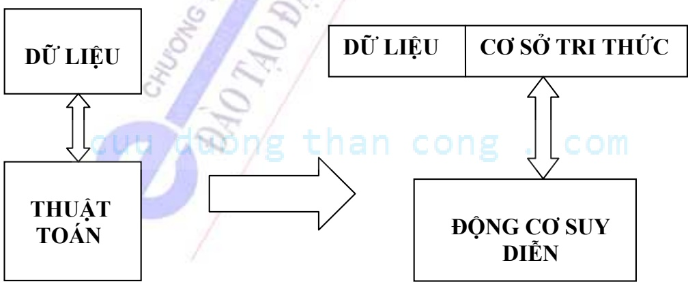

Động cơ suy diễn: là phương pháp vận dụng tri thức trong cơ sở tri thức để giải quyết vấn đề.

<!-- page: 11 -->

# 1.4 CÁC LĨNH VỰC NGHIÊN CỨU VÀ ỨNG DỤNG CƠ BẢN

## 1.4.1 Lý thuyết giải bài toán và suy diễn thông minh

Lý thuyết giải bài toán cho phép viết các chương trình giải câu đố, chơi các trò chơi thông qua các suy luận mang tính người. Hệ thống giải bài toán GPS do Newel, Shaw và Simon đưa ra rồi được hoàn thiện năm 1969 là một mốc đáng ghi nhớ. Trước năm 1980, Buchanal và Luckham cũng hoàn thành hệ thống chứng minh định lý. Ngoài ra các hệ thống hỏi đáp thông minh như SỈ, QA2, QA3,.. cho phép lưu trữ và xử lý khối lượng lớn các thông tin. Chương trình của McCarthy về các phương án hành động có khả năng cho các lời khuyên.

## 1.4.2 Lý thuyết tìm kiếm may rủi

Việc tìm kiếm lời giải cũng là việc bài toán. Lý thuyết tìm kiếm nhờ may rủi gồm các phương pháp và kỹ thuật tìm kiếm với sự hỗ trợ của thông tin phụ để giải bài toán một cách hiệu quả. Công trình đáng kể về lý thuyết này là của G.Pearl vào năm 1984.

## 1.4.3 Các ngôn ngữ về Trí Tuệ Nhân Tạo

Để xử lý các tri thức người ta không thể chỉ sử dụng các ngôn ngữ lập trình dùng cho các xử lý dữ liệu số mà cần có các ngôn ngữ khác. Các ngôn ngữ chuyên dụng này cho phép lưu trữ và xử lý các thông tin kí hiệu. Dùng các ngôn ngữ này cũng là cách để trả lời câu hỏi “ thế nào” (what). rồi tới câu hỏi “làm sao vậy”(how). Một số ngôn ngữ được nhiều người biết đến là:

• Các ngôn ngữ IPL.V, LISP.

Ngôn ngữ mạnh hơn như PLANNER, PROLOG. Ngay trong một ngôn ngữ cũng có nhiều thế hệ với những phát triển đáng kể.

## 1.4.4 Lý thuyết thể hiện tri thức và hệ chuyên gia

Theo quan điểm của nhiều chuyên gia công nghệ thông tin, trí tuệ nhân tạo là khoa học về thể hiện tri thức và sử dụng tri thức. Người ta nhận xét về phương pháp thể hiện tri thức như sau:

• Lược đồ dùng thể hiện tri thức trong chương trình

Mạng ngữ nghĩa, logíc vị từ , khung, mạng là các phương pháp thể hiện tri thức một cách thông dụng.

Dùng khung để thể hiện tri thức chắc chắn là phương pháp có nhiều hữa hẹn trong các năm gần đây.

Việc gắn liền cách thể hiện và sử dụng tri thức là cơ sở hình thành hệ chuyên gia. Vậy nên phải kết hợp các quá trình nghiên cứu các quy luật, thiết kế và xây dựng hệ chuyên gia. Tuy nhiên cho đên nay, đa số các hệ chuyên gia mới thuộc lĩnh vực y học.

## 1.4.5 Lý thuyết nhận dạng và xử lý tiếng nói

Giai đoạn phát triển đầu của trí tuệ nhân tạo gắn liền với lý thuyết nhận dạng. Các phương pháp nhận dạng chính được giới thiệu gồm:

• Nhận dạng dùng tâm lý học

• Nhận dạng hình học

Nhận dạng theo phương pháp hàm thế.

• Dùng máy nhận dạng

<!-- page: 12 -->

Ứng dụng của phương pháp này trong việc nhận dạng trong chữ viết, âm thanh, hình ảnh… cho đến ngay đã trở nên quen thuộc. Người ta đã có hệ thống xử lý hình ảnh ba chiều, hệ thống tổng hợp tiếng nói.

Do khối lượng đồ sộ của tri thức về lý thuyết nhận dạng. các chương trình sau chưa đề cập đến các phương pháp nhận dạng được.

## 1.4.6 Người máy

Cuối những năm 70, người máy trong công nghiệp đã đạt được nhiều tiến bộ “ Khoa học người máy là nối kết thông minh của nhận thức với hành động”. Người máy có bộ cảm nhận và các cơ chế hoạt động được nối ghép theo sự điều khiển thông minh. Khoa học về cơ học và trí tuệ nhân tạo được tích hợp trong khoa học về người máy. Các đề án trí tuệ nhân tạo nghiên cứu về người máy bắt đầu từ đề án “mắt – tay”. Trong thực tế, người máy được dùng trong các nhiệm vụ chuyên sâu, thuộc các dây truyền công nghiệp.

Nội dung về khoa học người máy sẽ được trình bày trong tài liệu riêng, không thuộc các chương của tài liệu này.

## 1.4.7 Tâm lý học xử lý thông tin

Các kết quả nghiên cứu của tâm lý học giúp trí tuệ nhân tạo xây dựng các cơ chế trả lời theo hành vi, có ý thức. Nó giúp thực hiện các suy diễn mang tính người.

Hệ thống chuyên gia thương mại đầu tiên, R1, bắt đầu hoạt động tại công ty thiết bị kĩ thuật số (McDemott, 1982). Chương trình giúp sắp xếp cấu hình cho các hệ thống máy tính mới và trước năm 1986, nó đã tiết kiệm cho công ty khoảng 40 triệu dollar mỗi năm. Đến trước năm 1988, nhóm nghiên cứu AI của DEC đã có 40 hệ thống chuyên gia được triển khai. Du pont có 100 chiếc đi vào sử dụng và 500 chiếc được phát triển, tiết kiệm được khoảng 10 triệu dollar mỗi năm. Dường như mỗi một công ty chính của Mĩ đều có một nhóm AI của riêng công ty và cùng sử dụng hoặc đầu tư vào công nghệ hệ chuyên gia.

Năm 1981, Nhật bản thông báo về dự án “Thế hệ thứ năm”, kế hoạch 10 năm xây dựng những chiếc máy tính thông minh chạy Prolog giống như những chiếc máy chạy chương trình mã máy. Ý tưởng đó với khả năng thực hiện hàng triệu phép tính mỗi giây, máy tính có thể thuận lợi trong việc lưu trữ hàng loạt luật có sẵn. Dự án được đưa ra nhằm máy tính có thể giao tiếp bằng ngôn ngữ tự nhiên cùng một số các tham vọng khác.

Dự án “thế hệ 5” thúc đẩy niềm đam mê vào AI, bằng cách tận dụng nỗi lo lắng của người Nhật, các nhà nghiên cứu, các tổng công ty có thể hỗ trợ chung cho việc đầu tư tương tự như ở nước Mĩ. Tổng công ty công nghệ máy tính và siêu điện tử (MMC) đã được hình thành như một công ty liên kết nghiên cứu dự án của Nhật. Ở Anh, bài báo Alvey làm phục hồi số vốn đã bị bài báo Lighthill làm hụt. Trong cả hai trường hợp, thì AI đều là một phần trong nỗ lực lớn bao gồm cả thiết kế con chip và nghiên cứu giao diện với con người.

Bùng nổ công nghiệp AI cũng bao gồm cả các công ty như tập đoàn Carnegie, Inference, Intellicorp, và Teknowledge các công ty này yêu cầu các công cụ phần mềm để xây dựng hệ chuyên gia và các công ty phần cứng như Lisp Machine, công ty thiết bị Texas, Symbolic và Xerox đã xây dựng hệ thống làm việc tối ưu để phát triển các chương trình Lisp. Trên 100 công ty lắp ráp hệ thống công nghiệp robot. Nói chung ngành công nghiệp đi từ mức chỉ bán được vài triệu trong năm 1980 lên 2 tỉ dollar năm 1988.

Mặc dù khoa học máy tính bỏ quên lĩnh vực mạng nơ ron sau khi cuốn sách “khả năng nhận thức” của Minsky và Papert ra đời, nhưng các lĩnh vực khác vẫn tiếp tục, đặc biệt là vật lý. Một số

<!-- page: 13 -->

lượng lớn các nơ ron đơn giản đã có thể coi như một số nguyên tử trong chất rắn. Các nhà vật lý học như Hopfield (1982) đã sử dụng các kĩ thuật cơ học thống kê dẫn tới các ý tưởng thụ thai chéo quan trọng. Các nhà triết học David Rumelhart và Geoff Hinton nghiên cứu các mẫu mạng nơ ron trí nhớ. Vào những năm 1980, có ít nhất bốn nhóm khác nhau nghiên cứu lại thuật toán Back-propagation. Thuật toán này được công bố lần đầu vào năm 1969 bởi Bryson và Ho. Thuật toán được áp dụng rất nhiều trong khoa học máy tính và tâm lý học, và phổ biến kết quả trong cuốn “xử lý phân tán song song” (Rumelhart và McClelland, 1986).

Những năm gần đây, chúng ta đã chứng kiến sự thay đổi rất lớn trong nội dung và phương pháp nghiên cứu AI. Nó trở nên phổ biến khi dựa trên các lý thuyết có sẵn. Trong những năm 1970, một số lớn các kiến trúc và các phương pháp đã buộc phải thử. Rất nhiều trong số này, thậm trí là ad hoc và fragile và được tượng trưng ở một vài ví dụ được chọn là đặc biệt. Trong những năm gần đây, các phương pháp dựa trên mô hình Markov ẩn (HMMs) đã thống trị lĩnh vực này, hai khía cạnh của HMMs có liên quan đến những vấn đề bàn luận hiện tại. Đầu tiên, chúng được dựa trên lý thuyết toán học chính xác. Điều này cho phép các nhà nghiên cứu tiếng nói xây dựng các kết quả toán học của một vài thập kỉ đã được phát triển ở một số lĩnh vực khác. Thứ hai, chúng đã được sinh ra bởi một quá trình xử lý trên tập dữ liệu tiếng nói. Chắc chắn rằng thực hiện đó là dạng thô, và trong các trắc nghiệm HMMs khắt khe không rõ ràng đã tiến triển đều đặn.

Lĩnh vực khác xem ra có lợi ích từ sự chính thức hoá là lập kế hoạch. Công việc sớm được thực hiện bởi Austin Tate (1977), sau đó là David Chapman (1987) đã có kết quả trong sự tổng hợp của các chương trình lập kế hoạch vào một khung làm việc đơn giản. Đã có một vài lời khuyên rằng nên xây dựng trên mỗi cái khác nhau hơn là bắt đầu từ con số không tại mỗi thời điểm. Kết quả của các hệ thống lập kế hoạch đó chỉ thực sự tốt trong các thế giới thu hẹp, trong năm 1970 nhiệm vụ lập lịch cho công việc của nhà máy. Xem Chương 11 và 12 để biết thêm chi tiết.

Cuốn Tranh luận theo xác suất trong các hệ thống thông minh đã đánh dấu một sự tán thưởng của lý thuyết quyết định và xác suất trong AI, tiếp theo sự hồi sinh của một sự thu nhỏ lí thú theo bài báo “Trong biện hộ của xác suất” của Peter Cheeseman (1985). Tin tưởng rằng hình thức mạng là phát minh đã cho phép tranh luận hiệu quả về chứng minh của sự phối hợp không chắc chắn. Cách tiếp cận lớn này vượt qua được vấn đề các hệ thống lập luận có khả năng trong những năm 1960 đến 1970... Chương 14 tới 16 bàn tới lĩnh vực này.

Cũng tương tự như cuộc cách mạng trong lĩnh vực người máy, khả năng của máy tính, máy học (bao gồm cả các mạng neural) và sự trình diễn tri thức. Một cách hiểu tốt nhất của các vấn đề và sự phức tạp các thuộc tính, phối hợp cùng với sự ngụy biện đã gia tăng trong toán học, đã có sự chỉ đạo về lịch nghiên cứu công việc có khả năng và các phương pháp dạng thô. Có lẽ được khuyến khích bởi sự tiến triển trong giải quyết các vấn đề con của AI, các nhà nghiên cứu đã bắt đầu tìm kiếm “yếu tố đầy đủ” cho vấn đề. Công việc của Allen Newel, John Laird và Paul Rosenbloom ở SOAR (Newel, 1990; Laird 1987) là những ví dụ hiểu biết tốt nhất của một yếu tố hoàn chỉnh về kiến trúc trong AI. Cũng gọi là hành động có mục đích “trong những hoàn cảnh xác định” của các yếu tố đưa vào trong các môi trường thực tế với các đầu vào cảm biến liên tục. Nhiều kết quả lý thú đã được tìm thấy trong công việc; bao gồm sự thực rằng trước đó các lĩnh vực con riêng biệt của AI cần tái tạo lại cái gì đó khi mà các kết quả của họ là cùng chỗ trong thiết kế một yếu tố riêng rẽ.

<!-- page: 14 -->

## 1.5 NHỮNG VẤN ĐỀ CHƯA ĐƯỢC GIẢI QUYẾT TRONG TRÍ TUỆ NHÂN TẠO

Kiện tướng cờ vua quốc tế Amold Denker, nghiên cứu các quân cờ trên bàn cờ trước mặt ông ta. Ông ta không hy vọng là hiện thực: ông phải từ bỏ cuộc chơi. Đối thủ của ông, HITECH, đã trở thành chương trình máy tính đầu tiên đánh thắng một kiện tướng cờ trong một ván chơi (Berliner, 1989).

“Tôi muốn đi từ Boston tới San Francisco” một người du lịch nói trong micro. “Bạn sẽ đi vào thời gian nào?” là câu hỏi lại. Người du lịch giải thích rằng cô ấy muốn đi vào ngày 20 tháng 10, trên chuyến rẻ nhất có thể, và trở về vào ngày Chủ nhật. Một chương trình giao tiếp bằng tay có thể hiểu được hành động nói của người là PEGASUS, đó là kết quả khiêm tốn dùng để đặt chỗ chuyến đi du lịch với giá 894 dollar bằng xe khách đường dài. Mặc dù vậy chương trình nhận biết tiếng nói có quá 10 từ bị sai, nó có thể là sự tổng hợp từ các lỗi nhỏ bởi vì sự hiểu của nó từ các hội thoại là đưa vào cùng một lúc (Zue 1994).

Một phân tích từ nơi điều khiển các nhiệm vụ của phòng thí nghiệm Jet Propulsion bắt đầu xu hướng thanh toán. Một thông báo màu đỏ xuất hiện trên màn hình chỉ ra rằng “sự không bình thường” với người du hành trên tàu không gian, đó là một nơi nào đó trong vùng xung quanh sao Hải vương. May thay, vấn đề phân tích có thể đúng từ mặt đất. Những người điều khiển tin tưởng rằng có vấn đề phải được bỏ qua đó là MARVEL, một hệ chuyên gia thời gian thực có các màn hình, dòng dữ liệu thô được chuyển từ tàu không gian, các công việc điều khiển chương trình và phân tích cảnh báo đối với những vấn đề nghiêm trọng

## TỔNG KẾT

Chương này đưa ra các định nghĩa về AI và thiết lập lại các cơ sở của nó, đó là sự phát triển. Một số các điểm quan trọng đáng lưu ý như sau:

Người ta nghĩ về AI có khác nhau. Có hai câu hỏi quan trọng đó là: bạn có quan tâm đến suy nghĩ hoặc hành vi? và Bạn có muốn hình mẫu con người hoặc từ một ý tưởng chuẩn mực?

Các nhà triết học (quay trở lại năm 400 tr.CN) đưa ra ý kiến cho rằng não bộ cũng như một chiếc máy, rằng nó được điều khiển bằng tri thức đã được mã hoá, và ý nghĩ có thể mang theo thói quen giúp đỡ những hành động đúng đắn.

Một số nhà toán học đã cung cấp những công cụ các lệnh tính toán logic chắc chắn cũng tốt như là không chắc chắn, các lệnh không chính xác. Họ cũng đặt cơ sở làm việc cho các thuật toán.

Ngành tâm lý học củng cố thêm ý tưởng rằng loài người và động vật có thể đưa ra cách xử lý thông tin máy móc. Ngành ngôn ngữ học trình bày rằng ngôn ngữ đủ để dùng trong mô hình này.

Ngành công nghiệp máy tính cung cấp các ứng dụng của AI. Các chương trình AI có xu hướng khá lớn, và họ không làm việc được nếu máy tính không có đủ tốc độ và bộ nhớ cần thiết.

Lịch sử của AI có các chu kì thành công, tối ưu hoá đặt không đúng chỗ, và kết quả dẫn đến giảm lòng nhiệt tình và chi phí. Cũng đã có những bước lặp chỉ ra được các cách tiếp cận mới và trau dồi có hệ thống trong số các cách đó.

Những tiến triển gần đây trong học thuyết căn bản về sự thông minh đã tiến bộ cùng với khả năng của các hệ thống thực tế.

**Những điểm chú ý về tiểu sử và lịch sử**

<!-- page: 15 -->

Cuốn sách Artificial Intelligence của Daniel Crevier (1993) đưa ra lịch sử khá hoàn chỉnh của lĩnh vực này, và Age of Intelligent Machines của Raymond Kurzweil (1990) về AI trong ngữ cảnh của khoa học máy tính và lịch sử trí tuệ. Các văn bản của Dianne Martin (1993) cũng công nhận rằng từ rất sớm các máy tính là có khả năng bởi sức mạnh thần kỳ của trí tuệ.

Phương pháp luận trạng thái của AI được Herb Simon bàn tới trong The Sciences of the Artificial (1981), đó là các lĩnh vực nghiên cứu được quan tâm cùng với các đồ tạo tác phức tạp. Nó cũng lý giải tại sao AI có thể có tầm nhìn trên cả hai lĩnh vực toán học và khoa học.

Artificial Intelligence: The very Idea bởi John Haugeland (1985) đã đưa ra sự tường thuật có thể đọc được của triết học và các vấn đề của AI. Khoa học nhận thức được mô tả tốt nhất bởi Johnson Laird, Máy tính và não bộ: giới thiệu về khoa học nhận thức. Baker (1989) gồm cả phần cú pháp của ngôn ngữ học hiện đại, cùng Chierchia và McConnel-Ginet (1990) bao gồm cả ngữ nghĩa, Allen (1995) bao gồm cả ngôn ngữ học từ quan điểm của AI.

Feigenbaum và Feldman đã làm việc với AI từ rất sớm, cuốn sách của họ có tựa đề Máy tính và suy nghĩ. Cuốn Xử lý thông tin ngữ nghĩa của Minsky và một loạt bài viết về Trí tuệ máy của Donald Michie. Một số lượng lớn các trang báo được tập hợp lại trong Sự hiểu biết trong AI (Webber và Nilsson, 1981).

Các cuộc hội thảo xuất hiện gần đây bàn về vấn đề chính của AI, đó là: thống nhất cứ hai năm một lần diễn ra hội thảo quốc tế AI, gọi tắt là IJCA (International Joint Conference AI), và hội thảo diễn ra hàng năm ở mức quốc gia về AI, và AAAI là tổ chức đứng ra bảo trợ cho AI. Các tạp chí chuyên ngành chung về AI là AI, Computation Intelligence, tổ chức IEEE Transactions on Pattern Analysis and Machine Intelligence, và tạp chí điện tử Journal of Artificial Intelligence Research. Các sản phẩm thương mại đưa ra trong các tạp chí như AI Expert và PC AI. Tổ chức xã hội chuyên nghiệp về AI là American Association for AI (AAAI), ACM Special Interest Group in AI (SIGART) và AISB (Society for AI and Simulation of Behaviour). Tạp chí về AI của AAAI và SIGART Bullentin có rất nhiều các đề tài và thầy hướng dẫn tốt như là thông báo của các cuộc hội thảo và thảo luận.

Ở Việt Nam gần đây có tổ chức các Hội nghi Khoa học: Hệ mờ mạng nơ ron; Hoi thảo Quốc gia vè Hệ mờ do viện Toan học, Viện Công nghệ Thông tin thuộc viện Khoa học Công nghệ Quốc gia tổ chức hàng năm.

## BÀI TẬP VÀ CÂU HỎI

1. Chúng tôi đưa ra định nghĩa của AI theo hai khía cạnh, con người, ý tưởng và hành động. Nhưng có nhiều khía cạnh khác có giá trị đáng xét đến. Một trong số đó là sự chọn lựa giữa: sự phấn khích của chúng tôi về các kết quả lí thuyết hoặc các ứng dụng thực hành. Một khía cạnh nữa là chúng tôi có dự kiến có thể nhận ra các máy tính của chúng tôi có thông minh hay không. Đã có 8 định nghĩa tiêu biểu trong Hình 1.1 và có 7 định nghĩa theo bốn khía cạnh chúng tôi vừa đề cập và bạn có cảm thấy các định nghĩa là hữu ích sau đây

AI là ...

a. “một tập hợp các thuật toán dễ tính toán, thích hợp tính gần đúng cho các bài toán đặc biệt khó .” (Partridge, 1991)

b. “sự tham gia vào xây dựng một hệ thống kí hiệu vật lí sao cho có thể vượt qua trắc nghiệm của Turning.”

c. “lĩnh vực khoa học máy tính nghiên cứu về các máy có thể hành động thông minh ra sao.” (Jackson, 1986)

<!-- page: 16 -->

d. “một lĩnh vực nghiên cứu đó là xoay quanh các kĩ thuật tính toán, cho phép thực hiện các công việc đòi hỏi thông minh thực sự khi có con người tham dự.” (Tanimoto, 1990)

e. “một sự đầu tư rất lớn của trí tuệ của tự nhiên và các nguyên lí, các máy móc yêu cầu sự am hiểu hoặc tái tạo nó .” (Sharples , 1989)

f. “Lợi ích của máy tính là làm được mọi thứ, xem nó như là thông minh.” (Rowe, 1988)

2. Nghiên cứu tài liệu AI để tìm ra các công việc nào dưới đây có thể giải quyết được bằng máy tính:

a. Trò chơi bóng bàn

b. Lái xe ở trung tâm Cairô

c. Khám phá và chứng minh các lý thuyết toán học mới.

d. Viết một truyện cười

e. Đưa ra một lời khuyên khá hợp lý trong phạm vi liên quan đến luật pháp.

f. Dịch tiếng Anh sang tiếng Việt theo thời gian thực.

3. Thực tế, hư cấu và dự đoán:

a. Tìm một bản công bố của một nhà triết học hoặc nhà khoa học có uy tín cho rằng hiệu quả của độ chắc chắn sẽ không bao giờ được trình diễn bởi máy tính, rằng ở đó bây giờ đã được trình diễn.

b. Tìm một công bố của một nhà khoa học về máy tính có uy tín cho rằng hiệu quả của độ đo chắc chắn được trình diễn bởi thời điểm từ khi nó hợp qui cách.

c. So sánh độ chính xác của những dự đoán trong các lĩnh vực khác nhau, chẳng hạn như y sinh, công nghệ nano, hoặc điện gia dụng.

4. Cho rằng “những chiếc máy tính là không thông minh - chúng chỉ có thể làm được những gì mà lập trình viên bảo chúng” là câu lệnh phần trước thì đúng và hàm ý sau đó không đúng?

<!-- page: 17 -->

# CHƯƠNG 2: CÁC PHƯƠNG PHÁP GIẢI QUYẾT VẤN ĐỀ

## 2.1. GIẢI QUYẾT VẤN ĐỀ KHOA HỌC VÀ TRÍ TUỆ NHÂN TẠO

Trong phần này, chúng ta chỉ ra một agent có thể hành động như thế nào bằng cách đặt ra mục tiêu và xem xét chuỗi các hành động mà có thể đạt được những mục tiêu này. Một mục tiêu và tập các phương tiện để đạt được mục tiêu được gọi là vấn đề. Quá trình khám phá các phương tiện có thể làm được gì gọi là tìm kiếm. Chúng ta cho thấy tìm kiếm có thể thực hiệhie và những giới hạn của nó..

## Giải quyết bài toán bằng cách tìm kiếm

Chúng ta xem một agent quyết định phải làm gì? như thế nào? bằng cách xem xét có hệ thống kết quả các chuỗi hành động mà nó thực hiện.

Trong chương này, chúng ta mô tả một agent dựa trên mục đích gọi là **agent giải quyết bài toán**. Các agent giải quyết vấn đề sẽ quyết định phải làm gì bằng cách tìm kiếm chuỗi các hành động dẫn đến trạng thái mong muốn. Chương này phân tích các thuật toán.

## 2.2. GIẢI QUYẾT VẤN ĐỀ CỦA CON NGƯỜI

Hãy tưởng tượng các agent của chúng ta ở trong thành phố Arad, Rumani đang thực hiện một chuyến du lịch. Agent đã có vé để bay đến Bucarét vào ngày hôm sau. Vé máy bay không thể trả lại được, visa của agent chuẩn bị hết hạn, và kể từ ngày mai sẽ không còn chỗ trong 6 tuần tới. Phạm vi thực hiện của agent chứa nhiều yếu tố khác ngoài chi phí tiền vé máy bay và có một điều không mong muốn là có thể bị trục xuất. Chẳng hạn, agent muốn cải thiện nước da rám nắng của mình, học thêm tiếng Rumani, đi chơi đâu đó vv… Tất cả những yếu tố này có thể gợi ra vô số các hành động.

Agent đưa ra mục tiêu: lái xe tới Bucarét, và xem những thành phố nào cần phải đếcaa, xuất phát từ Arad. Có ba con đường ra khỏi Arad, một đường đến Sibiu, một đường đến Timisoara và một đến Zerind. Tất cả các con đường này đều không đến Bucaret, vì vậy trừ khi agent nắm rõ bản đồ Rumani, agent sẽ không biết phải đi con đường nào tiếp theo. Nói cách khác, agent không biết hành động nào là tốt nhất trong các hành động. Nếu agent không có các kiến thức trợ giúp, nó sẽ bị tắc (không tìm ra được đường đi tiếp theo). Cách tốt nhất nó có thể làm là chọn ngẫu nhiên một trong các hành động.

Giả thiết agent có một bản đồ Rumani, hoặc trên giấy hoặc trong trí nhớ. Mục đích của bản đồ là cung cấp cho agent các thông tin về các trạng thái mà nó có thể đến và những hành động mà nó có thể thực hiện. Agent có thể sử dụng thông tin này để xem xét các các đoạn của hành trình mang tính giả thiết là: khi nó tìm ra một con đường trên bản đồ từ Arad tới Bucaret, nó có thể đạt mục tiêu bằng cách thực hiện các hành động tương ứng với các chặng của hành trình. Sau đó agent lựa chọn các giá trị chưa biết để quyết định phải làm gì bằng cách kiểm tra chuỗi các hành động khác nhau dẫn đến các trạng thái đã biết; sau đó chọn hành động tốt nhất. Quá trình tìm kiếm một chuỗi các hành động như vậy được gọi là tìm kiếm. Giải thuật tìm kiếm coi một vấn đề như dữ liệu vào và đáp số là một giải pháp dưới dạng chuỗi hành động. Khi một giải pháp được tìm thấy, các hành động mà nó đề xuất có thể được tiến hành. Điều này được gọi là giai đoạn thực hiện

<!-- page: 18 -->

Trong phần này, chúng ta sẽ tìm hiểu quá trình xác định bài toán chi tiết hơn. Trước tiên, ta xem xét khối lượng kiến thức mà agent có thể có sử dụng để hướng đến các hành động của nó và trạng thái mà nó phải đi qua. Điều này phụ thuộc vào sự nhận thức của agent với môi trường của nó như thế nào thông qua kết quả giác quan và hành động của nó. Chúng ta biết có bốn loại bài toán khác nhau: bài toán một trạng thái đơn giản; bài toán đa trạng thái; bài toán ngẫu nhiên và bài toán thăm dò

## 2.3. PHÂN LOẠI VẤN ĐỀ. CÁC ĐẶC TRƯNG CƠ BẢN CỦA VẤN ĐỀ

## Những vấn đề (bài toán) xác định rõ ràng và các giải pháp

Một vấn đề là một tập hợp các thông tin mà agent sử dụng để quyết định phải làm gì. Chúng ta bắt đầu bằng cách phân loại các thông tin cần thiết dùng cho định nghĩa bài toán đơn trạng thái.

Các yếu tố cơ bản của việc định nghĩa một bài toán là các trạng thái và các hành động. Để xác định được chúng một cách chính xác, chúng ta cần các yếu tố sau:

**Trạng thái ban đầu của agent.** Tập các hành động có thể đối với agent. Thuật ngữ thao tác (operation) được sử dụng để mô tả một hành động trong ngữ cảnh là trạng thái nào nó sẽ đến nếu thực hiện hành động trong từ một trạng thái đặc biệt. (Một công thức sử dụng hàm S. Cho trước trạng thái x, S(x) cho trạng thái có thể đi tới từ x bằng bất cứ một hành động đơn).

**Định nghĩa: không gian trạng thái của vấn đề**: là tập các trạng thái có thể đạt được bằng chuỗi hành động bất kỳ xuất phát từ trạng thái ban đầu. Một hành trình trong không gian trạng thái là tập các hành động tuỳ ý xuất phát từ trạng thái này đến trạng thái khác.

Yếu tố tiếp theo của vấn đề như sau: tiêu chuẩn kiểm tra trạng thái hiện thời là trạng thái đích (mục tiêu)? Việc kiểm tra đơn giản chỉ là để nhằm kiểm tra xem chúng ta đã đi tới một trong các trạng thái mục tiêu hay chưa. Thỉnh thoảng mục tiêu được xác định bởi một thuộc tính trừu tượng thay vì một tập đếm được các trạng thái. Chẳng hạn, trong môn đánh cờ, mục tiêu là đi tới một trạng thái gọi là “chiếu tướng”, khi tướng của đối phương sẽ bị ăn bất kể đối phương đi như thế nào ở bước kế tiếp.

Cuối cùng, chọn giải pháp thích hợp nhất, dù có nhiều giải pháp tới đích. Ví dụ, chúng ta có thể thích những hành trình có ít hành động hoặc các hành động có chi phí thấp.

Hàm chi phí đường đi là hàm được gán chi phí cho một đường đi. Trong tất cả các trường hợp chi phí của đường đi là tổng các chi phí của các hành động đơn dọc theo đường đi. Hàm chi phí đường đi thường được ký hiệu là hàm g. Trạng thái ban đầu, tập toán tử, thủ tục kiểm tra mục tiêu và hàm chi phí đường đi xác định một vấn đề. Về mặt tự nhiên, chúng ta có thể xác định một kiểu dữ liệu để biểu diễn các vấn đề:

## Kiu d liu Bi toán

Các thành phn**: Trng thái ban u, các toán t, kim tra mc tiêu, hm chi phí ng i**

## Giải quyết vấn đề

Hiệu quả của tìm kiếm có thể đo được theo ít nhất ba chỉ tiêu Thứ nhất, có tìm thấy một giải pháp nào không? Thứ hai, đó có phải là một giải pháp tốt không (giải pháp có chi phí đường đi

<!-- page: 19 -->

thấp)? Thứ ba, chi phí tìm kiếm với thời gian tìm kiếm và bộ nhớ yêu cầu để tìm một giải pháp là bao nhiêu? Chi phí toàn bộ của việc tìm kiếm là tổng chi phí đường đi và chi phí tìm kiếm (S).

Đối với vấn đề tìm đường đi từ Arad đến Bucarét, chi phí đường đi tỷ lệ thuận với tổng độ dài của đường, cộng thêm chi phí do sự cố dọc đường. Chi phí tìm kiếm phụ thuộc vào các tình huống. Trong môi trường tĩnh, nó bằng không vì phạm vi thực hiện là độc lập với thời gian. Nếu phải cấp tốc đến Bucarét, môi trường là bán động bởi vì việc cân nhắc lâu hơn sẽ làm chi phí nhiều hơn. Trong trường hợp này, chi phí tìm kiếm có thbi ì ến thiên xấp xỉ tuyến tính với thời gian tính toán(ít nhất với một khoảng thời gian nhỏ). Do đó, để tính toán tổng chi phí, chúng ta cần phải bổ sung thêm các giá trị là dặm và mili giây. Điều này không phải luôn dễ dàng bởi vì không có một “tỷ lệ trao đổi chính thức” giữa hai đại lượng này. Agent bằng cách nào đó phải quyết định những tài nguyên nào sẽ dành cho việc tìm kiếm và những tài nguyên nào dành cho việc thực hiện. Đối với những vấn đề có không gian trạng thái rất nhỏ, dễ dàng tìm ra giải pháp với chi phí đường đi thấp nhất. Nhưng đối với những vấn đề phức tạp, lớn, cần phải thực hiện một sự thoả hiệp- agent có thể tìm kiếm trong một thời gian dài để tìm ra giải pháp tối ưu hoặc agent có thể tìm kiếm trong một thời gian ngắn hơn và nhận được một giải pháp với chi phí đường đi cao hơn một chút. Chọn lựa trạng thái và hành động

Bây giờ chúng ta có các định nghĩa mới, chúng ta hãy bắt đầu sự điều tra các vấn đề của chúng ta với một vấn đề khá dễ như sau: “ Lái xe từ Arad đến Bucarét sử dụng các con đường trên bản đồ” Một không gian trạng thái có xấp xỉ 20 trạng thái, mỗi trạng thái được xác định bởi vị trí, được ghi rõ là một thành phố. Như vậy, trạng thái ban đầu là “ở Arad” và kiểm tra mục tiêu là “đây có phải là Bucarét không?”. Các toán hạng tương ứng với việc lái dọc theo các con đường giữa các thành phố.

## Các bài toán ví dụ

Phạm vi của các môi trường nhiệm vụ mà có thể được mô tả đặc điểm bởi các vấn đề được định nghĩa rõ ràng là rất rộng lớn. Chúng ta có thể phân biệt giữa cái gọi là **các bài toán trò chơi**, mà nhằm để minh hoạ hay thực hành rất nhiều các phương pháp giải quyết vấn đề, và cái gọi là các **bài toán thuộc thế giới thực** mà sẽ là các vấn đề khó khăn hơn và mọi người thực sự quan tâm đến các giải pháp để giải quyết các vấn đề này. Trong phần này, chúng ta sẽ đưa ra ví dụ cho cả hai loại vấn đề đó. Các vấn đề đồ chơi tất nhiên có thể mô tả một cách chính xác, ngắn gọn. Điều đó có nghĩa là các nhà nghiên cứu khác nhau có thể dễ dàng sử dụng các vấn đề này để so sánh việc thực hiện của các giải thuật. Ngược lại, các vấn đề thế giới thực lại không thể có một sự miêu tả một cách đơn giản, nhưng chúng ta sẽ cố gắng đưa ra một cách chung nhất về sự mô tả chính xác các vấn đề này.

## Các bài toán Trò chơi

## Trò chơi 8 quân cờ (Cờ ta canh)

Một ví dụ của trò chơi 8 quân cờ được chỉ ra trong hình 2.1, gồm một bảng kích thước 3 x 3 với 8 quân cờ được đánh số từ 1 đến 8 và một ô trống. Một quân cờ đứng cạnh ô trống có thể đi vào ô trống. Mục tiêu là tiến tới vị trí các quân cờ như ở trong hình bên phải. Một mẹo quan trọng cần chú ý là thay vì dùng các toán tử như “ chuyển quân cờ số 4 vào ô trống”, sẽ tốt hơn nếu có các toán tử như “ ô trống thay đổi vị trí với quân cờ chuyển sang bên trái của nó”, bởi vì loại toán tử thứ hai này sẽ ít hơn. Điều đó sẽ giúp chúng ta có các khái niệm như sau:

Các trạng thái: một sự mô tả trạng thái chỉ rõ vị trí của mỗi quân cờ trong 8 quân cờ ở một trong 9 ô vuông. Để có hiệu quả, sẽ có ích nếu trạng thái bao gồm cả vị trí của ô trống.

• Các toán tử: ô trống di chuyển sang trái, phải, lên trên, đi xuống.

<!-- page: 20 -->

• Kiểm tra mục tiêu: trạng thái khớp với hình dạng chỉ ra ở hình 3.4

• Chi phí đường đi: mỗi bước đi chi phí là 1, vì vậy chi phí đường đi bằng độ dài của đường đi.

<table><tr><td colspan="3">Trạng thái đầu</td><td colspan="3">Trạng thái đích</td></tr><tr><td>1</td><td>2</td><td>3</td><td>1</td><td>2</td><td>3</td></tr><tr><td>7</td><td>4</td><td>6</td><td>4</td><td>7</td><td>6</td></tr><tr><td>5</td><td></td><td>8</td><td></td><td>5</td><td>8</td></tr></table>

Hình 2.1 Một ví của trò chơi 8 quân cờ

Trò chơi 8 quân cờ thuộc về loại trò chơi trượt khối. Lớp trò chơi này được biết đến có mức độ hoàn thành NP, vì vậy chúng ta không mong muốn tìm được các phương pháp tốt hơn các thuật toán tìm kiếm đã được mô tả trong chương này và trong các chương tiếp theo. Trò chơi 8 quân cờ và sự mở rộng của nó, trò chơi 15 quân cờ là những vấn đề kiểm tra tiêu chuẩn đối với các giải thuật tìm kiếm trong AI.

## Bài toán 8 quân hậu

Mục tiêu của bài toán 8 quân hậu là đặt 8 con hậu trên một bàn cờ vua sao cho không con nào ăn con nào. (Một con hậu sẽ ăn bất cứ con nào nằm trên cùng hàng, cùng cột hoặc cùng đường chéo với nó). Hình 2.2 chỉ ra một giải pháp cố gắng để giải quyết bài toán nhưng không thành công: con hậu ở cột bên phải nhất bị con hậu ở trên cùng bên trái chiếu.

Mặc dầu các giải thuật đặc biệt hiệu quả tồn tại để giải quyết bài toán này và tập các bài toán tổng quát n con hậu, nó thực sự vẫn là vấn đề rất thú vị dùng để kiểm tra các giải thuật tìm kiếm. Có hai hai loại phương pháp chính. Phương pháp gia tăng bao gồm việc đặt các con hậu từng con một, trong khi phương pháp trạng thái hoàn thành lại bắt đầu với 8 con hậu trên bàn cờ và tiến hành di chuyển các con hậu. Trong cả hai phương pháp, người ta không quan tâm đến chi phí đường đi do chỉ tính đến trạng thái cuối cùng: các giải thuật do đó chỉ được so sánh về chi phí tìm kiếm. Như vậy, chúng ta có việc kiểm tra mục tiêu và chi phí đường đi như sau:

**Hình 2.2** Gần như là một giải pháp đối với bài toán 8 con hậu. ( Giải pháp thực sự được dành cho bạn đọc tự làm như một bài tập.)

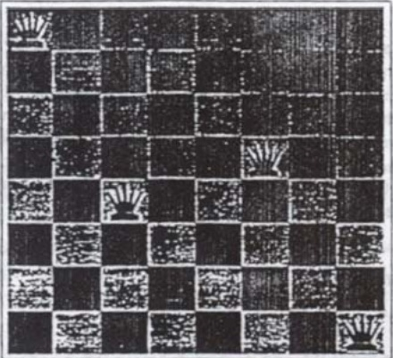

<!-- page: 21 -->

## Hình 2.2 Một giải pháp đối với bài toán 8 con hậu

◊ Kiểm tra mục tiêu: 8 con hậu trên bàn cờ, không con nào ăn con nào

◊ Chi phí đường đi: bằng không

◊ Cũng có các trạng thái và các toán tử có thể khác

.Hãy xem xét sự công thức hoá

◊ Các trạng thái: bất cứ sự sắp xếp của từ 0 đến 8 con hậu trên bàn cờ

◊ Các toán tử: thêm một con hậu vào bất cứ ô nào

Trong cách công thức hoá này, chúng ta có 648 dãy có thể để thử. Một sự lựa chọn khôn khéo sẽ sử dụng thực tế là việc đặt một con hậu vào ô mà nó đã bị chiếu sẽ không thành công bởi vì việc đặt tất cả các con hậu còn lại sẽ không giúp nó khỏi bị ăn(bị con hậu khác chiếu). Do vậy chúng ta có thể thử cách công thức hoá sau:

◊ Các trạng thái: là sự sắp xếp của 0 đến 8 con hậu mà không con nào ăn con nào

◊ Các toán tử: đặt một con hậu vào cột trống bên trái nhất mà nó không bị ăn bởi bất cứ con hậu nào khác.

Dễ thấy rằng các hành động đã đưa ra chỉ có thể tạo nên các trạng thái mà không có sự ăn lẫn nhau; nhưng đôi khi có thể không có hành động nào. Tính toán nhanh cho thấy chỉ có 2057 khả năng có thể để xếp thử các con hậu. Công thức hoá đúng đắn sẽ tạo nên một sự khác biệt rất lớn đối với kích thước của không gian tìm kiếm. Các sự xem xét tương tự cũng sẽ được áp dụng cho cách công thức hoá trạng thái đầy đủ. Chẳng hạn, chúng ta có thể thiết lập vấn đề như sau:

◊ Các trạng thái: là sự sắp xếp của 8 con hậu, mỗi con trên một cột.

◊ Các toán tử: di chuyển bất cứ con hậu nào bị chiếu tới một ô khác trên cùng cột.

Cách công thức này sẽ cho phép các giải thuật cuối cùng tìm ra một giải pháp, nhưng sẽ là tốt hơn nếu di chuyển tới ô bị chiếu.

## Các bài toán thế giới thực

## Tìm kiếm đường đi

Chúng ta đã xem việc tìm kiếm đường đi được định nghĩa như thế nào bằng các thuật ngữ chỉ các vị trí xác định và các phép di chuyển dọc theo các đường nối giữa chúng. Các giải thuật tìm kiếm đường đi được sử dụng trong rất nhiều các ứng dụng, như tìm đường đi trong các mạng máy tính , trong các hệ thống tư vấn du lịch tự động, và trong các hệ thống lập kế hoạch cho các chuyến du lịch bằng máy bay. ứng dụng cuối cùng có lẽ phức tạp hơn, bởi vì du lịch bằng máy bay có chi phí đường đi rất phức tạp, liên quan đến vấn đề tiền nong, chất lượng ghế ngồi, thời gian trong ngày, loại máy bay, các giải thưởng cho các lộ trình bay thường xuyên, v.v Hơn nữa, các hành động trong bài toán không có kết quả được biết đầy đủ: các chuyến bay có thể đến chậm hay đăng ký trước quá nhiều, có thể bị mất liên lạc, sương mù hoặc sự bảo vệ khẩn cấp có thể gây ra sự trì hoãn.

## Bài toán người bán hàng rong và các chuyến du lịch

Hãy xét bài toán kinh điển sau: “ Thăm tất cả các thành phố mỗi thành phố thăm ít nhất một lần, khởi hành và kết thúc ở Bucaret”. Điều này rất giống với tìm kiếm đường đi, bởi vì các toán tử vẫn tương ứng với các chuyến đi giữa các thành phố liền kề. Nhưng đối với bài toán này, không gian trạng thái phải ghi nhận nhiều thông tin hơn. Ngoài vị trí của agent, mỗi trạng thái phải lưu lại được các thành phố mà agent đã đi qua. Như vậy, trạng thái ban đầu sẽ là “ ở Bucaret: đã thăm{Bucaret}.”, một trạng thái trung gian điển hình sẽ là “ ở Vaslui: đã thăm {Bucaret,

<!-- page: 22 -->

Urziceni, Vaslui}.” và việc kiểm tra mục tiêu sẽ kiểm tra xem agent đã ở Bucaret chưa và tất cả 20 thành phố đã được viếng thăm xong toàn bộ chưa.

Bài toán người bán hàng rong (TSP) là một bài toán du lịch nổi tiếng trong đó mỗi thành phố phải được viếng thăm đúng chính xác một lần. Mục đích là tìm hành trình ngắn nhất. 6 Bài toán có độ phức tạp NP(Karp,1972), nhưng đã có một sự cố gắng rất lớn nhắm cải thiện khả năng của các thuật toán TSP. Ngoài các chuyến đi đã được lập kế hoạch cho người bán hàng rong, những thuật toán này đã được sử dụng cho các nhiệm vụ như lập kế hoạch cho sự dịch chuyển của các mũi khoan trên trên bảng mạch một cách tự động.

## Bài toán hành trình ngắn nhất - ứng dụng nguyên lý tham lam (Greedy)

Bài toán: Hãy tìm một hành trình cho người giao hàng đi qua n điểm khác nhau, mỗi điểm đi qua một lần và trở về điểm xuất phát sao cho tổng chiều dài đoạn đường cần đi là ngắn nhất. Giả sử rằng có con đường nối trực tiếp từ giữa hai điểm bất kỳ.

Tất nhiên là có thể giải bài toán này bằng cách liệt kê tất cả các con đường có thể đi, tính chiều dài của mỗi con đường đó rồi tìm con đường có chiều dài ngắn nhất. Tuy nhiên cách giải này có độ phức tạp O(n!) Do đó, khi số đại lý tăng thì số con đường phải xét sẽ tăng lên rất nhanh.

Một cách đơn giản hơn nhiều cho kết quả tương đối tốt là ứng dụng thuật toán heuristic ứng dụng nguyên lý tham lam Greedy. Tư tưởng của thuật giải như sau:

• Điểm khởi đầu, ta liệt kê tất cả các quãng đường từ điểm xuất phát cho đến n đại lý rồi chọn đi theo con đường ngắn nhất.

Khi đã đi đến một đại lý chọn đi đến đại lý kế tiếp cũng theo nguyên tắc trên. Nghĩa là liệt kê tất cả các con đường từ đại lý ta đang đứng đến những đại lý chưa đến. Chọn con đường ngắn nhất. Lặp lại quá trình này cho đến lúc không còn đại lý nào để đi

## Bài toán phân việc - ứng dụng của nguyên lý thứ tự

Bài toán: Một công ty nhận được hợp đồng gia công m chi tiết máy $\mathbf { J } _ { 1 } ,   \mathbf { J } _ { 2 } ,   \dots   \mathbf { J } _ { \mathrm { m } }$ . Công ty có n máy gia công lần lượt là $\mathrm { P } _ { 1 } , \mathrm { P } _ { 2 } , \dots \mathrm { P } _ { \mathrm { n } } .$ Mọi chi tiết đều có thể gia công trên bất kỳ máy gia công nào. Một khi đã gia công một chi tiết trên một máy, công việc sẽ tiếp tục cho đến lúc hoàn thành, không thể bị cắt ngang. Để gia công một việc $J _{1}$ trên một máy bất kỳ ta cần dùng thời gian tương ứng là $\mathbf { t } _ { 1 }$ . Nhiệm vụ của công ty là làm sao để gia công xong toàn bộ n chi tiết trong thời gian sớm nhất.

Chúng ta xét bài toán trong trường hợp có 3 máy $\mathbf { P } _ { 1 } , \mathbf { P } _ { 2 } , \mathbf { P } _ { 3 }$ và sáu công việc với thời gian là $t_{1}=2, t_{2}=5, t_{3}=8, t_{4}=1, t_{5}=5, t_{6}=1, C \delta$ một giải pháp được đặt ra là: Tại thời điểm $\mathbf { t } = 0$ , ta tiến hành gia công chi tiết $J _2$ trên máy P<sub>1</sub>, J<sub>5</sub> trên máy $\mathrm { P } _ { 2 }$ và $\mathrm { J } _ { 1 }$ tại $\operatorname { P } _ { 3 } .$ Tại thời điểm t = 2 công việc $\mathrm { J } _ { 1 }$ được hoàn thành, trên máy $P _{3}$ ta gia công tiếp chi tiết ${ \bf J } _ { 4 } .$ Trong lúc đó, hai máy $\mathrm { P } _ { 1 }$ và $\mathrm { P } _ { 2 }$ vẫn đang thực hiện công việc đầu tiên của mình … Theo vậy sau đó máy $\mathrm { P } _ { 3 }$ sẽ tiếp tục hoàn thành nốt các công việc $\mathrm { J } _ { 6 }$ và ${ \bf J } _ { 3 } .$ Thời gian hoàn thành công việc là 12. Ta thấy phương án này đã thực hiện công việc một cách không tốt. Các máy $\mathrm { P } _ { 1 }$ và $\mathrm { P } _ { 2 }$ có quá nhiều thời gian rảnh.

Thuật toán tìm phương án tối ưu $\mathrm { L } _ { 0 }$ cho bài toán này theo kiểu vét cạn có độ phức tạp cỡ O(m<sup>n</sup>) (với m là $\mathrm { s } \hat { \hat { 0 } }$ máy và n là $s \hat { \hat { 0 } }$ công việc). Bây giờ ta xét đến một thuật giải Heuristic rất đơn giản (độ phức tạp O(n)) để giải bài toán này:

• Sắp xếp các công việc theo thứ tự giảm dần về thời gian gia công

• Lần lượt sắp xếp các việc theo thứ tự đó vào máy còn dư nhiều thời gian nhất

Với tư tưởng như vậy ta hoàn toàn có thể đưa ra một phương án tối ưu $\mathrm { ~ L ~ } _ { : } ^ { * }$ thời gian thực hiện công việc bằng 8, đúng bằng thời gian thực hiện công việc J<sub>3</sub>

<!-- page: 23 -->

## Điều khiển Robot

Điều khiển robot là sự tổng quát hoá của bài toán tìm đường đi đã được miêu tả lúc trước. Thay vì một tập các lộ trình rời rạc, một robot có thể di chuyển trong một không gian liên tiếp với (về mặt nguyên lý) một bộ vô hạn các hành động và trạng thái có thể. Để đơn giản, robot tròn di chuyển trên một mặt phẳng, không gian bản chất là hai chiều. Khi robốt có cánh tay và chân mà phải được điều khiển, không gian tìm kiếm trở nên đa chiều. Cần có các kỹ thuật tiên tiến để biến không gian tìm kiếm trở nên hữu hạn. Ngoài sự phức tạp của bài toán còn ở chỗ các robot thật sự phải xử lý các lỗi trong việc đọc thông tin sensor và các bộ điều khiển động cơ.

## Sắp xếp dãy

Sự lắp ráp tự động các đối tượng phức tạp được thực hiện bởi rôbốt lần đầu tiên đã được tiến hành bởi robot Freddy (Michie,1972). Sự phát triển kể từ đó khá chậm chạp nhưng chắc chắn nó rất cần cho những nơi lắp ráp phức tạp như lắp ráp điện tử. Trong các bài toán lắp ráp, vấn đề là tìm một thứ tự để lắp ráp các phần của một sản phẩm. Nếu như lựa chọn sai một thứ tự, sẽ không thể lắp thêm một số các bộ phận của sản phẩm nếu như không phải dỡ bỏ một số bộ phận đã lắp ráp lúc trước đó. Kiểm tra một bước trong dãy để đảm bảo tính khả thi là một bài toán tìm kiếm hình học phức tạp rất gần với điều khiển robot. Như vậy, việc sinh ra những bước kế vị hợp lý là khâu đắt nhất trong dây truyền lắp ráp và việc sử dụng các giải thuật tốt để làm giảm việc tìm kiếm là điều cần thiết.

## 2.4 CÁC PHƯƠNG PHÁP BIỂU DIỄN VÂN ĐỀ

## Tìm kiếm các giải pháp

Chúng ta đã xem xét cách làm thế nào để xác định một vấn đề, và làm thế nào để công nhận một giải pháp. Phần còn lại – tìm kiếm một giải pháp- được thực hiện bởi một phép tìm kiếm trong không gian trạng thái. ý tưởng là để duy trì và mở rộng một tập các chuỗi giải pháp cục bộ. Trong phần này, chúng ta chỉ ra làm thế nào để sinh ra những chuỗi này và làm thế nào để kiểm soát được chúng bằng cách sử dụng các cấu trúc dữ liệu hợp lý.

## Khởi tạo các chuỗi hành động

Ví dụ để giải quyết bài toán tìm đường đi từ Arad đến Bucaret, chúng ta bắt đầu với trạng thái đầu là Arad. Bước đầu tiên là kiểm tra xem nó có phải là trạng thái đích hay không. Rõ ràng là không, nhưng việc kiểm tra là rất quan trọng để chúng ta có thể giải quyết những việc bị chơi xỏ như “ bắt đầu ở Arad, đi đến Arad”. Do nó không phải là trạng thái đích, chúng ta cần phải xem xét một số trạng thái khác. Điều này được thực hiện bằng cách áp dụng các toán tử cho trạng thái hiện thời, do đó xây dựng nên một tập các trạng thái mới. Quá trình này được gọi là sự mở rộng trạng thái. Trong trường hợp này, chúng ta có ba trạng thái mới, “ở Sibiu”,”ở Timisoara” và “ở Zerind” bởi vì có một đường đi một bước trực tiếp từ Arad đến ba thành phố này. Nếu như chỉ có duy nhất một khả năng, chúng ta sẽ chọn khả năng đó và tiếp tục đi tiếp. Nhưng bất cứ khi nào mà có nhiều khả năng lựa chọn, chúng ta phải quyết định sẽ chọn phương án nào để đi tiếp.

Đây chính là vấn đề cốt yếu của việc tìm kiếm – lựa chọn một vị trí và để các lựa chọn còn lại cho việc lựa chọn sau này nếu như sự lựa chọn đầu tiên không đưa đến một giải pháp. Giả sử chúng ta chọn Zezind. Chúng ta kiểm tra xem nó đã phải là trạng thái đích chưa (nó chưa phải trạng thái đích), và sau đó mở rộng nó để có “ ở Arad “ và “ở Oradea”. Như thế chúng ta có thể chọn một trong hai trạng thái này, hoặc là quay lại và chọn Sibiu hay Timisoara. Chúng ta tiếp tục chọn , kiểm tra và mở rộng cho đến khi tìm được một đường đi, hoặc cho đến khi không còn trạng

<!-- page: 24 -->

thái nào nữa để mở rộng. Việc lựa chọn trạng thái nào để mở rộng trước tiên do chiến lược tìm kiếm quyết định.

## 2.5. CÁC PHƯƠNG PHÁP GIẢI QUYẾT VẤN ĐỀ CƠ BẢN

## Các chiến lược tìm kiếm

Công việc chủ yếu của việc tìm kiếm đã chuyển sang việc tìm kiếm một chiến lược tìm kiếm đúng đắn đối với một vấn đề. Trong sự nghiên cứu của chúng ta về lĩnh vực này, chúng ta sẽ đánh giá các chiến lược bằng các thuật ngữ của bốn tiêu chuẩn sau:

◊ **Tính hoàn thành**: chiến lược có bảo đảm tìm thấy một giải pháp khi có một vấn đề

◊ **Độ phức tạp thời gian**: chiến lược mất bao lâu để tìm ra một giải pháp?

◊ **Độ phức tạp không gian** (dung lượng bộ nhớ): chiến lược đó cần bao nhiêu dung lượng bộ nhớ cần thiết để thực hiện việc tìm kiếm.

◊ **Tính tối ưu**: chiến lựơc có tìm được giải pháp có chất lượng cao nhất khi có một số các giải pháp khác nhau?

Phần này sẽ nói đến 6 chiến lược tìm kiếm mà được sử dụng dưới tiêu đề **tìm kiếm không đủ thông tin (uninformed search**). Thuật ngữ này có nghĩa là không có các thông tin về số các bước hay chi phi đường đi từ trạng thái hiện tại cho tới đích – tất cả những gì chúng có thể làm là phân biệt một trạng thái đích với một trạng thái không phải là trạng thái đích. Tìm kiếm không có thông tin đầy đủ đôi khi còn được gọi là **tìm kiếm mù (blind search).**

## Tìm kiếm theo chiều rộng

Một chiến lược tìm kiếm đơn giản là tìm kiếm theo chiều rộng. Trong chiến lược này, nút gốc được mở rộng trước tiên, sau đó đến lượt tất cả các nút mà được sinh ra bởi nút gốc được mở rộng, và sau đó tiếp đến những nút kế tiếp của chúng và cứ như vậy. Nói một cách tổng quát, tất cả các nút ở độ sâu d trên cây tìm kiếm được mở rộng trước các nút ở độ sâu d+1. Tìm kiếm theo chiều rộng có thể được thực hiện bằng cách gọi giải thuật general-search với một hàm hàng đợi mà đưa các trạng thái mới được sinh ra vào cuối của hàng đợi, đứng sau tất cả các trạng thái mà đã được sinh ra trước nó:

**Function** Tìm- kiếm- rộng(problem)

**Returns** một giải pháp hoặc thất bại

**Return** General-search (problem, xếp vào cuối hàng)

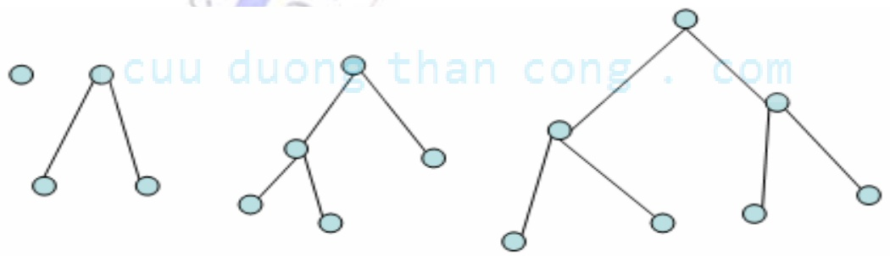

Hình 2.3. Tìm kiếm trên một cây nhị phân đơn giản

Tìm kiếm theo chiều rộng là một chiến lược rất có phương pháp (có hệ thống) bởi vì nó xem xét tất cả các đường đi có độ dài bằng 1 trước, sau đó đến tất cả những đường đi có độ dài

<!-- page: 25 -->

bằng 2, và cứ như vậy. Hình 2.3 chỉ ra quá trình của sự tìm kiếm trên một cây nhị phân đơn giản. Nếu như có một giải pháp, tìm kiếm theo chiều rộng đảm bảo sẽ tìm được nó, và nếu có nhiều giải pháp, tìm kiếm theo chiều rộng sẽ luôn tìm ra trạng thái đích nông nhất trước tiên. Dưới thuật ngữ của 4 tiêu chuẩn, tìm kiếm theo chiều rộng là hoàn thành, và nó được cung cấp một cách tối ưu chi phí đường dẫn bằng một hàm tăng của độ sâu các nút.

Chúng ta phải xem xét thời gian và dung lượng bộ nhớ nó sử dụng để hoàn thành một cuộc tìm kiếm. Để làm điều này, chúng ta xem xét một không gian trạng thái có tính giả thiết trong đó mỗi trạng thái có thể được mở rộng để tạo ra các trạng thái mới b. Chúng ta nói rằng yếu tố phân nhánh của những trạng thái này (và của cây tìm kiếm) là b. Gốc của cây tìm kiếm sinh ra b nút ở mức đầu tiên, mỗi nút đó lại sinh ra thêm b nút, và sẽ có cả thảy b2 nút ở mức thứ hai. Mỗi một nút này lại sinh ra thêm b nút, tạo ra b3 nút ở mức thứ ba, và cứ như vậy. Bây giờ chúng ta giả sử rằng giải pháp cho bài toán này có độ dài đường đi là d, như vậy số nút tối đa được mở rộng trước khi tìm thấy một giải pháp là :

$$
1 + b + b 2 + b 3 + \dots + b d
$$

Đây là số nút tối đa, nhưng giải pháp có thể được tìm thấy ở bất cứ điểm nào thuộc mức có độ sâu là d. Do đó, trong trường hợp tốt nhất , số lượng các nút sẽ ít hơn.

## Tìm kiếm với chi phí thấp nhất

Phép tìm kiếm theo chiều rộng tìm được trạng thái đích, nhưng trạng thái này có thể không phải là giải pháp có chi phí thấp nhất đối với một hàm chi phí đường đi nói chung. Tìm kiếm với chi phí thấp nhất thay đổi chiến lược tìm kiếm theo chiều rộng bằng cách luôn luôn mở rộng nút có chi phí thấp nhất (được đo bởi công thức tính chi phí được đi g(n)), thay vì mở rộng nút có độ sâu nông nhất. Dễ thấy rằng tìm kiếm theo chiều rộng chính là **tìm kiếm với chi phí thấp nhất** với g(n)= DEPTH(n).

Khi đạt được những điều kiện nhất định, giải pháp đầu tiên được tìm thấy sẽ đảm bảo là giải pháp rẻ nhất, do nếu như có một đường đi khác rẻ hơn, nó đã phải được mở rộng sớm hơn và như vậy nó sẽ phải được tìm thấy trước. Việc quan sát các hành động của chiến lược sẽ giúp giải thích điều này. Hãy xem xét bài toán tìm đường đi. Ván đề là đi từ S đến G, và chi phí của mỗi toán tử được ghi lại. Đầu tiên chiến lược sẽ tiến hành mở rộng trạng thái ban đầu, tạo ra đường đi tới A, B và C. Do đường đi tới A là rẻ nhất, nó sẽ tiếp tục được mở rộng, tạo ra đường đi SAG mà thực sự là một giải pháp, mặc dù không phải là phương án tối ưu. Tuy nhiên, giải thuật không công nhận nó là một giải pháp, bởi vì nó chi phí là 11, và nó bị che bởi đường đi SB có chi phí là 5 ở trong hàng đợi. Dường như thật là xấu hổ nếu sinh ra một giải pháp chỉ nhằm chôn nó ở sâu trong hàng đợi, nhưng điều đó là cần thiết nếu chúng ta muốn tìm một giải pháp tối ưu chứ không đơn thuần là tìm bất cứ giải pháp nào. Bước tiếp theo là mở rộng SB, tạo ra SBG, và nó là đường đi rẻ nhất còn lại trong hàng đợi, do vậy mục tiêu được kiểm tra và đưa ra một giải pháp.

Phép tìm kiếm chi phí ít nhất tìm ra giải pháp rẻ nhất thoả mãn một yêu cầu đơn giản: Chi phí của một đường đi phải không bao giờ giảm đi khi chúng ta đi dọc theo đường đi. Nói cách khác, chúng ta mong muốn rằng

$$
g (\text {Successor} (n)) \geq g (n) \quad \text {với mọi nút n.}
$$

Giới hạn đối với chi phí đường đi không được giảm thực sự sẽ là vấn đề cần quan tâm nếu chi phí đường đi của một nút là tổng chi phí của các toán tử mà tạo nên đường đi. Nếu như mọi toán tử có một chi phí không âm, thì chi phí của đường đi không bao giờ có thể giảm đi khi chúng ta đi dọc theo đường đi và phép tìm kiếm với chi phí giống nhau có thể tìm được đường đi rẻ nhất mà không cần kiểm tra hết toàn bộ cây. Nhưng nếu một số toán tử có chi phí âm thì chẳng có một

<!-- page: 26 -->

cách tìm kiếm nào khác ngoài một phép tìm kiếm toàn bộ tất cả các nút để tìm ra giải pháp tối ưu, bởi vì chúng ta sẽ không bao giờ biết được rằng khi nào một đường đi sẽ chuyển sang một bước với chi phí âm cao và do đó trở thành đường đi tốt nhất trong tất cả các đường đi, bất kể là nó dài bao nhiêu và chi phí thế nào.

## Tìm kiếm theo chiều sâu

Tìm kiếm theo chiều sâu luôn luôn mở rộng một trong các nút ở mức sâu nhất của cây. Chỉ khi phép tìm kiếm đi tới một điểm cụt (một nút không phải đích mà không có phần mở rộng), việc tìm kiếm sẽ quay lại và mở rộng đối với những nút nông hơn. Chiến lược này có thể được thực hiện bởi General-search với một hàm hàng đợi mà luôn đưa các trạng thái mới được sinh ra vào trước hàng đợi. Do nút được mở rộng là sâu nhất, các nút kế tiếp của nó thậm chí sẽ sâu hơn và khi đó sẽ trở thành sâu nhất. Quá trình tìm kiếm được minh hoạ trong hình 2.4.

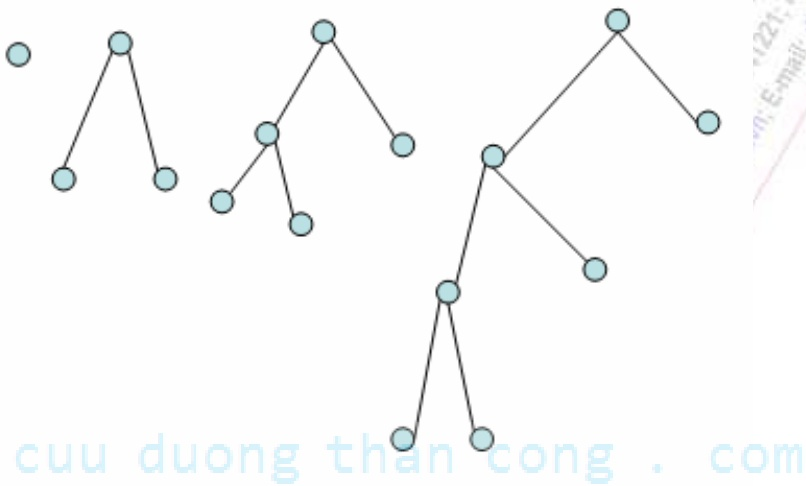

Hình 2.4. Tìm kiếm theo chiều sâu

Phép tìm kiếm theo chiều sâu yêu cầu dung lượng bộ nhớ rất khiêm tốn. Như hình vẽ cho thấy, nó chỉ cần phải lưu một đường duy nhất từ gốc tới nút lá, cùng với các nút anh em với các nút trên đường đi chưa được mở rộng còn lại. Đối với một không gian trạng thái với hệ số rẽ nhánh b và độ sâu tối đa m, phép tìm kiếm theo chiều sâu chỉ yêu cầu lưu trữ bm nút, ngược lai so với bd nút mà phép tìm kiếm theo chiều rộng yêu cầu trong trường hợp mục tiêu nông nhất ở độ sâu d.

Độ phức tạp thời gian của phép tìm kiếm sâu là O(bm). Đối với những vấn đề mà có rất nhiều giải pháp, phép tìm kiếm sâu có thể nhanh hơn tìm kiếm rộng, bởi vì nó có một cơ hội tốt tìm ra một giải pháp chỉ sau khi khám phá một phần nhỏ của toàn bộ không gian. Tìm kiếm theo chiều rộng sẽ vẫn phải tìm tất cả các đường đi có độ sâu d-1 trước khi xem xét bất cứ đường đi nào có độ sâu d. Phép tìm kiếm theo chiều sâu vẫn cần thời gian O(bm) trong trường hợp tồi nhất.

Mặt hạn chế của phép tìm kiếm sâu là nó có thể bị tắc khi đi theo một đường sai. Rất nhiều bài toán có các cây tìm kiếm rất sâu, thậm chí vô hạn, vì vậy tìm kiếm sâu sẽ không bao giờ có thể quay trở lại được một trong các nút gần đỉnh của cây sau khi có một sự lựa chọn sai. Phép tìm kiếm sẽ luôn luôn tiếp tục đi xuống mà không quay trở lại, thậm chí khi có một giải pháp ở mức rất nông tồn tại. Như vậy đối với những bài toán này, phép tìm kiếm sâu sẽ hoặc là bị sa lầy trong một vòng lặp vô hạn và không bao giờ đưa ra một giải pháp, hoặc là cuối cùng nó có thể đưa ra một đường đi giải pháp mà dài hơn so với phương án tối ưu. Điều đó có nghĩa là phép tìm kiếm theo chiều sâu là không hoàn thành và không tối ưu. Bởi vì điều này, cần tránh sử dụng phép tìm kiếm sâu cho các cây tìm kiếm có độ sâu tối đa là vô hạn hoặc rất sâu.

<!-- page: 27 -->

Việc thực hiện phép tìm kiếm sâu với general-search là khá tầm thường:

Người ta thường thực hiện phép tìm kiếm sâu cùng với một hàm đệ qui mà gọi tới chính nó ở lần lượt mỗi con của nó. Trong trường hợp này, hàng đợi được lưu trữ hoàn toàn trong không gian địa phương của mỗi lần gọi trong ngăn xếp gọi.

## Tìm kiếm theo độ sâu giới hạn

Tìm kiếm theo độ sâu giới hạn tránh các bẫy mà tìm kiếm theo chiều sâu mắc phải bằng cách đặt một giới hạn đối với độ sâu tối đa của đường đi. Giới hạn này có thể được thực hiện với một giải thuật tìm kiếm theo độ sâu giới hạn đặc biệt hoặc sử dụng các giải thuật tìm kiếm tổng quát với các toán tử theo dõi độ sâu. Chẳng hạn, trên bản đồ Rumani, có 20 thành phố, vì vậy chúng ta biết rằng nếu như có một giải pháp, thì nó phải có độ dài nhiều nhất là bằng 19. Chúng ta có thể thực hiệnviệc giới hạn độ sâu bằng cách sử dụng các toán tử dưới dạng “ Nếu bạn ở thành phố A và vừa đi một đoạn đường ít hơn 19 bước, thì khởi tạo một trạng thái mới ở thành phố B với độ dài đường đi lớn hơn 1”. Với tập các toán tử mới này, chúng ta đảm bảo tìm thấy giải pháp nếu nó tồn tại, nhưng chúng ta vẫn không đảm bảo tìm thấy giải pháp ngắn nhất trước tiên: phép tìm kiếm theo chiều sâu giới hạn là hoàn thành nhưng không tối ưu. Nếu chúng ta chọn một giới hạn độ sâu mà quá nhỏ, thì phép tìm kiếm theo chiều sâu giới hạn thậm chí không hoàn thành. Độ phức tạp về không gian và thời gian của phép tìm kiếm theo chiều sâu giới hạn tương đương với phép tìm kiếm sâu. Nó mất O(bl) thời gian và O(bl) không gian, với l là giới hạn độ sâu.

## Tìm kiếm lặp sâu dần (Iterative Deepening Search)

Thành phần khó khăn của tìm kiếm theo độ sâu giới hạn đem lại một giới hạn khá tốt. Chúng ta lấy 19 như là một giới hạn độ sâu “hiển nhiên” cho bài toán Rumani, nhưng thực ra nếu chúng ta nghiên cứu kỹ bản đồ, chúng ta sẽ thấy rằng bất cứ thành phố nào cũng có thể đi đến được từ bất kỳ thành phố nào khác với nhiều nhất là 9 bước. Con số này, được biết đến như là đường kính của không gian trạng thái , cho chúng ta một giới hạn độ sâu tốt hơn, và đưa đến một phép tìm kiếm theo độ sâu giới hạn hiệu quả hơn. Tuy nhiên, đối với hầu hết các bài toán, chúng ta chỉ biết một giới hạn độ sâu tốt sau khi đã giải quyết xong bài toán.

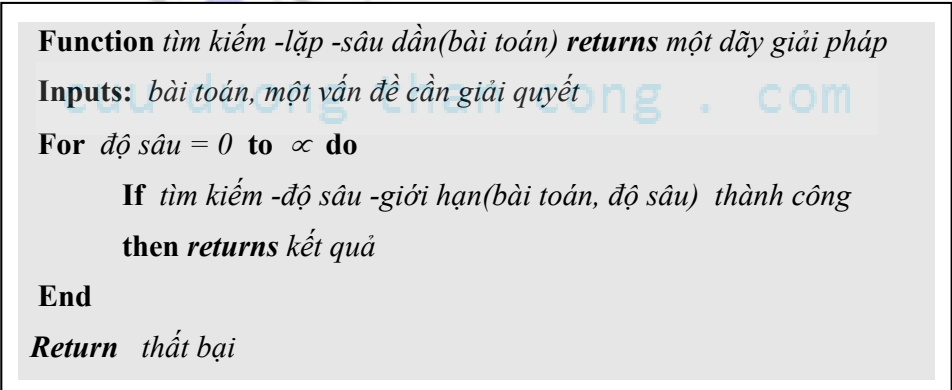

Hình 2.5 Giải thuật tìm kiếm lặp sâu dần

<!-- page: 28 -->

Phép tìm kiếm lặp sâu dần là một chiến lược né tránh vấn đề lựa chọn giới hạn độ sâu tốt nhất và cố gằng thử tất cả các giơí hạn độ sâu có thể: đầu tiên thử độ sâu bằng 0, sau đó độ sâu bằng 1, tiếp theo là 2, và cứ như vậy. Về mặt hiệu quả, việc lặp sâu dần kết hợp lợi ích của cả hai phép tìm kiếm theo chiều sâu và tìm kiếm theo chiều rộng. Đây là phương pháp tối ưu và đầy đủ, giống như phép tìm kiếm theo chiều rộng, nhưng chỉ yêu cầu bộ nhớ rất ít như phép tìm kiếm sâu yêu cầu. Thứ tự mở rộng các trạng thái tương tự với tìm kiếm rộng, ngoại trừ việc một số trạng thái được mở rộng nhiều lần.

Phép tìm kiếm lặp sâu dần có thể dường như là hơi lãng phí, bởi vì có rất nhiều trạng thái được mở rộng nhiều lần. Tuy nhiên, đối với hầu hết các bài toán, tổng chi phí của sự mở rộng nhiều lần này thực ra khá nhỏ. Bằng trực giác, có thể thấy rằng trong một cây tìm kiếm theo luật số mũ, hầu hết tất cả các nút là ở mức thấp nhất, vì vậy việc các mức ở bên trên được mở rộng nhiều lần sẽ không thành vấn đề lắm. nhắc lại rằng số lần mở rộng trong phép tìm kiếm theo độ sâu giới hạn tới độ sâu d với hệ số phân nhánh b là:

$$
1 + b + b ^ {2} + \dots + b d ^ {- 2} + b d ^ {- 1} + b d
$$

Cụ thể, cho b=10, và d=5 thì số lần mở rộng là :

$$
1 + 1 0 + 1 0 0 + 1 0 0 0 + 1 0. 0 0 0 + 1 0 0. 0 0 0 = 1 1 1. 1 1 1
$$

Trong phép tìm kiếm lặp sâu dần, các nút ở mức dưới cùng được mở rộng một lần, những nút ở trên mức dưới cùng được mở rộng hai lần, và cứ như vậy đến gốc của cây tìm kiếm sẽ được mở rộng d+1 lần. Do đó tổng số lần mở rộng trong một phép tìm kiếm lặp sâu dần là :

$$
(d + 1) 1 + (d) b + (d - 1) b ^ {2} + \dots .. + 3 b d ^ {- 2} + 2 b d ^ {- 1} + 1 b d
$$

Và cụ thể lại cho b=10, và d=5 thì số lần mở rộng là :

$$
6 + 5 0 + 4 0 0 + 3 0 0 0 + 2 0. 0 0 0 + 1 0 0 0 0 0 = 1 2 3. 4 5 6
$$

Như vậy chúng ta thấy, một phép tìm kiếm lặp sâu dần từ độ sâu1 xuống tới độ sâu d chỉ mở rộng nhiều hơn khoảng11% số nút so với phép tìm kiếm theo chiều rộng hay phép tìm kiếm theo chiều sâu tới độ sâu d khi hệ số phân nhánh b=10. Hệ số phân nhánh càng cao, tổng số các trạng thái được mở rộng lặp lại (nhiều lần) càng thấp, nhưng thậm chí khi hệ số phân nhánh là 2, phép tìm kiếm lặp sâu dần chỉ mở rộng số trạng thái nhiều gấp hai so với một phép tìm kiếm theo chiều rộng đầy đủ. Điều đó có nghĩa rằng độ phức tạp thời gian của phép tìm kiếm lặp sâu dần vẫn là O(bd), độ phức tạp không gian là O(bd). Nói chung, lặp sâu dần là phép tìm kiếm được tham khảo đến khi có một không gian tìm kiếm lớn và độ sâu của giải pháp là không biết trước.

## Tìm kiếm tiến lùi

Ý tưởng của phép tìm kiếm tiến lùi là thực hiện đồng thời hai phép tìm kiếm: tìm kiếm từ trạng thái đầu về phía trước và tìm kiếm ngược lại từ trạng thái đích, và dừng lại khi hai phép tìm kiếm này gặp nhau.

Đối với những bài toán mà hệ số rẽ nhánh là b ở cả hai hướng, phép tìm kiếm tiến lùi có thể đưa lại một sự khác biệt rất lớn. Nếu chúng ta vẫn giả sử rằng có một giải pháp ở độ sâu d, thì giải pháp sẽ được tìm thấy sau O(2bd/2) = O(bd/2) bước, bởi vì mỗi phép tìm kiếm tiến và lùi chỉ phải đi một nửa quãng đường. Xét ví dụ cụ thể, với b=10 và d=6, phép tìm kiếm rộng sinh ra 1.111.111 nút, trong khi đó phép tìm kiếm tiến lùi thành công khi mỗi hướng ở độ sâu bằng 3, tại thời điểm 2.222 nút đã được tạo ra. Điều này về mặt lý thuyết nghe rất hấp dẫn. Chúng ta cần phải xem xét một số vấn đề trước khi thực hiện giải thuật

<!-- page: 29 -->

Câu hỏi chính là, tìm kiếm lùi từ đích có nghiã là như thế nào? Chúng ta định nghĩa các nút tổ tiên (predecessor) của một nút n là tất cả các nút mà có nút n là nút kế vị (successor). Phép tìm kiếm lùi có nghĩa là sinh ra những nút tổ tiên liên tiếp bắt đầu từ nút đích.

Khi tất cả các toán tử là có thể đảo ngược, các tập kế vị và tập tổ tiên là giống hệt nhau. Tuy nhiên, đối với một số bài toán, việc tính toán các phần tử tổ tiên là rất khó khăn.

Con số O(bd/2) của độ phức tạp thừa nhận rằng quá trình kiểm tra sự giao nhau của hai biên giới có thể được thực hiện trong một khoảng thời gian không đổi (như vậy, nó không phụ thuộc vào số trạng thái). Điều này thường có thể thu được với một bảng băm. Để hai phép tìm kiếm cuối cùng sẽ gặp nhau, tất cả các nút của ít nhất một trong hai phép tìm kiếm phải được lưu giữ trong bộ nhớ (giống như với trường hợp của phép tìm kiếm rộng). Điều này có nghĩa là độ phức tạp không gian của phép tìm kiếm tiến lùi không có đủ thông tin là O(bd/2).

So sánh các chiến lược tìm kiếm

<table><tbody><tr><td>Tiêu chuẩn</td><td>Tìm kiếm theo chiều rộng</td><td>Tìm kiếm chi phí thấp nhất</td><td>Tìm kiếm theo độ sâu</td><td>Tìm kiếm theo độ sâu giới hạn</td><td>Tìm kiếm lặp sâu dần</td><td>Tìm kiếm tiến lùi</td></tr><tr><td>Thời gian Không gian Có tối ưu không? Có hoàn thành?</td><td>b<sup>d</sup> b<sup>d</sup> Có Có</td><td>b<sup>d</sup> b<sup>d</sup> Có Có</td><td>b<sup>m</sup> bm Không Không</td><td>b<sup>l</sup> bl Không Có, nếu l ≥ d</td><td>b<sup>d</sup> bd Có Có</td><td>bd/2bd/2Có Có</td></tr><tr><td colspan="7">Đánh giá các chiến lược tìm kiếm, b là hệ số phân nhánh, d là độ sâu của giải pháp; m là độ sâu tối đa của cây tìm kiếm; l là giới hạn độ sâu</td></tr></tbody></table>

Cho đến lúc này, chúng ta đã xét tất cả các vấn đề ngoại trừ còn một trong những vấn đề phức tạp nhất của quá trình tìm kiếm, đó là: khả năng lãng phí thời gian do việc mở rộng các trạng thái mà đã gặp và đã được mở rộng trước đó trên một số đường đi. Đối với một số bài toán, khả năng này không bao giờ xảy ra, mỗi trạng thái chỉ được đi đến theo một con đường. Việc xác định chính xác vấn đề bài toán 8 con hậu rất có tác dụng, đó là mỗi trạng thái chỉ có thể nhận được thông qua một đường đi.

Đối với rất nhiều bài toán, các trạng thái bị lặp lại là điều không thể tránh khỏi. Điều này có ở tất cả các bài toán mà các toán tử là có thể đảo ngược, như các bài toán tìm đường đi và bài toán những nhà truyền giáo và những kẻ ăn thịt người. Các cây tìm kiếm cho những bài toán này là vô hạn, nhưng nếu chúng ta tỉa bớt một số trạng thái lặp lại, chúng ta có thể cắt cây tìm kiếm xuống còn kích thước hữu hạn, chỉ sinh ra một phần của cây mà mở rộng đồ thị không gian trạng thái. Thậm chí khi cây là hữu hạn, việc tránh các trạng thái lặp có thể dẫn đến một sự suy giảm theo cấp số mũ chi phí tìm kiếm. Một ví dụ kinh điển được mô tả ở hình 2.4. Không gian chỉ chứa m+1 trạng thái, với m là độ sâu tối đa. Do cây bao gồm mỗi đường đi có thể trong không gian, nó có 2m nhánh.

<!-- page: 30 -->

## 2.6. GIẢI QUYẾT VẤN ĐỀ VÀ CÁC KĨ THUẬT HEURISTIC

## Các phương pháp tìm kiếm có đầy đủ thông tin

Phần trước đã chỉ ra rằng các chiến lược tìm kiếm không đầy đủ thông tin có thể tìm thấy giải pháp đối với các bài toán bằng cách tạo ra một cách có hệ thống các trạng thái mới và kiểm tra chúng với mục tiêu. Điều không may là, những chiến lược này rõ ràng là không có hiệu quả trong hầu hết các trường hợp. Phần này cho một chiến lược tìm kiếm có thêm hiểu biết (có đủ thông tin the- một chiến lược sử dụng các tri thực đặc thù đối với bài toán - có thể tìm các giải pháp một cách hiệu quả hơn như thế nào. Phần này cũng chỉ ra các bài toán tối ưu có thể được giải quyết.

## Phương pháp tìm kiếm tốt nhất (Best-first)

```txt
Function best-first-search(problem, hàm định giá) return một dãy giải pháp
Input : problem, một bài toán
Hàm định giá, một hàm giá trị
Hàm hàng đợi – một hàm mà sắp thứ tự các nút theo hàm giá
Return general-search (problem, hàm hàng đợi)
```

Hình 2.6 Một phương pháp tìm kiếm tốt nhất sử dụng các giải thuật tìm kiếm tổng quát

Trong chương trước, chúng ta đã tìm thấy một số cách để áp dụng các tri thức cho qui trình xác định rõ ràng chính xác một vấn đề bằng các thuật ngữ về trạng thái và các toán tử. Tuy nhiên, khi chúng ta được đưa cho một bài toán mà được chỉ rõ cụ thể, các sự lựa chọn của chúng ta là có giới hạn. Nếu chúng ta sử dụng giải thuật tìm kiếm tổng quát, thì cách duy nhất có thể áp dụng được tri thức là hàm "hàng đợi”, hàm quyết định nút nào sẽ được mở rộng tiếp theo. Thông thường, tri thức để quyết định điều này được cung cấp bởi một hàm định giá trả về một số có nghĩa mô tả sự mong muốn được mở rộng nút. Khi các nút được xếp thứ tự để nút nào có định giá tốt nhất sẽ được mở rộng trước. Chiến lược như vậy được gọi là phép tìm kiếm tốt nhất (best-first). Nó có thể được cài đặt trực tiếp với tìm kiếm tổng quát, như hình 2.6.

Tên gọi “tìm kiếm tốt nhất” là phép tìm kiếm quan trọng nhưng không chính xác. Nếu chúng ta mở rộng nút tốt nhất trước tiên, đó không phải là phép tìm kiếm - đó là một cách đi thẳng đến mục tiêu. Điều có thể làm là chọn nút tỏ ra là tốt nhất theo hàm giá. Nếu hàm giá là rõ, thì nút này sẽ là nút tốt nhất. Trong thực tế, hàm giá thỉnh thoảng có sai sót và việc tìm kiếm bị lạc đường. Tuy nhiên, chúng ta sẽ dùng tên “tìm kiếm tốt nhất”, vì tên “tìm kiếm vẻ ngoài tốt nhất“ có vẻ không tiện.

Khi có một họ giải thuật tìm kiếm tổng quát với các hàm theo thứ tự khác nhau, tồn tại một họ các giải thuật tìm kiếm tốt nhất với các hàm giá khác nhau. Vì mục đích là tìm kiếm các giải pháp có chi phí thấp, những giải thuật này sử dụng phướng pháp đánh giá các chi phí của giải pháp và cố gắng tối thiểu nó. Chúng ta có một phương pháp đo: sử dụng chi phí

<!-- page: 31 -->

đường đi g để quyết định đường đi nào sẽ mở. Tuy nhiên, phương pháp này không tìm trực tiếp về phía đích. Để làm chụm phép tìm kiếm, phương pháp kết hợp một số cách đánh giá chi phí đường đi từ một trạng thái tới trạng thái đích gần nhất. Xét hai phương pháp cơ bản. Phương pháp thứ nhất mở nút gần đích nhất. Phương pháp thứ hai mở nút ở đường đi có chi phí ít nhất.

## Tối thiểu hoá chi phí đánh giá để đi tới mục tiêu: phép tìm kiếm tham lam

Một trong những chiến lược tìm kiếm tốt nhất trước đơn giản nhất là tối thiểu chi phí ước lượng để đi tới mục tiêu. Đó là, nút mà trạng thái của nó được đánh giá là gần với trạng thái mục tiêu nhất luôn luôn được mở rộng trước. Đối với hầu hết các bài toán, chi phí của việc đi tới đích từ một trạng thái nào đó có thể được ước lượng nhưng không thể xác định chính xác. Một hàm mà tính toán những ước lượng chi phí như vậy được gọi là hàm heuristic và thường được biểu diễn bằng chữ cái h:

h(n) = chi phí ước lượng của đường đi rẻ nhất từ trạng thái ở nút n tới trạng thái đích.

Một phép tìm kiếm tốt nhất trước mà sử dụng h để lựa chọn nút mở rộng tiếp theo được gọi là phương pháp tìm kiếm tham lam(greedy search), vì các lý do mà chúng ta sẽ thấy rõ ràng sau đây. Cho một hàm heuristic h, phép tìm kiếm tham lam có thể được thực hiện như sau:

**function** greedy-search(problem) **returns** một giải pháp hoặc thất bại **return** best-first-search(problem,h)

Nói một cách chính thức, h có thể là bất cứ hàm nào. Chúng ta sẽ chỉ yêu cầu là h(n) = 0 nếu n là một mục tiêu.

Để hình dung một hàm heuristic là như thế nào, chúng ta cần chọn một bài toán điển hình, bởi vì các hàm heuristic chuyên xác định các bài toán đặc biệt. Chúng ta hãy quay trở lại với bài toán tim đường đi từ Arad đến Bucaret.

Một hàm heuristic tốt đối với những bài toán tìm đường đi giống như thế này là khoảng cách đường thẳng(straight-line distance hay SLD) tới mục tiêu. Tức là,

hSLD(n) = khoảng cách đường thẳng giữa n và vị trí đích.

Với phép heuristic khoảng cách -đường thẳng, nút đầu tiên sẽ mở rộng từ Arad sẽ là Sibiu, bởi vì nó gần Bucaret hơn so với Zerind và Timisoara. Nút mở rộng tiếp theo sẽ là Fagaras, do nó là nút gần nhất. Fagaras sẽ sinh ra Bucaret, và là đích.Đối với bài toán này, phép heuristic dẫn tới chi phí tìm kiếm tối thiểu: nó tìm một giải pháp mà không cần mở một nút nào không nằm trên đường đi giải pháp (đường đi tới đích). Tuy nhiên, nó không phải là hoàn toàn tối ưu: đường đi mà nó tìm ra đi qua Sibiu và Fagaras tới Bucaret dài hơn đường đi xuyên qua Rimnicu Vilcea và Pitesti (rồi tới Bucaret) là 32 km. Con đường này nó không tìm ra bởi vì Fagaras gần với Bucaret theo khoảng cách đường thẳng hơn so với Rimnicu, vì vậy nó được mở trước. Chiến lược ưu tiên chọn khả năng có “miếng ngoạm lớn nhất” (tức là đi bước đầu tiên đi được xa nhất) không quan tâm đến các chi phí còn lại để đi đến đích, không đếm xỉa đến việc bước đi này có phải là tốt nhất xét về toàn cục hay không – chính vì thế nó được gọi là “phương pháp tìm kiếm tham lam”. Mặc dù tham lam được coi là một trong 7 lỗi nặng, nhưng các giải thuật tham lam thường tỏ ra khá hiệu quả. Chúng có thiên hướng tìm giải pháp nhanh chóng, mặc dù như đã chỉ ra trong ví dụ vừa

<!-- page: 32 -->

rồi, chúng không phải luôn luôn tìm ra các giải pháp tối ưu: cần phải có sự phân tích một cách kỹ các giải pháp toàn cục, chứ không chỉ một sự lựa chọn tốt nhất tức thì.

Phép tìm kiếm tham lam tương tự phép tìm kiếm theo độ sâu ở điểm là nó ưu tiên đi theo một đường đơn tới đích, nhưng nó sẽ quay lui khi gặp đường cụt.Nó có những nhược điểm giống với phương pháp tìm kiếm sâu - không tối ưu, và không hoàn thành vì có thể rơi vào một đường vô hạn và không bao giờ quay lại để chọn khả năng khác. Độ phức tạp thời gian trong trường hợp tồi nhất của phép tìm kiếm tham lam là $O ( b ^ { m } )$ , với m là độ sâu tối đa của không gian tìm kiếm. Bởi vì phép tìm kiếm tham lam lưu trữ tất cả các nút trong bộ nhớ, độ phức tạp không gian của nó tương tự như độ phức tạp thời gian. Với một hàm heuristic tốt, độ phức tạp không gian và độ phức tạp thời gian có thể giảm đáng kể. Lượng giảm phụ thuộc vào bài toán cụ thể và chất lượng của hàm h.

## Tối thiểu hoá tổng chi phí đường đi: Thuật toán tìm kiếm A

Phương pháp tìm kiếm háu ăn tối thiểu hoá chi phí dự tính tới đích, h(n), và do đó giảm chi phí tìm kiếm đi đáng kể. Điều không may là, đó không phải là phương pháp tối ưu cũng như hoàn thành. Mặt khác, phép tìm kiếm theo chi phí ít nhất lại tối thiểu hoá chi phí đường tính đến thời điểm hiện tại, g(n); Đó là phương pháp tìm kiếm tối ưu và hoàn thành, nhưng có thể rất không hiệu quả. Sẽ rất tốt nếu chúng ta kết hợp cả hai phương pháp này để lợi dụng điểm mạnh của cả hai phương pháp. Rất may là chúng ta có thể làm được chính xác điều đó, kết hợp hai hàm định giá đơn giản bằng cách cộng chúng lại:

$$
f (n) = g (n) + h (n)
$$

Do g(n) đưa ra chi phí đường đi từ nút đầu tới nút n, và h(n) là chi phí ước tính của đường đi rẻ nhất từ n đến đích, có :

## f(n) = chi phí ước tính của giải thuật tốt nhất đi qua n

Như thế, nếu chúng ta cố gắng tìm giải pháp rẻ nhất, nút cần mở rộng trước hợp lý một cách hợp lý nhất là nút có giá trị thấp nhất của f. Điều thú vị về phương pháp này là phương pháp này còn hơn cả sự hợp lý. Thực tế chúng ta có thể chứng minh rằng nó là hoàn thành và tối ưu, với một hạn chế đơn giản đối với hàm h.

Hạn chế là cần chọn một hàm h mà không vượt quá chi phi đi tới đích. Một hàm h như vậy dược gọi là một heuristic có thể chấp nhận. Những heuristic có thể chấp nhận là theo quan điểm của những người lạc quan, vì họ nghĩ chi phí của việc giải quyết vấn đề là ít hơn thực tế. Sự lạc quan này cũng sẽ chuyển hàm f: Nếu h là chấp nhận được, f(n) không bao giờ vượt quá chi phí thực tế của giải pháp n. Phép tìm kiếm tốt nhất sử dụng f như là một hàm giá và một hàm h chấp nhận được với tên **phương pháp tìm kiếm A\*.**

**Function** A\*-search(problem) **return** một giải pháp hoặc thất bại

**Return** best-first-search(problem, g+h)

## Hình 2.7.

Ví dụ rõ ràng về phép heuristic chấp nhận được là khoảng cách đường thẳng hSLD mà chúng ta sử dụng để đi đến Bucaret. Khoảng cách đường thẳng là chấp nhận được bởi vì đường đi ngắn nhất giữa bất cứ hai điểm là một đường thẳng. Trong hình 2.7, chúng ta chỉ ra một số bước đầu tiên của phép tìm kiếm $\mathbf { A } ^ { * }$ tới Bucaret sử dụng phép heuristic hSLD. Chú ý rằng phép tìm kiếm $\mathbf { A } ^ { * }$ ưu tiên mở rộng từ Rimnicu Vilcea hơn so với mở rộng từ Fagaras. Mặc dù thậm chí

<!-- page: 33 -->

Fagaras gần Bucaret hơn, đường đi tới Fagaras không hiệu quả bằng đường đi tới Rimnicu trong việc tiến gần tới Bucaret. Bạn đọc có thể mong muốn tiếp tục ví dụ này để xem điều gì sẽ xảy đến tiếp theo.

## Sự hoạt động của phép tìm kiếm $\mathbf { A } ^ { \star }$

Trước khi chúng ta chứng minh tính hoàn thành và tính tối ưu của A\*, chúng ta nên đưa ra một bức tranh trực giác về hoạt động của phương pháp tìm kiếm này (Hình 2.8).Một minh hoạ không thể thay thế cho một bằng chứng, nhưng nó thường dễ nhớ và có thể sử dụng tạo ra các chứng cứ khi có yêu cầu. Trước tiên, một sự quan sát ban đầu: nếu như bạn kiểm tra các cây tìm kiếm, bạn sẽ chú ý một hiện tượng thú vị: Dọc theo bất cứ đường đi nào từ gốc, chi phí f không bao giờ tăng. Điều này không phải là ngẫu nhiên. Nó là đúng đối vơí hầu như tất cả các heuristic chấp nhận được. Người ta nói một heuristic như vậy là đưa ra sự đơn điệu (monotonicity1).

Nếu heuristic là một trong những heuristic kỳ cục mà không phải là đơn điệu. Chúng ta có thể sửa chữa nhỏ để phục hồi tính đơn điệu. Xét hai nút n và n’, với n là nút cha của n’. Giả sử $g ( n ) = 3$ và h(n) = 4, ta có, $f(n) = g(n) + h(n) = 7$ – như vậy ta biết rằng giá trị thực của một giải pháp tới n ít nhất là 7. Cũng giả sử g(n’) = 4 và h(n’) = 2, do $y a y f ( n ) = 6$ Rõ ràng, đây là một ví dụ về một heuristic không đơn điệu. Rất may là, từ thực tế rằng bất cứ đường đi nào đến n’ thì cũng là đường đi đến n, chúng ta có thể thấy rằng giá trị 6 là không có ý nghĩa gì, bởi vì chúng ta đã biết chi phí thực tế ít nhất là 7. Như vậy, chúng ta nên kiểm tra , mỗi lần chúng ta tạo ra một nút mới, để xem chi phí f của nó có nhỏ hơn chi phí f của nút cha của nó nay không: nếu nhỏ hơn, chúng ta sẽ sử dụng chi phí f của nút cha của nó:

$$
f (n ^ {\prime}) = \max (f (n), g (n ^ {\prime}) + h (n ^ {\prime})).
$$

Theo cách này, ta bỏ qua các giá trị dẫn sai đường có thể xảy ra với một heuristic không đơn điệu. Công thức này gọi là **cực đại đường đi**. Nếu sử dụng công thức đó, thì f luôn không giảm dọc theo bất cứ đường đi từ gốc, giá trị h được cung cấp là chấp nhận được.

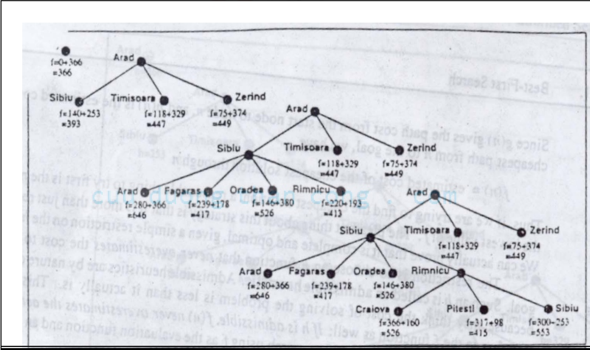

\*Hình 2.8 Các giai đoạn của phép tìm kiếm A để đi đến Bucharest. Các nút được gán nhãn với f $= \mathbf { g } + \mathbf { h }$ . Các giá trị h là các khoảng cách đường thẳng tới Bucharest lấy từ giả thiết

<!-- page: 34 -->

Phương pháp tìm kiếm $\mathbf { A } ^ { * }$ là hoàn thành, tối ưu và hiệu quả một cách tối ưu trong số tất cả các thuật toán như vậy. Điều đó không có nghĩa là $A ^ { * }$ là câu trả lời cho tất cả các yêu cầu tìm kiếm. Đối với hầu hết các bài toán, số nút trong không gian tìm kiếm đường viền mục tiêu là cấp số mũ theo độ dài của giải pháp. Mặc dù không chứng minh, nó đã được chỉ ra rằng độ tăng theo cấp số mũ sẽ xẩy ra trừ phi sai số trong hàm heuristic không tăng nhanh hơn logarits của chi phí đường đi thực tế. Theo ký hiệu toán học, điều kiện đối với độ tăng nhỏ hơn cấp số mũ là :

$$
\big | h (n) - h ^ {*} (n) \big | \leq O (\log h ^ {*} (n)),
$$

với $h ^ { * } ( n )$ là chi phí thực tế của việc đi từ n đến mục tiêu. Đối với hầu hết tất cả các heuristic trong thực tế sử dụng, sai số ít nhất cũng tỷ lệ với chi phí đường đi , và độ tăng theo cấp số mũ cuối cùng sẽ vượt quá bất cứ khả năng của máy tính nào. Tất nhiên, việc sử dụng một heuristic tốt vẫn cho chúng ta một tiết kiệm rất lớn so với các phép tìm kiếm không đủ thông tin. Trong phần tiếp theo, chúng ta sẽ xem xét đến vấn đề thiết kế các heuristic tốt.

Tuy nhiên, thời gian tính toán không phải là mặt trở ngại chính của A\*. Do nó lưu trữ tất cả các nút được tạo ra trong bộ nhớ, $A ^ { * }$ thường bị vượt ra khỏi bộ nhớ rất lâu trước khi nó hết thời gian. Các giải thuật phát triển gần đây đã vượt qua trở ngại về dung lượng bộ nhớ mà không phải hi sinh tính tối ưu hay tính hoàn thành.

## Các hàm heuristic

Cho đến lúc này, chúng ta mới chỉ xem xét một ví dụ về một heuristic: khoảng cách đường thẳng đối với các bài toán tìm đường đi. Trong phần này, chúng ta sẽ xét các hàm heuristic đối với trò chơi số 8. Điều này sẽ soi rọi về yếu tố tự nhiên của các hàm heuristic nói chung.

Trò chơi số 8 là một trong những bài toán tìm kiếm theo phương pháp heuristic sớm nhất. Như đã đề cập trong phần 2.5, mục tiêu của trò chơi này là đi các con cờ theo chiều ngang hoặc chiều dọc vào ô trống cho đến khi thu được trạng thái các quân cờ như mô hình mục tiêu (hình 2.9).

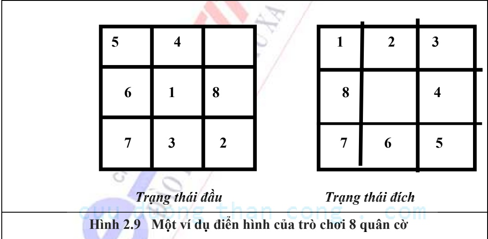

Trò chơi số 8 ở mức độ khó vừa phải nên là một trò chơi rất thú vị. Một giải pháp điển hình gồm khoảng 20 bước, mặc dù tất nhiên con số này biến đổi phụ thuộc vào trạng thái đầu. Hệ số rẽ nhánh khoảng bằng 3 (khi ô trống ở giữa, có bốn khả năng di chuyển; khi nó ở góc bàn cờ, có hai khả năng di chuyển; và khi nó ở trên các cạnh, có 3 khả năng đi). Điều này có nghĩa là một phép tìm kiếm vét cạn tới độ sâu 20 sẽ xem xét khoảng $320 = 3.5 \times 109$ trạng thái. Bằng cách theo dõi các trạng thái lặp lại, chúng ta có thể giảm số trạng thái này xuống đáng kể, bởi vì chỉ có 9! = 362980 các sự sắp xếp khác nhau của 9 ô vuông. Đây vần là một số rất lớn các trạng thái, vì thế

<!-- page: 35 -->

bước tiếp theo là tìm một hàm heuristic tốt. Nếu chúng ta muốn tìm kiếm các giải thuật ngắn nhất, chúng ta cần một hàm heuristic mà không bao giờ ước đoán vượt quá số các bước đi tới mục tiêu. Sau đây là hai “ứng cử viên”:

$h I = \silde { \mathbf { s } \hat { \mathbf { o } } }$ lượng quân cờ mà ở sai vị trí. Đối với hình 2.9, 7 trong số 8 quân cờ ở sai vị trí, vì vậy trạng thái đầu sẽ có h1 = 7. h1 là một hàm heuristic chấp nhận được, bởi vì rõ ràng là bất cứ quân cờ nào mà đang ở sai vị trí phải di chuyển ít nhất một lần.

• h<sub>2</sub> = tổng số khoảng cách của các quân cờ so với vị trí mục tỉêu. Bởi vì các quân cờ không thể đi theo các đường chéo, khoảng cách mà chúng ta tính tổng sẽ là tổng của các khoảng cách theo chiều ngang và theo chiều dọc. Khoảng cách này đôi khi được gọi là “khoảng cách **khối thành phố”(city block distance) hoặc** khoảng cách **Manhantan** h<sub>2</sub> là chấp nhận được, vì bất cứ nước đi nào cũng chỉ có thể di chuyển một quân cờ một bước gần hơn tới đích. Các quân cờ từ 1 đến 8 trong trạng thái đầu cho ta một khoảng cách Manhatan là:

$$
h _ {2} = 2 + 3 + 3 + 2 + 4 + 2 + 0 + 2 = 1 8
$$

## Hiệu quả (tác dụng) của độ chính xác heuristic trong khi thực hiện

Một cách để xác định chất lượng của một hàm heuristic là hệ số phân nhánh hiệu quả b\*. Nếu tổng số các nút được mở rộng bởi $A ^ { * } \mathrm { d } { \hat { 0 } } \mathrm { i }$ với một bài toán nào đó là N, và độ sâu giải pháp là d, thì b\* là hệ số phân nhánh mà một cây đồng dạng có độ sâu d sẽ phải có để chứa được N nút. Nhưvậy,

$$
N = 1 + b ^ {*} + (b ^ {*}) 2 + \dots + (b ^ {*}) d
$$

Chẳng hạn, nếu A\* tìm thấy một giải pháp ở độ sâu bằng 5 sử dụng 52 nút, thì hệ số phân nhánh hiệu quả là 1,91. Thông thường, hệ số phân nhánh hiệu quả đưa ra bởi một heuristic cho trước là khá ổn định đối với đa số các bài toán. Do đó, các phép đo thử nghiệm giá trị b\* trong một tập nhỏ các bài toán có thể đưa ra một chỉ dẫn tốt khi xét tổng thể hàm heuristic. Một hàm heuristic được thiết kế tốt sẽ có giá trị b\* gần với 1, cho phép giải quyết một số lượng lớn các bài toán. Để kiểm tra các hàm heuristic h1 và h2, chúng ta ít khi sinh ra 100 bài toán, mỗi bài toán với các độ dài giải pháp là $\scriptstyle 2 , 4 , \ldots , 2 0 ;$ , và giải quyết chúng với phép tìm kiếm A\* với h1 và h2, cùng với phép tìm kiếm lặp sâu dần không đầy đủ thông tin. Hình 2.8 đưa ra số trung bình các nút được mở rộng bởi chiến lược tìm kiếm và hệ số phân nhánh hiệu quả. Kết quả cho thấy là h2 tốt hơn h1 và phép tìm kiếm thiếu thông tin tồi hơn nhiều.

## Xây dựng các hàm heuristic

Chúng ta đã thấy rằng, cả h1 và h2 là những heuristic khá tốt đối với trò chơi số 8, và h2 thì tốt hơn h1. Nhưng chúng ta không biết làm thế nào để phát minh ra một hàm heuristic. Làm sao một người có thể có được một heuristic như h2? Một máy tính có thể phát minh một cách máy móc ra được một heuristic như vậy không?

h1 và h2 là các đánh giá (ước đoán) đối với độ dài đường đi còn lại trong trò chơi số 8, nhưng chúng cũng có thể được xem là các độ dài đường đi có độ chính xác tuyệt vời đối với những kiểu đơn giản hoá của trò chơi này. Nếu như qui tắc của trò chơi được thay đổi để một quân cờ có thể di chuyển đến bất cứ chỗ nào, thay vì chỉ có thể đi đến ô trống ngay cạnh nó, thì h1 sẽ đưa ra một cách chính xác số các bước của giải pháp gần nhất. Tương tự, nếu một quân cờ có thể đi một ô theo tất cả các hướng, thậm chí đi vào ô đã bị chiếm bởi một quân cờ khác, thì h2 sẽ đưa ra con số chính xác các bước đi của giải pháp ngắn nhất. Một bài toán với ít ràng buộc hơn đối với các toán tử được gọi là một bài toán giải trí (relaxed problem). Thường xảy ra trường hợp

<!-- page: 36 -->

là chi phí đường đi của một giải pháp đúng đối với một bài toán giải trí là một heuristic tốt đối với bài toán gốc (ban đầu).

Nếu việc định nghĩa vấn đề được viết dưới dạng một ngôn ngữ chính thức, có thể xây dựng các bài toán thư giãn một cách tự động. 3 Ví dụ, nếu các toán tử của trò chơi số 8 được miêu tả như sau:

Quân cờ A có thể đi từ ô A đến ô B nếu A là cạnh B và B trống, thì chúng ta có thể tạo ra ba bài toán giải trí bằng cách bỏ đi một hoặc nhiều hơn các điều kiện:

(a) Quân cờ A có thể đi từ ô A đến ô B nếu A ở cạnh B.

(b) Quân cờ A có thể đi từ ô A đến ô B nếu B là trống.

(c) Quân cờ A có thể đi từ ô A đến ô B.

Gần đây, một chương trình được gọi là ABSOLVER đã được viết mà có thể tạo ra các heuristic một cách tự động từ các khái niệm xác định bài toán, sử dụng phương pháp “bài toán thư giãn” và rất nhiều các kỹ thuật khác (Prieditis, 1993). ABSOLVER sinh ra một heuristic mới cho trò chơi số 8 tốt hơn bất cứ heuristic đang tồn tại nào, và tìm ra heuristic hữu ích đầu tiên cho trò chơi nổi tiếng là hình khối lập phương Rubik.

Một vấn đề của việc tạo ra các hàm heuristic mới là chúng ta thường thất bại trong việc có được một heuristic “tốt nhất một cách rõ ràng”. Nếu chúng ta có một tập các heuristic chấp nhận được h1…hm cho một bài toán, và không có hàm nào vượt trội hơn hàm nào, chúng ta nên chọn heuristic nào? Như chúng ta sẽ thấy, chúng ta không cần thiết phải lựa chọn. Chúng ta có thể có heuristic tốt nhất , bằng cách định nghĩa:

$$
h (n) = \max (h _ {1} (n), \dots , h m (n)).
$$

Heuristic tổ hợp này sử dụng bất cứ hàm nào chính xác nhất đối với nút trong câu hỏi. Do các heuristic thành phần là chấp nhận được , h cũng chấp nhận được. Hơn nữa, h vượt trội hơn so với tất cả các heuristic thành phần tạo nên nó.

Một cách khác để phát minh ra một heuristic tốt là sử dụng thông tin thống kê. Điều này có thể thu được bằng cách chạy một phép tìm kiếm đối với một số các bài toán đào tạo, như 100 mô hình ngẫu nhiên của trò chơi số 8 được chọn, và thu thập các thống kê. Ví dụ, chúng ta có thể tìm thấy rằng, khi h<sub>2</sub>(n) = 14, thì 90% của quãng đường thực sự để tới đích là 18. Như vậy khi gặp những bài toán “thực sự”, chúng ta có thể sử dụng 18 làm giá trị quãng đường bất cứ khi nào h<sub>2</sub>(n) cho giá trị 14. Tất nhiên, nếu chúng ta sử dụng các thông tin theo xác xuất như thế này, chúng ta đang từ bỏ sự bảo đảm về tính có thể chấp nhận được, nhưng tính trung bình chúng ta có lẽ sẽ mở rộng ít nút hơn.

Thông thường có thể lấy ra các đặc điểm của một trạng thái mà đóng góp cho hàm định giá heuristic của nó, thậm chí nếu rất khó nói chính xác sự đóng góp là gì. Chẳng hạn, mục tỉêu trong đánh cờ là chiếu tướng đối phương, và các đặc điểm liên quan như số quân mỗi loại của mỗi bên, số quân mà bị ăn bởi quân của đối thủ, v. .v. Thông thường, hàm định giá được giả định là tổ hợp tuyến tính của các giá trị đặc điểm. Thậm chí nếu chúng ta không biết các đặc điểm quan trọng như thế nào, hay thậm chí một đặc điểm là tốt hay xấu, ta vẫn có thể sử dụng một giải thuật học tập để thu được các hệ số hợp lý cho mỗi đặc điểm. Ví dụ, trong đánh cờ, một chương trình có thể học hỏi được rằng con hậu của một người nên có hệ số dương lớn, trong khi một con tốt của đối thủ nên có một hệ số âm nhỏ.

Một yếu tố khác mà chúng ta chưa xem xét đến là chi phí tìm kiếm của việc chạy thật sự hàm heuristic trên một nút. Chúng ta vừa giả định rằng chi phí của việc tính toán hàm heuristic

<!-- page: 37 -->

tương đương với chi phí mở rộng một nút. do vậy tối thiểu hoá số lượng nút mở rộng là một điều tốt. Nhưng nếu hàm heuristic phức tạp đến nối mà tính toán giá trị của nó cho một nút mất khoảng thời gian để mở rộng hàng trăm nút thì chúng ta cần phải cân nhắc. Cuối cùng, rất dễ để có một hàm heuristic mà chính xác tuyệt đối – nếu chúng ta cho phép hàm heuristic thực hiện, ví dụ, một phép tìm kiếm theo chiều rộng “kín đáo”. Điều đó sẽ tối thiểu hoá số lượng các nút được mở rộng bởi phép tìm kiếm thực sự, nhưng nó sẽ không tối thiểu hoá chi phí tìm kiếm tổng thể. Một hàm heuristic tốt phải vừa chính xác vừa hiệu quả.

## 2.7. CÁC PHƯƠNG PHÁP GIẢI QUYẾT VẤN ĐỀ KHÁC

**Phương pháp tìm kiếm A\* lặp sâu dần (IDA\*)**

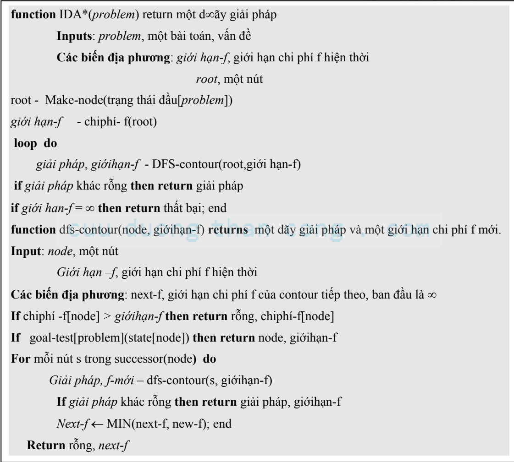

Hình 2.10. Giải thuật tìm kiếm IDA

Trong phần trước, chúng ta đã chỉ ra rằng lặp sâu dần là một kỹ thuật rất hiệu quả để giảm bộ nhớ. Chúng ta có thể lại thử phép đó lần nữa, biến phép tìm kiếm A\* trở thành A\* lặp sâu dần hay phương pháp IDA\* (Hình 2.10). Trong giải thuật này, mỗi phép lặp là một phép tìm kiếm theo chiều sâu, cũng như trong phương pháp tìm kiếm lặp sâu dần bình thường. Phép tìm kiếm theo chiều sâu được sửa đổi để sử dụng một giới hạn chi phí f thay vì một giới hạn độ sâu. Như vậy, mỗi vòng lặp mở rộng các nút bên trong dường viền của chi phí f hiện tại, nhin vào trong đường viền để tìm đường viền tiếp theo ở đâu. Khi phép tìm kiếm bên trong một đường viền đã cho đã hoàn thành, vòng lặp mới lại bắt đầu sử dụng một chi phí f mới cho đường vìên tiếp theo.IDA\* là hoàn thành và tối ưu với cùng một dự báo cho trước như phép tìm kiếm A\*, nhưng do nó là phương pháp tìm kiếm theo chiều sâu, nó chỉ yêu cầu không gian bộ nhớ tỷ lệ với đường đi dài nhất mà nó khám

<!-- page: 38 -->

phá. Nếu δ là chi phí nhỏ nhất và f\* là chi phí giải pháp tối ưu, thì trong trường hợp tồi nhất, IDA\* sẽ yêu cầu bf\*/δ nút lưu trữ. Trong hầu hết các trường hợp, bd là sự ước đoán rất tốt đối với yêu cầu về dung lượng lưu trữ

## Phương pháp tìm kiếm SMA\*

Những khó khăn của IDA\* về không gian bài toán nào đó có thể tìm ra được là sử dụng quá ít bộ nhớ. Giữa các vòng lặp, nó chỉ lưu lại một số duy nhất,đó là giới hạn chi phí f hiện thời. Do nó không thể nhớ được các bước đi của nó, IDA\* buộc phải lặp lại chúng. Điều này càng đúng trong các không gian trạng thái mà là các bản đồ thay vì các cây. IDA\* có thể được sửa đổi để kiểm tra đường đi hiện thời đối với những trạng thái lặp lại, nhưng nó không thể tránh được các trạng thái lặp lại được tạo ra bởi các đường đi thay đổi.

Trong phần này, chúng ta miêu tả giải thuật SMA\* mà có thể sử dụng tất cả bộ nhớ sẵn có đẻ tiến hành việc tìm kiếm. Việc sử dụng bộ nhớ nhiều hơn chỉ có thể cải thiện được hiệu quả tìm kiếm – một giải thuật có thể luôn bỏ qua không gian phụ, nhưng thường tốt hơn là nhớ một nút thay vì tạo ra nó khi cần thiết. SMA\* có các thuộc tính sau đây:

• Nó sẽ sử dụng tất cả dưng lượng bộ nhớ được tạo ra dành cho nó.

• Nó tránh các trạng thái lặp lại chừng nào mà bộ nhớ còn cho phép.

• Nó là hoàn thành nếu bộ nhớ có sẵn là hiệu quả để lưu trữ đường đi giải pháp nông nhất.

• Nó là tối ưu nếu có đủ bộ nhớ để cất giữ đường đi giải pháp tối ưu nông nhất. Trái lại, nó trả về giải pháp tốt nhất có thể có được trong phạm vi bộ nhớ cho phép.

Khi có đủ bộ nhớ cho cây tìm kiếm toàn bộ, phép tìm kiếm là hiệu quả một cách tối ưu.

Vấn đề không giải quyết được là không rõ SMA\* có phải luôn hiệunquả một cách tối ưu trong các giẩi pháp cho bởi cùng các thông tin heuristic và cùng dung lượng bộ nhớ.

Việc thiết kế SMA\* là đơn giản , ít nhất là vè tổng quát. Khi cần phải tạo ra một nút tiếp theo nhưng không còn bộ nhớ, nó sẽ cần phải tạo ra không gian nhớ trong hàng đợi. Để làm điều này, nó bỏ qua một nút trong hàng đợi. Những nút mà bị bỏ rơi trong hàng đợi theo cách này đựoc gọi là những nút bị bỏ quên. Nó ưu tiên bỏ qua những nút mà không có triển vọng – tức là những nút có chi phí f cao. Để tránh khám phá lại những cây conmà đã bị bỏ rơi khỏi bộ nhớ, nó lưu lại trong các nút tổ tiên những thông tin về chất lượng của đường đi tốt nhất trên cây con bị bỏ qua. Theo cách này, nó chỉ tái sinh ra ccác cây con khi tất cả các đường đi khác đã được chỉ ra là tồi hơn đường đi mà nó vừa bỏ qua. Một cách nói khác là nếu tất cả các hậu duệ của một nút n bị bỏ quên, thì chúng ta sẽ không biết đi đường nào từ n, nhưng chúng ta vãn có vẫn có ý tưởng về giá trị của việc đi khỏi n đến bất cứ chỗ nào.

## Các giải thuật cải tiến lặp

Chúng ta đã thấy trong chương 2 rằng một số bài tập nổi tiếng (ví dụ, bài toán 8 con hậu) có thuộc tính là sự miêu tả trạng thái có chứa tất cả các thông tin cần thiết cho một giải pháp. Đường đi mà dẫn tới đích là không liên quan. Trong những trường hợp như vậy, các giải thuật cải tiến lặp thường cung cấp các giải pháp có tính thực tế nhất. Chẳng hạn , chúng ta bắt đầu với 8 con hậu trên bàn cờ, hoặc tất cả các dây đều đi qua các kênh nào đó. Theo cách này thì, chúng ta có thể đi các con hậu sang xung quanh để giảm số con hậu bị chiếu; hoặc chúng ta có thể di chuyển một cái dây từ một kênh này đến một kênh khác để giảm sự tắc nghẽn. ý tưởng chung là bắt đầu với một mô hình đầy đủ và thay đổi mô hình để cải thiện chất lượng của nó.

<!-- page: 39 -->

Cách tốt nhất để hiểu các giải thuật cải tiến lặp là xét tất cả các trạng thái được bày ra trên bề mặt của một phong cảnh. Độ cao của bất cứ điểm nào trên phong cảnh tương ứng với hàm giá của trạng thái ở điểm đó. Ý tưởng cải tiến lặp là di chuyển quanh phong cảnh để cố gắng tìm các đỉnh cao nhất, mà là các giải pháp tối ưu. Các giải thuật cải tiến lặp thường chỉ theo sát trạng thái hiện thời, và không nhìn về phía trước vượt qua những lân cận tức thì của trạng thái đó. Điều này cũng giống với việc cố gắng tìm đỉnh của ngọn núi Everest trong sương mù dày đặc trong khi phải chịu đựng chứng hay quên. Tuy nhiên, đôi khi các giải thuật cải tiến lặp là một phương pháp của sự lựa chọn các bài toán thực tế và hóc búa.

Các giải thuật cải tiến lặp được chia thành hai lớp chính. Các giải thuật **trèo núi (hay còn gọi “gradient hạ xuống”** nếu chúng ta xem hàm định giá như là chi phí thay vì chất lượng) luôn cố gắng thay đổi để cải tiến trạng thái. Các giải thuật **rèn luyện tái tạo** thỉnh thoảng tạo thay đổi mà làm cho mọi thứ tồi tệ hơn, ít nhất là tạm thời.

## Phép tìm kiếm leo núi (Hill-climbing)

Giải thuật tìm kiếm leo núi được chỉ ra ở hình 2.11. Nó đơn giản là một vòng lặp mà di chuyển liên tục theo hướng làm tăng giá trị. Giải thuật không duy trì một cây tìm kiếm , vì vậy cấu trúc dữ liệu nút chỉ cần ghi lại trạng thái và giá trị của nó, mà chúng ta biểu diễn bằng giá trị. Một khái niệm quan trọng là khi có nhiều hơn một nút kế tiép tốt nhất để chọn lựa, giải thuật có thể lựa chọn trong số chúng một cách ngẫu nhiên. Qui tắc đơn giản này có ba nhược điểm nổi tiếng như sau:

• **Các giá trị cực đại địa phương**: một giá trị cực đại địa phương, trái ngược với một giá trị cực đại toàn cục, là một đỉnh mà thấp hơn đỉnh cao nhất trong không gian trạng thái. Khi ở trên một đại lượng cực đại địa phương , giảithuật sẽ dừng lại thậm chí mặc dù giải pháp vẫn còn lâu mới tối ưu.

• **Các cao nguyên:** một cao nguyên là một khu vực của không gian trạng thái mà hàm định giá là phẳng tuyệt đối. Phép tìm kiếm sẽ thực hiện một bước đi ngẫu nhiên.

• **Các đỉnh chóp**: một đỉnh chóp có thể có các bên sườn võng và dốc, vì vậy phép tìm kiếm đi đến đỉnh của chóp một cách dễ dàng, nhưng đỉnh có thể dốc rất ít về phía một đỉnh khác. Trừ phi ở đó có các toán tử mà di chuyển trực tiếp dọc theo đỉnh của hình chóp, phép tìm kiếm có thể dao động từ bên này qua bên kia, khiến cho sự tiến chuyển rất ít.

Trong mỗi trường hợp, giải thuật đi đến một điểm mà tại đó nó không tiến triển gì thêm. Nếu điều này xảy ra, một điều chắc chắn phải làm là bắt đầu lại từ một điểm khởi đầu khác. Phép **leo núi- bắt đầu lại -ngẫu nhiên** làm như sau: nó thực hiện một loạt các phép tìm kiếm leo núi từ các trạng thái ban đầu được tạo ra một cách ngẫu nhiên , thực hiện mỗi phép tìm kiếm cho đến khi nó dừng lại hoặc không có sự tiến triển rõ rệt. Nó lưu lại kết quả tốt nhất tìm dược của bất cứ phép tìm kiếm nào. Nó có thể sử dụng một số bước lặp hỗn hợp, hoặc có thể tiếp tục cho đến khi kết quả lưu được tốt nhất chưa được cải thiện đối với một số phép lặp nào đó.

## Rõ ràng, nếu cho phép đủ số lần lặp, phép tìm kiếm leo núi bắt đầu lại ngẫu nhiên

cuối cùng sẽ tìm ra giải pháp tối ưu. Sự thành công của phép tìm kiếm leo núi phụ thuộc rất nhiều vào hình fdạng của ”bề mặt” không gian trạng thái: nếu như chỉ có một vài giá trị cực đại địa phương, phép tìm kiếm leo núi bắt đầu lại ngẫu nhiên sẽ rất nhanh chóng tìm thấy một giải pháp tốt. Một bài toán thực sự có một bề mặt mà trôngrất giống môtj con nhím. Nếu bài toán là hoàn thành trong thời gian NP, thì rất có thể chúng ta không thể làm tốt hơn thời gian theo cấp số mũ. Tiếp theo là phải có số các cực đại địa phương theo cấp số mũ mà giải thuật sẽ mắc kẹt vào đó. Tuy nhiên, thông thường, một giải pháp tốt hợp lý có thể được tìm thấy sau một số ít lần lặp

<!-- page: 40 -->

```txt
Function Hill-climbing(problem) return một trạng thái giải pháp
    Inputs : problem, một bài toán
    Các biến cục bộ: current, một nút
        Next, một nút
Current ← make-node(initial-state[problem])
Loop do
    Next ← một nút con cháu có giá trị cao nhất của nút current(hiện tại)
    If value[next] < value[current] then return current
Current ← next
End
```

Hình 2.11. Giải thuật tìm kiếm trèo núi.

## Giới hạn của việc tìm kiếm

Phương pháp dễ hỉểu nhất để điều khiển khối lượng việc tìm kiếm là thiết lập một độ sâu giới hạn, để việc kiểm tra ngưỡng (giới hạn) tiến hành đối với tất cả các nút ở độ sâu d hay bên dưới độ sâu d. Độ sâu được chọn để khối lượng thời gian sử dụng sẽ không vượt quá những gì mà luật chơi cho phép. Khi thời gian hết, chương trình sẽ quay lại bước đi mà được lựa chọn bởi phép tìm kiếm kết thúc sâu nhất.

Những phương pháp này có một số những hậu quả tai hại do tính chất gần đúng của hàm định giá. Rõ ràng, cần có một hàm kiểm tra giới hạn phức tạp . Hàm giá chỉ nên áp dụng cho các vị trí thụ động, tức là dường như sẽ không phô bày sự “đung đưa chuyển động dữ dội” (sự biến động lớn) về mặt giá trị trong tương lai gần. Ví dụ trong đánh cờ, các vị trí mà dễ ăn có thể được tạo ra là không thụ động dối với một hàm định giá mà chỉ tính đến vật chất. Các vị trí không thụ động có thể được mở rộng hơn nữa cho đến khi chạm tới các vị trí thụ động. Việc tìm kiếm bổ sung này được gọi là một phương pháp **tìm kiếm thụ động;** đôi khi nó được giới hạn chỉ để xem xét các kiểu đi nào đó, như bước đi ăn (quân đối phương), mà sẽ nhanh chóng giải quyết sự không chắc chắn ở vị trí.

## Trình độ phát triển của các chương trình trò chơi

Việc thiết kế các chương trình trò chơi có hai mục đích: cả hai đều nhằm hiểu rõ hơn việc làm thế nào để chọn các hành động trong các miền giá trị phức tạp với các kết quả không chắc chắn và để phát triển các hệ thống hiệu suất cao đối với trò chơi được nghiên cứu.

## Cờ vua

Cờ vua thu hút được sự quan tâm lớn nhất trong trò chơi. Mặc dù không đạt tới như lời khẳng định của Simon năm 1957 rằng trong vòng 10 năm nữa, các máy tính sẽ đánh bại bất cứ nhà vô địch thế giới nào, nhưng giờ đây các máy tính gần như đã sắp đạt được mục tiêu đó. Trong môn cờ vua tốc độ, các máy tính đã đánh bại nhà vô địch thế giới, Gary Kasparov, trong các trò chơi 5 phút và 25 phút, nhưng trong các trò chơi đầy đủ, máy tính chỉ xếp trong tốp 100 tay cờ giỏi nhất thế giới. Hình dưới đây cho thấy tỷ lệ của các nhà vô địch cờ vua là người và máy tính trong những năm qua.

<!-- page: 41 -->

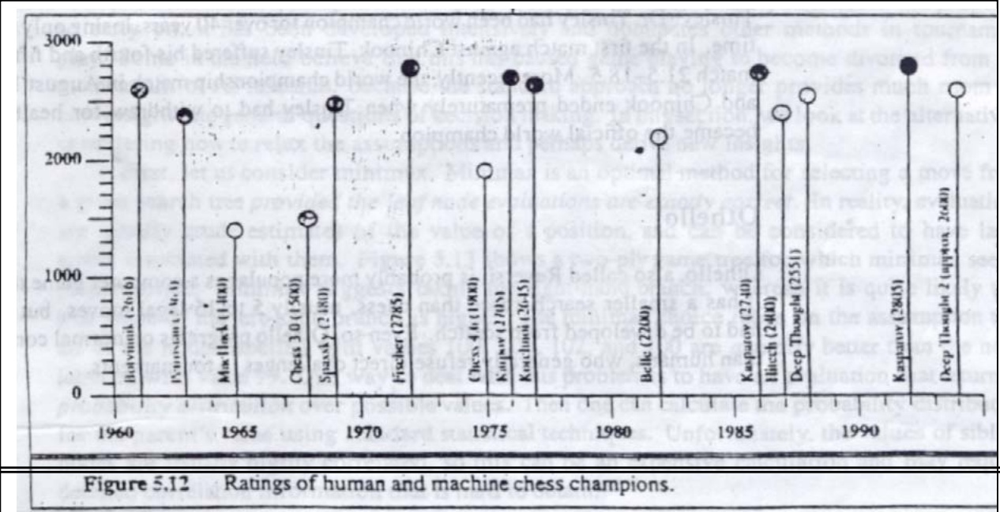

Hình 2.12 Tỷ lệ của các nhà vô địch cờ vua: con người và máy tính.

Hệ thống HITECH là một máy tính có mục đích đặc biệt được thiết kế bởi người xứng đáng cựu vô địch thế giới Hans Berliner và sinh viên của ông Carl Ebeling, có thể tính toán nhanh các hàm định giá rất phức tạp. Tạo ra khoảng 10 triệu trên mỗi nước đi và sử dụng việc định giá chính xác nhất các vị trí đã được phát triển. HITECH đã trở thành vô địch thế giới về máy tính năm 1985 và là chương trình đầu tiên đánh bại thần đồng của nhân loại, Arnold Denker năm 1987. Vào thời điểm đó nó đứng trong 800 người chơi cờ giỏi nhất thế giới.

Hệ thống tốt nhất hiện thời là Deep Thought 2 được sản xuất bổi IBM. Mặc dù Deep Thought 2 sử dụng hàm định giá đơn giản, nó kiểm tra khoảng một nửa tỷ vị trí cho mỗi nước đi, đạt đến độ sâu 10 hoặc 11 (nó đã từng tìm được 37 nước chiếu tướng hết cờ).Tháng 2 năm 1993, Deep Thought 2 thi đấu với đội Olympic của Đan mạch và thắng 3-1, đánh bại một đại kiện tướng và hoà với một đại kiện tướng khác. Hệ số FIDE của nó là 2600, xếp trong số 100 người chơi cờ giỏi nhất thế giới.

## Cờ đam

Bắt đầu vào năm 1952, Arthur Samuel của IBM làm việc trong thời gian rỗi của ông, đã xây dựng một chương trình chơi cờ đam (loại cờ gồm 24 quân cờ cho 2 người chơi – ND) mà tự học hàm định giá của nó bằng cách tự chơi với nó hàng nghìn lần. Chương trình của Samuel bắt đầu như mộ người mới học việc, nhưng chỉ sau một vài ngày tự chơi với chính nó đã có thể đấu trong những cuộc thi lớn của loài người. Khi một người thấy rằng công cụ tính toán của Samuel (một chiếc máy tính IBM 704) có 10.000 từ trong bộ nhớ chính, băng từ để lưu trữ dữ liệu và một chu kỳ thời giankhoảng hầu như một miligiây, điều đó cho thấy đây là một trơng những thành tích vĩ đại của AI.

Có rất ít những người khác có thể cố gắng làm được tốt hơn cho đến khi Jonathan Schaeffer và các đồng nghiệp viết trình Chinook, mà chạy trên một máy tính thông thường sử dụng phép tìm kiếm alpha-beta, nhưng sử dụng một số kỹ thuật, bao gồm cơ sở dữ liệu giải pháp tuyệt vời cho tất cả các vị trí 6-quân cờ, và gây ra sự tàn phá thế trận dẫn đến chấm dứt ván cờ. Chinook đã chiến thắng trong giải Mỹ mở rộng 1992 và trở thành chương trình đầu tiên mà thử thách một

<!-- page: 42 -->

cách chính thức những nhà vô địch thế giới. Sau đó nó gặp phải một vấn đề,dưới cái tên MarionTinsley. Tiến sỹ Tinsley đã là nhà vô địch thế giới suốt hơn 40 năm, chỉ thua có 3 trận trong suốt khoảng thời gian đó. Trong trận đầu tiên với Chinook, Tinsley đã chịu thua ván thứ 4 và thứ năm của mình, những đã thắng chung cuộc 21.5–18.5. Gần đây, giải vô địch thế giới tháng 8 năm 1994 giữa Tinsley và Chinook kết thúc sớm khi Tinsley phải xin rút lui vì lý do sức khoẻ. Chinook chính thức trở thành nhà vô địch thế giới.

## Trò chơi là các bài toán tìm kiếm

Chơi trò chơi cũng là một trong những khu vực cổ nhất của ccác nỗ lực trong lĩnh vực trí tuệ nhân tạo. Năm 1950, hầu như ngay khi máy tính trở nên có thể lập trình được, các chương trình chơi cờ được viết bởi Shannon (người phát minh ra lý thuyết thông tin) và bởi Alan Turing. Kể từ đó, đã có những phát triển rất mạnh mẽ về các tiêu chuẩn của việc chơi, đạt tới điểm mà các hệ thống hiện thời có thể thử thách các nhà vô địch của loài người mà không sợ xấu hổ.

Các nhà nghiên cứuđầu tiên đã chọn cờ vì một số lý do. Một máy tính chơi cờ sẽ là một chứng cứ sinh tồn của một máy cơ khí làm một điều gì đó mà cần sự thông minh. Hơn nữa, sự đơn giản của luật chơi, và thực tế rằng trạng thái thế giới có thể nắm bắt được đầy đủ đối với chương trình có nghĩa là rất dễ để biểu diễn trò chơi như là một cuộc tìm kiếm trong một không gian các vị trí trò chơi có thể. Sự biểu diễn trò chơi của máy tính thực ra có thể chỉnh sửa theo bất cứ chi tiết thích đáng hợp lý nào – không giống như sự miêu tả của bài toán về một cuộc chiến tranh.

Nhưng những gì làm cho trò chơi thực sự khác biệt là chúng thường quá khó để giải quyết. Ví dụ, đánh cờ, có một hệ số phân nhánh trung bình khoảng 35, và mỗi bên thường đi khoảng 50 nước trong một ván cờ, dẫn đến cây tìm kiếm có khoảng 35<sup>100</sup> nút (mặc dù “chỉ có” khoảng 10<sup>40</sup> vị trí hợp lý khác nhau). Trò chơi cờ ca rô (Tic-Tac –Toe) khá buồn tẻ đối với những người lớn thông minh bởi vì rất dễ để quyết định bước đi đúng. Sự phức tạp của các trò chơi đưa ra một kiểu không chắc chắn hoàn toàn mới mà chúng ta chưa được biết; sự không chắc chắn xuất hiện không phải vì có thông tin bị mất, mà do chúng ta không có đủ thời gian để tính toán một dãy chính xác của bất cứ nước đi nào. Thay vào đó, chúng ta phải dự đoán tốt nhất dựa trên kinh nghiệm của mình, và hành động trước khi chúng ta biết chắc được cần phải hành động như thế nào. Dưới viễn cảnh này, các trò chơi rất giống với thế giới thực hơn so với các bài toán tìm kiếm tiêu chuẩn mà chúng ta đã xét cho tới nay.

## Kết luận

Chương này áp dụng các heuristic để làm giảm chi phí tìm kiếm. Chúng ta đã xem xét một số giải thuật sử dụng các heuristic, và thấy rằng sự tối ưu phải trả giá cao dưới dạng chi phí tìm kiếm, thậm chí với các heuristic tốt.

Phép tìm kiếm best-first là phép tìm kiếm tổng quát khi các nút có chi phí ít nhất (dựa theo một số tính toán) được mở rộng trước tiên.

Nếu chúng ta tối thiểu hoá chi phí ước tính để đi tới mục tiêu h(n), chúng ta có phương pháp tìm kiếm tham lam. Thời gian tìm kiếm thường giảm đi so với một giải thuật không đầy đủ thông tin, nhưng giải thuật này là không tối ưu và không hoàn thành.

Tối thiểu hoá $f(n) = g(n) + h(n)$ để kết hợp điểm mạnh của phép tìm kiếm thiếu thông tin và phép tìm kiếm háu ăn. Nếu chúng ta sử dụng các trạng thái lặp lại và đảm bảo rằng h(n) không bao giờ ước lượng vượt quá, chúng ta có phép tìm kiếm A\*.

<!-- page: 43 -->

A\* là hoàn thành, tối ưu và hiệu quả một cách tốt nhất trong số tất cả các giải thuật tìm kiếm tối ưu. Độ phức tạp không gian của nó vẫn là một trở ngại lớn.

Độ phức tạp thời gian của các giải thuật heuristic phị thuộc vào chất lượng của các hàm heuristic. Các heuristic tốt có thể thỉnh thoảng được xây dựng bằng cách kiểm tra sự xác định bài toán hoặc bằng cách tổng quát hoá từ kinh nghiệm với các lớp bài toán.

Chúng ta có thể giảm yêu cầu đối với dung lưọng bộ nhớ cho phép tim kiếm A\* với các giải thuật có bộ nhớ giới hạn như IDA\*(A\* lặp sâu dần) và SMA\*(A\* có bộ nhớ giới hạn đơn giản hoá).

Các giải thuật cải tiến lặp chỉ lưu trữ một trạng thái đơn trong bộ nhớ, nhưng có thể bị sa lầy ở những cực đại địa phương. Phép tìm kiếm rèn luyện tái tạo đưa ra một cách để thoát khỏi cực đại địa phương, và là phương pháp hoàn thành, tối ưu khi được cho một lịch trình dài và đủ gọn.

## BÀI TẬP

2.1 Giả sử rằng chúng ta chạy một giải thuật tìm kiếm háu ăn với h(n) = - g(n). Phép tìm kiếm háu ăn sẽ cạnh tranh với kiểu tìm kiếm nào?

2.2 Hãy phát minh ra một hàm heuristic cho trò chơi số 8 mà thỉnh thoảng ước lượng vượt quá, và chỉ ra làm thể nào nó có thể dẫn đến một giải pháp gần tới ưu đối với một bài toán cụ thể.

2.3. Hãy chứng minh rằng nếu hàm heuristic h tuânn theo bất đẳng thức tam giác, thì chi phí f dọc theo bất cứ đường đi nào trên cây tìm kiếm là không giảm. (Bất đẳng thức tam giác phát biểu rằng tổng số các chi phí từ A dến B và từ B đến C không được nhỏ hơn chi phí đi trực tiếp từ A đến C).

2.4. Phép tìm kiếm A\* tiến lùi có thể là một phương pháp tốt không? Nó có thể áp dụng được trong những điều kiện nào?

2.5. Hãy miêu tả một không gian tìm kiếm trong đó phép tìm kiếm lặp sâu dần thực hiện kém hơn nhiều so với phương pháp tìm kiếm theo chiều sâu.

2.6. Hãy viết giải thuật cho phương pháp tìm kiếm tiến lùi, bằng giả mã hoặc bằng một ngôn ngữ lập trình. Giả sử rằng mỗi phép tìm kiếm sẽ là một phép tìm kiếm theo chiều rộng, và phép tìm kiếm tiến và phép tìm kiếm lùi thay nhau mở rộng một nút ở một thời điểm

<!-- page: 44 -->

# CHƯƠNG 3: BIỂU DIỄN TRI THỨC VÀ SUY DIỄN

Trong chương này chúng ta sẽ trình bày các đặc trưng của ngôn ngữ biểu diễn tri thức. Chúng ta sẽ nghiên cứu logic mệnh đề, một ngôn ngữ biểu diễn tri thức rất đơn giản, có khả năng biểu diễn hẹp, nhưng thuận lợi cho ta làm quen với nhiều khái niệm quan trọng trong logic, đặc biệt trong logic vị từ cấp một sẽ được nghiên cứu trong các chương sau.

3.1 Nhập môn

3.2 Tri thức và dữ liệu

3.3 Phân loại tri thức

3.4 Bản chất của các tri thức chuyên gia

3.5 Các phương pháp biểu diễn tri thức

3.6 Cơ chế suy diễn

3.7 Các hệ cơ sỏ tri thức và các hệ chuyên gia

3.8 Các ngôn ngữ lập trình thông minh

## 3.1 NHẬP MÔN

Con người sống trong môi trường có thể nhận thức được thế giới nhờ các giác quan (tai, mắt và các giác quan khác), sử dụng các tri thức tích luỹ được và nhờ khả năng lập luận, suy diễn, con người có thể đưa ra các hành động hợp lý cho công việc mà con người đang làm. Một mục tiêu của Trí tuệ nhân tạo ứng dụng là thiết kế các **Agent thông minh** (intelligent agent) cũng có khả năng đó như con người. Chúng ta có thể hiểu Agent thông minh là bất cứ cái gì có thể nhận thức được môi trường thông qua các **bộ cảm nhận** (sensors) và đưa ra hành động hợp lý đáp ứng lại môi trường thông qua **bộ phận hành động** (effectors). Các robots, các softbot (software robot), các hệ chuyên gia,... là các ví dụ về Agent thông minh. Các Agent thông minh cần phải có tri thức về thế giới hiện thực mới có thể đưa ra các quyết định đúng đắn.

## 3.2 TRI THỨC VÀ DỮ LIỆU

Thành phần trung tâm của agent **dựa trên tri thức** (knowledge-based agent), còn gọi là **hệ dựa trên tri thức** (knowledge-based system) hoặc đơn giản là hệ tri thức trong đó chứa cơ sở tri thức (Knowledge Base: viết tắt tiếng Anh: KB; viết tắt tiếng Việt: CSTT).

Cơ sở tri thức là một tập hợp các tri thức được biểu diễn dưới dạng nào đó. Mỗi khi nhận được các thông tin đưa vào, Agent cần có khả năng suy diễn để đưa ra các câu trả lời, đưa ra các hành động hợp lý. Nhiệm vụ này được thực hiện bởi bộ suy diễn-thành phần cơ bản khác của các hệ tri thức. Như vậy, hệ tri thức bao hàm một CSTT và được trang bị một thủ tục suy diễn. Mỗi khi tiếp nhận các sự kiện từ môi trường, thủ tục suy diễn thực hiện quá trình liên kết các sự kiện với các tri thức trong CSTT để rút ra các câu trả lời, hoặc các hành động hợp lý mà Agent cần thực hiện. Khi thiết kế một Agent giải quyết vấn đề nào đó thì CSTT sẽ chứa các tri thức về đối tượng cụ thể đó. Để máy tính có thể sử dụng, xử lý tri thức, cần biểu diễn tri thức dưới dạng thuận tiện. Đó là mục tiêu của biểu diễn tri thức.

Tri thức là một khái niệm trừu tượng. Chúng ta không cố gắng đưa ra một định nghĩa chính xác ở đây mà muốn so sánh nó với hai khái niệm có liên quan là thông tin và dữ liệu. Karan Sing đã phát biểu:”Chúng ta ngập chìm trong thông **biển thông tin** nhưng lại khát tri thức”.

<!-- page: 45 -->

Trong ngữ cảnh của khoa học máy tính “dữ liệu là nguyên liệu thô để xử lý” là các con số, chữ cái, hình ảnh, âm thanh… Thông tin là tất cả những gì con người có thể cảm nhận qua các giác quan (chính xác, xem khái niệm Entropy là độ đo thông thông tin, đọ đo về các tin tức mới đối vói một người nào đó). Nếu so về số lượng: dữ liệu nhiều hơn thông tin; thông tin nhiều hơn tri thức. Chúng ta có thể mô tả chúng theo dạng hình chóp.

## 3.3 PHÂN LOẠI TRI THỨC

Người ta thường phân loại tri thức thành các dạng sau:

## Tri thức sự kiện

**Định nghĩa:** Tri thức sự kiện là một khẳng địng về một sự kiện, hiện tượng hay một khái niệm nào đó trong một hoàn cảng không gian hoặc thời gian nhất định.

**Ví dụ:** khẳng định về hiện tượng: ”Mặt trời lặn ở phương Tây”. Khái niệm về: “tam giác đều: là tam giác có ba góc bằng nhau”.

## Tri thức mô tả

**Định nghĩa:** Tri thức sự kiện là một khẳng địng về một sự kiện, hiện tượng hay một khái niệm nào đó trong một hoàn cảng không gian hoặc thời gian nhất định.

**Ví dụ:** khẳng định về hiện tượng: ”Mặt trời lặn ở phương Tây”. Khái niệm về: “tam giác đều: là tam giác có ba góc bằng nhau”.

## Tri thức thủ tục

**Định nghĩa:** Tri thức thủ tục là tri thức mô tả cách giải quyết một vấn đề, quy trình xử lý các công việc, lịch trình tiến hành các thao tác … Các dạng của tri thức thủ tục thường dùng là các luật, chiến lược, lịch trình

## Ví dụ: IF xe máy không khởi động được

THEN đầu tiên kiểm tra bugi

## Tri thức heuristic

**Định nghĩa:** Tri thức **heuristic** là tri nông cạn do không đảm bảo hòan tòan chính xác hoặc tối ưu theo một nghĩa nào đó về cách giải quyết vấn đề. Tri thức **heuristic** thường được coi là một mẹo nhằm dẫn dắt tiến trình lập luận

**Ví dụ:** một số giải thuật tìm đường đi ngắn nhất, giải thuật A<sup>\*</sup> có thể được coi là lời giả của một vấn đề tốt nhưng chưa hẳn tối ưu.

Ngòai ra người ta còn phân chia ra tri thức mêta: tri thức tham chiếu đến các tri thức khác; tri thức có cấu trúc: tri thức về các quan hệ giữa các khái niệm, quan hệ giữa các đối tượng…

## 3.4. BẢN CHẤT CỦA CÁC TRI THỨC CHUYÊN GIA

## Chuyên gia (Expert).

Nói chung, chuyên gia là là người có đầy đủ kỹ năng, kiến thức sâu (cả về luật và các sự kiện) về một lĩnh vực nào đó; người có thể làm những việc mà người khác ít khả năng làm được.

## Hệ chuyên gia

Hệ chuyên gia (đơn giản) là chương trình máy tính có thể thực hiện các công việc, vấn đề trong thuộc lĩnh vực hẹp ở mức tương tự như mộ người chuyên gia [19].

<!-- page: 46 -->

Hầu hết các hệ chuyên gia là các hệ dựa luật. Hiện nay một số các hệ chuyên gia thành công trong các lĩnh vữ: bán hàng, kỹ nghệ , y học và địa chỉ (tìm kiếm mỏ), các hệ điện lực và khai mỏ. Để hiểu rõ bản chất tri thức của chuyên gia, chúng ta quan sát một hệ chuyên gia gồm các thành phần nào. Nói chung hệ chuyên gia bao gồm các phần cơ bản như sau

## 3.5. CÁC PHƯƠNG PHÁP BIỂU DIỄN TRI THỨC

Trong phần này, chúng ta sẽ tập trung nghiên cứu logic vị từ cấp một (first-order predicate logic hoặc first-order predicate calculus) - một ngôn ngữ biểu diễn tri thức, bởi vì logic vị từ cấp một có khả năng biểu diễn tương đối tốt, và hơn nữa nó là cơ sở cho nhiều ngôn ngữ biểu diễn tri thức khác. Nhưng trước hết chúng ta sẽ nghiên cứu logic mệnh đề (propositional logic hoặc propositional calculus). Nó là ngôn ngữ rất đơn giản, có khả năng biểu diễn hạn chế, song thuận tiện cho ta đưa vào nhiều khái niệm quan trọng trong logic.

## 3.5.1 Biểu diễn tri thức bằng Logic mênh đề

**Định nghĩa:** Logic mênh đề là công cụ toán logic, trong đó các mênh đề được mã hoá (gán) cho một biến, hoặc hằng; còn vác biểu thức là sự liên kết co nghĩa giữa các biến hằng với một số toán tử nhất định.

**Ví dụ:** Mệnh đề “Nếu trời mưa (A) thì đất ướt (B) “ được mô tả: A⇒B

Tri thức được mô tả dưới dạng các mệnh đề trong **ngôn ngữ biểu diễn tri thức**. Mỗi câu có thể xem như sự mã hóa một sự hiểu biết của ta về thế giới thực. Ngôn ngữ biểu diễn tri thức (cũng như mọi ngôn ngữ hình thức khác) gồm hai thành phần cơ bản là **cú pháp** và **ngữ nghĩa.**

• Cú pháp của một ngôn ngữ bao gồm các ký hiệu và các quy tắc liên kết các ký hiệu (các luật cú pháp) để tạo thành các câu (công thức) trong ngôn ngữ. Các câu ở đây là biểu diễn ngoài, cần phân biệt với biểu diễn bên trong máy tính. Các câu sẽ được chuyển thành các cấu trúc dữ liệu thích hợp được cài đặt trong một vùng nhớ nào đó của máy tính, đó là biểu diễn bên trong. Bản thân các câu chưa chứa đựng một nội dung nào cả, chưa mang một ý nghĩa nào cả.

• Ngữ nghĩa của ngôn ngữ cho phép ta xác định ý nghĩa của các câu trong một miền nào đó của thế giới hiện thực. Chẳng hạn, trong ngôn ngữ các biểu thức số học, dãy ký hiệu (x+y)\*z là một câu viết đúng cú pháp. Ngữ nghĩa của ngôn ngữ này cho phép ta hiểu rằng, nếu x, y, z, ứng với các số nguyên, ký hiệu + ứng với phép toán cộng, còn \* ứng với phép chia, thì biểu thức (x+y)\*z biểu diễn quá trình tính toán: lấy số nguyên x cộng với số nguyên y, kết quả được nhân với số nguyên z.

• Ngoài hai thành phần cú pháp và ngữ nghĩa, ngôn ngữ biểu diễn tri thức cần được cung cấp **cơ chế suy diễn**. Một luật suy diễn (rule of inference) cho phép ta suy ra một công thức từ một tập nào đó các công thức. Chẳng hạn, trong logic mệnh đề, luật modus ponens cho phép từ hai công thức A và A⇒B suy ra công thức B. Chúng ta sẽ hiểu **lập luận** hoặc **suy diễn** là một quá trình áp dụng các luật suy diễn để từ các tri thức trong cơ sở tri thức và các sự kiện ta nhận được các tri thức mới. Như vậy chúng ta xác định:

**Ngôn ngữ biểu diễn tri thức = Cú pháp + Ngữ nghĩa + Cơ chế suy diễn.**

Một ngôn ngữ biểu diễn tri thức tốt cần có khả năng biểu diễn rộng, tức là mô tả được mọi điều mà chúng ta muốn. Nó cần hiệu quả để đi tới các kết luận; thủ tục suy diễn đòi hỏi ít thời

<!-- page: 47 -->

gian tính toán và không gian nhớ. Người ta mong muốn ngôn ngữ biểu diễn tri thức gần với ngôn ngữ tự nhiên.

## 3.5.1.1. Cú pháp

Cú pháp của logic mệnh đề rất đơn giản. Nó cho phép xây dựng các công thức. Cú pháp của logic mệnh đề gồm tập các ký hiệu và tập các luật xây dựng công thức.

• **Các ký hiệu**

Hai hằng logic: **True** và **False.**

Các ký hiệu mệnh đề (còn được gọi là các biến mệnh đề): P, Q,...

Các phép kết nối logic: $\land , \lor , \rceil , \Rightarrow , \Leftrightarrow .$

Các dấu mở ngoặc”(“ và đóng ngoặc ”)”.

• **Các quy tắc xây dựng các công thức**

Các biến mệnh đề là công thức. Nếu A và B là công thức thì:

(A∧B) (đọc “A hội B” hoặc “A và B”)

(A∨B) (đọc “A tuyển B”hoặc “A hoặc B”)

(⎤A) (đọc “phủ định A”)

(A⇒B) (đọc “A kéo theo B”hoặc “nếu A thì B”)

(A⇔B) (đọc “A và B kéo theo nhau”)

là các công thức.

Để ngắn gọn, ta bỏ đi các cặp dấu ngoặc khi không cần thiết. Ví dụ, thay cho ((A∨B)∧C), ta viết (A∨B)∧C.

Các công thức là các ký hiệu mệnh đề sẽ được gọi là các **câu đơn** hoặc **câu phân tử**. Các công thức không phải là câu đơn sẽ được gọi là câu phức hợp. Nếu P là ký hiệu mệnh đề thì P và ⎤ P được gọi là **literal,** P là **literal dương**, còn ⎤ P là **literal âm**. Câu phức hợp có dạng A<sub>1</sub>∨...∨A<sub>m</sub> trong đó A<sub>i</sub> là các literal sẽ được gọi là **câu tuyển** (clause).

## 3.5.1.2 Ngữ nghĩa:

Ngữ nghĩa của logic mệnh đề cho phép ta **xác định** ý nghĩa của các công thức trong thế giới hiện thực nào đó. Điều đó được thực hiện bằng cách kết hợp mỗi ký hiệu mệnh đề với sự kiện nào đó trong thế giới hiện thực. Chẳng hạn, ký hiệu mệnh đề P có thể ứng với sự kiện “Paris là thủ đô nước Pháp”hoặc bất kỳ một sự kiện nào khác. Bất kỳ một sự kết hợp các kí hiệu mệnh đề với các sự kiện trong thế giới thực được gọi là một **minh họa** (interpretation). Chẳng hạn minh họa của kí hiệu mệnh đề P có thể là một sự kiện (mệnh đề) “Paris là thủ đô nước Pháp ”. Một sự kiện chỉ có thể đúng hoặc sai. Chẳng hạn, sự kiện “Paris là thủ đô nước Pháp “là đúng, còn sự kiện “Số Pi là số hữu tỉ “là sai.

Một cách chính xác hơn, ta hiểu một minh họa là một cách gán cho mỗi ký hiệu mệnh đề một giá trị chân lý **True** hoặc **False.** Trong một minh họa, nếu kí hiệu mệnh đề P được gán giá trị chân lý **True/False** (P: **True**/ P: **False**) thì ta nói mệnh đề P **đúng/sai** trong minh họa đó. Trong một minh họa, ý nghĩa của các câu phức hợp được xác định bởi ý nghĩa của các kết nối logic. Chúng ta xác định ý nghĩa của các kết nối logic trong các bảng chân lý (xem hình 3.1)

<!-- page: 48 -->

| P | Q | lP | P∧Q | P ∨ Q | P⇒Q | P⇔Q |
| --- | --- | --- | --- | --- | --- | --- |
| False | False | True | False | False | True | True |
| False | True | True | False | True | True | False |
| True | False | False | False | True | False | False |
| True | True | False | True | True | True | True |

Hình 3.1 Bảng chân lý của các kết nối logic

Ý nghĩa của các kết nối logic ∧, ∨ và l được xác định như ý nghĩa của các từ “**và**”,“**hoặc là**” và “**phủ định**” trong ngôn ngữ tự nhiên. Chúng ta cần giải thích thêm về ý nghĩa của phép kéo theo $\mathrm { P } \Rightarrow \mathrm { Q }$ (P kéo theo Q). Ở đây: P là giả thiết, Q là kết luận. Trực quan cho phép ta xem rằng, khi P là đúng và Q là đúng thì câu “P kéo theo Q “là đúng, còn khi P là đúng Q là sai thì câu “P kéo theo Q”là sai. Nhưng nếu P sai và Q đúng, hoặc P sai Q sai thì “P kéo theo Q”là đúng hay sai? Nếu xuất phát từ giả thiết sai, thì không khẳng định gì về kết luận. Không có lý do để nói rằng nếu P sai và Q đúng hoặc P sai và Q sai thì “P kéo theo Q” là sai. Do đó, trong trường hợp P

Bảng chân lý cho phép ta xác định ngữ nghĩa các câu phức hợp. Chẳng hạn ngữ nghĩa của các câu P∧Q trong minh họa {P ← **True**, Q ơ **False**} là **False**. Việc xác định ngữ nghĩa của một câu $( \mathrm { P } \lor \mathrm { Q } ) \land \daleth$ S trong minh họa được tiến hành như sau: đầu tiên ta xác định giá trị chân lý của P ∨ Q và ⎤ S, sau đó ta sử dụng bảng chân lý của ∧ để xác định giá trị $( \mathrm { P } \lor \mathrm { Q } ) \triangle \rceil$ S Một công thức được gọi là **thoả được** (satisfiable) nếu nó đúng trong một minh họa nào đó. Chẳng hạn công thức (P∨ Q) ∧⎤ S là thoả được vì nó có giá trị **True** trong minh họa {P ơ **True**, Qơ**False**, Sơ **True**}.

Một công thức được gọi là **vững chắc (**valid) nếu nó đúng trong mọi minh họa. Chẳng hạn câu P ∨ ⎤ P là vững chắc (luôn bằng 1:**True)**.

Một công thức được gọi là **không thoả được,** nếu nó là sai trong mọi minh họa. Chẳng hạn công thức P ∧⎤ P (luôn bằng 0:**False)**..

Chúng ta sẽ gọi một **mô hình** (model) của một công thức là một minh họa sao cho công thức là đúng trong minh họa này. Như vậy một công thức thoả được là công thức có một mô hình. Chẳng hạn, minh họa {P ơ **False,** Q ơ **False**, Sơ**True** } là một mô hình của công thức (P =>Q) ∧ S.

Bằng cách lập bảng chân lý (**phương pháp bảng chân lý**) ta có thể xác định được một công thức có **thoả được** hay không. Trong bảng này, mỗi biến mệnh đề đứng đầu một cột, công thức cần kiểm tra đứng đầu một cột, mỗi dòng tương ứng với một minh họa. Chẳng hạn hình 3.2 là bảng chân lý cho công thức (P=>Q) ∧S. Trong bảng chân lý này ta cần đưa vào các cột phụ ứng với các công thức con của các công thức cần kiểm tra để việc tính giá trị của công thức này được dễ dàng. Từ bảng chân lý ta thấy rằng công thức (P=>Q) ∧S là **thoả được** nhưng không **vững chắc.**

<!-- page: 49 -->

| P | Q | S | P⇒Q | (P⇒Q) ∧S |
| --- | --- | --- | --- | --- |
| False | False | False | True | False |
| False | False | True | True | True |
| False | True | False | True | False |
| False | True | True | True | True |
| True | False | False | False | False |
| True | False | True | False | False |
| True | True | False | True | False |
| True | True | True | True | True |

Hình 3.2 Bảng chân lý cho công thức (P⇒Q) ∧S

Cần lưu ý rằng, một công thức chứa n biến, thì số các minh họa của nó là $2 ^ { \mathrm { n } } ;$ , tức là bảng chân lý có $2 ^ { \mathrm { n } }$ dòng. Như vậy việc kiểm tra một công thức có thoả được hay không bằng phương pháp bảng chân lý, đòi hỏi thời gian mũ. Cook (1971) đã chứng minh rằng, vấn đề kiểm tra một công thức trong logic mệnh đề có thoả được hay không là vấn đề NP-đầy đủ.

Chúng ta sẽ nói rằng một tập công thức $\mathbf{G} = \{ \mathbf{G}_1, \ldots, \mathbf{G}_m \}$ là vững chắc (**thoả được, không thoả được**) nếu hội của chúng $\mathbf { G } _ { 1 } { \wedge } . . . . . . { \wedge } \mathbf { G } _ { \mathrm { m } }$ là **vững chắc** (**thoả được, không thoả được**). Một mô hình của tập công thức G là mô hình của công thức $\mathrm { G } _ { 1 } \underset {} { \wedge } { \dots } \underset {} { \dots } { \wedge } \mathrm { G } _ { \mathrm { m } , \downarrow }$

## 3.5.2 Dạng chuẩn tắc

Trong mục này chúng ta sẽ xét việc chuẩn hóa các công thức, đưa các công thức $\mathrm { v } \dot { \hat { \mathrm { e } } }$ dạng thuận lợi cho việc lập luận, suy diễn. Trước hết ta sẽ xét các phép biến đổi tương đương. Sử dụng các phép biển đổi này, ta có thể đưa một công thức bất kỳ về dạng chuẩn tắc.

## 3.5.2.1 Sự tương đương của các công thức

Hai công thức A và B được xem là **tương đương** nếu chúng có cùng một giá trị chân lý trong mọi minh họa. Để chỉ A tương đương với B ta viết A≡ B. Bằng phương pháp bảng chân lý, dễ dàng chứng minh được sự tương đương của các công thức sau đây:

$$
\begin{array}{r l} \mathrm{A} & \Rightarrow \mathrm{B} \equiv \mathrm{lA} \lor \mathrm{B} \\ \mathrm{A} \Leftrightarrow \mathrm{B} & \equiv (\mathrm{A} \Rightarrow \mathrm{B}) \land (\mathrm{B} \Rightarrow \mathrm{A}) \\ & \mathrm{l} (\mathrm{lA}) \equiv \mathrm{A} \end{array}
$$

• **Luật De Morgan**

$$
\begin{array}{l} \mathrm{l(A\lor B)} \equiv \mathrm{lA} \land \mathrm{lB} \\ \mathrm{l(A\land B)} \equiv \mathrm{lA} \lor \mathrm{lB} \end{array}
$$

**Luật giao hoán**

$$
\mathrm{A} \lor \mathrm{B} \equiv \mathrm{B} \lor \mathrm{A}
$$

$$
\mathrm{A} \land \mathrm{B} \equiv \mathrm{B} \land \mathrm{A}
$$

**Luật kết hợp**

<!-- page: 50 -->

$$
(\mathrm{A} \lor \mathrm{B}) \lor \mathrm{C} \equiv \mathrm{A} \lor (\mathrm{B} \lor \mathrm{C})
$$

$$
(\mathrm{A} \land \mathrm{B}) \land \mathrm{C} \equiv \mathrm{A} \land (\mathrm{B} \land \mathrm{C})
$$

## • Luật phân phối

$$
\mathrm{A} \land (\mathrm{B} \lor \mathrm{C}) \equiv (\mathrm{A} \land \mathrm{B}) \lor (\mathrm{A} \land \mathrm{C})
$$

$$
\mathrm{A} \lor (\mathrm{B} \land \mathrm{C}) \equiv (\mathrm{A} \lor \mathrm{B}) \land (\mathrm{A} \lor \mathrm{C})
$$

## 3.5.2.2 Dạng chuẩn tắc

Các công thức tương đương có thể xem như các biểu diễn khác nhau của cùng một sự kiện. Để dễ dàng viết các chương trình máy tính thao tác trên các công thức, chúng ta sẽ chuẩn hóa các công thức, đưa chúng về dạng biểu diễn chuẩn được gọi là **dạng chuẩn hội**. Một công thức ở dạng chuẩn hội nếu nó là hội của các câu tuyển. Nhớ lại rằng, câu tuyển có dạng $A_{1} \lor \cdots \lor A_{m}$ trong đó các $\mathbf { A _ { i } }$ là **literal**. Chúng ta có thể biến đổi một công thức bất kỳ về công thức ở dạng chuẩn hội bằng cách áp dụng thủ tục sau.

Bỏ các dấu kéo theo (⇒) bằng cách thay (A⇒B) bởi (lAvB).

Chuyển các dấu phủ định (l) vào sát các ký hiệu mệnh đề bằng cách áp dụng luật De Morgan và thay l(lA) bởi A.

$\acute { \mathrm { A p } }$ dụng luật phân phối, thay các công thức có dạng $\mathrm{A}\tilde{\vee}(\mathrm{B}\wedge\mathrm{C})\mathrm{b}\tilde{\circ}\mathrm{i}(\mathrm{A}\vee\mathrm{B})\wedge(\mathrm{A}\vee\mathrm{B})$

Ví dụ: Ta chuẩn hóa công thức $( \mathrm { P } \Rightarrow \mathrm { Q } ) \lor \mathrm { l } ( \mathrm { R } \lor \mathrm { l S } ) ;$

$$
(\mathrm{P} \Rightarrow \mathrm{Q}) \lor \mathrm{l} (\mathrm{R} \lor \mathrm{lS}) \equiv (\mathrm{lP} \lor \mathrm{Q}) \lor (\mathrm{lR} \land \mathrm{S})
$$

$$
\equiv ((\mathrm{lP} \lor \mathrm{Q}) \mathrm{vlR}) \land ((\mathrm{lP} \lor \mathrm{Q}) \lor \mathrm{S})
$$

$$
\equiv (1 \mathrm{P} \lor \mathrm{Q} \lor \mathrm{lR}) \land (\mathrm{lP} \lor \mathrm{Q} \lor \mathrm{S}).
$$

Như vậy công thức $( \mathrm { P } \Rightarrow \mathrm { Q } ) \lor \mathrm { I } ( \mathrm { R } \lor \mathrm { I S } )$ được đưa về dạng chuẩn hội $( \mathrm { l P } \lor \mathrm { Q } \lor \mathrm { l R } ) \land ( \mathrm { l P } \lor \mathrm { Q } \lor \mathrm { S } )$ Khi biểu diễn tri thức bởi các công thức trong logic mệnh $\dot { \mathbf { d } } \hat { \hat { \mathbf { e } } } _ { z }$ cơ sở tri thức là một tập nào đó các công thức. Bằng cách chuẩn hoá các công thức, cơ sở tri thức là một tập nào đó các câu tuyển.

## 3.5.3. Các câu Horn:

Ở trên ta đã chỉ ra, mọi công thức đều có thể đưa về dạng chuẩn hội, tức là hội của các tuyển, mỗi câu tuyển có dạng:

$$
\mathrm{lP}_{1}\lor \dots\dots\lor \mathrm{lP}_{\mathrm{m}}\lor \mathrm{Q}_{1}\lor \dots\dots\lor \mathrm{Q}_{\mathrm{n}}
$$

trong đó $\mathrm { P _ { i } , Q _ { i } }$ là các ký hiệu mệnh đề (literal dương) câu này tương đương với câu:

$$
\mathrm{P} _ {1} \wedge \dots \dots \wedge \mathrm{lP} _ {\mathrm{m}} = > \mathrm{Q} _ {1} \vee \dots \vee \mathrm{Q} _ {\mathrm{n}}
$$

Dạng câu này được gọi là **câu Kowalski** (do nhà logic Kowalski đưa ra năm 1971).

Khi $n   <   =   1$ , tức là câu tuyển chỉ chứa nhiều nhất một literal dương, ta có một dạng câu đặc biệt quan trọng được gọi là **câu Horn** (mang tên nhà logic Alfred Horn, năm 1951).

Nếu m>0, n=1, câu Horn có dạng:

$$
\mathrm{P} _ {1} \wedge \dots \wedge \mathrm{P} _ {\mathrm{m}} = > \mathrm{Q}
$$

Trong đó $\mathrm { P _ { i } \mathrm { ~ \mu ~ } ~ , Q }$ là các literal dương. Các $\mathrm { P _ { i } }$ được gọi là các điều kiện (hoặc giả thiết), còn Q được gọi là kết luận (hoặc hệ quả). Các câu Horn dạng này còn được gọi là các luật **if-then** và được biểu diễn như sau:

<!-- page: 51 -->

**If** P<sub>1</sub> **and**....**and** $\mathrm { P _ { m } }$ **then** Q.

Khi m= $-0,n=1$ câu Horn trở thành câu đơn Q, hay sự kiện Q. Nếu m>0, n=0 câu Horn trở thành dạng $\mathrm { I P _ { 1 } v . . . . . v }   \mathrm { I P _ { m } }$ hay tương đương $\mathrm { l } ( \mathrm { P _ { 1 } } ^ { \wedge } . . . ^ { \wedge } \mathrm { P _ { m } } )$

Cần chú ý rằng, không phải mọi công thức đều có thể biểu diễn dưới dạng hội của các câu Horn. Tuy nhiên trong các ứng dụng, cơ sở tri thức thường là một tập nào đó các câu Horn (tức là một tập nào đó các luật if-then).

## 3.5.4. Luật suy diễn

Một công thức H được xem là **hệ qủa logic** (logical consequence) của một tập công thức $G = \{ G _ { 1 } , \ldots , G _ { m } \}$ nếu trong bất kỳ minh họa nào mà $\{ \mathbf { G } _ { 1 } , . . . . , \mathbf { G } _ { \mathrm { m } } \}$ đúng thì H cũng đúng. Nói cách khác bất kỳ mô hình nào của G cũng là mô hình của H.

Khi có một cơ sở tri thức, ta muốn sử dụng các tri thức trong cơ sở này để suy ra tri thức mới mà nó là hệ quả logic của các công thức trong cơ sở tri thức. Điều đó được thực hiện bằng cách sử dụng **các luật suy diễn** (rule of inference). Luật suy diễn giống như một thủ tục mà chúng ta sử dụng để sinh ra một công thức mới từ các công thức đã có. Một luật suy diễn gồm hai phần: một tập các điều kiện và một kết luận. Chúng ta sẽ biểu diễn các luật suy diễn dưới dạng “phân số”, trong đó tử số là danh sách các điều kiện, còn mẫu số là kết luận của luật, tức là mẫu số là công thức mới được suy ra từ các công thức ở tử số.

Sau đây là một số luật suy diễn quan trọng trong logic mệnh đề. Trong các luật này α, $\mathbf { a } _ { \mathbf { i } _ { \mathbf { z } } }$ β, γ là các công thức:

## Luật Modus Ponens

$$
\alpha \Rightarrow \beta , \alpha
$$

Từ một kéo theo và giả thiết của kéo theo, ta suy ra kết luận của nó.

## Luật Modus Tollens

$$
\alpha \Rightarrow \beta , \lceil \beta
$$

<div class="docvortex-algorithm" style="white-space: pre-wrap; font-family:monospace;">
$\lceil \alpha$
</div>

Từ một kéo theo và phủ định kết luận của nó, ta suy ra phủ định giả thiết của kéo theo.

## Luật bắc cầu

$$
\alpha \Rightarrow \beta , \beta \Rightarrow \gamma
$$

$$
\alpha \Rightarrow \gamma
$$

Từ hai kéo theo, mà kết luận của kéo theo thứ nhất trùng với giả thiết của kéo theo thứ hai, ta suy ra kéo theo mới mà giả thiết của nó là giả thiết của kéo theo thứ nhất, còn kết luận của nó là kết luận của kéo theo thứ hai.

## Luật loại bỏ hội

$$
\alpha_ {1} \wedge \dots \wedge \alpha_ {\mathrm{i}} \wedge \dots \wedge \alpha_ {\mathrm{m}}
$$

$$
\alpha_ {\mathrm{i}}
$$

Từ một hội ta suy ra một nhân tử bất kỳ của hội.

## Luật đưa vào hội

<!-- page: 52 -->

α<sub>1</sub>,.......,α<sub>i</sub>,........α<sub>m</sub>

$$
\alpha_ {1} \wedge \dots \wedge \alpha_ {\mathrm{i}} \wedge \dots \wedge \alpha_ {\mathrm{m}}
$$

Từ một danh sách các công thức, ta suy ra hội của chúng.

**Luật đưa vào tuyển**

$$
\alpha_ {1} \vee \dots \vee \alpha_ {\mathrm{i}}. \vee \dots \vee \alpha_ {\mathrm{m}}
$$

Từ một công thức, ta suy ra một tuyển mà một trong các hạng tử của tuyển là công thức đó. **Luật phân giải**

$$
\alpha \lor \beta , \lceil \beta \lor \gamma
$$

$$
\alpha \lor \gamma
$$

Từ hai tuyển, một tuyển chứa một hạng tử đối lập với một hạng tử trong tuyển kia, ta suy ra tuyển của các hạng tử còn lại trong cả hai tuyển.

Một luật suy diễn được xem là **tin cậy** (sound) nếu bất kỳ một mô hình nào của giả thiết của luật cũng là mô hình của kết luận của luật. Chúng ta chỉ quan tâm đến các luật suy diễn tin cậy.

Bằng phương pháp bảng chân lý, ta có thể kiểm chứng được các luật suy diễn nêu trên đều là tin cậy. Bảng chân lý của luật phân giải được cho trong hình 3.3. Từ bảng này ta thấy rằng, trong bất kỳ một minh họa nào mà cả hai giả thiết α ∨ β, ⎤ β ∨ γ đúng thì kết luận α ∨ γ cũng đúng. Do đó luật phân giải là luật suy điễn tin cậy.

| α | β | γ | α ∨ β | lβ ∨ γ | α ∨ γ |
| --- | --- | --- | --- | --- | --- |
| False | False | False | False | True | False |
| False | False | True | False | True | True |
| False | True | False | True | False | False |
| False | True | True | True | True | True |
| True | False | False | True | True | True |
| True | False | True | True | True | True |
| True | True | False | True | False | True |
| True | True | True | True | True | True |

Hình 3.3 Bảng chân lý chứng minh tính tin cậy của luật phân giải.

Ta có nhận xét rằng, luật phân giải là một luật suy diễn tổng quát, nó bao gồm luật Modus Ponens, luật Modus Tollens, luật bắc cầu như các trường hợp riêng. (Bạn đọc dễ dàng chứng minh được điều đó).

## Tiên đề, định lý, chứng minh.

Giả sử chúng ta có một tập nào đó các công thức. Các luật suy diễn cho phép ta từ các công thức đã có suy ra công thức mới bằng một dãy áp dụng các luật suy diễn. Các công thức đã

<!-- page: 53 -->

cho được gọi là các **tiên** $\pmb { \mathscr { d } } \pmb { \mathscr { \hat { e } } } .$ Các công thức được suy ra được gọi là các **định** $\mathbf { y } .$ Dãy các luật được áp dụng để dẫn tới định lý được gọi là một **chứng minh** của định lý. Nếu các luật suy diễn là tin cậy, thì các định lý là hệ quả logic của các tiên đề.

Ví dụ: Giả sử ta có các công thức sau:

$$
\mathrm{Q} \land \mathrm{S} \Rightarrow \mathrm{G} \lor \mathrm{H}\tag{1}
$$

$$
\mathrm{P} \Rightarrow \mathrm{Q}\tag{2}
$$

$$
\mathrm{R} \Rightarrow \mathrm{S}\tag{3}
$$

$$
\mathrm{P}\tag{4}
$$

$$
\mathrm{R}\tag{5}
$$

Giả sử ta cần chứng minh công thức G∨H. Từ công thức (2) và (4), ta suy ra Q (Luật Modus Ponens). Lại áp dụng luật Modus Ponens, từ (3) và (5) ta suy ra S. Từ Q, S ta suy ra Q∧S (luật đưa vào hội). Từ (1) và Q∧S ta suy ra G∨H. Công thức G∨H đã được chứng minh.

Trong các hệ tri thức, chẳng hạn các hệ chuyên gia, hệ lập trình logic,..., sử dụng các luật suy diễn người ta thiết kế lên các **thủ tục suy diễn** (còn được gọi là **thủ tục chứng minh**) để từ các tri thức trong cơ sở tri thức ta suy ra các tri thức mới đáp ứng nhu cầu của người sử dụng.

Một **hệ hình thức** (formal system) bao gồm một tập các tiên đề và một tập các luật suy diễn nào đó (trong ngôn ngữ biểu diễn tri thức nào đó).

Một tập luật suy diễn được xem là **đầy đủ**, nếu mọi hệ quả logic của một tập các tiên đề đều chứng minh được bằng cách chỉ sử dụng các luật của tập đó.

## Phương pháp chứng minh bác bỏ

Phương pháp chứng minh bác bỏ (refutation proof hoặc proof by contradiction) là một phương pháp thường xuyên được sử dụng trong các chứng minh toán học. Tư tưởng của phương pháp này là như sau: Để chứng minh P đúng, ta giả sử P sai (thêm ⎤ P vào các giả thiết) và dẫn tới một mâu thuẫn. Sau đây ta sẽ trình bầy cơ sở của phương pháp chứng minh này.

Giả sử chúng ta có một tập các công thức $\mathbf { G } = \{ \mathbf { G } _ { 1 } , \ldots , \mathbf { G } _ { \mathfrak { m } } \}$ ta cần chứng minh công thức H là hệ quả logic của G. Điều đó tương đương với chứng minh công thức $\mathrm { G _ { 1 } } ^ { \wedge } . . . . ^ { \wedge } \mathrm { G _ { m } } \Rightarrow$ H là vững chắc. Thay cho chứng minh $\mathrm{G_1}^{\wedge} \cdots \mathrm{G_m} \Rightarrow \mathrm{H}$ là vững chắc, ta chứng minh $\mathrm { G _ { 1 } \mathrm { \textquotesingle } \cdots \mathrm { G _ { m } \mathrm { \textquotesingle } } }$ H là không thỏa mãn được. Tức là ta chứng minh tập $\mathrm{G}' = (\mathrm{G}_1, \ldots, \mathrm{G}_m, \mathrm{H})$ là không thỏa được. G sẽ không thoả được nếu từ G‘ta suy ra hai mệnh đề đối lập nhau. Việc chứng minh công thức H là hệ quả logic của tập các tiêu đề G bằng cách chứng minh tính không thỏa được của tập các tiêu đề được thêm vào phủ định của công thức cần chứng minh, được gọi là chứng minh bác bỏ.

## 3.5.5. Luật phân giải, chứng minh bác bỏ bằng luật phân giải

Để thuận tiện cho việc sử dụng luật phân giải, chúng ta sẽ cụ thể hoá luật phân giải trên các dạng câu đặc biệt quan trọng.

Luật phân giải trên các câu tuyển

$$
\mathrm{A}_1 \lor \dots\dots\lor \mathrm{A}_m \lor \mathrm{C}
$$

$$
\rceil \mathrm{C} \lor \mathrm{B}_1 \lor \dots\dots\lor \mathrm{B}_n
$$

$$
\mathrm{A} _ {1} \vee \dots \dots \vee \mathrm{A} _ {\mathrm{m}} \vee \mathrm{B} _ {1} \vee \dots \vee \mathrm{B} _ {\mathrm{n}}
$$

trong đó $\mathrm { A _ { i } , B _ { j } }$ và C là các literal.

Luật phân giải trên các câu Horn:

<!-- page: 54 -->

Giả sử $\mathrm { P _ { i } , R _ { j } , Q }$ và S là các literal. Khi đó ta có các luật sau:

$$
\mathrm{P} _ {1} \wedge \dots\dots\wedge \mathrm{P} _ {\mathrm{m}} \wedge \mathrm{S} \Rightarrow \mathrm{Q},
$$

$$
\mathrm{R}_{1}\wedge \dots\dots\wedge \mathrm{R}_{\mathrm{n}}\Rightarrow \mathrm{S}
$$

$$
\mathrm{P} _ {1} \wedge \dots \wedge \mathrm{P} _ {\mathrm{m}} \wedge \mathrm{R} _ {1} \wedge \dots \wedge \mathrm{R} _ {\mathrm{n}} \Rightarrow \mathrm{Q}
$$

Một trường hợp riêng hay được sử dụng của luật trên là:

$$
\mathrm{P} _ {1} \wedge \dots \wedge \mathrm{P} _ {\mathrm{m}} \wedge \mathrm{S} \Rightarrow \mathrm{Q},
$$

S

$$
\mathrm{P} _ {1} \wedge \dots \wedge \mathrm{P} _ {\mathrm{m}} \Rightarrow \mathrm{Q}
$$

Khi ta có thể áp dụng luật phân giải cho hai câu, thì hai câu này được gọi là **hai câu phân giải được** và kết quả nhận được khi áp dụng luật phân giải cho hai câu đó được gọi là **phân giải thức** của chúng. Phân giải thức của hai câu A và B được kí hiệu là res(A,B). Chẳng hạn, hai câu tuyển phân giải được nếu một câu chứa một literal đối lập với một literal trong câu kia. Phân giải thức của hai literal đối lập nhau (P và ⎤ P) là câu rỗng, chúng ta sẽ ký hiệu câu rỗng là [], câu rỗng không thoả được.

Giả sử G là một tập các câu tuyển (bằng cách chuẩn hoá ta có thể đưa một tập các công thức về một tập các câu tuyển). Ta sẽ ký hiệu R(G) là tập câu bao gồm các câu thuộc G và tất cả các câu nhận được từ G bằng một dãy áp dụng luật phân giải.

Luật phân giải là luật đầy đủ để chứng minh một tập câu là không thỏa được. Điều này được suy từ định lý sau:

## Định lý phân giải:

Một tập câu tuyển là không thỏa được nếu và chỉ nếu câu rỗng [9] ∈ R(G).

```matlab
procedure Resolution;
Input: tập G các câu tuyển ;
begin
Repeat
1.1 Chọn hai câu A và B thuộc G;
1.2 if A và B phân giải được then tính Res(A,B);
1.3 if Res(A,B)là câu mới then thêm Res(A,B)vào G;
until nhận được [] hoặc không có câu mới xuất hiện;
2. if nhận được câu rộng then thông báo G không thỏa được
else thông báo G thỏa được;
end
```

Định lý phân giải có nghĩa rằng, nếu từ các câu thuộc G, bằng cách áp dụng luật phân giải ta dẫn tới câu rỗng thì G là không thỏa được, còn nếu không thể sinh ra câu rỗng bằng luật phân giải thì G thỏa được. Lưu ý rằng, việc dẫn tới câu rỗng có nghĩa là ta đã dẫn tới hai literal đối lập nhau P và ⎤ P (tức là dẫn tới mâu thuẫn).

Từ định lý phân giải, ta đưa ra thủ tục sau đây để xác định một tập câu tuyển G là thỏa được hay không. Thủ tục này được gọi là thủ tục phân giải.

Dễ thấy, nếu G là tập các câu hữu hạn thì các literal có mặt trong các câu của G là hữu hạn. Do đó, số các câu tuyển thành lập được từ các literal đó là hữu hạn. Vì vậy, chỉ có một số

<!-- page: 55 -->

hữu hạn câu được sinh ra bằng luật phân giải. Thủ tục phân giải sẽ dừng lại sau một $s \hat { 0 }$ hữu hạn bước.

Chỉ sử dụng luật phân giải ta không thể suy ra mọi công thức là hệ quả logic của một tập công thức đã cho. Tuy nhiên, sử dụng luật phân giải ta có thể chứng minh được một công thức bất kì có là hệ quả của một tập công thức đã cho hay không bằng phương pháp chứng minh bác bỏ. Vì vậy luật phân giải được xem là **luật** $\dot { \bar { \alpha } y }$ **đủ cho bác bỏ.** Thủ tục chứng minh bác bỏ bằng luật phân giải xem [9, 17]

**Ví dụ:** Giả giử G là tập hợp các câu tuyển sau

⎤ A ∨ ⎤ B ∨ P (1)

⎤ C ∨ ⎤ D ∨ P (2)

⎤ E ∨ C (3)

A (4)

E (5)

D (6)

Giả sử ta cần chứng minh P. Thêm vào G câu sau: $\daleth \mathbf { P }$ (7)

áp dụng luật phân giải cho câu (2) và (7) ta được câu: $\rceil \mathrm { C } \lor \rceil \mathrm { D }$ (8)

Từ câu (6) và (8) ta nhận được câu: ⎤ C (9)

Từ câu (3) và (9) ta nhận được câu: ⎤ E

(10)

Tới đây đã xuất hiện mâu thuẫn, vì câu (5) và (10) đối lập nhau. Từ câu (5) và (10) ta nhận được câu rỗng [9].

Vậy P là hệ quả logic của các câu (1) --(6).

Thông thường chúng ta có thể bảng chân lý để chứng minh tính đúng đắn của môt biểu thức. Nhưng phương pháp đó tỏ ra cồng kênhf và có tính “thủ công”. Thay vào đó, chúng ta có thể sử dụng hai thuật toán sau đây để chứng minh biêu thức là đúng hoặc sai

## Thuật toán Havard (1970)

**Bước 1:** Phát biểu lại giả thiết (GT) và kết luận của bài toán dưới dạng chuẩn sau:

$$
\mathrm{GT} _ {1}, \mathrm{GT} _ {2}, \dots , \mathrm{GT} _ {\mathrm{n}} \rightarrow \mathrm{KL} _ {1}, \mathrm{KL} 2, \dots , \mathrm{KLm}
$$

Trong đó các $\mathrm{GT_{i},KL_{j}}$ được xây dựng từ các biến mệnh đề và các phép nối $[ 1 , v , 7 ]$

**Bước 2: Bước** bỏ phủ định (nếu cần). Khi cần bỏ các các phủ định: chuyển vế GT<sub>i</sub> sang vế kết luận $\mathrm { K L _ { j } }$ và ngược lại (giống như chuyển dấu âm trong đai số từ vế phai sang trái và ngược lại)

Bước 3: Thay dấu $`` \bigwedge ''$ ở $\mathrm { G T _ { i } }$ và $c _ { V }$ ở $\mathrm { K L _ { j } }$ bằng các dấu $^ { * * } , ^ { * * }$

**Bước 4:** Nếu $\mathrm { G T _ { i } }$ còn dấu $c _ { V }$ và $\mathrm { K L } _ { \mathrm { j } }$ còn dấu $`` \bigwedge ''$ thì tách chúng thành hai dòng con

**Bước 5:** Một dòng được chứng minh nêu tồn tại chung một mệnh đề ở cả hai vế

**Bước 6:** Bài toán được chứng minh khi và chi khi tất cả các dòng được chứng minh. Ngược lại thì bài toán không được chứng minh.

<!-- page: 56 -->

## Thuật toán Robin son (1971)

Robíson đã cai tiến thuật toán Havard. Cách thức chứng minh như sau:

**Bước 1:** Phát biểu lại giả thiết (GT) và $\mathrm { k \hat { \hat { e } } t }$ luận của bài toán dưới dạng chuẩn sau:

$$
\mathrm{GT} _ {1}, \mathrm{GT} _ {2}, \dots , \mathrm{GT} _ {\mathrm{n}} \rightarrow \mathrm{KL} _ {1}, \mathrm{KL} 2, \dots , \mathrm{KLm}
$$

Trong đó các $\mathrm { G T _ { i } , K L _ { j } }$ được xây dựng từ các biến mệnh đề và các phép nối $\lambda , v , 7$

**Bước 2: Thay dấu** $`` \bigwedge ''$ ở $\mathrm { G T _ { i } }$ và $c _ { V }$ ở $\mathrm { K L } _ { \mathrm { j } }$ bằng các dấu “,”

**Bước 3: Chuyển vế** $\mathrm { K L _ { j }   s a n g ~ v \acute { \hat { e } } ~ G T _ { i } }$ với dấu phủ định để còn một vế, tức là :

$$
\mathrm{GT} _ {1}, \mathrm{GT} _ {2}, \dots , \mathrm{GT} _ {\mathrm{n}}, \rceil , \mathrm{KL} _ {1}, \rceil , \mathrm{KL} 2, \dots , \rceil \mathrm{KLm}
$$

**Bước 4:** Xây dựng một mệnh $\dot { \mathsf { d } } \dot { \hat { \mathsf { e } } }$ mới bằng cách tuyển một cặp mệnh đề từ danh sách các mệnh đề. Nếu mệnh đề mới có các biến mệnh đề đối ngẫu thì mệnh đề đó được loại bỏ.

## Bước 5: Bổ sung mệnh đề mới này vào danh sách và lặp lai bươc 4

**Bước 6:** Bài toán được chứng minh khi và chi khi chỉ còn hai mệnh đề đói ngẫu. Ngược lại thì bài toán không được chứng minh.

Thuật toán này thực chất là chứng minh bằng phản chứng

## 3.5.6 Biểu diễn tri thức bằng Logic vị từ

Logic mệnh đề cho phép ta biểu diễn các sự kiện. Mỗi kí hiệu trong logic mệnh đề được minh họa như là một sự kiện trong thế giới hiện thực, sử dụng các kết nối logic ta có thể tạo ra các câu phức hợp biểu diễn các sự kiện mang ý nghĩa phức tạp hơn. Như vậy, khả năng biểu diễn của logic mệnh đề chỉ giới hạn trong phạm vi thế giới các sự kiện.

Thế giới hiện thực bao gồm các **đối tượng**. Mỗi đối tượng có những **tính chất** riêng để phân biệt nó với các đối tượng khác. Các đối tượng lại có **quan** $h \hat { e }$ với nhau. Các mối quan hệ rất đa dạng và phong phú. Chúng ta có thể liệt kê rất nhiều ví dụ về đối tượng, tính chất, quan hệ.

Đối tượng: một cái bàn, một cái nhà, một cái cây, một con người, một con $s { \hat { 0 } } . .$

Tính chất: Cái bàn có thể có tính chất: có bốn chân, làm bằng $\mathbf { g } \mathbf { \tilde { 0 } } ,$ không có ngăn kéo. Con số có thể có tính chất là số nguyên, số hữu tỉ, là số chính phương...

Quan hệ: cha con, anh em, bè bạn (giữa con người); lớn hơn, nhỏ hơn, bằng nhau (giữa các con số); bên trong, bên ngoài nằm trên nằm dưới (giữa các đồ vật)...

Hàm: Một trường hợp riêng của quan hệ là quan hệ hàm. Chẳng hạn, vì mỗi người có một mẹ, do đó ta có quan hệ hàm ứng mỗi người với mẹ của nó.

Mục này dành cho nghiên cứu logic vị từ cấp một với tư cách là một ngôn ngữ biểu diễn tri thức. Logic vị từ cấp một đóng vai trò quan trọng trong biểu diễn tri thức vì khả năng biểu diễn của nó (nó cho phép ta biểu diễn tri thức về thế giới với các đối tượng, các thuộc tính của đối tượng và các quan hệ của đối tượng), hơn nữa, nó là cơ sở cho nhiều ngôn ngữ logic khác.

## 3.5.6.1 Cú pháp và ngữ nghĩa của logic vị từ cấp 1

Logic vị từ cấp một là mở rộng của logic mệnh đề. Nó cho phép ta mô tả thế giới với các đối tượng, các thuộc tính của đối tượng và các mối quan hệ giữa các đối tượng. Nó sử dụng các biến (biến đối tượng) để chỉ các đối tượng trong một miền đối tượng nào đó. Để mô tả các thuộc tính của đối tượng, các quan hệ giữa các đối tượng, trong logic vị từ, người ta đưa vào các **vị từ**

<!-- page: 57 -->

(predicate). Ngoài các kết nối logic như trong logic mệnh đề, logic vị từ cấp một còn sử dụng các **lượng tử.** Chẳng hạn, lượng tử ∀ (với mọi) cho phép ta tạo ra các câu nói tới mọi đối tượng trong một miền đối tượng nào đó.

## 3.5.6.1.1 Cú pháp.

## Các ký hiệu.

Logic vị từ cấp một sử dụng các loại ký hiệu sau đây.

Các ký hiệu hằng: a, b, c, An, Ba, John,...

Các ký hiệu biến: $\mathrm{X}, \mathrm{Y}, \mathrm{Z}, \mathrm{u}, \mathrm{V}, \mathrm{W}, \ldots$

Các ký hiệu vị từ: P, Q, R, S, Like, Havecolor, Prime,...

Mỗi vị từ là vị từ của n biến (n≥0). Chẳng hạn Like là vị từ của hai biến, Prime là vị từ một biến. Các ký hiệu vị từ không biến là các ký hiệu mệnh đề.

Các ký hiệu hàm: f, g, cos, sin, mother, husband, distance,..

Mỗi hàm là hàm của n biến (n≥1). Chẳng hạn, cos, sin là hàm một biến, distance là hàm của ba biến.

Các ký hiệu kết nối logic: $\wedge \; ( \mathrm { h } \hat { \mathrm { o } } \mathrm { i } ) , \vee \; ( \mathrm { t u y } \hat { \mathrm { \acute { e } n } } ) ,$ ⎤ (phủ định), ⇒(kéo theo), ⇔ (kéo theo nhau).

Các ký hiệu lượng tử: ∀ (với mọi), ∃ (tồn tại).

Các ký hiệu ngăn cách: dấu phẩy, dấu mở ngoặc và dấu đóng ngoặc.

## Các hạng thức

Các hạng thức (term) là các biểu thức mô tả các đối tượng. Các hạng thức được xác định đệ quy như sau.

Các ký hiệu hằng và các ký hiệu biến là hạng thức.

Nếu $t _ { I } , \; t _ { 2 } , \; t _ { 3 } , . . . , \; t _ { n }$ là n hạng thức và f là một ký hiệu hàm n biến thì $f ( t _ { I } , \; t _ { 2 } , . . . , \; t _ { n } )$ là hạng thức. Một hạng thức không chứa biến được gọi là một **hạng thức cụ thể** (ground term).

Chẳng hạn, An là ký hiệu hằng, mother là ký hiệu hàm một biến, thì mother(An) là một hạng thức cụ thể.

## Các công thức phân tử

Chúng ta sẽ biểu diễn các tính chất của đối tượng, hoặc các quan hệ giữa các đối tượng bởi các **công thức phân tử (câu đơn).**

Các công thức phân tử (câu đơn) được xác định đệ quy như sau.

Các ký hiệu vị từ không biến (các ký hiệu mệnh đề) là công thức phân tử.

Nếu $\mathbf { t } _ { 1 } , \mathbf { t } _ { 2 } , . . . , \bar { \mathbf { t } } _ { \mathrm { n } }$ là n hạng thức và P là vị từ của n biến thì $\mathrm{P}(\mathrm{t}_{1}, \mathrm{t}_{2}, \ldots, \mathrm{t}_{\mathrm{n}})$ là công thức phân tử.

Chẳng hạn, Hoa là một ký hiệu hằng, Love là một vị từ của hai biến, husband là hàm của một biến, thì Love(Hoa, husband(Hoa)) là một công thức phân tử.

## Các công thức

Từ công thức phân tử, sử dụng các kết nối logic và các lượng tử, ta xây dựng nên các công thức (các câu).

Các công thức được xác định đệ quy như sau:

Các công thức phân tử là công thức.

<!-- page: 58 -->

Nếu G và H là các công thức, thì các biểu thức (G ∧ H), (G ∨ H), (⎤ G), (G⇒H), (G⇔H) là công thức.

Nếu G là một công thức và x là biến thì các biểu thức (∀ x G), (∃ x G) là công thức.

Các công thức không phải là công thức phân tử sẽ được gọi là các câu phức hợp. Các công thức không chứa biến sẽ được gọi là **công thức cụ thể.** Khi viết các công thức ta sẽ bỏ đi các dấu ngoặc không cần thiết, chẳng hạn các dấu ngoặc ngoài cùng.

Lượng tử phổ dụng cho phép mô tả tính chất của cả một lớp các đối tượng, chứ không phải của một đối tượng, mà không cần phải liệt kê ra tất cả các đối tượng trong lớp. Chẳng hạn sử dụng vị từ Elephant(x) (đối tượng x là con voi) và vị từ Color(x, Gray) (đối tượng x có mầu xám) thì câu “tất cả các con voi đều có mầu xám”có thể biểu diễn bởi công thức ∀x (Elephant(x) Color(x, Gray)).

Lượng tử tồn tại cho phép ta tạo ra các câu nói đến một đối tượng nào đó trong một lớp đối tượng mà nó có một tính chất hoặc thoả mãn một quan hệ nào đó. Chẳng hạn bằng cách sử dụng các câu đơn Student(x) (x là sinh viên) và Inside(x, P301), (x ở trong phòng 301), ta có thể biểu diễn câu “Có một sinh viên ở phòng 301”bởi biểu thức ∃x (Student(x) ∧ Inside(x,P301).

Một công thức là công thức phân tử hoặc phủ định của công thức phân tử được gọi là **literal**. Chẳng hạn, Play(x, Football), ⎤ Like(Lan, Rose) là các literal. Một công thức là tuyển của các literal sẽ được gọi là **câu tuyển**. Chẳng hạn, Male(x) ∨ ⎤ Like(x, Foodball) là câu tuyển.

Trong công thức ∀x G, hoặc ∃x G trong đó G là một công thức nào đó, thì mỗi xuất hiện của biến x trong công thức G được gọi là **xuất hiện buộc**. Một công thức mà tất cả các biến đều là xuất hiện buộc thì được gọi là **công thức đóng.**

Ví dụ: Công thức ∀x P(x, f(a, x)) ∧ ∃y Q(y) là công thức đóng, còn công thức ∀x P(x, f(y, x)) không phải là công thức đóng, vì sự xuất hiện của biến y trong công thức này không chịu ràng buộc bởi một lượng tử nào cả (Sự xuất hiện của y gọi là **sự xuất hiện tự do**).

Sau này chúng ta chỉ quan tâm tới các công thức đóng.

## 3.5.6.1.2. Ngữ nghĩa.

Cũng như trong logic mệnh đề, nói đến ngữ nghĩa là chúng ta nói đến ý nghĩa của các công thức trong một thế giới hiện thực nào đó mà chúng ta sẽ gọi là **một minh họa.**

Để xác định một minh hoạ, trước hết ta cần xác định một miền đối tượng (nó bao gồm tất cả các đối tượng trong thế giới hiện thực mà ta quan tâm).

Trong một minh hoạ, các ký hiệu hằng sẽ được gắn với các đối tượng cụ thể trong miền đối tượng, các ký hiệu hàm sẽ được gắn với một hàm cụ thể nào đó. Khi đó, mỗi hạng thức cụ thể sẽ chỉ định một đối tượng cụ thể trong miền đối tượng. Chẳng hạn, nếu An là một ký hiệu hằng, Father là một ký hiệu hàm, nếu trong minh hoạ An ứng với một người cụ thể nào đó, còn Father(x) gắn với hàm: ứng với mỗi x là cha của nó, thì hạng thức Father(An) sẽ chỉ người cha của An.

## Ngữ nghĩa của các câu đơn.

Trong một minh hoạ, các ký hiệu vị từ sẽ được gắn với một thuộc tính, hoặc một quan hệ cụ thể nào đó. Khi đó mỗi công thức phân tử (không chứa biến) sẽ chỉ định một sự kiện cụ thể. Đương nhiên sự kiện này có thể là đúng (True) hoặc sai (False). Chẳng hạn, nếu trong minh hoạ, ký hiệu hằng Lan ứng với một cô gái cụ thể nào đó, còn Student(x) ứng với thuộc tính “x là sinh viên”thì

<!-- page: 59 -->

câu Student (Lan) có giá trị chân lý là True hoặc False tuỳ thuộc trong thực tế Lan có phải là sinh viên hay không.

## Ngữ nghĩa của các câu phức hợp.

Khi đã xác định được ngữ nghĩa của các câu đơn, ta có thể xác định được ngữ nghĩa của các câu phức hợp (được tạo thành từ các câu đơn bằng các liên kết các câu đơn bởi các kết nối logic) như trong logic mệnh đề.

Ví dụ: Câu Student(Lan) ∧ Student(An) nhận giá trị True nếu cả hai câu Student(Lan) và Student(An) đều có giá trị True, tức là cả Lan và An đều là sinh viên.

Câu Like(Lan, Rose) ∨ Like(An, Tulip) là đúng nếu câu Like(Lan, Rose) là đúng hoặc câu Like(An, Tulip) là đúng.

## Ngữ nghĩa của các câu chứa các lượng tử

Ngữ nghĩa của các câu ∀x G, trong đó G là một công thức nào đó, được xác định như là ngữ nghĩa của công thức là hội của tất cả các công thức nhận được từ công thức G bằng cách thay x bởi một đối tượng trong miền đối tượng. Chẳng hạn, nếu miền đối tượng gồm ba người {Lan, An, Hoa} thì ngữ nghĩa của câu ∀x Student(x) được xác định là ngữ nghĩa của câu Student(Lan) ∧ Student(An) ∧ Student(Hoa). Câu này đúng khi và chỉ khi cả ba câu thành phần đều đúng, tức là cả Lan, An, Hoa đều là sinh viên.

Như vậy, công thức ∀x G là đúng nếu và chỉ nếu mọi công thức nhận được từ G bằng cách thay x bởi một đối tượng trong miền đối tượng đều đúng, tức là G đúng cho tất cả các đối tượng x trong miền đối tượng.

Ngữ nghĩa của công thức ∃x G được xác định như là ngữ nghĩa của công thức là tuyển của tất cả các công thức nhận được từ G bằng cách thay x bởi một đối tượng trong miền đối tượng. Chẳng hạn, nếu ngữ nghĩa của câu Younger(x,20) là “x trẻ hơn 20 tuổi “và miền đối tượng gồm ba người {Lan, An, Hoa} thì ngữ nghĩa của câu ∃x Yourger(x,20) là ngữ nghĩa của câu Yourger(Lan,20) ∨ Yourger(An,20) ∨ Yourger(Hoa,20). Câu này nhận giá trị True nếu và chỉ nếu ít nhất một trong ba người Lan, An, Hoa trẻ hơn 20 tuổi.

Như vậy công thức ∃x G là đúng nếu và chỉ nếu một trong các công thức nhận được từ G bằng cách thay x bằng một đối tượng trong miền đối tượng là đúng.

Bằng các phương pháp đã trình bày ở trên, ta có thể xác định được giá trị chân lý (True, False) của một công thức bất kỳ trong một minh hoạ. (Lưu ý rằng, ta chỉ quan tâm tới các công thức đóng).

Sau khi đã xác định khái niệm minh hoạ và giá trị chân lý của một công thức trong một minh hoạ, chúng ta có thể đưa ra các khái niệm **công thức vững chắc** (**thoả được, không thoả được**), **mô hình** của công thức giống như trong logic mệnh đề.

## Các công thức tương đương

Cũng như trong logic mệnh đề, ta nói hai công thức G và H tương đương (viết là G ≡ H) nếu chúng cùng đúng hoặc cùng sai trong mọi minh hoạ. Ngoài các tương đương đã biết trong logic mệnh đề, trong logic vị từ cấp một còn có các tương đương khác liên quan tới các lượng tử. Giả sử G là một công thức, cách viết G(x) nói rằng công thức G có chứa các xuất hiện của biến x. Khi đó công thức G(y) là công thức nhận được từ G(x) bằng cách thay tất cả các xuất hiện của x

<!-- page: 60 -->

bởi y. Ta nói G(y) là công thức nhận được từ $\mathbf { G } ( \mathbf { x } )$ bằngcách đặt tên lại (biến x được đổi tên lại là y).

Các công thức tương đương:

$$
1. \quad \forall x G (x) \equiv \forall y G (y)
$$

$$
\exists x G (x) \equiv \exists y G (y)
$$

Đặt tên lại biến đi sau lượng tử tồn tại, nhận được công thức tương đương.

$$
7 (\forall x G (x)) \equiv \exists x (\lnot G (x)) \tag {2.}
$$

$$
\mathcal {J} (\exists x G (x)) \equiv \forall x (\mathcal {J} G (x))
$$

3. ∀x $( G ( x ) \land H ( x ) ) = V _ { x } G ( x ) \land V _ { x } H ( x )$

$$
\exists x (G (x) \lor H (x)) \equiv \exists x G (x) \lor \exists x H (x)
$$

**Ví dụ:** ∀x Love(x, Husband(x)) ≡ ∀y Love(y, Husband(y)).

## 3.5.6.2. Chuẩn hóa và công thức

Từ các câu phân tử, bằng cách sử dụng các kết nối logic và các lượng tử, ta có thể tạo ra các câu phức hợp có cấu trúc rất phức tạp. Để dễ dàng cho việc lưu trữ các câu trong bộ nhớ, và thuận lợi cho việc xây dựng các thủ tục suy diễn, chúng ta cần chuẩn hoá các câu bằng cách đưa chúng về dạng **chuẩn tắc hội** (hội của các câu tuyển).

Trong mục này chúng ta sẽ trình bày thủ tục chuyển một câu phức hợp thành một câu ở dạng chuẩn tắc hội tương đương.

Thủ tục chuẩn hoá các công thức gồm các bước sau:

## Loại bỏ các kéo theo

Để loại bỏ các kéo theo, ta chỉ cần thay công thức $\mathrm{P} \rightrightarrows \mathrm{Q}$ bởi công thức tương đương ⎤ $\mathrm { ~ P ~ } \vee \mathrm { ~ Q ~ }$ thay $\mathbf { P } \Leftrightarrow \mathbf { Q }$ bởi $( \overline { { \mathrm { ~ P ~ } } } \lor \mathrm { Q } ) \land ( \overline { { \mathrm { ~ P ~ } } } \lor \mathrm { Q } )$

## • Chuyển các phủ định tới các phân tử

Điều này được thực hiện bằng cách thay công thức ở vế trái bởi công thức ở vế phải trong các tương đương sau

$$
\left. \right] (\left. \right] P) \equiv P
$$

$$
\lceil (P \land Q) \equiv \lceil P \lor \lceil Q
$$

$$
7 (P \lor Q) \equiv 7 P \land 7 Q
$$

$$
7 (\forall x P) \equiv \exists x (\not P)
$$

$$
\big \lceil (\exists x P) \equiv \forall x (\big \rceil P)
$$

## • Loại bỏ các lượng tử tồn tại

Giả sử $P ( x ,   y )$ là các vị từ có nghĩa: “y lớn hơn $x ^ { 5 }$ trong miền các số. Khi đó, công thức $Vx ( 孟$ $( P ( x ,   y ) )$ có nghĩa là “với mọi số x, tồn tại y sao cho số $y$ lớn hơn $x ^ { \flat } .$ Ta có thể xem y trong công thức đó là hàm của đối số x. Chẳng hạn, loại bỏ lượng tử $\begin{aligned} & 刁 ,\\ \end{aligned}$ , công thức đang xét trở thành $\mathbb { V }$ $x ( P ( x , f ( x ) ) )$ .

<!-- page: 61 -->

Một cách tổng quát, giả sử $\mathcal{Y} \left( G \right)$ là một công thức con của công thức đang xét và nằm trong miền tác dụng của các lượng tử $V   x _ { I } , . . . , V   x _ { n }$ . Khi đó, có thể xem y là hàm của n biến $x _ { l } { , . . . , } x _ { n }$ của ví dụ $f _ { Ḋ } ( x _ { Ḋ } , . . . x _ { Ḋ n Ḍ Ḍ } )$ . Sau đó, thay các xuất hiện của y trong công thức G bởi hạng thức $\mathbf { f } ( x _ { I } . . . x _ { n } )$ và loại bỏ các lượng tử tồn tại. Hàm f được đưa vào để loại bỏ các lượng tử tồn tại được gọi là **hàm Skolem.**

**Ví dụ**: xét công thức sau:

$$
\forall x (\exists y (P (x, y) \vee \forall u (\exists \boldsymbol {v} (Q (a, \boldsymbol {v}) \wedge \exists y \bar {7} R (x, y))) \tag {1}
$$

Công thức con $\exists \mathbf { y } \; \mathbf { P } ( \mathbf { x } \mathbf { , } \mathbf { y } )$ nằm trong miền tác dụng của lượng tử $\forall \mathrm{x}_{i}$ ta xem y là hàm của x: f(x). Các công thức con ∃v (Q(a, v)) và $\exists \mathrm { y }   ]   \mathrm { R } ( \mathrm { x } , \mathrm { y } )$ nằm trong miền tác dụng của các lượng tử $\forall \mathbf { x } ,$ ∀u ta xem v là hàm g(x,u) và y là hàm h(x,u) của hai biến $\mathbf { X , } \mathbf { u } .$ . Thay các xuất hiện của y và ∨ bởi các hàm tương ứng, sau đó loại bỏ các lượng tử tồn tại, từ công thức (1) ta nhận được công thức:

$$
\forall x (P (x, f (x)) \vee \forall u (Q (a, g (x, u)) \wedge \overline {{R}} (x, h (x, u))))\tag{2}
$$

## • Loại bỏ các lượng tử phổ dụng

Sau bước 3 trong công thức chỉ còn lại các lượng tử phổ dụng và mọi xuất hiện của các biến đều nằm trong miền tác dụng của các lượng tử phổ dụng. Ta có thể loại bỏ tất cả các lượng tử phổ dụng, công thức (2) trở thành công thức:

$$
P (x, f (x)) \vee (Q (a, g (x, u)) \wedge \overline {{7}} R (x, h (x, u)))\tag{3}
$$

Cần chú $\dot { \mathbf { y } }$ rằng, sau khi được thực hiện bước này tất cả các biến trong công thức được xem là chịu tác dụng của các lượng tử phổ dụng.

## • Chuyển các tuyển tới các literal

Bước này được thực hiện bằng cách thay các công thức dạng: P∨(Q∧R) bởi $( \mathrm { P } \lor \mathrm { Q } ) \land ( \mathrm { P } \lor \mathrm { R } )$ và thay $( \mathrm { P } { \wedge } \mathrm { Q } ) { \vee } \mathrm { R }$ bởi $( \mathrm { P } \lor \mathrm { Q } ) \land ( \mathrm { P } \lor \mathrm { R } )$ Sau bước này công thức trở thành hội của các câu tuyển nghĩa là ta nhận được các công thức ở dạng chuẩn tắc hội.

Chẳng hạn, câu (3) được chuyển thành công thức sau

$$
(P (x, f (x)) \vee (Q (a, g (x, u))) \wedge (P (x, f (x)) \vee \overline {{7}} R (x, h (x, u)))\tag{4}
$$

## Loại bỏ các hội

Một câu hội là đúng nếu và chỉ nếu tất cả các thành phần của nó đều đúng. Do đó công thức ở dạng chuẩn tắc hội tương đương với tập các thành phần.

Chẳng hạn, câu (4) tương đương với tập hai câu tuyển sau

$$
\begin{array}{l} P (f (x)) \lor (Q (a, g (x, u)) \\ P (f (x)) \lor 7 R (x, h (x, u)) \end{array}\tag{5}
$$

## Đặt tên lại các biến

Đặt tên lại các biến sao cho các biến trong các câu khác nhau có tên khác nhau, chẳng hạn, hai câu (5) có hai biến cùng tên là $\mathbf { X } _ { \mathfrak { p } }$ ta cần đổi tên biến x trong câu hai thành $\mathbf { Z } _ { z }$ khi đó các câu (5) tương đương với các câu sau

$$
\begin{array}{l} P (f (x)) \lor (Q (a, g (x, u)) \\ P (f (x)) \lor \overline {{R}} (x, h (x, u)) \end{array}\tag{5'}
$$

<!-- page: 62 -->

Như vậy, khi tri thức là một tập hợp nào đó các công thức trong logic vị từ, bằng cách áp dụng thủ tục trên ta nhận được cơ sở tri thức chỉ gồm các câu tuyển (tức là luôn có thể xem mỗi câu trong cơ sở tri thức là tuyển của các literal). Tương tự như logic mệnh đề, mỗi câu tuyển có thể biểu diễn dưới dạng một kéo theo; vế trái của các kéo theo là hội của các câu phân tử; vế phải là tuyển của các câu phân tử. Dạng câu này được gọi là câu Kowalski. Một trường hợp quan trọng của câu Kowalski là câu Horn (luật **if - then**).

## 3.5.6.3 Các luật suy diễn

Trong các phần trươc chúng ta đã đưa ra các luật suy diễn quan trọng trong logic mệnh đề: luật Modus Ponens, luật Modus Tolens, luật bắc cầu,... luật phân giải. Chúng ta đã chỉ ra rằng, luật phân giải là luật đầy đủ cho bác bỏ. Điều đó có nghĩa là, bằng phương pháp chứng minh bác bỏ, chỉ sử dụng luật phân giải ta có thể chứng minh được một công thức có là hệ quả logic của một tập các công thức cho trước hay không. Kết quả quan trọng này sẽ được mở rộng sang lôgic vị từ. Tất cả các luật suy diễn đã được đưa ra trong logic mệnh đề đều đúng trong logic vị từ cấp một. Bây giờ ta đưa ra một luật suy diễn quan trọng trong logic vị từ liên quan tới lượng tử phổ dụng

## • Luật thay thế phổ dụng:

Giả sử G là một câu, câu ∀x G là đúng trong một minh hoạ nào đó nếu và chỉ nếu G đúng đối với tất cả các đối tượng nằm trong miền đối tượng của minh hoạ đó. Mỗi hạng thức t ứng với một đối tượng vì thế nếu câu ∀x G đúng thì khi thay tất cả các xuất hiện của biến x bởi hạng thức t ta nhận được câu đúng. Công thức nhận được từ công thức G bằng cách thay tất cả các xuất hiện của x bởi t được kí hiệu là G[x/t]. Luật thay thế phổ dụng (**universal instatiation**) phát biểu rằng, từ công thức ∀xG suy ra công thức G[x/t].

∀xG

G[x/t]

Chẳng hạn, từ câu ∀x Like(x, Football) (mọi người đều thích bóng đá), bằng cách thay x bởi An ta suy ra câu Like(An,Football) (An thích bóng đá)

## • Hợp nhất

Trong luật thay thế phổ dụng, ta cần sử dụng phép thế các biến bởi các hạng thức để nhận được các công thức mới từ công thức chứa các lượng tử phổ dụng. Ta có thể sử dụng phép thế để hợp nhất các câu phân tử (tức là để các câu trở thành đồng nhất). Chẳng hạn xét hai câu phân tử Like(An, y), Like(x, Football). Cần lưu ý rằng hai câu này là hai câu ∀y Like(An,y) và ∀x Like(x,Football) mà để cho đơn giản ta bỏ đi các lượng tử phổ dụng. Sử dụng phép thế [x/An, y/Football] hai câu trên trở thành đồng nhất Like(An,Football). Trong các suy diễn, ta cần sử dụng phép hợp nhất các câu bởi các phép thế. Chẳng hạn, cho trước hai câu

Friend(x,Ba) ⇒ Good(x) (Mọi bạn của Ba đều là người tốt)

Friend(Lan,y) (Lan là bạn của tất cả mọi người)

Ta có thể hợp nhất hai câu Friend(x,Ba) ⇒ Good(x) và Friend(Lan,y) bởi phép thay thế [x/Lan,y/Ba]. áp dụng luật thay thế phổ dụng với phép thay thế này ta nhận được hai câu:

Friend(Lan,Ba) ⇒ Good(Lan)

Friend(Lan,Ba)

Từ hai câu này, theo luật Modus Ponens, ta suy ra câu Good(Lan) (Lan là người tốt).

<!-- page: 63 -->

Một cách tổng quát, một phép thế $\theta$ là một dãy các cặp $\mathbf{x}_{\mathrm{i}} / \mathbf{t}_{\mathrm{i}}, \boldsymbol{\Theta}=\left[\mathbf{x}_{1} / \mathbf{t}_{1} \mathbf{x}_{2} / \mathbf{t}_{2} \cdots \mathbf{x}_{\mathrm{n}} / \mathbf{t}_{\mathrm{n}}\right]$ trong đó các $\mathbf { X _ { i } }$ là các biến khác nhau, các $\mathbf { t _ { i } }$ là các hạng thức và các $\mathbf { X _ { i } }$ không có mặt trong $\mathbf { t } _ { i } \left( \mathbf { i } { = } 1 , . . . , \mathbf { n } \right)$ $\acute { \mathrm { A p } }$ dụng phép thế $\theta$ vào công thức $\mathbf { G } _ { z }$ ta nhận được công thức G<sub>θ</sub>, đó là công thức nhận được từ công thức G bằng cách thay mỗi sự xuất hiện của các $\mathbf { X _ { i } }$ bởi $\mathbf { t _ { i } } .$ Chẳng hạn, nếu $\mathrm{G} = \mathrm{P}(\mathrm{x}, \mathrm{y}, \mathrm{f}(\mathrm{a}, \mathrm{x}))$ và $\Theta = [ \mathrm{x/b}, \mathrm{y/g}(\mathrm{z}) ]$ thì $\mathrm{G}_{\Theta}=\mathrm{P}(\mathrm{b}, \mathrm{g}(\mathrm{z}), \mathrm{f}(\mathrm{a}, \mathrm{b}))$ ).

Với hai câu phân tử G và H mà tồn tại phép thế $\theta$ sao cho G<sub>θ</sub> và H<sub>θ</sub> trở thành đồng nhất $( \mathrm { G } _ { \boldsymbol { \theta } } \mathrm { = } \mathrm { H } _ { \boldsymbol { \theta } } )$ thì G và H được gọi là **hợp nhất được**, phép thế $\theta$ được gọi là **hợp nhất tử** của G và H. Chẳng hạn, hai câu Like(An,y)và Like(x,Football) là hợp nhất được bởi hợp nhất tử [x/An,y/Football]. Vấn đề đặt ra là, với hai câu phân tử bất kì G và H, chúng có hợp nhất được không và nếu có thì làm thế nào tìm được hợp nhất tử ? Vấn đề này sẽ được nghiên cứu trong mục sau. Còn bây giờ chúng ta đưa ra các luật suy diễn quan trọng nhất, trong đó có sử dụng phép hợp nhất.

## • Luật Modus Ponens tổng quát.

Giả sử $\mathrm{P}_{\mathrm{i}, \mathrm{P}_{\mathrm{i}}} \left( \mathrm{i}=1, \ldots, \mathrm{n} \right)$ và Q là các công thức phân tử sao cho tất cả các cặp câu $\mathrm { P _ { i _ { 2 } } P _ { i } } ^ { \prime }$ hợp nhất được bởi phép thế $\theta _ { z }$ tức là $\mathrm{P}_{\mathrm{i} \Theta}=\mathrm{P}_{\mathrm{i} \Theta}^{\mathrm{c}} \left(\mathrm{i}=1, \ldots, \mathrm{n}\right)$ . Khi đó ta có luật:

$$
\frac {\left(\mathrm{P} _ {\mathrm{i}} \wedge \dots \wedge \mathrm{P} _ {\mathrm{n}} \Rightarrow \mathrm{Q}\right) , \mathrm{P} _ {\mathrm{i}} ^ {\prime}, . . , \mathrm{P} _ {\mathrm{n}} ^ {\prime}}{\mathrm{Q} ^ {\prime}}
$$

Trong đó $\mathrm { Q ^ { \prime }   =   Q _ { \theta } }$

Ví dụ: Giả sử ta có các câu (Student (x) ∧ Male $(x) \to 1$ ike (x,Football)) và Student(Anh), Male(Anh). Với phép thế $\Theta = [ \mathrm { x } | \mathrm { A n h } ]$ , các cặp câu Student(x),Student(Anh) và Male(x), Male(Anh) hợp nhất được.Do đó ta suy ra câu Like(Anh,Football).

## Luật phân giải tổng quát

## Luật phân giải trên các câu tuyển

Giả sử ta có hai câu tuyển $\mathrm{A}_{1} \lor \ldots \lor \mathrm{A}_{\mathrm{m}} \lor \mathrm{C}$ và $\mathbf { B } _ { 1 } \lor \dotso \lor \mathbf { B } _ { \mathfrak { n } } \lor \mathbf { \bar { \bar { D } } }$ , trong đó $\mathrm{A}_{\mathrm{i}} (\mathrm{i} = 1, \ldots, \mathrm{m})$ và $\mathrm { B _ { j } }$ $(   \mathsf { j }   =   1 \mathsf { , . . , } \mathsf { n }   )$ là các literal, còn C và D là các câu phân tử có thể hợp nhất được bởi phép thế $\boldsymbol { \theta } , \boldsymbol { \alpha } _ { \boldsymbol { \theta } } \boldsymbol { \theta } { = }$ D<sub>θ</sub>. Khi đó ta có luật:

$$
\mathrm{A} _ {1} \vee \dots \vee \mathrm{A} _ {\mathrm{m}} \vee \mathrm{C}, \mathrm{B} _ {1} \vee \dots \vee \mathrm{B} _ {\mathrm{n}} \vee ] \mathrm{D}
$$

$$
\mathrm{A} _ {1} ^ {\prime} \vee \dots \vee \mathrm{A} _ {\mathrm{m}} ^ {\prime} \vee \mathrm{B} _ {1} ^ {\prime} \vee \dots \vee \mathrm{B} _ {\mathrm{n}} ^ {\prime}
$$

Trong đó $\mathrm{A}_{\mathrm{i}} = \mathrm{A}_{\mathrm{i}} \Theta (\mathrm{i} = 1, \ldots, \mathrm{m})$ và $\mathbf{B}_{\mathrm{j}} = \mathbf{B}_{\mathrm{j}} \Theta (\mathrm{j} = 1, \ldots, \mathrm{n})$

Trong luật phân giải này (và trong các luật phân giải sẽ trình bày sau này), hai câu ở tử $\mathrm { s } \hat { \hat { 0 } }$ (giả thiết) của luật được gọi là hai câu **phân giải được**, còn câu ở mẫu số (kết luận) của luật được gọi là **phân giải thức** của hai câu $\mathring { \mathbf { U } }$ tử $\mathrm { s } \hat { \hat { 0 } } ,$ Ta sẽ ký hiệu phân giải thức của hai câu A và B là $\mathrm { R e s ( A ,   B ) }$

Ví dụ: Giả sử ta có hai câu A=Hear(x,Music)∨ Play(x,Tennis) và $\mathrm{B}=\left[\mathrm{Play}(\mathrm{An}, \mathrm{y}) \lor \mathrm{Study}(\mathrm{An})\right]$ Hai câu Play(x,Tennis) và $\mathrm{Play(An,y)}$ hợp nhất được bởi phép thế $\theta = [ x  |  An, y  |  Thenis ]$ . Do đó từ hai câu đã cho, ta suy ra câu Hear(An,Music) ∨ Study (An). Trong ví dụ này, hai câu

<!-- page: 64 -->

A=Hear(x,Music) ∨ Play(x,Tennis) và $\mathrm{B}=\left[\mathrm{P} \mathrm{l} \mathrm{a} \mathrm{y}(\mathrm{A} \mathrm{n}, \mathrm{y}) \mathrm{~V}\right]$ Study (An) là phân giải được và phân giải thức của chúng là Hear(An,Music)∨ Study(An).

**Luật phân giải trên các câu Horn:**

Câu Horn (luật If-Then) là các câu có dạng

$$
P _ {1} \wedge \dots \wedge P _ {m} \Rightarrow Q
$$

trong đó $\mathrm{P}_{\mathrm{i}}(\mathrm{i}=1,\ldots,\mathrm{m};\mathrm{m} \geq 0)$ và Q là các câu phần tử.

Giả sử ta có hai câu Horn $\mathrm { P _ { 1 } } \land \ldots \land \mathrm { P _ { m } } \land \mathrm { S } \Rightarrow \mathrm { Q }$ và $\mathsf{R}_{1} \land \cdots \land \mathsf{R}_{\mathsf{n}} \Longrightarrow \mathsf{T}$ trong đó hai câu S và T hợp nhất được bởi phép thế $\scriptstyle \Theta ,   \mathrm { S _ { \theta } = } \mathrm { T _ { \theta } } .$ . Khi đó ta có luật:

$$
\mathrm{P} _ {1} \wedge \dots \wedge \mathrm{P} _ {\mathrm{m}} \wedge \mathrm{S} \Rightarrow \mathrm{Q},
$$

$$
\mathrm{R}_1 \land \ldots \land \mathrm{R}_n \Rightarrow \mathrm{T}
$$

$$
\mathrm{P} _ {1} ^ {\prime} \wedge \dots \wedge \mathrm{P} _ {\mathrm{m}} ^ {\prime} \wedge \mathrm{R} _ {1} ^ {\prime} \wedge \dots \wedge \mathrm{R} _ {\mathrm{n}} \Rightarrow \mathrm{Q}
$$

$$
\text {trong đó} \mathrm{P} _ {\mathrm{i}} ^ {\prime} = \mathrm{P} _ {\mathrm{i}} \theta (\mathrm{i} = 1,.., \mathrm{m}), \mathrm{R} _ {\mathrm{j}} ^ {\prime} = \mathrm{R} _ {\mathrm{j}} \theta (\mathrm{j} = 1,.., \mathrm{n}), \mathrm{Q} ^ {\prime} = \mathrm{Q} \theta .
$$

Trong thực tế,chúng ta thường sử dụng trường hợp riêng sau đây. Giả sử S và T là hai câu phân tử, hợp nhất được bởi phép thế θ. Khi đó ta có luật:

$$
\mathrm{P} _ {1} \land \dots \land \mathrm{P} _ {\mathrm{m}} \land \mathrm{S} \Rightarrow \mathrm{Q},
$$

$$
\mathrm{P} _ {1} ^ {\prime} \wedge \dots \wedge \mathrm{P} _ {\mathrm{m}} ^ {\prime} \Rightarrow \mathrm{Q} ^ {\prime}
$$

trong đó $\mathrm{P}_{\mathrm{i}}^{\prime}=\mathrm{P}_{\mathrm{i}} \Theta(\mathrm{i}=1, \ldots, \mathrm{m}) \mathrm{v} \dot{\mathrm{a}} \mathrm{Q}^{\prime}=\mathrm{Q} \dot{\Theta}.$

Ví dụ: Xét hai câu Student(x) ∧ Male(x) ⇒ Play(x,Football) và Male(Ba). Hai câu Male(Ba) và Male(x) hợp nhất được với phép thế [x|Ba], do đó từ hai câu trên ta suy ra Student (Ba) ⇒ Play (Ba, Football).

## 3.5.6.4. Sử dụng logic vị từ cáp 1 để biểu diễn tri thức

Logic vị từ cấp một cho phép chúng ta biểu diễn các đối tượng trong thế giới hiện thực với các tính chất của chúng và các mối quan hệ giữa chúng. Để biểu diễn tri thức của chúng ta về một miền đối tượng nào đó trong logic vị từ cấp một, trước hết chúng ta cần đưa ra các kí hiệu: các kí hiệu hằng (hằng đối tượng) để chỉ ra các đối tượng cụ thể; các kí hiệu biến để chỉ các đối tượng bất kỳ trong miền đối tượng; các kí hiệu hàm để biểu diễn các quan hệ hàm; các kí hiệu vị từ để biểu diễn các mối quan hệ khác nhau giữa các đối tượng. Các kí hiệu được đưa ra đó tạo thành **hệ thống từ vựng** về miền đối tượng mà chúng ta đang quan tâm. Sử dụng các từ vựng đã đưa ra, chúng ta sẽ tạo ra các câu trong logic vị từ cấp một để biểu diễn tri thức của chúng ta về miền đối tượng đó. Tập hợp tất cả các câu được tạo thành sẽ lập nên cơ sở tri thức trong hệ tri thức mà chúng ta mong muốn xây dựng. Vấn đề xây dựng cơ sở tri thức sẽ được đề cập đến trong mục sau. Sử dụng các kí hiệu hằng, các kí hiệu biến và các kí hiệu hàm, chúng ta sẽ tạo ra các hạng thức (term) để biểu diễn các đối tượng. Tuy nhiên trong rất nhiều vấn đề, để thuận lợi cho biểu diễn, chúng ta cần đến một dạng hạng thức đặc biệt, đó là danh sách. Danh sách là một cấu trúc dữ liệu được sử dụng thường xuyên nhất trong các ngôn ngữ Prolog và Lisp. Trong mục này chúng ta sẽ

<!-- page: 65 -->

trình bày sự tạo thành các hạng thức danh sách và các phép toán trên danh sách. Song trước hết chúng ta cần xác định vị từ bằng, một vị từ thường xuyên được sử dụng.

## 3.5.6.4.1. Vị từ bằng

Vị từ bằng, kí hiệu truyền thống là =, biểu diễn mối quan hệ đồng nhất. Giả sử $\mathrm { T } _ { 1 }$ và $\mathrm { T } _ { 2 }$ là hai hạng thức bất $\mathrm { k \ddot { y } } ,$ khi đó công thức phân tử $\mathrm { T } _ { 1 } = \mathrm { T } _ { 2 }$ là đúng trong một minh hoạ nếu trong minh hoạ đó $\mathrm { T } _ { 1 }$ và $\mathrm { T } _ { 2 }$ ứng với cùng một đối tượng. Chẳng hạn, câu: Father (An) = Ba là đúng trong một minh hoạ, nếu người ứng với Father(An) và người ứng với Ba là một.

Sau đây là một ví dụ đơn giản về sử dụng vị từ bằng nhau. Giả sử vị từ Sister(x,y) có nghĩa là $\mathbf { ^ { c } X }$ là chị gái của $y ^{55}$ , khi đó câu “Tam có ít nhất hai chị gái”có thể biễu diễn bởi công thức:

$$
\exists x, y \text {(Sister} (x, T a m) \wedge \text {Sister} (y, T a m) \wedge 7 (x = y))
$$

Sau này chúng ta thường viết $\mathrm { T } _ { 1 } { \neq } \mathrm { T } _ { 2 }$ thay cho $\rceil _ { ( \mathrm { T } _ { 1 } = \mathrm { T } _ { 2 } ) }$

## 3.5.6.4.2. Danh sách và các phép toán trên danh sách

Để mô tả vấn đề, trong rất nhiều trường hợp chúng ta cần sử dụng các danh sách. Danh sách là cấu trúc dữ liệu được sử dụng rộng rãi nhất trong các ngôn ngữ xử lý các thông tin không phải là số.

Danh sách là một dãy gồm n (n≥0) đối tượng bất kỳ, ở đây đối tượng có thể là đối tượng đơn hoặc đối tượng có cấu trúc, và do đó danh sách cũng là một dạng đối tượng. Chúng ta sẽ biểu diễn danh sách bởi cặp dấu ngoặc vuông, bên trong liệt kê các thành phần của danh sách, các thành phần ngăn cách nhau bởi dấu phẩy.

Sau đây là một số ví dụ về danh sách:

[ ] (danh sách rỗng)

[ spring, summer, autumn, winter ]

[ john, data(23, may, 1964), 8354268]

[ a, [a,c], b, [a,d,e] ]

Một danh sách không phải là danh sách rỗng có thể phân tách làm hai phần: thanh phần đầu tiên của danh sách được gọi là **đầu danh sách**, phần còn lại của danh sách được gọi là **đuôi danh sách**. Chẳng hạn trong danh sách:

[ blue, red, white, yellow ]

đầu của danh sách là blue, và đuôi của danh sách là danh sách [red, white, yellow].

Chúng ta có thể biểu diễn danh sách bởi cách viết:

[ đầu\_danh\_sách ⎪đuôi\_danh\_sách ]

Chẳng hạn:

[ blue, red, white, yellow ]=[ blue⎪[ red, white, yellow ] ]

Chúng ta cũng có thể biểu diễn danh sách bằng cách liệt kê ra một số thành phần ở đầu danh sách, theo sau là dấu gạch đứng “⎪”, rồi đến danh sách các thành phần còn lại. Chẳng hạn, sau đây là một số cách viết danh sách trên:

[ blue, red, white, yellow ]

=[ blue⎪[ red, white, yellow ] ]

=[ blue, red⎪[ white, yellow ] ]

<!-- page: 66 -->

=[blue, red, white⎪[ yellow ] ]

=[blue, red, white, yellow⎪[ ] ]

Chúng ta có thể biểu diễn danh sách bởi các hạng thức trong logic vị từ cấp một. Trong logic vị từ, một danh sách được định nghĩa như sau:

Danh sách hoặc là kí hiệu hằng [ ], hoặc là một hạng thức có dạng list(X,Y), trong đó list là kí hiệu hàm của hai biến, đối số X là một hạng thức bất kì và được gọi là đầu danh sách, đối số Y là một danh sách và được gọi là đuôi danh sách. (Trong ngôn ngữ Prolog, người ta sử dụng kí hiệu “.” thay cho kí hiệu list; tức là hạng thức list(X,Y) trong Prolog được viết là.(X,Y).

Như vậy các cặp biểu diễn sau là tương đương:

| Biểu diễn hạng thức | Biểu diễn dấu ngoặc vuông |
| --- | --- |
| list(X,Y) | [ X⎪Y ] |
| list(X,list(Y,Z)) | [ X, Y⎪Z ] |
| list(X,list(Y,list(Z, [ ]))) | [ X,Y,Z ] |

Trong ngôn ngữ Prolog, ta có thể sử dụng cả hai dạng biểu diễn danh sách.

**Các phép toán cơ bản trên danh sách:**

• **. Quan hệ thành phần**

Quan hệ “đối tượng X là thành phần của danh sách L”được biểu diễn bởi vị từ:

Member(X,L)

Quan hệ này được xác định như sau:

X là thành phần của danh sách L nếu:

(1) hoặc X là đầu danh sách L

(2) hoặc X là thành phần của đuôi danh sách L

Tức là, vị từ Member(X,L) được xác định bởi công thức:

Member(X,L) ⇐(L = [X | L1])∨ (L = [Y | L2]∧ Member (X,L2))

Chẳng hạn,

Member(a,[a,b,c])

$$
\text {Member} ([ b, c ], [ a, [ b, c ], d ])
$$

là các quan hệ đúng, còn

$$
\text {Member} (\mathrm{b}, [ \mathrm{a}, [ \mathrm{b}, \mathrm{c} ], \mathrm{d} ])
$$

là sai.

## • Kết nối hai danh sách thành một danh sách

Phép toán kết nối 2 danh sách $\mathrm { L } _ { 1 }$ và $\mathrm { L } _ { 2 }$ thành một danh sách L được biểu diễn bởi vị từ Conc(L<sub>1</sub>,L<sub>2</sub>,L)

Quan hệ này được xác định như sau:

Danh sách L là kết nối của 2 danh sách $\mathrm { L _ { 1 } }$ và $\mathrm { L } _ { 2 }$ nếu:

(1) hoặc $L _{ l } = \begin{bmatrix} 1 \\ \end{bmatrix}$ và $\mathrm { L   =   L } _ { 2 }$

(2) hoặc $\mathrm { L } _ { 1 }   \neq   \left[ \begin{array} { l } { } \end{array} \right]$ và đầu của L là đầu của $\mathrm { L } _ { 1 }$ và đuôi của L là kết nối của đuôi $\mathrm { L _ { 1 } }$ và $\mathrm { L } _ { 2 }$ Tức là, quan hệ $\mathrm{Conc}(\mathrm{L}_{1}, \mathrm{L}_{2}, \mathrm{L})$ được xác định bởi công thức:

<!-- page: 67 -->

$$
\operatorname{Conc} \left(\mathrm{L} _ {1}, \mathrm{L} _ {2}, \mathrm{L}\right) \Leftarrow \left(\mathrm{L} _ {1} = [ ] \wedge \mathrm{L} = \mathrm{L} _ {2}\right) \vee \left(\mathrm{L} _ {1} = \left[ \mathrm{X} \mid \mathrm{L} _ {3} \right] \wedge \mathrm{L} = \left[ \mathrm{X} \mid \mathrm{L} _ {4} \right] \wedge \operatorname{Conc} \left(\mathrm{L} _ {3}, \mathrm{L} _ {2}, \mathrm{L} _ {4}\right) \right.
$$

Chẳng hạn,

$$
\text {Conc} ([ a, b ], [ 1, 2, 3 ], [ a, b, 1, 2, 3 ])
$$

$$
\text {Conc} ([ a, [ b, c ] ], [ a, [ ], d ], [ a, [ b, c ], a, [ ], d)
$$

là các quan hệ đúng, nhưng:

$$
\text {Conc} ([ a, b ], [ c, d ], [ a, b, a, c, d ])
$$

là sai.

## • .Loại bỏ một thành phần khỏi danh sách

Việc loại bỏ một thành phần X khỏi danh sách L được xác định bởi quan hệ:

$$
\text {Delete} (\mathrm{X}, \mathrm{L}, \mathrm{L} 1)
$$

Quan hệ này được xác định như sau:

Danh sách $\mathrm { L _ { 1 } }$ là kết quả loại thành phần X khỏi danh sách $\mathrm{L}_{2} \vec{\mathrm{n}} \hat{\mathrm{e}} \mathbf{u}$

(1) hoặc X là đầu của L và $\mathrm { L } _ { 1 }$ là đuôi của L

(2) hoặc đầu của $\mathrm { L } _ { 1 }$ là đầu của L và đuôi của $\mathrm { L } _ { 1 }$ là kết quả việc loại X khỏi đuôi của L. Tức là,

Delete $\left( \mathrm{X}, \mathrm{L}, \mathrm{L}_{1} \right) \Longleftarrow \left( \mathrm{L} = \left[ \mathrm{X} \mid \mathrm{L}_{1} \right] \right) \lor \left( \mathrm{L} = \left[ \mathrm{Y} \mid \mathrm{L}_{2} \right] \land \mathrm{Delete} \left( \mathrm{X}, \mathrm{L}_{2}, \mathrm{L}_{3} \right) \land \mathrm{L}_{3} = \left[ \mathrm{Y}, \mathrm{L}_{3} \right] \right)$

Chẳng hạn, ta có quan hệ đúng sau:

Delete(a,[a,b,a,c],[b,a,c])

Delete(a,[a,b,a,c],[a,b,c])

## .Quan hệ danh sách con

Quan hệ ${ \mathrm { S u b l i s t } } ( \mathrm { L } _ { 1 } , \mathrm { L } )$ là đúng nếu danh sách $\mathrm{L}_{1}$ là danh sách con của danh sách L, chẳng hạn: $\mathrm { S u b l i s t ( [ c ,   d ,   e ] ,  [ a ,   b ,   c ,   d ,   e ,   f ] ) }$ à quan hệ đúng; còn Sublist $( [ \mathsf { b } , \mathsf { d } ] , [ \mathsf { a } , \mathsf { b } , \mathsf { c } , \mathsf { d } , \mathsf { e } , \mathsf { f } ] )$ là sai.

Đương nhiên, nếu $\mathrm { L _ { 1 } }$ là danh sách con của L, thì danh sách L có thể phân tách thành các danh sách con. Do đó ta có thể xác định quan hệ này như sau:

$\mathrm { L } _ { 1 }$ là danh sách con của danh sách L, nếu:

(1) L là kết nối của $\mathrm{L}_{2}\widetilde{\mathrm{VA}}_{3},\mathrm{v}_{4}$

(2) $\mathrm { L } _ { 3 }$ là kết nối của L<sub>1</sub> và L<sub>4</sub>

tức là, ta có: $\mathrm{Sublist(L_i,L) \; \; \; \; ~ ~ \; ~ ~ \; ~ ~ \; ~ ~ \; ~ ~ \; ~ ~ \; ~ ~ \; ~ ~ \; ~ ~ \; ~ ~ \; ~ ~ \; ~ ~ \; ~ ~ \; ~ ~ \; ~ ~ \; ~ ~ \; ~ ~ \; ~ ~ \; ~ ~ \; ~ ~ \; ~ ~ \; ~ ~ \; ~ ~ \; ~ ~ \; ~ ~ \; ~ ~ \; ~ \; ~ ~ \; ~ ~ \; ~ \; ~ ~ \; ~ ~ \; ~ \; ~ ~ \; ~ \; ~ ~ \; ~ \; ~ ~ \; ~ \; ~ ~ \; ~ \; ~ ~ \; ~ \; ~ ~ \; ~ \; ~ ~ \; ~ \; ~ ~ \; ~ \; ~ ~ \; ~ \; ~ \; ~ ~ \; ~ \; ~ \; ~ ~ \; ~ \; ~ \; ~ \; ~ \; ~ \; ~ \; ~ \; ~ \; ~ \; ~ \; ~ \; ~ \; ~ \; ~ \; ~ \; ~ \; ~ \; ~ \; ~ \; ~ \; ~ \; ~ \; ~ \; ~ \; ~ \; ~ \; ~ \; ~ \; ~ \; ~ \; ~ \; ~ \; ~ \; ~ \; ~ \; ~ \; ~ \; ~ \; ~ \; ~ \; ~ \; ~ \; ~ \; ~ \; ~ \; ~ \; ~ \; ~ \; ~ \; ~ \; ~ \; ~ \; ~ \; ~ \; ~ \; ~ \; \; ~ \; ~ \; ~ \; \; ~ \; ~ \; ~ \; \; ~ \; ~ \; \; ~ \; \; ~ \; \; ~ \; \; ~ \; \; ~ \; \; \; ~ \; \; \; \; \; \; \; \; \; \; \; \; \; \; \; \; \; \; \; \; \; \; \; \; \; \; \; \; \; \; \; \; \; \; \; \; \; \; \; \; \; \; \; \; \; \; \; \; \; \; \; \; \; \; \; \; \; \; \; \; \; \; \; \; \; \; \; \; \; \; \; \; \; \; \; \; \; \; \; \; \; \; \; \; \; \; \; \; \; \; \; \; \; \; \; \; \; \; \; \; \; \; \; \; \; \; \; \; \; \; \; \; \; \; \; \; \; \; \; \; \; \; \; \; \; \; \; \; \; \; \; \; \; \; \; \; \; \; \; \; \; \; \; \; \; \; \; \; \; \; \; \; \; \; \; \; \; \; \; \; \; \; \; \; \; \; \; \; \; \; \; \; \; \; \; \; \; \; \; \; \; \; \; \; \; \; \; \; \; \; \; \; \; \; \; \; \; \; \; \; \; \; \; \; \; \; \; \; \; \; \; \; \; \; \; \; \; \; \; \; \; \; \; \; \; \; \; \; \; \; \; \; \; \; \; \; \; \; \; \; \; \; \; \; \; \; \; \; \; \; \; \; \; \; \; \; \;$

Trên đây là một số phép toán cơ bản trên danh sách, để dễ dàng cho xử lý danh sách, ta cần xác định một số phép toán khác.

**Tập hợp** là một khái niệm cơ bản trong toán học, ta có thể mô tả rất nhiều vấn đề bằng cách sử dụng tập hợp và các phép toán trên tập hợp.Tuy nhiên ta có thể biểu diễn tập hợp bởi danh sách,và các phép toán tập hợp có thể được xác định thông qua các phép toán trên danh sách.

## 3.5.6.5. Xây dựng cơ sở tri thức

Như chúng ta đã biết một hệ tri thức bao gồm hai thành phần chính là cơ sở tri thức (CSTT)và thủ tục suy diễn. Như vậy để thiết kế một hệ tri thức, chúng ta cần phải xây dựng nên CSTT. CSTT bao gồm các câu (trong một ngôn ngữ biểu diễn tri thức nào đó, ở đây là logic vị từ cấp một). Các câu này biểu diễn tri thức của chúng ta về một lĩnh vực áp dụng mà chúng ta đang quan tâm. Logic vị từ cấp một là một công cụ mạnh để biểu diễn tri thức và lập luận. Song một

<!-- page: 68 -->

vấn đề đặt ra là, ta phải lựa chọn các đối tượng nào, các sự kiện nào, các quan hệ nào, các tri thức chung nào để đưa vào CSTT, sao cho với CSTT đó, thủ tục suy diễn có thể đưa ra các câu trả lời cho các câu hỏi của người sử dụng.

Quá trình xây dựng CSTT được gọi là **công nghệ tri thức** (knowledge engineering).Người kỹ sư tri thức (người kỹ sư làm việc trong lĩnh vực công nghệ tri thức) có thể nắm được các công nghệ làm ra CSTT, nhưng nói chung anh ta không hiểu biết về lĩnh vực áp dụng. Người kỹ sư tri thức cần phải phỏng vấn các chuyên gia trong lĩnh vực đó để khai thác các tri thức cần thiết đưa vào CSTT,quá trình này được gọi là **quá trình thu thập tri thức** (knowledge acquisition).Chỉ nắm được cú pháp và ngữ nghĩa của ngôn ngữ biểu diễn tri thức, chúng ta không thể xây dựng được CSTT. Người kỹ sư cần phải hiểu biết các kỹ thuật của công nghệ tri thức. Trong mục này chúng ta sẽ trình bày vắn tắt các kỹ thuật cơ bản của công nghệ tri thức.

## Phương pháp luận xây dựng một CSTT bao gồm các bước chính sau đây:

Trước hết cần phải xác định CSTT mà ta xây dựng nói tới các loại đối tượng nào, các sự kiện nào, các thuộc tính nào, các quan hệ nào. Muốn vậy người kỹ sư tri thức cần phải tìm hiểu các chuyên gia trong lĩnh vực áp dụng để có sự hiểu biết đầy đủ về lĩnh vực đó. Cần nhớ rằng, chỉ khi nào đã hiểu biết tường tận về lĩnh vực áp dụng mới bắt đầu xây dựng CSTT.

## • Xây dựng hệ thống từ vựng.

Hệ thống từ vựng bao gồm các hằng, các hàm và các vị từ. Bước này thực hiện việc chuyển dịch các khái niệm trong lĩnh vực áp dụng thành các tên hằng, tên hàm, tên vị từ. Các tên hằng, tên hàm, tên vị từ cần được lựa chọn sao cho người đọc CSTT có thể hiểu được dễ dàng ý nghĩa của nó. Chẳng hạn, ta có thể dùng vị từ HasColor (x,y) để biểu diễn quan hệ "đối tượng x có màu y", dùng vị từ Small(x) để biểu diễn thuộc tính "đối tượng x có cỡ nhỏ". Cùng một quan hệ, ta có thể biểu diễn bởi hàm hoặc vị từ, chẳng hạn, ta có thể sử dụng hàm HusbandOf(x) để biểu diễn đối tượng là chồng của x, hoặc có thể sử dụng vị từ IsHusband(y,x) để biểu diễn quan hệ “ y là chồng của x”. Một ví dụ khác, nếu chúng ta quan tâm tới các đối tượng với các màu khác nhau, ta có thể sử dụng vi từ HasColor(x,y) đã đưa ra ở trên. Song nếu chỉ quan tâm tới các đối tượng với màu đỏ hay không, ta có thể dùng vị từ Red(x) (x có màu đỏ).

Như vậy, trong giai đoạn xây dựng hệ thống từ vựng, ta cần quyết định biểu diễn một quan hệ bởi hàm hay vị từ, các hàm (vị từ) là các hàm (vị từ) của các đối số nào. Ta cần chọn các tên hằng, tên hàm, tên vị từ sao cho nó nói lên được nội dung mà nó cần mô tả.

## • Biểu diễn tri thức chung về lĩnh vực:

Hệ thống từ vựng chỉ là danh sách các thuật ngữ. Chúng ta cần phải sử dụng các thuật ngữ này để viết ra các công thức logic mô tả các tri thức chung của chúng ta về lĩnh vực áp dụng, và cũng là để chính xác hoá các thuật ngữ mà chúng ta đưa ra trong hệ thống từ vựng. Chẳng hạn, khi nói tới các quan hệ họ hàng, ta cần đưa vào các vị từ Sibling(x,y) biểu diễn quan hệ "x và y là anh em", vị từ Parent (u,v) biểu diễn "u là cha mẹ của v",... Sau đó ta cần đưa vào tiên đề sau đây:

∀x,y(Sibling(x,y) ⇔ (x≠y)∧∃p(Parent(p,y)∧Parent(p,x)))

Câu này nói rằng, nếu x và y là anh em thì họ phải cùng cha mẹ và ngược lại.

Một số lượng lớn các tri thức của con người được mô tả bởi các câu trong ngôn ngữ tự nhiên. Do đó để xây dựng CSTT chúng ta cần biết chuyển các câu trong ngôn ngữ tự nhiên thành các câu trong ngôn ngữ vị từ. Sau đây là một vài ví dụ cho ta biết cách chuyển các câu trong ngôn ngữ tự nhiên thành công thức logic (chúng tôi khuyên độc giả hãy tự mình viết ra các công thức

<!-- page: 69 -->

logic trước khi đọc tiếp). Sử dụng các vị từ Mushroom(x)(x là nấm), Purple(y) (y màu tím), Poisonnous(z) (z có độc),chúng ta hãy chuyển các câu sau đây thành các công thức logic.

Mọi cây nấm tím đều có độc

$$
\forall \mathrm{x} (\text {Mushroom} (\mathrm{x}) \land \text {Purple} (\mathrm{x}) \Rightarrow \quad \text {Poisonnous} (\mathrm{x}))
$$

Tất cả cây nấm hoặc có màu tím hoặc có độc

∀x(Mushroom(x)⇒Purple(x)∨Poisonnous(x))

Mọi cây nấm hoặc màu tím hoặc có độc nhưng không là cả hai

∀x(Mushroom(x)⇒(Purple(x)∧⎤Poisonnous(x))∨(⎤Purple(x)∧ Poisonnous(x)))

Tất cả các cây nấm tím đều có độc trừ một cây

∃x(Mushroom(x)∧Purple(x)∧⎤ Poisonnous(x))∧∀y(Mushroom(y)∧Purple(y)∧(y≠x)⇒ Poisonnous(y)))

Chỉ có hai cây nấm tím

∃x,y(Mushroom(x)∧Purple(x)∧Mushroom(y)∧Purple(y)∧(x≠y)∧

∀z,x(Mushroom(z)∧Purple(z)⇒(z=x)∨(z=y)))

Sau khi chúng ta đã viết ra các công thức logic (các tiên đề) mô tả các tri thức chung về lĩnh vực áp dụng, có thể xem như chúng ta đã xây dựng nên một CSTT.Để thuận lợi cho việc lưu trữ CSTT trong máy tính, và thuận lợi cho thủ tục suy diễn hoạt động, chúng ta có thể chuẩn hoá các câu trong CSTT.

Trong toán học, người ta cố gắng tìm được một tập các tiên đề độc lập, tức là trong đó không có tiên đề nào có thể suy ra từ các tiên đề còn lại. Tuy nhiên, trong các hệ tri thức, CSTT có thể chứa các tiên đề "thừa", chúng không làm tăng thêm các tri thức mới được suy ra, song chúng có thể làm cho quá trình suy diễn hiệu quả hơn.

## 3.5.6.5. Cài đặt cơ sở tri thức

Trong mục trước, chúng ta đã xét một số kĩ thuật để xây dựng cơ sở tri thức (CSTT). CSTT là tập các mệnh đề (tiên đề) mô tả tri thức của về một lĩnh vực nào đó. Giả thiết, CSTT đã được chuẩn hoá, tức gồm các câu tuyển (mỗi câu là tuyển của các literal). Thủ tục suy diễn, nói chung, là thủ tục chứng minh bác bỏ. Trong trường hợp CSTT là một tập các câu Horn (các luật If-Then), ta có thể sử dụng thủ tục suy diễn tiến (forward chaining) hoặc thủ tục suy diễn lùi (forward chaining) sẽ được trình bày sau để lập luận. Trong các thủ tục suy diễn, ta phải thực hiện lặp công việc như sau: tìm ra các literal có thể hợp nhất được với một literal đang xét nào đó; nếu tìm được thì áp dụng luật phân giải cho hai câu chứa hai literal hợp nhất được đó. Do đó, để cho thủ tục suy diễn thực hiện hiệu quả, cần cài đặt CSTT sao cho công việc lặp lại trên được thực hiện hiệu quả. Trước hết, ta cần biểu diễn các hạng thức và các câu phân tử bằng các cấu trúc dữ liệu thích hợp.

## 3.5.6.5.1. Cài đặt các hạng thức và các câu phân tử:

Về mặt cú pháp, các hạng thức và các câu phân tử có cấu trúc giống nhau Do đó, ta chỉ xét việc cài đặt các hạng thức. Các hạng thức biểu diễn đối tượng trong thế giới hiện thực. Từ các đối tượng đơn được biểu diễn bởi các kí hiệu, hằng, biến; ta có thể tạo ra các đối tượng có cấu trúc. Các đối tượng có cấu trúc là các đối tượng có một số thành phần. Các thành phần này lại có thể là các đối tượng có cấu trúc khác. Để kết hợp các thành phần tạo thành một đối tượng mới, sử dụng kí hiệu hàm (function). Chẳng hạn, sử dụng kí hiệu hàm Date, ngày 1 tháng 5 năm 2000 được

<!-- page: 70 -->

biểu diễn bởi hạng thức date(1, May, 2000). Một ngày bất kỳ trong tháng 5 năm 2000 được biểu diễn bởi hạng thức: date(Day, May, 2000) trong đó Day là kí hiệu biến. Hạng thức này gồm 3 thành phần, một là kí hiệu biến, hai thành phần khác là các kí hiệu hằng. Hạng thức này được biểu diễn bởi cấu trúc cây trong hình 3.3

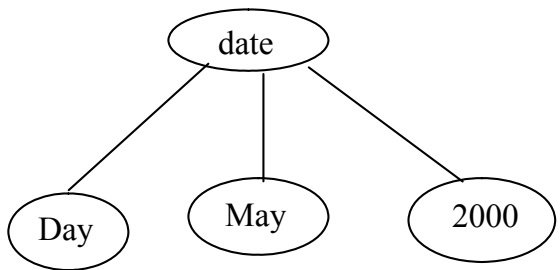

Hình 3.3. Cây biểu diễn hạng thức date(Day, May,2000)

Các ví dụ sau đây cho ta thấy cách tạo ra các hạng thức biểu diễn các đối tượng hình học trong mặt phẳng. Một điểm trong không gian hai chiều được xác định bởi hai toạ độ; một đoạn thẳng được xác định bởi hai điểm; một tam giác được xác định bởi ba điểm. Do đó, nếu ta sử dụng các kí hiệu hàm point (điểm), seg (đoạn thẳng), triangle (tam giác) thì điểm có toạ độ (2,3) được biểu diễn bởi hạng thức point (2, 3)

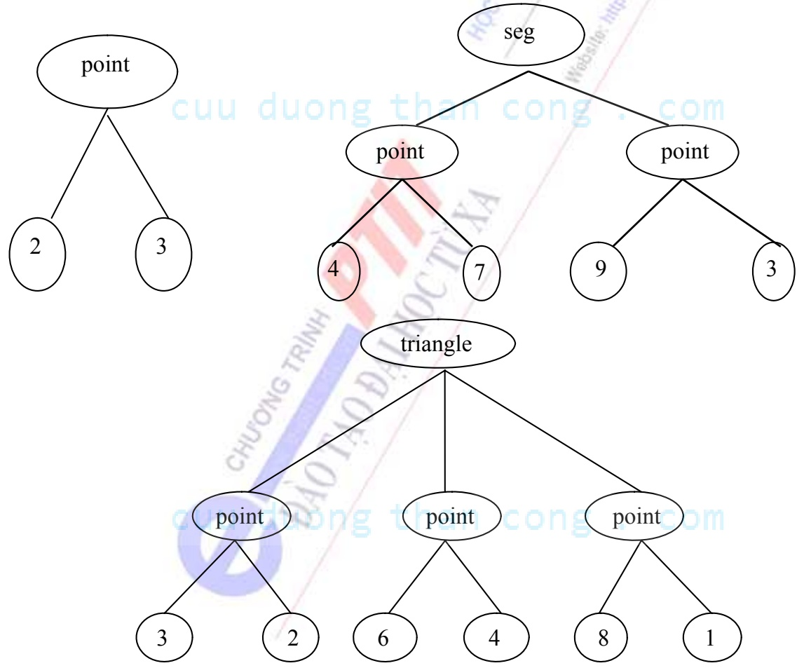

Hình 3.4. Các cây biểu diễn các hạng thức

Đoạn thẳng nối hai điểm (4, 7) và (9, 3) được biểu diễn bởi hạng thức: seg(point (4, 7), point (9, 3))

Tam giác có ba đỉnh là ba điểm (3, 2), (6, 4), (8, 1) được biểu diễn bởi hạng thức: 68

<!-- page: 71 -->

Triangle (point(3, 2), point(6, 4), point(8, 1))

Các hạng thức trên được biểu diễn bởi các cấu trúc cây trong hình 3.4

Một cách tổng quát, các hạng thức được biểu diễn bởi các cây (chẳng hạn, các cây trong **hình 3.4**), trong đó gốc của cây là các kí hiệu hàm. Nếu các đối số này không phải là kí hiệu hằng, hoặc kí hiệu biến thì chúng là các cây con của gốc được tạo thành theo quy tắc trên.

Bây giờ chúng ta xem xét các đối tượng danh sách được biểu diễn bởi cấu trúc cây như thế nào. Nhớ lại rằng, danh sách [spring, summer, autumn, winter]

được biểu diễn bởi hạng thức: list (spring, list(summer, list (autumn, list (winter,[ ]))))

Hạng thức này được biểu diễn bởi cây trong **hình 3.5**

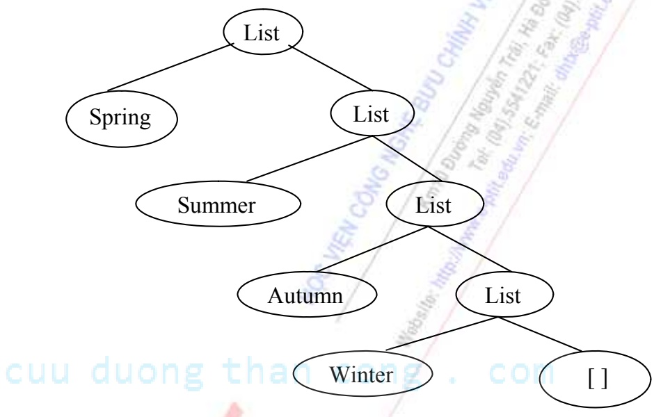

**Hình 3.5 Cây biểu diễn danh sách [spring, summer, autumn, winter]**

Một cách tương tự, bằng cách chuyển sang dạng hạng thức, ta có thể biểu diễn danh sách: [a,b], c, [ [a, e], d ] ] bởi cây trong **hình 3.6**

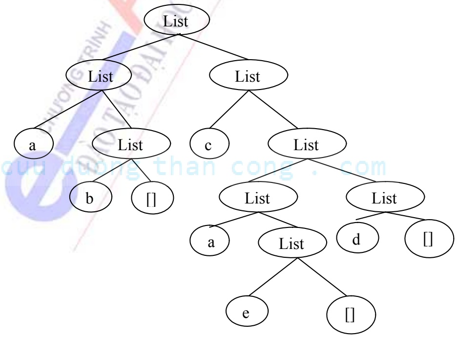

Hình 3.6 Cây biểu diễn danh sách [ [a,b], c, [[a,e],d] ]

<!-- page: 72 -->

Trong cây **hình 3.6** nếu a, b, c, d, e không phải là các đối tượng đơn mà là các đối tượng có cấu trúc được biểu diễn bởi các hạng thức, thì ở vị trí của các đỉnh gắn nhãn a, b, c, d, e sẽ là các cây con biểu diễn các hạng thức đó.

Trên đây chúng ta đã chỉ ra rằng, các hạng thức (và các câu phân tử) có thể biểu diễn một cách tự nhiên bởi các cấu trúc cây.

## 3.5.6.5.2. Cài đặt cơ sở tri thức

Chúng ta đã biết cách tạo ra các cấu trúc dữ liệu để biểu diễn các hạng thức và các câu phân tử. Bây giờ chúng ta nghiên cứu các kĩ thuật cài đặt cơ sở tri thức sao cho các thủ tục suy diễn có thể thực hiện có hiệu quả. Giả sử CSTT bao gồm các câu tuyển dạng

$$
\mathrm{C} = \mathrm{P} _ {1} \vee \dots \vee \mathrm{P} _ {\mathrm{m}} \vee \left\rceil \mathrm{Q} _ {1} \vee \dots \vee \right\rceil \mathrm{Q} _ {\mathrm{n}}
$$

trong đó, Pi $( \mathrm{i} = 1, \ldots, \mathrm{m}, \mathrm{m} \geq 0 ), \mathrm{Q}_{\mathrm{k}} ( \mathrm{k} = 1, 2, \ldots, \mathrm{n}, \mathrm{n} \geq 0 )$ là các câu phân tử. Một cách tự nhiên, mỗi câu C có thể được biểu diễn bởi bản ghi gồm hai trường:

• Danh sách các Literal dương $\left[ \mathrm { P _ { 1 } , . . . , P _ { m } } \right]$

• Danh sách các Literal âm $[ \mathrm { Q } _ { 1 } , . . . , \mathrm { Q } _ { \mathrm { n } } ]$

Một cách đơn giản nhất, ta có thể cài đặt CSTT như một danh sách các câu tuyển. Tuy nhiên với cách cài đặt này, thủ tục suy diễn kém hiệu quả, bởi mỗi lần cần xét xem một câu phân tử S có hợp nhất với một thành phần nào đó của một câu trong CSTT, ta phải đi qua danh sách, xem xét từng thành phần của các câu trong danh sách cho tới khi tìm ra hoặc đi tới hết danh sách.

Một giải pháp khác tốt hơn, ta có thể cài đặt CSTT bởi bảng băm. Các khoá cho bảng băm này là các kí hiệu vị từ, tức là bảng băm được định chỉ số theo các kí hiệu vị từ. Trong bảng băm, tại chỉ số ứng với mỗi kí hiệu vị từ ta sẽ lưu:

• Danh sách các literal dương của kí hiệu vị từ đó.

• Danh sách các literal âm.

• Danh sách các câu mà kí hiệu vị từ xuất hiện trong các literal dương của câu (Câu dương).

• Danh sách các câu mà kí hiệu vị từ xuất hiện trong các literal âm của câu (Câu âm).

Ví dụ: Giả sử CSTT chứa các câu sau:

Brother (An, Ba)

Brother (Tam, Hoa)

⎤Brother (Lan, Cao)

⎤Brother (x,y)∨ Male(x)

⎤Brother (x,y)∨ ⎤Male(y) ∨ ⎤Brother (y,x)

Male(Cao)

Male(Ba)

⎤ Male(Lan)

Khi đó, tại các chỉ số ứng với khoá Brother và Male, bảng băm sẽ lưu giữ các thành phần được cho trong bảng sau

<!-- page: 73 -->

| Khoá | Literal dương | Literal âm | Câu dương | Câu âm |
| --- | --- | --- | --- | --- |
| Brother | Brother(An,Ba) Brother(Tam, Hoa) | ⎤Brother (Lan, Cao) | ⎤Brother(x,y)∨ Male(y)∨Brother(y,x) | ⎤Brother (x,y)∨⎤Male(y)∨ Brother(y,x) ⎤Brother (x,y)∨ Male(x) |
| Male | Male(Cao) Male(Ba) | ⎤ Male(Lan) | ⎤Brother(x,y)∨ Male(x) | ⎤Brother (x,y)∨⎤Male(y) ∨ Brother (y,x) |

Cài đặt CSTT bởi bảng băm định chỉ số theo các kí hiệu vị từ là phương pháp rất hiệu quả cho việc tìm kiếm trên CSTT, nếu như CSTT chứa nhiều kí hiệu vị từ và với mỗi kí hiệu vị từ chỉ có một số ít các câu chứa kí hiệu vị từ đó. Tuy nhiên trong một số áp dụng, có thể có rất nhiều câu chứa cùng một kí hiệu vị từ nào đó. Chẳng hạn, Cơ Sở Tri Thức có thể chứa hàng triệu câu nói về người lao động, mỗi người lao động được biểu diễn bởi các thông tin về họ tên, ngày tháng năm sinh, số thẻ bảo hiểm, công việc (Công việc được xác định bởi nơi làm việc và tiền lương). Tức là mỗi người lao động được mô tả bằng câu có dạng:

## Worker (Tom, date (3, may,1965), 012-34-567, job(UNIMEX, 300))

(câu này nói rằng, có người lao động tên là Tom, sinh ngày 3 tháng 5 năm 1965, số thẻ bảo hiểm 012-34-567, làm việc tại công ty UNIMEX với mức lương 300). Trong các trường hợp như thế, để tìm kiếm có hiệu quả, ngoài việc xây dựng bảng băm định chỉ số theo các đối số của các kí hiệu vị từ, ta cần xây dựng các bảng băm định chỉ số theo các đối số của các vị từ. Chẳng hạn, ở đây các literal dương ứng với khoá Worker cần được tổ chức dưới dạng bảng băm định chỉ số theo khóa là số bảo hiểm y tế hoặc họ tên và ngày tháng năm sinh.

## 3.5.6.5.3 Biểu diễn tri thức bằng luật và lập luận

Với một CSTT gồm các câu trong logic vị từ cấp một, ta có thể chứng minh công thức có là hệ quả logic của CSTT hay không bằng phương pháp chứng minh bác bỏ và thủ tục phân giải. Tuy nhiên, thủ tục chứng minh này có độ phức tạp lớn và đòi hỏi chiến lược giải một cách thích hợp. Vì lý do này, các nhà nghiên cứu cố gắng tìm các tập con của logic vị từ cấp một, sao cho chúng đủ khả năng biểu diễn CSTT trong nhiều lĩnh vực, và có thể đưa ra các thủ tục suy diễn hiệu quả. Các tập con này của logic vị từ cấp một sẽ xác định các ngôn ngữ biểu diễn tri thức đặc biệt. Trong phần này chúng ta sẽ nghiên cứu ngôn ngữ chỉ bao gồm các câu Horn (các luật nếu - thì). Chỉ sử dụng các luật nếu – thì, ta không thể biểu diễn được mọi điều trong logic vị từ cấp một. Tuy nhiên, với các luật nếu - thì ta có thể biểu diễn được một khối lượng lớn tri thức trong nhiều lĩnh vực khác nhau, và có thể thực hiện các thủ tục suy diễn hiệu quả.

## Biểu diễn tri thức bằng luật sinh

Ngôn ngữ bao gồm các luật nếu - thì (if - then), còn gọi là các **luật sản xuất hay luật sinh** (production rule), là ngôn ngữ phổ biến nhất để biểu diễn tri thức. Nhớ rằng, các câu Horn có dạng

$$
P _ {1} \wedge \dots \wedge P _ {n} \Rightarrow Q
$$

trong đó các $\mathbf { P } _ { \mathrm { i } }   ( \mathrm { i } = 1 , . . . , \mathrm { n } )$ và Q là các câu phần tử.

Các câu Horn còn được viết dưới dạng

<!-- page: 74 -->

$$
\underline {{n \acute {e} u}} P _ {1} v à P _ {2} \dots v à P _ {n} \underline {{t h i}} Q
$$

$$
(i f P _ {1} \text {and} \dots \text {and} P _ {n} \text {then} Q)
$$

các P<sub>i</sub> (i = 1, ..., n) được gọi là các điều kiện, Q được gọi là kết luận của luật.

Các luật nếu - thì có các ưu điểm sau đây

• Mỗi luật nếu - thì mô tả một phần nhỏ tương đối độc lập của tri thức.

• Có thể thêm và cơ sở tri thức các luật mới, hoặc loại bỏ một số luật cũ mà không ảnh hưởng nhiều tới các luật khác.

Các hệ tri thức với cơ sở tri thức gồm các luật nếu - thì có khả năng đưa ra lời giải thích cho các quyết định của hệ.

Các luật nếu - thì là dạng biểu diễn tự nhiên của tri thức. Bằng cách sử dụng các luật nếu - thì chúng ta có thể biểu diễn được một số lượng lớn tri thức của con người về tự nhiên, về xã hội, kinh nghiệm của con người trong lao động, sản xuất, tri thức của các thầy thuốc, tri thức của các kỹ sư, tri thức trong các ngành khoa học: kinh tế, sinh học, hoá học, vật lý, toán học,

Sau đây là một luật về chẩn đoán bệnh:

## Nếu

1. bệnh nhân ho lâu ngày, và

2. bệnh nhân thường sốt vào buổi chiều

<u>Thì</u> bệnh nhân có khả năng bệnh lao

Một luật về kinh nghiệm dự báo thời tiết:

Nếu chuồn chuồn bay thấp

thì trời sẽ mưa

Nhiều định lý trong toán học có thể biểu diễn bởi các luật. Chẳng hạn,

Nếu

1. tam giác có một góc bằng 60 <sup>0</sup>, và

2. tam giác có hai cạnh bằng nhau

thì tam giác đó là tam giác đều.

Trên đây chúng ta chỉ xét các luật trong đó mỗi phần kết luận của một luật xác định một khẳng định mới được suy ra khi tất cả các điều kiện của luật được thoả mãn. Trong nhiều áp dụng, cơ sở luật của hệ cần được đưa vào các luật mà phần kết luận của luật là một **hành động** hệ cần thực hiện. Gọi các luật dạng này là luật hành động (action). Một luật hành động có dạng:

## nếu

1. <điều kiện 1>, và

2. <điều kiện 2>, và

m. <điều kiện m>

**thì** &lt;hành động&gt;

Hành động trong các luật hành động có thể là thêm vào một sự kiện mới, có thể là loại bỏ một sự kiện đã có trong bộ nhớ làm việc; hành động cũng có thể là thực hiện một thủ tục nào đó. Trong các robot được trang bị một hệ dựa trên luật, thì phần kết luận của luật có thể là một hành động nào đó mà robot cần thực hiện.

<!-- page: 75 -->

Người ta phân biệt hai dạng hệ, các hệ dựa trên luật sử dụng lập luận tiến và phần kết luận của các luật xác định các khẳng định mới được gọi là các **hệ diễn dịch** (deduction systems). Các hệ dựa trên luật mà phần kết luận của các luật xác định các hành động cần thực hiện được gọi là **hệ hành động dựa trên luật** (rule-based reaction systems).

Trong các hệ diễn dịch, chúng ta xem mọi luật đều sinh ra các khẳng định mới “có giá trị” như nhau; tức là, ta không xem khẳng định do luật này sinh ra là “tốt” hơn khẳng định do luật khác sinh ra. Do đó trong các hệ diễn dịch, khi mà nhiều luật có thể cháy được (một luật được gọi là **cháy được** nếu tất cả các điều kiện của luật được thoả mãn) ta có thể cho tất cả các luật đó cháy (một luật cháy để sinh ra khẳng định mới).

Trong các hệ hành động, khi có có nhiều hơn một luật có thể cháy, nói chung, chúng ta chỉ muốn thực hiện một trong các hành động có thể. Do đó, trong các hệ hành động, chúng ta cần có chiến lược giải quyết va chạm để quyết định cho luật nào cháy trong số các luật có thể cháy. Sau đây là một số chiến lược giải quyết va chạm.

Sắp xếp các luật theo thứ tự ưu tiên. Trong các luật có thể cháy, luật nào có mức ưu tiên cao nhất sẽ được thực hiện.

• Sắp xếp dữ liệu. Các sự kiện trong bộ nhớ làm việc được sắp xếp theo thứ tự ưu tiên. Luật nào mà các điều kiện của nó được làm thoả mãn bởi các điều kiện có mức ưu tiên cao sẽ được thực hiện trước.

Các luật được phân thành các nhóm. Trong mỗi nhóm luật, được chỉ ra các điều kiện để áp dụng các luật của nhóm. Các điều kiện này liên quan đến nội dung của bộ nhớ làm việc.

Sử dụng các siêu luật (metarule). Đó là các luật mà phần điều kiện của nó liên quan tới nội dung của các luật và nội dung của bộ nhớ làm việc, còn phần kết luận của nó chỉ ra các luật có thể được áp dụng hoặc có thể bi cấm áp dụng. Các siêu luật sẽ điều khiển sự cho phép các luật cháy.

Đương nhiên là, việc sử dụng chiến lược giải quyết va chạm nào phụ thuộc vào từng áp dụng. Tuỳ theo mục đích thiết kế của hệ mà ta lựa chọn chiến lược giải quyết va chạm cho thích hợp.

## Biểu điễn tri thức không chắc chắn

Trong đời sống thực tế, có rất nhiều điều mà ngay cả các chuyên gia cũng không hoàn toàn tin tưởng chúng là đúng hay sai. Đặc biệt là các kết luận trong chẩn đoán y học, trong dự báo thời tiết, trong phỏng đoán sự hỏng hóc của máy móc, chúng ta không thể tin tưởng 100% các kết luận đưa ra là đúng. Chẳng hạn, nếu xe máy đang chạy bị chết máy và kiểm tra xăng hãy còn thì có thể tin rằng 90% là do có vấn đề ở bugi. Tuy nhiên vẫn còn 10% phỏng đoán đó là sai, xe bị chết máy do các nguyên nhân khác. Do đó trong các hệ dựa trên luật, chúng ta còn phải đưa vào **mức độ chắc chắn** của các luật và các sự kiện trong cơ sở tri thức. Chúng ta sẽ gán cho mỗi luật hoặc sự kiện một mức độ chắc chắn nào đó, mức độ chắc chắn là một số nằm giữa 0 và 1. Cách viết

$$
A _ {1} \wedge \dots \wedge A _ {n} \Rightarrow B: C\tag{1}
$$

có nghĩa là luật ${ \mathcal { A } } _ { 1 } \wedge \cdots \wedge { \mathcal { A } } _ { n } \Longrightarrow B$ có độ chắn chắn là $\mathrm { ~ C ~ } ( 0 \leq \mathrm { C } \leq 1 )$ .

Chúng ta cần phải đưa ra phương pháp xác định mức độ chắc chắn của các kết luận được suy ra. Trước hết chúng ta đánh giá kết luận suy ra từ luật chỉ có một điều kiện. Giả sử ta có luật

$$
A \Rightarrow B: C\tag{2}
$$

Theo lý thuyết xác suất, ta có

<!-- page: 76 -->

$$
\Pr (\mathrm{B}) = \Pr (\mathrm{B} \mid \mathrm{A}) \Pr (\mathrm{A})\tag{3}
$$

trong đó Pr(B), Pr(A) là xác suất của sự kiện B, A tương ứng (tức là mức độ chắc chắn của B, A tương ứng), còn Pr(B⏐A) là xác suất có điều kiện của B khi A đã xảy ra, ở đây $\operatorname* { P r } ( \mathrm { B }   \big |   \mathrm { A } )$ là mức độ chắc chắn của luật $\mathbf { A } \Rightarrow \mathbf { B } ,$ , tức là bằng C.

Trong trường hợp luật có n (n > 1) điều kiện, tức là các luật dạng (1), ta xem $\mathrm { A } = \mathrm { \it A } _ { 1 } \wedge \cdots \wedge \mathrm { \it A } _ { n }$ Trong trường hợp này, mức độ chắc chắn của A, Pr(A) được tính bằng các phương pháp khác nhau, tuỳ thuộc vào các sự kiện $\mathrm{A}_{\mathrm{i}}(\mathrm{i}=1, \ldots, \mathrm{n})$ là độc lập hay phụ thuộc.

Giả sử các sự kiện $\mathrm{A}_{\mathrm{i}}(\mathrm{i}=1, \ldots, \mathrm{n})$ là độc lập, khi đó

$$
\Pr (\mathrm{A}) = \Pr (\mathrm{A} _ {1}) \dots \Pr (\mathrm{A} _ {\mathrm{n}})\tag{4}
$$

Ví dụ. Giả sử cơ sở tri thức của hệ chứa luật sau

**IF** 1. X có tiền án, và

2. X có thù oán với nạn nhân Y, và

3. X đưa ra bằng chứng ngoại phạm sai

**THEN** X là kẻ giết Y.

với mức độ chắc chắn 90%.

Giả sử ta có các sự kiện

Hung có tiền án, với mức độ chắc chắn là 1.

Hung có thù oán với nạn nhân Meo, với mức độ chắc chắn là 0,7.

Hung đưa ra bằng chứng ngoại phạm sai, với mức độ chắc chắn là 0,8.

Từ các sự kiện và luật trên, ta có

$$
\begin{array}{l} \operatorname * {P r} (\mathrm{A}) = 1. 0, 7. 0, 8 = 0, 5 6 \\ \operatorname * {P r} (\mathrm{B}) = 0, 9. 0, 5 6 = 0, 5 0 4 \end{array}
$$

Như vậy mức độ chắc chắn của kết luận “Hung là kẻ giết Meo” là 50, 4%.

Công thức (4) chỉ áp dụng cho các sự kiện $\mathrm { A _ { 1 } ^ { \overline { { \gamma } } } , . . . , A _ { n } ^ { \overline { { \gamma } } } }$ là độc lập (tức sự xuất hiện của sự kiện này không ảnh hưởng gì đến sự xuất hiện của các sự kiện khác). Nếu các sự kiện $\mathrm { A _ { 1 } ,   . . . ,   A _ { n } }$ là phụ thuộc, ta có thể tính mức độ chắc chắn của điều kiện của luật, $\mathrm { A } = \mathrm { \it A } _ { 1 } \wedge \ldots \wedge \mathrm { \it A } _ { n }$ , theo công thức sau:

$$
\Pr (\mathrm{A}) = \min \left(\Pr (\mathrm{A} _ {1}),..., \Pr (\mathrm{A} _ {\mathrm{n}})\right)\tag{5}
$$

Chẳng hạn, với các thông tin trong ví dụ trên, từ công thức (5) ta có

$$
\begin{array}{c} \operatorname * {P r} (\mathrm{A}) = \min (1, 0, 7, 0, 8) = 0, 7 \\ \text {Do do} \quad \operatorname * {P r} (\mathrm{B}) = 0, 9. 0, 7 = 0, 6 3 \end{array}
$$

Ngoài công thức (5), người ta còn đưa ra các phương pháp khác để tính mức độ chắc chắn $\operatorname { P r } ( \mathbf { A } )$ khi mà $\mathrm{A} = A_{1} \wedge \cdots \wedge A_{n}$ và các $\mathrm { A _ { 1 } , . . . , A _ { n } }$ không độc lập.

## 3.5.6.5.4 Biểu diễn tri thức bằng mạng ngữ nghiã

Mạng ngữ nghĩa là một phương pháp biểu diễn tri thức dễ hiểu nhất. Phương pháp biểu diễn dựa trên đồ thị, trong đó đỉnh là là các đối tượng (hay khái niệm) còn các cung là là các mối quan hệ giữa các đói tượng (họặc khái niệm) đó.

**Ví dụ 1**: giữa các đối tượng và khái niệm: chích, chim, tổ, cánh, hótcó ccác quan hệ như hình dưới đây

<!-- page: 77 -->

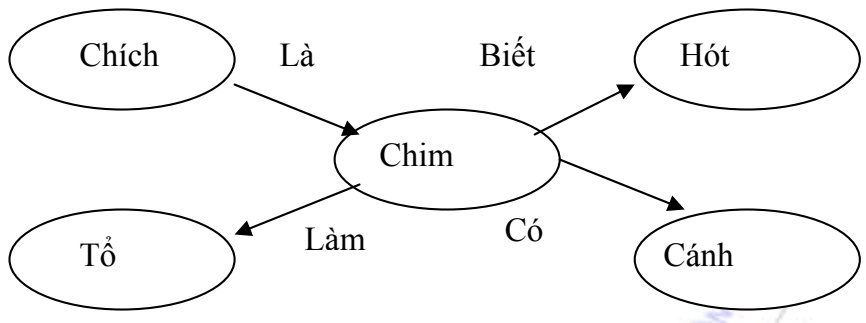

Hình 3.7. Ví dụ đơn giản về mạng ngữ nghĩa

**Ví dụ 2.** Cho tập quan hệ (hàm) trong tam giác:

a) $a / \sin \alpha = b / \sin \beta$

b) $c / \sin \gamma = b / \sin \beta$

c) $S = \sqrt{p(p - a)(p - b)(p - c)}$

d) $a + \beta + \gamma = \pi$

e) $\mathrm { S } { = } \mathrm { h _ { c } { ^ { * } c } }$

f) Nếu chúng ta đặt các quan hệ này là các nút vuông, các biến là các nút tròn; cung là các đường liên kết giữa các biến có liên quan (như $\mathrm{S}_{2} \mathrm{h}_{\mathrm{c}}, \mathrm{c})$ trong các quan hệ (ở đây là công thức e); c); b) ). Học viên có thể dùng mạng ngữ nghĩa để mô tả các mối quan hệ giữa biến và hàm.

## 3.5.6.5.5 Biểu diễn tri thức bằng khung

Khung là một phương pháp biểu diễn tri thức có cấu trúc dữ liệu chứa tất cả tri thức liên quan đến một đối tượng cụ thể nào đó. Khung (Frame) có liên hệ chặt chẽ đến khái niệm hương đối tượng. Khung thương được dùng đẻ biểu diễn những tri thức “chuẩn” hoặc những tri thức dựa trên kinh nghiệm hoặc các điểm đã được hiểu biết cặn kẽ.

Cấu trúc của khung gồm hai thành phần cơ bản “Slot” và “Facet”. Slot là một thuộc tính đặc tả đối tượng ví dụ khung mô tả xe hơi có hai Slot là Trọng lượng và Loại động cơ. Một Slot có thể chứ nhiều Facet. Các Facet đôi khi còn được gọi là Slot con, Ví dụ Facet của Slot Loại động cơ có thể là:Kiêu đong cơ, Số xi lanh,Khả năng tăng tốc độ.

## 3.5.6.5.6 Các phương pháp biểu diễn tri thức khác

Một sô cách biểu diễn tri thức khác có thể liêt kê như sau:

Mô tả tri thức bằng cặp ba Đói tương-Thuộc tính-Giá trị (Object-Attibute-Value: O-A-V). Đây là phương pháp biểu diên cổ điển, đơn giản. Hiệu quả của phương pháp không cao nên hiện nay ít dùng. Mặt khác, cặp ba Đói tương-Thuộc tính-Giá trị gần giống với phương pháp mạng ngữ nghĩa.

ƒ Phương pháp mô tả tri thức bằng kịch bản (Script)

ƒ Phương pháp mô tả tri thức bằng mặt (Face)

ƒ Phương pháp mô tả tri thức bằng bảng đen (Blackboard)

ƒ Phương pháp mô tả tri thức theo thủ tục

<!-- page: 78 -->

## 3.6 CƠ CHẾ SUY DIỄN

## 3.6.1 Khái niêm về suy diễn và lập luận

Suy diễn (inference) và lập luận (reasoning) là hai khái niệm được dùng chung để chỉ một tiến trình đưa đến kết luận từ các giả thiết cho ở dạng cơ sở tri thức (sự kiện, quy luật)

Các hệ tri thức mà cơ sở tri thức bao gồm các luật sẽ được gọi là các **hệ dựa trên luật** (rule - based system). Trong các mục còn lại của chương này chúng ta sẽ nghiên cứu các thủ tục suy diễn trong các hệ dựa trên luật.

Một khi chúng ta đã lưu trữ một cơ sở tri thức, chúng ta cần có thủ tục lập luận để rút ra các kết luận từ cơ sở tri thức. Trong các hệ dựa luật, có hai phương pháp luận lập luận cơ bản:

• Lập luận tiến và

• lập luận lùi

Chúng ta sẽ phân chia cơ sở tri thức thành hai bộ phận: **cơ sở luật** và **cơ sở sự kiện** (hoặc **bộ nhớ làm việc**). Cơ sở luật bao gồm các luật có ít nhất một điều kiện, biểu diễn các tri thức chung về lĩnh vực áp dụng. Còn cơ sở luật bao gồm các câu phần tử (các luật không điều kiện) mô tả các sự kiện mà chúng ta biết về các đối tượng trong lĩnh vực áp dụng.

## 3.6.2 Lập luận tiến

Tư tưởng cơ bản của lập luận tiến là áp dụng luật suy diễn Modus Ponens tổng quát). Trong mỗi bước của thủ tục lập luận tiến, người ta xét một luật trong cơ sở luật. Đối sánh mỗi điều kiện của luật với các sự kiện trong cơ sở sự kiện, nếu tất cả các điều kiện của luật đều được thoả mãn thì sự kiện trong phần kết luận của luật được xem là sự kiện được suy ra. Nếu sự kiện này là sự kiện mới (không có trong bộ nhớ làm việc), thì nó được đặt vào bộ nhớ làm việc. Quá trình trên được lặp lại cho tới khi nào không có luật nào sinh ra các sự kiện mới.

Như vậy quá trình lập luận tiến là quá trình xem xét các luật. Với mỗi luật, ta đi từ phần điều kiện tới phần kết luận của luật, khi mà tất cả các điều kiện của luật đều được làm thoả mãn (bởi các sự kiện trong cơ sở sự kiện), thì ta suy ra sự kiện trong phần kết luận của luật. Chính vì lẽ đó mà có tên lập luận tiến (forward chaining hoặc forward reasoning).

Quá trình lập luận tiến không định hướng tới giải quyết một vấn đề nào cả, không định hướng tới tìm ra câu trả lời cho một câu hỏi nào cả. Lập luận tiến chỉ là quá trình suy ra các sự kiện mới từ các sự kiện trong bộ nhớ làm việc. Vì vậy lập luận tiến còn được gọi là **lập luận điều khiển bởi dữ liệu** (data - driven reasioning), hoặc **lập luận định hướng dữ liệu** (data - directed reasioning).

**Ví dụ lập luận tiến.** Để thấy được quá trình lập luận tiến diễn ra như thế nào, chúng ta xét ví dụ sau đây. (Ví dụ này là của P. H. Winston xem [17]).

Giả sử cơ sở luật (cơ sở luật về các động vật trong sở thú) gồm các luật sau

Luật 1: nếu động vật có lông mao

thì động vật là loài có vú

Luật 2: nếu động vật có lông vũ

thì động vật là chim

Luật 3: nếu 1. động vật biết bay, và

2. động vật đẻ trứng

<!-- page: 79 -->

thì động vật là chim Luật 4: nếu 1. động vật là loài có vú, và 2. động vật ăn thịt thì động vật là thú ăn thịt

Luật 5: nếu 1. động vật là loài có vú, và 2. động vật có răng nhọn, và 3. động vật có móng vuốt thì động vật là thú ăn thịt

Luật 6: nếu 1. động vật là thú ăn thịt, và 2. động vật có màu lông vàng hung, và 3. động vật có đốm sẫm thì động vật là báo Châu Phi

Luật 7: nếu 1. động vật là thú ăn thịt, và 2. động vật có màu lông vàng hung, và 3. động vật có vằn đen thì động vật là hổ

Luật 8: nếu 1. động vật là chim, và 2. động vật không biết bay, và 3. động vật có chân dài, và 4. động vật có cổ dài thì động vật là đà điểu

Luật 9: nếu 1. động vật là chim, và 2. động vật không biết bay, và 3. động vật biết bơi, và 4. động vật có lông đen và trắng thì động vật là chim cánh cụt

Giả sử một em bé quan sát một con vật có tên là Ki trong sở thú, em thấy nó có các đặc điểm sau Ki có lông mao Ki ăn thịt Ki có màu lông vàng hung Ki có đốm sẫm

Lúc này cơ sở sự kiện sẽ bao gồm các sự kiện trên.

Thủ tục lập luận tiến xem xét luật 1. Khi biến “động vật” trong luật này được thay bởi Ki, điều kiện của luật trỏ thành “Ki có lông mao”, đây là một sự kiện có trong bộ nhớ làm việc, do đó ta suy ra “Ki là loài có vú”. Đây là sự kiện mới, do đó nó được thêm vào bộ nhớ làm việc. Xét luật 4, thế biến “động vật” bởi Ki, thì hai điều kiện của luật trở thành:

Ki là loài có vú, và

Ki ăn thịt

<!-- page: 80 -->

Cả hai sự kiện này đều có trong bộ nhớ làm việc, do đó từ luật 4 ta suy ra “Ki là thú ăn thịt”. Sự kiện mới này lại được thêm vào bộ nhớ làm việc. Ta xét tiếp luật 6, thế biến “động vật” bởi Ki, các điều kiện của luật trở thành:

Ki là loài thú ăn thịt, và

Ki có màu lông vàng hung, và

Ki có đốm sẫm

Tất cả các điều kiện này đều đúng, do đó từ luật 6, ta suy ra “Ki là báo Châu Phi”. Như vậy từ các sự kiện đã biết về Ki, lập luận tiến đã suy ra các sự kiện mới sau

Ki là loài có vú.

Ki là thú ăn thịt.

Ki là báo Châu Phi.

## 3.6.3 Lập luận lùi

Trong các hệ dựa trên luật, chúng ta còn có thể sử dụng phương pháp **lập luận lùi** (backward chaining hoặc backward reasoning).

Trong lập luận lùi, người ta đưa ra các giả thuyết cần được đánh giá. Sử dụng lập luận lùi, giả thuyết đưa ra hoặc là được chứng minh, hoặc là bị bác bỏ (bởi các sự kiện trong bộ nhớ làm việc). Cần lưu ý rằng, chúng ta nói giả thuyết được chứng minh, hoặc bị bác bỏ là muốn nói tới nó được chứng minh, hoặc bác bỏ bởi tình trạng hiện thời của bộ nhớ làm việc. Khi mà bộ nhớ làm việc thay đổi (chúng ta thêm vào hoặc loại bỏ một số sự kiện) thì một giả thuyết đã được chứng minh có thể trở thành bị bác bỏ và ngược lại.

Quá trình lập luận lùi diễn ra như sau: Ta đối sánh giả thuyết đưa ra với các sự kiện trong bộ nhớ làm việc. Nếu có một sự kiện khớp với giả thuyết, (ở đây “khớp” được hiểu là hai câu mô tả sự kiện và giả thuyết trùng nhau qua một phép thế nào đó), thì ta xem như giả thuyết là đúng. Nếu không cớ sự kiện nào khớp với giả thuyết, thì ta đối sánh giả thuyết với phần kết luận của các luật. Với mỗi luật mà kết luận của luật khớp với giả thuyết, ta đi lùi lại phần điều kiện của luật. Các điều kiện này của luật được xem như các giả thuyết mới. Với giả thuyết mới, ta lập lại quá trình trên.

Nếu tất cả các giả thuyết được sinh ra trong quá trình phát triển các giả thuyết bởi các luật được chọn thích hợp đều được thoả mãn (đều có trong bộ nhớ làm việc) thì giả thuyết đã đưa ra được xem là đúng. Ngược lại, dù ta áp dụng luật nào để phát triển các giả thuyết cũng dẫn tới các giả thuyết không có trong bộ nhớ làm việc và không thể quy giả thuyết này về các giả thuyết mới khác, thì giả thuyết đã đưa ra được xem là sai.

**Ví dụ lập luận lùi.** Để làm sáng tỏ tư tưởng của lập luận lùi, xét với dụ sau.Giả sử bộ nhớ làm việc chứa các sự kiện sau.

Bibi có lông vũ

Bibi có chân dài

Bibi có cổ dài

Bibi không biết bay

Ta đưa ra giả thuyết sau đây

Bibi là đà điểu

<!-- page: 81 -->

Đối sánh giả thuyết này với phần kết luận của các luật, ta thấy nó khớp với kết luận của luật 8 nếu thế biến “động vật” bởi Bibi. Từ luật 8, ta suy ra rằng, giả thuyết “Bibi là đà điểu” là đúng, nếu các điều kiện sau là đúng

1. Bibi là chim

2. Bibi không biết bay

3. Bibi có chân dài

4. Bibi có cổ dài

Đây là 4 giả thuyết mới. Việc đánh giá giả thuyết “Bibi là đà điểu” được quy về việc đánh giá bốn giả thuyết mới này. Các giả thuyết 2, 3 và 4 đều có trong bộ nhớ làm việc, ta chỉ cần đánh giá giả thuyết “Bibi là chim”. Lại đối sánh giả thuyết này với phần kết luận của các luật. Ta thấy nó khớp với kết luận của luật 2 và luật 3. Xét luật 3, đi lùi lại phần điều kiện của luật này, ta nhận được các giả thuyết mới là:

Bibi biết bay

Bibi đẻ trứng

Cả hai giả thuyết này đều không có trong bộ nhớ làm việc và cũng không khớp với phần kết luận của luật nào cả. Do đó, ta không thể phát triển tiếp các giả thuyết này được nữa. Chuyển sang xét luật 2, để “Bibi là chim” luật này đòi hỏi điều kiện “Bibi có lông vũ”. Điều kiện này có trong bộ nhớ làm việc. Vậy giả thuyết đã đưa ra “Bibi là đà điểu” là đúng.

Lập luận lùi nhằm chứng minh một giả thuyết. Chính vì thế mà lập luận lùi còn được gọi là **lập luận định hướng mục đích** (goal - ariented reasoning).

## 3.6.4 Lập luận tương tự như tìm kiếm trên đồ thì và/hoặc

Có thể biểu diễn lập luận bởi đồ thị và/hoặc. Mỗi luật **nếu - thì** dạng đều có dạng

$$
\boldsymbol {n} \acute {\boldsymbol {e u}} P _ {1} v a P _ {2} \dots v a P _ {m} \text {thi} Q
$$

Có thể xảy ra nhiều luật khác nhau có cùng phần kết luận. Chẳng hạn, có hai luật cho kết luận Q, một luật gồm ba điều kiện $\mathrm{P}_{1}, \mathrm{P}_{2}, \mathrm{P}_{3}$ một luật gồm hai điều kiện $\mathrm { S } _ { 1 } ,   \mathrm { S } _ { 2 } .$ Hoàn cảnh này được biểu diễn bởi đồ thị trong hình 3.8.

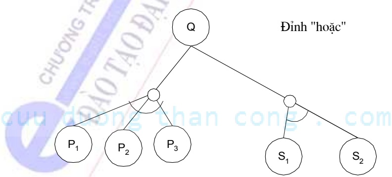

Hình 3.8 Biểu diễn đồ thị của luật

Bằng cách biểu diễn các luật bởi đồ thị như trên. Từ cơ sở luật, ta xây dựng đồ thị và/hoặc. Khi đó lập luận lùi có thể xem như quá trình tìm kiếm trên đồ thị và/hoặc được xây dựng nên từ cơ sở luật. Quá trình tìm kiếm xuất phát từ đỉnh khớp với giả thuyết cần đánh giá.

Việc tìm kiếm để xác định một giả thuyết là đúng hay sai hoàn toàn tương tự như việc tìm kiếm trên đồ thị và/hoặc để xác định một đỉnh ứng với bài toán đã cho là giải được hay không giải

<!-- page: 82 -->

được. Nếu giả thuyết được chứng minh là đúng thì chúng ta sẽ tìm được **cây chứng minh** giống như tìm cây nghiệm cho bài toán cần giải

## Thủ tục lập luận tiến

Như chúng ta đã nói, trong các hệ dựa trên luật, chúng ta sẽ tách cơ sở tri thức thành hai phần

Cở sở luật, ký hiệu là RB (Rule Base), và

• Cở sở sự kiện (bộ nhớ làm việc), ký hiệu là FB (Fact Base)

Với mỗi luật R:

$$
\boldsymbol {N} \acute {\boldsymbol {e u}} P _ {1} v à P _ {2} \dots P _ {m} \boldsymbol {t h i} Q
$$

ký hiệu Conds là danh sách các điều kiện của luật, Conds $\mathbf{\xi} = [\mathbf{P}_1, \mathbf{P}_2, \ldots, \mathbf{P}_{\mathrm{m}}];$ và ký hiệu Conc là kết luận của luật, Conc = Q. Ta xem mỗi luật R như một cặp danh sách các điều kiện và một kết luận:

$$
R = (C o n d s (R), C o n c (R))
$$

Trong thủ tục lập luận tiến, chúng ta sẽ sử dụng luật suy diễn sau

$$
\begin{array}{c} P _ {1} \wedge \dots \wedge P _ {i} \wedge \dots \wedge P _ {m} \Rightarrow Q, \\ \hline S \\ \hline P _ {1} ^ {\prime} \wedge \dots \wedge P _ {i - 1} ^ {\prime} \wedge P _ {i} ^ {\prime} \wedge \dots \wedge P _ {m} ^ {\prime} \Rightarrow Q ^ {\prime} \end{array}
$$

trong đó, P<sub>i</sub> hợp nhất với S bởi phép thế θ, tức:

$$
P _ {i} \theta = S \theta , v \grave {a} P _ {k} ^ {'} = P _ {k} \theta (k = 1, \dots , m; k \neq i), Q ^ {'} = Q \theta .
$$

Luật suy diễn trên cho phép ta từ một luật có m điều kiện, một trong các điều kiện đó “khớp” với một sự kiện suy ra một luật mới có m - 1 điều kiện. Do đó nếu luật có m điều kiện, thì bằng cách áp dụng luật suy diễn tiến m lần (nếu có thể) ta suy ra được một sự kiện. Sự kiện này là kết quả của việc áp dụng phép thế biến vào kết luận của luật.

## 3.6.6 Thủ tục For\_chain

Thủ tục sau đây, thủ tục For\_Chair, thực hiện quá trình áp dụng luật suy diễn nêu trên để giảm bớt số điều kiện của một luật trong cơ sở luật. Khi mà ta dẫn tới một luật có phần điều kiện rỗng tức là ta đã suy ra một sự kiện. Trong thủ tục For\_Chain, luật R = (Conds, Conc) là biến địa phương của thủ tục, $\mathrm{Cond}s = [\mathrm{P}_1,  点  \mathrm{P}_1,  点  \mathrm{P}_{\mathrm{m}}]$

```txt
procedure For_Chain (conds, conc);
begin
for mỗi S trong FB do
if S hợp nhất với điều kiện Pi trong Conds bởi phép thế θ
then {
Conds ← [P1θ, ..., Pi-1θ, Pi+1θ, ..., Pmθ];
Conc ← Conc θ;
if Conds rỗng then Add(Conc, FB)
else For_Chain(Conds, Conc);
}
end:
```

**Chú ý**. Trong thủ tục trên, thủ tục Add(Conc,FB) thực hiện kiểm tra kết luận conc có là sự kiện mới không (tức là không có sự kiện nào trong cơ sở sự kiện FB trùng với Conc hoặc nhận được từ Conc bằng cách đặt tên lại các biến), nếu Conc là sự kiện mới thì nó được đặt vào FB.

<!-- page: 83 -->

Quá trình lập luận tiến là quá trình áp dụng thủ tục trên cho các luật trong cơ sở luật cho tới khi nào không có sự kiện mới nào xuất hiện. Ta có thủ tục sau:

**procedure** Forward\_Reasoning (RB, FB); **begin repeat for** mỗi luật (conds, conc) trong FB **do** For\_Chain(Conds, Conc); **until** không có luật nào sinh ra sự kiện mới; **end;**

**Ví dụ.** Giả sử cơ sở luật chứa luật sau (luật mẹ) **nếu** 1.x là ngựa, và 2.x mẹ của y, và 3.y chạy nhanh **thì** x có giá

Cơ sở sự kiện gồm các sự kiện sau Tom là ngựa Ken là ngựa Kit là ngựa Bin là ngựa Tom là mẹ của Bin Tom là mẹ của Ken Bin là mẹ của Kit. Kit chạy nhanh. Bin chạy nhanh.

Bằng cách sử dụng các vị từ House(x) (x là ngựa), Mother(x, y) (x là mẹ của y), Fast(y) (y chạy nhanh), Valuable(x) (x có giá), ta có thể viết luật trên lại thành câu: House(x) Λ Mother(x, y) Λ Fast(y) ⇒ Valuable(x)

Cơ sở sự kiện gồm các câu phần tử sau House(Tom) (1) House(Ken) (2) House(Kit) (3) House(Bin) (4) Mother(Tom, Bin) (5) Mother(Tom, Ken) (6) Mother(Bin, Kit) (7) Fast(Kit) (8) Fast(Bin) (9)

Xét quá trình sẽ diễn ra như thế nào khi ta áp dụng thủ tục For\_chain cho luật mẹ và FB gồm các sự kiện (1) - (9).

<!-- page: 84 -->

• Sự kiện (1) khớp với điều kiện thứ nhất của luật bởi phép thế [x/Tom], từ luật mẹ ta suy ra

Mother(Tom, y) Λ Fast(y) ⇒ Valuable(Tom)

• Sự kiện (5) hợp nhất với điều kiện Mother(Tom/y) bởi phép thế [y/ Bin], ta suy ra

Fast(Bin) ⇒ Valuable(Tom)

Từ sự kiện (9) và kéo theo trên, ta suy ra Valuable(Tom).

• Sự kiện (2) cũng hợp nhất với điều kiện thứ nhất của luật, do đó ta suy ra

Mother(Ken, y) Λ Fast(y) ⇒ Valuable(Ken)

Tới đây ta không suy diễn tiếp được, vì không có sự kiện nào hợp nhất được với điều kiện Mother(Ken, y). Điều tương tự cũng xảy ra, khi mà biến x trong luật mẹ được thế bởi Kit.

Từ sự kiện (4) và luật mẹ, ta suy ra

Mother(Bin, y) Λ Fast(y) ⇒ Valuable(Bin)

• Sự kiện (7) hợp nhất với điều kiện Mother(Bin, y), từ đó ta suy ra

Fast(Kit) ⇒ Valuable(Bin)

Từ kéo theo này và sự kiện (8), ta suy ra Valuable(Bin). Như vậy áp dụng thủ tục For\_chain cho luật mẹ, chúng ta suy ra được hai sự kiện mới là “Tom có giá” và “Bin có giá”.

## 3.7 CÁC HỆ CƠ SỞ TRI THỨC VÀ CÁC HỆ CHUYÊN GIA

Tồn tại nhiều hệ cơ sở tri thức như: các hệ chuyên gia, Hệ hỗ trợ quyết định, Hệ học (Learning), Hệ logic mờ; Mạng (lưới) tính toán, Hệ tích hợp cơ sở dữ liệu và cơ sở tri thức v.v… Trong phạm vi tài liệu này, chúng ta chỉ có thể xem xét một vài hệ điển hình như: Hệ hỗ trợ ra quyết định, Hệ chuên gia Y học MYCIN, hệ dựa luật. Các hệ thống khác co thể tìm đọc ở [11, 8]

## 3.7.1 Hệ hỗ trợ ra quyết định và hệ thống thông tin

Hệ hỗ trợ ra quyết định được Michael S. Scô Morton đề xuất vào những năm 1070. Hệ gồm một số phần chính như: phần mềm máy tính; chức năng hỗ trợ ra quyết định; dữ liệu giao dịch, các mô hình. Có những đặc thù riêng giữa hệ hỗ trợ ra quyết định và hệ thống thông tin. Cụ thể như sau:.

Hệ thống thông tin có các tính chất.

• Tập trung vào thông tin, hướng đến các nhà quản lý cấp điều hành.

• Làm việc với dòng thông tin có cấu trúc Các hệ hỗ trợ quyết định có các tính chất:

Hướng đến các quyết định, các nhà lãnh đạo

• Tính uyển chuyển, thích ứng với hoàn cảnh và phản ứng nhanh

Do người dùng khởi động và kiểm soát

• Hỗ trợ các quyết định các nhân của nhà lãnh đạo

Bảng dưới đây cung cấp một số hệ hỗ trợ ra quyết định đã được xây dựng và ứng dụng:

<!-- page: 85 -->

<table><tr><td colspan="3">TÒN</td><td>LÒNH VÒC ẢNG DỒNG</td></tr><tr><td colspan="3">GADS</td><td>PH ÔN TỐCH V Pero CUNG CÓP TỔI</td></tr><tr><td>GEODATA</td><td>ANALYSIS</td><td>DISPLAY</td><td>NGUYỜN ẢA LÝ</td></tr><tr><td colspan="3">SYSTEM</td><td></td></tr><tr><td colspan="3">PMS</td><td>TỔ VÒN V Pero QUẢN TRỔ ẢU TỔ</td></tr><tr><td colspan="3">PORTFOLIO MANAGEMENT SYSTEM</td><td></td></tr><tr><td colspan="3">IRIS</td><td>PH ÔN TỐCH CHỘT LƯƠNG V Pero B Pero TRỐ</td></tr><tr><td colspan="2">INDUSTRIAL</td><td>RELATIONS</td><td>NH ÔN LỘC TRONG SƠN XUỒT</td></tr><tr><td colspan="3">INFORMATION</td><td></td></tr><tr><td colspan="3">PROJECTOR</td><td>HOỘCH ẢNH K Pero HOỘCH TỔI CHỐNH</td></tr><tr><td colspan="3">IFPS</td><td>PH ÔN TỐCH TỔI CHỐNH, GIỜ THỒNH,</td></tr><tr><td colspan="3">INTERACTIVE FINANCIAL PLANNING</td><td>SƠN PHÒM</td></tr><tr><td colspan="3">SYSTEM</td><td></td></tr><tr><td colspan="3">BRANDAID</td><td>PH ÔN TỐCH TH Pero TRƯƠNG, NG ÔN SỞCH, QUỐNG CỞO</td></tr></table>

Hình 3.9: Một số hệ hỗ trợ ra quyết định

## 3.7.2. Các thành phần của một hệ ra hỗ trợ quyết định

Một cách hình dung về các thành phần của một hệ hỗ trợ ra quyết định (DDS – decision support system) (Hình 3.10) và quan hệ giữa chúng là sử dụng các khái niệm đối thoại (dialog), dữ liệu (data) mà mô hình (model). Đối với những người thiết kế hệ thống DDS cũng như những người sử dụng hệ thống, điều quan trọng là hiểu được các thành phần này được thiết kế như thế nào. Người sử dụng cần phải biết có thể yêu cầu cái gì ở DDS. Người thiết kế phải biết được DDS có thể cung cấp cái gì.

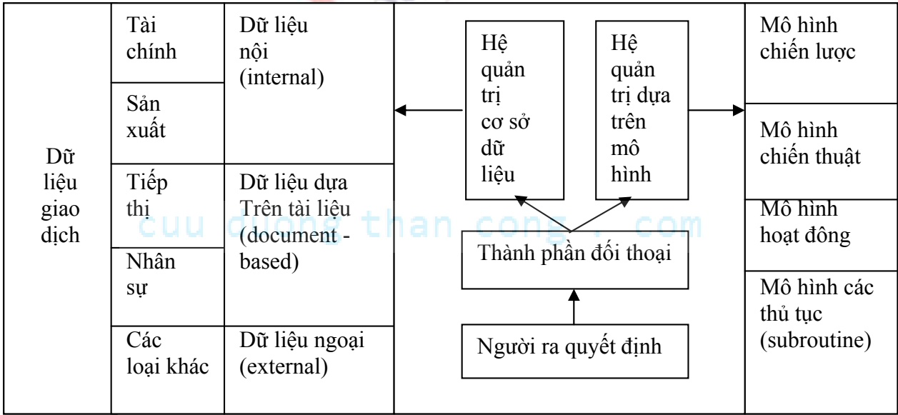

Hình 3.10. các thành phần của một hệ hỗ trợ ra quyết định

<!-- page: 86 -->

Các kỹ thuật mới có nhiều ảnh hưởng đến các thành phần đối thoại, dữ liệu, và mô hình; ví dụ như giao diện đồ hoạ hay cơ sở dữ liệu quan hệ. Ngoài ra trí tuệ nhân tạo cũng cung cấp các khả năng biểu diễn và sử dụng mô hình trong những hình thức mới.

## 3.7.3 Hệ hỗ chuyên gia HỆ MYCIN

## Mở đầu

MYCIN là một hệ lập luận trong y học được hoàn tất vào năm 1970 tại Đại học Standford, Hoa Kỳ. Đây là một hệ chuyên gia dựa trên luật và sự kiện. MYCIN sử dụng cơ chế lập luật gần đúng để xử lý các luật suy diễn dựa trên độ đo chắc chắn. Tiếp theo sau MYCIN, hệ EMYCIN ra đời, EMYCIN là một hệ chuyên gia tổng quát được tạo lập bằng cách loại phần cơ sở tri thức ra khỏi hệ MYCIN, EMYCIN cung cấp một cơ chế lập luận và tuỳ theo bài toán cụ thể sẽ bổ sung tri thức riêng của bài toán đó để tạo thành hệ chuyên gia.

## Lý thuyết về sự chắc chắn dùng cho hệ chuyên gia

Lý thuyết về sự chắc chắn dựa trên số lần quan sát. Đầu tiên theo lý thuyết xác suất cổ điển thì tổng số của sự tin tưởng và sự phản bác một quan hệ phải là 1. Tuy vậy trong thực tế các chuyên gia lại gán cho kết luận của họ những mệnh đề đại loại như “ có vẻ đúng”. “gần đúng”, “đúng khoảng 70%”…

Lý thuyết về sự chắc chắn dùng độ đo chắn chắn để lượng định những mệnh đề trên và cung cấp một số luật nhằm kết hợp các độ đo chắc chắn để dẫn đến kết luận. Trước khi tìm hiểu độ đo chắc chắn, chúng ta xét “ sự tin cậy” và “ sự phản bác” một quan hệ.

Gọi **MB(H/E)** là độ đo sự tin cậy của giả thuyết khi có chứng cứ E.

**MD**(H/E) là độ đo sự không tin cậy và giả thuyết khi có chứng cứ E.

Thế thì:

$$
0 <   \mathbf {M B} (\mathrm{H/E}) <   1 \text { khi } \mathbf {M D} (\mathrm{H/E}) = 0
$$

$$
0 <   \mathbf {M D} (\mathrm{H/E}) <   1 \text { khi } \mathbf {M B} (\mathrm{H/E}) = 0
$$

Độ đo chắc chắn CF(H/E) được tính bằng công thức:

## CF(H/E) = MB(H/E) – MD(H/E)

Khi giá trị của độ đo chắc chắn tiến dần về 1 thì chứng cớ biện minh cho giả thuyết nhiều hơn

Khi giá trị của độ đo chắc chắn tiến dần về -1 thì chứng cớ phản bác giả thuyết nhiều hơn.

Khi **CF** có giá trị 0 có nghĩa là có rất ít chứng cớ để biện minh hay phản bác giả thuyết.

Khi các chuyên gia tạo ra các luật suy diễn, họ phải cung cấp độ đo chắc chắn của luật. T rong quá trình lập luận, chúng ta sẽ thu nhận được độ đo chắc chắn của chứng cớ và dựa vào hai độ đo chắc chắn trên để tính được độ đo chắc chắn của giả thuyết ( còn được gọi là kết luận).

## Luật đơn giản

Luật đơn giản có dạng sau:

## If(e) then (c)

Gọi **CF**(e) là độ đo chắc chắn của chứng cớ.

**CF**(r) là độ đo chắc chắn của luật suy diễn

Thế thì **CF**(c) là độ đo chắc chắn của kết luận sẽ được tính bằng công thức:

$$
\mathrm{CF} (\mathbf {c}) = \mathrm{CF} (\mathbf {e}) * \mathrm{CF} (\mathbf {r})
$$

Công thức này chính là nền tảng cho cơ chế lập luận của MYCIN.

## Lập luận phức tạp

Trong thực tế chúng ta có thể gặp các luật phưc tạp như sau:

<!-- page: 87 -->

IF (e1 AND e2) then (c)

Toán tử AND được dùng để liên kết chứng cớ e1 và e2. Lúc bấy giờ ta có:

CF (e1 END e2) = MIN (CF(e1),CF(e2))

Với luật có dạng OR như sau:

If (e1 OR e2) then (c)

Thì CF (e1 OR e2) = MAX( CF(e1),CF(e2))

Với luật có dạng AND và OR như sau:

If ((e1 AND e2) OR e3) then (c)

Thì CF ((e1 AND e2) OR e3) = MAX (MIN(CF(e1),CF(e2),CF(e3))

Ngoài ra độ đo chắc chắn có dạng NOT được tính như sau:

CF (NOT e) = - CF (e)

Sau khi tính được độ đo chắc chắn của chứng cớ liên kết, ta dùng công thức nêu trong mục Luật đơn giản để tính CF kết luận.

## 3.7.3 Các hệ thống dự luật

Trong các hệ dựa trên luật, chúng ta còn có thể sử dụng phương pháp lập luận lùi. Lập luận lùi cho phép ta tìm ra các phép thế biến mà giả thuyết đưa ra trở thành đúng (là hệ quả logic của cơ sở tri thức). Do đó trong hệ dựa trên luật chúng ta có thể sử dụng lập luận lùi để tìm ra các câu trả lời cho các câu hỏi được đặt ra bởi người sử dụng.

Một câu hỏi đặt ra có thể xem như một giả thuyết (ký hiệu là Hyp) cần kiểm tra. Giả thuyết có thể là một câu phân tử hoặc là hội của các câu phân tử:

Hyp = H<sub>1</sub> Λ … Λ H m

trong đó $\mathrm{H}_{\mathrm{i}} \left( \mathrm{i} = 1, \ldots, \mathrm{m} \right)$ là các câu phân tử.

Mục đích của chúng ta là kiểm chứng xem giả thuyết có thể trở thành đúng không, và nếu có thì với các phép thế biến nào nó trở thành đúng.

Chúng ta sẽ xử lý Hyp như một danh sách các giả thuyết H<sub>i</sub>:

Hyp = [H<sub>1</sub>, ..., H<sub>m</sub>]

Chúng ta sẽ xét mỗi luật

$$
P _ {1} \wedge \dots \wedge P _ {m} \Rightarrow Q
$$

như một cặp (conds, conc); trong đó Conds là danh sách các điều kiện của luật.

Conds = [P<sub>1</sub>, ..., P<sub>m</sub>]

và Conc là kết luận của luật, Conc = Q.

Một sự kiện S (câu phân tử) được xem như một luật không có điều kiện, tức là Conds = [ ] và Conc = S.

Tư tưởng của phương pháp lập luận lùi là như sau. Với mỗi giả thuyết trong danh sách các giả thuyết, ta tìm những luật có phần kết luận hợp nhất với giả thuyết đó. Nếu luật này là một sự kiện thì ta loại bỏ giả thuyết đang xét khỏi danh sách các giả thuyết. Nếu không thì ta xem các điều kiện của luật là các giả thuyết mới xuất hiện và giả thuyết đang xét được thay bởi các giả thuyết mới đó. Khi đó ta nhận được một danh sách các giả thuyết mới. Lặp lại quá trình trên cho danh sách các giả thuyết mới này. Trong quá trình trên ta lưu lại hợp thành của các phép thế đã sử dụng θ. Nếu tới một bước nào đó, danh sách các giả thuyết trở thành rỗng, thì ta kết luận giả thuyết ban đầu là đúng với phép thế biến θ.

<!-- page: 88 -->

Sau đây là thủ tục suy diễn lùi. Trong thủ tục này, Hyp và θ là các biến địa phương trong thủ tục. Giá trị ban đầu của Hyp là danh sách các giả thuyết ban đầu (biểu diễn câu hỏi được đặt ra), còn giá trị ban đầu của θ là phép thế rỗng.

**procedure** Backward\_Chaining (Hyp, θ);

## begin

H ← giả thuyết đầu tiên trong danh sách Hyp;

**for** mỗi luật R = (conds, Q) **do**

**if** H hợp nhất với Q bởi phép thế θ<sub>1</sub> **then**

1. Loại H khỏi danh sách Hyp;

2. Thêm các điều kiện của luật Conds vào danh sách Hyp;

3. Áp dụng phép thế θ<sub>1</sub> vào các giả thuyết trong danh sách Hyp;

4. Lấy hợp thành của các phép thế θ và θ<sub>1</sub> để nhận được phép thế θ mới, tức là θ ← θθ<sub>1</sub>;

5. **if** Hyp = [ ] **then** cho ra θ

**else** Backward\_Chaining (Hyp, θ);

## end;

Trong thủ tục lập luận lùi, mỗi θ được cho ra là một phép thế biến làm cho giả thuyết ban đầu trở thành đúng, tức là (Hyp) θ = H<sub>1</sub>θ Λ ... ΛH<sub>m</sub>θ là đúng (là hệ quả logic của cơ sở tri thức). Do đó mỗi phép thế biến θ được cho ra bởi thủ tục là một câu trả lời cho câu hỏi đặt ra.

Ví dụ. Giả sử cơ sở tri thức chứa các sự kiện sau

House(Tom) (Tom là ngựa) (1)

House(Ken) (2)

House(Kit) (3)

House(Bin) (4)

Mother(Tom, Bin) (Tom là mẹ Bin) (5)

Mother(Tom, Ken) (6)

Mother(Bin, Kit) (7)

Fast(Kit) (Kit chạy nhanh) (8)

Winner(Bin) (Bin thắng cuộc) (9)

Giả sử cơ sở tri thức chứa hai luật sau

House(x) Λ Mother(x, y) Λ Fast(y) ⇒ Valuable(x) (10)

(**nếu** 1. x là ngựa, và

2. x là mẹ y, và

3. y chạy nhanh

**thì** x có giá )

Winner(z) ⇒ Fast(z) (11)

(**nếu** z thắng cuộc **thì** x chạy nhanh)

Câu hỏi đặt ra là: con ngựa nào có giá ?

<!-- page: 89 -->

Giả thuyết ban đầu $\mathrm{Hyp} = \left[ \mathrm{Valueable(w)} \right]$ và $\boldsymbol { \theta } = [ ]$ . Giả thuyết Valuable(w) hợp nhất được với kết luận của luật (10) bởi phép thế $\Theta _ { 1 } = [ \mathbf { w } / \mathbf { x } ]$ , do đó ta nhận được danh sách các giả thuyết mới Hyp = [House(x), Mother(x, y), Fast(y)]

$$
\mathrm{và} \quad \theta = \theta \theta_ {1} = [ \mathrm{w} / \mathrm{x} ]
$$

Giả thuyết House(x) hợp nhất được với sự kiện (1) bởi phép thế $\Theta _ { 1 } = [ \mathrm { x } / \mathrm { T o m } ]$ , ta nhận được danh sách các giả thuyết mới

$$
\begin{array}{l} \mathrm{Hyp} = [ \text {Mother} (\mathrm{x}, \mathrm{y}), \text {Fast} (\mathrm{y}) ] \\ \mathrm{và} \quad \theta = [ \mathrm{w} / \mathrm{x} ] [ \mathrm{x} / \text {Tom} ] = [ \mathrm{w} / \text {Tom} ] \end{array}
$$

Giả thuyết Mother(Tom, y) hợp nhất được với sự kiện (5) bởi phép thế $\theta_{1} = [y/ B  in ]$ ta nhận được danh sách các giả thuyết

$$
\begin{array}{l} \mathrm{Hyp} = [ \text {Fast} (\mathrm{y}) ] \\ \mathrm{và} \quad \theta = [ \mathrm{w/Tom} ] [ \mathrm{y/Bin} ] = [ \mathrm{w/Tom}, \mathrm{y/Bin} ] \end{array}
$$

Giả thuyết Fast(Bin) hợp nhất được với kết luận của luật (11) bởi phép thế [z/Bin], do đó ta có Hyp = [Winner(Bin)]

Giả thuyết Winner(Bin) trùng với sự kiện (9) (hợp nhất được bởi phép thế $\Theta _ { 1 } = \left[ \begin{array} { l } \end{array} \right]$ . Do đó danh sách các giả thuyết trở thành rỗng với phép thế θ = [w/Tom, y/Bin, z/Bin]. Như vậy với phép thế này thì giả thuyết Valuable(w) trở thành đúng, hay nói cách khác, Tom là con ngựa có giá.

Từ các luật được sử dụng trong quá trình lập luận trên, và từ phép thế θ thu được, ta có thể xây dựng nên cây chứng minh cho Valuable(Tom) (xem hình 3.11).

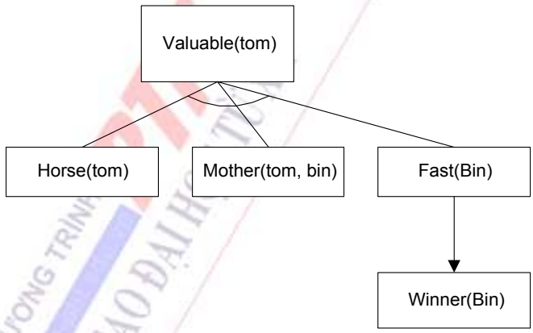

Hình 3.11 Cây chứng minh cho Valuable(Tom)

Chúng ta còn tìm được một phép thế biến khác $\underline{0} = [  w/Bi ,  y/Kit  ]$ để cho Valuable(w) trở thành đúng. Do đó, ta tìm ra Tom và Bin là các con ngựa có giá.

## 3.8 CÁC NGÔN NGỮ LẬP TRÌNH THÔNG MINH

Hiện nay đã có nhiều hệ lập trình logic ra đời mà tiêu biểu là Prolog. Prolog là viết tắt của cụm từ tiếng Pháp ”Programmation en Logique”

Hệ Prolog đầu tiên ra đời vào năm 1973 do Alain Colmerauer và nhóm trí tuệ nhân tạo thuộc Đại học tổng hợp Aix-Marseilie, Pháp xây dựng. Mục đích ban đầu của hệ này là dịch các ngôn ngữ tự nhiên. Năm 1977, David Warren thuộc Đại học tổng hợp Edinburgh đã cài đặt một phiên bản của Prolog, mang tên là Prolog-10. Năm 1981, người Nhật đã tiến bộ sử dụng Prolog như ngôn ngữ cơ bản cho máy tính thế hệ thứ năm. Hiện nay đã có nhiều hệ Prolog khác nhau về tốc độ,

<!-- page: 90 -->

môi trường làm việc, ..., song phần lớn các hệ này tương thích với Prolog-10, Prolog-10 được công nhận như Prolog chuẩn.

Prolog đã được sử dụng như một công cụ phần mềm để phát triển các hệ thông minh. Nó đã được áp dụng trong nhiều lĩnh vực trí tuệ nhân tạo: giải quyết vấn $\mathbf { \dot { d } } \mathbf { \dot { \hat { e } } } ,$ các hệ chuyên gia, biểu diễn tri thức, lập kế hoạch, xử lý ngôn ngữ tự nhiên, học máy, ..

Trong các ngôn ngữ lập trình truyền thống (chẳng hạn, Pascal, $\mathbf { C } , \ldots )$ một chương trình là một dãy các lệnh mà máy cần thực hiện. Người lập trình để viết một chương trình trong các ngôn ngữ truyền thống, phải dựa vào thuật toán đã có và cách biểu diễn dữ liệu để lập ra một dãy các lệnh chỉ dẫn cho máy cần phải thực hiện các hành động nào.

Điều khác nhau căn bản của lập trình Prolog so với lập trình truyền thống là:

• Trong Prolog người lập trình mô tả vấn đề bằng các câu trong logic.

Hệ sẽ sử dụng lập luận logic để tìm ra các câu trả lời cho vấn đề.

Do đó một chương trình Prolog là sự đặc tả của một vấn đề. Vì lý do này Prolog là ngôn ngữ lập trình khai báo (declarative language). Trong Prolog, chỉ được phép sử dụng các câu Horn, tức là mỗi câu hoặc là câu phân tử, hoặc là một luật nếu - thì mà các điều kiện của luật và kết luận của luật đều là câu phân tử. Một chương trình Prolog gồm một dãy các luật có dạng:

$$
A: - B _ {1}, \dots , B _ {m}
$$

trong đó, $m \geq 0 ,$ A và $B _ { i }   ( i = I ,   . . . ,   m )$ là các câu phân tử. Luật trên được đọc là “A nếu $\mathbf { B } _ { 1 }$ và $\ldots$ và ${ \bf B _ { m } } ^ { \flat \flat }$ . Nó là cách viết trong Prolog của logic mênh đề sau:

$$
B _ {1} \wedge \dots \wedge B _ {m} \Rightarrow A
$$

Trong luật trên, A được gọi là **đầu**, danh sách các câu $\mathrm{B_i} \; (\mathrm{B_1,\ldots,\;B_m})$ được gọi là **thân** của luật. Nếu m=0, ký hiệu $\frac { a _ { 5 } } { 2 } = \frac { 5 5 } { 2 }$ sẽ được bỏ đi, khi đó ta có câu phân tử A và nó được gọi là một **sự kiện**.

**Ví dụ**. Giả sử chúng ta biết các thông tin sau đây về An và Ba.

An yêu thích mọi môn thể thao mà cậu chơi.

Bóng đá là môn thể thao.

Bóng bàn là môn thể thao.

An chơi bóng đá.

Ba yêu thích mọi thứ mà An yêu thích.

Các câu trên được chuyển thành một chương trình Prolog như sau

likes(an, X) :- sport(X), plays(an, X)

sport(football).

sport(tennis).

plays(an, football).

likes(ba, Y) :- likes(an, Y).

Với chương trình Prolog trên (nó mô tả sở thích thể thao của An và Ba), ta có thể đặt ra các câu hỏi, chẳng hạn “An yêu thích cái gì ?”. Câu hỏi này được viết trong Prolog như sau.

? - likes(an, X).

Khi đưa vào một câu hỏi, hệ Prolog sẽ thực hiện quá trình suy diễn logic để tìm ra các câu trả lời cho câu hỏi. Chẳng hạn, với câu hỏi trên Prolog sẽ đưa ra câu trả lời:

X = football

<!-- page: 91 -->

điều đó có nghĩa là “An yêu thích bóng đá”.

Một cách tổng quát, một câu hỏi có dạng

$$
\text {?} - \mathrm{G} _ {1}, \dots , \mathrm{G} _ {\mathrm{n}}.
$$

trong đó, mỗi $\mathrm { G _ { i }   ( i = 1 ,   . . . ,   n ) }$ là một công thức phân tử, danh sách $( \mathrm { G } _ { 1 } ,   . . . ,   \mathrm { G } _ { \mathrm { n } } )$ được gọi là đích, các $\mathrm{G}_{\mathrm{i}}(\mathrm{i}=1, \ldots, \mathrm{n})$ được gọi là đích con. Nếu $\mathbf { n } = 0 ,$ , ta có đích rỗng, ký hiệu là .

Đến đây chúng ta muốn biết, làm thế nào mà Prolog tìm ra các câu trả lời cho các câu hỏi? Một chương trình Prolog có thể xem như một CSTT. Thủ tục tìm câu trả lời của Prolog là một cách cài đặt phương pháp lập luận lùi mà chúng ta đã trình bày ở mục 7.4. Trong cách cài đặt phương pháp lập luận lùi này, người ta sử dụng kỹ thuật tìm kiếm theo chiều sâu. Các câu trong Prolog được xét theo thứ tự từ trên xuống dưới. Các đích con được xem xét để thoả mãn theo thứ tự từ trái sang phải. Ngoài ra, thủ tục lập luận của Prolog còn cho phép người lập trình sử dụng vị từ “**cut**” khi cần thiết đảm bảo chương trình đúng đắn và hiệu quả.

Một đặc điểm nữa của Prolog là, thay cho việc sử dụng các câu là phủ định của các câu phân tử. Prolog đưa vào vị từ **not** biểu diễn **phủ định như thất bại** (negation as failure). Điều đó có nghĩa là **not(P)** được xem là đúng nếu ta thất bại trong việc tìm một chứng minh P đúng. Tức là, với CSTT hiện có, ta không tìm được một phép thay thế biến nào để P trở thành hệ quả logic của CSTT. Sau đây là một ví dụ sử dụng vị từ **not**.

likes(an, X) :- animal(X), not(snaker(X)).

Bạn đọc muốn tìm hiểu sâu hơn về các kỹ thuật lập trình Prolog và các ứng dụng trong Trí tuệ nhân tạo, có thể tìm đọc các tài liệu [ ] và [ ].

## CÂU HỎI VÀ BÀI TẬP

<strong><u>Bai 1</u></strong><u>.</u> Cho {(a ∧ b)→c, (b ∧ c)→d, (a ∧ b)}. Hỏi d ?

<strong><u>Bai 2.</u></strong> Cho {p→q , q→r}. Hỏi p→r?

<strong><u>Bai 3.</u></strong> Cho {(a ∧ b)→c,(b ∧ c)→d,┐d}. Cm a→b ?

<strong><u>Bai 4</u></strong> Cho{p ∧ q)→r , (p ∧ r)→s , p.q} Hỏi r ?..

**Bai 5** Cm từ $\{(\mathrm{p} \wedge \mathrm{q}) \rightarrow \mathrm{r},(\mathrm{q} \wedge \mathrm{r}) \rightarrow \mathrm{s}, \mathrm{q} \wedge \mathrm{H} \dot{\mathrm{o}} \dot{\mathrm{i}} \mathrm{p} \rightarrow \mathrm{q} \}$

<strong><u>Bai 6.</u></strong> Cho $\{ \mathrm { ~ 7 p v q ~ . 7 q v f . ~ 7 f v s . ~ 7 f v ~ . ~ s } \} \mathrm { H \acute { o } i \urcorner p . \urcorner u }$

<strong><u>Bai 7.</u></strong> Cho{p→q , q→r , r→s , p} Hỏi p ∧ s?

<strong><u>Bài 8:</u></strong> Cho tập mênh đề:

a) Ông Tư ăn táo

b) Ông Tư ăn cam

c) Cam là thức ăn

d) Món ăn mà người ăn không chết (sống) gọi là thức ăn

e) Ông Tư đang sống

f) Hỏi táo có phải là thức ăn?

Hãy: 1. Dùng logic vi từ để mô tả các mệnh đề trên

2. Dùng thuật toán Havard (hoặc Robinson để giải.

**Bài 9** Cho tập quan hệ (hàm) trong tam giác:

g) a/sinα= b/sinβ

<!-- page: 92 -->

h) $c / \sin \gamma = b / \sin \beta$

i) $S = \sqrt{p(p - a)(p - b)(p - c)}$

j) $a + \beta + \gamma = \pi$

k) $\mathrm { S }   =   \mathrm { h _ { c } } ^ { * } \mathrm { c }$

Hãy 1. Dùng mạng ngữ nghĩa để mô tả các mối quan hệ giữa biến và hàm

2. Dùng thuật toán vết dầu loang để tìm lời giải

<!-- page: 93 -->

# CHƯƠNG 4: XỬ LÝ NGÔN NGỮ TỰ NHIÊN

## 4.1 XỬ LÝ NGÔN NGỮ TỰ NHIÊN VÀ TRÍ TUỆ NHÂN TẠO

## 4.1.1 Sự tiến hóa của ngôn ngữ

Vấn đề để hiểu được lời nói hành động giống như việc hiểu các vấn đề khác, tương tự như việc hiểu hình ảnh hoặc chẩn đoán y học. Chúng ta đưa ra một tập các đầu vào đa nghĩa và từ đó chúng ta làm ngược lại để quyết định trạng thái nào của thế giới có thể được tạo ra đầu vào. Hiểu được vấn đề của lời nói hành động là phần đặc tả của ngôn ngữ. Một phần của hiểu vấn đề có thể giải thích bằng các lí do logic. Chúng ta nhận thấy rằng các chuỗi logic liên kết lại là cách tốt để mô tả cách mà các từ và các cụm từ phối hợp để tạo ra một cụm từ lớn. Phần khác của việc hiểu vấn đề có thể chỉ được giải thích bởi các lí do kĩ thuật không rõ ràng. Thông thường có nhiều trạng thái của thế giới mà tất cả đều hướng dẫn đến một lời nói hành động tương tự, vì vậy người hiểu phải quyết định cái mà nó dễ xảy ra hơn.

## 4.1.2 Cơ sở của ngôn ngữ

Một ngôn ngữ hình thức được định nghĩa như một tập các chuỗi kí tự, trong đó mỗi chuỗi kí tự là một chuỗi các biểu tượng được lấy ra từ một tập hữu hạn được gọi là biểu tượng terminal. Một trong những phiền toái khi làm việc với cả ngôn ngữ tự nhiên và ngôn ngữ hình thức là có quá nhiều sự khác biệt hình thức và kí hiệu cho việc viết ngữ pháp. Tuy nhiên, hầu hết chúng đều tương tự như cách mà chúng căn cứ vào ý tưởng của cấu trúc cụm từ - các chuỗi kí tự được soạn thảo của các chuỗi kí tự cơ sở được gọi là cụm từ, dẫn đến các phạm trù khác nhau. Các phạm trù như cụm danh từ, cụm động từ, câu được gọi là biểu tượng nonterminal. Trong kí pháp BNF quy luật viết phù hợp của biểu tượng nonterminal đơn ở bên trái và liên kết của đầu cuối hoặc không đầu cuối viết ở bên phải. Quy luật được viết như trong ví dụ sau:

## S → NP VP

Có nghĩa là chúng ta có thể đem bất kì cụm từ NP thêm vào sau bất kì cụm từ VP và kết quả là một cụm từ dạng câu.

## Các bước thành phần của giao tiếp:

Một đoạn giao tiếp điển hình, trong đó người nói S muốn truyền đạt lời thông báo P đến người nghe H sử dụng từ W, được sắp xếp trong 7 tiến trình. Ba bước đối với người nói:

Mục đích : S muốn H tin P (trong đó S đặc biệt tin P)

Phát sinh : S chọn từ W (bởi vì chúng nhấn mạnh nghĩa của P)

Tổng hợp : S phát âm từ W ( thường chuyển thẳng chúng đến H)

Bốn bước đối với người nghe

Nhận thức : H nhận thức W’( W’=W, nhưng mất nhận thức là có thể)

Phân tích : H suy luận W’ có thể mang các nghĩa P1…,Pn (từ và cụm từ có thể có nhiều nghĩa)

Ý nghĩa hóa : H suy luận rằng S có ý định truyền đạt Pi (trong đó ý nghĩa Pi=P, nhưng sự mất giải thích là có thể)

Hợp nhất : H quyết định tin tưởng vào Pi, (hoặc loại bỏ nó nếu nó không được H chắc chắn tin tưởng)

<!-- page: 94 -->

## 4.1.3 Khả năng phát sinh

Ngữ pháp hình thức có thể được phân loại bởi khả năng phát sinh của chúng: tập các ngôn ngữ mà chúng có thể trình bày. Chomsky (1957) mô tả bốn lớp của ngữ pháp hình thức suy luận. Các lớp này được sắp xếp trong một trật tự thứ bậc, trong đó mỗi lớp có thể được mô tả bởi ít nhất một lớp có quyền, giống như việc có thể thêm vài ngôn ngữ vào. Dưới đây là danh sách các lớp theo cấp bậc từ trên xuống dưới:

Ngữ pháp đệ quy liệt kê sử dụng quy luật không giới hạn: kích thước của quy luật viết lại có thể chứa số lượng bất kì biểu tượng terminal và không đầu cuối. Ngữ pháp này là tương đương với máy Turing.

Ngữ pháp nhạy ngữ cảnh được giới hạn chỉ ở bên phải và phải chứa ít nhất một số biểu tượng ở phía bên trái. Tên “nhạy ngữ cảnh” xuất phát từ một thực tế là một quy luật tương tự như ASB→AXB có nghĩa là một S có thể được viết lại như là một X trong ngữ cảnh của một A có trước và một sự kéo theo B.

Trong ngữ pháp phi ngữ cảnh ở phía bên phải chứa một biểu tượng nonterminal đơn. Vì vậy mỗi quy luật cho phép viết lại không đầu cuối ở bên phải trong bất kì ngữ cảnh nào.

Ngữ pháp thông thường là lớp được giới hạn nhất. Ngữ pháp thông thường là tương đương trong máy có số trạng thái hạn chế. Chúng không phù hợp lắm cho ngôn ngữ lập trình, vì chúng không thể xây dựng được cách trình bày giống như sự cân bằng của dầu mở và đóng ngoặc đơn.

Để đưa ra cho các bạn một ý tưởng ngôn ngữ nào được điều khiển bởi lớp nào, ngôn ngữ anbn (một chuỗi n bản sao của a kéo theo bởi một số lượng tương tự của b) có thể được phát sinh bởi ngữ pháp phi ngữ cảnh, nhưng không phải là ngữ pháp thông thường. Ngôn ngữ đó yêu cầu một ngữ pháp nhạy ngữ cảnh, trong khi ngôn ngữ a\*b\* (một sự phối hợp của bất kì một số của a theo sau bởi một số bất kì của b) có thể được mô tả bởi một trong 4 lớp trên. Một bảng tóm tắt của 4 lớp:

| Lớp | Quy luật ví dụ | Ngôn ngữ ví dụ |
| --- | --- | --- |
| Ngữ pháp liệt kê đệ quy | AB→C | Bất kì |
| Nhạy ngữ cảnh | AB→BA | anbncn |
| Ngữ cảnh tự do | S→ a S b | anbn |
| Thông thường | S→ a S | a*b* |

## Vấn đề nói và nghe.

Mục đích: Bằng cách này hay cách khác người nói quyết định rằng sẽ có một số cái mà nó đáng để nói với người nghe. Điều này thường bao gồm cả đức tin và mục đích của người nghe vì thế khi nói sẽ có sự tác dụng ao ước. Trong ví dụ của chúng ta người nói có mục đích cho người nghe biết wumpus không còn sống nữa.

Sự phát sinh: Người nói sử dụng kiến thức về ngôn ngữ để quyết định xem nói như thế nào. Trong nhiều cách sẽ khó khăn hơn việc lật ngược vấn đề của sự hiểu biết (ví dụ như phân tích và chuyển thành nghĩa). Sự phát sinh này không bị ép nhiều như sự hiểu biết trong trí tuệ nhân tạo, chủ yếu bởi vì con người chúng ta hay băn khoăn khi nói với máy, nhưng lại không bị kích động khi chúng nói lại. Bây giờ chúng ta chỉ cho rằng người nghe có thể chọn từ “the wumpus is dead”.

<!-- page: 95 -->

Tổng hợp: Hầu hết các ngôn ngữ đều căn cứ vào dạng hệ thống phân tích đầu ra của trí tuệ nhân tạo trên màn hình hoặc trên giấy. Tổng hợp lời nói đang được phát triển rộng rãi và một vài hệ thống đã bắt đầu nghe tiếng người. Chi tiết của kí pháp không quan trọng, điều này có nghĩa là âm thanh được phân tích rất khác với từ được nhân vật phát sinh. Mặc dù các từ phải đi liền với nhau, đây là một đặc điểm của việc nói nhanh.

**Nhận thức**. Bình thường là lời nói, bước nhận thức được gọi là nhận dạng lời nói, khi nó được đưa ra máy in, nó được gọi là nhận dạng đặc điểm quang học. Cả hai đều chuyển đến người quan tâm. Chẳng hạn, chúng ta cho rằng người nghe nhận thức được âm thanh và thu lại hoàn toàn lời nói.

**Phân tích.** Chúng ta phân tích chúng thành hai phần chính: cách hiểu về cú pháp (hay phân tích cú pháp) và sự giải thích về ngữ nghĩa. Sự giải thích về ngữ nghĩa bao gồm cả việc hiểu nghĩa của từ và hợp nhất kiến thức của tình huống hiện tại (cũng được gọi là sự giải thích thực tế).

**Phân tích cú pháp từ.** Xuất phát từ cụm từ Latin par orationis, hoặc “part of speech” và ám chỉ sự chuyển nhượng một phần của lời nói (danh từ, động từ) đến mỗi từ trong câu và nhóm các từ trong cụm từ.

**Một cây phân tích từ loại** là một cây mà bên trong các nút tương ứng với các cụm từ, liên kết với các ứng dụng của quy luật ngữ pháp, và các nút lá tương úng với các từ. Nếu chúng ta định nghĩa số lượng của một nút như là một danh sách tất cả các lá ở bên dưới của nút đó theo thứ tự từ trái sang phải. Khi đó, chúng ta có thể nói rằng ý nghĩa của một cây phân tích từ loại là mỗi nút, với nhãn X xác định số lượng của nút đó là một cụm từ của phạm trù X.

**Giải thích ngữ nghĩa** là quá trình rút ra ý nghĩa của một lời nói của một sự diễn đạt trong một sự trình diễn ngôn ngữ. Chúng ta sử dụng logic như sự trình diễn ngôn ngữ, nhưng sự trình diễn ngôn ngữ khác không được sử dụng.

**Giải thích thực tế** là một phần của sự giải thích về ngữ nghĩa mà nó mang tình huống hiện thời vào bảng mô tả.

**Chuyển thành ý nghĩa.** Hầu hết các người nói đều không cố ý nói đa nghĩa, nhưng hầu hết lời nói đều có nhiều sự giải thích hợp lí. Giao tiếp làm việc bởi vì người nghe đã làm việc định hình một nghĩa mà người nghe hầu như chắc chắn truyền đạt. chú ý rằng đây là lần đầu tiên chúng sử dụng từ hầu như chắc chắn và việc chuyển thành ý nghĩa này là tiến trình đầu tiên mà nó phụ thuộc rất nhiều vào lý do không chắc chắn. Phân tích sự giải thích có thể: nếu có nhiều hơn một sự giải thích được tìm thấy, khi đó việc chuyển thành ý nghĩa sẽ chọn lấy một ý nghĩa tốt nhất.

## Hợp nhất.

Về tổng thể, một nhân vật có thể tin vào mọi thứ mà anh ta nghe thấy, nhưng một người thông minh sẽ xem xét từ W và xuất phát từ sự giải thích P<sub>i</sub> như là một phần thêm vào của các bằng chứng được cân nhắc kỹ lưỡng với tất cả các bằng chứng khác chống lại P<sub>i</sub>.

Chú ý rằng nó chỉ làm nên câu để sử dụng ngôn ngữ khi các nhân vật giao tiếp với người (a) hiểu được ngôn ngữ thông thường, người (b) có một ngữ cảnh mà nó căn cứ vào cuộc hội thoại đó, và người (c) ít nhất có một phần lý trí. Giao tiếp không làm việc khi các nhân vật hoàn toàn không hợp lí,bởi vì không có cách nào để dự báo một nhân vật không hợp lí sẽ phản ứng lại một lời nói hành động.

**Hai mô hình của giao tiếp**

<!-- page: 96 -->

Nghiên cứu của chúng ta về trung tâm giao tiếp là cách mà một niềm tin của nhân vật thay đổi vào từ và trở lại với niềm tin và kiến thức cơ bản của một nhân vật khác. Có hai cách để xem xét quá trình này:

## Mô hình bản tin mã hóa

Mô hình bản tin mã hóa nói rằng người nói xác định một nhận định P trong ý nghĩ và mã hóa gợi ý này vào trong từ (hoặc kí hiệu) W. Người nghe sau đó sẽ cố gắng mã hóa bản tin W để lấy lại nguyên bản P (ví dụ như mã Morse). Dưới mô hình này ý nghĩa ở trong đầu người nói, bản tin mà nó được chuyển đi mà người nghe nhận được tất cả ý nghĩ có số lượng tương tự. Khi chúng không giống nhau thì nguyên nhân là do tiếng ồn trong khi giao tiếp hoặc một lỗi trong khi mã hay giải mã.

## Mô hình tình huống giao tiếp

Hạn chế của bản tin mã hóa dẫn đến mô hình tình huống giao tiếp, là mô hình cho rằng ý nghĩa của một bản tin phụ thuộc vào cả từ ngữ và cả tình huống mà trong đó các từ được phát âm. Trong mô hình này, chỉ cần trong một phép tính tình huống, các hàm mã và giải mã đã thêm vào một đối số điển hình cho một tình huống mới. Bản mô tả cho sự việc mà những từ tương tự có thể có rất nhiều nghĩa cho những tình huống khác nhau.

Mô hình tình huống ngôn ngữ chỉ ra một nguồn của giao tiếp không thành công: nếu như người nói và người nghe có những ý tưởng khác nhau của tình huống hiện thời có thể, khi đó bản tin có thể không được thông qua như ý định.

## 4.1.4 Giao tiếp sử dụng ngôn ngữ hình thức

Hầu hết các đối tượng giao tiếp thông qua ngôn ngữ hơn là thông qua truy cập trực tiếp đến kiến thức cơ sở. Hình 4.1 cho một sơ đồ giao tiếp kiểu này. Đối tượng có thể thực hiện hành động mà nó sinh ra ngôn ngữ, với đối tượng khác có thể nhận biết được. Ngôn ngữ giao tiếp bên ngoài có thể khác so với ngôn ngữ mô tả bên trong, mỗi đối tượng có thể có ngôn ngữ bên trong khác nhau. Chúng không cần thiết phải đồng ý trên bất kì một kí hiệu bên trong nào miễn là mỗi một đối tượng có thể vẽ một bản đồ đáng tin cậy từ ngôn ngữ bên ngoài đến kí hiệu bên trong của chính nó.

Ngôn ngữ

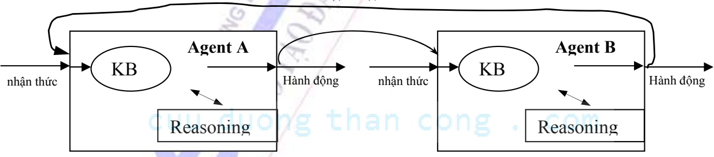

Hình 4.1 Hai đối tượng giao tiếp với ngôn ngữ

Một ngôn ngữ giao tiếp bên ngoài mang theo vấn đề tổng hợp và giao tiếp, và nhiều nỗ lực trong xử lý ngôn ngữ tự nhiên dẫn đến việc quyết định một thuật toán cho hai bước trên. Nhưng vấn đề khó khăn nhất của giao tiếp với ngôn ngữ vẫn là vấn đề: sự phù hợp kiến thức cơ bản của những đối tượng khác nhau. Đối tượng A nói như thế nào và làm sao đối tượng B dịch được trạng thái phụ thuộc chủ yếu trên những gì mà A và B thực sự tin tưởng (bao gồm những gì mà chúng tin và niềm tin lẫn nhau của chúng). Điều này có nghĩa là những đối tượng mà chúng có

<!-- page: 97 -->

cùng ngôn ngữ bên trong và bên ngoài sẽ có một thời gian dễ dàng để tổng hợp và phân tích, nhưng chúng vẫn phải tìm hiểu để quyết định phải nói với nhau như thế nào.

Trong phần này chúng ta xem xét việc phát triển từ lĩnh vực trò chơi sang các hệ thống thực có hiệu quả trong các công việc về ngôn ngữ. Chúng ta cũng đã thấy một vài kĩ thuật dịch các câu từ một tập hợp tiếng Anh đơn giản. ác vấn đề đó là:

Các ứng dụng thực tế: các công việc về ngôn ngữ tự nhiên được chứng minh có hiệu quả.

Xử lý bài luận: vấn đề nắm bắt đoạn văn có nhiều câu.

Hiệu quả của việc phân tích ngữ pháp: các thuật toán phân tích cú pháp và dịch các câu nhanh.

Tăng cường về thuật ngữ: quan tâm tới các từ không thường dùng hoặc không biết.

Tăng cường về ngữ pháp: quan tâm tới các ngữ pháp phức tạp.

Dịch theo nghĩa: một số vấn đề cần dịch theo nghĩa hơn là dịch theo các hàm đơn giản.

Ngữ nghĩa: cách chọn phép dịch đúng.

Chúng ta bắt đầu xem xét các hệ thống đã thành công trong việc đưa ngôn ngữ tự nhiên vào ứng dụng thực tế. Các hệ thống này đều có chung hai tính chất: một là chúng đều tập chung vào một lĩnh vực nhất định chứ không cho phải là tất cả, hai là chúng chỉ tập chung vào một nhiện vụ cụ thể chứ không đòi hỏi hiểu toàn bộ ngôn ngữ.

## 4.2 XỬ LÝ VÀ HIỂU VĂN BẢN

## 4.2.1 Truy nhập cơ sở dữ liệu

Lĩnh vực đầu tiên thành công đối với việc xử lí ngôn ngữ tự nhiên là truy cấp CSDL. Vào năm 1970, nhiều CSDL trong các máy tính KHUNG CHÍNH (mainframe), nhưng chỉ truy cập được bằng cách viết các chương trình hoàn thiện bằng các ngôn ngữ khó hiểu. Nhân viên phục vụ trong các máy mainframe không thể đáp ứng tất cả các đòi hỏi của người sử dụng, còn người sử dụng không muốn học cách lập trình. Giao diện ngôn ngữ tự nhiên được đưa ra để giải quyết vấn đề này. Đầu tiên là giao diện của hệ thống LUNAR, một phương thức được xây dựng bởi William Woods (1973) và nhóm của mình cho trung tâm NASA. Nó cho phép, ví dụ, một nhà địa chất hỏi về dữ liệu hoá học của các mẫu đất đá trên mặt trăng được mang về từ tầu Apollo. Hệ thống này không thể sử dụng ở thế giới thực, nhưng trong một kiểm nghiệm nó thành công 78% các câu hỏi như là:

What is the average model plagioclase concentration for lunar samples that contain rubidium?

Hệ thống sơ đồ Fernando Pereira’s (Pereira, 1983) là một hệ thông tương đương. Nó trả lời như sau về các câu hỏi về CSDL địa lý như:

Q: Which countries are bounded by two seas?

A: Egypt, Iran, Israel, Saudi Arabia and Turkey.

Q: Whats are the counties from which a river flows into Black sea?

A: Romania, Soviet Union.

Thuận lợi của các hệ thống như vậy mang lại rõ ràng. Nhưng có bất lợi là người sử dụng không biết khi nào thành công và những từ nào nằm ngoài hệ thống. Vào cuối thế kỷ trước, một vài hệ thống thương mại đã xây dựng một số lượng đủ lớn các từ, ngữ pháp đáp ứng diện rộng các văn bản. Cảnh báo chính trong các hệ thống hiện tại là sự tác động qua lại lẫn nhau. Người sử

<!-- page: 98 -->

dụng sẽ hỏi một dãy các câu hỏi mà ở đó có một số câu hỏi lại liên quan đến các câu hỏi hoặc trả lời truớc đó. Ví dụ:

What countries are north of the equator?

How about south?

Show only the ones outside Australasia?

What is their total area?

Một số hệ thống coi vấn đề đó như giới hạn.

Trong những năm 1990, nhiều công ty như Natural Language Inc. và Symatec vẫn bán các công cụ truy cập dữ liệu sử dụng ngôn ngữ tự nhiên, nhưng những khách hàng không thích mua sản phẩm dựa trên ngôn ngữ tự nhiên hơn là các giao diện đồ hoạ. Ngôn ngữ tự nhiên không phải là con đường tự nhiên nhất (ví dụ chuột và click).

## 4.2.2 Thu thập thông tin

Thu thập thông tin là lấy từ một văn bản ra một số dữ liệu phù hợp với một câu hỏi. Một số tài liệu được miêu tả bởi đại diện, như tiêu đề, danh sách từ khoá, hoặc tóm tắt. Hiện nay có quá nhiều thông tin trực tuyến, tốt nhất là sử dụng toàn bộ văn bản, có thể chia thành các đoạn, mỗi đoạn coi như một tài liệu riêng biệt cho việc mục đích thu thập thông tin. Các câu hỏi thường là danh sách các từ khoá. Trong các hệ thống thu thập thông tin ban đầu, các câu hỏi là sự kết hợp logic các từ khoá. Khi một câu hỏi không tìm thấy tài liệu, ví dụ, nó không đủ rộng để tìm được một vài tài liệu. Chuyển một “and” thành một “or” là một khả năng; thêm vào một ngăn cách là một khả năng nữa, nhưng có khi lại tìm thấy quá nhiều và không đủ hướng dẫn.

Hầu hết các hệ thống hiện đại đều chuyển từ kiểu logic sang kiểu không gian vector, trong đó danh sách các từ (cả trong tài liệu, trong câu hỏi) đều được coi như một vettor trong không gian n-chiều, ở đó n là số dấu hiệu phân biệt của tập hợp tài liệu. Nó sẽ được coi như một vector. Khi đó việc tìm các tài liệu chính là việc so sánh vector này với tập hợp các vector khác và đưa ra những véc tơ gần nhất với nó. Kiểu véctơ linh động hơn kiểu logic bởi vì có thể sắp xếp các tài liệu bởi khoảng cách tới câu hỏi, và tài liệu nào gần nhất được báo cáo trước.

Kiểu này có nhiều dạng. Một vài hệ thống cho phép các câu hỏi phát biểu rằng hai từ phải xuất hiện gần nhau mới được đếm như một lần, một vài hệ thống khác sử dụng từ điển đồng nghĩa làm tăng thêm các từ trong câu hỏi bằng các từ đồng nghĩa với nó. Chỉ những hệ thống tồi nhất mới đếm tất cả các số hạng trong vector tương đương. Nhiều hệ thống đánh giá trọng lượng các số hạng khác nhau. Cách tốt nhất là cho số hạng trọng lượng lớn nếu nó là từ đặc trưng: nếu nó xuất hiện trong một số ít các văn bản hơn là trong nhiều văn bản.

## 4.2.3 Phân loại văn bản

Kỹ thuật xử lý ngôn ngữ tự nhiên (NLP: Natural Language Processing) đã thành công trong một công việc liên quan: sắp xếp văn bản theo các chủ đề xác định. Một số hệ thống thương mại truy cập thông tin của các bức điện báo theo cách này. Một người thuê bao có thể hỏi tất cả các thông tin trong các lĩnh vực công nghiệp, thương mại, hoặc địa lí. Các nhà cung cấp đã sử dụng kiến thức của các chuyên gia để xác định các lớp. Trong vài năm gần đây, các hệ thống NLP đã được chứng minh tính đúng đắn, phân lớp chính xác trên 90% các thông tin thời sự. Chúng cũng nhanh hơn và thích hợp hơn, và đã có sự chuyển đổi từ thủ công sang các hệ thống tự động.

<!-- page: 99 -->

Phân loại văn bản tuân theo các kĩ thuật NLP không phải là gọi lại (IR : Information Retrieval) bởi vì sự phân lớp là cố định, và những người xây dựng các hệ thống đó đã tập trung kết hợp các chương trình của họ với vấn đề đó.

## 4.2.4 Lấy dữ liệu vào văn bản

Lấy dữ liệu từ một văn bản là lấy ra một vài thông tin yêu cầu để có thể đưa vào một cấu trúc dữ liệu.

## Hiệu quả phân tích từ

Trong phần này, chúng ta xem xét tính hiệu quả của thuật toán phân tích từ. ở mức broadest, có ba vấn đề chính làm tăng hiệu quả:

Không làm hai lần cái gì có thể làm một lần.

Không làm nếu có thể tránh được.

Không trình bày riêng lẻ nếu không cần.

Đặc biệt, chúng ta sẽ thiết kế một thuật toán phân tích từ thực hiện như sau:

Chúng ta đã nhận thấy rằng “the students in section 2 of Computer Science $1 0 1 ^ { \circ }$ là danh từ NP (Noun Phrase), đó là một ý tưởng để thấy rằng kết quả trong một cấu trúc dữ liệu đã biết là một sơ đồ. Các thuật toán này được gọi là phân tích từ loại theo sơ đồ. Bởi vì chúng ta đang quan tâm tới các ngữ pháp ngữ cảnh tự do (context-free), mọi mệnh đề tìm thấy trong ngữ cảnh của một nhánh trong không gian tìm kiếm cũng có thể phải làm việc như vậy trong nhánh khác của không gian tìm kiếm. Ghi nhận các kết quả trong sơ đồ là mẫu cho việc lập trình tránh việc lặp lại.

Chúng ta thấy rằng thuật toán phân tích sơ đồ kết hợp việc xử lý trên xuống (top-down) và dưới lên (bottom-up).

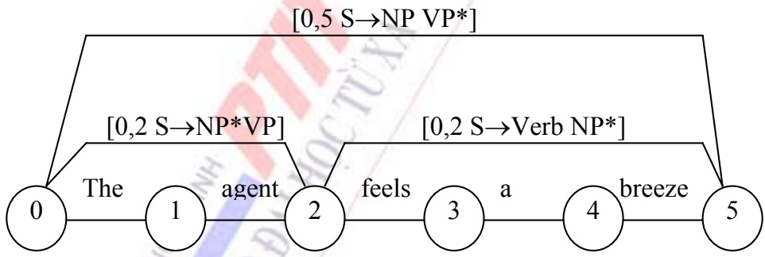

Hình 4.2 Sơ đồ phân tích câu “The agent feels a breeze”

Kết quả của thuật toán là một rừng được đóng gói (packed forest) của các cây phân tích hợp thành không chỉ là việc đếm mọi khả năng có thể.

Sơ đồ là một cấu trúc dữ liệu mô tả các kết quả thành phần của quá trình phân tích được dùng lại. Một sơ đồ cho một câu n từ gồm n+1 đỉnh và một số cạnh nối với các vector. Hình 4.2 biểu diễn một sơ đồ với 6 đỉnh và 3 cạnh. Ví dụ, cạnh có nhãn [0,5, S – NP VP\*] có nghĩa là danh từ NP (Noun Phrase) đi theo bởi động từ VP (Verb Phrase) để tạo ra một mệnh đề S (S: sentnce) mà trải theo chuỗi từ 0 đến 5. Dấu \* trong một cạnh tách được tìm thấy từ các phần còn lại. Các cạnh với dấu \* ở cuối được gọi là cạnh hoàn thiện; ví dụ cạnh [0, 2 S – NP\*VP]

Ta nói rằng một NP trải chuỗi từ 0 đến 2, và nếu có thể tìm một VP theo sau nó, sẽ có một S. Các cạnh với dấu chấm trước dấu kết thúc gọi là cạnh không hoàn thiện, và nó đang tìm một VP. Chúng ta đã biết hai cách xem xét quá trình xử lý. Trong cách phân tích Bottom – Up trong trang 666, chúng ta miêu tả xử lý như một quá trình xây dựng các từ vào cây, quay lui khi cần

<!-- page: 100 -->

thiết. Với ngữ pháp mệnh đề nhất định (Definite Clause Grammar), chúng ta miêu tả việc xử lý như một mẫu của suy luận logic trong các chuỗi (string). Việc quay lui đã được sử dụng khi một vài qui tắc có thể điều khiển cùng một dự đoán. Bây giờ chúng ta sẽ xem cách tiếp cận thứ ba. Dưới cách nhìn này, quá trình phân tích một câu n – từ gồm một sơ đồ mẫu với n + 1 đỉnh và thêm vào một số cạnh để biểu diễn, cố gắng tạo ra một cạnh hoàn thiện mà trải ra từ đỉnh 0 tới đỉnh n và là sự phân lớp S. Không có việc quay lui: tất cả mọi thứ được đặt trong sơ đồ này.

## Phân tích mở rộng từ sơ đồ : Đóng gói

Khi thuật toán phân tích sơ đồ kết thúc, nó trả về toàn bộ sơ đồ, nhưng chúng ta thực sự cần là một cây (tree) (hoặc một số cây). Phụ thuộc việc phân tích được sử dụng, chúng ta muốn chọn một hoặc toàn bộ cây phân tích mà trải toàn bộ đầu vào, hoặc chúng ta muốn xem xét một số cây con mà không trải ra trên toàn bộ đầu vào. Nếu có một ngữ pháp bổ sung, có thể chúng ta chỉ muốn tìm mở rộng ngữ nghĩa, bỏ qua các cấu trúc cú pháp. Trong mọi trường hợp, chúng ta cần khả năng phân tích mở rộng từ một sơ đồ.

Cách dễ nhất để làm việc đó là sửa bộ hòan thiện (Completer) sao cho khi nó kết hợp hai cạnh con tạo thành cạnh cha. Nó chứa trong cạnh cha danh sách các cạnh con mà cấu thành nó. Sau đó, khi phân tích chỉ cần tìm trong chart[n] cho một cạnh bắt đầo tại 0, đệ quy tại danh sách các cạnh con để tạo ra cây phân tích hoàn thiện. Chỉ phép biện chứng quyết định cái gì thực hiện phân tích mở rộng trên.

Chúng ta kết thúc vấn đề bằng việc phân tích độ phức tạp thuật toán đó là O(n<sup>3</sup>) trong trường hợp xấu nhất (ở đó n là số từ đầu vào). Trường hợp tốt nhất có thể đạt được là ngữ pháp ngữ cảng tự do (context-free grammar). Chú ý, nếu thiếu rừng đóng gói, thuật toán sẽ bùng nổ trong trường hợp xấu nhất, bởi vì nó là khả năng có O(2n) cây phân tích khác nhau. Trong thực tế, có thể thực hiện thuật toán để phân tích với yêu cầu 100 từ một giây, với sự biến đổi phụ thuộc vào độ phức tạp của ngữ pháp và đầu vào.

## Dấu hiệu cú pháp

Sự thay đổi như động từ, giới từ sinh ra nhiều sự nhập nhằng, bởi vì chúng có thể dẫn tới một vài sự khác biệt. Ví dụ:

Lee asked Kim to tell Toby to leave on Saturday.

Phó từ “Saturday” có thể được hỏi cho tell hoặc leave.

## Dấu hiệu từ vựng

Có nhiều từ nhập nhằng, nhưng tất cả không giống nhau. Khi hỏi nghĩa của từ “pen”, hầu hết mọi người đều trả lời là một công cụ để viết. Mặc dù nó còn các nghĩa khác như hàng rào, nhà lao, con thiên nga đực.

## 4.3 CÁC HỆ THỐNG DỊCH TỰ ĐỘNG

Vào những năm 60 của thế kỉ trước, người ta hi vọng máy tính có thể dịch từ một ngôn ngữ tự nhiên này sang một ngôn ngữ tự nhiên khác, đơn giản như máy Turing “dịch” các bản văn mã thành các bản văn rõ. Nhưng vào năm 1966, người ta nhận thấy rằng việc dịch đòi hỏi một sự hiểu biết về nghĩa của văn bản (và hơn nữa là những hiểu biết chi tiết về thế giới), trong khi đó việc giải mã chỉ phụ thuộc vào các tính chất ngữ pháp của văn bản.

Điều đó không làm mất ý nghĩ về việc dịch máy. Thực tế đã có nhiều hệ thống dịch máy, hàng ngày đã tiết kiệm rất nhiều so với việc xử lý hoàn toàn thủ công. Một trong hệ thống thành công nhất là hệ thống TAUM METEO, được phát triển bởi trường đại học Montral. Nó đã dịch

<!-- page: 101 -->

các báo cáo thời tiết từ tiếng Anh sang tiếng Pháp. Nó làm được việc này bởi vì ngôn ngữ được sử dụng trong các báo cáo thời tiết của chính phủ có mẫu và quy tắc chặt chẽ.

Một lĩnh vực khác rộng hơn, mà kết quả gây ấn tượng không kém, đó là hệ thống SPANAM (Vascocellos và Leon, 1985). Nó có thẻ dịch một đoạn văn bản tiếng Tây Ban Nha sang tiếng Anh với chất lượng hầu như hiểu được tất cả, nhưng không đúng ngữ pháp và hiếm khi trôi chảy. Việc dịch máy là không đầy đủ. Nhưng khi người dịch có được văn bản như vậy, người dịch có thể dịch nhanh gấp bốn lần. Một số người có thể dịch thẳng từ văn bản đó không cần đọc bản gốc. Giá phải trả đối với hiệu quả của việc dịch máy là để có các thông tin rộng rãi, hệ thống dịch máy phải có lượng từ vựng từ 20.000 đến 100.000 từ và 100 đến 10.000 quy tắc ngữ pháp. Các con số đó phụ thuộc vào việc chọn hình thức dịch.

Việc dịch là khó vì, trong trường hợp tổng quát, nó đòi hỏi hiểu biết sâu sắc về văn bản, và tình huống trong giao tiếp. Thực vậy, ngay cả đối với các văn bản rất đơn giản – thậm chí chỉ có một từ. Xét từ “Open” trên cửa ra vào của một cửa hàng. Nó có nghĩa là đang đón khách. Cũng từ “Open” trên một biển quảng cáo lớn của một nhà hàng mới khánh thành, nó có nghĩa là nhà hàng đang trong những ngày làm việc, nhưng người đọc không cảm thấy bị lừa dối khi nhà hàng đóng cửa vào ban đêm mà không tháo biển quảng cáo. Một từ có thể mang nhiều nghĩa khác nhau. Trong một số ngôn ngữ khác, có một từ hoặc cụm từ như vậy sẽ được sử dụng trong cả hai trường hợp.

Vấn đề đó cho thấy trong các ngôn ngữ khác nhau sự phân loại từ là khác nhau. Để dịch tốt, người dịch (người, máy) phải đọc văn bản gốc hiểu được nghĩa mà nó mô tả, và tìm một văn bản tương ứng trong ngôn ngữ đích có một nghĩa tương đương. Ở đây có nhiều lựa chọn. Người dịch (cả máy và người) đôi khi khó có một sự lựa chọn.

## 4.4 XỬ LÝ VÀ HIỂU TIẾNG NÓI

## 4.4.1. Tổng quan về tiếng nói

Nhận dạng tiếng nói là một hệ thống tạo khả năng để máy nhận biết ngữ nghĩa của lời nói. Về bản chất, đây là quá trình biến đổi tín hiệu âm thanh thu được của người nói qua Micro, đường dây điện thoại hoặc các thiết bị khác thành một chuỗi các từ. Kết quả của quá trình nhận dạng có thể được ứng dụng trong điều khiển thiết bị, nhập dữ liệu, soạn thảo văn bản bằng lời, quay số điện thoại tự động hoặc đưa tới một quá trình xử lý ngôn ngữ ở mức cao hơn.

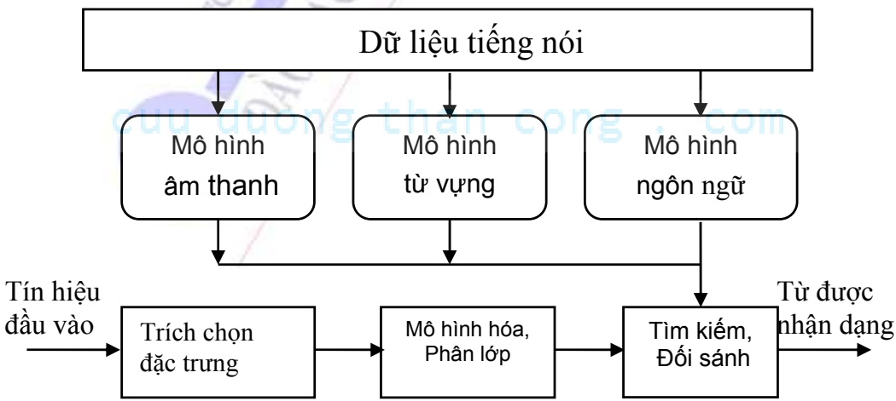

Hình 4.2. Các phần tử cơ bản của một hệ thống nhận dạng tiếng nói

<!-- page: 102 -->

Các hệ thống nhận dạng tiếng nói có thể được phân loại như sau:

Nhận dạng từ phát âm rời rạc/liên tục;

• Nhận dạng tiếng nói phụ thuộc người nói/không phụ thuộc người nói;

• Hệ thống nhận dạng từ điển cớ nhỏ (dưới 20 từ)/từ điển cỡ lớn (hàng nghìn từ);

• Nhận dạng tiếng nói trong môi trường có nhiễu thấp/cao;

• Nhận dạng người nói.

Trong hệ nhận dạng tiếng nói với cách phát âm rời rạc có khoảng lặng giữa các từ trong câu. Trong hệ nhận dạng tiếng nói liên tục không đòi hỏi điều này. Tùy thuộc vào quy mô và phương pháp nhận dạng, ta có các mô hình nhận dạng tiếng nói khác nhau. Hình 4.2 là mô hình tổng quát của một hệ nhận dạng tiếng nói điển hình .

Tín hiệu tiếng nói sau khi thu nhận được lượng tử hóa sẽ biến đổi thành một tập các vector tham số đặc trưng với các phân đoạn có độ dài trong khoảng 10-30 ms. Các đặc trưng này được dùng cho đối sánh hoặc tìm kiếm các từ gần nhất với một số ràng buộc về âm học, từ vựng và ngữ pháp. Cơ sở dữ liệu tiếng nói được sử dụng trong quá trình huấn luyện (mô hình hóa/phân lớp) để xác định các tham số hệ thống.

## Các phương pháp tiếp cận trong nhận dạng tiếng nói

Có ba phương pháp phổ biến được sử dụng trong nhận dạng tiếng nói hiện nay là:

• Phương pháp Âm học-Ngữ âm học;

• Phương pháp nhận dạng mẫu;

• Phương pháp ứng dụng trí tuệ nhân tạo.

Các phương pháp được trình bày tóm tắt như dưới đây.

## Phương pháp Âm học-Ngữ âm học

Phương pháp này dựa trên lý thuyết về Âm học-Ngữ âm học. Lý thuyết đó cho biết: tồn tại các đơn vị ngữ âm xác định, có tính phân biệt trong lời nói và các đơn vị ngữ âm đó được đặc trưng bởi một tập các tín hiệu tiếng nói. Các bước nhận dang của phương pháp gồm:

Bước 1: phân đoạn và gán nhãn. Bước này chia tín hiệu tiếng nói thành các đoạn có đặc tính âm học đặc trưng cho một (hoặc một vài) đơn vị ngữ âm, đồng thời gán cho mỗi đoạn âm thanh đó một hay nhiều nhãn ngữ âm phù hợp.

Bước 2: nhận dạng. Bước này dựa trên một số điều kiện ràng buộc về từ vựng, ngữ pháp v.v… để xác định một hoặc một chuỗi từ đúng trong các chuỗi nhãn ngữ âm được tạo ra sau bước 1. Sơ đồ khối của phương pháp này được biểu diễn ở Hình 4.2. Nguyên lý hoạt động của phương pháp có thể mô tả như sau:

Trích chọn đặc trưng. Tín hiệu tiếng sau khi số hóa được đưa tới khối trích chọn đặc trưng nhằm xác định các phổ tín hiệu. Các kỹ thuật trích chọn đặc trưng tiếng nói phổ biến là sử dụng băng lọc (filter bank), mã hóa dự đoán tuyến tính (LPC)…

Tách tín hiệu tiếng nói nhằm biến đổi phổ tín hiệu thành một tập các đặc tính mô tả các tính chất âm học của các đơn vị ngữ âm khác nhau. Các đặc tính đó có thể là: tính chất các âm mũi, âm xát; vị trí các formant; âm hữu thanh, vô thanh; tỷ số mức năng lượng tín hiệu…

Phân đoạn và gán nhãn. Ở bước này hệ thống nhận dạng tiếng xác định các vùng âm thanh ổn định (vùng có đặc tính thay đổi rất ít) và gán cho mỗi vùng này một nhãn phù hợp với đặc tính

<!-- page: 103 -->

của đơn vị ngữ âm. Đây là bước quan trọng của hệ nhận dạng tiếng nói theo khuynh hướng Âm học-Ngữ âm học và là bước khó đảm bảo độ tin cậy nhất.

Nhận dạng. Chọn lựa để kết hợp chính xác các khối ngữ âm tạo thành các từ nhận dạng. Đặc điểm của phương pháp nhận dạng tiếng nói theo hướng tiếp cận Âm học-Ngữ âm học:

• Người thiết kế phải có kiến thức khá sâu rộng về Âm học-Ngữ âm học;

• Phân tích các khối ngữ âm mang tính trực giác, thiếu chính xác;

Phân loại tiếng nói theo các khối ngữ âm thường không tối ưu do khó sử dụng các công cụ toán học để phân tích.

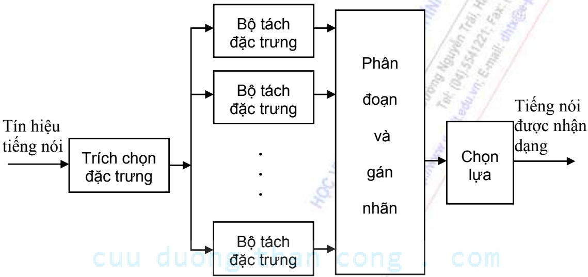

Hình 4.3. Sơ đồ khối nhận dạng tiếng nói theo Âm học-Ngữ âm học

Phương pháp nhận dạng mẫu

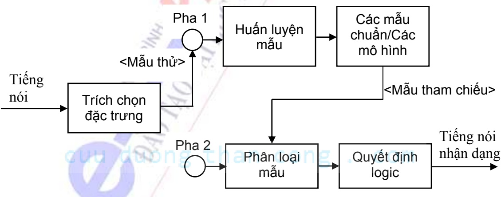

Hình 4.3. Sơ đồ khối hệ nhận dạng tiếng nói theo phương pháp mẫu

Phương pháp nhận dạng mẫu không cần xác định đặc tính âm học hay phân đoạn tiếng nói mà sử dụng trực tiếp các mẫu tín hiệu tiếng nói trong quá trình nhận dạng. Các hệ thống nhận dạng tiếng nói theo phương pháp này được phát triển theo hai bước (Hình 2.3), cụ thể là.

<!-- page: 104 -->

Bước 1: Sử dụng tập mẫu tiếng nói (cơ sở dữ liệu mẫu tiếng nói) để đào tạo các mẫu tiếng nói đặc trưng (mẫu tham chiếu) hoặc các tham số hệ thống.

Bước 2: Đối sánh mẫu tiếng nói từ ngoài với các mẫu đặc trưng để ra quyết định.

Trong phương pháp này, nếu cơ sở dữ liệu tiếng nói cho đào tạo có đủ các phiên bản mẫu cấn nhận dạng thì quá trình đào tạo có thể xác định chính xác các đặc tính âm học của mẫu (các mẫu ở đây có thể là âm vị, từ, cụm từ…). Hiện nay, một số kỹ thuật nhận dạng mẫu được áp dụng thành công trong nhận dạng tiếng nói là lượng tử hóa vector, so sánh thời gian động (DTW), mô hình Markov ẩn (HMM), mạng nơron nhân tạo (ANN).

## Hệ thống bao gồm các hoạt động sau:

Trích chọn đặc trung: Tín hiệu tiếng nói được phân tích thành chuỗi các số đo để xác định mẫu nhận dạng. Các số đo đặc trưng là kết quả xử lý của các kỹ thuật phân tích phổ như: lọc thông dải, phân tích mã hóa dự đoán tuyến tính (LPC), biến đổi Fourier rời rạc (DFT).

Huấn luyện mẫu: Nhiều mẫu tiếng nói ứng với các đơn vị âm thanh cùng loại dùng để đào tạo các mẫu hoặc các mô hình đại diện, được gọi là mẫu tham chiếu hay mẫu chuẩn.

Nhận dạng: Các mẫu tiếng nói được đưa tới khối phân loại mẫu. Khối này đối sánh mẫu đầu vào với các mẫu tham chiếu. Kối nhận dạng căn cứ vào các tiêu chuẩn đánh giá để quyết định mẫu tham chiếu nào giống mẫu đầu vào.

Một số đặc điểm của phương pháp nhận dạng mẫu:

Hiệu năng của hệ phụ thuộc vào số mẫu đưa vào. Nếu số lượng mẫu càng nhiều thì độ chính xác của hệ càng cao; tuy nhiên, dung lượng nhớ và thời gian luyện mẫu tăng.

Các mẫu tham chiếu phụ thuộc vào môi trường thu âm và môi trường truyền dẫn.

Không đòi hỏi kiến thức sâu về ngôn ngữ.

Phương pháp ứng dụng trí tuệ nhân tạo

Phương pháp ứng dụng trí tuệ nhân tạo kết hợp các phương pháp trên nhằm tận dụng tối đa các ưu điểm của chúng, đồng thời bắt chước các khả năng của con người trong phân tích và cảm nhận các sự kiện bên ngoài để áp dụng vào nhận dạng tiếng nói. Sơ đồ khối của phương pháp trí tuệ nhân tạo theo mô hình từ dưới lên (bottom-up) (Hình 4.4).

## Đặc điểm của các hệ thống nhận dạng theo phương pháp này là:

Sử dụng hệ chuyên gia để phân đoạn, gán nhãn ngữ âm. Điều này làm đơn giản hóa hệ thống so với phương pháp nhận dạng ngữ âm.

Sử dụng mạng nơron nhân tạo để học mối quan hệ giữa các ngữ âm, sau đó dùng nó để nhận dạng tiếng nói.

<!-- page: 105 -->

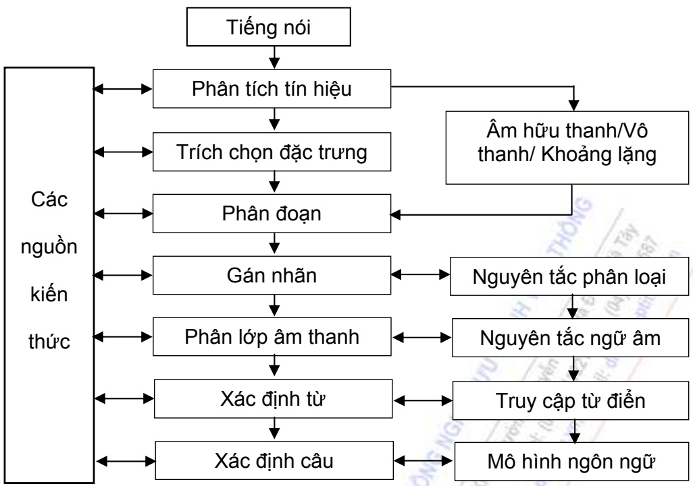

Hình 4.4. Sơ đồ khối hệ nhận dạng tiếng nói theo phương pháp từ dưới lên

Việc sử dụng hệ chuyên gia nhằm tận dụng kiến thức con người vào hệ nhận dạng: Kiến thức về âm học: để phân tích phổ và xác định đặc tính âm học của các mẫu tiếng nói. Kiến thức về từ vựng: sử dụng để kết hợp các khối ngữ âm thành các từ cần nhận dạng. Kiến thức về cú pháp: nhằm kết hợp các từ thành các câu cần nhận dạng.

Kiến thức về ngữ nghĩa: nhằm xác định tính logic của các câu đã được nhận dạng.

Có nhiều cách khác nhau để tổng hợp các nguồn kiến thức vào bộ nhận dạng tiếng nói. Phương pháp thông dụng nhất là xử lý ”từ dưới lên”. Theo cách này, tiến trình xử lý của hệ thống được triển khai tuần tự từ thấp lên cao. Trong Hình 4.4, các bước xử lý ở mức thấp (phân tích tín hiệu, tìm đặc tính, phân đoạn, gán nhãn) được triển khai trước khi thực hiện các bước xử lý ở mức cao (phân lớp âm thanh, xác định từ, xác định câu). Mỗi bước xử lý đòi hỏi một hoặc một số nguồn kiến thức nhất định. Ví dụ: bước phân đoạn tiếng nói cần hiểu biết sâu sắc về đặc tính Âm học-Ngữ âm học của các đơn vị ngữ âm; bước xác định từ đòi hỏi kiến thức về từ vựng; bước xác định câu đòi hỏi kiến thức về mô hình ngôn ngữ (nguyên tắc ngữ pháp).

Phương pháp này đã và đang được áp dụng thành công trong các ứng dụng nhận dạng tiếng nói thực tế. Đề tài sẽ sử dụng phương pháp nhận dạng mẫu cho bài toán nhận dạng một số từ tiếng Việt. Bước đầu tiên của quá trình nhận dạng là trích chọn các tham số tín hiệu tiếng nói. Phần tiếp theo sẽ trình bày chi tiết về phương pháp này.

## 4.4.2. Phân tích tham số tiếng nói

Trong nhận dạng, tổng hợp, mã hóa tiếng nói đều cần phân tích các tham số. Dưới đây, mô tả phương pháp phân tích cepstral theo thang đo mel để tính các hệ số MFCC thông qua việc sử dụng dãy các băng lọc.

Khái niệm cơ bản trong phân tích tín hiệu tiếng nói là phân tích thời gian ngắn (Short-Time Analysis). Trong khoảng thời gian dài, tín hiệu tiếng nói là không dừng, nhưng trong khoảng thời gian đủ ngắn (10-30 ms) tiếng nói được coi là dừng. Do đó, trong các ứng dụng xử lý

<!-- page: 106 -->

tiếng nói người ta thường chia tiếng nói thành nhiều đoạn có thời gian bằng nhau được gọi là khung (frame), mỗi khung có độ dài từ 10 đến 30 ms.

## Phát hiện tiếng nói

Phát hiện thời điểm bắt đầu, điểm kết thúc của tiếng nói (tách tiếng nói ra khỏi khoảng lặng) là phần cần thiết trong chương trình nhận dạng tiếng nói, đặc biệt trong chế độ thời gian thực. Phần này trình bày ba phương pháp phát hiện tiếng nói dựa trên hàm năng lượng thời gian ngắn SE (Short Energy) và tỷ lệ vượt quá điểm không ZCR (Zero Crossing).

## a. Phát hiện tiếng nói dựa trên hàm năng lượng thời gian ngắn

Hàm năng lượng thời gian ngắn của tín hiệu tiếng nói được tính bằng cách chia tín hiệu tiếng nói thành các khung, mỗi khung dài N mẫu. Mỗi khung được nhân với một hàm cửa sổ $W ( n )$ . Nếu hàm cửa sổ bắt đầu xét ở mẫu thứ m thì hàm năng lượng thời gian ngắn $E _ { m }$ được xác định như sau:

$$
E _ {m} = \sum_ {n = m} ^ {m + N - 1} \bigl [ x (n) W (n - m) \bigr ] ^ {2}
$$

trong đó:

$$
\mathrm{n}: \text {là biế n ròi rạc};
$$

m: là số mẫu thử thứ m;

$$
\mathrm{N}: \text {là tông số mẫu tiếng nói}
$$

Hàm cửa sổ $W ( n )$ thường dùng là hàm cửa sổ chữ nhật được xác định như sau:

$$
W (n) = \left[ \begin{array}{c c} 1 & 0 \leq n \leq N - 1 \\ 0 & n \geq N \end{array} \right.
$$

Thuật toán xác định điểm đầu và điểm cuối tiếng nói theo phương pháp này:

**Bước 1:** Với mỗi khung của tín hiệu, xác định hàm năng lượng thời gian ngắn $E _ { m }$ tính theo (2-1). Nếu $E _ { m } > E _ { t h r e s h o l d }$ (giá trị ngưỡng năng lượng cho trước) thì đánh dấu là điểm bắt đầu khung (kí hiệu là khung B). Ngược lại, xét khung kế tiếp cho đến khi xác định được khung B. Nếu không xác định được B, kết luận: đó không là tín hiệu tiếng nói.

**Bước 2:** Tính $E _ { m }$ của khung kế tiếp khung B cho đến khi $E _ { m } < E _ { t h r e s h o l d }$ thì dừng và đánh dấu khung đó là điểm kết thúc của một từ (kí hiệu khung E). Sau khi xác định điểm bắt đầu và kết thúc, dựa vào độ dài thời gian đoạn âm thanh đó để thêm bước kiểm tra: tín hiệu đó có chắc là tiếng nói không? (một từ tiếng Việt nếu phát âm rõ ràng thường dài hơn 200 ms).

## b. Phát hiện tiếng nói dựa trên hàm giả năng lượng và tỷ lệ vượt quá điểm không

Thuật toán này xác định điểm bắt đầu, điểm kết thúc của tín hiệu tiếng nói dựa trên hai đại lượng tĩnh của tín hiệu tiếng nói là: hàm giả năng lượng E (Pseudo-Energy) và tỷ lệ vượt quá điểm không ZCR (Zero Crossing Rate) .

Trong một dãy giá trị tín hiệu tiếng nói được rời rạc hóa, điểm không là điểm tại đó diễn ra sự đổi dấu cường độ tín hiệu và được mô tả bởi:

<!-- page: 107 -->

$$
\operatorname{sgn} [ \mathrm{x(n+1)} ] \neq \operatorname{sgn} [ \mathrm{x(n)} ]
$$

trong đó, sgn(.) là hàm dấu

Năng lượng là đại lượng được dùng để xác định vùng chứa âm hữu thanh, vô thanh. Nhưng hàm năng lượng thường rất nhạy cảm với nhiễu. Do vậy, người ta thường sử dụng hàm giả năng lượng trong tính toán. Hàm giả năng lượng được xác định bởi:

$$
E ^ {\wedge} (n) = \sum_ {m = 0} ^ {N - 1} \big | w (m) x (n - m) \big |
$$

trong đó;

$E ^ { \wedge } ( n )$ : là hàm giả năng lượng,

N : là kích thước khung cửa sổ.

## Tỷ lệ vượt quá điểm không ZCR

Ta thấy, khung có năng lượng càng cao thì tỷ lệ vượt quá điểm không càng thấp và ngược lại. Như vậy, tỷ lệ vượt quá điểm không là đại lượng đặc trưng cho tần số tín hiệu tiếng nói. Ở đây, chúng ta cần xác định các tham số ngưỡng cho hàm giả năng lượng với hai ngưỡng trên và dưới và một ngưỡng tỷ lệ vượt quá điểm không.

Kí hiệu:

$E _ { v _ { P } }$ : ngưỡng năng lượng trên (cao);

$E _ { D o w n }$ : ngưỡng năng lượng dưới (thấp);

$Z C R \_ T$ : ngưỡng tỷ lệ vượt quá điểm không.

Thuật toán này được mô tả như sau :

**Bước 1:** Chia chuỗi tín hiệu tiếng nói thành các khung. Tính giá trị hàm giả năng lượng theo (2-5) và tỷ lệ vượt quá điểm không theo (2-6) tương ứng trên mỗi khung.

**Bước 2:** Xét từ khung đầu tiên. Đánh dấu khung thứ i là điểm bắt đầu nếu tại khung i tỷ lệ vượt quá điểm không của ZCR vượt ngưỡng $( Z C R > Z C R _ { - } T )$ và giá trị hàm giả năng lượng vượt ngưỡng dưới $( E ^ { \wedge } ( n ) > E _ { D o w n } )$ theo hướng tăng của của hàm giả năng lượng.

**Bước 3:** Xét các khung kế tiếp. Đánh dấu khung kế tiếp thuộc từ. Nếu hàm giả năng lượng vượt ngưỡng trên $( E ^ { \wedge } ( n ) > E _ { U p } )$ theo hướng tăng của năng lượng.

**Bước 4:** Điểm bắt đầu của từ được xác định lại khi hàm giả năng lượng trên khung đó nhỏ hơn ngưỡng dưới $( E ^ { \wedge } ( n ) < E _ { D o w n } ) ,$ và đồng thời tỷ lệ vượt quá điểm không trên khung lớn hơn ngưỡng (ZCR> ZCR \_T ).

**Bước 5:** Điểm kết thúc từ được xác định nếu tại đó; tỷ lệ vượt quá điểm không nhỏ hơn ngưỡng $( ZCR < ZCR_{-}T )$ và hàm gi  ả năng lượng tương ứng nhỏ hơn ngưỡng dưới $( E ^ { \wedge } ( n ) < E _ { D o w n } )$ theo xu hướng đi xuống của hàm giả năng lượng.

## c) Phát hiện tiếng nói dựa trên năng lượng phổ ngắn hạn

Ý tưởng chính của phương pháp này là sử dụng bộ điều khiển dò biên tiếng nói VAD (Voice Activity Detector) dựa trên việc xác định năng lượng phổ ngắn hạn $E _ { f }$ trên các khung tín

<!-- page: 108 -->

hiệu tiếng nói. VAD dùng để xác định một khung chứa tín hiệu tiếng nói hay nhiễu. Hàm đầu ra của VAD trên khung thứ m là $\nu _ { [ \mathrm { m } ] }$ . Với khung chứa tiếng nói (có thể cả nhiễu) $^ { v } [ \mathbf { m } ] { = } 1$ , ngược lại khung chỉ chứa nhiễu $v _ { [ \mathfrak { m } ] = 0 . }$

Thuật toán được mô tả như sau:

Bước 1: Tính năng lượng phổ ngắn hạn $E _ { f }$ cho mỗi khung theo:

$$
E _ {f} [ m ] = \sum_ {i = 1} ^ {\text {NumChan}} f _ {\ln} [ m, i ]\tag{4-1}
$$

trong $\acute { d o } ;$ NumChan : số kênh của băng lọc tam giác

$f _ { \mathrm { { l n } } } [ m , i ]$ : các phần tử đầu ra của NumChan (chuẩn hoá bằng hàm logarit)

Bước 2: Xác định năng lượng phổ trung bình dài $_ { h a n } E _ { _ m }$ trên mỗi khung dựa trên $E _ { f }$

Nếu

$$
(E _ {f} [ m ] - E _ {m} [ m - 1 ] <   \alpha)
$$

Thì

$$
E _ {m} [ m ] = E _ {m} [ m - 1 ] + \frac {E _ {f} [ m ] - E _ {\mathrm{m}} [ m - 1 ]}{1 0 0}\tag{4-2}
$$

Còn không thì

$$
E _ {m} [ m ] = E _ {m} [ m - 1 ]\tag{4-3}
$$

trong đó, $\alpha$ : ngưỡng của phổ trung bình dài hạn

Bước 3: Kiểm tra khung chứa tiếng nói hay không:

Nếu

$$
(E _ {f} [ m ] - E _ {m} [ m ] \geq \beta)
$$

Thì

$$
v [ m ] = 1;
$$

Còn không thì :

$$
v [ m ] = 0;
$$

trong đó $\beta$ : là tham số xác định nhờ thực nghiệm.

Phương pháp này ngăn việc phân loại sai của phụ âm sát và tiếng nói ở cuối tín hiệu tiếng nói.

## 4.4.3. Các phương pháp trích chọn tham số đặc trưng của tín hiệu tiếng nói

Trích chọn các tham $s \hat { 0 }$ đặc trưng là bước có $\dot { \mathbf { y } }$ nghĩa quyết định tới kết quả của các chương trình nhận dạng tiếng nói. $\therefore \textcircled{C} \dot { 0 }$ nhiều phương pháp trích chọn các tham số đặc trưng nhưng nhìn chung các phương pháp này dựa trên hai cơ chế:

Mô phỏng lại quá trình cảm nhận âm thanh của tai người.

Mô phỏng lại quá trình tạo âm của cơ quan phát âm.

## Phân tích cepstral theo thang đo mel

Phương pháp tính các hệ số MFCC là phương pháp trích chọn tham số tiếng nói được sử dụng rộng rãi bởi tính hiệu quả của nó thông qua phân tích cepstral theo thang đo mel.

Phương pháp được xây dựng dựa trên sự cảm nhận của tai người đối với các dải tần số khác nhau. Với các tần số thấp (dưới 1000 Hz), độ cảm nhận của tai người là tuyến tính. Đối với các tần số cao, độ biến thiên tuân theo hàm logarit. Các băng lọc tuyến tính ở tần số thấp và biến thiên theo

<!-- page: 109 -->

hàm logarit ở tần số cao được sử dụng để trích chọn các đặc trưng âm học quan trọng của tiếng nói. Mô hình tính toán các hệ số MFCC được mô tả như Hình 4.5.

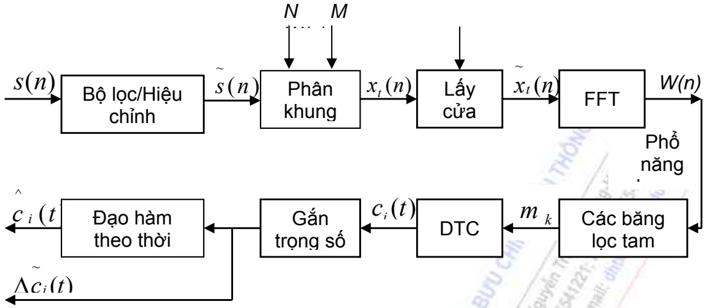

Hình 4.5. Sơ đồ tính toán các hệ số MFCC

Ý nghĩa và phương pháp xác định tham số ở các khối trong sơ đồ trên mô tả như sau:

**Khối 1:** Bộ lọc hiệu chỉnh (Preemphasis)

Tín hiệu tiếng nói s(n) được đưa qua bộ lọc số bậc thấp để phổ đồng đều hơn, giảm ảnh hưởng gây ra cho các xử lý tín hiệu sau này. Thường bộ lọc này cố định bậc một, có dạng:

$$
\mathrm{H(z)} = 1 - \mathrm{az} ^ {- 1} \quad 0. 9 \leq \mathrm{a} \leq 1. 0
$$

Quan hệ giữa tín hiệu ra với tín hiệu vào tuân theo phương trình

$$
\tilde {s} (n) = s (n) - a. s (n - 1)
$$

Giá trị a thường được chọn là 0.97.

**Khối 2:** Phân khung (Frame Blocking)

Trong khối này tín hiệu hiệu chỉnh <sup>s</sup> (n) được phân thành các khung, mỗi khung có N mẫu; hai khung kề lệch nhau M mẫu. Khung đầu tiên chứa N mẫu, khung thứ hai bắt đầu chậm hơn khung thứ nhất M mẫu và chồng lên khung thứ nhất N-M mẫu. Tương tự, khung thứ ba chậm hơn khung thứ nhất 2M mẫu (chậm hơn khung thứ hai M mẫu) và chờm lên khung thứ nhất N-2M mẫu. Quá trình này tiếp tục cho đến khi tất cả các mẫu tiếng nói cần phân tích thuộc về một hoặc nhiều khung.

## Khối 3: Lấy cửa sổ (Windowing)

Bước tiếp theo là lấy cửa sổ cho mỗi khung riêng rẽ nhằm giảm sự gián đoạn của tín hiệu tiếng nói tại đầu và cuối mỗi khung. Nếu $w _ { ( \mathrm { n } ) ,   0 } \leq \mathrm { n } \leq \mathrm { N } { - } 1$ , sau khi lấy cửa sổ được:

$$
x _ {n} (k) = x _ {n} (k) w (n), \quad 0 \leq n \leq N - 1
$$

Thông thường, của sổ Hamming được sử dụng. Cửa sổ này có dạng:

<!-- page: 110 -->

$$
w (n) = 0. 5 4 - 0. 4 6 \cos \left(\frac {2 \pi n}{N - 1}\right), \quad 0 \leq n \leq N - 1
$$

**Khối 4**: Biến đổi Fourier rời rạc (FFT)

Tác dụng của FFT là chuyển đổi mỗi khung với N mẫu từ miền thời gian sang miền tần số. FFT là thuật toán tính DFT nhanh. DFT được xác định

$$
X (k) = \sum_ {k = 0} ^ {N - 1} x (n) e ^ {- j \frac {2 \pi}{N} n k}
$$

**Khối 5:** Biến đổi sang thang đo Mel trên miền tần số

Như đã nói ở trên, tai người không cảm nhận sự thay đổi tần số của tiếng nói tuyến tính mà theo thang Mel. Người ta chọn tấn số 1kHz, 40 dB trên ngưỡng nghe là 1000 Mel. Do đó, công thức gần đúng biểu diễn quan hệ tần số ở thang mel và thang tuyến tính như sau:

$$
m e l (f) = 2 5 9 5 * \log_ {1 0} (1 + \frac {f}{7 0 0})
$$

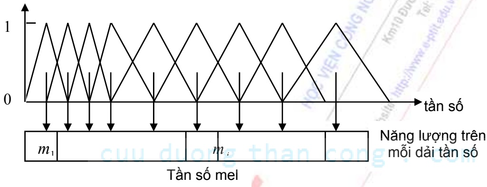

Hình 4.6. Các băng lọc tam giác theo thang tần số Mel

Một phương pháp để chuyển đổi sang thang mel là sử dụng băng lọc (Hình 4.6), trong đó mỗi bộ lọc có đáp ứng tần số dạng tam giác. Số băng lọc sử dụng thường trên 20 băng. Thông thường, người ta chọn tần số từ 0 dến Fs/2 (Fs là tần số lấy mẫu tiếng nói). Nhưng cũng có thể một dải tần giới hạn từ LOFREQ đến HIFREQ sẽ được dùng để lọc đi các tần số không cần thiết cho xử lý. Chẳng hạn, trong xử lý tiếng nói qua đường điện thoại có thể lấy giới hạn dải tần từ LOFREQ=300 đến HIFREQ=3400.

Sau khi tính FFT ta thu được phổ tín hiệu $s ( f _ { n } )$ . Thực chất đây là một dãy năng lượng $W ( n ) = | s ( f _ { n } ) | ^ { 2 }$ . Cho W ( ) n đi qua một dãy K băng lọc dạng tam giác, ta được một dãy các $W ( n )$ Tính tổng của các dãy $W ( \boldsymbol { n } )$ trong từng băng lọc, ta thu được một dãy các hệ số $m_{k}(k = 1,2,\ldots,K)$

## Khối 6: Biến đổi Cosine rời rạc (DCT)

Trong bước này ta sẽ chuyển log của các giá trị $m _ { k _ { \mathrm { \tiny ~ V } } \hat { \mathbf { e } } }$ miền thời gian bằng cách biến đổi Cosine rời rạc (DCT). Kết quả của phép biến đổi này ta thu được các hệ số MFCC.

$$
c _ {i} = \sqrt {\frac {2}{K}} \sum_ {j = 1} ^ {K} \ln (m _ {j}) \cos \left(\frac {\pi i}{K} (j - 0. 5)\right); \quad i = 1, 2,..., K;
$$

<!-- page: 111 -->

Thông thường, chỉ có một số giá trị đầu tiên của i c được sử dụng. Trong các ứng dụng nhận dạng tiếng nói, người ta thường lấy 12 hệ số MFCC và thêm 1 hệ số năng lượng của khung sau khi đã được chuẩn hóa làm tham số đặc trưng cho tín hiệu tiếng nói (như vậy tổng cộng có Q=13 hệ số).

## Khối 7: Cepstral có trọng số

Vì độ nhạy của các hệ số cepstral bậc thấp làm cho phổ toàn bộ bị đổ dốc, độ nhạy của các cepstral bậc cao gây ra nhiễu nên người ta thường sử dụng cửa sổ cepstral để cực tiểu hóa độ nhạy này. Công thức biểu diễn các hệ số cepstral có trọng số:

$$
\stackrel {\wedge} {c} _ {i} = \left[ 1 + \frac {Q}{2} \sin \left(\frac {\pi i}{Q}\right) \right] c _ {i}; \quad 1 \leq i \leq Q;
$$

**Khối 8:** Lấy đạo hàm các hệ số MFCC theo thời gian

Để nâng cao chất lượng nhận dạng, người ta đưa thêm các giá trị đạo hàm theo thời gian của các giá trị hệ số MFCC vào vector hệ số tiếng nói. Các giá trị đó được tính theo:

$$
\Delta \hat {c _ {i}} = \frac {\sum_ {\theta = 1} ^ {\Theta} \theta (\hat {c _ {t + \theta}} - \hat {c _ {t - \theta}})}{2 \sum_ {\theta = 1} ^ {\Theta} \theta^ {2}};
$$

$$
1 \leq i \leq Q;
$$

trong đó; θ: là độ dài cửa sổ tính delta (thường chọn là 2 hoặc 3).

Kết thúc các bước trên với mỗi khung ta thu được một vector có 2Q thành phần biểu diễn tham số đặc trưng của tiếng nói.

## b. Phương pháp mã dự đoán tuyến tính LPC

Mô hình LPC được sử dụng để trích lọc các tham số đặc trưng của tín hiệu tiếng nói. Kết quả của quá trình phân tích tín hiệu thu được một chuỗi gồm các khung tiếng nói. Các khung này được biến đổi nhằm sử dụng cho việc phân tích âm học.

Nội dung phân tích dự báo tuyến tính là: một mẫu tiếng nói được xấp xỉ bởi tổ hợp tuyến tính của các mẫu trước đó. Thông qua việc tối thiểu hóa tổng bình phương sai số giữa các mẫu hiện tại với các mẫu dự đoán có thể xác định được một tập duy nhất các hệ số dự báo. Các hệ số dự báo này là các trọng số được sử dụng trong tổ hợp tuyến tính. Với dãy tín hiệu tiếng nói s(n), giá trị dự báo được xác định bởi:

$$
\tilde {s} (n) = \sum_ {k = 1} ^ {p} \alpha_ {k} s (n - k) \quad . \text {com}
$$

trong đó; $\alpha _ { k }$ : là các hệ số đặc trưng cho hệ thống.

<!-- page: 112 -->

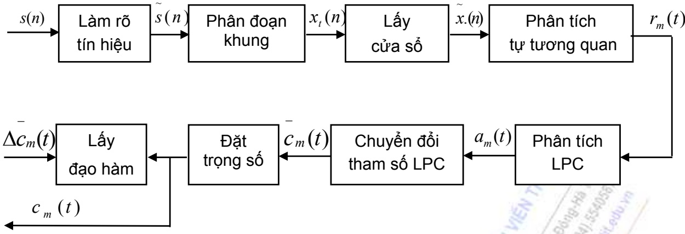

Hình 4.7. Sơ đồ bộ xử lý LPC dùng trích chọn đặc trưng tiếng nói

Sơ đồ khối bộ phân tích LPC dùng cho trích chọn các tham số đặc trưng của tín hiệu tiếng nói (Hình 4.7). Hàm sai số dự báo được tính theo công thức:

$$
e (n) = s (n) - \tilde {s} (n) = s (n) - \sum_ {k = 1} ^ {p} \alpha_ {k} s (n - k)
$$

Để cực tiểu hóa lỗi cần tìm tập giá trị $\{   \alpha _ { \boldsymbol { k } }   \}$ phù hợp nhất.

Do tín hiệu tiếng nói thay đổi theo thời gian nên các hệ số dự báo phải được ước lượng từ các đoạn tín hiệu ngắn. Vấn đề đặt ra là tìm một tập các hệ số dự báo để tối thiểu hóa sai $s \hat { 0 }$ trung bình trên một đoạn ngắn.

Hàm lỗi dự báo trong một thời gian ngắn xác định bởi:

$$
\begin{array}{l} E _ {n} = \sum_ {m} e _ {n} ^ {2} (n) = \sum_ {m} \left(s _ {n} (m) - \sum_ {k = 1} ^ {p} \alpha_ {k} s _ {n} (m - k)\right) ^ {2} \\ = \sum_ {m} s _ {n} ^ {2} (m) = \sum_ {m} \left\{2 s _ {n} (m) \sum_ {k = 1} ^ {p} \alpha_ {k} s _ {n} (m - k) \right\} + \sum_ {m} \left\{\sum_ {k = 1} ^ {p} \alpha_ {k} s _ {n} (m - k) \right\} ^ {2} \\ = \sum_ {m} e _ {n} ^ {2} (n) = \sum_ {m} \left(s _ {n} (m) - \sum_ {k = 1} ^ {p} \alpha_ {k} s _ {n} (m - k)\right) ^ {2} \end{array}
$$

trong đó; $s _ { n } ( m )$ : là một đoạn tín hiệu tiếng nói lân cận mẫu thứ n;

Tìm tập giá trị $\alpha_{k}$ để tối thiểu hóa $E_{n}$ bằng cách đặt $\hat { c } E _ { n } / \hat { c } \alpha _ { i } = 0 \mathrm { v o i } ; i = 1 , 2 , \ldots , p ;$

$$
\frac {\partial E}{\partial \alpha_ {i}} = 0 = - \sum_ {m} 2 s _ {n} (m) s _ {n} (m - i) + 2 \sum_ {m} \left\{\sum_ {k = 1} ^ {p} \alpha_ {k} s _ {n} (m - k) \right\} s _ {n} (m - i)
$$

từ đó nhận được phương trình:

$$
\sum_ {m} s _ {n} (m - i) s _ {n} (m) = \sum_ {k = 1} ^ {p} \alpha_ {k} \sum_ {m} s _ {n} (m - i) s _ {n} (m - k) \quad 1 \leq i \leq p;
$$

Đặt:

<!-- page: 113 -->

$$
\phi_ {n} (i, k) = \sum_ {m} s _ {n} (m - i) s _ {n} (m - k)
$$

Phương trình trên có thể viết:

$$
\phi_ {n} (i. 0) = \sum_ {k = 1} ^ {p} \alpha_ {k} \phi_ {n} (i, k) \quad i = 1, 2, \dots , p;
$$

Giải hệ $p$ phương trình này tìm được $p$ ẩn cuả $\{   \alpha _ { \boldsymbol { k } }   \}$ . Tập các hệ số $\{   \alpha _ { k }   \}$ sẽ tối thiểu sai $s \hat { 0 }$ trung bình bình phương dự đoán cho đoạn tín hiệu $s _ { n } ( m )$ Sai số dự đoán được xác định:

$$
E _ {n} = \sum_ {m} S _ {n} ^ {2} (m) - \sum_ {k = 1} ^ {p} \alpha_ {k} \sum_ {m} S _ {n} (m) S _ {n} (m - k)
$$

Sử dụng phếp thế ta có:

$$
E _ {n} = \theta_ {n} (0, 0) - \sum_ {k = 1} ^ {p} \alpha_ {k} \phi_ {n} (0, k)
$$

Theo nguyên tắc, phân tích dự doán tuyến tính rất đơn giản nhưng việc tính toán $\theta _ { _ n } ( i , k )$ và tìm nghiệm của hệ phương trình rất phức tạp. Phương pháp khắc phục là sử dụng hàm tự tương quan để giải các phương trình này.

Giả sử đoạn tín hiệu $s _ { _ n } ( m ) = 0$ nếu chúng nằm ngoài khoảng $0 \leq m \leq N - 1$ . Điều đó có nghĩa là có thể biểu diễn đoạn tín hiệu đó dưới dạng: $s_{n}(m) \equiv s(n + m)w(m)$ , trong đó: $w ( m )$ là cửa sổ có chiều dài hữu hạn (thường dùng cửa sổ Hamming). Sai số dự đoán $E _ { {   m } } ( m )$

$$
E _ {n} = \sum_ {m = 0} ^ {N + p - 1} e _ {n} ^ {2} (m)
$$

khi đó (2-24) trở thành:

$$
\begin{array}{l l} \phi_ {n} (i, k) = \sum_ {m = 0} ^ {N + p - 1} S _ {n} (m - i) S _ {n} (m - k) & \begin{array}{l l} 1 \leq i \leq p \\ 0 \leq k \leq p \end{array} \\ \phi_ {n} (i, k) = \sum_ {m = 0} ^ {N - 1 - (i - k)} S _ {n} (m) S _ {n} (m + i - k) & \begin{array}{l l} 1 \leq i \leq p \\ 0 \leq k \leq p \end{array} \end{array}
$$

Gọi $R _ { _ n } ( k )$ là hàm tự tương quan dạng:

$$
R _ {n} (k) = \sum_ {m = 0} ^ {N - 1 - k} S _ {n} (m) S _ {n} (m + k)
$$

dễ thấy: $\phi_{n}(i,k)=R_{n}(i-k)$

Do $R _ { _ n } ( k )$ là hàm chẵn nên:

$$
\phi_ {n} (i, k) = R _ {n} (\left| i - k \right|) \quad i = 1, 2, \dots , p; k = 0, 1, 2, \dots p
$$

do đó

$$
\sum_ {k = 1} ^ {p} \alpha_ {k} r _ {n} (| i - k |) = R _ {n} (i)
$$

<!-- page: 114 -->

Hệ phương trình này có thể viết dưới dạng ma trận:

$$
\bar {\alpha} = \underset {-} {R} ^ {- 1} \bar {r}
$$

trong đó:

$$
\bar {\alpha} = \left[ \begin{array}{c} \alpha_ {1} \\ \alpha_ {2} \\ \dots \\ \alpha_ {p} \end{array} \right] \quad R = \left[ \begin{array}{c c c c} r (0) & r (1) & \dots & r (p - 1) \\ r (1) & r (0) & \dots & r (p - 2) \\ \dots & \dots & \dots & \dots \\ r (p - 1) & r (p - 2) & \dots & r (0) \end{array} \right]; \quad \bar {r} = \left[ \begin{array}{c} r (1) \\ r (2) \\ \dots \\ r (p) \end{array} \right]
$$

**Chú ý:** R là ma trận đối xứng. Tất cả các phần tử thuộc đường chéo của ma trận này đều có giá trị bằng nhau, điều đó có nghĩa là nghịch đảo của nó luôn tồn tại và có nghiệm

## c. Phương pháp PLP

Phương pháp này là sự kết hợp của hai phương pháp đã trình bày ở trên. Hình 2.8 mô tả các bước xác định hệ số PLP.

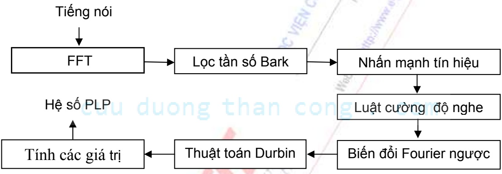

Hình 4.8. Sơ đồ các bước xác định hệ số PLP

## Các khối xử lý

♦ **Khối 1:** Biến đổi Fourier nhanh (FFT)

Tương tự như phương pháp MFCC, tín hiệu tiếng nói được chia thành các khung và được chuyển sang miền tần số bằng thuật toán FFT.

♦ **Khối 2:** Lọc theo thang tần số Bark

Tín hiệu tiếng nói được lọc qua các bộ lọc phân bố theo thang tần số phi tuyến, trong trường hợp này là thang tần số Bark:

$$
B a r k (f) = 6 \ln \left\{\frac {f}{1 2 0 0} + \left[ \left(\frac {f}{1 2 0 0}\right) ^ {2} + 1 \right] ^ {\frac {1}{2}} \right\}
$$

## ♦ Khối 3: Nhấn mạnh tín hiệu dùng hàm cân bằng độ ồn (equal-loudnes)

Bước này tương tự bước nhấn mạnh (preemphais) của phương pháp MFCC. Hàm này mô phỏng đường cong cân bằng độ ồn (Equal-Loudnes Curve).

<!-- page: 115 -->

$$
E (\omega) = \frac {(\omega^ {2} + 5 6 , 8 * 1 0 ^ {6}) \omega^ {4}}{(\omega^ {2} + 6 . 3 * 1 0 ^ {6}) (\omega^ {6} + 9 . 5 8 * 1 0 ^ {2 6})}
$$

**Khối 4:** Dùng luật cường độ nghe (Power Law of Hearing)

Bước xử lý này giống như bước lấy giá trị logarit trong phương pháp MFCC. Hàm căn lập phương được dùng có dạng:

$$
\Phi (f) = \psi (f) ^ {0. 3 3}
$$

♦ **Khối 5**: Biến đổi Fourier ngược (Inverse DFT)

Các hệ số tự tương quan được biến đổi Fourier ngược là giá trị đầu vào cho LPC.

♦ **Khối 6:** Thuật toán Durbin

Thuật toán Durbin được sử dụng để tính các hệ số dự báo tuyến tính như phương pháp LPC

♦ **Khối 7:** Tính các giá trị delta

Phương pháp tính tương tự như phương pháp hệ số MFCC.

Phương pháp ứng dụng trí tuệ nhân tạo cho xử lý và nhận dạng tiếng nói có thể tham khảo thêm các tai liệu trích dẫn trong tài liêu..

## 4.5 CÁC HỆ THỐNG HỘI THOẠI

Chúng ta quan tâm đến những gì xảy ra bên trong của một đối tượng - từ khi nó nhận được một kết quả của tri thức đến khi đối tượng này quyết định một hành động. Trong phần này chúng ta tập trung vào giao diện giữa đối tượng và môi trường. Kết quả chúng ta có được sự nhận thức: thị giác, thính giác và có thể nhiều giác quan khác, ở một kết quả khác chúng ta có hành động: sự cử động của một cánh tay robot chẳng hạn.

Mặc dù bao trùm lên phần này là đối thoại. Một nhóm đối tượng có thể thành công hơn, cá thể hay tập thể nếu họ đối thoại với nhau về mục tiêu và sự hiểu biết của mình. Chúng ta sẽ xem xét một cách chặt chẽ ngôn ngữ nhân loại và ngôn ngữ này được sử dụng như là một công cụ đối thoại.

Con người sử dụng một số hữu hạn các ký hiệu quy ước (mỉm cười, bắt tay) để giao tiếp tương tự như hầu hết các động vật khác. Con người cũng có thể phát triển một hệ thống các kí hiệu có kiến trúc phức tạp được biết như là ngôn ngữ mà có thể sử dụng chúng để đối thoại trong hầu hết những gì mà họ biết về thế giới.

Trong các hệ cơ sở tri thức, đặc biệt hẹ chuyên gia, các hệ thống đối thoai giữa ngươi và máy đươc thiết lập và là một khâu rất cần thiết để xử lý thông tin, Học viên có thể tham khảo thêm phần này ở các tài liệu trích dẫn kèm theo

## 4.6 TỪ ĐIỂN ĐIỆN TỬ

Bước đầu tiên trong việc định nghĩa ngữ pháp là định nghĩa một từ điển ngôn ngữ, hoặc danh sách các từ vựng có thể cho phép. Các từ được nhóm lại vào những phạm trù hoặc những phần của lời nói quen thuộc đến từ điển người dùng: danh từ, đại từ, và tên để biểu thị chúng, động từ để biểu thị một sự kiện, tính từ để bổ nghĩa cho danh từ, trạng từ bổ nghĩa cho động từ. Hình 4.9 cho một từ điển ngôn ngữ nhỏ.

<!-- page: 116 -->

| Noun → stench\| breeze\| glitter\| nothing \| wumpus\| pit\| pits\| gold\| east\| … Verb → is\| see\| smell\| shoot\| feel\| stinks \| go\| grab\| carry\| kill\| turn\|… Adjective → right\| left\| east\| sound\| back\| smelly\|… Adverb → here\| there\| nearby\| ahead Right\| left\| sound\| back\| … Pronoun → me\| you\| I\| it\| … Name → John\| Mary\| Boston\| Aristotle\|… Article → the\| a\| an\| … Preposition → to\| in\| on\| near\| … Conjunction → and\| or\| but\| … Digit → 0\| 1\|2\| 3\| 4\| 5\| 6\| 7\| 8\| 9 |
| --- |
| Hình 4.9. Từ điển ngôn ngữ |

Mỗi một phạm trù đều kết thúc để biểu thị rằng có những từ khác ở trong phạm trù này. Tuy nhiên chú ý rằng có hai lý do khác biệt cho việc mất từ. Đối với danh từ, động từ, tính từ và trạng từ, nó là nguyên tắc cơ bản bất khả thi để hiển thị tất cả chúng. Không những có hàng ngàn hoặc hàng chục ngàn thành viên trong mỗi lớp, mà mỗi một loại mới luôn luôn được bổ sung thêm vào. Ví dụ, ngày nay “fax” là một danh từ và động từ phổ biến nhưng nó chỉ được đặt ra trong vài nănm trước. Có bốn phạm trù được gọi là lớp mở. Những phạm trù khác (đại từ, quán từ, giới từ, và liên từ) được gọi là lớp đóng. Chúng thường có một số lượng nhỏ các từ (một vài từ đến một vài nhóm từ) mà nó có thể được liệt kê theo quy tắc. sự thay đổi lớp đóng diễn ra trong hàng thế kỷ , không phải hàng tháng. Ví dụ “thee” và “thou” thường được sử dụng làm đại từ trong thế kỷ XVII, bị suy tàn vào thế kỷ XIX, và ngày nay nó chỉ được thấy trong thơ ca và ngôn ngữ địa phuơng.

## Ngữ pháp

Bước tiếp theo là phối hợp các từ trong cụm từ. chúng ta vẫn sử dụng năm biểu tượng nonterminal để định nghĩa sự khác nhau của cụm từ: câu (S), cụm danh từ (NP), cụm động từ (VP), cụm giới từ (PP), và mệnh đề quan hệ (Rel Clause)(4). Hình 4.10 xét một ngữ pháp cho ε0 với một ví dụ cho mỗi một quy luật viết lại.

<table><tr><td>S → |</td><td>NP,VP S Conjunction S</td><td>I +feel a breeze I feel a breeze+and+ I smell the wumpus</td></tr><tr><td>NP → |</td><td>Pronoun Noun Article Noun Digit Digit NP PP NP Rel Clause</td><td>I Pits The +wumpus 3 4 the wumpus+ to the east the wumpus+ that is smell</td></tr><tr><td>VP → |</td><td>Verb VP NP VP adjective VP PP VP Adverb</td><td>Stinks Feel+ a breeze Is+ smelly Turn+ to the east Go+ ahead</td></tr><tr><td>PP →</td><td>Priposition NP</td><td>To+ the east</td></tr><tr><td>RelClause→</td><td>That VP</td><td>That+ is smelly</td></tr><tr><td colspan="3">Hình 4.10. Ngữ pháp cho t上级iểm, với cụm từ ví dụ cho mỗi quy luật</td></tr></table>

<!-- page: 117 -->

## CÂU HỎI VÀ BÀI TẬP

1. Không xem lại bài trả lời các câu hỏi sau: bốn lớp được nhắc đến của ngữ pháp hình thức?

2. Thực hiện một phiên bản của giải thuật biểu đồ phân tích cú pháp mà kết quả là một cây cho tất cả cạnh mà mở rộng cho toàn bộ đầu vào.

3. Trình bày phương pháp phát hiện tiếng nói dựa trên năng lượng phổ ngắn hạn

4. Trình bày phương pháp tính các hệ số MFCC: phương pháp trích chọn tham số tiếng nói được sử dụng rộng rãi bởi tính hiệu quả của nó thông qua phân tích cepstral theo thang đo mel.

5.Trình bày phương pháp mã dự đoán tuyến tính LPC


<!-- page: 118 -->

# CHƯƠNG 5: CÁC KỸ THUẬT TRÍ TUỆ NHÂN TẠO HIỆN ĐẠI

## 5.1. NHẬP MÔN

Mạng nơ ron nhân tạo, logic mờ, giải thuật di truyền và các hệ thống lai là các lĩnh vực của trí tuệ nhân tạo hiện đại - một trong những lĩnh vực rất được quan tâm của Công nghệ thông tin. Các máy tính và công nghệ vi điện tử hiện đại đang hy vọng ở các phương pháp này như chìa khoá mở ra thế hệ máy tính mới: thế hệ máy tính thứ năm. Không chỉ trong nghiên cứu, các chuyên đề môn học của chương trình đào tạo đại học Công nghệ thông tin cũng đã chọn những môn này vào chương trình giảng dạy. Nhiều đề tài, luận văn tiến sỹ, thạc sỹ đồ án, khóa luận tốt nghiệp đại học đã lấy các công cụ logic mờ và mạng nơ ron nhân tạo làm phương tiện xử lý và tính toán mới thay cho các phương pháp kinh điển hiện nay.

Chương này giói thiêu năm phần:

mạng nơ ron với các khả năng ứng dụng của chúng

nghiên cứu logic mờ với các khả năng ứng dụng

giải thuật di truyền

• các phương pháp và thuật toán lai mạng nơ ron và logic mờ; giải thuật di truyền

• các agent thông minh.

Những vấn đề kể trên là rất lớn. Học viên có thể tìm đọc thêm [2, 3, 4, 5, 11, 16, 20, 25]

## 5.2. MẠNG NƠ RON NHÂN TAO

## 5.2.1 Quá trình phát triển

Theo Wiener: trí não, thông tin và điều khiển là ba lĩnh vực dưới ngọn cờ chung là điều khiển học (Cybernetics) [16]. Nghiên cứu và mô phỏng trí não, cụ thể là mô tế bào thần kinh (nơron) là một ước muốn từ lâu của nhân loại. Từ mơ ước đó nhiều nhà khoa học đã không ngừng nghiên cứu tìm hiểu về mạng nơron. Với khoảng 15 tỷ nơ ron ở não người, mỗi nơ ron có thể nhận hàng vạn tín hiệu từ các khớp thần kinh và được coi là một cơ chế sinh vật phức tạp nhất. Não người có khả năng giải quyết nhũng vấn đề như: nghe, nhìn, nói, hồi ức thông tin, phân biệt các mẫu mặc dù sự kiện có bị méo mó, thiếu hụt. Não thực hiện những nhiệm vụ như vậy nhờ các phần tử tính toán (nơ ron). Não phân bố việc xử lý cho hàng tỷ nơ ron có liên quan, điều khiển các mối liên hệ giữa các nơ ron đó. Nơ ron không ngừng nhận và truyền thông tin lẫn nhau. Cơ chế hoạt động nơ ron bao gồm: liên kết (association), tổng quát hoá (generation), và tự tổ chức (Self-organization). Các nơ ron tự liên kết với nhau thành mạng trong xử lý. Mỗi mạng gồm hàng vạn các phần tử nơ ron khác nhau. Môĩ phần tử nơ ron có khả năng liên kết với hàng nghìn các nơ ron khác. Lý thuyết về mạng nơ ron đã hình thành và đang phát triển, đặc biệt là nghiên cứu ứng dụng chúng [2, 4]. Có thể chia quá trình phát triển và nghiên cứu mạng nơ ron trong thế kỷ qua thành bốn giai đoạn:

Giai đoạn một có thể tính từ những nghiên cứu của William từ những năm 1890 về tâm lý học với sự liên kết các nơ ron thần kinh. Năm 1940, McCulloch và Pitts đã cho biết, nơ ron có thể được mô hình hoá như thiết bị ngưỡng giới hạn để thực hiện các phép tính logic. Cũng thời gian đó, Wiener đã xét mối liên quan giữa nguyên lý phản hồi trong điều khiển và chức năng cuả bộ não; Ashly đã đề xuất mô hình chức năng bộ não và nguyên lý ổn định cuả nó.

<!-- page: 119 -->

Giai đoạn hai có thể tính từ sau thế chiến thứ hai. Đặc biệt, vào những năm cuả thập niên 60 gần như đồng thời xuất hiện một loạt mô hình mạng nơ ron hoàn hảo hơn được đưa ra như: Perceptron cuả Rosenblatt, phần tử nơ ron tuyến tính Adaline (ADAptive LINear Element) cuả Windrow, Ma trận học cuả Steinbuck. Perceptron rất được chú trọng vì nguyên lý giản đơn, nhưng nó cũng hạn chế vì như Minsky và Papert đã chứng minh nó không dùng được cho các hàm logic phức. Bản chất cuả Adaline là tuyến tính, tự chỉnh và được dùng rộng rãi cho những bài toán tự thích nghi, tách nhiễu và vẫn phát triển cho đến ngày nay.

Giai đoạn thứ ba có thể tính từ đầu những năm 80 đến nay. Những đóng góp to lớn cho mạng nơ ron ở giai đoạn này phải kể đến Grossberg, Kohonen, Rumelhart và Hopfield. Đóng góp chính cuả Hopfield là hai mô hình mạng phản hồi: mạng rời rạc năm 1982 và mạng liên tục năm 1984. Đặc biệt, ông dự kiến nhiều khả năng tính toán lớn cuả mạng mà một nơ ron đơn không thể có được.

Giai đoạn thứ tư, từ năm 1990 đến nay. Các Hội nghị, Tạp chí khoa học và chuyên đề đặc biệt về mạng nơ ron liên tục được tổ chức ví dụ như IJCNN (International Joint Conference on Neural Networks). Hàng loạt các lĩnh vực khác nhau như: kỹ thuật tính toán, tính toán tối ưu, ứng dụng mạng nơ ron trong tin học, viễn thông, sinh-y-học, dự báo, thống kê... đã đi vào áp dụng và đem lại nhiều kết quả đáng khích lệ.

## 5.2.2 Cơ sở của mạng nơron nhân tạo và một số khái niệm

Đầu tiên, chúng ta tìm hiểu nguồn gốc của mạng nơ ron, bắt đầu từ một phần tử nơ ron đơn giản. Mô hình nơron nhân tạo có nguồn gốc từ mô hình tế bào thần kinh (hay còn gọi là nơron) sinh vật. Mục đích của phần này không mô tả và nghiên cứu nơ ron sinh học (việc đó có chuyên ngành nơ ron sinh vật nghiên cứu) mà muốn chỉ ra rằng: từ những nguyên lý cơ bản nhất của nơ ron sinh học, người ta đã bắt chước mô hình đó cho nơ ron nhân tạo [20].

## a) Mô hình nơron sinh vật

Các nơron sinh vật có nhiều dạng khác nhau như dạng hình tháp ở đại não, dạng tổ ong ở tiểu não, dạng rễ cây ở cột sống. Tuy nhiên, chúng có cấu trúc và nguyên lý hoạt động chung. Từ mô hình chung nhất, người ta có thể mô tả chúng như một nơron chuẩn. Một tế bào nơron chuẩn gồm bốn phần cơ bản là [20]:

\+ Các nhánh và rễ: là các bộ phận nhận thông tin. Các đầu nhạy hoặc các đầu ra của các nơ ron khác bám vào rễ hoặc nhánh của một nơ ron. Khi các đầu vào từ ngoài này có sự chênh lệch về nồng độ K+, Na+ hay Cl- so với nồng độ bên trong của của nơ ron thì xảy ra hiện tượng thấm (hoặc hiện tượng bơm) từ ngoài vào trong thông qua một cơ chế màng thấm đặc biệt. Hiện tượng thẩm thấu như vậy tạo nên một cơ chế truyền đạt thông tin với hàng nghìn hàng vạn lối vào trên một nơ ron sinh vật, ứng với hàng nghìn hàng vạn liên kết khác nhau. Mức độ thẩm thấu được đặc trưng bởi cơ chế màng tượng trưng bằng một tỷ lệ. Tỷ lệ đó được gọi là tỷ trọng hay đơn giản gọi là trọng (weight)

\+ Thân thần kinh (soma) chứa các nhân và cơ quan tổng hợp prôtêin. Các ion vào được tổng hợp và biến đổi. Khi nồng độ các ion đạt đến một giá trị nhất định, xẩy ra quá trình phát xung (hay kích thích). Xung đó được phát ở các đầu ra của nơ ron. Dây dẫn đầu ra xung được gọi là dây thần kinh (axon).

<!-- page: 120 -->

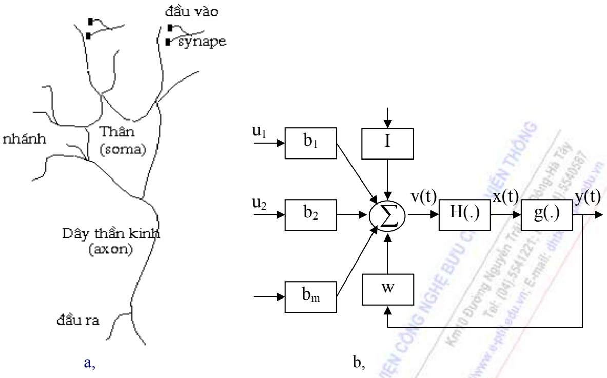

Hình 5.1: a, Nơron sinh vật; b, Nơron nhân tạo

\+ Dây thần kinh (axon) là đầu ra. Đó là phương tiện truyền dẫn tín hiệu. Dây thần kinh được cấu tạo gồm các đốt và có thể dài từ vài micro mét đến vài mét tùy từng kết cấu cụ thể. Đầu ra này có thể truyền tín hiệu đến các nơ ron khác.

\+ Khớp thần kinh (synape) là bộ phận tiếp xúc của các đầu ra nơ ron với rễ, nhánh của các nơ ron khác. Chúng có cấu trúc màng đặc biệt để tiếp nhận các tín hiệu (Hình 1.a) khi có sự chênh lệch về nồng độ ion giữa bên trong và bên ngoài. Nếu độ lệch về nồng độ càng lớn thì việc truyền các ion càng nhiều và ngược lại. Mức độ thấm của các ion có thể coi là một đại lượng thay đổi tùy thuộc vào nồng độ như một giá trị đo thay đổi và được gọi là trọng.

## Hoạt động của nơron sinh vậ

\+ Truyền xung tín hiệu: Mỗi nơron nhận tín hiệu vào từ các tế bào thần kinh khác. Chúng tích hợp các tín hiệu vào. Khi tổng các tín hiệu vượt một giá trị nào đó gọi là giá trị ngưỡng (hay đơn giản gọi là ngưỡng) chúng phát tín hiệu ra. Tín hiệu ra của nơron được chuyển tới các nơron hoặc tới các cơ quan chấp hành khác như các cơ, các tuyến (glands). Việc truyền tín hiệu thực hiện thông qua dây thần kinh và từ nơron này tới nơron khác theo cơ chế truyền tin đặc biệt là khớp thần kinh. Mỗi một nơron có thể nhận hàng nghìn, vạn tín hiệu và cũng có thể gửi tín hiệu đến hàng vạn các nơron khác. Mỗi nơron được coi là một thiết bị điện hoá, chứa các nội năng liên tục, được gọi là thế năng màng (rnembrance potential). Khi thế năng màng vượt ngưỡng, nơron có thể truyền thế năng tác động đi xa theo các dây thần kinh.

\+ Quá trình học: Khi có xung kích thích từ bên ngoài tới, các khớp hoặc cho đi qua hoặc không và kích thích hay ức chế các nơron tiếp theo. Học là một quá trình làm cho cách cập nhật này lặp lại nhiều lần đến một giá trị ổn định, cân bằng điện hoá giữa các nơron. (Trong mạng nơron nhân tạo, trọng số wij biểu diễn gía trị cân bằng đó đồng thời tạo mối liên kết giữa các nơron).

<!-- page: 121 -->

Những nơron không có ý nghĩa khi xử lý đơn lẻ mà cần thiết liên kết với nhau tạo thành mạng. Đặc tính của hệ thần kinh được xác định bằng cấu trúc và độ bền của những liên kết đó. Có thể thay đổi độ bền vững liên kết (weight) bằng các thuật học khác nhau.

Theo nghiên cứu của các nhà nơ ron sinh vật, một noron xử lý với tốc độ chỉ bằng 1/6 đến 1/7 tốc độ của cổng logic. Các nơron sinh học thường được liên kết hàng nghìn, hàng vạn các phần tử với nhau theo nhiều cách tổ chức khác nhau rất phức tạp. Tuy nhiên, một số cách kết hợp các phần tử nơron thành mạng theo lớp (layer) được đúc kết như sau:

\+ Mạng một lớp: là tập hợp các nơron có đầu vào và đầu ra trên mỗi một phần tử.

\+ Mạng hai lớp: gồm một lớp đầu vào và một lớp đầu ra riêng biệt trên mỗi một phần tử.

\+ Mạng nhiều lớp: gồm nhiều lớp trong đó lớp đầu vào và lớp đầu ra riêng biệt. Các lớp nằm giữa lớp vào và lớp ra gọi là các lớp ẩn (Hidden layers).

\+ Mạng truyền thẳng: là mạng nhiều lớp mà quá trình truyền tín hiệu từ đầu ra lớp này đến đầu vào lớp kia theo một hướng xác định.

\+ Mạng truyền ngược: là mạng mà trong đó một hoặc nhiều đầu ra của các phần tử lớp sau truyền ngược tới đầu vào các lớp trước đó.

\+ Mạng tự tổ chức: là mạng có khả năng sử dụng những kinh nghiệm quá khứ để thích ứng với những biến đổi của môi trường (không dự báo trước).

## b) Mô hình nơron nhân tạo

Mạng nơron sinh học có cấu trúc phức tạp. Mô hình một nơron nhân tạo được xây dựng từ ba thành phần chính: tổng các liên kết đầu vào, động học tuyến tính, phi tuyến không động học (Hình 1.1b)

\* Bộ tổng liên kết. Bộ tổng liên kết đầu vào phần tử nơron có thể mô tả như sau:

$$
\mathrm{v} (t) = \mathrm{wy} (t) + \sum_ {\mathrm{k} = 1} ^ {\mathrm{m}} \mathrm{b} _ {\mathrm{k}} \mathrm{u} _ {\mathrm{k}} (t) + \mathrm{I}\tag{5.1}
$$

trong đó: v(t) là tổng tất cả các đầu vào; uk(t) là các đầu vào ngoài, $\mathrm{k}=1, \ldots, \mathrm{m}; \mathrm{~y}(\mathrm{t})$ là đầu ra nơron; bk là trọng liên kết các đầu vào ngoài; w là trọng liên kết các đầu vào trong; I là ngưỡng.

\* Phần động học tuyến tính

Có nhiều hàm để mô tả phần động học tuyến tính. Đây là phần mô tả các xử lý bên trong của nơron. Dưới đây là một phương pháp dùng toán tử Laplace mô tả (Bảng 1.1) phần động học tuyến tính như một hàm truyền đạt:

$$
\mathrm{X(s)} = \mathrm{H(s)} \mathrm{V(s)}\tag{5.2}
$$

Bảng 5.1: Một số hàm H(s) thường dùng cho nơron nhân tạo

| H(s) | 1 | 1s | 11-sT | Exp(-sT) |
| --- | --- | --- | --- | --- |
| Quan hệ vào ra | x(t) = v(t) | dx(t) = v(t) dt | T dx(t) + x(t) = v(t) dt | x(t) = v(t-T) |

\* Phần phi tuyến.

Các đầu ra của nơ ron sinh vật là các xung, có giới hạn chặn. Trong mô phỏng, để đảm bảo hệ ổn định đầu ra, người ta thường gán hàm chặn ở lối ra cho các tín hiệu. Để đặc trưng cho

<!-- page: 122 -->

điều đó, ở lối ra của mỗi nơ ron phải đặt một hàm chặn, thường ở dạng phi tuyến với hàm g(.). Như vậy đầu ra y có đặc trưng là một hàm:

$$
y = g (x (t))\tag{5.3}
$$

Có nhiều hàm phi tuyến có thể sử dụng trong phần phi tuyến. Một số hàm phi tuyến thường dùng được cho ở Bảng 5.2. Một số dạng khác cũng được sử dụng. (Các nơron chuyển động ở vùng thị giác trong nơ ron sinh học có đặc tính của hàm Sigmoid, nơron ở khu vực quan

Bảng 5.2: Một số hàm phi tuyến thường dùng trong các mô hình nơron

<table><tr><td>Tên hàm</td><td>Công thức</td><td>Đặc tính</td></tr><tr><td>Bước nhảy đơn vị</td><td> $g(x) = \begin{cases} 1 & nếu x \geq 0 \\ 0 & nếu x < 0 \end{cases}$ </td><td>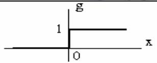</td></tr><tr><td>Hard limiter (sgn)</td><td> $g(x) = \begin{cases} 1 & nếu x \geq 0 \\ -1 & nếu x < 0 \end{cases}$ </td><td>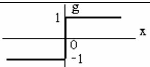</td></tr><tr><td>Hàm tuyến tính</td><td> $g(x) = x$ </td><td>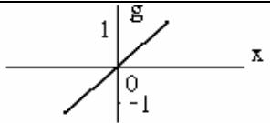</td></tr><tr><td>Hàm tuyến tính bảo hoà</td><td> $g(x) = \begin{cases} 1 & nếu x > 1 \\ x & nếu 0 \leq x \leq 1 \\ 0 & nếu x < 0 \end{cases}$ </td><td>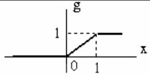</td></tr><tr><td>Hàm tuyến tính bảo hoà đối xứng</td><td> $g(x) = \begin{cases} 1 & nếu x > 1 \\ x & nếu -1 \leq x \leq 1 \\ -1 & nếu x < -1 \end{cases}$ </td><td>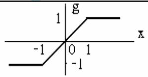</td></tr><tr><td>Hàm Sigmoid đơn cực (Unipolar Sigmoid)</td><td> $g(x) = \frac{1}{1 + e^{-\lambda x}}$ </td><td>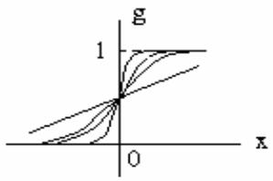</td></tr><tr><td>Hàm Sigmoid lưỡng cực (Bipolar Sigmoid)</td><td> $g(x) = \frac{2}{1 + e^{-\lambda x}} - 1$ </td><td>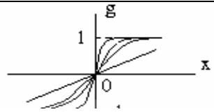</td></tr></table>

sát có dạng hàm Gauss, nên việc mô hình hoá các đầu ra ở các dạng kể trên là phù hợp và tương ứng với các nơ ron sinh học)

<!-- page: 123 -->

\*Một kiểu phân loại điển hình được biểu diễn trên Hình 5.2

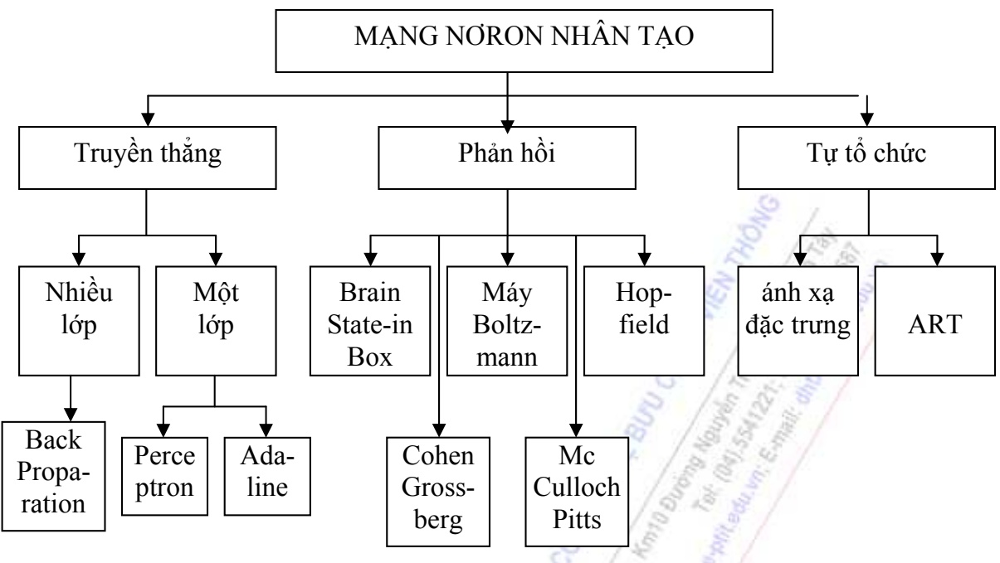

Hình 5.2: Một cách Phân loại mạng nơron nhân tạo

Một số dạng hàm mũ, logarit cũng được sử dụng trong khâu đầu ra phi tuyến mặc dù cơ sở sinh vật của những hàm đó chưa được đặt ra. Đầu ra y(t) trong trường hợp tổng quát có thể là liên tục hoặc rời rạc.

Cũng như nơron sinh vật, các nơron nhân tạo có thể liên kết với nhau để tạo thành mạng. Có nhiều cách kết hợp các nơron nhân tạo thành mạng, mỗi cách kết hợp tạo thành một loại lớp mạng khác nhau.

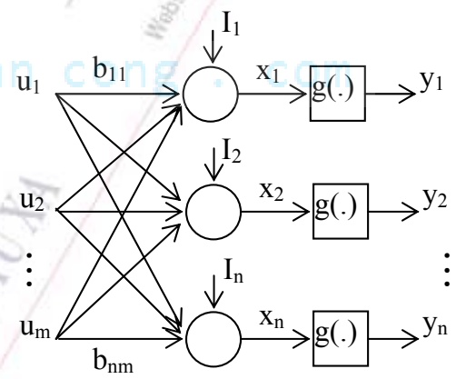

Hình 5.3 Mạng nơron truyền thẳng một lớp

## 5.2.3. Các cấu trúc mạng điển hình

## Mạng nơron truyền thẳng một lớp

Là mạng mà các nơron tạo thành một lớp, trong đó mỗi một tín hiệu vào có thể được đưa vào cho tất cả các nơron của lớp và mỗi nơron có nhiều các đầu vào và một đầu ra trên mỗi nơ ron đó (Hình 5.3). Xét trường hợp các nơron không phải là động học (tức H(s) =1) khi đó xi(t) = vi(t). Phương trình mạng được mô tả như sau:

$$
\begin{array}{c} \mathrm{x} _ {\mathrm{i}} (t) = \sum_ {\mathrm{k} = 1} ^ {\mathrm{m}} \mathrm{b} _ {\mathrm{ik}} \mathrm{u} _ {\mathrm{k}} (t) + \mathrm{I} _ {\mathrm{i}} \\ \mathrm{y} _ {\mathrm{i}} = \mathrm{g} (\mathrm{x} _ {\mathrm{i}} (t)), \end{array}\tag{5.4}
$$

<!-- page: 124 -->

trong đó: x<sub>i</sub>(t) là các trạng thái của nơ ron, $\mathrm { i = } 1 , \ldots , \mathrm { n } ; \mathrm { u _ { i } ( t ) }$ là các đầu vào ngoài; bik là trọng liên k $\mathbf{k}\acute{\mathbf{c}}\mathbf{t}, \mathbf{k} = 1, \ldots, \mathbf{m}; \mathbf{y}\mathbf{i}(\mathbf{t})$ là đầu ra; n là số nơron; m là số tín hiệu ngoài đưa vào.

Có thể mô tả phương trình (1.4) dưới dạng phương trình ma trận véc tơ:

$$
\mathrm{x(t)=Bu(t)+I}
$$

$$
\mathrm{y(t)=g(x(t))}\tag{5.5}
$$

trong đó: $\mathbf { x } = \left[ x _ { I } ,   x _ { 2 } , . . . ,   x _ { n } \right] ^ { T }$ là véc tơ trạng thái; $\mathbf{i} = 1, \ldots, \mathbf{n}; \mathbf{y} = [y_1, y_2, \ldots, y_n]^T$ là véc tơ đầu ra; $\mathbf { B } \mathbf { = } [ \mathbf { b } _ { \mathrm { i k } } ]$ là ma trận trọng n×m chiều; $\pmb { I } = [ I _ { 1 } , I _ { 2 } , . . . , I _ { n } ] ^ { T }$

Nếu mỗi nơron có đặc tính động học bậc nhất $\mathrm{H}(\mathrm{s}) = 1 / (\mathrm{Ts} + 1)$ thì tập hợp của các nơron có thể được viết dưới dạng phương trình trạng thái:

$$
T \frac {d x}{d t} + x (t) = B u (t) + I
$$

$$
\mathrm{y(t)=g(x(t))}\tag{5.6}
$$

Hệ phương trình (1.6) có thể cho ở dạng rời rạc:

$$
\begin{array}{c} \mathrm{Tx(t+1)+(1-T)x(t)=Bu(t)+I} \\ \mathrm {y(t) = g(x(t))} \end{array}\tag{5.7}
$$

Đặc tính mạng phụ thuộc vào ma trận liên kết B và dạng động học H(s).

## Mạng truyền thẳng nhiều lớp

Liên kết một lớp cho khả năng ánh xạ phi tuyến giữa các đầu vào và các đầu ra. Mạng hai lớp có khả năng ánh xạ các hàm trong vùng lồi. Mạng một hoặc hai lớp nói chung dễ phân tích. Mạng ba lớp hoặc nhiều lớp có khả năng mô tả được mọi hàm phi tuyến. Theo Cybenco thì bất kỳ hàm phi tuyến nào cũng có thể xấp xỉ tuỳ ý trên một tập compact bằng mạng nơron truyền thẳng gồm hai lớp ẩn với độ phi tuyến

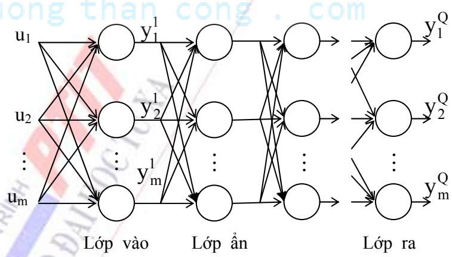

Hình 5.4: Mạng truyền thẳng nhiều lớp

cố định. Như vậy, khi xây dựng mạng nơ ron trong xử lý, mạng hai lớp ẩn đủ khả năng xấp xỉ một hàm tùy chọn mà có thể không dùng nhiều lớp hơn phức tạp cho tính toán.

Xét mạng tĩnh (H(s)=1) truyền thẳng nhiều lớp có phương trình mô tả như sau:

$$
\mathrm{x} _ {\mathrm{i}} ^ {\mathrm{q}} (t) = \sum_ {\mathrm{j} = 1} ^ {\mathrm{n} ^ {\mathrm{q}}} \mathrm{w} _ {\mathrm{ij}} ^ {\mathrm{q}} \mathrm{y} _ {\mathrm{j}} ^ {\mathrm{q} - 1} (t) + \sum_ {\mathrm{k} = 1} ^ {\mathrm{m}} \mathrm{b} _ {\mathrm{ik}} \mathrm{u} _ {\mathrm{k}} (t) + \mathrm{I} _ {\mathrm{i}} ^ {\mathrm{q}}
$$

$$
\mathbf {y} _ {\mathrm{i}} ^ {\mathrm{q}} = \mathbf {g} ^ {\mathrm{q}} (\mathbf {x} _ {\mathrm{i}} ^ {\mathrm{q}} (\mathbf {t}))\tag{5.8}
$$

<!-- page: 125 -->

trong đó: $\mathbf { X } _ { \mathrm { i } } ^ { \mathfrak { q } } ( \mathrm { t } )$ là các đầu vào lớp q; $i { = } I , . . . , n ; \quad q { = } I , . . . , Q ; \quad u _ { k } ( t )$ là các đầu vào ngoài; bik là trọng ngoài, $k { = } I { , } . . . { , } m { ; ~ } \mathbf { y } _ { \mathrm { i } } ^ { \tt q }$ là đầu ra lớp q; $\mathbf { W } _ { \mathbf { i j } } ^ { \mathbf { q } }$ là trọng lớp q, từ nơron thứ j tới nơron thứ i, $i , j = I , . . . , n ; \; \mathrm { I _ { i } ^ { q } }$ là ngưỡng của nơron thứ i, lớp q; $n ^ { q }$ là số phần tử nơron lớp $q ;$ m là số tín hiệu ngoài đưa vào.

Có thể mô tả phương trình (5.8) dưới dạng phương trình ma trận-véc tơ:

$$
\begin{array}{c} \mathrm{x(t) = Wy(t) + Bu(t) + I} \\ \mathrm{y(t) = g(x(t))} \end{array}\tag{5.9}
$$

trong đó, W, B, I là các ma trận; x, u, g là các véc tơ hàm. Từ các mạng truyền thẳng tổng quát một số tác giả đã chọn các dạng cụ thể, nghiên cứu áp dụng cho chúng các thuật học phù hợp, hình thành các mạng cụ thể như: mạng Adaline, mạng Percetron, mạng truyền ngược. Dưới đây là một số mạng điển hình.

## Mạng percetron một lớp đơn

Cấu trúc: Với các véc tơ ra mong muốn $d^{(k)} = \left[ d_{1} \quad d_{2} \quad \cdots \quad d_{n} \quad d_{n} \right]$ và véc tơ vào $X ^ { k }$ $^ { 0 } = \nmid \mathrel { { X _ { I } } ^ { ( k ) } } , \mathrel { { X _ { 2 } } ^ { ( k ) } } , . . . , \mathrel { { X _ { m } } ^ { ( k ) } } \nmid , \mathrel { { k } } = \mathrel { { I , 2 , } } . . . , \mathrel { { p , } }$ trong đó m là số đầu $\mathrm{v}\dot{\mathrm{a}}\mathrm{o},\ddot{\mathrm{n}}$ là số đầu ra, p là $s \hat { 0 }$ cặp mẫu vào-ra dùng huấn luyện mạng. Đầu ra thực tế theo cấu trúc chung:

$$
\mathrm{y} _ {\mathrm{i}} ^ {(\mathrm{k})} = \mathrm{f} (\mathrm{W} _ {\mathrm{i}} ^ {\mathrm{T}} \mathrm{x} _ {\mathrm{i}} ^ {(\mathrm{k})}) = \mathrm{f} (\Sigma \mathrm{W} _ {\mathrm{ij}} \mathrm{x} _ {\mathrm{j}} ^ {(\mathrm{k})}) = \mathrm{d} _ {\mathrm{i}} ^ {(\mathrm{k})}; \mathrm{i} = 1, \dots , \mathrm{n}; \mathrm{k} = 1, \dots , \mathrm{p}\tag{5.10}
$$

Đối với cấu trúc perceptron (5.10) có thể viết thành:

$$
\mathrm{y} _ {\mathrm{i}} ^ {(\mathrm{k})} = \operatorname{Sign} (\mathrm{W} _ {\mathrm{i}} ^ {\mathrm{T}} \mathrm{x} _ {\mathrm{i}} ^ {(\mathrm{k})}) = \mathrm{d} _ {\mathrm{i}} ^ {(\mathrm{k})}\tag{5.11}
$$

$$
\mathbf {W} = \left[ \begin{array}{c} \mathbf {w} _ {\mathrm{i}} ^ {\mathrm{T}} \end{array} \right] = \left[ \begin{array}{c} \mathbf {w} _ {1} ^ {\mathrm{T}} \\ \mathbf {w} _ {2} ^ {\mathrm{T}} \\ \dots \\ \mathbf {w} _ {\mathrm{n}} ^ {\mathrm{T}} \end{array} \right] = \left[ \begin{array}{c} \mathbf {w} _ {1 1} \mathbf {w} _ {1 2}... \mathbf {w} _ {1 \mathrm{m}} \\ \mathbf {w} _ {2} ^ {\mathrm{T}} \mathbf {w} _ {2 2}... \mathbf {w} _ {2 \mathrm{m}} \\ \dots\dots\\ \mathbf {w} _ {\mathrm{n}} ^ {\mathrm{T}} \mathbf {w} _ {\mathrm{n} 2}... \mathbf {w} _ {\mathrm{nm}} \end{array} \right]
$$

Luật học tổng quát: học đối với mạng nơron là cập nhật trọng trên cơ sở các mẫu. Theo nghĩa tổng quát, học có thể được chia làm hai loại: Học tham $s \hat { 0 }$ và học cấu trúc. Trong những năm gần đây, các công trình tập trung cho nghiên cứu các luật học khác nhau. Các luật học đó có thể khái quát thành dạng chung sau:

$$
\Delta \mathrm{W} _ {\mathrm{ij}} \equiv \alpha \mathrm{rX(t)}\tag{5.12}
$$

trong $\mathbf { d } \dot { \mathbf { o } } : \mathbf { a }$ là hằng số học (dương) xác định tốc độ học; r là tín hiệu học. Tín hiệu học tổng quát là một hàm của W, X, di, tức là $\mathbf{r} = \mathrm{fr}(\mathrm{wi}, \mathrm{xi}, \mathrm{di})$ . Đối với các trọng biến đổi liên tục có thể sử dụng dạng sau:

$$
\frac {d w _ {i} (t)}{d t} = \alpha r x (t)\tag{5.13}
$$

Luật Hebb là một ví dụ điển hình. Nhà sinh học Hebb (1949) đã nêu tiên $\dot{\hat{\mathbf{e}}};$ trọng được hiệu chỉnh phù hợp với quan hệ trước-sau [20] và sau này được mô hình hoá thành một trong

<!-- page: 126 -->

những luật học quan trọng nhất của mạng nơron nhân tạo. Trong luật học của Hebb, tín hiệu học thay đổi theo:

$$
\begin{array}{c} \mathrm {r\equiv f(W_ {i} ^ {T} X) = f(y_ {i});} \\ \Delta \mathrm {W_ {i}} = \alpha \mathrm {f(W_ {i} ^ {T} X) X_ {j}} = \alpha \mathrm {y_ {i} X_ {j}}; \quad \mathrm{i=1,2..,n}; \mathrm{j=1,2..,m}; \mathrm {r\equiv d_ {i} - y_ {i}} \end{array}
$$

Trong một mạng cụ thể nào đó, luật Hebb có dạng:

$$
\Delta \mathrm{W} _ {\mathrm{ij}} = \alpha [ \mathrm{d} _ {\mathrm{i}} - \operatorname{Sign} (\mathrm{W} _ {\mathrm{i}} ^ {\mathrm{T}} \mathrm{X}) ] \mathrm{X} _ {\mathrm{j}}\tag{5.14}
$$

## Mạng Adaline một lớp (Windrov, 1960)

Adaline (Adaplive Linear Element): là một nơron với đặc thù hàm tích hợp (tổng các đầu vào) tuyến tính và hàm kích hoạt (hàm đầu ra) dốc. Phương trình mô tả cấu trúc như sau:

$$
\mathrm{y} = \sum_ {\mathrm{j} = 1} ^ {\mathrm{m}} \mathrm{w} _ {\mathrm{j}} \mathrm{x} _ {\mathrm{j}} \equiv \mathrm{d} \quad \text {hoăc} \quad \mathrm{y} = \mathrm{W} ^ {\mathrm{T}} \mathrm{X} \equiv \mathrm{d}\tag{5.15}
$$

**Luật học:** Luật học Adaline sử dụng phương pháp bình phương cực tiểu truy hồi. Windrow và Hoff đề ra luật học dựa trên phương pháp gradient dùng một Adaline để xấp xỉ một hàm tuyến tính (m-1) biến nhờ một tập hợp gồm p mẫu. Đầu tiên chọn tuỳ ý véctơ trọng ban đầu W(1), sau đó ta từng bước hiệu chỉnh lại W(k) theo các mẫu $\{ \mathrm{x}(\mathrm{k}), \mathrm{d}(\mathrm{k}) \}, \mathrm{k}=1, \ldots, \mathrm{p},$ sao cho tổng bình phương sai số đạt cực tiểu:

$$
\begin{array}{r l} \mathrm{E(w)} & = \frac {1}{2} \sum_ {\mathrm{k=1}} ^ {\mathrm{p}} (\mathrm{d} ^ {(\mathrm{k})} - \mathrm{y} ^ {(\mathrm{k})}) ^ {2} = \frac {1}{2} \sum_ {\mathrm{k=1}} ^ {\mathrm{p}} (\mathrm{d} ^ {(\mathrm{k})} - \mathrm{w} ^ {\mathrm{T}} \mathrm{x} ^ {(\mathrm{k})}) ^ {2} \\ & = \frac {1}{2} \sum_ {\mathrm{k=1}} ^ {\mathrm{p}} (\mathrm{d} ^ {(\mathrm{k})} - \sum_ {\mathrm{j=1}} ^ {\mathrm{m}} \mathrm{w} _ {\mathrm{j}} \mathrm{x} _ {\mathrm{j}}) ^ {2} \end{array}\tag{5.16}
$$

$$
\Delta \mathrm{W} _ {\mathrm{j}} = \eta \frac {\partial \mathrm{E}}{\partial \mathrm{W} _ {\mathrm{j}}} = \eta \sum_ {\mathrm{k} = 1} ^ {\mathrm{p}} (\mathrm{d} ^ {(\mathrm{k})} - \mathrm{W} ^ {\mathrm{T}} \mathrm{x} ^ {(\mathrm{k})}) \mathrm{x} ^ {(\mathrm{k})} _ {\mathrm{j}}\tag{5.17}
$$

Học được tiến hành lần lượt theo các mẫu, nên ΔWj có thể tính tuần tự:

$$
\Delta \mathrm{W} _ {\mathrm{j}} = \eta (\mathrm{d} ^ {(\mathrm{k})} - \mathrm{W} ^ {\mathrm{T}} \mathrm{x} ^ {(\mathrm{k})}) \mathrm{x} _ {\mathrm{j}} ^ {(\mathrm{k})}\tag{5.18}
$$

E(W) có dạng bình phương, là một siêu Parabol trong không gian các trọng Rm, có một điểm cực tiểu duy nhất. Do đó, nếu chọn η đủ nhỏ theo phương pháp gradient ở trên thì có thể tìm được véc tơ trọng tối ưu sau số lần lặp đủ lớn.

## Mạng nơron RBF (Radial Basis Function)

Mạng RBF được Moody và Darker đề xuất năm 1989 dựa trên sự tương đồng giữa khai triển RBF với mạng nơron một lớp ẩn. Khả năng xấp xỉ của các hàm phi tuyến của mạng có thể thừa nhận từ hai lý do. Một là, nó là một kiểu khai triển RBF. Hai là, nó tương đương với hệ thống mờ và là một công cụ xấp xỉ vạn năng. Đặc biệt mạng RBF Gauss sẽ là một kiểu mạng “có một số người thắng”, nên có thể áp dụng luật học không giám sát của Kohonen mở rộng. Điều này có thể giải thích từ cách suy diễn kiểu NẾU-THÌ của hệ thống mờ tương đương.

## Cấu trúc mạng nơron RBF

<!-- page: 127 -->

Có m đầu vào, $\mathbf { W } \mathbf { q } _ { \mathbf { j } } ^ { \cdot } = 1$ (nên có người gọi là mạng hai lớp) trong đó lớp ẩn: hàm kích hoạt

dạng Gauss chuẩn: $\mathrm{Z}_{\mathrm{q}}=\frac{\exp \left[-\left\|\mathrm{x}-\mathrm{m}_{\mathrm{k}}\right\|^{2} / 2 \delta_{\mathrm{q}}^{2}\right]}{\sum_{\mathrm{k}=1}^{1} \exp \left[-\left\|\mathrm{x}-\mathrm{m}_{\mathrm{k}}\right\|^{2} / 2 \delta_{\mathrm{k}}^{2}\right]}$

(5.19)

ở đây, véctơ đầu vào $\mathrm{X}=[\mathrm{x}1,\ldots,\mathrm{x}\mathrm{m}]$ ; mk là véctơ tâm (giá trị trung bình), δk (Scalar) là chiều rộng (phương sai), ||.|| là kí hiệu chuẩn ơclit.

Lớp ra: với n đầu ra:

$$
\begin{array}{l} \mathrm{y} _ {\mathrm{i}} = \sum_ {\mathrm{q} = 1} ^ {1} \mathrm{W} _ {\mathrm{iq}} \mathrm{Z} _ {\mathrm{q}} = \mathrm{w} _ {\mathrm{i}} ^ {\mathrm{T}} \mathrm{Z} \\ \text {với i = 1,...,n, k = 1,.p số mãu} \end{array}\tag{5.20}
$$

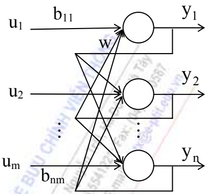

Hình 5.5: Mạng phản hồi một lớp

## Các mạng nơ ron phản hồi

Đưa phản hồi ngược vào cấu trúc mạng nơron tạo một mạng động (dynamic) với một số điểm ổn định. Trong trường hợp tổng quát, mô hình mạng động mô tả như sau:

$$
\begin{array}{l} \mathrm{x(t) = F(x(t), u(t), \theta),} \\ \mathrm{y(t) = G(x(t), \theta)} \end{array}\tag{5.21}
$$

trong đó: x(t) là trạng thái; u(t) là các đầu vào ngoài; θ là tham số; F(.) là hàm mô tả cấu trúc; G(.) là hàm mô tả quan hệ giữa biến trạng thái và đầu ra.

Mạng phản hồi (recurrent) đầu tiên được Kohonen, Anderson và Nakano đề ra từ những năm 1972. Hopfield đã hiệu chỉnh sơ đồ học của nó, trong đó các thông tin về trọng đảm bảo các trạng thái nhớ, ứng với các điểm cực tiểu. Các điểm cực tiểu dùng làm bộ nhớ địa chỉ theo nội dung (CAM: Content Address Memory) nhằm giải quyết bài toán nhận mẫu (nhận dạng tĩnh). Các mẫu chắc chắn được dùng làm các điểm cân bằng. Các sai số giữa đầu vào so với mẫu phải nằm trong vùng hấp dẫn. Theo quan điểm của vật lý về spin glass hệ động học như vậy được tạo ra, trong đó hệ mạng gắn liền với tập các mẫu được đưa vào từ trước. Nếu toàn bộ không gian làm việc được phân vùng theo CAM thì điều kiện ban đầu ứng với các mẫu chuẩn là nghiệm trạng thái dừng ứng với các mẫu. Tiếp theo chúng ta xem xét hai mạng Hopfield là loại mạng một lớp phản hồi được sử dụng rất nhiều trong thực tế.

## Mạng Hopfield rời rạc

Hopfield là một nhà vật lý đã đề xuất hai loại mạng nổi tiếng. Mạng Hopfield đầu tiên là mạng nơ ron phản hồi một lớp dạng rời rạc với hàm kích hoạt (1982) [4] phi tuyến dạng bước nhảy :

$$
\mathrm{x} _ {\mathrm{i}} (\mathrm{t}) = \sum_ {\mathrm{j} = 1} ^ {\mathrm{n}} \mathrm{w} _ {\mathrm{ij}} \mathrm{y} _ {\mathrm{j}} (\mathrm{t}) - \mathrm{I} _ {\mathrm{i}} \quad \mathrm{i}, \mathrm{j} = 1, \dots , \mathrm{n}\tag{5.22}
$$

$$
\mathrm{y} _ {\mathrm{i}} (\mathrm{t} + 1) = \left\{ \begin{array}{l l} \mathrm{g} (\mathrm{x} _ {\mathrm{i}} (\mathrm{t})), & \text {neu x} _ {\mathrm{i}} (\mathrm{t}) \neq 0, \mathrm{i} = \mathrm{p} \\ \mathrm{y} _ {\mathrm{i}} (\mathrm{t}), & \text {neu x} _ {\mathrm{i}} (\mathrm{t}) = 0, \mathrm{i} \neq \mathrm{p} \end{array} \right.\tag{5.23}
$$

<!-- page: 128 -->

với $\mathrm { p }$ là phần tử chọn ngẫu nhiên được tính, $\mathbf { p }   =   1 \mathrm { , . . . , } \mathbf { n }$ , và hàm quan hệ vào ra:

$$
g (x _ {i} (t)) = \left\{ \begin{array}{l l} 1 & \text {neéu x} _ {\mathrm{i}} (t) \geq 0 \\ 0 & \text {neéu x} _ {\mathrm{i}} (t) <   0 \end{array} \right.\tag{5.24}
$$

Luật Hebb được dùng $\mathsf { d } \hat { \mathsf { e } }$ mã hoá P mẫu; yk, $\mathrm { k } { = } 1 { , } . . . { , } \mathrm { P }$ là các điểm cân bằng của hệ được mô tả từ (1-22) đến (1-24) bằng cách chọn các trọng số theo luật sau:

$$
\mathrm{W} _ {\mathrm{ij}} = \left\{ \begin{array}{l l} \sum_ {\mathrm{p} = 1} ^ {\mathrm{h}} \left(2 \mathrm{y} _ {\mathrm{p}, \mathrm{i}} - 1\right) \left(2 \mathrm{y} _ {\mathrm{p}, \mathrm{j}} - 1\right) & \text {neu i} \neq \mathrm{j} \\ 0 & \text {neu i} = \mathrm{j} \end{array} \right.\tag{5.25}
$$

$$
\mathrm{I_i} = \frac {1}{2} \sum_ {\mathrm{j=1}} ^ {\mathrm{n}} \mathrm{w_{ij}}\tag{5.26}
$$

$\dot { \mathrm { o } }$ đây, h là $s \hat { 0 }$ mẫu. Để xác định tính ổn định của mạng, Hopfield nêu hàm năng lượng mạng (hay hàm thế năng):

$$
\mathrm{E} (\mathrm{y}) = - \frac {1}{2} \sum_ {\mathrm{i} = 1} ^ {\mathrm{n}} \sum_ {\mathrm{j} = 1} ^ {\mathrm{n}} \mathrm{a} _ {\mathrm{ij}} \mathrm{y} _ {\mathrm{i}} \mathrm{y} _ {\mathrm{j}} + \sum_ {\mathrm{i} = 1} ^ {\mathrm{n}} \mathrm{I} _ {\mathrm{i}} \mathrm{y} _ {\mathrm{i}}\tag{5.27}
$$

Nếu $\mathrm { W i i { = } 0 }$ và $\mathbf { W } \mathbf { \ddot { j } = } \mathbf { W } \mathbf { \ddot { j } } \mathbf { \ddot { i } }$ thì mỗi thay đổi không đồng bộ của yp năng lượng sẽ giảm phù hợp theo:

$$
\Delta \mathrm{E} = - \left[ \mathrm{y} _ {\mathrm{p}} (\mathrm{t} + 1) - \mathrm{y} _ {\mathrm{p}} (\mathrm{t}) \right] \left[ \sum_ {\mathrm{j} = 1} ^ {\mathrm{n}} \mathrm{a} _ {\mathrm{pj}} \mathrm{y} _ {\mathrm{j}} - \mathrm{w} _ {\mathrm{p}} \right]\tag{5.28}
$$

Độ suy giảm của hàm năng lượng tiến về 0, mạng ổn định.

## Mạng phản hồi tổng quát

Cohen và Grossberg đã nêu mô hình tổng quát $\mathrm { v } \dot { \hat { \mathrm { e } } }$ mạng phản hồi và chứng minh tính ổn định của nó. Cohen và Grossberg xét một hệ bất kỳ:

$$
\frac {d x _ {i}}{d t} = a _ {i} (x _ {i}) \left[ b _ {i} (x _ {i}) - \sum_ {k = 1} ^ {n} c _ {i k} d _ {k} (x _ {i}) \right]\tag{5.29}
$$

trong đó $\mathbf { a } _ { \mathrm { i } } ( \mathbf { x } _ { \mathrm { i } } )   >   0 _ { \mathrm { j } }$ bi(xi) là các hàm liên tục, dk(xi) khả vi, đơn điệu không giảm. Các hệ số $\mathbf { c } _ { \mathrm { i k } } \geq 0$ , đối xứng và thoả mãn một số giả thiết thì tồn tại hàm Liapunov:

$$
\mathrm{V(x)} = - \sum_ {\mathrm{i} = 1} ^ {\mathrm{n}} \int_ {0} ^ {\mathrm{x} _ {\mathrm{i}}} \mathrm{b} _ {\mathrm{i}} (\xi) \mathrm{d} _ {\mathrm{i}} (\xi) \mathrm{d} \xi_ {\mathrm{i}} + \frac {1}{2} \sum_ {\mathrm{j}, \mathrm{k} = 1} ^ {\mathrm{n}} \mathrm{c} _ {\mathrm{jk}} \mathrm{d} _ {\mathrm{j}} (\mathrm{x} _ {\mathrm{j}}) \mathrm{d} _ {\mathrm{k}} (\mathrm{x} _ {\mathrm{k}})\tag{5.30}
$$

xác định dương và đạo hàm của nó

<!-- page: 129 -->

$$
\frac {\mathrm{d}}{\mathrm{dt}} \mathrm{V} (\mathrm{x}) = - \sum_ {\mathrm{k} = 1} ^ {\mathrm{n}} \mathrm{a} _ {\mathrm{i}} (\mathrm{x} _ {\mathrm{i}}) \mathrm{d} _ {\mathrm{i}} (\mathrm{x} _ {\mathrm{i}}) \left[ \mathrm{b} _ {\mathrm{i}} (\mathrm{x} _ {\mathrm{i}}) - \sum_ {\mathrm{k} = 1} ^ {\mathrm{n}} \mathrm{c} _ {\mathrm{ik}} \mathrm{d} _ {\mathrm{k}} (\mathrm{x} _ {\mathrm{k}}) \right] ^ {2} \frac {d V (x)}{d t} \leq 0:\tag{5.31}
$$

Đối với các hệ kỹ thuật, các điều kiện của định lý này khó thực hiện. Bởi vậy, mô hình ít được thoả mãn trong thực tế. Loại mô hình khác, mô hình Hopfield liên tục, đã được thực hiện bằng các mạch điện dạng hoặc các vi mạch tích hợp mật độ cao VLSI và đã có nhiều ứng dụng.

## Mạng Hopfield liên tục

Năm 1984 trên cơ sở mô hình rời rạc, Hopfield đã nêu mô hình nơron phản hồi liên tục được mô tả luật tác động bằng tập các phương trình vi phân sau:

$$
C _ {i} \frac {d x _ {i}}{d t} = - \frac {x _ {i}}{R _ {i}} + \sum_ {j = 1} ^ {n} w _ {i j} y _ {j} + I _ {i}\tag{5.32}
$$

$$
\mathrm{y} _ {\mathrm{i}} = \mathrm{g} _ {\mathrm{i}} (\mathrm{x} _ {\mathrm{i}}); \quad \mathrm{vàx} _ {\mathrm{i}} = \mathrm{g} _ {\mathrm{i}} ^ {- 1} (\mathrm{y} _ {\mathrm{i}}).\tag{5.33}
$$

trong đó: Ci, Ri, Ii là các hằng số, $\mathbf { i } = 1 , . . . , \mathbf { n } ;$ wij là trọng liên kết phần tử nơron thứ j tới nơron thứ i; xi là trạng thái thứ i của mạng; gi(.) là hàm sigmoid, tức là khả vi, bị chặn và đơn điệu tăng. Hopfield đã nêu hàm Liapunov hay hàm năng lượng mạng:

$$
\mathrm{V} = - \frac {1}{2} \sum_ {\mathrm{i} = 1} ^ {\mathrm{n}} \sum_ {\mathrm{j} = 1} ^ {\mathrm{n}} \mathrm{w} _ {\mathrm{ij}} \mathrm{y} _ {\mathrm{i}} \mathrm{y} _ {\mathrm{j}} + \sum_ {\mathrm{i} = 1} ^ {\mathrm{n}} \left(1 / \mathrm{R} _ {\mathrm{i}}\right) \int_ {0} ^ {\mathrm{y} _ {\mathrm{i}}} \mathrm{g} _ {\mathrm{i}}
$$

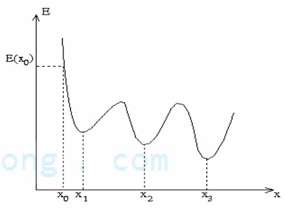

(5.34)

và đã chứng minh tính ổn định của mạng theo Hình 5.6: Năng lượng mạng E(x) tiêu chuẩn ổn định của Liapunov:

$$
\mathrm{dV} / \mathrm{dt} \leq 0\tag{5.35}
$$

Từ (5.35) cho thấy hệ luôn ổn định, sau một khoảng thời gian chuyển động trong không gian trạng thái, đạt cực tiểu trong miền V và dừng ở điểm đó với $\mathrm{dV} / \mathrm{dt} = 0, \mathrm{dy}_{\mathrm{i}} / \mathrm{dt} = 0$ tức yi=const với mỗi i. Với hệ này tồn tại nhiều điểm cân bằng ứng với mức năng lượng cực tiểu (hay là đáy năng lượng) trên một siêu phẳng năng lượng của siêu diện n chiều. Giả sử các mẫu vào (input patterns) tuỳ ý được đưa vào hệ như trạng thái ban đầu, hệ sẽ đạt đến điểm cân bằng gần nhất ứng với điểm ổn định. Hình 5.6 cho thấy một phác hoạ ngắn gọn về năng lượng của hệ E(x). Nếu E(x) là một hàm vô hướng của x với các cực tiểu địa phương, các điểm cực tiểu địa phương này được gắn vào mạng làm các đặc trưng xử lý thông tin. Nếu hệ thống xuất phát ở trạng thái ban đầu x(0), thì theo thời gian hệ trượt xuống đáy năng lượng của điểm cực tiểu gần nhất.

Với đặc trưng như vậy, mạng Hopfield có khả năng dùng làm một bộ nhớ các mẫu lệnh, để sau đó có thể gọi lại. Dựa trên nguyên lý đó, mạng Hopfield cũng có thể dùng trong hệ nhận dạng các tham $s \hat { \hat { 0 } } _ { z }$ làm các bộ suy diễn mờ (fuzzy interference) trong điều khiển thông minh, giải các bài toán tối ưu. Trong những mạng thuộc nhóm phản hồi còn có các mô hình mạng khác như: máy Bolzmann, Mc.Culloch-Pitts...

**Mạng nơron tự tổ chức: (Self-Organizing Feature Maps)**

<!-- page: 130 -->

Con người có khả năng sử dụng những kinh nghiệm quá khứ để thích nghi với những thay đổi của môi trường. Sự thích nghi đó không cần người hướng dẫn hoặc chỉ đạo từ bên ngoài. Mạng nơron nhân tạo thực hiện theo nguyên lý đó gọi là mạng tự tổ chức. Kohonen đã nêu lên loại mạng với tên gọi đặc trưng là tự tổ chức. Trong mạng tự tổ chức, tại một thời điểm chỉ có một tế bào nơron hoặc một nhóm nơron cục bộ cho đáp ứng đối với đầu vào tại thời điểm đó. Mạng có một lớp đơn như là một lớp đầu vào. Các trọng của mạng được mã hoá tương ứng với các mẫu đầu vào. Các ánh xạ đặc trưng được sử dụng nhiều trong nhận mẫu, điều khiển rô bốt và điều khiển quá trình. Mức tác động của mỗi nơron được tính theo tích của véc tơ vào và véc tơ trọng

$$
\mathrm{x_i} = \mathrm{UW_i}\tag{5.36}
$$

trong đó: xi là trạng thái (mức tác động) của nơron thứ i; Wi là véc tơ trọng của phần tử nơron thứ i; U là véc tơ vào.

Gần đây, vài mô hình mới như Fourier, Gabor ứng với các dạng hàm phi tuyến cũng được sử dụng. Những mạng này thường là tổ hợp của các loại mạng khác nhau hoặc là phát triển trên các loại mạng có sẵn.

## 5.2.4 Khả năng ứng dung của mạng nơ ron

Khó khăn nhất trong ứng dụng mạng nơ ron nhân tạo trong mấy chục thập kỷ qua là hạn chế về mặt công nghệ và tốc độ tính toán. Cấu trúc mạng nơron đòi hỏi hàng nghìn, hàng vạn liên kết và số lượng tính toán lớn cho nên phức tạp cả về mặt cấu trúc (phần cứng) cả về mặt phần mềm. Ngày nay, với các chip với độ siêu tích hợp, tốc độ cao đã mở ra nhiều khả năng ứng dụng thực tế.

## 5.2.4.1 Các ứng dụng trong tin học

Trong vài chục thập niên trở lại đây, nhiều bộ xử lý trên cơ sở nguyên lý mạng nơ ron đã được hình thành. Những chế thử đầu tiên của Hopfield trên cơ sở các mạch tương tự đã hình thành từ những năm 1982. Ngày nay nhiều IC trên cơ sở nguyên lý của mạng nơ ron đã được sản xuất. Điển hình hiện nay đã có những hãng sản xuất các vi mạch với độ tích hợp cao được gọi là Bộ xử lý-nơron thay cho các bộ vi xử lý (kinh điển được dùng trong máy tính) chứa đến hàng trăm vạn phần tử tính toán-nơron và có khả năng ghép nối hàng chục bộ khác nhau. Các liên kết trong tính toán theo kiểu nơron đã đạt đến hàng tỷ trong một thời điểm. Nhiều bộ chương trình phát triển xử lý theo kiểu nơ ron đã được bán ra thị trường để giải các bài toán tối ưu, xử lý tín hiệu, nhận dạng tiếng nói, chữ viết, nhận mẫu, dự báo, đặc biệt là dự báo tài chính. Những đặc trưng chính của ứng dụng này chủ yếu dựa trên các nguyên lý xử lý nơ ron theo tập mẫu thay vì xử lý từng bước của máy tính kinh điển. Nói cách khác các xử lý mang tính song song.

\+ Nhận dạng. Nhiều kiến trúc và thuật toán theo kiểu nơron được dùng để nhận dạng cấu trúc và tham số, đặc biệt là các mạng nơ ron truyền ngược. Chang, Zhang và Sami cho biết mạng Hopfield cũng có thể kết hợp với mạng Gabor để nhận dạng hệ phi tuyến có những kết quả khả quan. Trong trường hợp này, mạng bao gồm ba lớp. Lớp thứ nhất gọi là bộ tạo hàm sử dụng mạng Gabor để tạo hàm phi tuyến. Lớp thứ hai dùng mạng Hopfield để tối ưu các hệ số trọng chưa biết. Lớp thứ ba được gọi là mạng điều khiển để tính sai số ước lượng và điều khiển hoạt động của các lớp mạng thứ nhất và lớp thứ hai. Hệ không yêu cầu phải ổn định tiệm cận mà chỉ cần các đầu vào-ra giới hạn và ổn định đối với các kết quả được coi là hợp lý theo miền vào-ra lớn. Thành công của phương pháp ở chỗ đã đạt được lý luận của phương pháp và cho kết quả mô phỏng. Các ứng dụng này đang mở ra một tương lai phát triển của các máy tính thế hệ thứ năm: thế hệ máy

<!-- page: 131 -->

tính ở đó các quá trình vào ra dữ liệu không thủ công bằng tay mà bằng ngôn ngữ, hình ảnh với khả năng nhận dạng đạt độ chính xác chấp nhận được

\+ Mạng nơron nhân tạo có thể sử dụng làm bộ biến đổi A/D. Ta có thể xây dựng mạng Hopfield một lớp có bốn nơron với các đầu vào ngoài x=[x0, x1, x2, x3], các đầu ra y=[y0, y1, y2, y3] cho bộ biến đổi A/D bốn bit. Thành công này của Hopfield từ 1984 đã chứng minh một cách tiếp cận mới trong việc biến đổi các giá trị tương tự sang số theo nguyên lý “não người” thay cho các phần cứng hoặc phần mềm kinh điển.

\+ Nhận mẫu ký tự. Các mạng nơron đã được nhiều tác giả nghiên cứu ứng dụng trong xử lý chữ viết, như: nhận dạng ký tự, nhận dạng chữ viết, nhận dạng tiếng nói và ảnh. Viện CNTT trong khuôn khổ dự án kết hợp với Công ty Fuzisju (Nhật) cũng đã bắt đầu ứng dụng công nghệ này cho nhận mẫu chữ tiếng Việt viết tay. Phần 3 và 4 trong nghiên cứu này sẽ trình bày ứng dụng mạng “Nhớ liên kết hai chiều: BAM) để nhận dạng ký tự tiếng Việt.

\+ Nhận dạng ảnh. Trong các lĩnh vực nghiên cứu về hình ảnh cũng được các tác giả sử dụng mạng nơron để xử lý hình ảnh như nhận dạng, xử lý.

\+ Thực hiện các thuật toán tối ưu. Ngay sau khi đề xuất các kiến trúc và thuật học, năm 1986 Hopfield cùng với Tank đã ứng dụng mạng giải bài toán tối ưu tìm đường đi ngắn nhất thay cho thuật toán Tin học kinh điển “Người bán hàng”. Với phương tiện giải quyết bằng phần cứng trên các chip nơron hoặc phần mềm theo thuật học mạng nơron, phương pháp này đã bước vào kỷ nguyên ứng dụng mạng nơron cho những bài toán khác tương tự như bài toán định tuyến tối ưu (sẽ trình bày ở phần sau)

## 5.2.4.2 Các ứng dụng trong viễn thông

\+ Nhận dạng, mô hình hoá kênh phi tuyến. Mạng nơron đã dần được một số tác giả như Mohamed Ibnkahia ứng dụng vào các lĩnh vực truyền thông: nhận dạng kênh, mô hình hoá kênh, mã hoá và giải mã, hiệu chỉnh kênh, phân tích phổ, lượng tử hoá véc tơ... Ở đây các mạng nơron truyền thẳng, phản hồi, mạng tự tổ chức được ứng dụng trong các lĩnh vực phù hợp. Ví dụ mạng Perceptron nhiều lớp với thuật học lan truyền ngược đã được sử dụng để nhận dạng và điều khiển hệ thống tự động dẫn đường bay cho ngành hàng không...

\+ Ứng dụng trong ATM (sẽ trình bày ở phần 3 và 4). Atsush đã đề xuất bộ điều khiển mạng viễn thông ATM trên cơ sở mạng nơ ron truyền ngược để học mối quan hệ giữa lưu lượng thực tế và chất lượng dịch vụ. Phương pháp học bảng mẫu được đề xuất để học các mối quan hệ đó.

## 5.2.4.3 Ứng dụng mạng nơ ron trong xử lý tín hiệu

Mạng BAM được sử dụng để xử lý tín hiệu điều khiển [6]. Mạng có hai lớp (Hình 5.7), lớp vào có n phần tử x1, x2,...,xn; lớp ra có m phần tử y1, $\mathrm { y } 2 \mathrm { , . . . , } \mathrm { y m }$ Ma trận trọng có kích thước m×n. Phương trình trạng thái phần tử thứ i lớp y có thể mô tả như sau (i=1,...,n, k: bước lặp):

<!-- page: 132 -->

$$
\mathrm{y} _ {\mathrm{i}} (\mathrm{k} + 1) = \left\{ \begin{array}{l l} 1 & \text {neu y} _ {\mathrm{i}} ^ {*} (\mathrm{k} + 1) > 0 \\ \mathrm{y} (\mathrm{k}) & \text {neu y} _ {\mathrm{i}} ^ {*} (\mathrm{k} + 1) = 0; \\ 0 & \text {neu y} _ {\mathrm{i}} ^ {*} (\mathrm{k} + 1) <   0 \end{array} \right.
$$

$$
\mathrm{y} _ {\mathrm{i}} ^ {*} (\mathrm{k}) = \sum_ {\mathrm{j} = 1} ^ {\mathrm{n}} \mathrm{w} _ {\mathrm{ij}} \mathrm{x} _ {\mathrm{j}}\tag{5.37}
$$

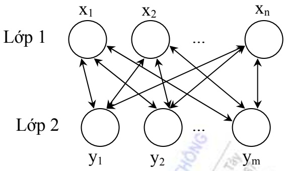

Phương trình trạng thái phần tử thứ i lớp x:

Hình 5.7: Mạng BAM 2 lớp

$$
\mathrm{x} _ {\mathrm{i}} (\mathrm{k} + 1) = \left\{ \begin{array}{l l} 1 & \text {neu x} _ {\mathrm{i}} ^ {*} (\mathrm{k} + 1) > 0 \\ \mathrm{x} _ {\mathrm{i}} (\mathrm{k}) & \text {neu x} _ {\mathrm{i}} ^ {*} (\mathrm{k} + 1) = 0; \\ 0 & \text {neu x} _ {\mathrm{i}} ^ {*} (\mathrm{k} + 1) <   0 \end{array} ; \right.
$$

$$
\mathrm{x} _ {\mathrm{i}} ^ {*} (\mathrm{k}) = \sum_ {\mathrm{j} = 1} ^ {\mathrm{m}} \mathrm{y} _ {\mathrm{j}} \mathrm{w} _ {\mathrm{ji}}\tag{5.38}
$$

Quá trình điều chỉnh được tiến hành đồng bộ khi tất cả các nơron xuất hiện ở cùng một chu kỳ tính, hoặc cập nhật không đồng bộ khi từng tập con cập nhật ở từng thời điểm. Hàm năng lượng được sử dụng (T là ký hiệu chuyển vị), mạng ổn định sau một thời gian

$$
\mathrm{E} = - \mathbf {Y W X} ^ {\mathrm{T}}\tag{5.39}
$$

Luật cập nhật là luật Hebb hay luật tích ngoài để mã hoá liên kết $\{ \mathrm { X i } , \mathrm { Y i } \}$ trong mạng BAM bằng cách đổi mô tả véc tơ nhị phân thành mô tả lưỡng cực 0 đến 1. Giả sử các véc tơ cột Ai và Bi có giá trị lưỡng cực thì ma trận trọng W được cho:

$$
\mathrm{W} = \mathrm{B} _ {1} ^ {\mathrm{T}} \mathrm{A} _ {1} + \mathrm{B} _ {2} ^ {\mathrm{T}} \mathrm{A} _ {2} + \dots + \mathrm{B} _ {\mathrm{q}} ^ {\mathrm{T}} \mathrm{A} _ \mathrm{q}\tag{5.40}
$$

Bài toán tách lỗi với mạng BAM được dùng như một ánh xạ từ không gian đầu vào đến không gian đầu ra. Chúng ta định nghĩa ba véc tơ vào và ra theo bảng:

| Véc tơ vào | Véc tơ ra | Véc tơ vào | Véc tơ ra |
| --- | --- | --- | --- |
| A=(1 0 1 0 1) | L = (1 1 1 1) | A'=( 1 -1 1 -1 1) | L' = (1 1 1 1) |
| B= (1 0 1 0 0) | M = (0 1 1 0) | B'=(1 -1 1 -1 -1) | M'= (-1 1 1 -1) |
| C= (0 1 0 1 1) | N = (1 0 0 1) | C'=(-1 1 -1 1 1) | N' = (1 -1 -1 1) |

$$
\text {than cong . com}
$$

Để mã hoá với việc sử dụng luật Hebb thì các véc tơ cần được đổi thành dạng có giá trị nhị phân đổi dấu (xem bảng trên bên phải).

Tổng các tích ngoài của các véc tơ này cho ma trận trọng W

$$
\mathrm{W} = \mathrm{L} ^ {\prime \mathrm{T}} \mathrm{A} ^ {\prime} + \mathrm{M} ^ {\prime \mathrm{T}} \mathrm{B} ^ {\prime} + \mathrm{N} ^ {\prime \mathrm{T}} \mathrm{C} ^ {\prime} = \left[ \begin{array}{c c c c c} - 1 & 1 & - 1 & 1 & 3 \\ 3 & - 3 & 3 & - 3 & - 1 \\ 3 & - 3 & 3 & - 3 & - 1 \\ - 1 & 1 & - 1 & 1 & 3 \end{array} \right]
$$

<!-- page: 133 -->

Từ (5.39) và (5.40) nếu đưa vào véc tơ A thì có L, ngược lại đưa L thì có A

$$
\begin{array}{l}\mathrm{AW} ^ {\mathrm{T}} = (1 \quad 5 \quad 5 \quad 1) \quad \rightarrow (1 \quad 1 \quad 1 \quad 1) = \mathrm{L}\\\mathrm{LW} = (4 \quad - 4 \quad 4 \quad - 4 \quad 4) \quad \rightarrow (1 \quad 0 \quad 1 \quad 0 \quad 1) = \mathrm{A}\end{array}
$$

Điều đó chứng tỏ nếu có một mẫu vào như là một véc tơ A mạng BAM xử lý và gọi ra mẫu như là một véc tơ L. Mạng BAM lúc đó như là một bộ nhớ liên kết W, nhớ các tình huống theo phương trình (1.38) và các giá trị của nó thể hiện trên ma trận bằng số như đã tính ở trên.

Để thể hiện khả năng chỉnh lỗi cho véc tơ vào $\mathrm{A} + \delta_{\mathrm{ strong~d}\delta} = (0 \quad 1 \quad 0 \quad 0)$ lỗi một bit thì véc tơ ra sẽ vẫn là:

$$
(\mathrm{A} + \delta) ^ {\mathrm{T}} \mathrm{W} = (2 \quad 2 \quad 2 \quad 2) \rightarrow (1 \quad 1 \quad 1 \quad 1) = \mathrm{L}
$$

Ví dụ này cho biết mạng nơ ron khá “thông minh” có khả năng nhận mẫu với sai số trong miền nhỏ cho phép.

## KẾT LUẬN

Phần này trình bày các mô hình noron sinh vật làm cơ sở cấu trúc cho mô hình nơ ron nhân tạo. Đối với mô hình nơ ron nhân tạo có bốn vấn đề lớn cần được quan tâm:

• Các kiểu liên kết đầu vào (tuyến tính, phi tuyến)

• Các loại hàm truyền được chọn

• Các hàm tương tác đầu ra cần xác định

• Các cách liên kết (truyền thẳng, phản hồi, một hoặc nhiều lớp)

Từ cách chọn đó, hàng loạt các cấu trúc mạng nhân tạo đựơc nghiên cứu và sáng tạo nhằm giải quyết các bài toán khoa học và kỹ thuật. Các thiết bị cứng, các chương trình, bộ công cụ phát triển mềm đã được sản xuất.

Không thể không nói đến các luật học của mạng nơ ron. Những luật học sẽ đề cập đến ở phần ba. Các chương trình mô phỏng sẽ đề cập đến ở phần bốn.

## 5.3. LOGIC MỜ

Ngành khoa học của logic mờ, hệ mờ và mô hình mờ đã có sự thành công vượt bậc và có nhiều ứng dụng thực tế. Quá trình xử lý thông tin dựa trên lý thuyết logic mờ đòi hỏi khối lượng tính toán lớn và do đó thời gian tính toán trở nên quan trọng. Các công trình khoa học gần đây đã ghi nhận những nỗ lực nghiên cứu của các tổ chức về logic mờ nhằm mục đích phát triển phần cứng hiện đại cho việc thực hiện logic mờ nhanh hơn. Ngoài ra, nhiều nhà cung cấp đã đưa ra các

giải pháp kết hợp phần cứng và phần mềm lại để phát triển hệ mờ. Những ứng dụng cho tin học và viễn thông là tương đối khó khăn đối với hệ mờ song một số cố gắng như trình bày dưới đây đã được áp dụng.

## 5.3.1. Các khái niệm cơ bản

## a. Khái niệm tập mờ

Trong lý thuyết về tập hợp kinh điển đã nêu lên các định nghĩa về tập hợp, về các phép tính của các tập hợp như phép bù, hợp, giao, hiệu. Trong lôgic mờ cũng có

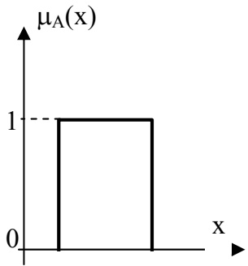

Hình 5.8: Hàm liên thuộc của tập kinh điển

<!-- page: 134 -->

những khái niệm và phép tính tương tự. Trước tiên, ta xem xét sự khác nhau giữa tập mờ và tập hợp kinh điển thông qua khái niệm hàm liên thuộc. Hàm liên thuộc $\mu \mathrm { A }$ của tập hợp kinh điển A được định nghĩa là:

$$
\mu_ {\mathrm{A}} (\mathrm{x}) = \left\{ \begin{array}{l l} 1 & \quad \text {neu x\in A} \\ 0 & \quad \text {neu x\notin A} \end{array} \right.
$$

Như vậy, hàm liên thuộc chỉ có hai giá trị chính xác là 0 và 1 như Hình 5.8. Do vậy nếu ta đã biết tập hợp A thì cũng xác định được hàm liên thuộc $\mu \mathrm { A } ( \mathrm { x } )$ của nó và ngược lại.

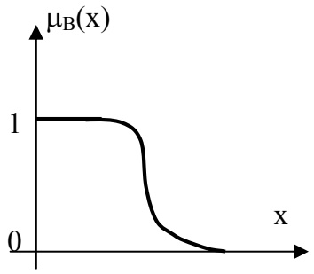

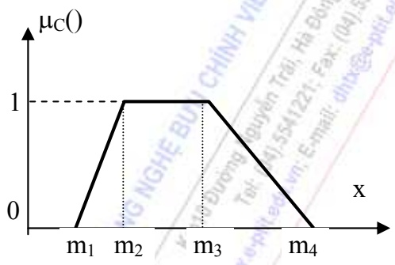

b,

Hình 5.9: Hàm liên thuộc của tập mờ.

Trong lôgic mờ, vấn đề này lại khác. Hàm liên thuộc của tập mờ không chỉ nhận 2 giá trị là 0 và 1 mà là toàn bộ các giá trị từ 0 đến 1 tức là $0 \leq \mu_{\mathrm{B}}(\mathrm{x}) \leq 1$ Trên Hình 5.9 là hai hàm liên thuộc của hai tập mờ B và C. Như vậy ở lôgic mờ không có sự suy luận thuận ngược như với tập hợp kinh điển. Vì vậy, trong định nghĩa tập mờ phải nêu thêm về hàm liên thuộc này do vai trò của nó là làm rõ ra chính tập mờ đó.

## b. Định nghĩa tập mờ

Tập mờ F xác định trên tập kinh điển M là một tập mà mỗi phần tử của nó là một cặp các giá trị $( \mathbf { x } , \mu \mathbf { f } \left( \mathbf { x } \right) )$ , trong đó x∈M và μf là ánh xạ $\mu_{f}:M\to[0,1]$ . Ánh xạ μf được gọi là hàm liên

thuộc (phụ thuộc) của tập mờ F. Tập kinh điển M được gọi là cơ sở của tập mờ F.

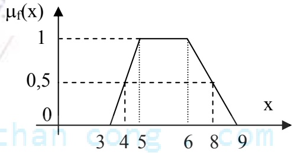

Các hàm liên thuộc $\mu _ { \mathrm { f } } ( \mathrm { x } )$ có dạng trơn như Hình bên gọi là hàm liên thuộc kiểu S. Đối với các hàm liên th kiể S d á ô thứ biể ễ di n $\mathbf { \mu } _ { \mathrm { f } } ( \mathbf { x } )$ c ộ p c tạp n, n n ó đ hứ lớ ê

uộc u , o c c c ng c u **Hình 5.10**: Hàm liên thuộc có mức chuyển đổi tuyến tính

thời gian tính độ phụ thuộc cho một phần tử lâu. Vì vậy, trong kỹ thuật thông thường các hàm liên thuộc kiểu S được thay bằng các đoạn thẳng (tuyến tính từng đoạn).

Một hàm liên thuộc có dạng tuyến tính từng đoạn được gọi là hàm liên thuộc có mức chuyển đổi tuyến tính (Hình 5.10. Với hàm liên thuộc như Hình2.2b nếu $\mathrm{m}1 = \mathrm{m}2 \mathrm{v}\dot{\mathrm{a}} \mathrm{m}_{3} = \mathrm{m}_{4}$ thì nó chính là hàm liên thuộc của tập kinh điển.

<!-- page: 135 -->

Ví dụ: tập mờ F bao $\mathrm { g \dot { \hat { o } } m }$ các $\mathrm { s } \hat { \hat { 0 } }$ thực lớn hơn 3 và nhỏ hơn 9 có hàm liên thuộc gần đúng là hình thang như Hình 5.3.3 Từ hàm liên thuộc ta xác định được độ phụ thuộc (liên thuộc) của các số trong tập này: $\mu_{\mathrm{f}}(4)=0.5,\mu_{\mathrm{f}}(4,5)=0.75,\mu_{\mathrm{f}}(5)=1,\mu_{\mathrm{f}}(6)=1,\mu_{\mathrm{f}}(8)=0.5$

## c. Độ cao, miền xác định và miền tin cậy

Tuy nhiên, không phải bắt buộc các hàm liên thuộc phải có giá trị lớn nhất bằng 1. Ứng với điều đó thì không phải mọi hàm liên thuộc đều có độ cao bằng 1.

Độ cao của tập mờ F (định nghĩa trên cơ sở M) là giá trị:

$$
\mathrm{H} = \sup \mu \mathrm{f} (\mathrm{x}), \mathrm{x} \in \mathrm{M}
$$

nếu tập mờ có H=1 gọi là chính tắc, H luôn <1 là không chính tắc.

Miền xác định của tập mờ F (định nghĩa trên cơ sở M) ký hiệu bằng S, là tập con của M thoả mãn

$$
\mathrm{S} = \{\mathrm{x} \in \mathrm{M}; \mu_ {\mathrm{f}} (\mathrm{x}) > 0 \}
$$

Miền tin cậy của tập mờ F (định nghĩa trên cơ sở M), ký hiệu bằng T, là tập con của M thoả mãn

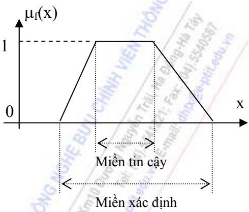

Hình 5.11: Miền xác định và miền tin cây của tập mờ

$$
\mathrm{T} = \{\mathrm{x} \in \mathrm{M}; \mu_ {\mathrm{f}} (\mathrm{x}) = 1 \}
$$

## 5.3.2. Các phép toán trên tập mờ

Tập mờ cũng có 3 phép toán cơ bản là phép hợp (tương đương phép OR), phép giao (tương đương phép AND) và phép bù (tương đương phép NOT).

## a. Phép hợp hai tập mờ:

Hợp của hai tập mờ A và B có cùng cơ sở M là một tập mờ cũng xác định trên cơ sở M với hàm liên thuộc:

$$
\mu_ {\mathrm{A} \cup \mathrm{B}} (\mathrm{x}) = \operatorname{MAX} \{\mu_ {\mathrm{A}} (\mathrm{x}), \mu_ {\mathrm{B}} (\mathrm{x}) \}
$$

Phép hợp của hai tập mờ thể hiện trên Hình5.12

Ngoài công thức trên còn có một số công thức khác để tính hàm liên thuộc của phép hợp hai tập mờ như: Phép hợp Lukasiewier, tổng Einstein, tổng trực tiếp

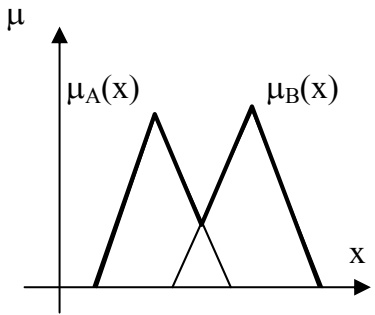

Hình 5:12 Phép hợp của hai tập mờ

\+ Phép hợp Lukasiewier: $\mu \mathrm{A} \cup \mathrm{B}(\mathrm{x}) = \min \left\{ 1, \mu \mathrm{A}(\mathrm{x}) + \mu \mathrm{B}(\mathrm{x}) \right\}$

\+ Tổng Einstein:

$$
\mu_ {\mathrm{A} \cup \mathrm{B}} (\mathrm{x}) = \frac {\mu_ {\mathrm{A}} (\mathrm{x}) + \mu_ {\mathrm{B}} (\mathrm{x})}{1 + \mu_ {\mathrm{A}} (\mathrm{x}) + \mu_ {\mathrm{B}} (\mathrm{x})}
$$

\+ Tổng trực tiếp:

$$
\mu \mathrm{A} \cup \mathrm{B} (\mathrm{x}) = \mu \mathrm{A} (\mathrm{x}) + \mu \mathrm{B} (\mathrm{x}) - \mu \mathrm{A} (\mathrm{x}) \mu \mathrm{B} (\mathrm{x})
$$

<!-- page: 136 -->

$$
\mu_ {\mathrm{A} \cup \mathrm{B}} (\mathrm{x}) = \left\{ \begin{array}{l l} \max \left\{\mu_ {\mathrm{A}} (\mathrm{x}), \mu_ {\mathrm{B}} (\mathrm{x}) \right\} & \text {neu} \min \left\{\mu_ {\mathrm{A}} (\mathrm{x}), \mu_ {\mathrm{B}} (\mathrm{x}) \right\} = 0 \\ 1 & \text {neu} \quad \min \left\{\mu_ {\mathrm{A}} (\mathrm{x}), \mu_ {\mathrm{B}} (\mathrm{x}) \right\} \neq 0 \end{array} \right.
$$

Nếu hai tập mờ không cùng cơ sở, tập mờ A với hàm liên thuộc $\mu \mathrm { A ( x ) }$ định nghĩa trên cơ sở M và tập mờ B với hàm liên thuộc $\mathbf { \mu { B } ( \mathrm { { x } ) } }$ định nghĩa trên cơ sở N thì ta đưa chúng về cùng một cơ sở bằng cách lấy tích của hai cơ sở đã có là (M×N). Ta ký hiệu tập mờ A là tập mờ định nghĩa trên cơ sở M×N và tập mờ B là tập mờ định nghĩa trên cơ sở M×N. Như vậy, hợp của hai tập mờ A và B tương ứng với hợp của hai tập mờ A và B kết quả là một tập mờ xác định trên cơ sở M×N với hàm liên thuộc:

$$
\mu_ {\underline {{\mathrm{A}}} \cup \underline {{\mathrm{B}}}} (\mathrm{x}, \mathrm{y}) = \operatorname{MAX} \{\mu_ {\underline {{\mathrm{A}}}} (\mathrm{x}, \mathrm{y}), \mu_ {\underline {{\mathrm{B}}}} (\mathrm{x}, \mathrm{y}) \}
$$

trong đó:

$$
\begin{array}{l l} \mu_ {\underline {{\mathrm{A}}}} (\mathrm{x}, \mathrm{y}) = \mu_ {\mathrm{A}} (\mathrm{x}) & \quad \text {Vói mọi y\in N và} \\ \mu_ {\underline {{\mathrm{B}}}} (\mathrm{x}, \mathrm{y}) = \mu_ {\mathrm{B}} (\mathrm{y}) & \quad \text {Vói mọi x\in M} \end{array}
$$

## b. Phép giao hai tập mờ:

Giao của hai tập mờ A và B có cùng cơ sở M là một tập mờ cũng xác định trên cơ sở M với hàm liên thuộc.

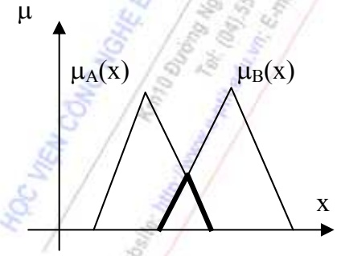

Hình 5.13: Phép giao của hai tập mờ

$$
\mu \mathrm{A} \cap \mathrm{B} (\mathrm{x}) = \operatorname{MIN} \{\mu \mathrm{A} (\mathrm{x}), \mu \mathrm{B} (\mathrm{x}) \}
$$

Phép giao của hai tập mờ được thể hiện trên Hình 5.13. Ngoài công thức trên còn có một số công thức tính khác để tính hàm liên thuộc của giao hai tập mờ như: Phép giao Lukasiewier, tích Einstein, tích đại $\mathrm { s } \hat { \hat { 0 } }$

$$
\begin{array}{l} + \text {Phép giao Lukasiewier:} \quad \mu \mathrm{A} \cap \mathrm{B} (\mathrm{x}) = \max \{\mathrm{0}, \mu \mathrm{A} (\mathrm{x}) \\ + \mu \mathrm{B} (\mathrm{x}) - 1 \} \\ + \text {Tích Einstein:} \\ \mu_ {\mathrm{A} \cap \mathrm{B}} (\mathrm{x}) = \frac {\mu_ {\mathrm{A}} (\mathrm{x}) + \mu_ {\mathrm{B}} (\mathrm{x})}{2 - \left(\mu_ {\mathrm{A}} (\mathrm{x}) + \mu_ {\mathrm{B}} (\mathrm{x})\right) - \mu_ {\mathrm{A}} (\mathrm{x}) \mu_ {\mathrm{B}} (\mathrm{x})} \\ + \text {Tích đại số:} \quad \mu \mathrm{A} \cap \mathrm{B} (\mathrm{x}) = \mu \mathrm{A} (\mathrm{x}) \mu \mathrm{B} (\mathrm{x}) \end{array}
$$

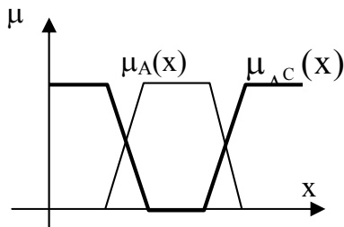

Hình 5.14.Phép bù của một tập mờ.

$$
\mu_ {\mathrm{A} \cap \mathrm{B}} (\mathrm{x}) = \left\{ \begin{array}{l l} \min \left\{\mu_ {\mathrm{A}} (\mathrm{x}), \mu_ {\mathrm{B}} (\mathrm{x}) \right\} & \text {neu} \max \left\{\mu_ {\mathrm{A}} (\mathrm{x}), \mu_ {\mathrm{B}} (\mathrm{x}) \right\} = 1 \\ 0 & \text {neu} \quad \max \left\{\mu_ {\mathrm{A}} (\mathrm{x}), \mu_ {\mathrm{B}} (\mathrm{x}) \right\} \neq 1 \end{array} \right.
$$

\* Nếu hai tập mờ không cùng cơ sở, tập mờ A với hàm liên thuộc $\mu \mathrm { A ( x ) }$ định nghĩa trên cơ sở M và tập mờ B với hàm liên thuộc $\mathbf { \mu { B } ( \mathrm { { x } ) } }$ định nghĩa trên cơ sở N thì ta đưa chúng về cùng một cơ sở bằng cách lấy tích của hai cơ sở đã có là (M×N). Ta ký hiệu tập mờ A là tập mờ định nghĩa trên cơ sở M×N và tập mờ B là tập mờ định nghĩa trên cơ sở M×N. Như vậy giao của hai tập mờ A và B tương ứng với giao của hai tập mờ A và B kết quả là tập mờ xác định trên cơ sở M×N với hàm liên thuộc:

<!-- page: 137 -->

$$
\mu_ {\underline {{\mathrm{A}}} \cap \underline {{\mathrm{B}}}} (\mathrm{x}, \mathrm{y}) = \operatorname{MIN} \{\mu_ {\underline {{\mathrm{A}}}} (\mathrm{x}, \mathrm{y}), \mu_ {\underline {{\mathrm{B}}}} (\mathrm{x}, \mathrm{y}) \}
$$

trong đó:

$$
\mu_ {\underline {{\mathrm{A}}}} (\mathrm{x}, \mathrm{y}) = \mu_ {\mathrm{A}} (\mathrm{x}) \quad \text {Với mọi y} \in \mathrm{N và} \mu_ {\underline {{\mathrm{B}}}} (\mathrm{x}, \mathrm{y}) = \mu_ {\mathrm{B}} (\mathrm{y}) \quad \text {Với mọi x} \in \mathrm{M}
$$

## c. Phép bù của một tập mờ:

Bù của tập mờ A có cơ sở M và hàm liên thuộc μA(x) là một tập mờ AC xác định trên cùng cơ sở M với hàm liên thuộc được thể hiện trên Hình 5.14 trong đó:

$$
\mu_ {\mathrm{A} ^ {\mathrm{C}}} (\mathrm{x}) = 1 - \mu_ {\mathrm{A}} (\mathrm{x})
$$

## 5.3.3. Biến ngôn ngữ

Biến ngôn ngữ là một biến có thể gán các từ trong ngôn ngữ cho giá trị của nó. $\dot { \mathrm { o } }$ đây các từ được đặc trưng bởi định nghĩa tập mờ trong miền xác định mà ở đó biến được định nghĩa.

Các biến ngôn ngữ chuẩn hoá thường dùng là: âm lớn NB (negative big), âm trung bình NM (negative medium), âm nhỏ NS (negative small), không Z (zero), dương nhỏ PS (positive small), dương trung bình PM (positive medium), dương lớn PB (positive big). Với trường hợp tối giản có thể biến ngôn ngữ chỉ gồm: âm N, không Z và dương P.

Biến ngôn ngữ chỉ cần thiết trước tiên là cho quá trình mờ hoá (Fuzzifiezs) các giá trị rõ của đầu vào các bộ điều khiển mờ, sau là để chuẩn hoá các hàm liên thuộc khác nhau.

## 5.3.4 Các khả năng ứng dụng của Logic mờ

## 5.3.4.1 Các ứng dụng trong điều khiển

Gasos và các cộng sự đề xuất một hệ thống mờ cho các robot di động tự hành. Trong hệ thống này các biến điều khiển (vận tốc, góc quay của tay lái) đều được tính toán nhanh bởi ba module dựa trên logic mờ. Hệ thống cho phép đạt tốc độ và gia tốc cực đại là: 0,6m/s và 0,4m/s2 mặc dù góc quay tay lái nằm trong phạm vi: 280÷280. Tốc độ chuyển tay lái cực đại là 80/s và thời gian lấy mẫu cực đại là: 0,25s.

Akahoshi giới thiệu bộ điều khiển logic mờ (FLC), điều khiển thành công quá trình tự động phóng to hay thu nhỏ tiêu cự của camera thấu kính phản xạ (SLR). Thiết bị hợp thành mờ thực hiện việc hợp thành sau vài mili giây với hai đầu vào, năm nhãn và hai luật điều khiển mờ và hàm liên thuộc được mô tả như là một bảng dùng 8 bit xếp loại và 16 bit kết hợp, thiết bị hợp thành mờ chiếm khoảng 500byte trong chương trình.

Zimmermann nghiên cứu về khả năng của động cơ khi đến tốc độ 80km/h dựa trên cơ sở những hiểu biết đã được xây dựng. Điều này cho thấy, nó hoàn toàn độc lập với bất kỳ thông tin bên ngoài nào. Động cơ dùng bộ transputer để tạo ra khả năng tính toán tương đương 40 MIPS/6 nhằm làm cho thiết bị hợp thành mờ nhanh hơn và thời gian tương tác dưới 10ms.

Marrtinez và Iamshidi đề xuất hệ thống mờ cho việc điều khiển tốc độ chạy không tải của xe ô tô. Điều này tạo ra sự cải tiến đáng kể liên quan đến hệ thống vòng mở và đạt được thời gian ổn định là 1,4s, độ quá tải 12%. Họ lưu ý rằng, trong khi hệ mờ tận dụng đầu ra và phát sinh từ vòng mở hồi tiếp thì trong mô hình hệ thống điều khiển Crisp PD, khi thời gian ổn định và thực hiện vượt quá giới hạn thì hệ thống mờ với chỉ một đầu ra sẽ đem lại thời gian ổn định tốt hơn nhưng chế độ làm việc quá tải xấu hơn.

## 5.3.4.2. Logic mờ trong mạng viễn thông

<!-- page: 138 -->

Hệ mờ đã được mô hình hoá bằng công cụ toán học để mô tả khả năng bền vững trong việc giải quyết những vấn đề không chính xác và không xác định trong thế giới thực. Các biến ngôn ngữ cho phép biểu diễn một miền các giá trị số dưới dạng thuật ngữ miêu tả đơn giản của hệ mờ. Thực tế hiện nay cho thấy các mạng thông tin trở nên phức tạp và động hơn nhiều, chứa đựng một độ bất định lớn trong mối quan hệ giữa lưu lượng thông tin đầu vào và các tham số môi trường khác, nảy sinh từ các sự cố lỗi, nhiễu và quá tải không mong muốn. Nó đi ngược lại mô hình phân tích chính xác, Fuzzy Logic (logic mờ) ra đời mở ra một hướng mới cho phép giải quyết nhiều bài toán quan trọng của mạng. Khả năng mô hình hoá mạng bằng các công thức toán học của hệ mờ thì cao hơn các giá trị rời rạc thông thường, cùng với việc mô phỏng hệ mờ tạo ra sự phối hợp nhịp nhàng giữa kiểu phân tích kinh điển

Bonde và Ghosh dùng biến hệ thống ngôn ngữ mềm để mô hình hoá việc sắp xếp các bộ đệm trong trạng thái chuyển mạch CELL. Họ đưa ra khái niệm ngưỡng mờ trước ổn định, quản lý bộ đệm thích nghi ở khía cạnh tương phản với ngưỡng thông thường, rời rạc và không ngụ ý rằng: có sự chuyển giao mềm dần dần giữa FULL hoàn toàn và FULL không hoàn toàn (riêng). Các giá trị liên thuộc được định nghĩa thông qua một hàm dạng “sigmoid” không đối ứng. Boude và Ghost đã nghiên cứu một nguyên lý cơ bản là: nguyên lý “underlying”; hoặc từ chối, hoặc là chấp nhận (cho phép) thâm nhập vào các CELL ví dụ như: từ các bộ chuyển đổi khác hay đến các bộ đệm chuyển đổi, từ việc kết hợp mô hình logic mờ và ngưỡng mờ.

Họ mô tả rằng, ngưỡng mờ là nguyên nhân gây ra việc sắp xếp bộ đệm để trình bày các hành vi “mềm” ví dụ như khả năng thích nghi điều kiện động và không ổn định tốt hơn, khả năng phục hồi mau lẹ với những thay đổi nhanh của lưu lượng mạng và chỉ ảnh hưởng tới việc loại bỏ tế bào.

Schefer và Knuicki giới thiệu kỹ thuật mô hình hoá dùng cho mạng dữ liệu gói. Phạm vi phân tích của họ bao gồm kỹ thuật giải tích, không giải tích và tham số như mạng Nơron, logic mờ, và hệ thồng Fractal. Nó được dùng để đánh độ chính xác độ trễ và tính năng không ổn định của quá trình thực hiện.

Tanaka và Hosaka: xem xét những khó khăn của các hàm liên thuộc đã có cho việc điều khiển mạng có hiệu quả trong việc quản lý cuộc gọi và định tuyến thông qua việc điều hưởng giá trị đầu vào và giá trị đạt được của mạng và giá trị tối ưu được chọn ra từ các giá trị này và cuối cùng đưa vào các bộ lưu.

## 5.3.4.3. Đề xuất những nghiên cứu về logic mờ trong mạng tốc độ cao

## a. Cấu trúc phần cứng mới cho việc tính toán mờ nhanh

Mặc dù logic mờ được triển khai thành công trong điều khiển máy móc công nghiệp, nó cũng đã có một số kết quả trong mạng viễn thông, nhưng cũng đặt ra một số thử thách. Mạng hiện tại và tương lai sẽ phát triển rất nhanh với việc chuyển mạch các gói có kích thước nhỏ ở tốc độ hàng Gb/s. Đối với tốc độ chuyển mạch ATM nhanh và mạng tốc độ cao khác (cần dùng phần cứng song song) và phạm vi chuyển mạch của các máy tính là rất nhỏ nên cần thực hiện hợp thành mờ trước khi xử lý các gói tin.

Catania và các cộng sự dự tính rằng kiến trúc VLSI mà ông đề xuất có thể đáp ứng các yêu cầu của lưu lượng thoại một cách dễ dàng. Nó đủ khả năng vượt qua yêu cầu của lưu lượng video, tại tốc độ 1 Mbps. Với các kết quả nghiên cứu được trình bày [ ] thì tỏ ra thành công trong các mạng đang hoạt động. Nó bắt buộc quá trình hợp thành mờ phải được thực hiện nhanh bởi các nút tính toán đồng bộ với quá trình xử lý gói. Mặc dù chi tiết về mạng được đề xuất bao gồm những

<!-- page: 139 -->

yêu cầu thực hiện vẫn chưa được xác định, song một hệ thống hợp lý yêu cầu mỗi nút phải thực hiện như quá trình hợp thành mờ, với các thông số được tính như sau:

Bốn đầu vào, năm đầu ra, năm ngôn ngữ cho mỗi đầu vào và mỗi đầu ra, phạm vi từ âm lớn, âm không đến dương và dương lớn,... tổng cộng có 20 hoặc nhiều hơn 20 luật và một hàm liên thuộc hình thang đối xứng. Hiện tại, có một cơ chế trong việc lựa chọn hai nguyên lý:

Tích hợp mô hình hợp thành mờ vào phần cứng chuyển mạch

Thiết kế và phát triển một hệ thống cứng/ mềm đồng xử lý để làm việc trong cấu trúc chuyển mạch cơ sở.

\+ Yêu cầu: nghiên cứu và đầu tư từ phía các công ty sản xuất mạng tốc độ cao.

\+ Bản thân nó có bốn sự lựa chọn phụ: dùng bộ xử lý chuẩn có sẵn, dùng bộ điều khiển mờ có hiệu quả thương mại, thiết kế bộ xử lý mờ VLSI hoặc dùng bộ đồng xử lý mờ tốc độ cao.

Tamakawa kết luận rằng: những nghiên cứu về các kiến trúc mới để thực hiện việc hợp thành mờ ở tốc độ cao và thấp thì vẫn được tiếp tục. Nhận ra hạn chế về mặt tốc độ của hệ thống phần cứng mờ hiện thời, Watanabe đã đề xuất việc phát triển bộ đồng xử lý hợp thành mờ cơ sở với ba yêu cầu cắt giảm chủ yếu:

• Giảm phần chỉ dẫn kiến trúc của hệ mờ từ việc xử lý thông tin mờ.

• Số lượng sơ đồ miêu tả hệ mờ.

• Phần cứng logic mờ được tổ chức như một đơn vị vec tơ.

## 5.3. GIẢI THUẬT DI TRUYỀN

Phần này trình bày những nghiên cứu và khả năng ứng dụng giải thuật di truyền để tối ưu cấu hình mạng nơron nhân tạo nhằm tăng hiệu quả nhận dạng tiếng nói của mạng.

## 5.3.1. Giải thuật di truyền

## 5.3.1.1. Nhiễm sắc thể

Các thuật giải di truyền (GAs: Genetic Algorithms) cũng như các thuật toán tiến hoá khác hình thành dựa trên quan niệm cho rằng quá trình tiến hoá tự nhiên là quá trình hợp lý, hoàn hảo. Tự nó đã mang tính tối ưu [12]. Quan điểm trên như một tiên đề, không chứng minh, nhưng phù hợp với thực tế khách quan.

Mục tiêu nghiên cứu của GAs có thể được khái quát như sau:

Trừu tượng hoá và mô phỏng quá trình thích nghi trong hệ thống tự nhiên.

Thiết kế phần mềm, chương trình mô phỏng, nhằm duy trì các cơ chế quan trọng của hệ thống tự nhiên.

Giải thuật di truyền sử dụng một số thuật ngữ của ngành di truyền học [12] như: nhiễm sắc thể, quần thể (Population), Gen.... Nhiễm sắc thể được tạo thành từ các Gen (được biểu diễn của một chuỗi tuyến tính). Mỗi Gen mang một số đặc trưng và có vị trí nhất định trong nhiễm sắc thể. Mỗi nhiễm sắc thể sẽ biểu diễn một lời giải của bài toán.

## 5.3.1.2. Các toán tử di truyền

## a. Toán tử sinh sản

<!-- page: 140 -->

Toán tử sinh sản gồm hai quá trình: quá trình sinh sản (phép tái sinh), quá trình chọn lọc (phép chọn).

## a.1. Phép tái sinh

Phép tái sinh là quá trình các nhiễm sắc thể được sao chép trên cơ sở độ thích nghi. Độ thích nghi là một hàm được gán giá trị thực, tương ứng với mỗi nhiễm sắc thể trong quần thể. Quá trình này, được mô tả như sau:

Xác định độ thích nghi của từng nhiễm sắc thể trong quần thể ở thế hệ thứ t, lập bảng cộng dồn các giá trị thích nghi (theo thứ tự gán cho từng nhiễm sắc thể). Giả sử, quần thể có n cá thể. Gọi độ thích nghi của nhiễm sắc thể i tương ứng là $f _ { i }$ , tổng cộng dồn thứ i là $f_{ti}$ được xác định bởi:

$$
f _ {t i} = \sum_ {j = 1} ^ {i} f _ {j}
$$

Gọi $F _ { n }$ là tổng độ thích nghi của toàn quần thể. Chọn một số ngẫu nhiên $f$ trong khoảng từ 0 tới $F _ { n }$ . Chọn cá thể thứ k đầu tiên thoả mãn $f \geq f_{t}$ đưa vào quần thể mới.

## a.2. Phép chọn

Phép chọn là quá trình loại bỏ các nhiễm sắc thể kém thích nghi trong quần thể. Quá trình này được mô tả như sau:

Sắp xếp quần thể theo thứ tự mức độ thích nghi giảm dần.

Loại bỏ các nhiễm sắc thể ở cuối dãy. Giữ lại n cá thể tốt nhất.

## b. Toán tử ghép chéo

Ghép chéo là quá trình tạo nhiễm sắc thể mới trên cơ sở các nhiễm sắc thể cha-mẹ bằng cách ghép một đoạn trên nhiễm sắc thể cha-mẹ với nhau. Toán tử ghép chéo được gán với một xác suất $p _ { c }$ . Quá trình được mô tả như sau:

Chọn ngẫu nhiên một cặp nhiễm sắc thể (cha-mẹ) trong quần thể. Giả sử, nhiễm sắc thể cha-mẹ có cùng độ dài $m .$

Tạo một số ngẫu nhiên trong khoảng từ 1 tới m-1 (gọi là điểm ghép chéo). Điểm ghép chéo chia nhiễm sắc thể cha-mẹ thành hai chuỗi con có độ dài $m _ { I , } m _ { 2 } .$ Hai chuỗi con mới được tạo thành là: $m_{II} + m_{22}$ và $m_{2I} + m_{I2}$

Đưa hai nhiễm sắc thể mới vào quần thể.

## c. Toán tử đột biến

Đột biến là hiện tượng nhiễm sắc thể con mang một số đặc tính không có trong mã di truyền của cha-mẹ. Phép đột biến được gán xác suất $p _ { m }$ (nhỏ hơn nhiều so với xác suất ghép chéo $p _ { c } )$ . Điều này được suy diễn bởi trong tự nhiên, đột biến Gen thường rất ít xảy ra. Phép đột biến được mô tả như sau:

• Chọn ngẫu nhiên một nhiễm sắc thể trong quần thể;

Tạo một số ngẫu nhiên k trong khoảng từ 1 tới m, $1 \leq k \leq m$

<!-- page: 141 -->

Thay đổi bit thứ k. Đưa nhiễm sắc thể này vào quần thể để tham gia quá trình tiến hoá ở thế hệ tiếp theo.

## 5.3.1.3. Các bước cơ bản của giải thuật di truyền

Một giải thuật di truyền đơn giản bao gồm các bước sau:

Bước 1: Khởi tạo một quần thể ban đầu gồm các chuỗi nhiễm sắc thể.

Bước 2: Xác định giá trị mục tiêu cho từng nhiễm sắc thể tương ứng.

Bước 3: Tạo các nhiễm sắc thể mới dựa trên các toán tử di truyền.

Bước 5: Xác định hàm mục tiêu cho các nhiễm sắc thể mới và đưa vào quần thể.

Bước 4: Loại bớt các nhiễm sắc thể có độ thích nghi thấp.

Bước 6: Kiểm tra thỏa mãn điều kiện dừng. Nếu điều kiện đúng, lấy ra nhiễm sắc thể tốt nhất, giải thuật dừng lại; ngược lại, quay về bước 3.

## 5.3.2. Cơ sở toán học của giải thuật di truyền

Cơ sở lý thuyết của giải thuật di truyền dựa trên biểu diễn chuỗi nhị phân và lý thuyết sơ đồ [12]. Một sơ đồ là một chuỗi, có chiều dài bằng chuỗi nhiễm sắc thể. Các thành phần của nó có thể nhận một trong các giá trị trong tập ký tự biểu diễn Gen hoặc một ký tự đại diện”\*”. Sơ đồ biểu diễn không gian con trong không gian tìm kiếm. Không gian con này là tập tất cả các chuỗi trong không gian tìm kiếm mà với mọi vị trí trong chuỗi, giá trị của Gen trùng với giá trị của sơ đồ; kí tự đại diện “\*” có thể trùng khớp với bất kỳ ký tự biểu diễn nào.

Ví dụ: sơ đồ (\* 1 0 1 0) sẽ khớp với 2 chuỗi: (1 1 0 1 0) và (0 1 0 1 0)

Như vậy, sơ đồ (1 1 0 1 0) và (0 1 0 1 0) chỉ khớp với chuỗi chính nó, còn sơ đồ (\* \* \* \* \*) khớp với tất cả các sơ đồ có độ dài là 5.

Với sơ đồ cụ thể có tương ứng 2<sup>r</sup> chuỗi, r: là số ký tự đại diện “\*” có trong sơ đồ; ngược lại, một chuỗi có chiều dài m sẽ khớp với 2<sup>m</sup> sơ đồ.

Một chuỗi có chiều dài m, sẽ có tối đa 3<sup>m</sup> sơ đồ. Trong một quần thể dân số kích thước n, có thể có tương ứng từ 2<sup>m</sup> đến nx2<sup>m</sup> sơ đồ khác nhau.

## 5.3.3. Thuộc tính của sơ đồ

Các sơ đồ khác nhau có đặc trưng khác nhau. Các đặc trưng này thể hiện qua hai thuộc tính quan trọng: bậc và chiều dài xác định.

Bậc của sơ đồ S (ký hiệu o(S)) là tổng số vị trí 0, 1 có trong sơ đồ. Đây là các vị trí cố định (không phải vị trí của các ký tự đại diện) trong sơ đồ. Bậc có thể xác định bằng cách lấy chiều dài của chuỗi trừ đi số ký tự đại diện.

Ví dụ: trong sơ đồ $S = ( ^ { * } \; ^ { * } \; I \; \theta \; ^ { * } \; I$ \*) có bậc o(S) = 7 - 4 = 3;

Chiều dài xác định của sơ đồ S (ký hiệu là ) δ (S ) là khoảng cách giữa 2 vị trí cố định ở đầu và cuối. Chiều dài của sơ đồ xác định độ nén thông tin chứa trong sơ đồ đó. Trong ví dụ trên δ (S) = 6-3 =3. Như vậy, nếu sơ đồ chỉ có một vị trí cố định thì chiều dài xác định của sơ đồ sẽ bằng 0.

Chiều dài của sơ đồ giúp ta tính xác suất tồn tại của sơ đồ do ảnh hưởng của ghép chéo.

<!-- page: 142 -->

## 5.3.4. Tác động của các toán tử di truyền trên một sơ đồ

## a. Toán tử sinh sản

Xét một quần thể có kích thước n. Gọi ) ξ (S,t là số nhiễm sắc thể trong quần thể ở thế hệ t, phù hợp với sơ đồ S. Gọi ) Eval(S,t là độ thích nghi của sơ đồ S ở thế hệ t. Giải sử có n nhiễm sắc thể $\{   C _ { i 1 } , . . . ,   C _ { i n }   \}$ trong quần thể phù hợp với sơ đồ S ở thời điểm t. Thì:

$$
E v a l (S, t) = \frac {\sum_ {j = 1} ^ {n} E v a l (C _ {i j})}{n}
$$

Trong quá trình sinh sản, xác suất nhiễm sắc thể $C _ { i }$ có xác suất được chọn p<sub>i</sub>:

$$
p (i) = \frac {\text {Eval} (C _ {i})}{\text {Fit} (t)}
$$

trong đó, ) Fit(t là tổc độ thích nghi của quần thể ở thế hệ t; được xác định bởi:

$$
F i t (t) = \sum_ {i = 1} ^ {n} E v a l (C _ {i})
$$

Ở thế hệ $t { + } I ,$ số chuỗi phù hợp với sơ đồ $S ( \xi ( S , t + 1 ) )$ được tính bới:

$$
\xi (S, t + 1) = \xi (S, t) * n * \frac {\text {Eval} (S , t)}{\text {Fit} (t)}
$$

Gọi $\overline { { F i t ( t ) } } = \frac { F i t ( t ) } { n }$ là độ thích nghi trung bình của quần thể. Viết lại công thức (5-5a):

$$
\xi (S, t + 1) = \xi (S, t) * \frac {\text {Eval} (S , t)}{\overline {{\text {Fit} (t)}}}
$$

Từ đó cho thấy, số lượng nhiễm sắc thể tăng bằng tỷ lệ độ thích nghi của sơ đồ với độ thích nghi trung bình của quần thể. Điều đó có nghĩa là sơ đồ “trên trung bình” nhận thêm số nhiễm sắc thể ở thế hệ sau; sơ $\dot { \mathsf { d } } \dot { \mathsf { o } }$ “dưới trung bình” số nhiễm sắc thể sẽ giảm; sơ đồ trung bình vẫn giữ nguyên. Công thức trên gọi là phương trình tăng trưởng sinh sản của sơ đồ S.

Giả sử sơ đồ S vẫn trên mức trung bình k % nghĩa là:

$$
E v a l (S, t) = \overline {{F i t (t)}} + k * \overline {{F i t (t)}}
$$

khi đó:

$$
\xi (S, t) = \xi (S, 0) * (1 + k) ^ {t}
$$

trong đó;

$k   \geq 0$ : với sơ đồ “trên trung bình“;

k < 0 : với sơ đồ “dưới trung bình”

Theo (5-7), số nhiễm sắc thể phù hợp với sơ đồ S tăng theo luỹ thừa ở thế hệ kế tiếp.

## b. Toán tử ghép chéo

Như mô tả ở trên về toán tử ghép chéo, giả sử có một sơ đồ được chọn để ghép chéo

<!-- page: 143 -->

$S = ( * * * I I I * * * * * )$ có chiều dài xác định $\delta ( S ) = 6 - 4 = 2$ . Tồn tại hai khả năng:

Nếu điểm ghép chéo trong khoảng $[ 4 ;   6 ]$ thì sơ đồ bị phá vỡ ở thế hệ tiếp theo. Ngược lại, số nhiễm sắc thể phù hợp với sơ đồ sẽ tăng. Gọi chiều dài nhiễm sắc thể là L, các vị trí ghép chéo có thể chọn trong đoạn từ 1 tới L-1 với đồng xác suất. Điều đó có nghĩa là xác suất S bị phá vỡ. Xác suất đó xác định bởi:

$$
p _ {d e l} (s) = \frac {\delta (s)}{L - 1}
$$

từ đó, xác suất tồn tại:

$$
p _ {r e} (S) = 1 - \frac {\delta (s)}{L - 1}
$$

Trong trường hợp này chỉ có một nhiễm sắc thể được ghép chéo với xác suất ghép chéo là $p _ { c }$ , nghĩa là xác suất tồn tại của một sơ đồ thực:

$$
P _ {r e} (S) = 1 - p _ {c} \frac {\delta (s)}{L - 1}
$$

Khi chọn một vị trí ghép chéo trong các vị trí cố định sơ đồ vẫn có thể tồn tại.

Ví dụ: nhiễm sắc thể S trên có thể ghép chéo tại vị trí 3. Như vậy, sơ đồ S rất dễ bị phá vỡ. Sơ đồ chỉ tồn tại khi nhiễm sắc thể ghép chéo với nó có dạng $^ { \ast \ast \ast \ast } 1 1 1 ^ { \ast }$ và kết thúc là $`` 10 ^{\circ}$ . Xác suất tồn tại sơ đồ sẽ rất nhỏ.

Từ đó, có thể viết:

$$
p _ {r e} (S) \geq 1 - p _ {c} \frac {\delta (s)}{L - 1}
$$

Kết hợp quá trình sinh sản với ghép chéo ta có phương trình tăng trưởng của sơ đồ sinh sản:

$$
\xi (S, t + 1) = \xi (S, t) * \frac {\text {Eval} (S , t)}{\overline {{\text {Fit} (t)}}} \left[ 1 - p _ {c} \frac {\delta (S)}{L - 1} \right]
$$

Phương trình (5-12) cho biết kỳ vọng số nhiễm sắc thể phù hợp sơ đồ S trong thế hệ kế tiếp.

## c. Toán tử đột biến

Phép đột biến, như đã mô tả ở trên, thay đổi một vị trí trong nhiễm sắc thể ngẫu nhiên với xác suất nhỏ $p_{m}^{\mathrm{p}}$ . Phép đột biến có thể khôi phục lại hoặc phá vỡ một sơ đồ.

Ví dụ: cho sơ đồ $S = \cdots = \cdots = 111^{******}$ . Quá trình sinh sản tạo ra nhiễm sắc thể con $S I =$ “\*\*\*110\*\*\*\*\*\*10”. Nếu đột biến ở vị trí 4, 5, 6 hoặc 13, 14 trên S thì sơ đồ bị phá vỡ. Nếu đột biến ở vị trí 6 trên sơ đồ S1 thì sơ đồ S được phục hồi. Như vậy, vị trí đột biến ảnh hưởng đến sơ đồ là các bit cố định. Các bit này chính là bậc của sơ đồ $( o ( S ) )$

Gọi xác suất thay đổi một bit là $p _ { m }$ thì xác suất tồn tại bit đó là $I   -   p _ { m }$ .  Do ${ \mathrm { v } } { \hat { \mathrm { a } } } \mathrm { y } ,$ xác suất tồn tại một sơ đồ sau đột biến:

$$
p _ {r e} (S) = (1 - p _ {m}) ^ {o (S)}
$$

<!-- page: 144 -->

Do $p _ { m } < < 1$ , nên công thức trên được xấp xỉ:

$$
p _ {r e} (S) \approx 1 - o (S) ^ {*} p _ {m}
$$

Kết hợp ba toán tử sinh sản, ghép chéo, đột biến cho ta phương trình tăng trưởng:

$$
\xi (S, t + 1) = \xi (S, t) \frac {\text {Eval} (S , t)}{\overline {{\text {Fit} (t)}}} \left[ 1 - p _ {c} \frac {\delta (S)}{L - 1} - o (S) p _ {m} \right]
$$

Phương trình trên cho biết kỳ vọng số nhiễm sắc thể phù hợp với sơ đồ S trong thế hệ tiếp theo. Các sơ đồ “trên trung bình” với chiều dài ngắn, bậc thấp sẽ có số nhiễm sắc thể phù hợp và tăng theo luỹ thừa.

## 5.3.5. Đặc điểm hội tụ của giải thuật di truyền

Khi áp dụng giải thuật GAs cho các vấn đề thực tế thường rất khó khăn. Lý do:

Cách biểu diễn nhiễm sắc thể có thể tạo ra không tìm kiếm khác với không gian thực của bài toán;

Số bước lặp, khi cài đặt thường không xác định trước;

• Kích thước quần thể thường có giới hạn.

Trong một số trường hợp, GAs không thể tìm được lời giải tối ưu. Lý do, GAs hội tụ sớm về lời giải tối ưu cục bộ. Hội tụ sớm là vấn đề của giải thuật di truyền cũng như các giải thuật tối ưu khác. Nếu hội tụ xảy ra quá nhanh thì các thông tin đáng tin cậy đang phát triển trong quần thể thường bị bỏ qua. Nguyên nhân của sự hội tụ sớm liên quan tới hai vấn đề:

• Quy mô và loại sai số do cơ chế tạo mẫu;

• Bản chất của hàm mục tiêu.

## a. Cơ chế tạo mẫu

Có hai vấn đề quan trọng trong tiến trình tiến hoá của giải thuật di truyền là: tính đa dạng của quần thể và áp lực chọn lọc [12]. Hai yếu tố này liên quan mật thiết với nhau: khi tăng áp lực chọn lọc thì tính đa dạng của quần thể sẽ giảm và ngược lại. Nói cách khác, áp lực hội tụ mạnh sẽ dẫn tới sự hội tụ sớm của giải thuật. Nhưng nếu áp lực chọn lọc yếu có thể làm cho tìm kiếm thành vô hiệu. Như vậy, cần thoả hiệp hai vấn đề. Hiện nay, các phương pháp đưa ra đều có khuynh hướng dể đạt tới mục đích này.

Năm 1975 DeJong đã xem xét một số biến thể của chọn lọc đơn giản bằng cách đưa ra: mô hình phát triển ưu tú, mô hình giá trị mong đợi và mô hình nhân tố tập trung.

Năm 1981 Brindle xem xét một số biến thể khác như: tạo mẫu tất định, tạo mẫu hỗn loạn, tạo mẫu hỗn loạn phần dư không thay thế, đấu tranh hỗn loạn, tạo mẫu hỗn loạn phần dư có thay thế.

Năm 1987 Baker nghiên cứu phương pháp tạo mẫu không gian hỗn loạn. Phương pháp này dùng cách “quay” bánh xe định tỷ lệ trước để thực hiện chọn lọc. Bánh xe này được thiết kế theo chuẩn, quay với số khoảng chia đều theo kích thước quần thể.

Xét một quần thể gồm 4 nhiễm sắc thể. Số liệu cho trong Bảng sau

<!-- page: 145 -->

Bảng mô tả các chuỗi nhiễm sắc thể và độ thích nghi tương ứng

| S□ TH□T□ | NHI□M S□C TH□ | □□THÓCH NGHI | T□ L□(%) |
| --- | --- | --- | --- |
| 1 | 01101 | 169 | 14.4 |
| 2 | 11000 | 576 | 49.2 |
| 3 | 01000 | 64 | 5.5 |
| 4 | 10011 | 316 | 30.9 |
| T□NG |  | 1170 | 100 |

Bánh xe Roulette (Hình 5.15) được đánh trọng số phù hợp.

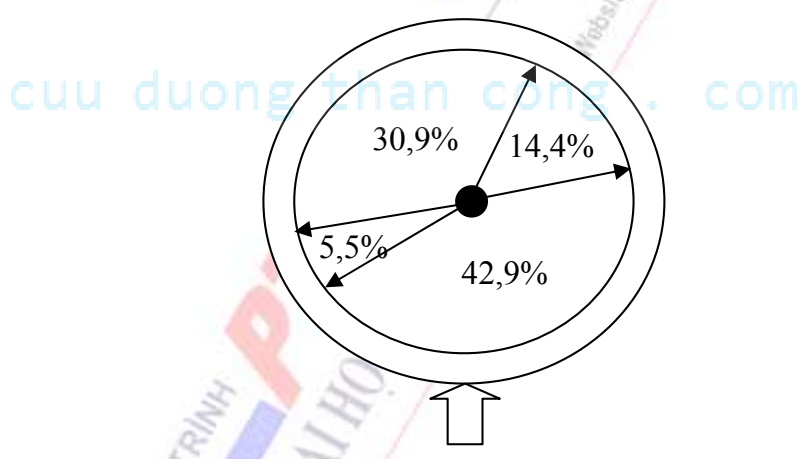

Hình 5.15. Tỷ lệ thích nghi của các nhiễm sắc thể trên bánh xe Roulette

Người ta thực hiện việc sinh sản bằng cách quay bánh xe Roulette với số lần bằng số nhiễm sắc thể trên bánh xe Roulette. Đối với bài toán này số lần quay bánh xe Roulette là 4. Nhiễm sắc thể 1 có giá trị thích nghi là 169, tương ứng 14,4 % tổng độ thích nghi. Như vậy, nhiễm sắc thể 1 chiếm 14.4% trên bánh xe Roulette. Mỗi lần quay nhiễm sắc thể 1 sẽ chiếm khe với giá trị 0,144.

Khi yêu cầu sinh ra 1 thế hệ mới, một vòng quay của bánh xe Roulette được đánh trọng số phù hợp sẽ chọn ra một cá thể để sinh sản. Bằng cách này, những nhiễm sắc thể có độ thích nghi cao sẽ có cơ hội được chọn lớn. Như vậy, sẽ có 1 số lượng con cháu lớn trong các thế hệ kế tiếp.

## b. Hàm mục tiêu

Cứ sau mỗi thế hệ được hình thành, chúng ta cần tính lại độ thích nghi cho từng cá thể để chuẩn bị cho một thế hệ mới. Do số lượng các cá thể tăng lên, độ thích nghi giữa các cá thể

<!-- page: 146 -->

không có sự chêch lệch đáng kể. Do đó, các cá thể có độ thích nghi cao chưa hẳn chiếm ưu thế trong thế hệ tiếp theo. Vì vậy, cần ấn định tỷ lệ đối với hàm thích nghi nhằm tăng khả năng cho các nhiễm sắc thể đạt độ thích nghi cao. Có 3 cơ chế định tỷ lệ như sau.

## b.1. Định tỷ lệ tuyến tính

Độ thích nghi được xác định theo công thức:

$$
f _ {i} ^ {\prime} = a * f _ {i} + b
$$

Cần chọn các tham số a, b sao cho độ thích nghi trung bình được ánh xạ vào chính nó. Tăng độ thích nghi tốt nhất bằng cách nhân nó với độ thích nghi trung bình. Cơ chế này có thể tạo ra các giá trị âm cần xử lý riêng. Ngoài ra, các tham số a, b thường gắn với đời sống quần thể và không phụ thuộc vào bài toán.

## b.2. Phép cắt Sigma

Phương pháp này được thiết kế vừa để cải tiến phương pháp định tỷ lệ tuyến tính vừa để xử lý các giá trị âm, vừa kết hợp thông tin mà bài toán phụ thuộc. Ở đây, độ thích nghi mới được tính theo công thức:

$$
f _ {i} ^ {\prime} = f _ {i} + (\overline {{f}} - c * \sigma)
$$

trong đó c là một số nguyên nhỏ (thường lấy giá trị từ 1 tới $5 ) ; \widetilde { \sigma }$ là độ lệch chuẩn của quần thể. Với giá trị âm thì ' f được thiết lập bằng 0.

## b.3. Định tỷ lệ cho luật dạng luỹ thừa

Trong phương pháp này, độ thích nghi lúc khởi tạo có năng lực đặc biệt:

$$
f _ {i} ^ {\prime} = f _ {i} ^ {k}
$$

với k gần bằng 1. Tham số k định tỷ lệ hàm f . Tuy nhiên, một số nhà nghiên cứu cho rằng nên chọn k độc lập với bài toán. Bằng thực nghiệm cho thấy nên chọn k =1.005.

## c. Điều kiện dừng của giải thuật

Chúng ta sẽ khảo sát điều kiện đơn giản nhất để dừng khi số thế hệ vượt quá một ngưỡng cho trước. Trong một số phiên bản về chương trình tiến hoá không phải mọi cá thể đều tiến hoá lại. Vài cá thể trong đó có khả năng vượt từ thế hệ này sang thế hệ khác mà không thay đổi gì cả. Trong những trường hợp như vậy, chúng ta đếm số lần lượng hàm. Nếu số lần lượng hàm vượt quá một hằng xác định trước thì dừng việc tìm kiếm.

Chúng ta nhận thấy, các điều kiện dừng ở trên giả thiết rằng người sử dụng đã biết đặc trưng của hàm, có ảnh hưởng như thế nào tới chiều dài tìm kiếm. Trong một số trường hợp khó có thể xác định số lượng thế hệ (hay lượng giá hàm) phải là bao nhiêu. Giải thuật có thể kết thúc khi cơ hội cho một cải thiện quan trọng chưa bắt đầu.

Có hai loại điều kiện dừng cơ bản. Các điều kiện này dùng các đặc trưng tìm kiếm để quyết định ngừng quá trình tìm kiếm .

Dựa trên cấu trúc nhiễm sắc thể: do sự hội tụ của quần thể bằng cách kiểm soát số alen được hội tụ, ở đây alen được coi như hội tụ nếu một số phần trăm quần thể đã định

<!-- page: 147 -->

trước có cùng (hoặc tương đương đối với các biểu diễn không nhị phân) giá trị trong alen này. Nếu số alen hội tụ vượt quá số phần trăm nào đó của tổng số alen, việc tìm kiếm sẽ kết thúc.

Dựa trên ý nghĩa đặc biệt của một nhiễm sắc thể: đo tiến bộ của giải thuật trong một số thế hệ cho trước. Nếu tiến bộ này nhỏ hơn một hằng số ε xác định, kết thúc tìm kiếm.

## 5.4. CÁC HỆ THỐNG THÔNG MINH LAI

Mỗi một hệ thống thông minh có những ưu điểm và hạn chế riêng của nó. Chúng ta có rhẻ nhìn nhận các hệ thống kết hợp nhiều phương pháp trí tuệ hiện đại theo các nhóm như sau

## 5.4.1. Hệ thống Nơ ron -Mơ

Các hệ thống nơ ron mờ là sự kết hợp của hai phương pháp mờ và nơ ron. Trong mạng nơ ron: một số lớp được chọn làm chức năng của hàm thuộc. Chức năng đó kết hợp khả năng phân lớp đối tương của hai công cụ. Sản phẩm được xayy dựng có thể là phần cứng và phần mềm

Việc kết hợp (hay lai) này xuất phát từ ưu điểm của mạng nơ ron là thông minh hoá trên các phần tư, còn logic mờ làm nhiệm vụ khái quát, suy diễn.

## 5.4.2. Hệ thống Nơ ron – Giải thuật di truyền

Như ta biết mạng nơ ron có khả năng cao trong xử lý song somg, phi tuyến và có khả năng giải nhiều bài toán tối ưu cục bộ. Để giải các bài toán tối ưu toàn cục, người ta thường dùng giải thuật di truyền để tối ưu toàn cục sau đó dùng mạng nơ ron nhân tạo để tói ưu mịn (cục bộ). Giải pháp này mang lại hiệu quả cao, hoàn thiện hơn. Tuy nhiên, giá phải trả là tăng độ phức tạp

## 5.4.3. Các hệ thống lai khác

Một sô phương pháp khác là kết hợp cả mạng nơ ron giải thuật di truyền và logic mờ. Về mặt khoa học, vấn đề đó mang tính khách quan. Trong thực tế độ phức tạp ngày càng cao.

Kết hợp phương pháp thống kê hiện đại (như phương pháp Bayes trong suy diễn mờ)

## 5.5. CÁC AGENT THÔNG MINH

Phần này thảo luận “agent thông minh” là gì, nó có quan hệ với môi trường như thế nào, nó được đánh giá như thế nào, và chúng ta có thể xây dựng nó như thế nào?

## 5.5.1. Giới thiệu


Hình 5.16 Các agent tương tác với môi trường thông qua sensor và các effector

<!-- page: 148 -->

Một “agent” là bất kỳ vật gì đó mà nó có thể nhận biết (perceiving) môi trường (environment) quanh nó thông qua các cảm biến (sensor) và tác động lại môi trường thông qua các bộ phận phản ứng lại kích thích (effector). Một cơ thể người có đôi mắt, đôi tai và các bộ phận khác là các cảm biến; đôi bàn tay, đôi chân và các phần cơ thể khác là các cơ quan phản ứng lại kích thích. Một robot camera và tia hồng ngoại nhìn thấy được là các sensor; các motor khác nhau là các các bộ phận phản ứng lại kích thích. Một phần mềm đã mã hoá các xâu bit xem như là các đối tượng tri giác và các hành động của nó. Một agent nói chung được mô tả:

Mục đích của chúng ta trong cuốn sách này là thiết kế các agent sao cho chúng làm việc tốt trong môi trường của chúng. Trước tiên, chúng ta sẽ làm rõ ràng hơn một chút về cái ý “việc tốt” vừa nói trên. Sau đó, chúng ta sẽ nói về các cách khác nhau thiết kế các agent hoàn thiện (đó chính là câu trả lời cho dấu ? trong hình 5.15). Chúng ta thảo luận một vài nguyên lý chung được sử dụng thiết kế các agent trình bày trong cuốn sách này. Quan trọng nhất đó là nguyên lý để thiết các agent phải hiểu biết các sự việc. Cuối cùng, chúng ta chỉ ra sự gắn liền giữa một agent và một môi trường như thế nào, và chỉ ra một vài loại môi trường.

## 5.5.2. Hoạt động của các Agent

Một agent có lý trí (rational agent) là agent làm các việc theo lẽ phải. Hiển nhiên, điều đó tốt hơn là làm việc sai trái, vậy điều đó có có ý nghĩa là gì. Như là một sự đánh giá không được chính xác lắm, chúng ta nói rằng hành động đúng là lý do agent thành công hơn. Điều đó dẫn đến vấn đề chúng ta phải đánh giá sự thành công của agent như thế nào (how) và khi nào (when).

## Tiêu chuẩn đánh giá sự thực hiện (Performance Measure)

Chúng ta sử dụng thuật ngữ tiêu chuẩn đánh giá sự thực hiện cho tiêu chuẩn how − tiêu chuẩn xác định xem như thế nào là một agent là thành công. Hiển nhiên không có một tiêu chuẩn đánh giá cố định nào thích hợp cho tất cả các agent. Chúng ta có thể hỏi agent theo quan điểm chủ quan nó hạnh phúc như thế nào với sự thực hiện của chính nó, nhưng một vài agent không thể trả lời, và một vài agent khác lừa dối chính chúng. (Con người ai cũng biết câu chuyện “con cáo và chùm nho xanh” – các con cáo nói rằng chúng không thực sự muốn điều đó sau khi họ không thành công trong việc dành lấy nó). Vì vậy, chúng ta đòi hỏi một tiêu chuẩn đánh giá sự thực hiện khách quan áp đặt bởi một số chuyên gia. Nói cách khác, chúng ta như là người quan sát thiết lập một chuẩn để cho nó thành công trong một môi trường và sử dụng nó để đánh giá sự thực hiện của các agent.

Cho một ví dụ, xem xét trường hợp một agent được hỗ trợ để hút bụi bẩn sàn nhà. Một tiêu chuẩn đánh giá hiệu suất đáng tin cậy có thể là số lượng bụi bẩn làm sạch trong một ca làm việc 8 giờ. Một đánh giá hiệu suất phức tạp hơn có thể là số lượng điện tiêu thụ và mức độ tiếng ồn phát ra. Đánh giá hiệu suất thứ ba có thể đưa ra điểm số cao hơn cho một agent không chỉ làm sạch sàn nhà một cách yên tĩnh và hiệu quả mà còn nhận ra thời gian nghỉ cuối tuần.1

Tiêu chuẩn when để đánh giá sự thực hiện cũng quan trọng. Nếu chúng ta đánh giá xem có bao nhiêu bụi bẩn agent làm sạch trong giờ đầu tiên trong ngày, chúng ta có thể thoả mãn với các agent khởi động nhanh (thậm chí chúng làm ít hoặc không làm sau thời điểm đó), và không hài lòng với những agent làm việc hợp lý. Vì vậy, chúng ta muốn đánh giá sự thực hiện trên toàn thời gian hoạt động, đó là một ca làm việc 8 giờ hoặc thời gian tồn tại của agent.

<small><span class="docvortex-page-footnote" data-block-type="page_footnote" style="color:#6b7280">1 Ở đây có một nguy cơ cho những người thiết lập các tiêu chuẩn đánh giá : bạn thường phải đưa cái điều bạn yêu cầu. Đó là, nếu bạn đánh giá sự thành công bởi số lượng bụi bẩn đã làm sạch, thì một vài agent khôn ngoan sẽ bị băt buộc phải thu gom một vật bẩn to nặng trong buổi sáng, nhanh chóng dọn sạch sẽ, và được cho điểm tốt cho của sự thực hiện.</span></small>

<!-- page: 149 -->

## Sự thông thái (Omniscience)

Chúng ta cần lưu ý phân biệt giữa sự hợp lý (rationality) và sự thông thái (omniscience). Một agent thông thái biết kết quả của các hành vi của nó ngay hiện thời và có thể hành động sao cho phù hợp, nhưng thông thái không có trong thực tế. Xem xét ví dụ: Một ngày tôi đang đi dọc theo đường Champs Elysées và tôi nhìn thấy một người bạn cũ bên kia đường. Không có xe cộ nào xung quanh và tôi không bận việc khác, vì vậy theo lẽ thường, tôi bắt đầu băng qua đường. Trong lúc đó, ở độ cao 33.000 feet một cánh cửa khoang hàng hoá rơi xuống từ một máy bay dân dụng vừa bay qua2, và trước khi tôi đến được bên kia đường tôi đã ngã sõng soài. Tôi băng qua đường là không hợp lý? Điều không muốn xảy ra là cáo phó của tôi có thể viết “Thằng ngốc cố gắng băng qua đường”. Đúng hơn, điều đó chỉ ra rằng, sự hợp lý được quan tâm với sự thành công mong muốn mang lại cái được nhận biết. Băng qua đường là hợp lý bởi vì đa phần những lần băng qua là thành công, và không có cách nào tôi có thể lường trước việc cánh cửa rơi. Lưu ý rằng một agent khác được trang bị radar phát hiện nhằm tránh các cánh cửa rơi xuống hoặc một khung thép đủ nặng sẽ “thành công” hơn, nhưng nó có thể không còn hợp lý.

Nói cách khác, chúng ta không thể đổ lỗi cho một agent vì không tính đến một số điều xảy ra mà nó không nhận thức được, hoặc vì không đưa ra một hành vi (ví dụ như tránh cánh cửa hành hoá) mà nó không có khả năng đưa ra. Nhưng việc giảm bớt yêu cầu của sự hoàn hảo không phải là vấn đề của việc hợp lý hoá agent. Nhận xét rằng, nếu chúng ta xác định một agent thông minh phải luôn luôn làm những cái thực sự chính xác, thì sẽ không thể thiết kế một agent đáp ứng đầy đủ yêu cầu đó - trừ khi chúng ta lợi dụng được sự làm của các tinh thể hình cầu.

Tóm lại, tính có lý trí đã được đưa ra dựa trên 4 nội dung sau:

Tiêu chuẩn đánh giá sự thực hiện định rõ mức độ thành công.

Những gì mà agent nhận biết được từ xa (theo nghĩa thời gian). Chúng ta gọi tiền sử giác quan một cách đầy đủ này là “chuỗi kết quả tri giác” (percept sequence).

Những gì agent hiểu biết về môi trường.

Những hành động mà agent có thể thực hiện.

Điều đó dẫn tới một định nghĩa về một agent có lý trí lý tưởng: Với một “chuỗi kết quả tri giác” có thể, một agent có lý trí lý tưởng phải đưa ra hành động nào đó được mong đợi đạt tới cực đại theo tiêu chuẩn đánh giá sự thực hiện dựa trên dấu hiệu nhận biết cơ bản quy định bởi chuỗi kết quả tri giác và sự hiểu biết có sẵn nào đó mà agent có.

Chúng ta cần xem xét cẩn thận định nghĩa này. Thoạt nhìn, nó có thể xuất hiện khả năng một agent tự cho phép mình một số hoạt động rõ ràng kém thông minh. Ví dụ, nếu một agent không nhìn cả hai lối đi trước ngã tư một con đường náo nhiệt, thì chuỗi kết quả tri giác của nó sẽ không chỉ cho nó biết rằng có một xe tải lớn tiến đến gần với tốc độ cao. Sự xác định đó dường như chỉ ra rằng nó có thể được chấp nhận băng qua đường. Trên thực tế, sự giải thích đó là sai trên cả hai phương diện. Thứ nhất, nó có thể không có lý trí khi băng qua đường: ngã tư đang nhìn là quá lớn. Thứ hai, một agent có lý trí lý tưởng sẽ có lựa chọn hành vi “nhìn” trước khi bước từng bước trên đường, bởi vì hành vi “nhìn” trợ giúp lớn nhất cho sự thực hiện mong muốn. Các hành động đang làm theo trình tự để thu được thông tin hữu ích là một phần quan trọng của “sự hợp lý” và được xem xét sâu hơn trong chương 16.

<small><span class="docvortex-page-footnote" data-block-type="page_footnote" style="color:#6b7280">2 Theo N.Henderson. “Các chốt cửa mới được đề xuất cho các máy bay phản lực lớn Boeing 747”. Washington Post 24/8/1989</span></small>

<!-- page: 150 -->

Khái niệm về một agent có ý nghĩa như là một công cụ để phân tích các hệ thống, và là sự mô tả các đặc tính không tuyệt đối để phân chia thế giới thành các agent và không phải agent. Xem xét một cái đồng hồ. Nó có thể được nghĩ chỉ là một đối tượng vô tri vô giác, hoặc nó có thể được xem như một agent đơn giản. Như một agent vì đa số đồng hồ luôn luôn thực hiện các hành động đúng: sự chuyển động của các kim (hoặc hiển thị các con số đối với đồng hồ điện tử) theo đúng quy tắc cấu tạo nên. Các đồng hồ là loại agent thoái hoá trong đó chuỗi kết quả tri giác của chúng là rỗng; không có sự kiện nào xảy ra bên ngoài ảnh hưởng đến các hành động của đồng hồ.

May mắn, điều đó là không hoàn toàn đúng. Nếu cái đồng hồ và chủ nhân của nó đi trên con tàu từ California đến Australia, một thực tế là đồng hồ đã tự quay ngược trở lại 6 giờ. Chúng ta không làm đảo lộn các đồng hồ của chúng ta do chúng ta không làm cái việc đó; chúng ta thấy rõ rằng chúng đang hoạt động hợp lý, nguyên nhân là do chúng ta có cảm giác các thiết bị của các đồng hồ đã chạy nhanh3.

**Phép ánh xạ lý tưởng từ các chuỗi kết quả tri giác thành các hành vi**

Đôi khi chúng thấy rằng cách hành động của một agent chỉ dựa trên chuỗi kết quả tri giác để xác định thời điểm, trong khi đó chúng ta có thể mô tả agent riêng biệt nào đó bằng cách xây dựng bảng các hành vi nó thi hành đáp lại chuỗi kết quả tri giác có thể. (Với nhiều agent, bảng đó là một danh sách rất dài – trong thực tế sẽ là vô hạn, trừ khi chúng ta đặt một giới hạn chiều dài của chuỗi kết quả tri giác mà chúng ta muốn xem xét). Một danh sách như vậy được gọi là một phép ánh xạ từ chuỗi kết quả tri giác thành các hành vi. Về nguyên tắc, chúng ta có thể tìm ra một phép ánh xạ phù hợp để mô tả một agent bằng việc thử tất cả các khả năng chấp nhận được của chuỗi kết quả tri giác và ghi lại hành vi mà agent đáp lại. (Nếu agent sử dụng một vài phép ngẫu nhiên trong việc tính toán, thì chúng ta sẽ thử một vài chuỗi kết quả tri giác, mỗi chuỗi dăm ba lần để đưa ra hiểu biết đúng về cách hành động theo mức thông thường của agent). Và nếu sử dụng các phép ánh xạ mô tả các agent, thì các phép ánh xạ lý tưởng được sử dụng mô tả các agent lý tưởng. Theo đó, hành vi một agent phải đáp lại chuỗi kết quả tri giác nào đó sẽ cho ta một phác thảo về một agent lý tưởng.

Dĩ nhiên, điều đó không có nghĩa là chúng ta phải tạo ra một bảng rõ ràng cho mọi chuỗi kết quả tri giác có khả năng xảy ra. Điều đó cho phép xác định một đặc tả phép ánh xạ mà không phải liệt kê đầy đủ nó. Một agent đơn gảin được cho là rất hay: Hàm căn bậc hai gần đúng của máy tính. Chuỗi kết quả tri giác cho agent này là một chuỗi các sự kiện bấm phím biểu diễn các con số trên bàn phím, hành vi là hiển thị con số trên màn hình hiển thị. Phép ánh xạ lý tưởng: kết quả tri giác là một số thực x, hành vi đúng là hiển thị một số thực z sao cho z2 ≈ x, lấy chính xác đến 15 chữ số. Sự đặc tả đó của phép ánh xạ không mang lại cho người thiết kế cấu trúc thực của bảng các căn bậc hai gần đúng. Và cũng không mang lại cho hàm căn bậc hai gần đúng sử dụng bảng để có cách hành động chính xác: Bảng 5.3 chỉ ra một phần của phép ánh xạ lý tưởng và một chương trình đơn giản tính toán phép ánh xạ sử dụng phương pháp tính gần đúng Newton.

Ví dụ căn bậc hai gần đúng ở trên minh hoạ quan hệ giữa phép ánh xạ lý tưởng và một thiết kế agent lý tưởng cho rất nhiều nhiệm vụ là hữu hạn. Trong khi bảng có kích thước rất lớn, thì agent lại là một chương trình hay súc tích. Điều đó cho thấy có thể thiết kế các agent súc tích thực hiện phép ánh xạ lý tưởng vào các tình huống tổng quát hơn rất nhiều: các agent mà có thể giải quyết vô số các nhiệm vụ khác nhau trong vô số các môi trường khác nhau. Trước khi chúng

<small><span class="docvortex-page-footnote" data-block-type="page_footnote" style="color:#6b7280">3 Một trong số các tác giả vẫn còn có một sự bối rối nhỏ khi cái máy tính của anh ta tự reset lại thành công tại một thời điểm ghi nhớ trong ngày.</span></small>

<!-- page: 151 -->

ta thảo luận xem điều đó được thực hiện như thế nào, chúng ta cần xem xét thêm một yêu cầu nữa mà một agent thông minh cần thoả mãn.

<!-- page: 152 -->

<table><tbody><tr><td>Kết quả tri giác x</td><td>Hành vi z</td><td rowspan="11">function SQRT(x) Begin z ← 1.0 /* initial guess*/ repeat until ⎢z<sup>2</sup> - x ⎢&lt;10-15 z ← z - (z<sup>2</sup> - x)/(2z) end return z</td></tr><tr><td>1.0</td><td>1.000000000000000</td></tr><tr><td>1.1</td><td>1.048808848170152</td></tr><tr><td>1.2</td><td>1.095445115010332</td></tr><tr><td>1.3</td><td>1.140175425099138</td></tr><tr><td>1.4</td><td>1.183215956619923</td></tr><tr><td>1.5</td><td>1.224744871391589</td></tr><tr><td>1.6</td><td>1.264911064067352</td></tr><tr><td>1.7</td><td>1.303840481040530</td></tr><tr><td>1.8</td><td>1.341640786499847</td></tr><tr><td>1.9</td><td>1.378404875209022</td></tr></tbody></table>

Bảng 5.3 Một phần của phép ánh xạ lý tưởng của bài toán căn bậc hai gần đúng (lấy xấp xỉ đến 15 chữ số), và một chương trình tương ứng để thực hiện phép ánh xạ lý tưởng.

## Sự tự trị (Autonomy)

Có một điều nữa cần quan tâm trong việc định nghĩa một agent có lý trí lý tưởng: ở phần “Sự hiểu biết có sẵn – (built-in knowledge)”. Nếu các hành vi của agent được bố trí hoàn toàn trong “sự hiểu biết có sẵn”, thí dụ rằng nó không cần chú ý tới các kết quả tri giác của nó, thì chúng ta nói rằng agent thiếu sự tự trị. Cho ví dụ, nếu nhà sản xuất đồng hồ có thể thấy trước rằng chủ nhân của chiếc đồng hồ sẽ đến Australia vào một ngày nào đó, thì một cơ chế có thể được cài đặt sẵn để điều chỉnh các kim một cách tự động 6 giờ cho đúng. Dĩ nhiên điều đó có thể thực hiện thành công, nhưng sự thông minh dường như là việc của người thiết kế đồng hồ hơn là của chính chiếc đồng hồ.

Cách hành động của agent có thể được bố trí vào trong cả “kinh nghiệm của chính nó” và “sự hiểu biết có sẵn” trong khi xây dựng cấu trúc của agent, agent đó hoạt động trong một môi trường cụ thể. Một hệ thống là “tự trị - autonomous4” tới một mức độ nhất định đó là hệ thống mà cách hành động được quyết định bởi chính kinh nghiệm của nó. Mặc dù nó có thể là quá khó khăn để đạt được sự tự trị hoàn toàn: khi agent có ít hoặc không có kinh nghiệm, nó phải hành động ngẫu nhiên trừ khi người thiết kế đưa ra một vài sự giúp đỡ. Vì vậy, khi mà sự tiến hoá cung cấp cho động vật với đầy đủ các phản xạ tự nhiên thì chúng có thể tồn tại đủ để tự học tập, nó có lý để cung cấp một agent thông minh nhân tạo với một vài sự hiểu biêt ban đầu giống như năng lực để học tập.

Sự tự trị không chỉ phù hợp với trực giác của chúng ta mà nó còn là một ví dụ của thực tiễn cơ sở khoa học. Một agent hoạt động trên cơ sở của các giả định sẽ chỉ hoạt động thành công khi hiểu rõ các giả định, và như vậy thiếu đi sự linh hoạt. Giả sử, cho ví dụ con bọ hung. Sau khi tìm ra tổ và đẻ trứng, nó đem về các viên phân từ một đống phân gần đó để bịt lối vào; nếu viên phân bị rơi trên đường đi, con bọ hung sẽ tiếp tục làm và bịt lối vào tổ với những viên phân khác

<small><span class="docvortex-page-footnote" data-block-type="page_footnote" style="color:#6b7280">4 Thuật ngữ “tự trị - autonomous” cũng con có ý nghĩa nào đó giống như “không phải dưới sự điều khiển trực tiếp của một người”, ví dụ sự hoạt động của làn xe trên đường là tự trị.</span></small>

<!-- page: 153 -->

theo kịch bản, mà không bao giờ để ý đến những viên phân nó đã đánh rơi. Sự tiến hoá đã gắn vào giả định của con bọ hung, và khi nó bị vi phạm, kết quả của hành vi không thành công (vì đã không nhặt lại các viên phân bị rơi). Một agent thông minh tự trị thực sự phải có khả năng hành động thành công trong các môi trường rộng lớn khác nhau đã cho đủ thời gian thích nghi.

## 5.5.3. Cấu trúc của các agent thông minh

Cho đến giờ chúng ta đã nói đến các agent qua sự mô tả cách hành xử của chúng – hành vi được thực hiện sau khi đã đưa ra chuỗi kết quả tri giác. Bây giớ chúng ta sẽ cố gắng chờ đợi và thảo luận xem bên trong nó làm việc như thế nào. Công việc của AI (Artificial Intelligence – Trí tuệ nhân tạo) là thiết kế agent chương trình: một chức năng thực hiện agent ánh xạ từ các kết quả tri giác tới hành vi. Chúng ta giả sử chương trình này sẽ chạy trên vài loại thiết bị tính toán - gọi là kiểu kiến trúc. Hiển nhiên, chương trình chúng ta lựa chọn là chương trình mà kiểu kiến trúc chấp nhận và chạy. Kiểu kiến trúc có thể là một máy tính đơn giản, hoặc nó có thể bao gồm thiết bị cho mục đích đặc biệt dành cho các nhiệm vụ nào đó, như camera ghi lại các hình ảnh hoặc bộ lọc âm thanh đầu vào. Nó cũng có thể bao gồm phần mềm đưa ra sự phân biệt trình độ giữa máy tính và agent chương trình, vì vậy chúng ta có thể lập chương trình ở mức cao hơn. Nói chung, kiểu kiến trúc thu các kết quả tri giác từ các sensor sẵn sàng cho chương trình, chạy chương trình, và cho hoạt động của chương trình lựa chọn các bộ phận phản ứng lại kích thích được sinh ra. Mối quan hệ giữa các agent, các kiểu kiến trúc, và các chương trình có thể tóm tắt như sau:

agent = kiểu kiến trúc + chương trình

(agent = architecture + program)

Phần lớn trong cuốn sách này nói về việc thiết kế các chương trình agent.

Trước khi thiết kế một chương trình agent, chúng ta phải có ý tưởng hay về các tri giác và hành vi khả thi, agent được hỗ trợ giành được các mục tiêu hoặc phạm vi thực hiện là gì, và các loại môi trường mà nó hoạt động là gì5. Bảng 5.4 chỉ ra các thành phần cơ bản cho sự lựa chọn các kiểu agent.

Có thể là ngạc nhiên với một vài độc giả vì chúng ta đã bao gồm trong danh sách các kiểu agent một vài chương trình dường như hoạt động trong môi trường nhân tạo hoàn toàn được định nghĩa bởi bàn phím cho đầu vào và các kí tự đầu ra trên màn hình. “Không nghi ngờ gì” có thể nói “đó không phải là môi trường thực, vậy nó là gì?”. Trong thực tế, không có sự khác biệt giữa môi trường “thực” và môi trường “nhân tạo”, nhưng mối quan hệ giữa cách hành xử của agent, chuỗi kết quả tri giác được sinh ra bởi môi trường, và mục tiêu cần đạt được của agent được hỗ trợ lại phức tạp. Một vài môi trường “thực” là hết sức đơn giản. Cho ví dụ, robot được thiết kế để kiểm tra những phần mà chúng đi qua trên một băng truyền có thể dùng một số giả định đơn giản: các phần của băng truyền luôn luôn được chiếu sáng, các phần đó cùng thuộc một loại, và robot chỉ có hai hành vi – “chấp thuận” nếu phần băng truyền được chiếu sáng hoặc “đánh dấu” nếu phần băng truyền không được chiếu sáng.

Trái lại, các agent phần mềm (hoặc các robot phần mềm) lại phong phú, phạm vi ứng dụng rất lớn. Hãy hình dung một hệ thống được thiết kế để mô phỏng lái máy bay 747. Sự mô phỏng có rất nhiều chi tiết, môi trường phức tạp, và tác nhân phần mềm phải chọn lựa từ rất nhiều hành động đa dạng trong thời gian thực. Hoặc hình dung một hệ thống được thiết kế để duyệt các nguồn tin tức trực tuyến và hiển thị các mục thú vị cho khách hàng. Để làm việc tốt, nó sẽ cần đến

<small><span class="docvortex-page-footnote" data-block-type="page_footnote" style="color:#6b7280">Đ<sup>5</sup>ể cho tiện chúng ta dùng từ viết tắt PAGE (Percepts, Actions, Goals, Environment)</span></small>

<!-- page: 154 -->

một vài ngôn ngữ tự nhiên có khả năng xử lý, cần phải biết được cái mà khách hàng cho là thú vị, và nó cần phải năng động trong việc thay đổi kế hoạch ví dụ khi việc kết nối vào một nguồn tin tức bị gián đoạn hoặc khi có một cái gì đó mới hơn trên đường truyền.

<table><tbody><tr><td>Kiểu Agent</td><td>Các tri giác</td><td>Các hành vi</td><td>Các mục tiêu</td><td>Môi trường</td></tr><tr><td>Hệ thống chuẩn đoán bệnh</td><td>các triệu chứng, các phát hiện, các câu trả lời của bệnh nhân</td><td>Các câu hỏi, các trắc nghiệm, cách điều trị</td><td>Sức khoẻ người bệnh, chi phí thấp nhất</td><td>Bệnh nhân, bệnh viện</td></tr><tr><td>Hệ thống phân tích hình ảnh vệ tinh</td><td>Cường độ, màu sắc khác nhau của các điểm ảnh</td><td>Xuất ra một sự phân loại quanh cảnh nó quan sát</td><td>phân loại chính xác</td><td>Các hình ảnh từ vệ tinh</td></tr><tr><td>Part-picking robot</td><td>cường độ khác nhau của các điểm ảnh</td><td>nhặt lên các bộ phận (của một loại máy móc) và đưa vào các cái thùng</td><td>Vị trí chính xác của các bộ phận trong các thùng</td><td>Băng tải với các bộ phận máy móc</td></tr><tr><td>Điều khiển nhà máy tinh chế dầu hoặc đường (Refinery controller)</td><td>Nhiệt độ, áp suất</td><td>Mở, đóng van; điều chỉnh nhiệt độ</td><td>sự tinh khiết, sản lượng và sự an toàn cao nhất</td><td>Nhà máy tinh chế</td></tr><tr><td>Chương trình dạy tiếng Anh</td><td>các từ loại</td><td>đưa ra các bài tập, các gợi ý, chỉ ra chỗ đúng</td><td>Kết quả kiểm tra sinh viên cao</td><td>Lớp sinh viên</td></tr><tr><td colspan="5">Bảng 5.4 Một số ví dụ về một số kiểu agent</td></tr></tbody></table>

Một số môi trường là không rõ ràng giữa “thực” và “nhân tạo”. Trong môi trường ALIVE, agent phần mềm được đưa đến các kết quả tri giác là hình ảnh camera kỹ thuật số của một phòng nơi có một người đi dạo trong đó. Agent này xử lý hình ảnh camera và lựa chọn một hành động. Môi trường cũng hiển thị hình ảnh camera trên một màn hình lớn, và thêm vào đó hình ảnh mà agent phần mềm biểu diễn thông qua đồ hoạ máy tính. Hình ảnh đó có thể là một con chó hoạt hình, nó được lập trình để chuyển động hướng đến một người (trừ trường hợp ông ta đuổi con chó đi) và vẫy chiếc chân trước hoặc nhảy lên một cách mừng rỡ khi người đó người đó ra hiệu.

Môi trường nhân tạo nổi tiếng nhất đó là Turing Test, trong đó chỉ ra rằng các agent “thực” và “nhân tạo” có quan hệ bình đẳng, nhưng môi trường lại có sự thách thức khá lớn là nó rất khó cho agent phần mềm làm việc như một con người.

## Các agent chương trình

Trong toàn bộ cuốn sách này, chúng ta sẽ xây dựng các agent thông minh. Tất cả được xây dựng giống như bộ xương, chúng nhận các kết quả tri giác từ một môi trường và sinh ra các hành vi. Các phiên bản ban đầu của các agent chương trình có dạng rất đơn giản (hình 5.16). Chúng sẽ sử dụng một vài cấu trúc dữ liệu nội tại mà nó được cập nhật khi các kết quả tri giác

<!-- page: 155 -->

được đưa đến. Các cấu trúc dữ liệu đó được đem lại bởi sự quyết định của agent – các thủ tục để sinh ra một sự lựa chọn hành vi, sau đó hành vi được chuyển qua kiểu kiến trúc để thực hiện.

Có hai điều cần chú ý về chương trình khung xương (chương trình vỏ) này. Thứ nhất, cho dù chúng ta định nghĩa agent như là một chức năng ánh xạ từ các chuỗi kết quả tri giác đến các hành vi, thì agent chương trình cũng chỉ nhận một kết quả tri giác đơn lẻ như là đầu vào. Nó để cho agent xây dựng dần chuỗi kết quả tri giác trong bộ nhớ, khi có yêu cầu. Trong một vài môi trường, nó có thể thực hiện hết sức thành công mà không có sự lưu trữ chuỗi kết quả tri giác, và trong những lĩnh vực phức tạp nó không thể lưu trữ chuỗi đầy đủ. Thứ hai, mục tiêu và thước đo hiệu suất không phải là nhiệm vụ của chương trình khung xương. Bởi vì, thước đo hiệu suất được đưa ra để đánh giá cách hoạt động của agent, và nó thường có thể đạt được hiệu suất cao mặc dù không biết rõ ràng về thước hiệu hiệu suất.

```txt
function SKELETON-AGENT(percept) return action
static: memory, the agent's memory of the world
memory ← UPDATE-MEMORY(memory,percept)
action ← CHOOSE-BEST-ACTION(memory)
memory ← UPDATE-MEMORY(memory,action)
return action
Hình 5.16 Một agent khung.
```

## Tại sao không tìm thấy các câu trả lời?

Hãy bắt đầu với cách đơn giản nhất có thể, chúng ta viết một agent chương trình - bảng tra cứu (hình 5.17). Nó hoạt động dựa trên việc lưu trữ trên bộ nhớ toàn bộ chuỗi kết quả tri giác, và sử dụng nó để đưa vào bảng, bao gồm hành vi thích hợp cho tất cả các chuỗi kết quả tri giác có thể.

**static**: percept, a sequence, intially empty

table, a table, index by percept sequence, intially fully specified

append percept to the end of percept

action ← LOOKUP(percept,table)

**return** action

**Hình 5.17 Một agent dựa trên lý thuyết bảng tra cứu.**

Nó cung cấp tài liệu để xem xét tại sao những đề nghị sau bị thất bại:

1. Bảng cần cho một điều gì đó, đơn giản như một agent chỉ có thể chơi cờ với khoảng 35100 nước đi.

2. Nó sẽ cần một khoảng thời gian không nhiều lắm để người thiết kế xây dựng bảng.

3. Agent này không tự giải quyết tất cả, bởi vì kết quả tính toán cho các hành vi hay nhất đều được xây dựng sẵn. Cho nên nếu môi trường thay đổi một cách đột ngột, thì agent này sẽ bị thất bại.

<!-- page: 156 -->

4. Thậm chí nếu chúng ta trao cho agent một cơ chế tự học tốt nhất, để nó có thể có khả năng tự giải quyết, thì nó vẫn cần phải học mãi mãi.

Mặc cho tất cả các điều đó, TABLE-DRIVEN-AGENT vẫn làm cái điều chúng ta muốn: nó thực hiện đầy đủ phép ánh xạ agent theo yêu cầu. Do đó không chắc chắn để khẳng định: “Nó không thông minh”.

## Một ví dụ

Phần này giúp xem xét một môi trường riêng, với mục đích sự thảo luận của chúng ta trở nên cụ thể hơn. Nguyên nhân chính của sự hiểu biết của nó, và nguyên nhân nó yêu cầu một phạm vi rộng những kỹ năng. Chúng ta sẽ xem xét công việc thiết kế tự động hoá lái taxi. Cần lưu ý rằng hệ thống hiện thời có phần vượt ra ngoài những phạm vi khả năng công nghệ cho phép, mặc dù hầu hết những phần hợp thành là sẵn có theo một vài mẫu6. Nhiệm vụ lái xe là cực kỳ phức tạp, tổ hợp các tình huống mới có thể xảy ra là không có giới hạn.

Đầu tiên chúng ta phải nghĩ ra các đối tượng tri giác, các hành vi, các mục tiêu và môi trường cho taxi (xem hình 5.18).

<table><tr><td>Kiểu Agent</td><td>Đối tượng tri giác (Percepts)</td><td>Hành vi (Actions)</td><td>Mục tiêu (Goals)</td><td>Môi trường Environment</td></tr><tr><td>Lái taxi</td><td>Các camera, công to mét, hệ thống GPS, microphone</td><td>định hướng, tăng giảm tốc, phanh, thông báo với hành khách</td><td>An toàn, nhanh, đúng luật, hành trình thoải mái, kinh tế nhất</td><td>các con đường,</td></tr><tr><td colspan="5">Hình 5.18 Kiểu agent “Lái xe Taxi”</td></tr></table>

Taxi cần sẽ biết nó ở đâu, trên con đường nào và đang chạy nhanh chậm ra sao. Những thông tin này có thể thu được từ các **percept**. Đó là một hoặc nhiều camera (Controllable TV camera), công tơ mét đo tốc đọ (Speedometer), và đồng hồ đo đoạn đường đi (Odometer). Để điều khiển xe cộ một cách chính xác, nhất là trên đoạn đường cong, cần phải có một bộ điều khiển tăng giảm tốc (accelerometer). Cũng cần biết trạng thái máy móc của xe cộ, vì vậy cần phải có một hệ thống các cảm biến cơ học và điện tử (engine and electrical sensor). Có thể có các thiết bị không có giá trị với người điều khiển thông thường như: hệ thống vệ tinh định vị toàn cầu GPS, để cung cấp thông tin chính xác vị trí trên bản đồ điện tử, hoặc cảm biến hồng ngoại (infrared sensor) hoặc cảm biến âm (sonar snesor) để phát hiện khoảng cách với các ô tô và các chướng ngại vật khác. Cuối cùng, cần có một microphone hoặc một bàn phím (keyboard) để cho các hành khách nói với nói nơi đến của họ.

Các hành vi có thể đối với agent “Lái taxi” sẽ ít nhiều tương tự như đối với một con người điều khiển taxi: điều khiển động cơ thông qua bàn đạp gas, điều khiển hướng, điều khiển phanh. Ngoài ra, sẽ cần đưa ra “đầu ra” trên màn hình hoặc thiết bị âm thanh để giao tiếp với hành khách; và một vài cách có thể để truyền thông với các xe cộ khác.

Khả năng phạm vi thực hiện (performance measure) mà chúng ta muốn hệ thống lái xe tự động đạt được là gì? Các năng lực mong muốn bao gồm: đến đích chính xác, sự tiêu thụ năng lượng là ít nhất, hao mòn ít nhất, ít hỏng hóc nhất, thời gian hành trình ngắn nhất hoặc chi phí ít nhất hoặc cả thời gian và chi phí ít nhất, ít vi phạm luật giao thông nhất, làm ảnh hưởng đến các

<small><span class="docvortex-page-footnote" data-block-type="page_footnote" style="color:#6b7280">6 Xem trang 26, ở đó mô tả một agent lái xe hiện nay</span></small>

<!-- page: 157 -->

lái xe khác là ít nhất, an toàn nhất, hành khách thoải mái nhất, thu lợi cao nhất. Rõ ràng, một vài mục tiêu đó là mâu thuẫn, vì vậy sẽ cần phải có sự thoả hiệp.

Cuối cùng, với dự án thực tế, chúng ta phải quyết định môi trường lái xe taxi sẽ đối diện. Nó phải hoạt động trên các con đường địa phương, hoặc là trên các xa lộ? Đó là Nam California, nơi ít khi có tuyết rơi, hoặc Alaska nới tuyết thường xuyên rơi? Luôn luôn lái xe bên phải hoặc có thể chúng ta muốn linh hoạt để có thể đi bên trái trong trường hợp taxi hoạt động ở nước Anh hoặc Nhật Bản. Rõ ràng, môi trường bị hạn chế hơn, vấn đề thiết kế dễ dàng hơn.

Bây giờ, chúng ta phải quyết định như thế nào để xây dựng chương trình thực để thực hiện phép ánh xạ từ các đối tượng tri giác đến các hành vi. Chúng ta thấy rằng các khía cạnh điều khiển khác nhau sẽ đề xuất các kiểu agent chương trình khác nhau. Có 4 kiểu agent được chỉ ra:

Các agent phản xạ đơn giản – simple reflex agents

Các agent theo dõi (các vật các sự kiện liên quan)

Các agent mục tiêu cơ bản – Goal-based agents

Các agent “lợi ích” cơ bản – Utility-based agents

## Simple reflex agents

Lựa chọn xây dựng “một bảng tra cứu hiện” là một vấn đề khó. Đầu vào thị giác từ một camera đơn đưa vào với tốc độ 50 Mb/giây (25 frame/giây, 1000×1000 pixel với 8 bit màu và 8 bit cường độ). Vì vậy, bảng tra cứu cho một giờ sẽ là 2<sup>60</sup> × 60 × 50M trạng thái.

Tuy nhiên, chúng ta có thể tóm tắt từng phần của bảng bằng cách ghi nhớ các sự kết hợp vào ra thường xuyên xuất hiện một cách chắc chắn. Cho ví dụ, nếu chiếc xe phía trước phanh lại, và đèn phanh của nó sáng lên, thì người lái xe phải chú ý và bắt đầu phanh. Nói cách khác, một vài sự xử lý được thực hiện trước đầu vào thị giác sẽ thiết lập điều kiện mà chúng ta gọi là “ô tô phía trước đang phanh – The car in front is braking”, thì gây ra một vài sự thiết lập kết nối tới agent chương trình để hành động “bắt đầu phanh – initiate braking”. Chúng ta gọi là một sự kết nối một qui tắc condition – action (phản xạ có điều kiện), viết như sau:

## if car-in-front-is-bracking then intiate-bracking

Con người cũng có nhiều kết nối, một vài trong số đó học được từ sự phản ứng lại - phản xạ có điều kiện (ví như việc lái xe) và một vài trong số đó là phản xạ tự nhiên (ví như việc chớp mắt khi một vật gì đó bay vào mắt). Theo cách này, trong cuốn sách, chúng ta sẽ thấy một số phương pháp khác nhau, sự kết nối có thể tự học và tự thực thi.


<small><span class="docvortex-page-footnote" data-block-type="page_footnote" style="color:#6b7280">7 Còn được gọi là các quy tắc situation-action hoặc production hoặc if-then</span></small>

<!-- page: 158 -->


Hình 5.19 đưa ra cấu trúc của một “simple reflex agent” dưới dạng giản đồ, chỉ ra qui tắc condition – action cho phép agent thực hiện kết nối từ tri giác đến hành động như thế nào. Chúng ta sử dụng hình chữ nhật để biểu thị trạng thái hiện tại bên trong tiến trình giải quyết của agent, hình oval biểu diễn thông tin cơ sở được sử dụng trong tiến trình. Agent chương trình cũng rất đơn giản, được chỉ ra ở hình 5.20. Chức năng INTERPRET-INPUT sinh ra một sự diễn tả trừu tượng của trạng thái hiện tại từ sự tri giác, RULE-MATCH trả về qui tắc đầu tiên trong tập các qui tắc mà nó phù hợp với sự mô tả trạng thái được đưa đến. mặc dù các agent có thể được thực hiện rất hiệu quả , nhưng phạm vi ứng dụng lại rất hẹp.

**function** SIMPLE-REFLEX-AGENT(percept) **return** action

**static:** rules, a set of condition-action rules

state ← INTERPRET-INPUT(percept)

rule ← RULE-MATCH(state,rules)

action ← RULE-ACTION[rule]

**return** action

**Hình 2.20 Kiểu agent “Lái xe”**

**Agent theo dõi** (Agents that keep track of the world)

Simple reflex agent mô tả ở phần trước sẽ chỉ làm việc nếu sự giải quyết chính xác có thể được dựa trên tri giác hiện thời. Nếu chiếc ô tô phía trước là một mô hình đã xuất hiện trước đây không lâu, và bây giờ có ánh sáng đèn phanh được mang lại từ trung tâm kết quả ở nước Mỹ, thì từ một hình ảnh đơn sẽ có thể nó rằng nó đang phanh. Không may, các mô hình cũ có sự khác biệt về hình dáng đèn hậu, đèn phanh, đèn xi nhan, và không phải bao giờ cũng có khả năng trả lời rằng chiếc ô tô phía trước đang phanh. Vì vậy, dù là việc phanh đơn giản, thiết bị lái của chúng ta vẫn phải duy trì một vài phần nào đó tình trạng bên trong theo trình tự để lựa chọn hành động. Ở đây tình trạng bên trong không quá lớn – nó chỉ cần frame trước đó từ camera để dò tìm khi hai đèn đỏ ở rìa xe cộ cùng sáng hoặc tắt đồng thời.

<!-- page: 159 -->

Hãy xem rõ ràng hơn trường hợp sau: thỉnh thoảng, người lái xe nhìn vào gương chiếu hậu để kiểm soát các xe cộ phía sau. Khi lái xe đang không quan sát gương, không quan sát thấy xe cộ ở làn đường bên cạnh (tức là không thể phân biệt được các trạng thái, ở đó chúng xuất hiện và không xuất hiện); vì vậy để quyết định chuyển làn xe một cách khéo léo thận trọng, người lái xe cần phải biết dù là chúng có ở đó hay không.

Vấn đề nảy sinh, bởi vì các sensor không cung cấp một cách đầy đủ trạng thái. Trong các trường hợp đó, agent có thể duy trì một vài thông tin trạng thái bên trong để nhận biết được các trạng thái phát sinh giống như giác quan đem lại, nhưng dù sao cũng khác nhau một cách đáng kể. Ở đây, “khác nhau một cách đáng kể” có ý nghĩa rằng các hành động khác nhau thích hợp cho hai trạng thái.

Việc cập nhật thông tin trạng thái bên trong này thực hiện bằng cách yêu cầu hai loại kiến thức được mã hoá trong agent chương trình. Thứ nhất, chúng cần một vài thông tin “thế giới xung quanh tiến triển không phụ thuộc vào agent như thế nào – how the world evolves” – cho ví dụ, một chiếc ô tô đang vượt qua nhìn chung sẽ là tiến dần đến phía sau hơn là ngay tức thì. Thứ hai, chúng ta cần một vài thông tin “Các hành động của agent phản ứng lại thế giới xung quanh như thế nào – What my actions do” – cho ví dụ, khi agent rẽ sang đường nhỏ bên phải, có một cái rãnh cắt ngang trước mặt nó sẽ tiến về phía trước hoặc lùi lại về phía sau theo con đường lớn nơi có con đường nhỏ khác.

Hình 5.20 đưa ra cấu trúc của agent phản xạ, cho biết tri giác hiện tại được kết hợp với trạng thái bên trong cũ để sinh ra sự mô tả cập nhật của trạng thái hiện thời. Agent chương trình được chỉ ra ở hình 5.21. Một nhiệm vụ thú vị là chức năng UPDATE-STATE, nó đáp ứng cho việc tạo ra sự mô tả trạng thái bên trong mới. Giống như công việc phiên dịch tri giác mới dưới ánh sáng của kiến thức có sẵn về trạng thái, nó sử dụng thông tin “how the world evolves” để theo dõi các phần không thấy được của thế giới xung quanh, và cũng phải biết các hành động của agent làm gì với trạng thái của thế giới.

**Agent mục tiêu** (Goal-based agent)


Cần biết rằng trạng thái hiện thời của môi trường luôn luôn không đủ để quyết định làm việc việc gì. Cho ví dụ, tại nơi gặp nhau của các con đường, taxi có thể rẽ trái, rẽ phải, hoặc đi

<!-- page: 160 -->

thẳng. Quyết định đúng đắn trên cơ sở “taxi đang cố gắng đi đến đâu”. Nói cách khác, giống như sự mô tả trạng thái hiện thời, agent cũng cần một số thông tin về mục tiêu, nó diễn tả trạng thái đang mong muốn – ví dụ, đó là điểm cần đến của hành khách. Agent chương trình có thể kết hợp điều này với thông tin về kết quả của các hành động có thể xảy ra (giống như thông tin được sử dụng để cập nhật trạng thái trong của agent phản xạ) để lựa chọn các hành động đạt được mục tiêu. Đôi khi, điều đó sẽ là đơn giản, khi sự thoả man mục tiêu là kết quả trực tiếp từ một hành động đơn giản; đôi khi, nó đòi hỏi phải khéo léo hơn, khi agent xem như các chuỗi xoắn dài và luẩn quẩn để tìm cách đạt được mục tiêu.

Chú ý rằng quyết định đưa ra của loại agent này về cơ bản khác với các quy tắc conditionaction được mô tả phần trước, bởi vì nó cần phải xem xét trong tương lai cả hai vấn đề “Điều gì sẽ xảy ra nếu tôi làm gì đó? – What will happen if I do such-and-such?” và “Điều đó sẽ mang lại cho tôi hạnh phúc? – Will that make me happy”. Trong thiết kế agent phản xạ, thông tin này không được sử dụng một cách rõ ràng, bởi vì người thiết kế đã tính trước hành động chính xác cho các trường hợp khác nhau. Agent phản xạ phanh xe khi nó nhìn thấy đèn phanh của xe phía trước. Một agent mục tiêu, theo nguyên tắc, có thể lập luận rằng nếu đèn phanh của chiếc ô tô phía trước sáng nó sẽ đi chậm lại. Theo cách diễn tiến thông thường của thế giới xung quanh, hành động chỉ đạt được mục tiêu là không đụng các xe khác khi phanh xe. Mặc dù agent mục tiêu xem ra kém hiệu quả hơn, nó khó thuyết phục. Nhưng nếu trời bắt đầu mưa, agent có thể cập nhật hiểu biết của nó về việc phanh xe sẽ hoạt động hiệu quả như thế nào, điều đó sẽ là lý do để tự động đưa ra tất cả các cách hành động có liên quan để sửa đổi sao cho phù hợp với điều kiện mới. Mặt khác, với agent phản xạ, chúng ta sẽ phải viết lại một số lượng lớn các qui tắc condition-action. Dĩ nhiên, agent mục tiêu linh hoạt hơn nhiều đối với việc đi đến các đích khác nhau. Một cách đơn giản để xác định một cái đích mới, chúng ta có thể đưa ra agent mục tiêu để theo kịp với cách hành động mới. Các qui tắc của agent phản xạ lái xe khi rẽ và khi đi thẳng sẽ chỉ làm việc với một đích đơn lẻ, và các qui tắc đó sẽ phải thay đổi tất cả khi cần đi đến các nơi mới.

## 5.5.4. Môi trường (Environments)

Đầu tiên, chúng ta sẽ mô tả các kiểu khác nhau của môi trường và chúng ảnh hưởng đến việc thiết kế các agent như thế nào. Sau đó, chúng ta sẽ mô tả các chương trình môi trường mà nó được sử dụng như là “nơi kiểm tra” các agent chương trình.

## Các thuộc tính của môi trường (Properties of Environments)

Môi trường có những đặ trưng riêng. Các đặc trưng chính được chỉ ra như sau:

## Có thể được và Không thể được (Accessible vs. Inaccessible)

Nếu cơ cấu giác quan của agent đem đến cho nó một trạng thái đầy đủ của môi trường thí chúng ta nói rằng môi trường là có thể đối với agent. Một môi trường là thực sự có thể nếu các sensor phát hiện ra tất cả các khía cạnh liên quan đến sự lựa chọn hành động. Một môi trường có thể cần thuận tiên bởi vì agent mong muốn không phải duy trì một số trạng thái bên trong để theo dõi thế giới xung quanh.

## Tiền định và không tiền định (Deterministic vs. Nondeterministic)

Nếu trạng thái tiếp theo của môi trường là hoàn toàn xác định được thông qua trạng thái hiện thời và hành động mà agent đã lựa chọn, thì chúng ta nói môi trường là tiền định. Theo nguyên tắc, agent mong muốn không phải lo nghĩ về một môi trường có thể không chắc chắn tiền định. Tuy nhiên, nếu một môi trường là không thể thì nó có thể được xem như không tiền định. Điều đó đặc biệt đúng, nếu môi trường phức tạp gây ra sự khó khăn cho việc theo dõi tất cả các

<!-- page: 161 -->

mặt không thể của nó. Vì vậy, môi trường tiền định hoặc môi trường không tiền định đối với điểm nhìn của agent thường được cho là tốt nhất.

## Phân đoạn và không phân đoạn (Episodic vs. Nonepisodic)

Trong môi trường phân đoạn, kinh nghiệm của agent bị phân ra thành từng đoạn. Trong mỗi đoạn gồm có sự nhận biết của agent và hành khi có được nhận biết đó. Đặc tính của hành động phụ thuộc vào chính đoạn đó, bởi vì các đoạn tiếp theo không phụ vào các hành động trong đoạn trước đó. Môi trường phân đoạn là rất đơn giản vì agent không muốn nghĩ xa.

## Tĩnh và Động (Static vs. Dynamic)

Nếu môi trường có thể thay đổi trong khi agent đang cân nhắc, thì chúng ta nói rằng môi trường là động đối với agent, ngược lại môi trường là tĩnh. Môi trường tĩnh rất dễ giao tiếp bởi vì agent mong muốn không phải theo dõi thế giới xung quanh trong khi đang quyết định lựa chọn hành động và cũng mong muốn không phải lo nghĩ thời gian đã trôi qua. Nếu môi trường không thay đổi theo thời gian nhưng sự thực hiện của agent thành công, thì chúng ta nói rằng môi trường phần nào là động.

## Rời rạc và Liên tục (Discrete vs. Continuous)

Nếu có một số lượng giới hạn nhất định các tri giác và hành động rõ ràng thì ta nói rằng môi trường là rời rạc. Môi trường “Chơi cờ” là rời rạc – có một số lượng cố định “nước đi có khả năng” trong mỗi lần đi. Môi trường “Lái taxi” là liên tục - tốc độ, vị trí của taxi và các xe cộ khác nhận giá trị trong một khoảng giá trị liên tục<sup>8</sup>.

Chúng ta sẽ xem xét xem các kiểu môi trường khác nhau yêu cầu các agent chương trình khác nhau như thế nào để xử lý chúng hiệu quả. Nó sẽ được đưa ra như bạn mong đợi, đó là trường hợp khó nhất: môi trường không thể, môi trường không phân đoạn, môi trường động và môi trường liên tục. Nó cũng có thể được đưa ra trong nhiều hoàn cảnh thực tế là rất phức tạp, đến mức phải thảo luận xem trên thực tế chúng có thực sự tiền định hay chúng được xem như không tiền định.

| Môi trường | Có thể | Tiền định | Phân đoạn | Tĩnh | Rời rạc |
| --- | --- | --- | --- | --- | --- |
| Chess with a clock | Yes | Yes | No | Semi | Yes |
| Chess without a clock | Yes | Yes | No | Yes | Yes |
| Poker | No | No | No | Yes | Yes |
| Backgammon | Yes | No | No | Yes | Yes |
| Taxi driving | No | No | No | No | No |
| Medical diagnosis system | No | No | No | No | No |
| Image-analysis system | Yes | Yes | Yes | Semi | No |
| Part-picking robot | No | No | Yes | No | No |
| Refinery controller | No | No | No | No | No |
| Interactive English tutor | No | No | No | No | Yes |

<!-- page: 162 -->

Bảng 5.5 liệt kê các thuộc tính của một số họ môi trường. Chú ý rằng các câu trả lời có thể thay đổi phụ thuộc vào việc bạn dựa trên các môi trường và các agent như thế nào. Ví dụ, Poker là tiền định nếu agent có thể theo dõi trật tự của các quân bài trong cỗ bài, nhưng nó là không tiền định nếu nó không thể. Cũng như vậy, nhiều môi trường là phân đoạn ở mức hơn cho từng hành động riêng lẻ của agent. Ví dụ, một vòng thi đấu cờ gồm có một loạt các trận thi đấu, mỗi trận thi đấu là một phân đoạn, bởi vì tất cả các nước đi của một trận đấu trong toàn bộ sự thực hiện của agent không bị ảnh hưởng bởi các nước đi của trận đấu tiếp theo. Mặt khác, các nước đi trong phạm vi một trận đấu đơn lẻ dĩ nhiên là ảnh hưởng lẫn nhau, đến mức agent cần phải nghĩ trước vài ba nước đi.

## Các chương trình môi trường (Environment programs)

Chương trình môi trường trong hình 5.21 minh hoạ mối quan hệ cơ bản giữa các agent và các môi trường. Chúng ta sẽ thấy nó thuận tiện cho nhiều ví dụ và nhiều bài tập sử dụng môi trường mô phỏng sinh ra cấu trúc chương trình đó. Việc mô phỏng một hoặc nhiều agent được thực hiện giống như là đưa vào và sắp xếp lặp đi lặp lại để sinh ra trong mỗi agent các tri giác đúng và nhận lại hành động. Việc mô phỏng sau đó cập nhật môi trường trên cơ sở các hành động, và các tiến trình động khác có thể trong môi trường mà các tiến trình đó không được quyết định bởi agent (ví dụ trời mưa). Vì vậy, môi trường được xác định bởi trạng thái ban đầu và hàm cập nhật. Một vấn đề hiển nhiên, một agent làm việc trong môi trường mô phỏng cũng phải làm việc giống như trong môi trường thực mà nó mô phỏng đó là: các loại tri giác, các hành động.

Thủ tục RUN-ENVIRONMENT (Hình 5.21) rèn luyện các agent trong một môi trường một cách đúng đắn. Đối với một vài loại agent, ví dụ như các agent tham gia vào cuộc đối thoại bằng ngôn ngữ tự nhiên, nó có thể dễ dàng theo dõi hành vi của chúng. Hàm RUN-EVAL-ENVIRONMENT (Hình 5.22) áp đặt một phạm vi thực hiện đối với mỗi agent và trả về danh sách các điểm số kết quả. Các biến score theo dõi điểm của mỗi agent.

Nói chung, phạm vi thực hiện có thể được quyết định bởi toàn bộ chuỗi trạng thái sinh ra trong quá trình chương trình hoạt động.

```txt
procedure RUN-ENVIRONMENT(state, UPDATE-FN, agents, termination)
    inputs: state, the initial state off the environment
        Update-Fn, function on modify the environment
        agents, a set of agents
        termination, a predicate to test when we are done
    repeat
        for each agent in agents do
            Percept[agent] ← Get-Percept(agent,state)
        end
        for each agent in agents do
            Action[agent] ← Program[agent](Percept[agent])
        end
        state ← Update-Fn(actions,agents,state)
until termination(state)
```

**Hình 5.21** Chương trình mô phỏng agent cơ bản. Nó sinh ra cho mỗi agent các tri giác của chúng, đưa ra một hành động từ mỗi agent, và sau đó cập nhật môi trường.

<!-- page: 163 -->

```matlab
function Run-Eval-Environment(state, Update-Fn, agents, termination,
                      Performance-Fn) returns scores
    local variable: scores, a vector thw same size as agents, all 0
repeat
    for each agent in agents do
        Percept[agent] ← Get-Percept(agent,state)
    end
    for each agent in agents do
        Action[agent] ← Program[agent](Percept[agent])
    end
    state ← Update-Fn(actions,agents,state)
    scores ← Performance-Fn(scores,agents,state)
until termination(state)
return scores
```

Hình 5.22 Một chương trình mô phỏng môi trường mà nó theo dõi phạm vi thực hiện cho mỗi agent.

## TÓM TẮT

Chương này chúng ta đã giới thiệu tổng quan một số vấn đề của Trí tuệ nhân tạo, chúng ta đã hình dung được việc thiết kế agent. Những điểm chủ yếu đó là:

Agent là một cái gì đó mà nó có thể nhận biết và tác động lại môi trường. Chúng ta phân biệt agent với kiểu kiến trúc và agent chương trình.

Agent lý tưởng luôn luôn thực hiện hành động được mong đợi đạt được phạm vi thực hiện cực đại, đem lại chuỗi kết quả tri giác nó thấy.

Agent là tự trị để phạm vi mà các hành động của nó lựa chọn được quyết định bởi chính kinh nghiệm của nó, một phần nào đó sự hiểu biết của môi trường được xây dựng bởi người thiết kế.

Chương trình agent ánh xạ từ một tri giác đến một hành động, khi cập nhật một trạng thái trong.

Có nhiều chương trình agent cơ bản khác nhau được thiết kế, được quyết định bởi loại thông tin và việc sử dụng trong quá trình ra quyết định. Các thiết kế dẫn đến sự khác nhau về hiệu quả, tính súc tích và tính linh động. Các thiết kế chương trình agent thích hợp quyết định bởi các tri giác, các hành động, các mục tiêu và môi trường.

Các agent phản xạ (reflex agents) phản ứng lại ngay tức thì các tri giác, các agent mục tiêu cơ bản (goal-based agents) hành động với mục đích là chúng sẽ giành được được các mục tiêu của chúng, và các agent lợi ích (utility-based agent) cố gắng để đạt được sự “hạnh phúc” lớn nhất.

<!-- page: 164 -->

Quá trình ra quyết định bằng việc sử dụng sự hiểu biết là trọng tâm của Trí tuệ nhân tạo và thiết kế thành công agent. Điều này có nghĩa là việc biểu diễn sự hiểu biết là rất quan trọng.

Một vài môi trường đòi hỏi khắt khe hơn rất nhiều. Các môi trường là “không thể được”, “không tiền định”, “không phân đoạn”, “động” và “liên tục” là những thách thức lớn.

## CÂU HỎI VÀ BÀI TẬP

1. Trinh bày mô hình: mạng nơ ron sinh vật và mạng nơ ron nhân tao. Nêu rõ các thành phần cơ bản của chúng.

2. Trình bày thuật toán lan truyền ngược

3. Ứng dụng mạng nơ ron trong xử lý tín hiệu. Trình bày ví dụ chứng tỏ mang BAM có khả năng nhớ và khả năng tách lỗi.

4. Trình bày các hàm thuộc (hàm thành viên) thường sử dụng trong logic mờ

5. Trình bày các phép logic thường sử dụng trong logic mờ

6. Trình bày các toán tử sau đây trong giải thuật di truyền

a) toán tử sinh sản

b) toán tử ghép chéo

c) toán tử đột biến

7. Trình bày cấu trúc của Agent thông minh

<!-- page: 165 -->

# GIẢI THÍCH TỪ VÀ THUẬT NGỮ VIẾT TẮT

AI : Artificial Intelligent: Trí tuệ nhân tạo

ANN : Artificial Neural Network

ADALINE (Adalines) :ADAptive LINear Element mạng do Widrow nêu năm 1960

ART : Adaptive Resonance Networks (knowledgeBase: viết tắt tiếng Anh: KB,viết tắt tiếng Việt: CSTT)

BP : Back Propagation Network

CPU : Center Processing Unit

GPS : General Problem Solver

EP : Evolutionary Programming: Lập trình tiến hóa

HMM : Hidden Markov Model

FIR : Finite Impulsse Response : Bộ lọc đáp ứng xung hữu hạn

GA : Genetic Algorithm: Giải thuật di truyền,

PC : Personal Computer: Máy tính cá nhân.

CSDL .Cơ sở dữ liệu

NLP: Natural Language Processing

IR : Information Retrieval

NP Noun Phrase : danh t ừ

VP :Verb Phrase : đông từ

<!-- page: 166 -->

## TÀI LIỆU THAM KHẢO

[1] Lương Chi Mai, Nguyễn Hữu Hoà. $\acute { A p }$ dụng mạng nơ ron mờ trong nhận dạng chữ số, chữ viết tay tiếng Việt. Báo cáo khoa học kỷ niệm 25 năm thành lập Viện Công nghệ Thông tin, tr.623-631. 2001

[2] Nguyễn Quang Hoan. Recurrent High-Order Neural Networks Stability. Japan-USA-Vietnam Workshop, May, 13-15, 1998..

[3] Nguyen Quang Hoan. Using Neural Networks for Vietnam Character Recognition. The $4 ^ { \mathrm { r d } }$ Telecommunication & Information Techno- Econmics Seminar between PTIT & ETRI June, 2000. Hanoi.

[4] Nguyễn Quang Hoan. Mở rộng cấu trúc và hàm Liapunop cho mạng nơron”. Tạp chí Tin Học và Điều Khiển Học, 1996

Nguyễn Quang Hoan. Nghiên cứu các phương pháp và thuật toán thông minh trên cơ sở [5] mạng nơ ron và logíc mờ trong công nghệ thông tin và viễn thông. Đề tài cấp Tổng Công Ty BCVT,.Mã số 082-2000-TCT-R-ĐT-83

[6] Hoàng Kiếm, Đinh nguyễn Anh Dũng. Giáo trình: Trí tuệ nhân tạo. Nhà xuất bản Đại học Quốc gia TP. Hồ Chí Minh, 2005

[7] Nguyễn Đức Dân. Nhập môn Logic hình thức. Nhà xuất bản Đại học Quốc gia TP. Hồ Chí Minh, 2005

[8] Hoàng Kiếm. Các hệ cơ sở tri thức. Nhà xuất bản Đại học Quốc gia TP. Hồ Chí Minh, 2005

[9] Đinh Mạnh Tường, Trí tuệ nhân tạo. Nhà xuất bản Giáo dục.Hà nội, 2002

[10] Đỗ Trung Tuấn. Trí tuệ nhân tạo. Nhà xuất bản Giáo dục. Hà nội, 1998

[11] Đỗ Trung Tuấn. Hệ chuyên gia. Nhà xuất bản Giáo dục. Hà nội, 1999

[12] Nguyễn Hoàng Phương. Trí tuệ nhân tạo. Nhà xuất bản Khoa học Kỹ thuật. Hà nội, 2006

[13] Phan trương Dần. Llập trình Turbo PrologNhà xuất bản Khoa học Kỹ thuật. Hà nội

[14] J. P. Beneke và J. S. Kunicki. Prediction of Telephone Traffic Load Using Fuzzy Systems. Proc. Inst. Elect. Eng. Petersburg. Teletraffic Seminar: New Telecomm Services Developing Networks, St. Petersburg, Russia. pp. 270-280. July, 2, 1995

<!-- page: 167 -->

[15] A. Celmins. Distributed fuzzy control of communications. Proc. ISUMA-NAFIPS’95 3<sup>rd</sup> Int. Symp. Uncertainty Modeling Annu. Conf. North Amer. Fuzzy Inform. Processing Soc. pp. 258-262, 1995.

[16] Chin Teng Lin, C. S. George Lee. Neural Fuzzy Systems, Prentice-Hall International Editions. 1996

[17] Stủat Rusell, Peter Novig. Artificial Intelligence. Prentice-Hall International Editions. 1995

[18] Kumpati S. Narendra fellow, IEEE and Kannan Parthasarathy. Identification and Control of Dynamical Systems Using Neural Networks. IEEE Tran. on Neural Networks, vol. 1(1), pp.4-26. Mar. 1990.

[19] Micheal. Artificial Intelligence. Prentice-Hall International Editions. 2000

[20] Li Min Fu. Neural Networks in Computer Intelligence, Mc. Graw-Hill, Inc. International Edittions. 1994.

[21] Behnam Bavarian. Introduction to Neural Networks for Intelligent Control. IEEE Control Systems Manazine, pp. 3-7.1988.

[22] Mohamed Ibnkahla. Application of Neural Networks to Digital Communications - a Survey. Signal Proccessing. vol. 80(7), pp. 1185-1215. 2000.

[23] Y. Tanaka và S. Hosaka. Fuzzy Control of Telecommunications Networks Using Learning Technique,” Electron. Commun. Japan, vol. 76, pt. I, N<sup>o</sup>. 12, pp. 41-51, Dec,1993.

[24] Timothy J. Ross. Fuzzy Logic with Engineering Applications, Mc.Graw-Hill, Inc, 1995.

[25] Chu S. R., Shoureshi R., and Tenorio M. Neural Networks for System Identification. IEEE Control Systems Magazine(10), pp. 31-34. 1990

[26] đề tài (mã số 082-2000-TCT-R-ĐT-83)

<!-- page: 168 -->

## MỤC LỤC

- LỜI NÓI ĐẦU....1
- CHƯƠNG 1: KHOA HỌC TRÍ TUỆ NHÂN TẠO: TỔNG QUAN....3
- 1.1 LỊCH SỬ HÌNH THÀNH VÀ PHÁT TRIỂN....3
- 1.1.1. Tư duy như con người: phương pháp nhận thức....3
- 1.1.2. Các qui tắc tư duy....4
- 1.1.3. Khởi nguồn của AI (1943 - 1956)....4
- 1.2. CÁC TIỀN ĐỀ CO BẢN CỦA TTNT....5
- 1.3. CÁC KHÁI NIỆM CO BẢN....6
- 1.3.1. Trí tuệ nhân tạo(AI) là gì?....6
- 1.3.2. Tri thức là gì?....8
- 1.3.3. Cơ sở tri thức (Knowledge Base: KB)....8
- 1.3.4. Hệ cơ sở tri thức....8
- 1.4 CÁC LĨNH VỰC NGHIÊN CỨU VÀ ỨNG DỤNG CO BẢN....9
- 1.4.1 Lý thuyết giải bài toán và suy diễn thông minh....9
- 1.4.2 Lý thuyết tìm kiếm may rủi....9
- 1.4.3 Các ngôn ngữ về Trí Tuệ Nhân Tạo....9
- 1.4.4 Lý thuyết thể hiện tri thức và hệ chuyên gia....9
- 1.4.5 Lý thuyết nhận dạng và xử lý tiếng nói....9
- 1.4.6 Người máy....10
- 1.4.7 Tâm lý học xử lý thông tin....10
- 1.5 NHỮNG VĂN ĐỀ CHU'A ĐƯỢC GIẢI QUYẾT TRONG TRÍ TUỆ NHÂN TẠO....12
- TỔNG KẾT....12
- BÀI TẬP VÀ CÂU HỒI....13
- CHƯƠNG 2: CÁC PHƯƠNG PHÁP GIẢI QUYẾT VĂN ĐỀ....15
- 2.1. GIẢI QUYẾT VĂN ĐỀ KHOA HỌC VÀ TRÍ TUỆ NHÂN TẠO....15
- 2.2. GIẢI QUYẾT VĂN ĐỀ CỦA CON NGƯỜI....15
- 2.3. PHÂN LOẠI VĂN ĐỀ. CÁC ĐẶC TRUNG CO BẢN CỦA VĂN ĐỀ....16
- 2.4 CÁC PHƯƠNG PHÁP BIỂU DIÊN VĂN ĐỀ....21
- 2.5. CÁC PHƯƠNG PHÁP GIẢI QUYẾT VĂN ĐỀ CO BẢN....22
- 2.6. GIẢI QUYẾT VĂN ĐỀ VÀ CÁC KỈ THUẬT HEURISTIC....28
- 2.7. CÁC PHƯƠNG PHÁP GIẢI QUYẾT VĂN ĐỀ KHÁC....35
- BÀI TẬP....41
- CHƯƠNG 3: BIỂU DIỄN TRI THỨC VÀ SUY DIỄN....42
- 3.1 NHẬP MÔN....42
- 3.2 TRI THỨC VÀ DỮ LIỆU....42
- 3.3 PHÂN LOẠI TRI THỨC....43
- 3.5. CÁC PHƯƠNG PHÁP BIỂU DIỄN TRI THỨC....44
- 3.5.1 Biểu diễn tri thức bằng Logic mènh đề....44
- 3.5.2 Dạng chuẩn tắc....47
- 3.5.3. Các câu Horn:....48

<!-- page: 169 -->

- 3.5.4. Luật suy diễn....49
- 3.5.5. Luật phân giải, chứng minh bác bỏ bằng luật phân giải....51
- 3.5.6 Biểu diễn tri thức bằng Logic vị từ....54
- 3.6 CƠ CHẾ SUY DIỂN....76
- 3.6.1 Khái niệm về suy diễn và lập luận....76
- 3.6.2 Lập luận tiến....76
- 3.6.3 Lập luận lùi....78
- 3.6.4 Lập luận tương tự như tìm kiếm trên đồ thì và hoặc....79
- 3.6.6 Thủ tục For\_chain....80
- 3.7 CÁC HỆ CƠ SỞ TRI THỨC VÀ CÁC HỆ CHUYÊN GIA....82
- 3.7.1 Hệ hỗ trợ ra quyết định và hệ thống thông tin....82
- 3.7.2. Các thành phần của một hệ ra hỗ trợ quyết định....83
- 3.7.3 Hệ hỗ chuyên gia HỆ MYCIN....84
- 3.7.3 Các hệ thống dự luật....85
- 3.8 CÁC NGÔN NGỮ LẬP TRÌNH THÔNG MINH....87
- CÂU HỒI VÀ BÀI TẬP....89
- CHƯƠNG 4: XỬ LÝ NGÔN NGỮ TỰ NHIÊN....91
- 4.1 XỬ LÝ NGÔN NGỮ TỰ NHIÊN VÀ TRÍ TUỆ NHÂN TẠO....91
- 4.1.1 Sự tiến hóa của ngôn ngữ....91
- 4.1.2 Cơ sở của ngôn ngữ....91
- 4.1.3 Khả năng phát sinh....92
- 4.2 XỬ LÝ VÀ HIỀU VĂN BẢN....95
- 4.2.1 Truy nhập cơ sở dữ liệu....95
- 4.2.2 Thu thập thông tin....96
- 4.2.3 Phân loại văn bản....96
- 4.2.4 Lấy dữ liệu vào văn bản....97
- 4.3 CÁC HỆ THÔNG ĐỊCH TỰ ĐỘNG....98
- 4.4 XỬ LÝ VÀ HIỀU TIÊNG NÓI....99
- 4.4.1. Tổng quan về tiếng nói....99
- 4.4.2. Phân tích tham số tiếng nói....103
- 4.4.3. Các phương pháp trích chọn tham số đặc trưng của tín hiệu tiếng nói....106
- 4.5 CÁC HỆ THÔNG HỘI THOẠI....113
- 4.6 TỬ ĐIỂN ĐIỆN TỬ....113
- CÂU HỒI VÀ BÀI TẬP....115
- 5.1. NHẬP MÔN....116
- 5.2. MẠNG NƠ RON NHÂN TAO....116
- 5.2.1 Quá trình phát triển....116
- 5.2.2 Cơ sở của mạng noron nhân tạo và một số khái niệm....117
- 5.2.3. Các cấu trúc mạng điện hình....121
- 5.2.4 Khả năng ứng dung của mạng nơ ron....128
- 5.3. LOGIC MỜ....131
- 5.3.1. Các khái niệm cơ bản....131
- 5.3.2. Các phép toán trên tập mờ....133

<!-- page: 170 -->

- 5.3.3. Biến ngôn ngữ....135
- 5.3.4 Các khả năng ứng dụng của Logic mờ....135
- 5.3. GIẢI THUẬT DI TRUYỀN....137
- 5.3.1. Giải thuật di truyền....137
- 5.3.2. Cơ sở toán học của giải thuật di truyền....139
- 5.3.3. Thuộc tính của sơ đồ....139
- 5.3.4. Tác động của các toán tử di truyền trên một sơ đồ....140
- 5.3.5. Đặc điểm hội tụ của giải thuật di truyền....142
- 5.4. CÁC HỆ THÔNG THÔNG MINH LAI....145
- 5.4.1. Hệ thống Nơ ron -Mơ....145
- 5.4.2. Hệ thống Nơ ron – Giải thuật di truyền....145
- 5.4.3. Các hệ thống lai khác....145
- 5.5. CÁC AGENT THÔNG MINH....145
- 5.5.1. Giới thiệu....145
- 5.5.2. Hoạt động của các Agent....146
- 5.5.3. Cấu trúc của các agent thông minh....151
- 5.5.4. Môi trường (Environments)....158
- TÓM TẮT....161
- CÂU HỒI VÀ BÀI TẬP....162
- GIẢI THÍCH TỪ VÀ THUẬT NGỮ VIẾT TẮT....163
- TÀI LIỆU THAM KHẢO....164
- MỤC LỤC....166

<!-- page: 171 -->

**NHẬP MÔN TRÍ TUỆ NHÂN TẠO**

**Mã số: 412TTN340**

**Chịu trách nhiệm bản thảo** TRUNG TÂM ÐÀO TẠO BƯU CHÍNH VIỄN THÔNG 1
