<!-- page: 1 -->

# Chương 1 - THUẬT TOÁN - THUẬT GIẢI

## I. KHÁI NIỆM THUẬT TOÁN – THUẬT GIẢI

Trong quá trình nghiên cứu giải quyết các vấn đề – bài toán, người ta đã đưa ra những nhận xét như sau:

\- Có nhiều bài toán cho đến nay vẫn chưa tìm ra một cách giải theo kiểu thuật toán và cũng không biết là có tôn tại thuật toán hay không.

○ Có nhiều bài toán đã có thuật toán để giải nhưng không chấp nhận được vì thời gian giải theo thuật toán đó quá lớn hoặc các điều kiện cho thuật toán khó đáp ứng.

○ Có những bài toán được giải theo những cách giải vi phạm thuật toán nhưng vẫn chấp nhận được.

Từ những nhận định trên, người ta thấy rằng cần phải có những đối mới cho khái niệm thuật toán. Người ta đã mở rộng hai tiêu chuẩn của thuật toán: tính xác định và tính đúng đắn. Việc mở rộng tính xác định đối với thuật toán đã được thể hiện qua các giải thuật độ quy và ngẫu nhiên. Tính đúng của thuật toán bảy giờ không còn bắt buộc đối với một số cách giải bài toán, nhất là các cách giải gần đúng. Trong thực tiễn có nhiều trường hợp người ta chấp nhận các cách giải thường cho kết quả tốt (nhưng

<!-- page: 2 -->

không phải lúc nào cũng tốt) nhưng ít phức tạp và hiệu quả. Chắng hạn nếu giải một bài toán bằng thuật toán tối ưu đời hỏi máy tính thực hiện nhiều năm thì chúng ta có thể sẵn lòng chấp nhận một giải pháp gần tối ưu mà chỉ cần máy tính chạy trong vài ngày hoặc vài giờ.

Các cách giải chấp nhận được nhưng không hoàn toàn đáp ứng đầy đủ các tiêu chuẩn của thuật toán thường được gọi là các thuật giải. Khái niệm mở rộng này của thuật toán đã mở cửa cho chúng ta trong việc tìm kiếm phương pháp để giải quyết các bài toán được đặt ra.

Một trong những thuật giải thường được đề cập đến và sử dụng trong khoa học trí tuệ nhân tạo là các cách giải theo kiểu heuristic.

## II. THUẬT GIẢI HEURISTIC

Thuật giải heuristic là một sự mở rộng khái niệm thuật toán. Nó thể hiện cách giải bài toán với các đặc tính sau:

○ Thuòng tìm được lời giải tốt (nhùng không chắc là lời giải tốt nhất)

Giải bài toán theo thuật giải heuristic thường dễ dàng và nhanh chóng đưa ra kết quả hơn so với giải thuật tối ưu, vì vậy chi phí thấp hơn.

○ Thuật giải heuristic thường thể hiện khá tự nhiên, gần gửi với cách suy nghĩ và hành động của con người.

<!-- page: 3 -->

Có nhiều phương pháp để xây dựng một thuật giải heuristic, trong đó người ta thường dựa vào một số nguyên lý cơ bản như sau.

Nguyên lý vét cạn thông minh: Trong một bài toán tìm kiếm nào đó, khi không gian tìm kiếm lớn, ta thường tìm cách giới hạn lại không gian tìm kiếm hoặc thực hiện một kiểu dò tìm đặc biệt dựa vào đặc thù của bài toán để nhanh chóng tìm ra mục tiêu.

Nguyên lý tham lam (Greedy): Lấy tiêu chuẩn tối ưu (trên phạm vi toàn cục) của bài toán để làm tiêu chuẩn chọn lựa hành động cho phạm vi cục bộ của từng bước (hay từng giai đoạn) trong quá trình tìm kiếm lời giải.

Nguyên lý thứ tự: Thực hiện hành động dựa trên một cấu trúc thứ tự hợp lý của không gian khảo sát nhằm nhanh chóng đạt được một lời giải tốt.

Hàm heuristic: Trong việc xây dựng các thuật giải heuristic, người ta thường dùng các hàm heuristic. Đó là các hàm đánh giá thô, giá trị của hàm phụ thuộc vào trạng thái hiện tại của bài toán tại mỗi bước giải. Nhở giá trị này, ta có thể chọn được cách hành động tương đối hợp lý trong từng bước của thuật giải.

## Bài toán hành trình ngắn nhất – ứng dụng nguyên lý Greedy

Bài toán: Hãy tìm một hành trình cho một người giao hàng đi qua n điểm khác nhau, mỗi điểm đi qua một lân và trở về điểm xuất phát

<!-- page: 4 -->

sao cho tổng chiều dài đoạn đường cân đi là ngắn nhất. Giả sử ràng có con đường nối trực tiếp từ giữa hai điểm bất kỳ.

Tất nhiên ta có thể giải bài toán này bằng cách liệt kê tất cả con đường có thể đi, tính chiều dài của mỗi con đường đó rời tìm con đường có chiều dài ngắn nhất. Tuy nhiên, cách giải này lại có độ phức tạp 0(n!) (một hành trình là một hoán vị của n điểm, do đó, tổng số hành trình là số lượng hoán vị của một tập n phần tử là n!). Do đó, khi số đại lý tăng thì số con đường phải xét sẽ tăng lên rất nhanh.

Một cách giải đơn giản hơn nhiều và thường cho kết quả tương đối tốt là dùng một thuật giải heuristic ứng dụng nguyên lý Greedy. Tự tưởng của thuật giải như sau:

\- Từ điểm khởi đầu, ta liệt kê tất cả quảng đường từ điểm xuất phát cho đến n đại lý rối chọn đi theo con đường ngắn nhất.

\- Khi đã di đến một đại lý, chọn di đến đại lý kế tiếp cũng theo nguyên tắc trên. Nghĩa là liệt kê tất cả con đường từ đại lý ta đang đúng đến những đại lý chưa đi đến. Chọn con đường ngắn nhất. Lặp lại quá trình này cho đến lúc không còn đại lý nào để đi.

Bạn có thể quan sát hình sau để thấy được quá trình chọn lựa. Theo nguyên lý Greedy, ta lấy tiêu chuẩn hành trình ngắn nhất của bài toán làm tiêu chuẩn cho chọn lựa cục bộ. Ta hy vọng rằng, khi đi trên n đoạn đường ngắn nhất thì cuối cùng ta sẽ có một hành trình ngắn nhất. Điều này không phải lúc nào cũng đúng. Với điều kiện trong hình tiếp theo thì thuật giải cho chúng ta một hành trình có chiều dài là 14 trong khi hành trình tối ưu là 13.

<!-- page: 5 -->

Kết quả của thuật giải Heuristic trong trường hợp này chỉ lệch 1 đơn vị so với kết quả tối ưu. Trong khi đó, độ phúc tạp của thuật giải Heuristic này chỉ là 0(n$^{2}$).

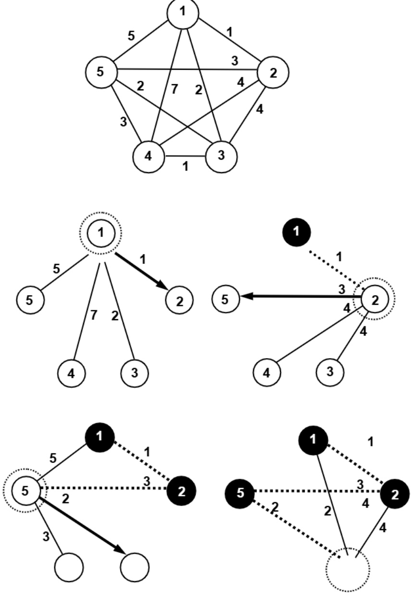

<!-- page: 6 -->

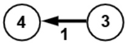

Hình 1.1: Giải bài toán sử dụng nguyên lý Greedy

Tất nhiên, thuật giải theo kiểu Heuristic đôi lúc lại đưa ra kết quả không tốt, thệm chí rất tệ như trường hợp ở hình sau.

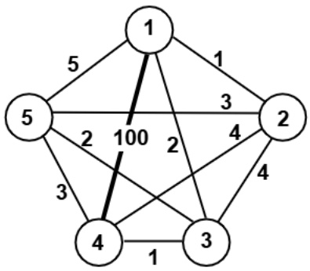

Hình 1.2

<!-- page: 7 -->

## Bài toán phân việc – ứng dụng của nguyên lý thủ tự

Một công ty nhận được hợp đồng gia công m chi tiết máy $J_1$, $J_2$, ... $J_m$. Công ty có n máy gia công lần lượt là $P_1$, $P_2$, ... $P_n$. Mọi chi tiết đều có thể được gia công trên bất kỳ máy nào. Một khi đã gia công một chi tiết trên một máy, công việc sẽ tiếp tục cho đến lúc hoàn thành, không thể bị cắt ngang. Đề gia công một việc $J_1$ trên một máy bất kỳ ta cần dùng một thời gian tương ứng là $t_1$. Nhiệm vụ của công ty là phải làm sao gia công xong toàn bộ n chi tiết trong thời gian sớm nhất.

Chúng ta xét bài toán trong trường hợp có ba máy  $P_{1}$ ,  $P_{2}$ ,  $P_{3}$  và sáu công việc với thời gian là  $t_{1}=2$ ,  $t_{2}=5$ ,  $t_{3}=8$ ,  $t_{4}=1$ ,  $t_{5}=5$ ,  $t_{6}=1$ ; ta có một phương án phân công (L) như hình sau:

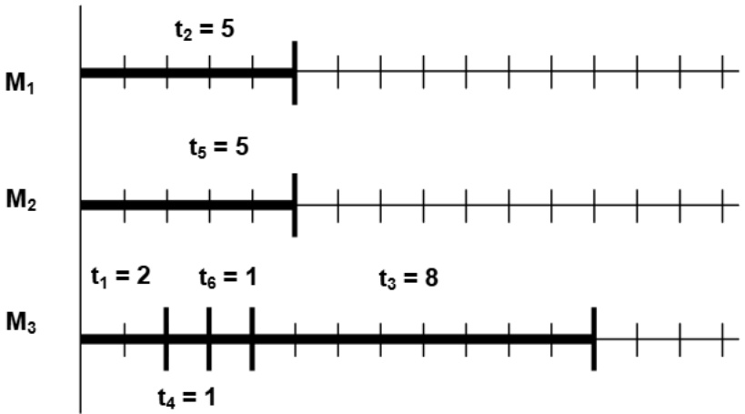

Hình 1.3

<!-- page: 8 -->

Theo hình 1.3, tại thời điểm t = 0, ta tiến hành gia công chi tiết J₂ trên máy P₁, J₅ trên P₂ và J₁ tại P₃. Tại thời điểm t = 2, công việc J₁ được hoàn thành, trên máy P₃ ta gia công tiếp chi tiết J₄. Trong lúc đó, hai máy P₁ và P2 vẫn đang thực hiện công việc đầu tiên mình ... Sơ đồ phân việc theo hình ở trên được gọi là lược đổ Gantt. Theo lược đổ này, ta thấy thời gian để hoàn thành toàn bộ 6 công việc là 12. Nhận xét một cách cảm tính ta thấy rằng phương án (L) vừa thực hiện là một phương án không tốt. Các máy P₁ và P₂ có quá nhiều thời gian rảnh.

Thuật toán tìm phương án tối ưu L₀ cho bài toán này theo kiểu vét cạn có độ phức tạp cỡ O(mⁿ) (với m là số máy và n là số công việc). Bây giờ ta xét đến một thuật giải heuristic rất đơn giản (độ phức tạp O(n)) để giải bài toán này.

\- Sắp xếp các công việc theo thú tự giảm dẫn về thời gian gia công.

○ Lân lượt sắp xếp các việc theo thú tự đó vào máy còn dưới nhiều thời gian nhất.

Với tư tưởng như vậy, ta sẽ có một phương án L\* như sau:

<!-- page: 9 -->

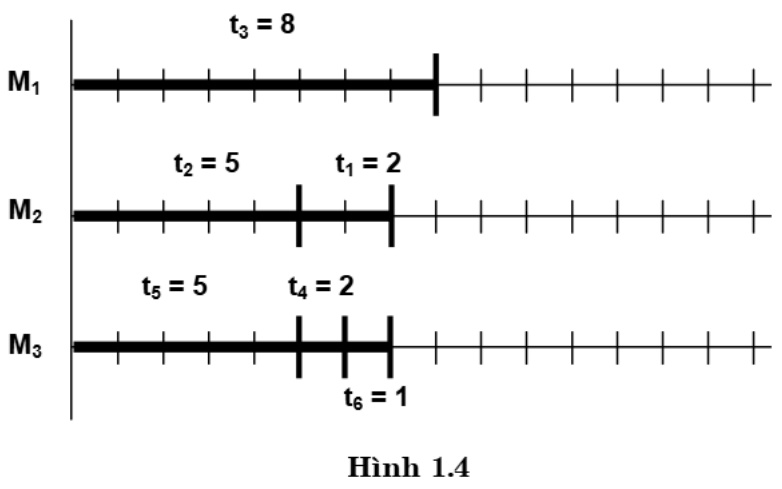

Rõ ràng phương án L\* vừa thực hiện cũng chính là phương án tối ưu của trường hợp này vì thời gian hoàn thành là 8, đúng bằng thời gian của công việc J₃. Ta hy vọng rằng một thuật giải heuristic đơn giản như vậy sẽ là một thuật giải tối ưu. Nhưng tiếp thay, ta dễ dàng đưa ra được một trường hợp mà thuật giải heuristic không đưa ra được kết quả tối ưu.

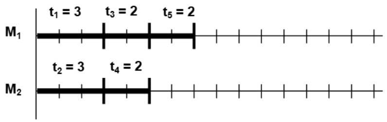

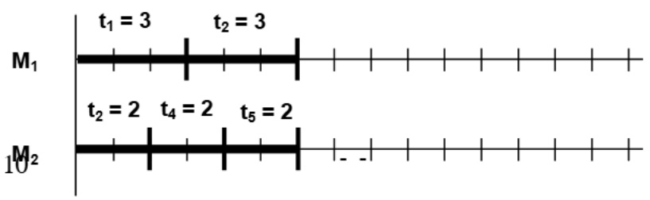

<!-- page: 10 -->

Nếu gọi T\* là thời gian để gia công xong n chi tiết máy do thuật giải heuristic đưa ra và T⁰ là thời gian tối ưu thì người ta đã chứng minh được rằng

$$
\frac {\mathsf {T} ^ {*}}{\mathsf {T} ^ {0}} \leq \frac {4}{3} - \frac {1}{\mathsf {M}} (\mathsf {M} \text {là só máy})
$$

Với kết quả này, ta có thể xác lập được sai số mà chúng ta phải gánh chịu nếu dùng heuristic thay vì tìm một lời giải tối ưu. Chẳng hạn với số máy là 2 (M = 2) ta có $\frac{T^{*}}{T^{0}} \leq \frac{7}{6}$, và đó chính là sai số cục đại mà trường hợp ở trên đã gánh chịu. Theo công thức này, số máy cảng lớn thì sai số cảng lớn.

Trong trường hợp M lớn thì tỷ số 1/M xem như bằng 0. Như vậy, sai số tối đa mà ta phải chịu là T\* ≤ 4/3 T⁰, nghĩa là sai số tối đa là 33%. Tuy nhiên, khó tìm ra được những trường hợp mà sai số đúng bằng giá trị cực đại, dù trong trường hợp xấu nhất. Thuật giải heuristic trong trường hợp này rõ ràng đã cho chúng ta những lời giải tương đối tốt.

<!-- page: 11 -->

## III. CÁC PHƯƠNG PHÁP TİM KIỂM HEURISTIC

Qua các phần trước chúng ta tìm hiểu tổng quan về ý tưởng của thuật giải heuristic (nguyên lý Greedy và sắp thứ tự). Trong mục này, chúng ta sẽ đi sâu vào tìm hiểu một số kỹ thuật tìm kiếm heuristic – một lớp bài toán rất quan trọng và có nhiều ứng dụng trong thực tế.

## III. Câu trúc chung của bài toán tìm kiếm

Đế tiện lợi cho việc trình bày, ta hấy dành chút thời gian để làm rõ hơn “đối tượng” quan tâm của chúng ta trong mục này. Một cách chung nhất, nhiều vấn đề-bài toán phức tạp đều có dạng “tìm đường đi trong đồ thị” hay nói một cách hình thức hơn là “xuất phát từ một định của một đồ thị, tìm đường đi hiệu quả nhất đến một định nào đó”. Một phát biểu khác thường gặp của dạng bài toán này là :

Cho trước hai trạng thái T₀ và T\_G hây xây dựng chuỗi trạng thái T₀, T₁, T₂, ..., T\_n-1, T\_n = T\_G sao cho :

$\sum_{1}^{n}\mathrm{cost}(\mathrm{T}_{i-1},\mathrm{T}_{i})$ thỏa mặn một điều kiện cho trước (thường là nhỏ nhất)

trong đó, T$_{i}$ thuộc tập hợp S (gọi là không gian trạng thái – state space) bao gồm tất cả các trạng thái có thể có của bài toán và cost(T$_{i-1}$, T$_{i}$) là chi phí để biến đổi từ trạng thái T$_{i-1}$ sang trạng thái T$_{i}$. Dĩ nhiên, từ một trạng thái T$_{i}$

<!-- page: 12 -->

ta có nhiều cách để biến đổi sang trạng thái  $T_{i+1}$ . Khi nói đến một biến đổi cụ thể từ  $T_{i-1}$  sang  $T_{i}$  ta sẽ dùng thuật ngữ hướng đi (với ngụ ý nói về sự lựa chọn).

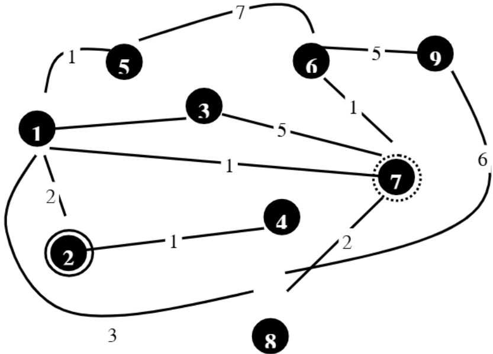

Hình 1.6: Mô hình chung của các vấn đề-bài toán phải giải quyết bằng phương pháp tìm kiếm lời giải. Không gian tìm kiếm là một tập hợp trạng thái - tập các nút của đô thị. Chi phí cần thiết để chuyển từ trạng thái T này sang trạng thái $T_k$ được biểu diễn dưới dạng các con số nằm trên cung nối giữa hai nút tượng trung cho hai trạng thái.

Đa số các bài toán thuộc dạng mà chúng ta đang mô tả đều có thể được biểu diễn dưới dạng đồ thị; trong đó, một trạng thái là một đình của đồ thị; tập hợp S bao gồm tất cả các trạng thái chính là tập hợp bao gồm tất cả định của đồ thị. Việc biến đổi từ trạng thái T$_{i-1}$ sang trạng thái T$_{i}$ là

<!-- page: 13 -->

việc đi từ đình đại diện cho T$_{i-1}$ sang đình đại diện cho T$_{i}$ theo cung nôi giữa hai đình này.

Đế bạn đọc có thể hình dung một cách cụ thể bản chất của thuật giải heuristic, chúng ta nhất thiết phải nằm vững hai chiến lược tìm kiếm cơ bản là tìm kiếm theo chiều sâu (Depth First Search) và tìm kiếm theo chiều rộng (Breath First Search). Số đã chúng ta dùng từ chiến lược mà không phải là phương pháp là bởi vì trong thực tế, người ta hầu như chẳng bao giờ vận dụng một trong hai kiểu tìm kiếm này một cách trực tiếp mà không phải sửa đổi gì.

## III.2.1. Tìm kiểm chiều sâu (Depth-First Search)

Trong tìm kiếm theo chiều sâu, tại trạng thái (đỉnh) hiện hành, ta chọn một trạng thái kế tiếp (trong tập các trạng thái có thể biến đổi thành từ trạng thái hiện tại) làm trạng thái hiện hành cho đến lúc trạng thái hiện hành là trạng thái đích. Trong trường hợp tại trạng thái hiện hành, ta không thể biến đổi thành trạng thái kế tiếp thì ta sẽ quay lui (back-tracking) lại trạng thái trước trạng thái hiện hành (trạng thái biến đổi thành trạng thái hiện hành) để chọn đường khác. Nếu ở trạng thái trước này mà cũng không thể biến đổi được nửa thì ta quay lui lại trạng thái trước nửa và cứ thế. Nếu đã quay lui đến trạng thái khởi đầu mà vẫn thất bại thì kết luận là không có lời giải.

<!-- page: 14 -->

Hình ảnh sau minh họa hoạt động của tìm kiếm theo chiều sâu.

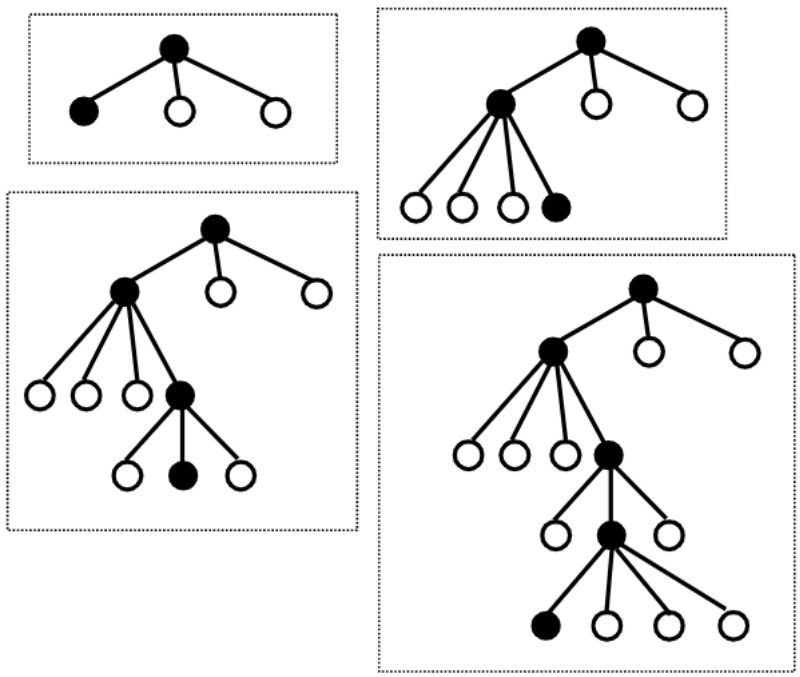

Hình 1.7: Hình ảnh của tìm kiếm chiều sâu. Nó chỉ lưu ý "mở rộng" trạng thái được chơn mà không "mở rộng" các trạng thái khác (nút màu trắng trong hình vẽ).

## III.2.2. Tìm kiểm chiêu rộng (Breath-First Search)

Ngược lại với tìm kiếm theo kiểu chiều sâu, tìm kiếm chiều rộng mang hình ảnh của vết đầu loang. Từ trạng thái ban đầu, ta xây dựng tập hợp S bao gồm các trạng

<!-- page: 15 -->

thái kế tiếp (mà từ trạng thái ban đầu có thể biến đổi thành). Sau đó, ứng với mỗi trạng thái  $T_{k}$  trong tập S, ta xây dựng tập  $S_{k}$  bao gồm các trạng thái kế tiếp của  $T_{k}$  rời lần lượt bổ sung các  $S_{k}$  vào S. Quá trình này cứ lập lại cho đến lúc S có chứa trạng thái kết thúc hoặc S không thay đổi sau khi đã bổ sung tất cả  $S_{k}$ .

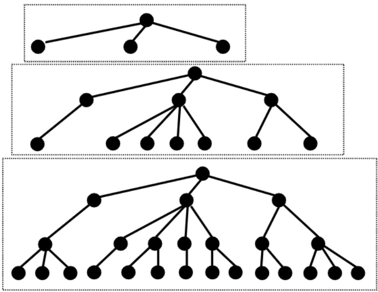

Hình 1.8: Hình ảnh của tìm kiếm chiêu rộng. Tại một bước, mọi trạng thái đều được mở rộng, không bổ sót trạng thái nào.

<!-- page: 16 -->

|  | Chiều sâu | Chiều rộng |
| --- | --- | --- |
| Tính hiệu quả | Hiệu quả khi lời giải nằm sâu trong cây tìm kiếm và có một phương án chọn hướng đi chính xác. Hiệu quả của chiến lược phụ thuộc vào phương án chọn hướng đi. Phương án càng kém hiệu quả thì hiệu quả của chiến lược càng giảm. Thuận lợi khi muốn tìm chỉ một lời giải. | Hiệu quả khi lời giải nằm gần gốc của cây tìm kiếm. Hiệu quả của chiến lược phụ thuộc vào độ sâu của lời giải. Lời giải càng xa gốc thì hiệu quả của chiến lược càng giảm. Thuận lợi khi muốn tìm nhiều lời giải. |
| Lượng bộ nhớ sử dụng để lưu trữ các trạng thái | Chỉ lưu lại các trạng thái chưa xét đến. | Phải lưu toàn bộ các trạng thái. |
| Trường hợp xấu nhất | Vết cạn toàn bộ | Vết cạn toàn bộ. |
| Trường hợp tốt nhất | Phương án chọn hướng đi tuyệt đối chính xác. Lời giải được xác định một cách trực tiếp. | Vết cạn toàn bộ. |

Tìm kiểm chiều sâu và tìm kiếm chiều rộng đều là các phương pháp tìm kiếm có hệ thống và chắc chắn tìm ra lời giải. Tuy nhiên, do bản chất là vét cạn nên với những bài toán có không gian lớn thì ta không thể dùng hai chiến lược này được. Hơn nửa, hai chiến lược này đều có tính chất “mù quáng” vì chúng không chú ý đến những thông

<!-- page: 17 -->

tin (tri thức) ở trạng thái hiện thời và thông tin về đích cần đạt tới cùng mối quan hệ giữa chúng. Các tri thức này vô cùng quan trọng và rất có ý nghĩa để thiết kế các thuật giải hiệu quả hơn mà ta sắp sửa bàn đến.

## III.3. Tìm kiểm leo đôi

## III. 3.1. Leo đôi đơn giản

Tìm kiểm leo đổi theo đúng nghĩa, nói chung, thực chất chỉ là một trường hợp đặc biệt của tìm kiếm theo chiều sâu nhưng không thể quay lui. Trong tìm kiếm leo đổi, việc lựa chọn trạng thái tiếp theo được quyết định dựa trên một hàm heuristic.

## Hàm heuristic là gì ?

Thuật ngữ “hàm heuristic” muốn nói lên điều gì? Chắng có gì ghê góm. Bạn đã quen với nó rời! Đó đơn giản chỉ là một ước lượng về khả năng dẫn đến lời giải tính từ trạng thái đó (khoảng cách giữa trạng thái hiện tại và trạng thái đích). Ta sẽ quy ước gọi hàm này là h trong suốt giáo trình này. Đôi lúc ta cũng để cập đến chi phí tối ưu thực sự từ một trạng thái dẫn đến lời giải. Thông thường, giá trị này là không thể tính toán được (vì tính được đồng nghĩa là đã biết con đường đến lời giải!) mà ta chỉ dùng nó như một cơ sở để suy luận về mặt lý thuyết mà thôi ! Hàm h, ta quy ước rằng, luôn trả ra kết quả là

<!-- page: 18 -->

một số không âm. Đề bạn đọc thực sự nắm được ý nghĩa của hai hàm này, hãy quan sát hình sau trong đó minh họa chi phí tối ưu thực sự và chi phí ước lượng.

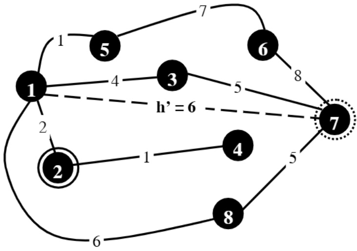

Hình 1.9: Chi phí uốc lượng h' = 6 và chi phí tối ưu thực sự h = 4 + 5 = 9 (đi theo đường 1-3-7)

Bản đang ở trong một thành phố xa là mà không có bản đồ trong tay và ta muốn đi vào khu trung tâm? Một cách suy nghĩ đơn giản, chúng ta sẽ nhằm vào hướng những tòa cao ốc của khu trung tâm!

<!-- page: 19 -->

<div class="docvortex-algorithm" style="white-space: pre-wrap; font-family:monospace;">
Tu tuǒng
1) Nếu trạng thái bắt đầu cũng là trạng thái đích thì thoát và báo là đã tìm được lời giải. Nguộc lại, đặt trạng thái hiện hành (T$_{i}$) là trạng thái khởi đấu (T$_{0}$)
2) Lắp lại cho đến khi đạt đến trạng thái kết thúc hoặc cho đến khi không tổn tại một trạng thái tiếp theo hợp lệ (T$_{k}$) của trạng thái hiện hành :
a. Đặt T$_{k}$ là một trạng thái tiếp theo hợp lệ của trạng thái hiện hành T$_{i}$.
b. Đánh giá trạng thái T$_{k}$ mới :
b.1. Nếu là trạng thái kết thúc thì trả về trị này và thoát.
b.2. Nếu không phải là trạng thái kết thúc nhưng tốt hơn trạng thái hiện hành thì cập nhật nó thành trạng thái hiện hành.
b.3. Nếu nó không tốt hơn trạng thái hiện hành thì tiếp tục vòng lặp.
</div>

```txt
Mã giả

    Ti := T0; Stop :=FALSE;
    WHILE Stop=FALSE DO BEGIN
        IF Ti ≡ TG THEN BEGIN
            <tìm được kết quả>; Stop:=TRUE;
        END;
        ELSE BEGIN
            Better:=FALSE;
            WHILE (Better=FALSE) AND (STOP=FALSE)
            DO BEGIN
                IF <không tồn tại trạng thái kế tiếp hợp
                lệ của Ti> THEN BEGIN
                    <không tìm được kết quả>; Stop:=TRUE;
                END;
```

<!-- page: 20 -->

<div class="docvortex-algorithm" style="white-space: pre-wrap; font-family:monospace;">
ELSE BEGIN
        $T_k := &lt;một trang thái kế tiếp hợp lệ$
        của $T_i&gt;$;
        IF    &lt;h($T_k$) tốt hơn h($T_i$)&gt; THEN BEGIN
            $T_i := T_k$; Better:=TRUE;
        END;
    END;
END; {WHILE}
END; {ELSE}
END; {WHILE}
</div>

Mệnh để “h' (T$_{k}$) tốt hơn h' (T$_{i}$)” nghĩa là gì? Đây là một khái niệm chung chung. Khi cải đặt thuật giải, ta phải cung cấp một định nghĩa tường minh về tốt hơn. Trong một số trường hợp, tốt hơn là nhỏ hơn : h' (T$_{k}$) < h' (T$_{i}$); một số trường hợp khác tốt hơn là lớn hơn h' (T$_{k}$) > h' (T$_{i}$) ... Chắng hạn, đối với bài toán tìm đường đi ngắn nhất giữa hai điểm. Nếu dùng hàm h' là hàm cho ra khoảng cách theo đường chim bay giữa vị trí hiện tại (trạng thái hiện tại) và đích đến (trạng thái đích) thì tốt hơn nghĩa là nhỏ hơn.

Vấn đề cần làm rõ kế tiếp là thể nào là <một trạng thái kế tiếp hợp lệ của T$_{i}$>? Một trạng thái kế tiếp hợp lệ là trạng thái chưa được xét đến. Giả sử h của trạng thái hiện tại T$_{i}$ có giá trị là h(T$_{i}$) = 1.23 và từ T$_{i}$ ta có thể biến đổi sang một trong ba trạng thái kế tiếp lần lượt là T$_{k1}$, T$_{k2}$, T$_{k3}$ với giá trị các hàm h tương ứng là h(T$_{k1}$) = 1.67,

<!-- page: 21 -->

$h(T_{k2}) = 2.52$, $h'(T_{k3}) = 1.04$. Đầu tiên, $T_k$ sẽ được gán bằng $T_{k1}$, nhưng vì $h'(T_k) = h'(T_{k1}) > h'(T_i)$ nên $T_k$ không được chọn. Kế tiếp là $T_k$ sẽ được gán bằng $T_{k2}$ và cũng không được chọn. Cuối cùng thì $T_{k3}$ được chọn. Nhưng giả sử $h'(T_{k3}) = 1.3$ thì cả $T_{k3}$ cũng không được chọn và mệnh đề <không thể sinh ra trạng thái kế tiếp của $T_i >$ sẽ có giá trị True. Giải thích này có về hiển nhiên nhưng có lẻ cần thiết để tránh nhằm lẫn cho bạn đọc.

Đế thấy rõ hoạt động của thuật giải leo đổi. Ta hãy xét một bài toán minh họa sau. Cho bốn khối lập phương giống nhau A, B, C, D trong đó các mặt (M1), (M2), (M3), (M4), (M5), (M6) có thể được tô bằng một trong sáu màu (1), (2), (3), (4), (5), (6). Ban đầu các khối lập phương được xếp vào một hàng. Mỗi một bước, ta chỉ được xoay một khối lập phương quanh một trực (X,Y,Z) 90$^{0}$ theo chiều bất kỳ (nghĩa là ngược chiều hay thuận chiều kim đồng hồ cũng được). Hãy xác định số bước quay ít nhất sao cho tất cả các mặt của khối lập phương trên bốn mặt của hàng là có cùng màu như hình vẽ.

<!-- page: 22 -->

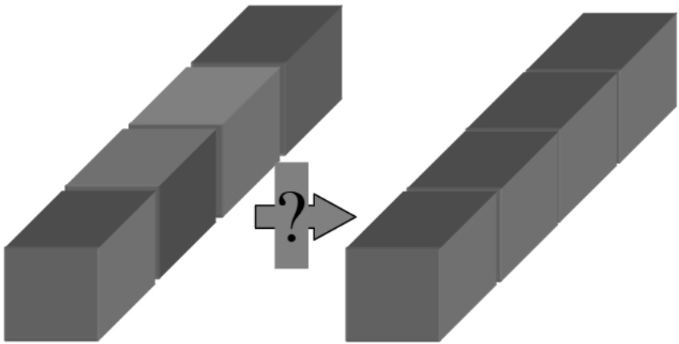

Hình 1.10: Bài toán bốn khối lập phương

Đế giải quyết vấn đề, trước hết ta cần định nghĩa một hàm G dùng để đánh giá một tình trạng cụ thể có phải là lời giải hay không? Bạn đọc có thể dễ dàng đưa ra một cải đặt của hàm G như sau :

$$
\begin{array}{l} \text {IF} \left(G _ {\text {trái}} + G _ {\text {phái}} + G _ {\text {trên}} + G _ {\text {duoi}} + G _ {\text {trước}} + G _ {\text {sau}}\right) = 1 6 \\ \text {THEN} \\ \quad \mathrm{G:=TRUE} \\ \text {ELSE} \\ \quad \mathrm{G:=FALSE}; \end{array}
$$

trong đó, Gphải là số lượng các mặt có cùng màu của mặt bên phải của hàng. Tương tự cho Gtrái, Gtrên, Ggiữa, Gtrước, Gsau. Tuy nhiên, do các khối lập phương A, B, C, D là hoàn toàn tương tự nhau nên tương quan giữa các mặt của mỗi khối là giống nhau. Do đó, nếu có hai mặt không đối nhau trên hàng đồng màu thì bốn mặt còn lại của hàng cũng đồng màu. Từ đó ta chỉ cần hàm G được định nghĩa như sau là đủ :

<!-- page: 23 -->

$$
\begin{array}{l} \text {IF} G _ {\text {phai}} + G _ {\text {duoi}} = 8 \text {THEN} \\ \quad \mathrm{G} := \text {TRUE} \\ \text {ELSE} \\ \quad \mathrm{G} := \text {FALSE}; \end{array}
$$

Hàm h (ước lượng khả năng dẫn đến lời giải của một trạng thái) sẽ được định nghĩa như sau :

$$
\mathbf {h} = \mathbf {G} _ {\mathrm{trái}} + \mathbf {G} _ {\mathrm{phải}} + \mathbf {G} _ {\mathrm{trên}} + \mathbf {G} _ {\mathrm{duói}}
$$

Bài toán này đủ đơn giản để thuật giải leo đổi có thể hoạt động tốt. Tuy nhiên, không phải lúc nào ta cũng may mặn như thế!

Đến dây, có thể chúng ta sẽ nảy sinh một ý tưởng. Nếu đã chọn trạng thái tốt hơn làm trạng thái hiện tại thì tại sao không chọn trạng thái tốt nhất ? Như vậy, có lẽ ta sẽ nhanh chóng dẫn đến lời giải hơn! Ta sẽ bàn luận về vấn đề: “liệu cải tiến này có thực sự giúp chúng ta dẫn đến lời giải nhanh hơn hay không?” ngay sau khi trình bày xong thuật giải leo đổi đốc đúng.

<!-- page: 24 -->

## III.3.2. Leo đôi đốc đúng

Về cơ bản, leo đổi đốc đúng cũng giống như leo đổi, chỉ khác ở điểm là leo đổi đốc đúng sẽ duyệt tất cả các hướng đi có thể và chọn đi theo trạng thái tốt nhất trong số các trạng thái kế tiếp có thể có (trong khi đó leo đổi chỉ chọn đi theo trạng thái kế tiếp đầu tiên tốt hơn trạng thái hiện hành mà nó tìm thấy).

```lisp
Tư tưởng
1) Nếu trạng thái bắt đầu cũng là trạng thái đích thì thoát và báo là đã tìm được lời giải. Nguốc lại, đặt trạng thái hiện hành (T_i) là trạng thái khởi đấu (T_0)
2) Lắp lại cho đến khi đạt đến trạng thái kết thúc hoặc cho đến khi (T_i) không tôn tại một trạng thái kế tiếp (T_k) nào tốt hơn trạng thái hiện tại (T_i)
    a) Đặt S bằng tập tất cả trạng thái kế tiếp có thể có của T_i và tốt hơn T_i.
    b) Xác định T_k^max là trạng thái tốt nhất trong tập S
        Đặt T_i = T_k^max

Mã giả
    T_i := T_0;
    Stop := FALSE;
    WHILE Stop=FALSE DO BEGIN
        IF T_i ≡ T_G THEN BEGIN
            <tìm được kết quả >;
            STOP := TRUE;
        END;
    ELSE BEGIN
        Best:=h' (T_i);
```

<!-- page: 25 -->

```txt
Tmax := Ti;

WHILE <tòn tại trạng thái kết tiếp hợp lệ của
Ti> DO BEGIN
    Tk := <một trạng thái kết tiếp hợp lệ của
    Ti>;
    IF <h'(Tk) tốt hơn Best> THEN BEGIN
        Best := h'(Tk);
        Tmax := Tk;
    END;
END;

IF (Best>Ti)
    Ti := Tmax;
ELSE BEGIN
    <không tìm được kết quả>;
    STOP:=TRUE;
END;
END; {ELSE IF}
END;{WHILE STOP}
```

## III.3.3. Đánh giá

So với leo đổi đơn giản, leo đổi đốc đúng có ưu điểm là luôn luôn chọn hướng có triển vọng nhất để đi. Liệu điều này có đảm bảo leo đổi đốc đúng luôn tốt hơn leo đổi đơn giản không? Câu trả lời là không. Leo đổi đốc đúng chỉ tốt hơn leo đổi đơn giản trong một số trường hợp mà thôi. Đế chọn ra được hướng đi tốt nhất, leo đổi đốc đúng phải duyệt qua tất cả các hướng đi có thể có tại trạng thái hiện hành. Trong khi đó, leo đổi đơn giản chỉ chọn đi theo trạng thái đầu tiên tốt hơn (so với trạng thái hiện hành) mà nó tìm ra được. Do đó, thời gian cần thiết để leo đổi

<!-- page: 26 -->

dốc đúng chọn được một hướng đi sẽ lớn hơn so với leo đổi đơn giản. Tuy vậy, do lúc nào cũng chọn hướng đi tốt nhất nên leo đổi đốc đúng thường sẽ tìm đến lời giải sau một số bước ít hơn so với leo đổi đơn giản. Nói một cách ngắn gọn, leo đổi đốc đúng sẽ tôn nhiều thời gian hơn cho một bước nhưng lại đi ít bước hơn; còn leo đổi đơn giản tổn ít thời gian hơn cho một bước đi nhưng lại phải đi nhiều bước hơn. Đây chính là yếu tố được và mất giữa hai thuật giải nên ta phải cân nhắc kỹ lượng khi lựa chọn thuật giải.

Cả hai phương pháp leo núi đơn giản và leo núi đốc đúng đều có khả năng thất bại trong việc tìm lời giải của bài toán mặc dù lời giải đó thực sự hiện hữu. Cả hai giải thuật đều có thể kết thúc khi đạt được một trạng thái mà không còn trạng thái nào tốt hơn nửa có thể phát sinh nhưng trạng thái này không phải là trạng thái đích. Điều này sẽ xảy ra nếu chương trình đạt đến một điểm cực đại địa phương, một đoạn đơn điều ngang.

Điểm cục đại địa phương (a local maximum) là một trạng thái tốt hơn tất cả lân cận của nó nhưng không tốt hơn một số trạng thái khác ở xa hơn; nghĩa là tại một điểm cực đại địa phương, mọi trạng thái trong một lân cận của trạng thái hiện tại đều xấu hơn trạng thái hiện tại. Tuy có dáng về của lời giải nhưng các cực đại địa phương không phải là lời giải thực sự. Trong trường hợp này, chúng được gọi là những gọn đổi thấp.

<!-- page: 27 -->

Đoạn đơn điệu ngang (a plateau) là một vùng bằng phẳng của không gian tìm kiếm, trong đó, toàn bộ các trạng thái lân cận đều có cùng giá trị.

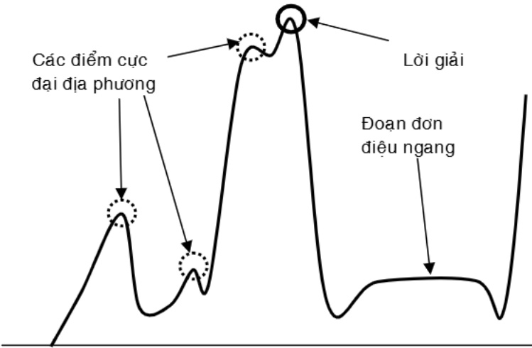

Hình 1.11: Các tình huống khó khăn cho tìm kiếm leo đèo.

Đế đối phó với các các điểm này, người ta đã đưa ra một số giải pháp. Ta sẽ tìm hiểu hai trong số các giải pháp này. Những giải này, không thực sự giải quyết trọn vẹn vấn đề mà chỉ là một phương án cứu nguy tạm thời mà thôi.

Phương án đầu tiên là kết hợp leo đổi và quay lui. Ta sẽ quay lui lại các trạng thái trước đó và thử đi theo hướng khác. Thao tác này hợp lý nếu tại các trạng thái trước đó có một hướng đi tốt mà ta đã bỏ qua trước đó. Đây là một cách khá hay để đổi phó với các điểm cực đại địa phương. Tuy nhiên, do đặc điểm của leo đổi là “bước sau cao hơn

<!-- page: 28 -->

bước trước” nên phương án này sẽ thất bại khi ta xuất phát từ một điểm quá cao hoặc xuất phát từ một định đổi mà để đến được lời giải cần phải đi qua một “thung lũng” thật sâu như trong hình sau.

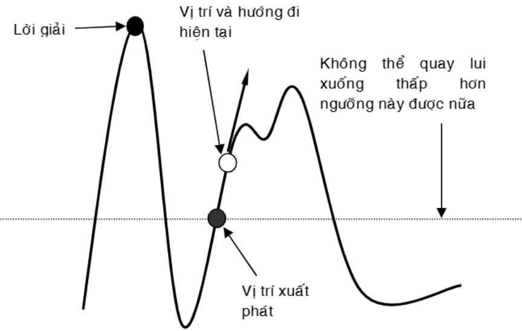

Hình 1.12: Một trường hợp thất bại của leo đèo kết hợp quay lui.

Cách thứ hai là thực hiện một bước nhảy vọt theo hướng nào đó để thử đến một vùng mới của không gian tìm kiếm. Nôm na là “bước” liên tục nhiều “bước” (chẳng hạn 5, 7, 10, ...) mà tạm thời “quên” đi việc kiểm tra “bước sau cao hơn bước trước”. Tiếp cận có về hiệu quả khi ta gặp phải một đoạn đơn điệu ngang. Tuy nhiên, nhảy vọt cũng có nghĩa là ta đã bỏ qua cơ hội để tiến đến lời giải thực sự. Trong trường hợp chúng ta đang đúng khá gần lời giải, việc nhảy vọt sẽ đưa chúng ta sang một vị trí hoàn toàn xa lạ, mà từ

<!-- page: 29 -->

dó, có thể sẽ dẫn chúng ta đến một rắc rối kiểu khác. Hơn nữa, số bước nhảy là bao nhiêu và nhảy theo hướng nào là một vấn đề phụ thuộc rất nhiều vào đặc điểm không gian tìm kiếm của bài toán.

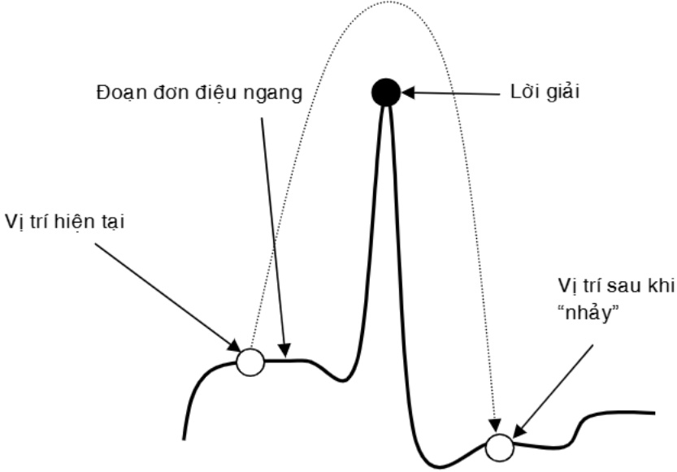

Hình 1.13 : Một trường hợp khó khăn cho phương án "nhảy vọt".

Leo núi là một phương pháp cục bộ bởi vì nó quyết định sẽ làm gì tiếp theo dựa vào một đánh giá về trạng thái hiện tại và các trạng thái kế tiếp có thể có (tốt hơn trạng thái hiện tại, trạng thái tốt nhất tốt hơn trạng thái hiện tại) thay vì phải xem xét một cách toàn diện trên tất cả các trạng thái đã đi qua. Thuận lợi của leo núi là ít gặp sự bùng nổ tổ hợp hơn so với các phương pháp toàn cục. Nhưng nó cũng giống như các phương pháp cục bộ khác ở

<!-- page: 30 -->

chỗ là không chắc chắn tìm ra lời giải trong trường hợp xấu nhất.

Một lần nửa, ta khẳng định lại vai trò quyết định của hàm heuristic trong quá trình tìm kiếm lời giải. Với cùng một thuật giải (như leo đôi chẳng hạn), nếu ta có một hàm heuristic tốt hơn thì kết quả sẽ được tìm thấy nhanh hơn. Ta hấy xét bài toán về các khối được trình bày ở hình 1.14. Ta có hai thao tác biến đổi là:

\+ Lấy một khối ở định một cột bất kỳ và đặt nó lên một chỗ trống tạo thành một cột mới. Lưu ý là chỉ có thể tạo ra tối đa hai cột mới.

\+ Lấy một khối ở định một cột và đặt nó lên định một cột khác

Hãy xác định số thao tác ít nhất để biến đổi cột đã cho thành cột kết quả.

<!-- page: 31 -->

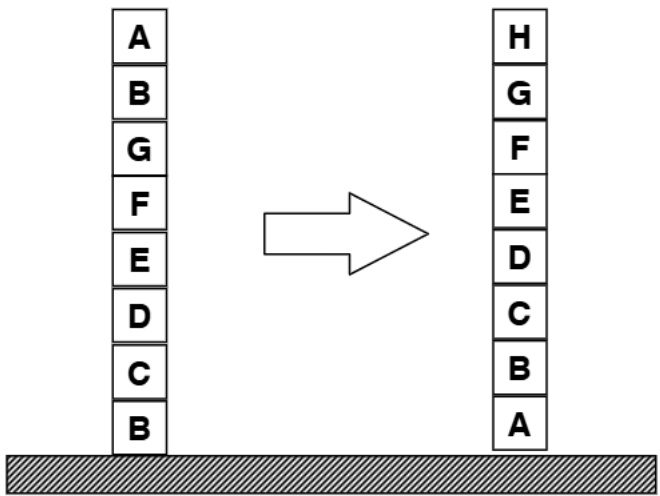

Hình 1.14: Trạng thái khởi đầu và trạng thái kết thúc

Giả sử ban đầu ta dùng một hàm heuristic đơn giản như sau :

```txt
H₁ : Cộng 1 điểm cho mỗi khối ở vị trí đúng so với trạng thái đích. Trù 1 điểm cho mỗi khối đặt ở vị trí sai so với trạng thái đích.
```

Dùng hàm này, trạng thái kết thúc sẽ có giá trị là 8 vì cả tám khối đều được đặt ở vị trí đúng. Trạng thái khối đầu có giá trị là 4 (vì nó có 1 điểm cộng cho các khối C, D, E, F, G, H và 1 điểm trừ cho các khối A và B). Chỉ có thể có một di chuyển từ trạng thái khối đầu, đó là dịch chuyển khối A xuống tạo thành một cột mới (T₁).

<!-- page: 32 -->

Điều đó sinh ra một trạng thái với số điểm là 6 (vì vị trí của khối A bảy giờ sinh ra 1 điểm cộng hơn là một điểm trừ). Thủ tục leo núi sẽ chấp nhận sự dịch chuyển đó. Từ trạng thái mới T₁, có ba di chuyển có thể thực hiện dẫn đến ba trạng thái Tₐ, T\_b, T\_c được minh họa trong hình dưới. Những trạng thái này có số điểm là : h'(Tₐ)= 4; h'(T\_b) = 4 và h'(T\_c) = 4

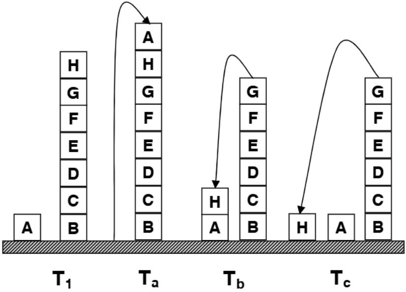

Hình 1.15: Các trạng thái có thể đạt được từ T₁

Thủ tục leo núi sẽ tạm dùng bởi vì tất cả các trạng thái này có số điểm thấp hơn trạng thái hiện hành. Quá trình tìm kiếm chỉ dùng lại ở một trạng thái cực đại địa phương mà không phải là cực đại toàn cực.

<!-- page: 33 -->

Chúng ta có thể đồ lỗi cho chính giải thuật leo đổi vì đã thất bại do không đủ tầm nhìn tổng quát để tìm ra lời giải. Nhưng chúng ta cũng có thể đồ lỗi cho hàm heuristic và cố gắng sửa đổi nó. Giả sử ta thay hàm ban đầu bằng hàm heuristic sau đây :

$H_{2}$ : Đối với mỗi khối phụ trợ đúng (khối phụ trợ là khối nằm bên dưới khối hiện tại), cộng 1 điểm, ngược lại trừ 1 điểm.

Dùng hàm này, trạng thái kết thúc có số điểm là 28 vì B nằm đúng vị trí và không có khối phụ trợ nào, C đúng vị trí được 1 điểm cộng với 1 điểm do khối phụ trợ B nằm đúng vị trí nên C được 2 điểm, D được 3 điểm... Trạng thái khởi đầu có số điểm là -28. Việc di chuyển A xuống tạo thành một cột mới làm sinh ra một trạng thái với số điểm là h'(T₁) = -21 vì A không còn 7 khối sai phía dưới nó nửa. Ba trạng thái có thể phát sinh tiếp theo bảy giờ có các điểm số là : h'(Tₐ) = -28; h'(T\_b) = -16 và h'(T\_c) = -15. Lức này thủ tục leo núi đốc đúng sẽ chọn di chuyển đến trạng thái T\_c, ở đó có một khối đúng. Qua hàm H₂ này ta rút ra một nguyên tắc : tốt hơn không chỉ có nghĩa là có nhiều ưu điểm hơn mà còn phải ít khuyết điểm hơn. Hơn nửa, khuyết điểm không có nghĩa chỉ là sự sai biệt ngay tại một vị trí mà còn là sự khác biệt trong tương quan giữa các vị trí. Rỗ ràng là đúng về mặt kết quả, cùng một thủ tục leo đổi nhưng hàm H₁ bị thất bại (do chỉ biết đánh giá uu

<!-- page: 34 -->

điểm) còn hàm  $H_{2}$  mới này lại hoạt động một cách hoàn hảo (do biết đánh giá cả ưu điểm và khuyết điểm).

Đáng tiếc, không phải lúc nào chúng ta cũng thiết kế được một hàm heuristic hoàn hảo như thế. Vì việc đánh giá ưu điểm đã khó, việc đánh giá khuyết điểm càng khó và tinh tế hơn. Chẳng hạn, xét lại vấn đề muốn đi vào khu trung tâm của một thành phố xa lạ. Đề hàm heuristic hiệu quả, ta cần phải đưa các thông tin về các đường một chiều và các ngõ cụt, mà trong trường hợp một thành phố hoàn toàn xa lạ thì ta khó hoặc không thể biết được những thông tin này.

Đến đây, chúng ta hiểu rõ bản chất của hai thuật giải tiếp cận theo chiến lược tìm kiếm chiều sâu. Hiệu quả của cả hai thuật giải leo đổi đơn giản và leo đổi độc đúng phụ thuộc vào :

\+ Chất lượng của hàm heuristic.

\+ Đặc điểm của không gian trạng thái.

\+ Trạng thái khởi đầu.

Sau đây, chúng ta sẽ tìm hiểu một tiếp cận theo mới, kết hợp được sức mạnh của cả tìm kiếm chiều sâu và tìm kiếm chiều rộng. Một thuật giải rất linh động và có thể nói là một thuật giải kinh điện của Heuristic.

<!-- page: 35 -->

## III.4 Tîm kiểm ủu tiên tối ủu (Best-first - search)

Ưu điểm của tìm kiếm theo chiều sâu là không phải quan tâm đến sự mở rộng của tất cả các nhánh. Ưu điểm của tìm kiếm chiều rộng là không bị sa vào các đường dẫn bế tắc (các nhánh cụt). Tìm kiểm ưu tiên tối ưu sẽ kết hợp hai phương pháp trên cho phép ta đi theo một con đường duy nhất tại một thời điểm, nhưng đồng thời vẫn “quan sát” được những hướng khác. Nếu con đường đang đi “có về” không triển vọng bằng những con đường ta đang “quan sát” ta sẽ chuyển sang đi theo một trong số các con đường này. Để tiện lợi ta sẽ dùng chữ viết tất BFS thay cho tên gọi tìm kiếm ưu tiên tối ưu.

Một cách cụ thể, tại mỗi bước của tìm kiếm BFS, ta chọn đi theo trạng thái có khả năng cao nhất trong số các trạng thái đã được xét cho đến thời điểm đó. (khác với leo đổi độc đúng là chỉ chọn trạng thái có khả năng cao nhất trong số các trạng thái kế tiếp có thể đến được từ trạng thái hiện tại). Như vậy, với tiếp cận này, ta sẽ uu tiên đi vào những nhánh tìm kiếm có khả năng nhất (giống tìm kiếm leo đổi độc đúng), nhưng ta sẽ không bị lần quản trong các nhánh này vì nếu càng đi sâu vào một hướng mà ta phát hiện ra rằng hướng này càng đi thì càng tệ, đến mức nó xấu hơn cả những hướng mà ta chưa đi, thì ta sẽ không đi tiếp hướng hiện tại nửa mà chọn đi theo một hướng tốt nhất trong số những hướng chưa đi. Đó là tư

<!-- page: 36 -->

tưởng chủ đạo của tìm kiếm BFS. Đề hiểu được tư tưởng này. Bạn hây xem ví dụ sau :

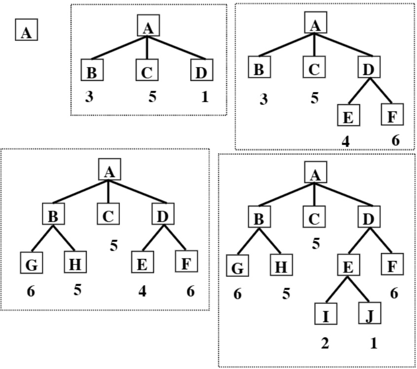

Hình 1.16 : Minh họa thuật giải Best-First Search

Khởi đầu, chỉ có một nút (trạng thái) A nên nó sẽ được mở rộng tạo ra ba nút mới B, C và D. Các con số dưới nút là giá trị cho biết độ tốt của nút. Con số càng nhỏ, nút càng tốt. Do D là nút có khả năng nhất nên nó sẽ được mở rộng tiếp sau nút A và sinh ra hai nút kế tiếp là E và F. Đến đây, ta lại thấy nút B có về có khả năng nhất (trong các nút B, C, E, F) nên ta sẽ chọn mở rộng nút B và tạo ra

<!-- page: 37 -->

hai nút G và H. Nhùng lại một lần nửa, hai nút G, H này được đánh giá ít khả năng hơn E, vì thế sự chú ý lại trở về E. E được mở rộng và các nút được sinh ra từ E là I và J. Ô bước kế tiếp, J sẽ được mở rộng vì nó có khả năng nhất. Quá trình này tiếp tục cho đến khi tìm thấy một lời giải.

Lưu ý rằng tìm kiếm này rất giống với tìm kiếm leo đổi đốc đúng, với hai ngoại lệ. Trong leo núi, một trạng thái được chọn và tất cả các trạng thái khác bị loại bỏ, không bao giờ chúng được xem xét lại. Cách xử lý đứt khoát này là một đặc trưng của leo đổi. Trong BFS, tại một bước, cũng có một di chuyển được chọn nhưng những cái khác vẫn được giữ lại, để ta có thể trở lại xét sau đó khi trạng thái hiện tại trở nên kém khả năng hơn những trạng thái đã được lưu trữ. Hơn nửa, ta chọn trạng thái tốt nhất mà không quan tâm đến nó có tốt hơn hay không các trạng thái trước đó. Điều này tương phân với leo đổi vì leo đổi sẽ dùng nếu không có trạng thái tiếp theo nào tốt hơn trạng thái hiện hành.

Đế cài đặt các thuật giải theo kiểu tìm kiếm BFS, người ta thường cần dùng hai tập hợp sau :

OPEN: tập chứa các trạng thái đã được sinh ra nhưng chưa được xét đến (vì ta đã chọn một trạng thái khác). Thực ra, OPEN là một loại hàng đội ưu tiên (priority queue) mà trong đó, phần tử có độ ưu tiên cao nhất là phần tử tốt nhất. Người ta thường cải đặt hàng đội ưu tiên

<!-- page: 38 -->

bằng Heap. Các bạn có thể tham khảo thêm về loại dữ liệu này trong các tài liệu về Cấu trúc dữ liệu.

CLOSE: tập chứa các trạng thái đã được xét đến. Chúng ta cần lưu trữ những trạng thái này trong bộ nhớ để đề phòng trường hợp khi một trạng thái mới được tạo ra lại trùng với một trạng thái mà ta đã xét đến trước đó. Trong trường hợp không gian tìm kiếm có dạng cây thì không cần dùng tập này.

<div class="docvortex-algorithm" style="white-space: pre-wrap; font-family:monospace;">
Thuật giải BEST-FIRST SEARCH
1. Đặt OPEN chứa trạng thái khởi đầu.
2. Cho đến khi tìm được trạng thái đích hoặc không còn nút nào trong OPEN, thực hiện :
2.a. Chọn trạng thái tốt nhất (T$_{max}$) trong OPEN (và xóa T$_{max}$ khởi OPEN)
2.b. Nếu T$_{max}$ là trạng thái kết thúc thì thoát.
2.c. Ngược lại, tạo ra các trạng thái kế tiếp T$_{k}$ có thể có từ trạng thái T$_{max}$. Đối với mỗi trạng thái kế tiếp T$_{k}$ thực hiện :
Tính f(T$_{k}$); Thêm T$_{k}$ vào OPEN
</div>

BFS khá đơn giản. Tuy vậy, trên thực tế, cũng như tìm kiếm chiều sâu và chiều rộng, hiểm khi ta dùng BFS một cách trực tiếp. Thông thường, người ta thường dùng các phiên bản của BFS là A$^{T}$, A$^{KT}$ và A$^{*}$

<!-- page: 39 -->

## \* Thông tin về quá khử và tương lai

Thông thường, trong các phương án tìm kiếm theo kiểu BFS, độ tốt f của một trạng thái được tính dựa theo hai giá trị mà ta gọi là là g và h'. h' chúng ta đã biết, đó là một uốc lượng về chi phí từ trạng thái hiện hành cho đến trạng thái đích (thông tin tương lai); còn g là “chiều dài quảng đường” đã đi từ trạng thái ban đầu cho đến trạng thái hiện tại (thông tin quá khú). Lưu ý ràng g là chi phí thực sự (không phải chi phí uốc lượng). Đế dễ hiểu, bạn hãy quan sát hình 1.17 :

g : chi phí thật sự đã bỏ ra để đi từ trạng thái ban đầu đến trạng thái hiện tại

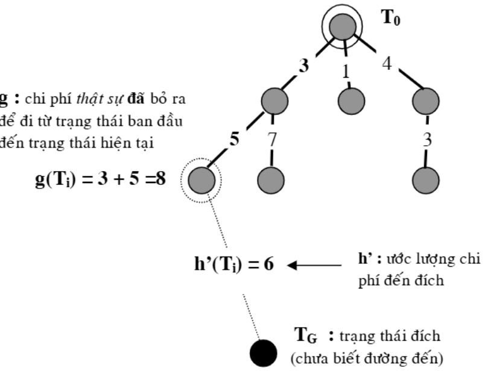

Hình1.17: Phân biệt khái niệm g và h'

<!-- page: 40 -->

Kết hợp g và h' thành  $\mathbf{f}^{\prime}$  ( $f^{\prime}=g+h^{\prime}$ ) sẽ thể hiện một ước lượng về “tổng chi phí” cho con đường từ trạng thái bắt đầu đến trạng thái kết thúc dọc theo con đường đi qua trạng thái hiện hành. Đế thuận tiện cho thuật giải, ta quy ước là g và h' đều không âm và cảng nhỏ nghĩa là cảng tốt.

Thuật giải A$^{T}$ là một phương pháp tìm kiếm theo kiểu BFS với độ tốt của nút là giá trị hàm g – tổng chiều dài con đường đã đi từ trạng thái bắt đầu đến trạng thái hiện tại.

## Thuật giải A$^{T}$

1. Đặt OPEN chứa trạng thái khởi đầu.

2. Cho đến khi tìm được trạng thái đích hoặc không còn nút nào trong OPEN, thực hiện :

2.a. Chọn trạng thái (T$_{max}$) có glá trị g nhỏ nhất trong OPEN (và xóa T$_{max}$ khởi OPEN)

2.b. Nếu  $T_{max}$  là trạng thái kết thúc thì thoát.

2.c. Nguoc lai, tao ra các trạng thái kế tiếp $T_k$ có thể có từ trạng thái

$T_{max}$  Đối với mỗi trạng thái kế tiếp  $T_{k}$  thực hiện :

$$
\mathsf {g} (T _ {k}) = \mathsf {g} (T _ {\max}) + \mathsf {c o s t} (T _ {\max}, T _ {k});
$$

Thêm  $T_{k}$  vào OPEN.

\* Vì chỉ sử dụng hàm g (mà không dùng hàm uốc lượng h') fs để đánh giá độ tốt của một trang thái nên ta cũng có thể xem A$^{T}$ chỉ là một thuật toán.

<!-- page: 41 -->

## III.6 Thuật giải A$_{KT}$

(Algorithm for Knowlegeable Tree Search)

Thuật giải A$^{KT}$ mở rộng A$^{T}$ bằng cách sử dụng thêm thông tin ước lượng h'. Độ tốt của một trạng thái f là tổng của hai hàm g và h'.

<div class="docvortex-algorithm" style="white-space: pre-wrap; font-family:monospace;">
Thuật giải A$^{KT}$

1. Đặt OPEN chứa trạng thái khởi đầu.
2. Cho đến khi tìm được trạng thái đích hoặc không còn nút nào trong OPEN, thực hiện :
    2.a. Chọn trạng thái (T$_{max}$) có glá trị f nhớ nhất trong OPEN (và xóa T$_{max}$ khởi OPEN)
    2.b. Nếu T$_{max}$ là trạng thái kết thúc thì thoát.
    2.c. Ngược lại, tạo ra các trạng thái kế tiếp T$_{k}$ có thể có từ trạng thái T$_{max}$. Đối với mỗi trạng thái kế tiếp T$_{k}$ thực hiện :
        g(T$_{k}$) = g(T$_{max}$) + cost(T$_{max}$, T$_{k}$);
        Tính h'(T$_{k}$)
        f(T$_{k}$) = g(T$_{k}$) + h'(T$_{k}$);
        Thêm T$_{k}$ vào OPEN.
</div>

$A^{*}$ là một phiên bản đặc biệt của $A^{KT}$ áp dụng cho trường hợp đồ thị. Thuật giải $A^{*}$ có sử dụng thêm tập hợp CLOSE để lưu trữ những trường hợp đã được xét đến. $A^{*}$ mở rộng $A^{KT}$ bằng cách bổ sung cách giải quyết trường hợp khi “mở” một nút mà nút này đã có sẵn trong OPEN hoặc

<!-- page: 42 -->

CLOSE. Khi xét đến một trạng thái T$_{i}$ bên cạnh việc lưu trữ ba giá trị cơ bản g,h', f' để phân ánh độ tốt của trạng thái đó, A\* còn lưu trữ thêm hai thông số sau.

1. Trạng thái cha của trạng thái $T_i$ (ký hiệu là $Cha(T_i)$: cho biết trạng thái dẫn đến trạng thái $T_i$. Trong trường hợp có nhiều trạng thái dẫn đến $T_i$ thì chọn $Cha(T_i)$ sao cho chi phí di từ trạng thái khởi đầu đến $T_i$ là thấp nhất, nghĩa là :

$$
\mathrm{g} (\mathrm{T} _ {\mathrm{i}}) = \mathrm{g} (\mathrm{T} _ {\mathrm{cha}}) + \mathrm{cost} (\mathrm{T} _ {\mathrm{cha}}, \mathrm{T} _ {\mathrm{i}}) \text {là thâp nhất.}
$$

2. Danh sách các trạng thái kế tiếp của $T_i$: danh sách này lưu trữ các trạng thái kế tiếp $T_k$ của $T_i$ sao cho chi phí đến $T_k$ thông qua $T_i$ từ trạng thái ban đầu là thấp nhất. Thực chất thì danh sách này có thể được tính ra từ thuộc tính Cha của các trạng thái được lưu trữ. Tuy nhiên, việc tính toán này có thể mất nhiều thời gian (khi tập OPEN, CLOSE được mở rộng) nên người ta thường lưu trữ ra một danh sách riêng. Trong thuật toán sau đây, chúng ta sẽ không để cập đến việc lưu trữ danh sách này. Sau khi hiểu rõ thuật toán, bạn đọc có thể dễ dàng điều chỉnh lại thuật toán để lưu trữ thêm thuộc tính này.

<!-- page: 43 -->

<div class="docvortex-algorithm" style="white-space: pre-wrap; font-family:monospace;">
1. Đặt OPEN chỉ chứa T0. Đặt g(T0) = 0, h'(T0) = 0 và f'(T0) = 0.
Đặt CLOSE là tập hợp rỗng.
2. Lắp lại các bước sau cho đến khi gặp điều kiện dùng.
2.a. Nếu OPEN rỗng : bài toán vô nghiệm, thoát.
2.b. Nguốc lại, chọn T$_{max}$ trong OPEN sao cho f'(T$_{max}$) là nhỏ nhất
2.b.1. Lấy T$_{max}$ ra khởi OPEN và đưa T$_{max}$ vào CLOSE.
2.b.2. Nếu T$_{max}$ chính là T$_{G}$ thì thoát và thông báo lời giải là T$_{max}$.
2.b.3. Nếu T$_{max}$ không phải là T$_{G}$. Tạo ra danh sách tất cả các trạng thái kế tiếp của T$_{max}$. Gọi một trạng thái này là T$_{k}$. Với mỗi T$_{k}$, làm các bước sau :
2.b.3.1. Tính g(T$_{k}$) = g(T$_{max}$) + cost(T$_{max}$, T$_{k}$).
2.b.3.2. Nếu tồn tại T$_{k}$' trong OPEN trùng với T$_{k}$.
Nếu g(T$_{k}$) &lt; g(T$_{k}$') thì
Đặt g(T$_{k}$') = g(T$_{k}$)
Tính lại f'(T$_{k}$')
Đặt Cha(T$_{k}$') = T$_{max}$
2.b.3.3. Nếu tồn tại T$_{k}$' trong CLOSE trùng với T$_{k}$.
Nếu g(T$_{k}$) &lt; g(T$_{k}$') thì
Đặt g(T$_{k}$') = g(T$_{k}$)
Tính lại f'(T$_{k}$')
Đặt Cha(T$_{k}$') = T$_{max}$
Lan truyền sự thay đổi giá trị g, f' cho tất cả các trạng thái kế tiếp của T$_{i}$ (ở tất cả các cấp) đã được lưu trữ trong CLOSE và OPEN.
2.b.3.4. Nếu T$_{k}$ chưa xuất hiện trong cả OPEN lẫn CLOSE thì :
Thêm T$_{k}$ vào OPEN
Tính : f' (T$_{k}$) = g(T$_{k}$)+h'(T$_{k}$).
</div>

Có một số điểm cần giải thích trong thuật giải này. Đầu tiên là việc sau khi đã tìm thấy trạng thái đích T$_{G}$, làm

<!-- page: 44 -->

sao để xây dựng lại được “con đường” từ T₀ đến T\_G. Rất đơn giản, bạn chỉ cần lần ngược theo thuộc tính Cha của các trạng thái đã được lưu trữ trong CLOSE cho đến khi đạt đến T₀. Đó chính là “con đường” tối ưu đi từ T\_G đến T₀ (hay nói cách khác là từ T₀ đến T\_G).

Điểm thứ hai là thao tác cập nhật lại g(T\_k'), f'(T\_k') và Cha(T\_k') trong bước 2.b.3.2 và 2.b.3.3. Các thao tác này thể hiện tư tưởng : “luôn chọn con đường tối ưu nhất”. Như chúng ta đã biết, giá trị g(T\_k') nhằm lưu trữ chi phí tối ưu thực sự tính từ T\_0 đến T\_k'. Do đó, nếu chúng ta phát hiện thấy một “con đường” khác tốt hơn thông qua T\_k (có chi phí nhỏ hơn) con đường hiện tại được lưu trữ thì ta phải chọn “con đường” mới tốt hơn này. Trường hợp 2.b.3.3 phúc tạp hơn. Vì từ T\_k' nằm trong tập CLOSE nên từ T\_k' ta đã lưu trữ các trạng thái con kế tiếp xuất phát từ T\_k'. Nhưng g(T\_k') thay đổi dẫn đến giá trị g của các trạng thái con này cũng phải thay đổi theo. Và đến lượt các trạng thái con này lại có thể có các trạng thái con tiếp theo của chúng và cứ thế cho đến khi mỗi nhánh kết thúc với một trạng thái trong OPEN (nghĩa là không có trạng thái con nào nửa). Đế thực hiện quá trình cập nhật này, ta hây thực hiện quá trình duyệt theo chiều sâu với điểm khởi đầu là T\_k'. Duyệt đến dâu, ta cập nhật lại g của các trạng thái đến đó (dùng công thức g(T) = g(Cha(T)) + cost(Cha(T), T)) và vì thể giá trị f' của các trạng thái này cũng thay đổi theo.

<!-- page: 45 -->

Một lần nửa, xin nhắc lại rằng, bạn có thể cho rằng tập OPEN lưu trữ các trạng thái “sẽ được xem xét đến sau” còn tập CLOSE lưu trữ các trạng thái “đã được xét đến rời”.

Có thể bạn sẽ cảm thấy khá lúng túng trước một thuật giải dài như thế. Vấn đề có lẻ sẽ trở nên sáng sửa hơn khi bạn quan sát các bước giải bài toán tìm đường đi ngắn nhất trên độ thị bằng thuật giải A\* sau đây.

Chúng ta sẽ minh họa hoạt động của thuật giải A\* trong việc tìm kiếm đường đi ngắn nhất từ thành phố Arad đến thành phố Bucharest của Romania. Bản đồ các thành phố của Romania được cho trong đồ thị sau. Trong đó mỗi định của đồ thị của là một thành phố, giữa hai đình có cung nổi nghĩa là có đường đi giữa hai thành phố tương ứng. Trọng số của cung chính là chiều dài (tính bằng km) của đường đi nổi hai thành phố tương ứng, chiều dài theo đường chim bay một thành phố đến Bucharest được cho trong bảng kèm theo.

<!-- page: 46 -->

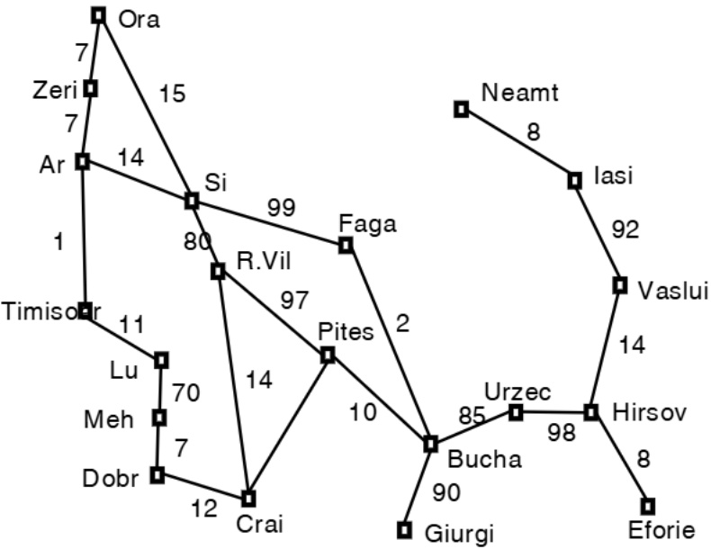

Hình 1.18: Bảng đô của Romania với khoảng cách đường tính theo km

Bảng 1.1: Khoảng cách đường chim bay từ một thành phố đến Bucharest.

| Arad | 366 |  | Mehadia | 241 |
| --- | --- | --- | --- | --- |
| Bucharest | 0 |  | Neamt | 234 |
| Craiova | 160 |  | Oradea | 380 |
| Dobreta | 242 |  | Pitesti | 98 |
| Eforie | 161 |  | R.Vilcea | 193 |
| Fagaras | 178 |  | Sibiu | 253 |
| Giurgiu | 77 |  | Timisoara | 329 |
| Hirsova | 151 |  | Urziceni | 80 |
| Iasi | 226 |  | Vaslui | 199 |
| Lugoj | 244 |  | Zerind | 374 |

<!-- page: 47 -->

Chúng ta sẽ chọn hàm h' chính là khoảng cách đường chim bay cho trong bảng trên và hàm chỉ phí cost(T$_{i}$, T$_{i+1}$) chính là chiều dài con đường nối từ thành phố T$_{i}$ và T$_{i+1}$.

Sau đây là từng bước hoạt động của thuật toán A\* trong việc tìm đường đi ngắn nhất từ Arad đến Bucharest.

```python
Ban đầu :
    OPEN = { (Arad, g=0, h'=0, f'=0) }
    CLOSE = {}
```

Do trong OPEN chỉ chứa một thành phố duy nhất nên thành phố này sẽ là thành phố tốt nhất; nghĩa là $T_{\text{max}} =$ Arad. Ta lấy Arad ra khởi OPEN và đưa vào CLOSE.

```python
OPEN = {}
CLOSE = {(Arad, g=0, h'=0, f'=0)}
```

Từ Arad có thể đi đến được ba thành phố là Sibiu, Timisoara và Zerind. Ta lần lượt tính giá trị f, g và h' của ba thành phố này. Do cả ba nút mới tạo ra này chưa có nút cha nên ban đầu nút cha của chúng đều là Arad.

```matlab
h' (Sibiu) =253
g(Sibiu) = g(Arad)+cost(Arad,Sibiu)
= 0+140=140
f' (Sibiu) = g(Sibiu)+h' (Sibiu)
= 140+253 = 393
Cha(Sibiu) = Arad
```

<!-- page: 48 -->

```txt
h'(Timisoara) = 329
g(Timisoara) = g(Arad)+cost(Arad,
        Timisoara)
        = 0+118=118
f'(Timisoara) = g(Timisoara)+ h'(Timisoara)
        = 118+329 = 447
Cha(Timisoara) = Arad

h'(Zerind) = 374
g(Zerind) = g(Arad)+cost(Arad, Zerind)
        =0+75=75
f'(Zerind) = g(Zerind)+h'(Zerind)
        = 75+374 = 449
Cha(Zerind) = Arad
```

Do cả ba nút Sibiu, Timisoara, Zerind đều không có trong cả OPEN và CLOSE nên ta bổ sung ba nút này vào OPEN.

```txt
OPEN =
{ (Sibiu,g=140,h'=253,f'=393,Cha=Arad)
  (Timisoara,g=118,h'=329,f'=447,Cha=Arad)
  (Zerind,g=75,h'=374,f'=449,Cha=Arad) }
  CLOSE = {(Arad,g=0,h'=0,f'=0)}
```

<!-- page: 49 -->

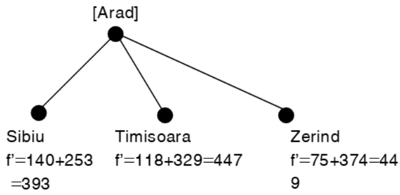

Hình 1.19: Bước 1, nút được đóng ngoặc vuông (như [Arad]) là nút trong tập CLOSE, ngược lại là trong tập OPEN.

Trong tập OPEN, nút Sibiu là nút có giá trị f' nhỏ nhất nên ta sẽ chọn  $T_{max} = Sibiu$ . Ta lấy Sibiu ra khối OPEN và đưa vào CLOSE.

```txt
OPEN =
{ (Timisoara,g=118,h'=329,f'=447,Cha=Arad)
  (Zerind,g=75,h'=374,f'=449,Cha=Arad) }
CLOSE = { (Arad,g=0,h'=0,f'=0)
    (Sibiu,g=140,h'=253,f'=393,Cha=Arad) }
```

Từ Sibiu có thể đi đến được bốn thành phố là : Arad, Fagaras, Oradea, Rimnicu. Ta lần lượt tính các giá trị g, h', f' cho các nút này.

```txt
h' (Arad) = 366
g (Arad) = g(Sibiu)+cost(Sibiu,Arad)
= 140+140=280
f' (Arad) = g(Arad)+h' (Arad)
= 280+366 = 646
```

<!-- page: 50 -->

```python
h'(Fagaras)      = 178
g(Fagaras)       = g(Sibiu)+cost(Sibiu,
Fagaras) = 140+99=239
f'(Fagaras)      = g(Fagaras)+ h'(Fagaras)
                   = 239+178=417
h'(Oradea)      = 380
g(Oradea) = g(Sibiu)+cost(Sibiu, Oradea)
                   = 140+151 =291
f'(Oradea) = g(Oradea)+ h'(Oradea)
         = 291+380 = 671
h'(R.Vilcea)    = 193
g(R.Vilcea)      = g(Sibiu)+cost(Sibiu,
                   R.Vilcea)
                   = 140+80 =220
f'(R.Vilcea) = g(R.Vilcea)+ h'(R.Vilcea)
         = 220+193 = 413
```

Nút Arad đã có trong CLOSE. Tuy nhiên, do g(Arad) mới được tạo ra (có giá trị 280) lớn hơn g(Arad) lưu trong CLOSE (có giá trị 0) nên ta sẽ không cập nhật lại giá trị g và f của Arad lưu trong CLOSE. ba nút còn lại : Fagaras, Oradea, Rimnicu đều không có trong cả OPEN và CLOSE nên ta sẽ đưa ba nút này vào OPEN, đặt cha của chúng là Sibiu. Như vậy, đến bước này OPEN đã chứa tổng cộng năm thành phố.

<!-- page: 51 -->

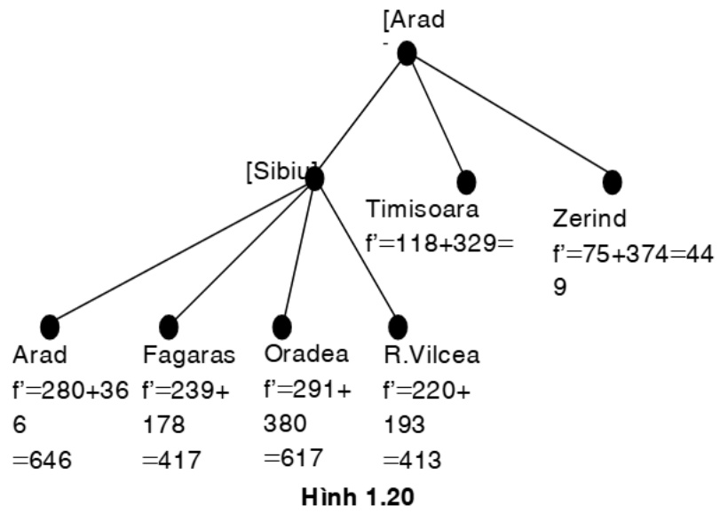

```txt
OPEN
{(Timisoara,g=118,h'=329,f'=447,Cha=Arad)
  (Zerind,g=75,h'=374,f'=449,Cha=Arad)
  (Fagaras,g=239,h'=178,f'=417,Cha=Sibiu)
  (Oradea,g=291,h'=380,f'=617,Cha=Sibiu)
  (R.Vilcea,g=220,h'=193,f'=413,Cha=Sibiu)}
CLOSE = {(Arad,g=0,h'=0,f'=0)
    (Sibiu,g=140,h'=253,f'=393,Cha=Arad)}
```

Trong tập OPEN, nút R.Vilcea là nút có giá trị f' nhỏ nhất. Ta chọn  $T_{max} = R.Vilcea$ . Chuyển R.Vilcea từ OPEN sang CLOSE. Từ R.Vilcea có thể di đến được ba thành phố là Craiova, Pitesti và Sibiu. Ta lần lượt tính giá trị f, g và h' của ba thành phố này.

<!-- page: 52 -->

```txt
h'(Sibiu) = 253
g(Sibiu) = g(R.Vilcea)+
    cost(R.Vilcea,Sibiu)
    = 220+80=300
f'(Sibiu) = g(Sibiu)+h'(Sibiu)
    = 300+253 = 553

h'(Craiova)      = 160
g(Craiova)       = g(R.Vilcea)+ cost(R.Vilcea,
                          Craiova)
                          = 220+146=366
f'(Craiova)      = g(Fagaras)+h'(Fagaras)
                          = 366+160=526

h'(Pitesti)      = 98
g(Pitesti)       = g(R.Vilcea)+ cost(R.Vilcea,
                          Pitesti)
                          = 220+97 =317
f'(Pitesti) = g(Oradea)+h'(Oradea)
    = 317+98 = 415
```

Sibiu đã có trong tập CLOSE. Tuy nhiên, do g'(Sibiu) mới (có giá trị là 553) lớn hơn g'(Sibiu) (có giá trị là 393) nên ta sẽ không cập nhật lại các giá trị của Sibiu được lưu trong CLOSE. Còn lại hai thành phố là Pitesti và Craiova đều không có trong cả OPEN và CLOSE nên ta sẽ đưa nó vào OPEN và đặt cha của chúng là R.Vilcea.

<!-- page: 53 -->

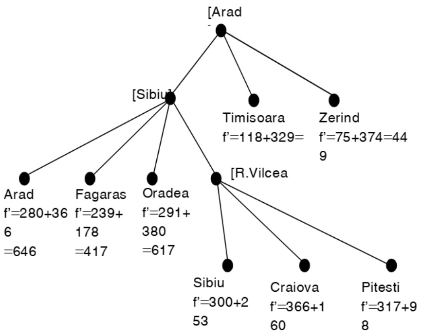

Hình 1.21

```txt
OPEN
  { (Timisoara,g=118,h'=329,f'=447,Cha=Arad)
    (Zerind,g=75,h'=374,f'=449,Cha=Arad)
  (Fagaras,g=239,h'=178,f'=417,Cha=Sibiu)
    (Oradea,g=291,h'=380,f'=617,Cha=Sibiu)
  (Craiova,g=366,h'=160,f'=526,Cha=R.Vilcea)
  (Pitesti,g=317,h'=98,f'=415,Cha=R.Vilcea)  }

CLOSE = {(Arad,g=0,h'=0,f'=0)
      (Sibiu,g=140,h'=253,f'=393,Cha=Arad)
      (R.Vilcea,g=220,h'=193,f'=413,Cha=Sibiu)
      }
```

<!-- page: 54 -->

Đến dây, trong tập OPEN, nút tốt nhất là Pitesti, từ Pitesti ta có thể đi đến được R.Vilcea, Bucharest và Craiova. Lấy Pitesti ra khởi OPEN và đặt nó vào CLOSE. Thực hiện tiếp theo tương tự như trên, ta sẽ không cập nhật giá trị f, g của R.Vilcea và Craiova lưu trong CLOSE. Sau khi tính toán f, g của Bucharest, ta sẽ đưa Bucharest vào tập OPEN, đặt Cha(Bucharest) = Pitesti.

```matlab
h' (Bucharest) = 0
g (Bucharest) =
g(Pitesti)+cost(Pitesti, Bucharest)
= 317+100=418
f' (Bucharest) = g(Fagaras)+h' (Fagaras)
= 417+0=417
```

Ô bước kế tiếp, ta sẽ chọn được $T_{max} =$ Bucharest. Và như vậy thuật toán kết thúc (thực ra thì tại bước này, có hai ứng cử viên là Bucharest và Fagaras vì đều cùng có $f = 417$, nhưng vì Bucharest là đích nên ta sẽ ưu tiên chọn hơn).

Đế xây dựng lại con đường di từ Arad đến Bucharest ta lần theo giá trị Cha được lưu trữ kèm với f, g và h' cho đến lúc đến Arad.

```txt
Cha(Bucharest) = Pitesti
Cha(R.Vilcea) = Sibiu
Cha(Sibiu) = Arad
```

<!-- page: 55 -->

Vậy con đường đi ngắn nhất từ Arad đến Bucharest là Arad, Sibiu, R. Vilcea, Pitesti, Bucharest.

Trong ví dụ minh họa này, hàm h' có chất lượng khá tốt và cấu trúc đồ thị khá đơn giản nên ta gần như đi thẳng đến đích mà ít phải khảo sát các con đường khác. Đây là một trường hợp đơn giản, trong trường hợp này, thuật giải có dáng đáp của tìm kiếm chiều sâu.

Đến đây, để minh họa một trường hợp phúc tạp hơn của thuật giải. Ta thử sửa đổi lại cấu trúc đồ thị và quan sát hoạt động của thuật giải. Giả sử ta có thêm một thành phố tạm gọi là TP và con đường giữa Sibiu và TP có chiều dài 100, con đường giữa TP và Pitesti có chiều dài 60. Và khoảng cách đường chim bay từ TP đến Bucharest là 174. Như vậy rõ ràng, con đường tối ưu đến Bucharest không còn là Arad, Sibiu, R.Vilcea, Pitesti, Bucharest nửa mà là Arad, Sibiu, TP, Pitesti, Bucharest.

<!-- page: 56 -->

Orad

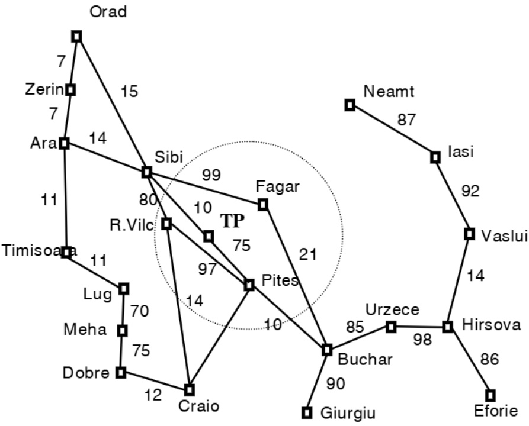

Hình 1.22

Trong trường hợp này, chúng ta vẫn tiến hành bước 1 như ở trên. Sau khi thực hiện hiện bước 2 (mở rộng Sibiu), chúng ta có cây tìm kiếm như hình sau. Lưu ý là có thêm nhánh TP.

<!-- page: 57 -->

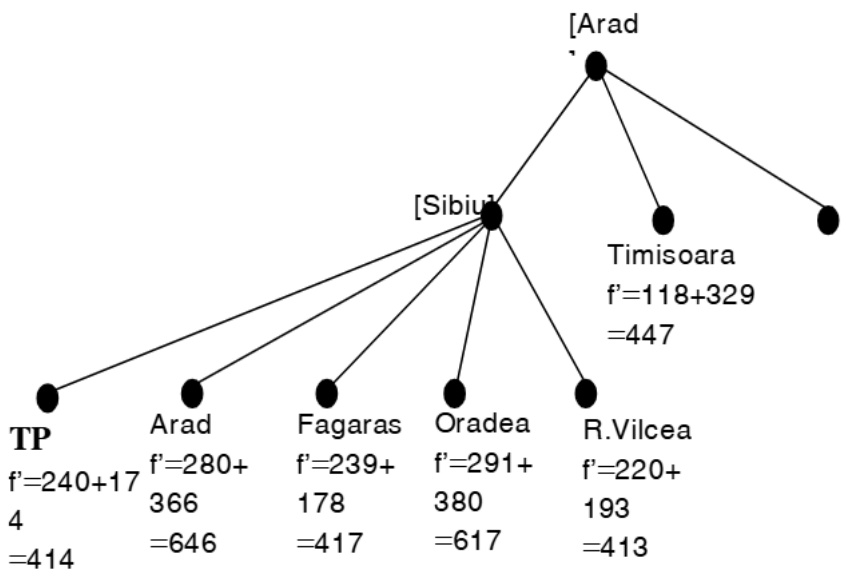

Hình 1.23

R. Vilcea vẫn có giá trị f' thấp nhất. Nên ta mở rộng R. Vilcea như trường hợp đầu tiên.

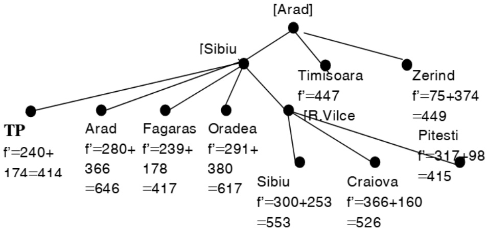

Hình 1.24

<!-- page: 58 -->

Bước kế tiếp của trường hợp đơn giản là mở rộng Pitesti để có được kết quả. Tuy nhiên, trong trường hợp này, TP có giá trị f' thấp hơn. Do đó, ta chọn mở rộng TP. Từ TP ta chỉ có hai hướng đi, một quay lại Sibiu và một đến Pitesti. Đế nhanh chóng, ta sẽ không tính toán giá trị của Sibiu vì biết chắc nó sẽ lớn hơn giá trị được lưu trữ trong CLOSE (vì đi ngược lại).

```txt
h' (Pitesti)       = 98
g (Pitesti)        = g(TP)+cost(TP,
                          Pitesti)
                          = 240+75=315
f' (Pitesti)      = g(TP)+h' (Pitesti) =
                          315+98=413
```

Pistestti đã xuất hiện trong tập OPEN và g'(Pitesti) mới (có giá trị là 315) thấp hơn g'(Pitesti) cũ (có giá trị 317) nên ta phải cập nhật lại giá trị của f,g, Cha của Pitesti lưu trong OPEN. Sau khi cập nhật xong, tập OPEN và CLOSE sẽ như sau :

```txt
OPEN
{(Timisoara,g=118,h'=329,f'=447,Cha=Arad)
  (Zerind,g=75,h'=374,f'=449,Cha=Arad)
(Fagaras,g=239,h'=178,f'=417,Cha=Sibiu)
(Oradea,g=291,h'=380,f'=617,Cha=Sibiu)
(Craiova,g=366,h'=160,f'=526,Cha=R.Vilcea)
(Pitesti,g=315,h'=98,f'=413,Cha=TP)   }
CLOSE = {(Arad,g=0,h'=0,f'=0)
```

<!-- page: 59 -->

```txt
(Sibiu,g=140,h'=253,f'=393,Cha=Arad)
(R.Vilcea,g=220,h'=193,f'=413,Cha=Sibiu)
}
```

Đến dây ta thấy rằng, ban đầu thuật giải chọn đường đi đến Pitesti qua R.Vilcea. Tuy nhiên, sau đó, thuật giải phát hiện ra con đường đến Pitesti qua TP là tốt hơn nên nó sẽ sử dụng con đường này. Đây chính là trường hợp 2.b.iii.2 trong thuật giải.

Bước sau, chúng ta sẽ chọn mở rộng Pitesti như bình thường. Khi lần ngược theo thuộc tính Cha, ta sẽ có con đường tối ưu là Arad, Sibiu, TP, Pitesti, Bucharest.

Đến dây, có lẻ bạn đã hiểu được thuật giải này. Ta có một vài nhận xét khá thú vị về A\*. Đầu tiên là vai trò của g trong việc giúp chúng ta lựa chọn đường đi. Nó cho chúng ta khả năng lựa chọn trạng thái nào để mở rộng tiếp theo, không chỉ dựa trên việc trạng thái đó tốt như thế nào (thể hiện bởi giá trị h') mà còn trên cơ sở con đường từ trạng thái khởi đầu đến trạng thái hiện tại đó tốt ra sao. Điều này sẽ rất hữu ích nếu ta không chỉ quan tâm việc tìm ra lời giải hay không mà còn quan tâm đến hiệu quả của con đường dẫn đến lời giải. Chắng hạn như trong bài toán tìm đường đi ngắn nhất giữa hai điểm. Bên cạnh việc tìm ra đường đi giữa hai điểm, ta còn phải tìm ra một con đường ngắn nhất. Tuy nhiên, nếu ta chỉ quan

<!-- page: 60 -->

tâm đến việc tìm được lời giải (mà không quan tâm đến hiệu quả của con đường đến lời giải), chúng ta có thể đặt g = 0 ở mọi trạng thái. Điều này sẽ giúp ta luôn chọn đi theo trạng thái có về gần nhất với trạng thái kết thúc (vì lúc này f' chỉ phụ thuộc vào h' là hàm uốc lượng "khoảng cách" gần nhất để tới đích). Lúc này thuật giải có dáng đáp của tìm kiếm chiều sâu theo nguyên lý hướng đích kết hợp với lần ngược.

Ngược lại, nếu ta muốn tìm ra kết quả với số bước ít nhất (đạt được trạng thái đích với số trạng thái trung gian ít nhất), thì ta đặt giá trị để đi từ một trạng thái đến các trạng thái con kế tiếp của nó luôn là hằng số, thường là một nghĩa đặt cost($T_{i-1}$, $T_i$) = 1 (và vẫn dùng một hàm uốc lượng h' như bình thường). Còn ngược lại, nếu muốn tìm chi phí rê nhất thì ta phải đặt giá trị hàm cost chính xác (phân ánh đúng chi phí thực sự).

Đến dây, chắc bạn đọc đã có thể bắt đầu cảm nhận được rằng thuật giải A\* không hoàn toàn là một thuật giải tối ưu tuyệt đối. Nói đúng hơn, A\* chỉ là một thuật giải linh động và cho chúng ta khá nhiều tùy chọn. Tùy theo bài toán mà ta sẽ có một bộ thông số thích hợp cho A\* để thuật giải hoạt động hiệu quả nhất.

Điểm quan tâm thứ hai là về giá trị  $h'$  – sự ước lượng khoảng cách (chi phí) từ một trạng thái đến trạng thái

<!-- page: 61 -->

dích. Nếu h' chính là h (đánh giá tuyệt đối chính xác) thì A\* sẽ đi một mạch từ trạng thái đầu đến trạng thái kết thúc mà không cần phải thực hiện bất kỳ một thao tác đối hướng nào! Dĩ nhiên, trên thực tế, hầu như chẳng bao giờ ta tìm thấy một đánh giá tuyệt đối chính xác. Tuy nhiên, điều dáng quan tâm ở đây là h' được ước lượng càng gần với h, quá trình tìm kiếm càng ít bị sai sót, ít bị rễ vào những nhánh cụt hơn. Hay nói ngắn gọn là càng nhanh chóng tìm thấy lời giải hơn.

Nếu h' luôn bằng 0 ở mọi trạng thái (trở về thuật giải A$^{T}$) thì quá trình tìm kiếm sẽ được điều khiển hoàn toàn bởi giá trị g. Nghĩa là thuật giải sẽ chọn đi theo những hướng mà sẽ tổn ít chi phí/bước đi nhất (chi phí tính từ trạng thái đầu tiên đến trạng thái hiện đang xét) bất chấp việc đi theo hướng đó có khả năng dẫn đến lời giải hay không. Đây chính là hình ảnh của nguyên lý tham lam (Greedy).

Nếu chi phí từ trạng thái sang trạng thái khác luôn là hằng số (dĩ nhiên lúc này h' luôn bằng 0) thì thuật giải A\* trở thành thuật giải tìm kiếm theo chiều rộng! Lý do là vì tất cả những trạng thái cách trạng thái khởi đầu n bước đều có cùng giá trị g và vì thế đều có cùng f và giá trị này sẽ nhỏ hơn tất cả các trạng thái cách trạng thái khởi đầu n + 1 bước. Và nếu g luôn bằng 0 và h' cũng luôn bằng 0,

<!-- page: 62 -->

mọi trạng thái đang xét đều tương đương nhau. Ta chỉ có thể chọn bằng trạng thái kế tiếp bằng ngẫu nhiên!

Còn nếu như h' không thể tuyệt đối chính xác (nghĩa là không bằng đúng h) và cũng không luôn bằng 0 thì sao? Có điều gì thú vị về cách xử lý của quá trình tìm kiếm hay không? Câu trả lời là có. Nếu như bằng một cách nào đó, ta có thể chắc chắn rằng, ước lượng h' luôn nhỏ hơn h (đối với mọi trạng thái) thì thuật giải A\* sẽ thường tìm ra con đường tối ưu (xác định bởi g) để đi đến đích, nếu đường dẫn đó tôn tại và quá trình tìm kiếm sẽ ít khi bị sa lấy vào những con đường quá đổ. Còn nếu vì một lý do nào đó, ước lượng h' lại lớn hơn h thì thuật giải sẽ dễ dàng bị vướng vào những hướng tìm kiếm vô ích. Thậm chí nó lại có khuynh hướng tìm kiếm ở những hướng đi vô ích trước! Điều này có thể thấy một cách dễ dàng từ vài ví dụ.

Xét trường hợp được trình bày trong hình sau. Giá sử ràng tất cả các cung đều có giá trị 1. G là trạng thái đích. Khởi đầu, OPEN chỉ chứa A, sau đó A được mở rộng nên B, C, D sẽ được đưa vào OPEN (hình về mô tả trạng thái hai bước sau đó, khi B và E đã được mở rộng). Đối với mỗi nút, con số đầu tiên là giá trị h', con số kế tiếp là g. Trong ví dụ này, nút B có f' thấp nhất là $4 = \mathbf{h}' + \mathbf{g} = 3 + 1$, vì thế nó được mở rộng trước tiên. Giá sử nó chỉ có một nút con tiếp theo là E và h'(E) = 3, do E các A hai cung nên g(E) = 2 suy ra f'(E) = 5, giống như f(C). Ta chọn mở

<!-- page: 63 -->

rộng E kế tiếp. Giả sử nó cũng chỉ có duy nhất một con kế tiếp là F và h'(F) cũng bằng 3. Rỗ ràng là chúng ta đang di chuyển xuống và không phát triển rộng. Nhưng f'(F) = 6 lớn hơn f'(D). Do đó, chúng ta sẽ mở rộng C tiếp theo và đạt đến trạng thái đích. Như vậy, ta thấy rằng do đánh giá thấp h(B) nên ta đã lăng phí một số bước (E,F), nhưng cuối cùng ta cùng phát hiện ra B khác xa với điều ta mong đợi và quay lại để thử một đường dẫn khác.

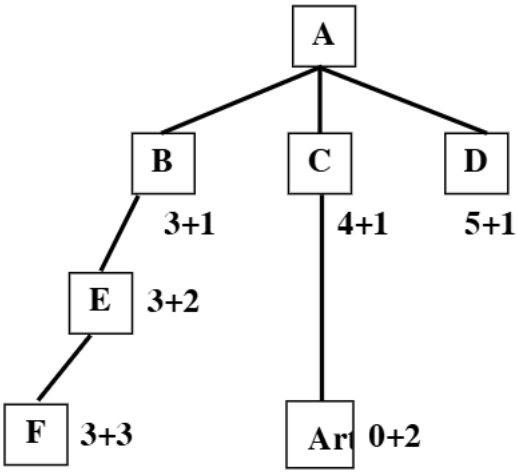

Hình 1.25 : h' đánh giá thấp h

Bây giờ hãy xét trường hợp ở hình tiếp theo. Chúng ta cũng mở rộng B ở bước đầu tiên và E ở bước thứ hai. Kế tiếp là F và cuối cùng G, cho đường dẫn kết thúc có độ dài là 4. Nhưng giả sử có đường dẫn trực tiếp từ D đến một lời giải có độ dài h thực sự là 2 thì chúng ta sẽ không bao giờ tìm được đường dẫn này (tuy rằng ta có thể tìm thấy lời giải). Bởi vì việc đánh giá quá cao h'(D), chúng ta sẽ làm cho D trồng dở đến nổi mà ta phải tìm một đường đi khác

<!-- page: 64 -->

\- đến một lời giải tệ hơn - mà không bao giờ nghĩ đến việc mở rộng D. Nói chung, nếu h' đánh giá cao h thì A\* sẽ có thể không thể tìm ra đường dẫn tối ưu đến lời giải (nếu như có nhiều đường dẫn đến lời giải). Một câu hỏi thú vị là "Liệu có một nguyên tắc chung nào giúp chúng ta đưa ra một cách ước lượng h' không bao giờ đánh giá cao h hay không?". Câu trả lời là "hầu như không", bởi vì đối với hầu hết các vấn đề thực ta đều không biết h. Tuy nhiên, cách duy nhất để bảo đảm h' không bao giờ đánh giá cao h là đặt h' bằng 0!

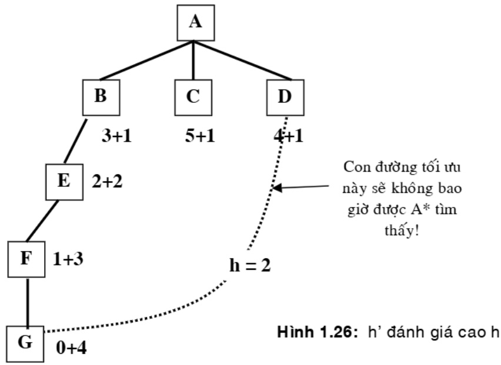

Đến dây chúng ta đã kết thúc việc bàn luận về thuật giải A\*, một thuật giải linh động, tổng quát, trong đó hàm chứa cả tìm kiếm chiều sâu, tìm kiếm chiều rộng và những

<!-- page: 65 -->

nguyên lý heuristic khác. Chính vì thế mà người ta thường nói, A\* chính là thuật giải tiêu biểu cho heuristic.

A\* rất linh động nhưng vẫn gặp một khuyết điểm cơ bản – giống như chiến lược tìm kiếm chiều rộng – đó là tốn khá nhiều bộ nhớ để lưu lại những trạng thái đã đi qua – nếu chúng ta muốn nó chắc chắn tìm thấy lời giải tối ưu. Với những không gian tìm kiếm lớn nhỏ thì đây không phải là một điểm dáng quan tâm. Tuy nhiên, với những không gian tìm kiếm không lỗ (chẳng hạn tìm đường đi trên một ma trận kích thước cỡ $10^{6} \times 10^{6}$) thì không gian lưu trữ là cả một vấn đề học búa. Các nhà nghiên cứu đã đưa ra khá nhiều các hướng tiếp cận lai để giải quyết vấn đề này. Chúng ta sẽ tìm hiểu một số phương án nhưng quan trọng nhất, ta cần phải nắm rõ vị trí của A\* so với những thuật giải khác.

Bài toán Ta-canh đã từng là một trò chơi khá phố biến, đôi lúc người ta còn gọi đây là bài toán 9-puzzle. Trò chơi bao gồm một hình vuông kích thước 3 x 3 ô. Có 8 ô có số, mỗi ô có một số từ 1 đến 8. Một ô còn trống. Mỗi lần di chuyển chỉ được di chuyển một ô nằm cạnh ô trống về phía ô trống. Vấn đề là từ một trạng thái ban đầu bất kỳ, làm sao đưa được về trạng thái cuối là trạng thái mà các ô được sắp lần lượt từ 1 đến 8 theo thứ tự từ trái sang phải, từ trên xuống dưới, ô cuối dùng là ô trống.

<!-- page: 66 -->

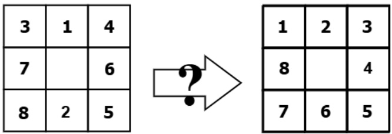

Hình 1.27

Cho đến nay, ngoại trừ hai giải pháp vét cạn và tìm kiếm heuristic, người ta vẫn chưa tìm được một thuật toán chính xác, tối ưu để giải bài toán này. Tuy nhiên, cách giải theo thuật giải A\* lại khá đơn giản và thường tìm được lời giải (nhưng không phải lúc nào cũng tìm được lời giải). Nhận xét rằng; tại mỗi thời điểm ta chỉ có tối đa bốn ô có thể di chuyển. Vấn đề là tại thời điểm đó, ta sẽ chọn lựa di chuyển ô nào? Chắng hạn ở hình trên, ta nên di chuyển (1), (2), (6), hay (7) ? Bài toán này hoàn toàn có cấu trúc thích hợp để có thể giải bằng A\* (tổng số trạng thái có thể có của bàn cờ là n²! với n là kích thước bàn cờ vì mỗi trạng thái là một hoán vị của tập n² con số).

Tại một trạng thái đang xét T$_{k}$, đặt d(i, j) là số ô cần di chuyển để đưa con số ô ô (i,j) về đúng vị trí của nó ô trạng thái đích.

Hàm ước lượng h' tại trạng thái T$_{k}$ bất kỳ bằng tổng của các d(i,j) sao cho vị trí (i,j) không phải là ô trống.

<!-- page: 67 -->

Như vậy đối với trạng thái ở hình ban đầu, hàm f(T$_{k}$) sẽ có giá trị là

$$
F _ {k} = 2 + 1 + 3 + 1 + 0 + 1 + 2 + 2 = 1 2
$$

## III.11. Các chiến lược tìm kiếm lai

Chúng ta đã biết qua bốn kiểu tìm kiếm : leo đèo (LĐ), tìm theo chiều sâu (MC), tìm theo chiều rộng (BR) và tìm kiếm BFS. Bốn kiểu tìm kiếm này có thể được xem như bốn thái cực của không gian liên tục bao gồm các chiến lược tìm kiếm khác nhau. Đế giải thích điều này rõ hơn, sẽ tiện hơn cho chúng ta nếu nhìn một chiến lược tìm kiếm lời giải dưới hai chiều sau.

Chiều khả năng quay lui (R) là khả năng cho phép quay lại để xem xét những trạng thái xét đến trước đó nếu gặp một trạng thái không thể đi tiếp.

Chiều phạm vi của sự đánh giá (S): số các trạng thái xét đến trong mỗi quyết định.

<!-- page: 68 -->

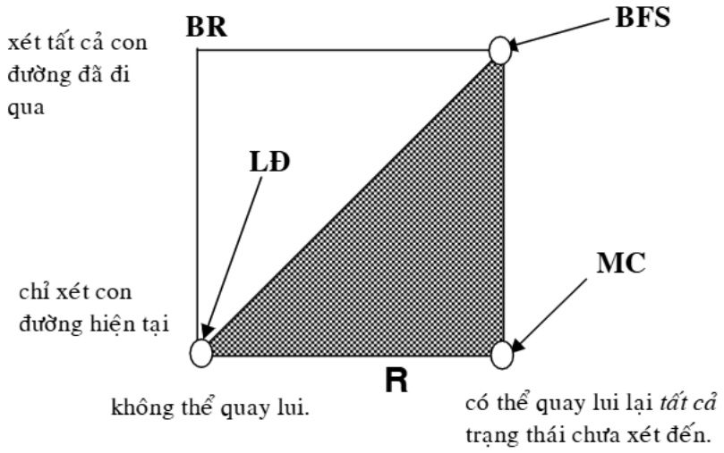

Hình 1.28: Tương quan giữa các chiến lược leo đèo, quay lui và tốt nhất

Theo hướng R, chúng ta thấy leo đèo nằm ở một thái cực (nó không cho phép quay lại những trạng thái chưa được xét đến), trong khi đó tìm kiếm quay lui và BFS ở một thái cực khác (cho phép quay lại tất cả các hướng đi chưa xét đến). Theo hướng S chúng ta thấy leo đèo và lần ngược nằm ở một thái cực (chỉ tập trung vào một phạm vi hẹp trên tập các trạng thái mới tạo ra từ trạng thái hiện tại) và BFS nằm ở một thái cực khác (trong khi BF xem xét toàn bộ tập các con đường đã có, bao gồm cả những con đường mới được tạo ra cũng như tất cả những con đường không được xét tới trước đây trước mỗi một quyết định).

Những thái cực này được trực quan hóa bằng hình ở trên. Vùng in đậm biểu diễn một mặt phẳng liên tục các chiến lược tìm kiếm mà nó kết hợp một số đặc điểm của

<!-- page: 69 -->

một trong ba thái cực (leo đèo, chiều sâu, BFS) để có được một hòa hợp các đặc tính tính toán của chúng.

Nếu chúng ta không đủ bộ nhớ cần thiết để áp dụng thuật toán BFS thuần túy. Ta có thể kết hợp BFS với tìm theo chiều sâu để giám bót yêu cầu bộ nhớ. Dĩ nhiên, cái giá mà ta phải trả là số lượng các trạng thái có thể xét đến tại một bước sẽ nhỏ đi. Một loại kết hợp như thế được chỉ ra trong hình 1.29. Trong hình này, thuật giải BFS được áp dụng tại định của đồ thị tìm kiếm (biểu diễn bằng vùng tô tạm) và tìm kiếm theo chiều sâu được áp dụng tại đáy (biểu diễn bởi tam giác tô nhạt). Đầu tiên ta áp dụng BFS vào trạng thái ban đầu T₀ một cách bình thường. BFS sẽ thi hành cho đến một lúc nào đó, số lượng trạng thái được lưu trữ chiếm dụng một không gian bộ nhớ vượt quá một mức cho phép nào đó. Đến lúc này, ta sẽ áp dụng tìm kiếm chiều sâu xuất phát từ trạng thái tốt nhất T$_{max}$ trong OPEN cho tới khi toàn bộ không gian con phía “đưới” trạng thái đó được duyệt hết. Nếu không tìm thấy kết quả, trạng thái T$_{max}$ này được ghi nhận là không dẫn đến kết quả và ta lại chọn ra trạng thái tốt thứ hai trong OPEN và lại áp dụng tìm kiếm chiều sâu cho cho phần không gian phía “đưới” trạng thái này...

<!-- page: 70 -->

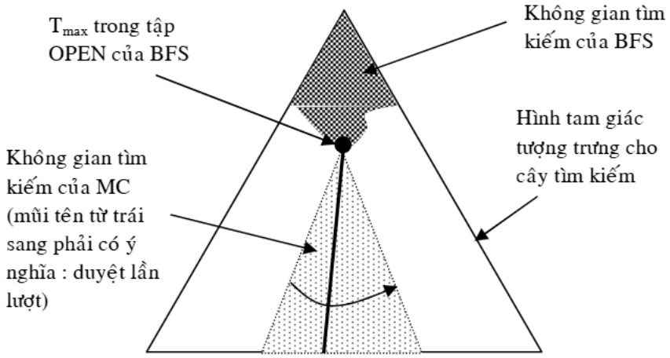

Hình 1.29: Chiến lược lai BFS-MC trong đó, BFS áp dụng tại đình và MC tại đáy.

Một cách kết hợp khác là dùng tìm kiếm chiều sâu tại định không gian tìm kiếm và BFS được dùng tại đáy. Chúng ta áp dụng tìm kiếm chiều sâu cho tới khi gặp một trạng thái T$_{k}$ mà độ sâu (số trạng thái trung gian) của nó vượt quá một ngưỡng d$_{0}$ nào đó. Tại điểm này, thay vì lần ngược trở lại, ta áp dụng kiểu tìm kiếm BFS cho phần không gian phía “đưới” bắt đầu từ T$_{k}$ cho tới khi nó trả về một giải pháp hoặc không tìm thấy. Nếu nó không tìm thấy kết quả, chúng ta lần ngược trở lại và lại dùng BFS khi đạt độ sâu d$_{0}$. Tham số d$_{0}$ sẽ được chọn sao cho bộ nhớ dùng cho tìm kiếm BFS trên không gian “đưới” mức d$_{0}$ sẽ không vượt quá một hàng số cho trước. Rỗ ràng ta ta không dễ gì xác định được d$_{0}$ (vì nói chung, ta khó đánh

<!-- page: 71 -->

giá được không gian bài toán rộng đến mức nào). Tuy nhiên, kiểu kết hợp này lại có một thuận lợi. Phân đáy không gian tìm kiếm thường chứa nhiều thông tin “bổ ích” hơn là phần định. (Chẳng hạn, tìm đường đi đến khu trung tâm của thành phố, khi càng đến gần khu trung tâm – đáy đồ thị – bạn càng dễ dàng tiến đến trung tâm hơn vì có nhiều “dấu hiệu” của trung tâm xuất hiện xung quanh bạn!). Nghĩa là, càng tiến về phía đáy của không gian tìm kiếm, ước lượng h’ thường càng trở nên chính xác hơn và do đó, càng dễ dẫn ta đến kết quả hơn.

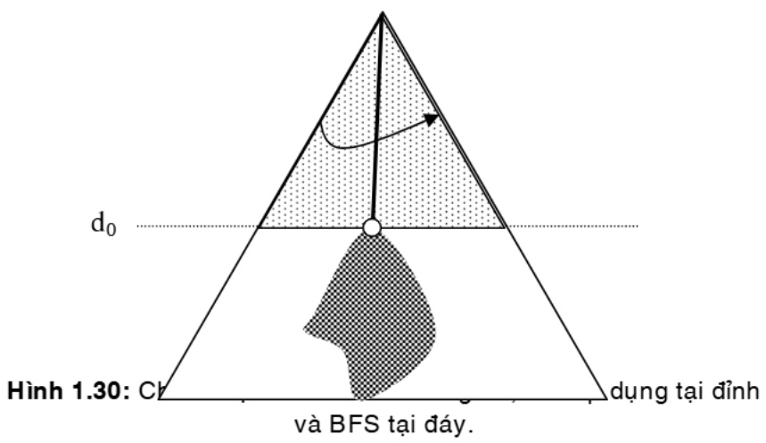

Còn một kiểu kết hợp phức tạp hơn nửa, trong đó, BFS được thực hiện cục bộ và chiều sâu được thực hiện toàn cục. Ta bắt đầu tìm kiếm theo BFS cho tới khi một sự lượng bộ

<!-- page: 72 -->

nhó xác định M₀ được dùng hết. Tại điểm này, chúng ta xem tất cả những trạng thái trong OPEN như những trạng thái con trực tiếp của trạng thái ban đầu và chuyển giao chúng cho tìm kiếm chiều sâu. Tìm kiểm chiều sâu sẽ chọn trạng thái tốt nhất trong những trạng thái con này và “bành trưởng” nó dùng BFS, nghĩa là nó chuyển trạng thái đã chọn cho tìm kiếm BFS cục bộ cho đến khi một lượng bộ nhớ M₀ lại được dùng hết và trạng thái con mối trong OPEN lại tiếp tục được xem như nút con của nút “bành trưởng”... Nếu việc “bành trưởng” bằng BFS thất bại thì ta quay lui lại và chọn nút con tốt thứ hai của tập OPEN trước đó, rời lại tiếp tục hành trưởng bằng BFS...

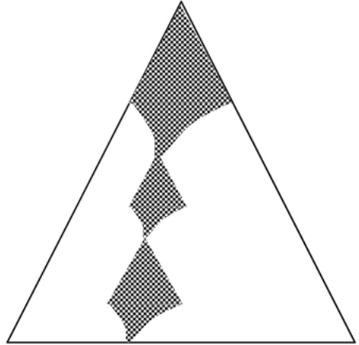

Hình 1.31: Chiến lược lai BFS-MC trong đó, BFS được áp dụng cục bộ và chiều sâu được áp dụng toàn cục.

Có một cách phối hợp nổi tiếng khác được gọi là tìm kiếm theo giai đoạn được thực hiện như sau. Thay vì lưu trữ trong bộ nhớ toàn bộ cây tìm kiếm được sinh ra bởi BFS, ta chỉ giữ lại cây con có triển vọng nhất. Khi một

<!-- page: 73 -->

lượng bộ nhớ M₀ được dùng hết, ta sẽ đánh dấu một tập con các trạng thái trong OPEN (những trạng thái có giá trị hàm f thấp nhất) để giữ lại; những đường đi tốt nhất qua những trạng thái này cũng sẽ được ghi nhớ và tất cả phần còn lại của cây bị loại bỏ. Quá trình tìm kiếm sau đó sẽ tiếp tục theo BFS cho tới khi một lượng bộ nhớ M₀ lại được dùng hết và cứ thể. Chiến lược này có thể được xem như là một sự lai ghép giữa BF và leo dèo. Trong đó, leo dèo thuần túy loại bỏ tất cả nhưng chỉ giữ lại phương án tốt nhất còn tìm kiếm theo giai đoạn loại bỏ tất cả nhưng chỉ giữ lại tập các phương án tốt nhất.

<!-- page: 74 -->

## Chương 2 BIÊU DIÊN TRI THỨC

## A. TỔNG QUAN TRÍ TUÊ NHÂN TẠO

## I. MÔ ĐẦU

Chế tạo được những cổ máy thông minh như con người (thậm chí thông minh hơn con người) là một ước mơ cháy bông của loài người từ hàng ngân năm nay. Hẫn bạn đọc còn nhớ đến nhà khoa học Alan Turing cùng những đóng góp to lớn của ông trong lĩnh vực trí tuệ nhân tạo. Năng lực máy tính ngày càng mạnh mẽ là một điều kiện hết sức thuận lợi cho trí tuệ nhân tạo. Điều này cho phép những chương trình máy tính áp dụng các thuật giải trí tuệ nhân tạo có khả năng phần ứng nhanh và hiệu quả hơn trước. Sự kiện máy tính Deep Blue đánh bại đại kiện tống cờ vua thế giới Casparov là một minh chứng hùng hồn cho một bước tiến dài trong công cuộc nghiên cứu về trí tuệ nhân tạo. Tuy có thể đánh bại được Casparov nhưng Deep Blue là một cổ máy chỉ biết đánh cờ ! Nó thập chí không có được trí thông minh sơ đẳng của một dựa bé biết lên ba như nhận diện được những người thân, khả năng quan sát

<!-- page: 75 -->

nhận biết thế giới, tình cảm thương, ghét ... Ngành trí tuệ nhân tạo đã có những bước tiến dáng kê, nhưng một trí tuệ nhân tạo thực sự vẫn chỉ có trong những bộ phim khoa học giả tưởng của Hollywood. Vậy thì tại sao chúng ta vẫn nghiên cứu về trí tuệ nhân tạo? Điều này cũng tương tự như ước mơ chế tạo vàng của các nhà giả kim thuật thời Trung cổ, tuy chưa thành công nhưng chính quá trình nghiên cứu đã làm sáng tổ nhiều vấn đề.

Mặc dù mục tiêu tối thương của ngành TTNT là xây dựng một chiếc máy có năng lực tư duy tương tự như con người nhưng khả năng hiện tại của tất cả các sản phẩm TTNT vẫn còn rất khiêm tốn so với mục tiêu đã đề ra. Tuy vậy, ngành khoa học mới mê này vẫn đang tiến bộ mỗi ngày và đang tổ ra ngày càng hữu dụng trong một số công việc đồi hỏi trí thông minh của con người. Hình ảnh sau sẽ giúp bạn hình dung được tình hình của ngành trí tuệ nhân tạo.

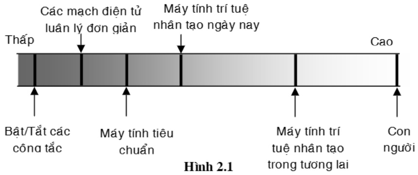

<!-- page: 76 -->

Trước khi bước vào tìm hiểu về trí tuệ nhân tạo, chúng ta hây nhắc lại một định nghĩa được nhiều nhà khoa học chấp nhận.

## Mục tiêu của ngành khoa học trí tuệ nhân tạo ?

Tạo ra những chiếc máy tính có khả năng nhận thức suy luận và phần ứng.

Nhận thức được hiểu là khả năng quan sát, học hỏi, hiểu biết cũng như những kinh nghiệm về thế giới xung quanh. Quá trình nhận thức giúp con người có tri thức. Suy luận là khả năng vận dụng những tri thức sẵn có để phân ứng với những tình huống hay những vấn đề - bài toán gặp phải trong cuộc sống. Nhận thức và suy luận để từ đó đưa ra những phần ứng thích hợp là ba hành vi có thể nói là đặc trưng cho trí tuệ của con người. (Dĩ nhiên còn một yếu tố nửa là tình cảm. Những chúng ta sẽ không đề cập đến ở đây!). Do đó, cũng không có gì ngạc nhiên khi muốn tạo ra một chiếc máy tính thông minh, ta cần phải trang bị cho nó những khả năng này. Cả ba khả năng này đều cần đến một yếu tố cơ bản là tri thức.

Dưới góc nhìn của tập sách này, xây dựng trí tuệ nhân tạo là tìm cách biểu diễn tri thức, tìm cách vận dụng tri thức để giải quyết vấn đề và tìm cách bổ sung tri

<!-- page: 77 -->

thức bằng cách “phát hiện” tri thức từ các thông tin sẵn có (máy học).

## II. THÔNG TIN, DỰ LIỆU VÀ TRI THỨC

Tri thức là một khái niệm rất trừu tượng. Do đó, chúng ta sẽ không có gắng đưa ra một định nghĩa hình thức chính xác ở đây. Thay vào đó, chúng ta hây cùng nhau cảm nhận khái niệm “tri thức” bằng cách so sánh nó với hai khái niệm khác là thông tin và dữ liệu.

Nhà bác học nổi tiếng Karan Sing đã từng nói rằng “Chúng ta đang ngập chìm trong biển thông tin nhưng lại đang khát tri thức”. Câu nói này làm nổi bật sự khác biệt về lượng lẩn về chất giữa hai khái niệm thông tin và tri thức.

Trong ngữ cảnh của ngành khoa học máy tính, người ta quan niệm rằng dữ liệu là các con số, chữ cái, hình ảnh, âm thanh... mà máy tính có thể tiếp nhận và xử lý. Bản thân dữ liệu thường không có ý nghĩa đối với con người. Còn thông tin là tất cả những gì mà con người có thể cảm nhận được một cách trực tiếp thông qua các giác quan của mình (khứu giác, vị giác, thính giác, xúc giác, thị giác và giác quan thứ 6) hoặc gián tiếp thông qua các phương tiện kỹ thuật như tivi, radio, cassette,... Thông tin đối với con người luôn có một ý nghĩa nhất định nào đó. Với phương tiện máy tính (mà cụ thể là các thiết bị đầu ra), con người

<!-- page: 78 -->

sẽ tiếp thu được một phần dữ liệu có ý nghĩa đối với mình. Nếu so về lượng, dữ liệu thường nhiều hơn thông tin.

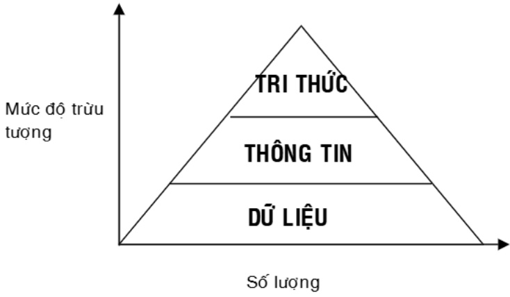

Hình 2.2

Cũng có thể quan niệm thông tin là quan hệ giữa các dữ liệu. Các dữ liệu được sắp xếp theo một thứ tự hoặc được tập hợp lại theo một quan hệ nào đó sẻ chứa dụng thông tin. Nếu những quan hệ này được chỉ ra một cách rõ ràng thì đó là các tri thức. Chắng hạn :

## Trong toán học :

Bản thân từng con số riêng lẻ như 1, 1, 3, 5, 2, 7, 11... là các dữ liệu. Tuy nhiên, khi đặt chúng lại với nhau theo trật tự như dưới đây thì giữa chúng đã bắt đầu có một mối liên hệ

Dữ liệu : 1, 1, 2, 3, 5, 8, 13, 21, 34...

<!-- page: 79 -->

Mối liên hệ này có thể được biểu diễn bằng công thức sau :  $U_{n} = U_{n-1} + U_{n-2}$ .

Công thức nêu trên chính là tri thức.

## Trong vật lý :

Bản sau đây cho chúng ta biết số đo về điện trở (R), điện thế (U) và cường độ dòng điện (I) trong một mạch điện.

| I | U | R |
| --- | --- | --- |
| 5 | 10 | 2 |
| 2.5 | 20 | 8 |
| 4 | 12 | 3 |
| 7.3 | 14.6 | 2 |

Bản thân những con số trong các cột của bản trên không có máy ý nghĩa nếu ta tách rời chúng ta. Nhùng khi đặt kế nhau, chúng đã cho thấy có một sự liên hệ nào đó. Và mối liên hệ này có thể được diễn tả bằng công thức đơn giản sau :

$$
\mathrm{I} = \frac {\mathrm{U}}{\mathrm{R}}
$$

Công thức này là tri thức.

<!-- page: 80 -->

## Trong cuộc sống hàng ngày :

Hằng ngày, người nông dân vẫn quan sát thấy các hiện tượng nắng, mưa, râm và chuẩn chuẩn bay. Rất nhiều lần quan sát, họ đã có nhận xét như sau :

Chuồn chuồn bay thấp thì mưa,

Bay cao thì nắng, bay vừa thì râm.

Lời nhận xét trên là tri thức.

Có quan điểm trên cho rằng chỉ những mối liên hệ tuồng minh (có thể chứng minh được) giữa các dữ liệu mối được xem là tri thức. Côn những mối quan hệ không tuồng minh thì không được công nhận. Ô đây, ta cũng có thể quan niệm rằng, mọi mối liên hệ giữa các dữ liệu đều có thể được xem là tri thức, bồi vì, những mối liên hệ này thực sự tôn tại. Điểm khác biệt là chúng ta chưa phát hiện ra nó mà thôi. Rỗ ràng rằng “dù sao thì trái đất cũng vẫn xoay quanh mặt trời” dù tri thức này có được Galilê phát hiện ra hay không!

Như vậy, so với dữ liệu thì tri thức có số lượng ít hơn rất nhiều. Thuật ngữ ít ở đây không chỉ đơn giản là một dấu nhỏ hơn bình thường mà là sự kết tinh hoặc cô động lại. Bạn hây hình dung dữ liệu như là những điểm trên mặt phẳng còn tri thức chính là phương trình của đường cong nói tất cả những điểm này lại. Chỉ cần một phương trình đường cong ta có thể biểu diễn được vô só điểm! Cũng vậy, chúng ta cần có những kinh nghiệm, nhận xét từ hàng đóng số liệu thống kê, nếu không, chúng ta sẽ

<!-- page: 81 -->

ngập chim trong biển thông tin như nhà bác học Karan Sing đã cảnh báo!

Người ta thường phân loại tri thức ra làm các dạng như sau.

Tri thức sự kiện : là các khẳng định về một sự kiện, khái niệm nào đó (trong một phạm vi xác định). Các định luật vật lý, toán học ... thường được xếp vào loại này. (Chẳng hạn : mặt trời mọc ở đẳng đông, tam giác đều có ba góc 60$^{0}$...)

Tri thức thủ tục : thường dùng để diễn tả phương pháp, các bước cần tiến hành, trình từ hay ngắn gọn là cách giải quyết một vấn đề. Thuật toán, thuật giải là một dạng của tri thức thủ tục.

Tri thức mô tả : cho biết một đối tượng, sự kiện, vấn đề, khái niệm ... được thấy, cảm nhận, cấu tạo như thế nào (một cái bàn thường có bốn chân, con người có hai tay, hai mắt...)

Tri thức heuristic : là một dạng tri thức cảm tính. Các tri thức thuộc loại này thường có dạng uốc lượng, phỏng đoán, và thường được hình thành thông qua kinh nghiệm.

<!-- page: 82 -->

Trên thực tế, rất hiểm có một trí tuệ mà không cần đến tri thức (liệu có thể có một đại kiện tương cờ vua mà không biết đánh cờ hoặc không biết các thể cờ quan trọng không?). Tuy tri thức không quyết định sự thông minh (người biết nhiều định lý toán hơn chưa chắc đã giải toán giới hơn!) nhưng nó là một yếu tố cơ bản cấu thành trí thông minh. Chính vì vậy, muốn xây dựng một trí thông minh nhân tạo, ta cần phải có yếu tố cơ bản này. Từ đây đặt ra vấn đề đầu tiên là ... Các phương pháp đưa tri thức vào máy tính được gọi là biểu diễn tri thức.

## III. THUẬT TOÁN – MỘT PHƯƠNG PHÁP BIỆU DIỄN TRI THỨC?

Trước khi trả lời câu hỏi trên, bạn hây thử nghĩ xem, liệu một chương trình giải phương trình bậc hai có thể được xem là một chương trình có tri thức hay không? ... Có chú! Vậy thì tri thức nằm ở đầu? Tri thức về giải phương trình bậc hai thực chất đã được mã hóa dưới dạng các câu lệnh if..then..else trong chương trình. Một cách tổng quát, có thể khẳng định là tất cả các chương trình máy tính ít nhiều đều đã có tri thức. Đó chính là tri thức của lập trình viên được chuyển thành các câu lệnh của chương trình. Bạn sẽ thắc mắc “như vậy tại sao đưa tri thức vào máy tính lại là một vấn đề ? (vì từ trước tới giờ chúng ta đã, đang và sẽ tiếp tục làm nhu thế mà?)”. Đúng như thế thật, nhưng vấn đề nằm ở chỗ, các tri thức trong những chương

<!-- page: 83 -->

trình truyền thống là những tri thức “cứng”, nghĩa là nó không thể được thêm vào hay điều chỉnh một khi chương trình đã được biên dịch. Muốn điều chỉnh thì chúng ta phải tiến hành sửa lại mã nguồn của chương trình (rôi sau đó biên dịch lại). Mà thao tác sửa chương trình thì chỉ có những lập trình viên mới có thể làm được. Điều này sẽ làm giám khả năng ứng dụng chương trình (vì đa số người dùng bình thường đều không biết lập trình).

Bạn thử nghĩ xem, với một chương trình hỗ trợ ra quyết định (như đầu tư cổ phiếu, đầu tư bất động sản chẳng hạn), liệu người dùng có cảm thấy thời mái không khi muốn đưa vào chương trình những kiến thức của mình thì anh ta phải chọn một trong hai cách là (1) tự sửa lại mã chương trình!? (2) tìm tác giả của chương trình để nhờ người này sửa lại!?. Cả hai thao tác trên đều không thể chấp nhận được đối với bất kỳ người dùng bình thường nào. Hộ cần có một cách nào đó để chính họ có thể đưa tri thức vào máy tính một cách dễ dàng, thuận tiện giống như họ đang đối thoại với một con người.

Đế làm được điều này, chúng ta cần phải “mềm” hóa các tri thức được biểu diễn trong máy tính. Xét cho cùng, mọi chương trình máy tính đều gồm hai thành phần là các mã lệnh và dữ liệu. Mã lệnh được ví như là phần cứng của chương trình còn dữ liệu được xem là phần mềm (vì nó có thể được thay đổi bởi người dùng). Do đó, “mềm” hóa tri

<!-- page: 84 -->

thức cũng đồng nghĩa với việc tìm các phương pháp để có thể biểu diễn các loại tri thức của con người bằng các cấu trúc dữ liệu mà máy tính có thể xử lý được. Đây cũng chính là ý nghĩa của thuật ngữ “biểu diễn tri thức”.

Bạn cần phải biết ràng, ít ra là cho đến thời điểm bạn đang đọc cuốn sách này, con người vẫn chưa thể tìm ra một kiểu biểu diễn tổng quát cho mọi loại tri thức!

Đế làm vấn đề mà chúng ta đang bàn luận trở nên sáng tổ hơn. Chúng ta hãy xem xét một số bài toán trong phần tiếp theo.

## IV. LÀM QUEN VỚI CÁCH GIẢI QUYẾT VẤN ĐỀ BẰNG CÁCH CHUYỄN GIAO TRI THỨC CHO MÁY TÍNH

Bài toán 1 : Cho hai bình rỗng X và Y có thể tích lần lượt là V\_X và V\_Y, hãy dùng hai bình này để dong ra z lít nước (z <= min(V\_X, V\_Y)).

Bài toán 2 : Cho biết một số yếu tố của tam giác (như chiều dài cạnh và góc ...). Hãy tính các yếu tố còn lại.

Bài toán 3 : Tính diện tích phần giao của các hình hình học cơ bản.

<!-- page: 85 -->

Hai bài toán đầu là hai bài toán khá tiêu biểu, thường được dùng để minh họa cho nét đẹp của phương pháp giải quyết vấn đề bài toán bằng cách chuyển giao tri thức cho máy tính. Nếu sử dụng thuật toán thông thường, chúng ta thường chỉ giải được một số trường hợp cụ thể của các bài toán này. Thậm chí, nhiều người khi mới tiếp cận với hai bài toán này còn không tin là nó có thể hoàn toàn được giải một cách tổng quát bởi máy tính! Bài toán số 3 là một minh họa đẹp mắt cho kỹ thuật giải quyết vấn đề “vĩ mô”, nghĩa là ta chỉ cần mô tả các bước giải quyết ở mức tổng quát cho máy tính mà không cần đi vào cải đặt cụ thể.

Bài toán 1 sẽ được giải quyết bằng cách sử dụng các luật dẫn xuất (luật sinh). Bài toán 2 sẽ được giải quyết bằng mạng ngữ nghĩa và bài toán 3 sẽ giải quyết bằng công cụ frame. Ô đây chúng ta cùng nhau tìm hiểu cách giải bài toán đầu tiên. Hai bài toán kế tiếp sẽ được giải quyết lần lượt ở các mục sau.

Với một trường hợp cụ thể của bài toán 1, như $V_{X} = 5$ và $V_{Y} = 7$ và z = 4. Sau một thời gian tính toán, bạn có thể sẽ đưa ra một quy trình độ nước đại loại như :

\- Mức đầy bình 7

\- Trút hết qua bình 5 cho đến khi 5 đầy.

\- Đổ hết nước trong bình 5

\- Đỗ hết nước còn lại từ bình 7 sang bình 5

<!-- page: 86 -->

\- Mức đầy bình 7

\- Trút hết qua bình 5 cho đến khi bình 5 đầy.

\- Phân còn lại chính là số nước cần dong.

Tuy nhiên, với những số liệu khác, bạn phải “mày mò” lại từ đầu để tìm ra quy trình đổ nước. Cứ thể, mỗi một trường hợp sẽ có một cách đổ nước hoàn toàn khác nhau. Như vậy, nếu có một ai đó yêu cầu bạn đưa ra một cách làm tổng quát thì chính bạn cũng sẽ lúng túng (dĩ nhiên, ngoại trừ trường hợp bạn đã biết trước cách giải theo tri thức mà chúng ta sắp sửa tìm hiểu ở đây!).

Đến đây, bạn hây bình tâm kiểm lại cách thức bạn tìm kiếm lời giải cho một trường hợp cụ thể. Vì chưa tìm ra một quy tắc cụ thể nào, bạn sẽ thực hiện một loạt các thao tác “cảm tính” như dong đầy một bình, trút một bình này sang bình kia, đồ hết nước trong một bình ra... vừa làm vừa nhằm tính xem cách làm này có thể đi đến kết quả hay không. Sau nhiều lần thí nghiệm, rất có thể bạn sẽ rút ra được một số kinh nghiệm như “khi bình 7 đầy nước mà bình 5 chưa đầy thì hãy đổ nó sang bình 5 cho đến khi bình 5 đầy”... Vậy thì tại sao bạn lại không thử “truyền” những kinh nghiệm này cho máy tính và để cho máy tính “mày mò” tìm các thao tác cho chúng ta? Điều này hoàn toàn có lợi, vì máy tính có khả năng “mày mò” hơn hẩn chúng ta! Nếu những “kinh nghiệm” mà chúng ta cung cấp cho máy tính không giúp chúng ta tìm được lời giải, chúng

<!-- page: 87 -->

ta sẽ thay thế nó bằng những kinh nghiệm khác và lại tiếp tục để máy tính tìm kiếm lời giải!

Chúng ta hãy phát biểu lại bài toán một cách hình thức hơn.

Không làm mất tính tổng quát, ta luôn có thể giả sử rằng V\_X < V\_Y.

Gọi lượng nước chứa trong bình X là x (0<=x<=V\_X)

Gọi lượng nước chứa trong bình Y là y (0<=y<=VY)

Như vây, điều kiện kết thúc của bài toán sẽ là :

x = z hoặc y = z

Điều kiện đầu của bài toán là : x = 0 và y = 0

Quá trình giải được thực hiện bằng cách xét lần lượt các luật sau, luật nào thỏa mặn thì sẽ được áp dụng. Lức này, các luật chính là các “kinh nghiệm” hay tri thức mà ta đã chuyển giao cho máy tính. Sau khi áp dụng luật, trạng thái của bài toán sẽ thay đổi, ta lại tiếp tục xét các luật kế tiếp, nếu hết luật, quay trở lại luật đầu tiên. Quá trình tiếp diễn cho đến khi đạt được điều kiện kết thúc của bài toán.

Ba luật này được mô tả như sau :

<!-- page: 88 -->

(L1) Nếu bình X đầy thì đồ hết nước trong bình X đi.

(L2) Nếu bình Y rộng thì đổ đầy nước vào bình Y.

(L3) Nếu bình X không đầy và bình Y không rộng thì hãy trút nước từ bình Y sang bình X (cho đến khi bình X đầy hoặc bình Y hết nước).

Trên thực tế, lúc đầu để giải trường hợp tổng quát của bài toán này, người ta đã dùng đến hơn 15 luật (kinh nghiệm) khác nhau. Tuy nhiên, sau này, người ta đã rút gọn lại chỉ còn ba luật như trên.

Bạn có thể dễ dàng chuyển đổi cách giải này thành chương trình như sau :

```matlab
...
x := 0; y := 0;
WHILE ( (x <> z) AND (y<>z) ) DO BEGIN
    IF (x = Vx) THEN x := 0;
    IF (y = 0) THEN (y:= Vy);
    IF (y > 0) THEN BEGIN
        k:= min(Vx - x, y);
        x := x + k;
        y := y - k;
    END;
END;
...
```

Thử “chạy” chương trình trên với số liệu cụ thể là :

<div class="docvortex-algorithm" style="white-space: pre-wrap; font-family:monospace;">
$V_{X}=3, V_{Y}=4$  và z=2
</div>

```txt
Ban dâu : x = 0, y = 0
Luật (L2) -> x = 0, y = 4
Luật (L3) -> x = 3, y = 1
```

<!-- page: 89 -->

Luật (L1) -> x = 0, y = 1

Luật (L3) -> x = 1, y = 0

Luật (L2) -> x = 1, y = 4

Ba luật mà chúng ta đã cài đặt trong chương trình ở trên được gọi là cơ sở tri thức. Còn cách thức tìm kiếm lời giải bằng cách duyệt tuần tự từng luật và áp dụng nó được gọi là động cơ suy diễn. Chúng ta sẽ định nghĩa chính xác hai thuật ngữ này ở cuối mục.

Người ta đã chứng minh được rằng, bài toán dong nước chỉ có lời giải khi số nước cần dong là một bội số của uốc số chung lớn nhất của thể tích hai bình.

$z = n \times USCLN(V_{X}, V_{Y})$  (với n nguyên dương)

Cách giải quyết vấn đề theo kiểu này khác so với cách giải bằng thuật toán thông thường là chúng ta không đưa ra một trình tự giải quyết vấn đề cụ thể mà chỉ đưa ra các quy tắc chung chung (dưới dạng các luật), máy tính sẽ dựa vào đó (áp dụng các luật) để tự xây dựng một quy trình giải quyết vấn đề. Điều này cũng giống như việc chúng ta giải toán bằng cách đưa ra các định lý, quy tắc liên quan đến bài toán mà không cần phải chỉ ra cách giải cụ thể.

Vậy thì điểm thú vị nằm ở điểm nào? Bạn sẽ có thể cảm thấy rằng chúng ta vẫn đang dùng tri thức “cúng”! (vì các tri thức vẫn là các câu lệnh IF được cải sẵn trong chương trình). Thực ra thì chương trình của chúng ta đã

<!-- page: 90 -->

“mềm” hơn một tí rời đáy. Nếu không tin, các bạn hãy quan sát phiên bản kế tiếp của chương trình này.

```txt
FUNCTION DK(L INTEGER):BOOLEAN;
BEGIN
    CASE L OF
        1 : DK := (x = Vx);
        2 : DK := (y = 0);
        3 : DK := (y>0);
    END;
END;

PROCEDURE ThiHanh(L INTEGER):BOOLEAN;
BEGIN
    CASE L OF
        1 : x := 0;
        2: y := Vy;
        3 : BEGIN
            k := min(Vx-x,y);
            x := x+k;
            y := y-k;
        END;
    END;
END;

CONST SO_LUAT = 3;
BEGIN
    WHILE (x<>z) AND (y<>z) DO BEGIN
        FOR i:=1 TO SO_LUAT DO
            IF DK(L) THEN ThiHanh(L);
    END;
END.
```

Đoạn chương trình chính cũng thi hành bằng cách lần lượt xét qua ba lệnh IF như chương trình đầu tiên. Tuy nhiên, ở đây, biểu thức điều kiện được thay thế bằng hàm DK và các hành động ứng với điều kiện đã được thay thế

<!-- page: 91 -->

bằng thủ tục ThiHanh. Tính chất “mềm” hơn của chương trình này thể hiện ở chỗ, nếu muốn bổ sung “tri thức”, ta chỉ phải điều chỉnh lại các hàm DK và ThiHanh mà không cần phải sửa lại chương trình chính.

Bây giờ hãy giả sử rằng ta đã có hàm và thủ tục đặc biệt sau :

FUNCTION GiaTriBool(DK : String) : BOOLEAN;
PROCEDURE ThucHien(ThaoTac : String) ;

Hàm GiaTriBool nhận vào một chuỗi điều kiện, nó sẽ phân tích chuỗi, tính toán rối trả ra giá trị BOOLEAN của biểu thức này.

Ví dụ : GiaTriBoolean('6<7') sẽ trả ra FALSE

Thủ tục ThucHien cũng nhận vào một chuỗi, nó cũng sẽ phân tích chuỗi rời tiến hành thực hiện những hành động được miêu tả trong chuỗi này.

Với hàm và thủ tục này, chương trình của chúng ta sẽ như sau :

```txt
CONST SO_LUAT = 3;
TYPE
    Luat RECORD
        DK : String;
        ThiHanh : String;
    END;
```

<!-- page: 92 -->

```txt
DSLuat ARRAY [1..SO_LUAT] OF Luat;
VAR
    CacLuat  DSLuat;

PROCEDURE KhoiDong;
BEGIN
    CacLuat[1].DK := 'x = Vx';
    CacLuat[2].DK := 'y = 0';
    CacLuat[3].DK := 'y>0';

    CacLuat[1].ThaoTac := 'x:=0';
    CacLuat[2].ThaoTac:= 'y:=Vy';
    CacLuat[3].ThaoTac:=      'k:=min(Vx-x,y),
x:=x+k, y:=y-k';
END;

BEGIN
    WHILE (x<>z) AND (y<>z) DO BEGIN
        FOR i:=1 TO SO_LUAT DO
            IF GiaTriBoolean(CacLuat[i].DK)
                THEN ThucHien(CacLuat[i].ThaoTac);
    END;
END.
```

Chúng ta tạm cho ràng trong quá trình chương trình thi hành, ta có thể dễ dàng thay đổi số phần tử măng CacLuat (các ngôn ngữ lập trình sau này như Visual C++, Delphi đều cho phép điều này). Với chương trình này, khi muốn sửa đổi “tri thức”, bạn chỉ cần thay đổi giá trị măng Luat là xong.

Tuy nhiên, người dùng vẫn gặp khó khăn khi muốn bổ sung hoặc hiệu chỉnh tri thức. Họ cần phải nhập các chuỗi đại loại như ‘x=0’ hoặc ‘k:=min(Vx-x,y)’ ...Các chuỗi này,

<!-- page: 93 -->

tuy có ý nghĩa đối với chương trình nhưng vẫn còn khá xa lạ đối với người dùng bình thường. Chúng ta cần giảm bót “khoảng cách” này lại bằng cách đưa ra những chuỗi điều kiện hoặc thao tác có ý nghĩa trực tiếp đối với người dùng. Chương trình sẽ có chuyển đổi lại các điều kiện và thao tác này sang dạng phù hợp với chương trình.

Đế làm được điều trên. Chúng ta cần phải liệt kê được các trạng thái và thao tác cơ bản của bài toán này. Sau đây là một số trạng thái và thao tác cơ bản.

## Trạng thái cơ bản

Bình X đầy, Bình X rộng, Bình X không rộng, Bình X có n lít nước.

## Thao tác

Đỗ hết nước trong bình, Đỗ đầy nước trong bình, Đỗ nước từ bình A sang bình B cho đến khi B đầy hoặc A rỗng.

Lưu ý rằng ta không thể có thao tác “Đỗ n lít nước từ A sang B” vì bài toán đã giả định rằng các bình đều không có vạch chia, hơn nửa nếu ta biết cách đồ n lít nước từ A sang B thì lời giải bài toán trở thành quá đơn giản.

"Mức đây X"

“Đỗ z lít nước từ X sang Y”

<!-- page: 94 -->

Vì đây là một bài toán đơn giản nên bạn có thể dễ nhận thấy rằng, các trạng thái cơ bản và thao tác chẳng có gì khác so với các điều kiện mà chúng ta đã đưa ra.

Kế tiếp, ta sẽ viết các đoạn chương trình cho phép người dùng nhập vào các luật (dạng nếu ... thì ...) được hình thành từ các trạng thái và điều kiện cơ bản này, đồng thời tiến hành chuyển sang dạng máy tính có thể xử lý được như ở ví dụ trên. Chúng ta sẽ không bàn đến việc cải đặt các đoạn chương trình giao tiếp với người dùng ở đây.

Như vậy, so với chương trình truyền thống (được cấu tạo từ hai “ chất liệu” cơ bản là dữ liệu và thuật toán), chương trình trí tuệ nhân tạo được cấu tạo từ hai thành phần là cơ sở tri thức (knowledge base) và động cơ suy diễn (inference engine).

Cơ sở tri thức : là tập hợp các tri thức liên quan đến vấn đề mà chương trình quan tâm giải quyết.

Động cơ suy diễn : là phương pháp vận dụng tri thức trong cơ sở tri thức để giải quyết vấn đề.

<!-- page: 95 -->

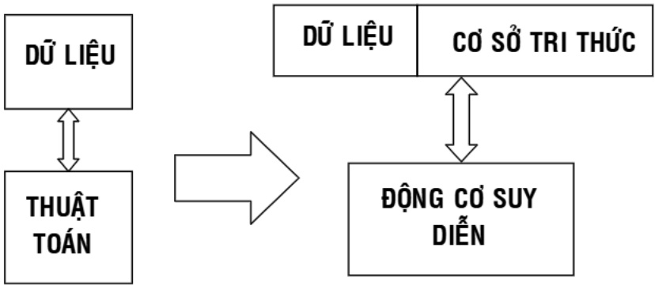

Nếu xét theo quan niệm biểu diễn tri thức mà ta vừa bàn luận ở trên thì cơ sở tri thức chỉ là một dạng dữ liệu đặc biệt và động cơ suy diễn cũng chỉ là một dạng của thuật toán đặc biệt mà thôi. Tuy vậy, có thể nói rằng, cơ sở tri thức và động cơ suy diễn là một bước tiến hóa mới của dữ liệu và thuật toán của chương trình! Bạn có thể hình dung động cơ suy diễn giống như một loại động cơ tổng quát, được chuẩn hóa có thể dùng để vận hành nhiều loại xe máy khác nhau và cơ sở tri thức chính là loại nhiên liệu đặc biệt để vận hành loại động cơ này!

<!-- page: 96 -->

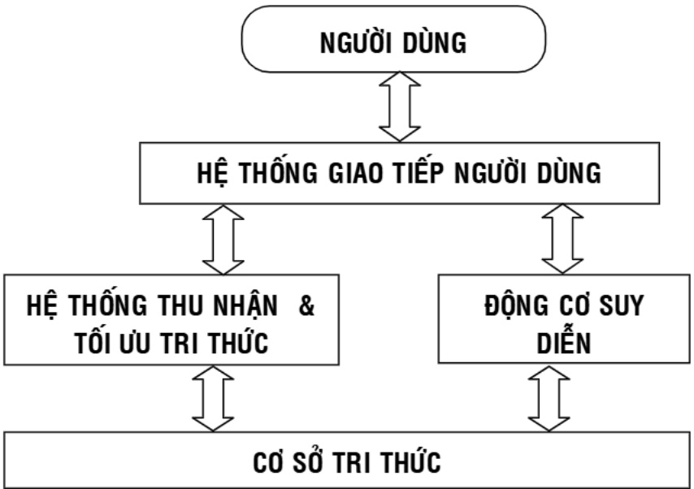

Cơ sở tri thức cũng gặp phải những vấn đề tương tự như những cơ sở dữ liệu khác như sự trùng lắp, thừa, màu thuẫn. Khi xây dựng cơ sở tri thức, ta cũng phải chú ý đến những yếu tố này. Như vậy, bên cạnh vấn đề biểu diễn tri thức, ta còn phải đề ra các phương pháp để loại bỏ những tri thức trùng lắp, thừa hoặc màu thuẫn. Những thao tác này sẽ được thực hiện trong quá trình ghi nhận tri thức vào hệ thống. Chúng ta sẽ đề cập đến những phương pháp này trong phần tìm hiểu về các luật dẫn.

Hình ảnh trên tóm tắt cho chúng ta thấy cấu trúc chung nhất của một chương trình trí tuệ nhân tạo.

<!-- page: 97 -->

# B. CÁC PHƯƠNG PHÁP BIỂU DIỄN TRI THỨC TRÊN MÁY TÍNH

## V. LOGIC MÊNH ĐỀ

Đây có lẽ là kiểu biểu diễn tri thức đơn giản nhất và gần gửi nhất đối với chúng ta. Mệnh đề là một khẳng định, một phát biểu mà giá trị của nó chỉ có thể hoặc là đúng hoặc là sai.

Ví dụ : phát biểu “1 + 1 = 2” có giá trị đúng.

phát biểu “Mọi loại cá có thể sống trên bò” có giá trị sai.

Giá trị của mệnh để không chỉ phụ thuộc vào bản thân mệnh để đó. Có những mệnh để mà giá trị của nó luôn đúng hoặc sai bất chấp thời gian nhưng cũng có những mệnh để mà giá trị của nó lại phụ thuộc vào thời gian, không gian và nhiều yếu tố khác quan khác. Chẳng hạn như mệnh để : “Con người không thể nhảy cao hơn 5m với chân trần” là đúng khi ở trái đất, còn ở những hành tỉnh có lực hấp dẫn yếu thì có thể sai.

Ta ký hiệu mệnh để bằng những chữ cái latinh như a, b, c, ...

Có ba phép nổi cơ bản để tạo ra những mệnh để mới từ những mệnh để cơ sở là phép hội (∨), giao(∧) và phủ định (¬).

<!-- page: 98 -->

Bạn đọc chẩn hẩn đã từng sử dụng logic mệnh để trong chương trình rất nhiều lần (như trong cấu trúc lệnh IF ... THEN ... ELSE) để biểu diễn các tri thức “cúng” trong máy tính!

Bên cạnh các thao tác tính ra giá trị các mệnh để phúc từ giá trị những mệnh đề con, chúng ta có được một cơ chế suy diễn như sau :

Modus Ponens : Nếu mệnh đề A là đúng và mệnh đề A → B là đúng thì giá trị của B sẽ là đúng.

Modus Tollens : Nếu mệnh đề A → B là đúng và mệnh đề B là sai thì giá trị của A sẽ là sai.

Các phép toán và suy luận trên mệnh để đã được để cập nhiều đến trong các tài liệu về toán nên chúng ta sẽ không đi vào chi tiết ở đây.

## VI. LOGIC VỊ TỪ

Biểu diễn tri thức bằng mệnh để gặp phải một trở ngại cơ bản là ta không thể can thiệp vào cấu trúc của một mệnh đề. Hay nói một cách khác là mệnh đề không có cấu trúc. Điều này làm hạn chế rất nhiều thao tác suy luận. Do đó, người ta đã đưa vào khái niệm vị từ và lượng từ (∀ - với mọi, ∃ - tồn tại) để tăng cường tính cấu trúc của một mệnh đề.

<!-- page: 99 -->

Trong logic vị từ, một mệnh để được cấu tạo bôi hai thành phần là các đối tượng tri thức và mối liên hệ giữa chúng (gọi là vị tử). Các mệnh đề sẽ được biểu diễn dưới dạng :

## Vị tử (<đối tượng 1>, <đối tượng 2>, ..., <đối tượng n>)

Như vậy để biểu diễn vị của các trái cây, các mệnh đề sẽ được viết lại thành :

Cam có vị Ngọt ⇒ Vị (Cam, Ngọt)

Cam có màu Xanh  $\Rightarrow$  Màu (Cam, Xanh)

Kiểu biểu diễn này có hình thức tương tự như hàm trong các ngôn ngữ lập trình, các đối tượng tri thức chính là các tham số của hàm, giá trị menses để chính là kết quả của hàm (thuộc kiểu BOOLEAN).

Với vị từ, ta có thể biểu diễn các tri thức dưới dạng các mệnh đề tổng quát, là những mệnh đề mà giá trị của nó được xác định thông qua các đối tượng tri thức cấu tạo nên nó.

Chẳng hạn tri thức: “A là bó của B nếu B là anh hoặc em của một người con của A” có thể được biểu diễn dưới dạng vị từ như sau :

Bố (A, B) = Tổn tại Z sao cho : Bố (A, Z) và (Anh(Z, B) hoặc Anh(B,Z))

<!-- page: 100 -->

Trong trường hợp này, mệnh để Bố(A,B) là một mệnh đề tổng quát

Như vây nếu ta có các mệnh đề cơ sở là :

a) Bố ("An", "Bình") có giá trị đúng (Anh là bổ của Bình)

b) Anh("Tú", "Bình") có giá trị đúng (Tú là anh của Bình)

thì mènh dê c) Bố ("An", "Tú") sẽ có giá trị là đúng. (An là bổ của Tú).

Rõ ràng là nếu chỉ sử dụng logic mệnh để thông thường thì ta sẽ không thể tìm được một mối liên hệ nào giữa c và a, b bằng các phép nối mệnh để ∧, ∨, ¬. Từ đó, ta cũng không thể tính ra được giá trị của mệnh để c. Sở dĩ như vậy vì ta không thể thể hiện tưởng minh tri thức “(A là bó của B) nếu có Z sao cho (A là bó của Z) và (Z anh hoặc em C)” dưới dạng các mệnh để thông thường. Chính đặc trưng của vị từ đã cho phép chúng ta thể hiện được các tri thức dạng tổng quát như trên.

Thêm một số ví dụ nửa để các bạn thấy rõ hơn khả năng của vị tử :

Câu cách ngôn “Không có vật gì là lớn nhất và không có vật gì là bé nhất!” có thể được biểu diễn dưới dạng vị từ như sau :

LónHon(x,y) = x>y

NhôHon(x,y) = x<y

<!-- page: 101 -->

$$
\forall \mathrm{x}, \exists \mathrm{y}: \text {LónHon} (\mathrm{y}, \mathrm{x}) \text {và} \forall \mathrm{x}, \exists \mathrm{y}: \text {NhóHon} (\mathrm{y}, \mathrm{x})
$$

Câu châm ngôn “Gần mục thì đen, gần đèn thì sáng” được hiểu là “choi với bạn xấu nào thì ta cũng sẽ thành người xấu” có thể được biểu diễn bằng vị từ như sau :

$$
\text {NgườiXấu (x) = \exists y : Bạn(x,y) và NgườiXấu(y)}
$$

Công cụ vị từ đã được nghiên cứu và phát triển thành một ngôn ngữ lập trình đặc trưng cho trí tuệ nhân tạo. Đó là ngôn ngữ PROLOG. Phẩn đọc thêm của chương sẽ giới thiệu tổng quan với các bạn về ngôn ngữ này.

## VII. MỘT SỐ THUẬT GIẢI LIÊN QUAN ĐẾN LOGIC MỆNH ĐỀ

Một trong những vấn đề khá quan trọng của logic mệnh đề là chứng minh tính đúng đắn của phép suy diễn (a → b). Đây cũng chính là bài toán chứng minh thường gặp trong toán học.

Rõ ràng rằng với hai phép suy luận cơ bản của logic mệnh đề (Modus Ponens, Modus Tollens) cộng với các phép biến đổi hình thức, ta cũng có thể chứng minh được phép suy diễn. Tuy nhiên, thao tác biến đổi hình thức là rất khó cài đặt được trên máy tính, thệm chí điều này còn khó khăn với cả con người!

<!-- page: 102 -->

Với công cụ máy tính, bạn có thể cho rằng ta sẽ dễ dàng chứng minh được mọi bài toán bằng một phương pháp “thô bạo” là lập bảng chân trị. Tuy về lý thuyết, phương pháp lập bảng chân trị luôn cho được kết quả cuối cùng nhưng độ phức tạp của phương pháp này là quá lớn, O(2$^{n}$) với n là số biến mệnh đề. Sau đây chứng ta sẽ nghiên cứu hai phương pháp chứng minh mệnh đề với độ phức tạp chỉ có O(n).

B1 : Phát biểu lại giả thiết và kết luận của vấn đề theo dạng chuẩn sau :

$$
\mathrm{GT} _ {1}, \mathrm{GT} _ {2}, \dots , \mathrm{GT} _ {\mathrm{n}} \rightarrow \mathrm{KL} _ {1}, \mathrm{KL} _ {2}, \dots , \mathrm{KL} _ {\mathrm{m}}
$$

trong đó các GT$_{i}$ và KL$_{i}$ là các mệnh để được xây dựng từ các biến mệnh để và ba phép nối cơ bản : ∧, ∨, ¬

B2 : Chuyển vé các GT$_{i}$ và KL$_{i}$ có dạng phủ định.

Vi dụ

$$
\mathrm{p} \lor \mathrm{q}, \neg (\mathrm{r} \land \mathrm{s}), \neg \mathrm{g}, \mathrm{p} \lor \mathrm{r} \rightarrow \mathrm{s}, \neg \mathrm{p}
$$

$$
\Rightarrow \mathrm{p} \lor \mathrm{q}, \mathrm{p} \lor \mathrm{r}, \mathrm{p} \rightarrow (\mathrm{r} \land \mathrm{s}), \mathrm{g}, \mathrm{s}
$$

B3 : Nếu GT$_{i}$ có phép ∧ thì thay thế phép ∧ bằng dấu “,”

Nếu KL$_{i}$ có phép ∨ thì thay thế phép ∨ bằng dấu “,”

Vi dụ

<!-- page: 103 -->

$$
\mathrm{p} \land \mathrm{q}, \mathrm{r} \land (\neg \mathrm{p} \lor \mathrm{s}) \rightarrow \neg \mathrm{q}, \neg \mathrm{s}
$$

$$
\Rightarrow \mathrm{p}, \mathrm{q}, \mathrm{r}, \neg \mathrm{p} \lor \mathrm{s} \rightarrow \neg \mathrm{q}, \neg \mathrm{s}
$$

B4 : Nếu GT$_{i}$ có phép ∨ thì tách thành hai dòng con.

Nếu ở KL$_{i}$ có phép ∧ thì tách thành hai dòng con.

Vi dụ

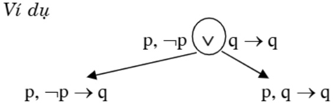

B5 : Một dòng được chứng minh nếu tôn tại chung một mệnh đề ở cả hai phía.

$$
\begin{array}{r l}\text {Vi   du}\\\mathrm{p}, \mathbf {q} \rightarrow \mathbf {q}&\quad \text {dược chứng minh}\\\mathrm{p}, \neg \mathrm{p} \rightarrow \mathrm{q}&\Rightarrow \quad \mathbf {p} \rightarrow \mathbf {p}, \mathrm{q}\end{array}
$$

B6 : a) Nếu một dòng không còn phép nối ∧ hoặc ∨ ở cả hai về và ở hai về không có chung một biến mệnh để thì dòng đó không được chứng minh.

b) Một vấn đề được chứng minh nếu tất cả dòng dẫn xuất từ dạng chuẩn ban đầu đều được chứng minh.

<!-- page: 104 -->

Thuật giải này hoạt động dựa trên phương pháp chứng minh phân chứng.

## Phương pháp chứng minh phần chứng

```txt
Chứng minh phép suy luận (a → b) là đúng (với a là giả thiết, b là kết luận).

Phân chứng : giả sử b sai suy ra ¬b là đúng.

Bài toán được chứng minh nếu a đúng và ¬b đúng sinh ra một màu thuẫn.
```

B1 : Phát biểu lại giả thiết và kết luận của vấn đề dưới dạng chuẩn như sau :

$$
\mathrm{GT}_{1},\mathrm{GT}_{2},\dots,\mathrm{GT}_{\mathrm{n}}\to \mathrm{KL}_{1},\mathrm{KL}_{2},..,\mathrm{KL}_{\mathrm{m}}
$$

trong đó : GT$_{i}$ và KL$_{j}$ được xây dựng từ các biến mệnh đề và các phép toán : ∧, ∨, ¬

B2 : Nếu GT$_{i}$ có phép ∧ thì thay bằng dấu “,”

Nếu KL$_{i}$ có phép ∨ thì thay bằng dấu “,”

B3 : Biến đổi dòng chuẩn ở B1 về thành danh sách mệnh để như sau :

$$
\{\mathrm{GT} _ {1}, \mathrm{GT} _ {2}, \dots , \mathrm{GT} _ {\mathrm{n}}, \neg \mathrm{KL} _ {1}, \neg \mathrm{KL} _ {2}, \dots , \neg \mathrm{KL} _ {\mathrm{m}} \}
$$

<!-- page: 105 -->

B4 : Nếu trong danh sách mệnh để ở bước 2 có hai mệnh để đối ngẫu nhau thì bài toán được chứng minh. Ngược lại thì chuyển sang B4. (a và ¬a gọi là hai mệnh để đối ngẫu nhau)

B5 : Xây dựng một mệnh để mới bằng cách tuyến một cặp mệnh để trong danh sách mệnh để ở bước 2. Nếu mệnh để mới có các biến mệnh để đối ngẫu nhau thì các biến đó được loại bỏ.

$$
V i d u: \quad \mathrm{p} \vee \neg \mathbf {q} \quad \vee \quad \neg \mathrm{r} \vee \mathrm{s} \vee \boxed {\mathbf {q}}
$$

Hai menses đề $\neg\mathbf{q}$, $\mathbf{q}$ là đối ngâu nên sẽ được loại bỏ

$$
\Rightarrow \mathrm{p} \lor \neg \mathrm{r} \lor \mathrm{s}
$$

B5 : Thay thế hai mệnh đề vừa tuyến trong danh sách mệnh đề bằng mệnh đề mới.

Ví dụ :

$$
\{\boxed {\mathrm{p} \vee \neg \mathbf {q}}, \boxed {\neg \mathrm{r} \vee \mathrm{s} \vee \mathbf {q}}, \quad \mathrm{w} \vee \mathrm{r}, \quad \mathrm{s} \vee \mathrm{q} \}
$$

$$
\Rightarrow \left\{\mathrm{p} \vee \neg \mathrm{r} \vee \mathrm{s}, \mathrm{w} \vee \mathrm{r}, \quad \mathrm{s} \vee \mathrm{q} \right\}
$$

B6 : Nếu không xây dựng được thêm một mệnh để mới nào và trong danh sách mệnh để không có hai mệnh để nào đối ngẫu nhau thì vấn đề không được chứng minh.

Ví dụ : Chứng minh rằng

$$
\neg \mathrm{p} \lor \mathrm{q}, \neg \mathrm{q} \lor \mathrm{r}, \neg \mathrm{r} \lor \mathrm{s}, \neg \mathrm{u} \lor \neg \mathrm{s} \quad \rightarrow \quad \neg \mathrm{p}, \neg \mathrm{u}
$$

<!-- page: 106 -->

B3: { ¬p ∨ q, ¬q ∨ r, ¬r ∨ s, ¬u ∨ ¬s, p, u }

B4 : Có tất cả sáu mệnh để nhưng chưa có mệnh để nào đối ngẫu nhau.

B5 :  $\Rightarrow$  tuyển một cặp mệnh đề (chọn hai mệnh đề có biến đối ngẫu). Chọn hai mệnh đề đầu :

$$
\neg \mathrm{p} \lor \mathrm{q} \quad \vee \quad \neg \mathrm{q} \lor \mathrm{r} \quad \Rightarrow \quad \neg \mathrm{p} \lor \mathrm{r}
$$

Danh sách mệnh đề thành :

$$
\{\neg \mathrm{p} \lor \mathrm{r}, \neg \mathrm{r} \lor \mathrm{s}, \neg \mathrm{u} \lor \neg \mathrm{s}, \mathrm{p}, \mathrm{u} \}
$$

Văn chưa có mệnh đề đối ngẫu.

Tuyến hai cặp mệnh đề đầu tiên

$$
\neg \mathrm{p} \lor \mathrm{r}
$$

$$
\neg \mathbf {r} \lor s
$$

$$
\neg \mathrm{p} \lor \mathrm{s}
$$

Danh sách mệnh đề thành {¬p ∨ s, ¬u ∨ ¬s, p, u }

Văn chưa có hai mệnh đề đối ngẫu

Tuyến hai cặp mệnh đề đầu tiên

$$
\neg \mathrm{p} \lor \mathrm{s} \lor \neg \mathrm{u} \lor \neg \mathrm{s} \Rightarrow \neg \mathrm{p} \lor \neg \mathrm{u}
$$

Danh sách mệnh để thành : {¬p ∨ ¬u, p, u }

Văn chưa có hai mệnh đề đối ngẫu

<!-- page: 107 -->

Tuyến hai cặp mệnh đề :

$$
\neg \mathrm{p} \lor \neg \mathrm{u} \quad \lor \quad \mathrm{u} \Rightarrow \neg \mathrm{p}
$$

Danh sách mệnh đề trở thành : {¬p, p }

Có hai menses để đối ngẫu nên biểu thức ban đầu đã được chứng minh.

## VIII. BIÊU DIỄN TRI THỨC SỬ DỤNG LUẬT ĐẪN XUẬT (LUẬT SINH)

Phương pháp biểu diễn tri thức bằng luật sinh được phát minh bởi Newell và Simon trong lúc hai ông đang cố gắng xây dựng một hệ giải bài toán tổng quát. Đây là một kiểu biểu diễn tri thức có cấu trúc. Ý tưởng cơ bản là tri thức có thể được cấu trúc bằng một cặp điều kiện - hành động : “NẾU điều kiện xây ra THÌ hành động sẽ được thi hành”. Chắng hạn : NẾU đèn giao thông là đô THÌ bạn không được đi thẳng; NẾU máy tính đã mở mà không khởi động được THÌ kiểm tra nguồn điện ...

Ngày nay, các luật sinh đã trở nên phố biến và được áp dụng rộng rãi trong nhiều hệ thống trí tuệ nhân tạo khác nhau. Luật sinh có thể là một công cụ mô tả để giải quyết các vấn đề thực tế thay cho các kiểu phân tích vấn đề

<!-- page: 108 -->

truyền thống. Trong trường hợp này, các luật được dùng như là những chỉ dẫn (tuy có thể không hoàn chỉnh) nhưng rất hữu ích để trợ giúp cho các quyết định trong quá trình tìm kiếm, từ đó làm giám không gian tìm kiếm. Một ví dụ khác là luật sinh có thể được dùng để bắt chuốc hành vi của những chuyên gia. Theo cách này, luật sinh không chỉ đơn thuần là một kiểu biểu diễn tri thức trong máy tính mà là một kiểu biểu diễn các hành vi của con người.

Một cách tổng quát luật sinh có dạng như sau :

$$
\mathrm{P} _ {1} \wedge \mathrm{P} _ {2} \wedge \dots \wedge \mathrm{P} _ {\mathrm{n}} \rightarrow \mathrm{Q}
$$

Tùy vào các vấn đề đang quan tâm mà luật sinh có những ngữ nghĩa hay cấu tạo khác nhau :

Trong logic vị tử : P₁, P₂, ..., Pₙ, Q là những biểu thức logic.

Trong ngôn ngữ lập trình, mỗi một luật sinh là một câu lệnh.

$$
\text {IF} (P _ {1} \text {AND} P _ {2} \text {AND}.. \text {AND} P _ {n}) \text {THEN} Q.
$$

Trong lý thuyết hiểu ngôn ngữ tự nhiên, mỗi luật sinh là một phép dịch :

$$
\mathrm{ONE} \rightarrow \mathrm{m}\hat{\mathrm{o}}\mathrm{t}
$$

<!-- page: 109 -->

$$
\mathrm{TWO} \rightarrow \mathrm{hai}
$$

JANUARY → tháng một

Đế biểu diễn một tập luật sinh, người ta thường phải chỉ rõ hai thành phần chính sau :

(1) Tập các sự kiện F(Facts)

$$
\mathrm{F} = \{\mathrm{f} _ {1}, \mathrm{f} _ {2}, \dots \mathrm{f} _ {\mathrm{n}} \}
$$

(2) Tập các quy tắc R (Rules) áp dụng trên các sự kiện dạng như sau :

$$
\mathrm{f} _ {1} \wedge \mathrm{f} _ {2} \wedge \dots \wedge \mathrm{f} _ {\mathrm{i}} \rightarrow \mathrm{q}
$$

Trong đó, các  $f_{i}$ , q đều thuộc F

Ví dụ : Cho một cơ sở tri thức được xác định như sau :

Các sự kiện : A, B, C, D, E, F, G, H, K

Tập các quy tắc hay luật sinh (rule)

R1 : A → E

$$
\mathrm{R2}: \mathrm{B} \to \mathrm{D}
$$

$$
\mathrm{R3:H} \rightarrow \mathrm{A}
$$

R4 : E ∧ G → C

<!-- page: 110 -->

R5 : E ∧ K → B

R6 : D ∧ E ∧ K → C

R7 : G ∧ K ∧ F → A

Suy diễn tiến : là quá trình suy luận xuất phát từ một số sự kiện ban đầu, xác định các sự kiện có thể được “sinh” ra từ sự kiện này.

## Sự kiện ban đầu : H, K

R3 : H → A {A, H, K }

R1 : A → E { A, E, H, H }

R5 : E ∧ K → B { A, B, E, H, K }

R2 : B → D { A, B, D, E, H, K }

R6 : D ∧ E ∧ K → C { A, B, C, D, E, H, K }

Suy diễn lùi : là quá trình suy luận ngược xuất phát từ một số sự kiện ban đầu, ta tìm kiếm các sự kiện đã “sinh” ra sự kiện này. Một ví dụ thường gặp trong thực tế là xuất phát từ các tình trạng của máy tính, chẩn đoán xem máy tính đã bị hồng học ở đầu.

Vi dụ

Tập các sự kiện :

○ Ô cứng là “hông” hay “hoạt động bình thường”

○ Hồng màn hình.

<!-- page: 111 -->

○ Lông cáp màn hình.

o Tỉnh trạng đèn ô cứng là “tất” hoặc “sáng”

○ Có âm thanh đọc ô cứng.

o Tỉnh trạng đèn màn hình “xanh” hoặc “chóp đô”

○ Không sử dụng được máy tính.

○ Điện vào máy tính “có” hay “không”

## Tập các luật :

R1. Nếu ( (ố cứng “hông”) hoặc (cáp màn hình “lông”)) thì không sử dụng được máy tính.

R2. Nếu (điện vào máy là “có”) và ( (âm thanh đọc ố cứng là “không”) hoặc tình trạng đèn ố cứng là “tất”)) thì (ố cứng “hông”).

R3. Nếu (điện vào máy là “có”) và (tình trạng đèn màn hình là “chóp độ”) thì (cáp màn hình “lông”).

Đế xác định được các nguyên nhân gây ra sự kiện “không sử dụng được máy tính”, ta phải xây dựng một cấu trúc độ thị gọi là độ thị AND/OR như sau :

<!-- page: 112 -->

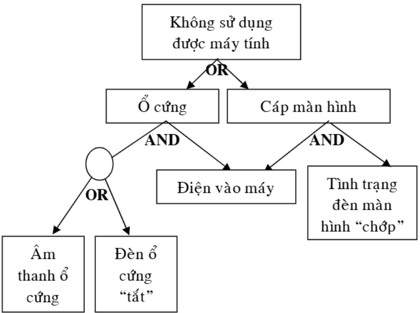

Hình 2.3

Như vậy là để xác định được nguyên nhân gây ra hồng hốc là do ô cứng hồng hay cáp màn hình lỏng, hệ thống phải lần lượt đi vào các nhánh để kiểm tra các điều kiện như điện vào máy “có”, âm thanh ô cứng “không”... Tại một bước, nếu giá trị cần xác định không thể được suy ra từ bất kỳ một luật nào, hệ thống sẽ yêu cầu người dùng trực tiếp nhập vào. Chẳng hạn như để biết máy tính có điện không, hệ thống sẽ hiện ra màn hình câu hỏi “Bạn kiểm tra xem có điện vào máy tính không (kiểm tra đèn nguồn)? (C/K)”. Đế thực hiện được cơ chế suy luận lùi, người ta thường sử

<!-- page: 113 -->

dụng ngăn xếp (đế ghi nhận lại những nhánh chưa kiểm tra).

## VIII.3 Vân đề tối ưu luật

Tập các luật trong một cơ sở tri thức rất có khả năng thừa, trùng lắp hoặc màu thuẫn. Dĩ nhiên là hệ thống có thể đồ lỗi cho người dùng về việc đưa vào hệ thống những tri thức như vậy. Tuy việc tối ưu một cơ sở tri thức về mặt tổng quát là một thao tác khó (vì giữa các tri thức thường có quan hệ không tường minh), nhưng trong giới hạn cơ sở tri thức dưới dạng luật, ta vẫn có một số thuật toán đơn giản để loại bỏ các vấn đề này.

## VIII.3.1. Rút gọn bên phải

Luật sau hiến nhiên đúng :

$$
\mathbf {A} \land \mathbf {B} \rightarrow \mathbf {A}\tag{1}
$$

Do đó luật

$$
\mathrm{A} \land \mathrm{B} \rightarrow \mathrm{A} \land \mathrm{C}
$$

Là hoàn toàn tương đương với

$$
\mathrm{A} \land \mathrm{B} \rightarrow \mathrm{C}
$$

Quy tắc rút gọn : Có thể loại bỏ những sự kiện bên về phải nếu những sự kiện đó đã xuất hiện bên về trái. Nếu

<!-- page: 114 -->

sau khi rút gọn mà vé phải trở thành rỗng thì luật đó là luật hiển nhiên. Ta có thể loại bỏ các luật hiển nhiên ra khôi tri thức.

## VIII.3.2. Rút gọn bên trái

Xét các luật :
(L1) A, B → C    (L2) A → X    (L3) X → C

Rỗ ràng là luật A, B → C có thể được thay thế bằng luật A → C mà không làm ảnh hưởng đến các kết luận trong mọi trường hợp. Ta nói rằng sự kiện B trong luật (1) là dư thừa và có thể được loại bổ khởi luật dẫn trên.

## VIII.3.3. Phân rã và kết hợp luật

Luật A ∨ B → C

Tương đương với hai luật

$$
\mathrm{A} \rightarrow \mathrm{C}
$$

$$
\mathrm{B} \rightarrow \mathrm{C}
$$

Với quy tắc này, ta có thể loại bỏ hoàn toàn các luật có phép nối HOẶC. Các luật có phép nối này thường làm cho thao tác xử lý trở nên phúc tạp.

<!-- page: 115 -->

## VIII.3.4. Luật thừa

Một luật dẫn A → B được gọi là thừa nếu có thể suy ra luật này từ những luật còn lại.

$Ví \text{dụ} :$ trong tập các luật gồm {A → B, B → C, A → C} thì luật thứ ba là luật thừa vì nó có thể được suy ra từ hai luật còn lại.

## VIII.3.5. Thuật toán tối ưu tập luật dẫn

Thuật toán này sẽ tối ưu hóa tập luật đã cho bằng cách loại đi các luật có phép nối HOẶC, các luật hiển nhiên hoặc các luật thừa.

## Thuật toán bao gồm ba bước chính

```txt
B1 : Rút gọn về phải
Với mỗi luật r trong R
    Với mỗi sự kiện A ∈ VếPhải(r)
        Nếu A ∈ VếTrái(r) thì Loại A ra khởi về phải của R.
    Nếu VếPhải(r) rỗng thì loại bổ r ra khởi hệ luật dẫn : R = R - {r}
```

<div class="docvortex-algorithm" style="white-space: pre-wrap; font-family:monospace;">
B2 : Phân rã các luật
Với mỗi luật r : $X_1 \lor X_2 \lor ... \lor X_n \to Y$ trong R
    Với mỗi i từ 1 đến n    R := R + { $X_i \to Y$ }
    R := R - {r}
B3 : Loại bỏ luật thừa
Với mỗi luật r thuộc R
</div>

<!-- page: 116 -->

$$
\text {Nếu VếPhải(r)} \in \text {BaoĐóng(VếTrái(r), R - \{r\})thì R} := \mathrm{R} - \{\mathrm{r} \}
$$

B4 : Rút gọn về trái

$$
X: A _ {1} \wedge A _ {2}, \dots , A _ {n} \rightarrow Y \text {thuộc} R
$$

Với mỗi sự kiện  $A_{i}$  thuộc r

$$
\text {Goi luật r} _ {1}: X - A _ {i} \rightarrow Y
$$

$$
\mathrm{S} = (\mathrm{R} - \{\mathrm{r} \}) \cup \{\mathrm{r} _ {1} \}
$$

$$
\text {Nếu BaoĐóng} (X - A _ {i}, S) \equiv \text {BaoĐóng} (X, R) \text {thì}
$$

loại sự kiện A ra khởi X

## Ưu điểm

Biểu diễn tri thức bằng luật đặc biệt hữu hiệu trong những tình huống hệ thống cần đưa ra những hành động dựa vào những sự kiện có thể quan sát được. Nó có những ưu điểm chính yếu sau đây :

○ Các luật rất dễ hiểu nên có thể dễ dàng dùng để trao đổi với người dùng (vì nó là một trong những dạng tự nhiên của ngôn ngũ).

○ Có thể dễ dàng xây dựng được cơ chế suy luận và giải thích từ các luật.

\- Việc hiệu chỉnh và bảo trì hệ thống là tương đối dễ dàng.

○ Có thể cải tiến dễ dàng để tích hợp các luật mò.

○ Các luật thường ít phụ thuộc vào nhau.

<!-- page: 117 -->

## Nhược điểm

○ Các tri thức phúc tạp đôi lúc đôi hồi quá nhiều (hàng ngân) luật sinh. Điều này sẽ làm này sinh nhiều vấn để liên quan đến tốc độ lẫn quản trị hệ thống.

○ Thống kê cho thấy, người xây dựng hệ thống trí tuệ nhân tạo thích sử dụng luật sinh hơn tất cả phương pháp khác (để hiểu, dễ cải đặt) nên họ thường tìm mọi cách để biểu diễn tri thức bằng luật sinh cho dù có phương pháp khác thích hợp hơn! Đây là nhược điểm mang tính chủ quan của con người.

○ Cơ sở tri thức luật sinh lớn sẽ làm giới hạn khả năng tìm kiếm của chương trình điều khiển. Nhiểu hệ thống gặp khó khăn trong việc đánh giá các hệ dựa trên luật sinh cũng như gặp khó khăn khi suy luận trên luật sinh.

## X. BIÊU DIỄN TRI THÚC SỬ DỤNG MẠNG NGỮ NGHĨA

## X.1. Khái niệm

Mạng ngữ nghĩa là một phương pháp biểu diễn tri thức đầu tiên và cũng là phương pháp dễ hiểu nhất đối với chúng ta. Phương pháp này sẽ biểu diễn tri thức dưới dạng một đồ thị, trong đó định là các đối tượng (khái niệm) còn các cung cho biết mối quan hệ giữa các đối tượng (khái niệm) này.

Chẳng hạn, giữa các khái niệm chích chòe, chim, hót, cánh, tổ có một số mối quan hệ như sau :

<!-- page: 118 -->

○ Chích chòe là một loài chim.

○ Chim biết hót

○ Chim có cánh

○ Chim sống trong tổ

Các mối quan hệ này sẽ được biểu diễn trực quan bằng một đô thị như sau :

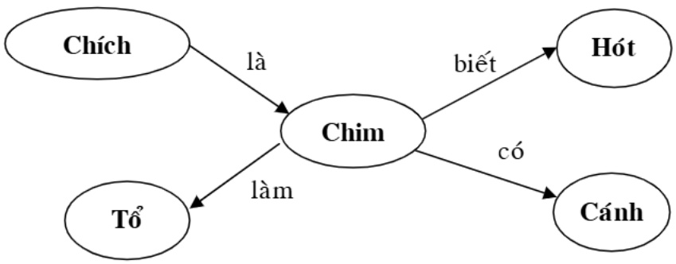

Do mạng ngữ nghĩa là một loại đồ thị cho nên nó thừa hưởng được tất cả những mặt mạnh của công cụ này; nghĩa là ta có thể dùng những thuật toán của đồ thị trên mạng ngữ nghĩa như thuật toán tìm liên thông, tìm đường đi ngắn nhất,... để thực hiện các cơ chế suy luận. Điểm đặc biệt của mạng ngữ nghĩa so với đồ thị thông thường chính là việc gán một ý nghĩa (có, làm, là, biết, ...) cho các cung. Trong đồ thị tiêu chuẩn, việc có một cung nối giữa hai định chỉ cho biết có sự liên hệ giữa hai định đó và tất cả các cung trong đồ thị đều biểu diễn cho cùng một loại liên

<!-- page: 119 -->

hệ. Trong mạng ngữ nghĩa, cung nối giữa hai đình còn cho biết giữa hai khái niệm tương ứng có sự liên hệ nhu thế nào. Việc gán ngữ nghĩa vào các cung của đồ thị đã giúp giám bót được số lượng đồ thị cần phải dùng để biểu diễn các mối liên hệ giữa các khái niệm. Chắng hạn như trong ví dụ trên, nếu sử dụng đồ thị thông thường, ta phải dùng đến bốn loại đồ thị cho bốn mối liên hệ: một đồ thị để biểu diễn mối liên hệ “là”, một đồ thị cho mối liên hệ “làm”, một cho “biết” và một cho “có”.

Một điểm khá thú vị của mạng ngữ nghĩa là tính kế thừa. Bôi vì ngay từ trong khái niệm, mạng ngữ nghĩa đã hàm ý sự phân cấp (như các mối liên hệ “là”) nên có nhiều định trong mạng mặc nhiên sẽ có những thuộc tính của những định khác. Chắng hạn theo mạng ngữ nghĩa ở trên, ta có thể dễ dàng trả lời “có” cho câu hỏi : “Chích chòe có làm tổ không?”. Ta có thể khẳng định được điều này vì định “chích chòe” có liên kết “là” với định “chim” và định “chim” lại liên kết “biết” với định “làm tổ” nên suy ra định “chích chòe” cũng có liên kết loại “biết” với định “làm tổ”. (Nếu để ý, bạn sẽ nhận ra được kiểu “suy luận” mà ta vừa thực hiện bắt nguồn từ thuật toán “loang” hay “tìm liên thông” trên đồ thị!). Chính đặc tính kế thừa của mạng ngữ nghĩa đã cho phép ta có thể thực hiện được rất nhiều phép suy diễn từ những thông tin sẵn có trên mạng.

<!-- page: 120 -->

Tuy mạng ngữ nghĩa là một kiểu biểu diễn trực quan đối với con người nhưng khi đưa vào máy tính, các đối tượng và mối liên hệ giữa chúng thường được biểu diễn dưới dạng những phát biểu động từ (như vị tử). Hơn nửa, các thao tác tìm kiếm trên mạng ngữ nghĩa thường khó khăn (đặc biệt đối với những mạng có kích thước lớn). Do đó, mô hình mạng ngữ nghĩa được dùng chủ yếu để phân tích vấn đề. Sau đó, nó sẽ được chuyển đổi sang dạng luật hoặc frame để thi hành hoặc mạng ngữ nghĩa sẽ được dùng kết hợp với một số phương pháp biểu diễn khác.

## X.2. Ủy điểm và nhược điểm của mạng ngữ nghĩa

## Ưu điểm

○ Mang ngữ nghĩa rất linh động, ta có thể dễ dàng thêm vào mạng các đình hoặc cung mới để bổ sung các tri thức cân thiết.

○ Mạng ngũ nghĩa có tính trực quan cao nên rất dễ hiểu.

○ Mạng ngữ nghĩa cho phép các đình có thể thừa kế các tính chất từ các đình khác thông qua các cung loại “là”, từ đó, có thể tạo ra các liên kết “ngẩm” giữa những đình không có liên kết trực tiếp với nhau.

○ Mạng ngữ nghĩa hoạt động khá tự nhiên theo cách thức con người ghi nhận thông tin.

<!-- page: 121 -->

## Nhược điểm

○ Cho đến nay, vẫn chưa có một chuẩn nào quy định các giới hạn cho các đình và cung của mạng. Nghĩa là bạn có thể gán ghép bất kỳ khái niệm nào cho đình hoặc cung!

Tính thừa kế (vốn là một ưu điểm) trên mạng sẽ có thể dẫn đến nguy cơ màu thuẫn trong tri thức. Chẳng hạn, nếu bổ sung thêm nút “Gà” vào mạng như hình sau thì ta có thể kết luận rằng “Gà” biết “bay”!. Sở đãí có điều này là vì có sự không rõ ràng trong ngũ nghĩa gán cho một nút của mạng. Bạn đọc có thể phần đối quan điểm vì cho rằng, việc sinh ra màu thuẫn là do ta thiết kế mạng đổ chú không phải do khuyết điểm của mạng! Tuy nhiên, xin lưu ý rằng, tính thừa kế sinh ra rất nhiều mối liên “ngâm” nên khả năng này sinh ra một mối liên hệ không hợp lệ là rất lớn!

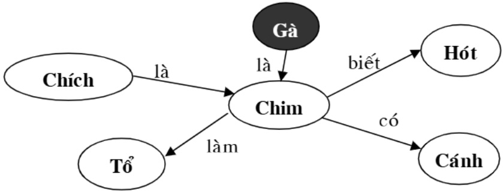

Hầu như không thể biến diễn các tri thức dạng thủ tục bằng mạng ngữ nghĩa vì các khái niệm về thời gian và trình tự không được thể hiện tường minh trên mạng ngữ nghĩa.

## X.3. Một ví dụ tiêu biểu

<!-- page: 122 -->

Dù là một phương pháp tương đối cũ và có những yếu điểm nhưng mạng ngữ nghĩa vẫn có những ứng dụng vô cùng độc đáo. Hai loại ứng dụng tiêu biểu của mạng ngữ nghĩa là ứng dụng xử lý ngôn ngữ tự nhiên và ứng dụng giải bài toán tự động.

Ví dụ 1 : Trong ứng dụng xử lý ngôn ngữ tự nhiên, mạng ngữ nghĩa có thể giúp máy tính phân tích được cấu trúc của câu để từ đó có thể phần nào “hiểu” được ý nghĩa của câu. Chắng hạn, câu “Châu đang đọc một cuốn sách dày và cuối khoái trả” có thể được biểu diễn bằng một mạng ngữ nghĩa như sau :

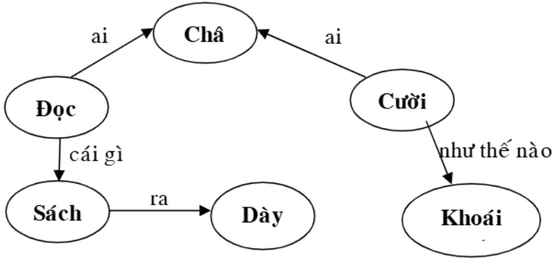

Ví dụ 2 : Giải bài toán tam giác tổng quát

Chúng ta sẽ không đi sâu vào ví dụ 1 vì đây là một vấn đề quá phúc tạp để có thể trình bày trong cuốn sách này. Trong ví dụ này, chúng ta sẽ khảo sát một vấn đề đơn giản hơn nhưng cũng không kém phần độc đáo. Khi mới học lập trình, bạn thường được giáo viên cho những bài tập nhập môn đại loại như “Cho ba cạnh của tam giác,

<!-- page: 123 -->

tính chiều dài các đường cao", "Cho góc a, b và cạnh AC. Tính chiều dài trung tuyến", ... Với mỗi bài tập này, việc bạn cần làm là lấy giấy bút ra tìm cách tính, sau khi đã xác định các bước tính toán, bạn chuyển nó thành chương trình. Nếu có 10 bài, bạn phải làm lại việc tính toán rời lập trình 10 lần. Nếu có 100 bài, bạn phải làm 100 lần. Và tin buồn cho bạn là số lượng bài toán thuộc loại này là rất nhiều! Bởi vì một tam giác có tất cả 22 yếu tố khác nhau!. Không lễ mỗi lần gặp một bài toán mới, bạn đều phải lập trình lại? Liệu có một chương trình tổng quát có thể tự động giải được tất cả (vài ngàn!) những bài toán tam giác thuộc loại này không? Câu trả lời là CÓ ! Và ngạc nhiên hơn nửa, chương trình này lại khá đơn giản. Bài toán này sẽ được giải bằng mạng ngữ nghĩa.

Có 22 yếu tố liên quan đến cạnh và góc của tam giác. Đế xác định một tam giác hay để xây dựng một tam giác ta cần có ba yếu tố trong đó phải có yếu tố cạnh. Như vậy có khoảng C$^{3}_{22}$ -1 (khoảng vài ngân) cách để xây dựng hay xác định một tam giác. Theo thống kê, có khoảng 200 công thức liên quan đến cạnh và góc một tam giác.

Đế giải bài toán này bằng công cụ mạng ngữ nghĩa, ta phải sử dụng khoảng 200 định để chứa công thức và khoảng 22 định để chứa các yếu tố của tam giác. Mạng ngữ nghĩa cho bài toán này có cấu trúc như sau.

Đỉnh của đồ thị bao gồm hai loại :

○ Đình chứa công thức (ký hiệu bằng hình chữ nhật)

○ Đình chứa yếu tố của tam giác (ký hiệu bằng hình tròn)

<!-- page: 124 -->

```txt
Cung : chỉ nổi từ đình hình tròn đến định hình chữ nhật cho biết yếu tố tam giác xuất hiện trong công thức nào (không có trường hợp cung nổi giữa hai đình hình tròn hoặc cung nổi giữa hai đình hình chữ nhật).
```

\* Lưu ý : trong một công thức liên hệ giữa n yếu tố của tam giác, ta giả định rằng nếu đã biết giá trị của n-1 yếu tố thì sẽ tính được giá trị của yếu tố còn lại. Chẳng hạn như trong công thức tổng ba góc của tam giác bằng 180$^{0}$ thì khi biết được hai góc, ta sẽ tính được góc còn lại.

```txt
Cơ chế suy diễn thực hiện theo thuật toán “loang” đơn giản sau :
```

```txt
B1 : Kích hoạt những định hình tròn đã cho ban đầu (những yếu tố đã có giá trị)
B2 : Lặp lại bước sau cho đến khi kích hoạt được tất cả những đỉnh ứng với những yếu tố cần tính hoặc không thể kích hoạt được bất kỳ định nào nữa.
Nếu một định hình chữ nhật có cung nổi với n định hình tròn mà n-1 định hình tròn đã được kích hoạt thì kích hoạt định hình tròn còn lại (và tính giá trị định còn lại này thông qua công thức ở định hình chữ nhật).
```

Giả sử ta có mạng ngữ nghĩa để giải bài toán tam giác như hình 2.4

<!-- page: 125 -->

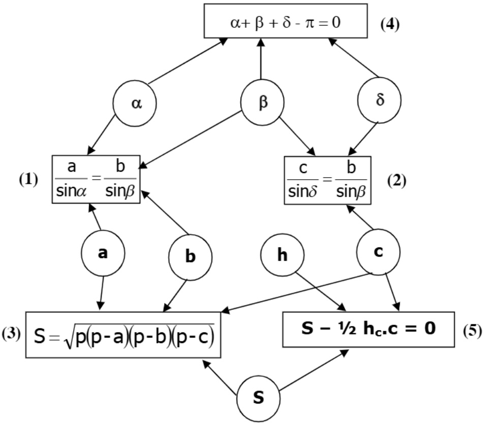

Ví dụ : “Cho hai góc  $\alpha$ ,  $\beta$  và chiều dài cạnh a của tam giác. Tính chiều dài đường cao  $h_{c}$ ”. Với mạng ngữ nghĩa đã cho trong hình 2.4. Các bước thi hành của thuật toán như sau :

<!-- page: 126 -->

```txt
Bắt đầu : đỉnh α, β, a của đồ thị được kích hoạt.
○ Công thức (1) được kích hoạt (vì α, β, a được kích hoạt). Từ công thức (1) tính được cạnh b. Đình b được kích hoạt.
○ Công thức (4) được kích hoạt (vì α, β). Từ công thức (4) tính được góc δ
○ Công thức (2) được kích hoạt (vì ba đình β, δ, b được kích hoạt). Từ công thức (2) tính được cạnh c. Đình c được kích hoạt.
○ Công thức (3) được kích hoạt (vì ba đình a, b, c được kích hoạt). Từ công thức (3) tính được diện tích S. Đình S được kích hoạt.
○ Công thức (5) được kích hoạt (vì hai đình S, c được kích hoạt). Từ công thức (5) tính được h_c. Đình h_c được kích hoạt.
○ Giá trị h_c đã được tính. Thuật toán kết thúc.
```

Về mặt chương trình, ta có thể cài đặt mạng ngữ nghĩa giải bài toán tam giác bằng một măng hai chiều A trong đó :

<!-- page: 127 -->

○ Cột : ứng với công thức. Mỗi cột ứng với một công thức tam giác khác nhau (đỉnh hình chữ nhật).

○ Dòng : ứng với yếu tố tam giác. Mỗi dòng ứng với một yếu tố tam giác khác nhau (đỉnh hình tròn).

○ Phân tử A[i, j] = -1 nghĩa là trong công thức ứng với cột j có yếu tố tam giác ứng với cột i. Nguộc lại A[i, j] = 0.

Đế thực hiện thao tác “kích hoạt” một định hình tròn, ta đặt giá trị của toàn dòng ứng với yếu tố tam giác bằng 1.

Đế kiểm tra xem một công thức đã có đủ n-1 yếu tố hay chưa (nghĩa là kiểm tra điều kiện “đỉnh hình chữ nhật có cung nổi với n đình hình tròn mà n-1 định hình tròn đã được kích hoạt”), ta chỉ việc lấy hiệu giữa tổng số ô có giá trị bằng 1 và tổng số ô có giá trị -1 trên cột ứng với công thức cần kiểm tra. Nếu kết quả bằng n, thì công thức đã có đủ n-1 yếu tố.

Trổ lại mạng ngữ nghĩa đã cho. Quá trình thi hành kích hoạt được diễn ra như sau :

Mâng biểu diễn mạng ngữ nghĩa ban đầu

<!-- page: 128 -->

|  | (1) | (2) | (3) | (4) | (5) |
| --- | --- | --- | --- | --- | --- |
| $\alpha$ | -1 | 0 | 0 | -1 | 0 |
| $\beta$ | -1 | -1 | 0 | -1 | 0 |
| $\delta$ | 0 | -1 | 0 | -1 | 0 |
| a | -1 | 0 | -1 | 0 | 0 |
| b | -1 | -1 | -1 | 0 | 0 |
| c | 0 | -1 | -1 | 0 | -1 |
| S | 0 | 0 | -1 | 0 | -1 |
| $h_c$ | 0 | 0 | 0 | 0 | -1 |

Khôi đầu : định α, β, a của đô thị được kích hoạt.

|  | (1) | (2) | (3) | (4) | (5) |
| --- | --- | --- | --- | --- | --- |
| $\alpha$ | 1 | 0 | 0 | 1 | 0 |
| $\beta$ | 1 | 1 | 0 | 1 | 0 |
| $\delta$ | 0 | -1 | 0 | -1 | 0 |
| a | 1 | 0 | 1 | 1 | 0 |
| b | -1 | -1 | -1 | 0 | 0 |
| c | 0 | -1 | -1 | 0 | -1 |
| S | 0 | 0 | -1 | 0 | -1 |
| $h_c$ | 0 | 0 | 0 | 0 | -1 |

Trên cột (1), hiệu  $(1 + 1 + 1 - (-1)) = 4$  nên dòng b sẽ được kích hoạt.

<!-- page: 129 -->

|  | (1) | (2) | (3) | (4) | (5) |
| --- | --- | --- | --- | --- | --- |
| $\alpha$ | 1 | 0 | 0 | 1 | 0 |
| $\beta$ | 1 | 1 | 0 | 1 | 0 |
| $\delta$ | 0 | -1 | 0 | -1 | 0 |
| a | 1 | 0 | 1 | 1 | 0 |
| b | 1 | 1 | 1 | 0 | 0 |
| c | 0 | -1 | -1 | 0 | -1 |
| S | 0 | 0 | -1 | 0 | -1 |
| $h_c$ | 0 | 0 | 0 | 0 | -1 |

Trên cột (4), hiệu  $(1 + 1 + 1 - (-1)) = 4$  nên dòng δ sẽ được kích hoạt.

|  | (1) | (2) | (3) | (4) | (5) |
| --- | --- | --- | --- | --- | --- |
| $\alpha$ | 1 | 0 | 0 | 1 | 0 |
| $\beta$ | 1 | 1 | 0 | 1 | 0 |
| $\delta$ | 0 | 1 | 0 | 1 | 0 |
| a | 1 | 0 | 1 | 1 | 0 |
| b | 1 | 1 | 1 | 0 | 0 |
| c | 0 | -1 | -1 | 0 | -1 |
| S | 0 | 0 | -1 | 0 | -1 |
| $h_c$ | 0 | 0 | 0 | 0 | -1 |

Trên cột (2), hiệu  $(1 + 1 + 1 - (1)) = 4$  nên dòng c được kích hoạt.

<!-- page: 130 -->

|  | (1) | (2) | (3) | (4) | (5) |
| --- | --- | --- | --- | --- | --- |
| $\alpha$ | 1 | 0 | 0 | 1 | 0 |
| $\beta$ | 1 | 1 | 0 | 1 | 0 |
| $\delta$ | 0 | 1 | 0 | 1 | 0 |
| A | 1 | 0 | 1 | 1 | 0 |
| B | 1 | 1 | 1 | 0 | 0 |
| C | 0 | 1 | 1 | 0 | 1 |
| S | 0 | 0 | -1 | 0 | -1 |
| $h_{c}$ | 0 | 0 | 0 | 0 | -1 |

Trên cột (3), hiệu  $(1 + 1 + 1 - (-1)) = 4$  nên dòng S được kích hoạt.

|  | (1) | (2) | (3) | (4) | (5) |
| --- | --- | --- | --- | --- | --- |
| $\alpha$ | 1 | 0 | 0 | 1 | 0 |
| $\beta$ | 1 | 1 | 0 | 1 | 0 |
| $\delta$ | 0 | 1 | 0 | 1 | 0 |
| a | 1 | 0 | 1 | 1 | 0 |
| b | 1 | 1 | 1 | 0 | 0 |
| c | 0 | 1 | 1 | 0 | 1 |
| S | 0 | 0 | 1 | 0 | 1 |
| $h_{c}$ | 0 | 0 | 0 | 0 | -1 |

Trên cột (5), hiệu  $(1 + 1 - (1)) = 3$  nên dòng  $h_{C}$  được kích hoạt.

Khả năng của hệ thống này không chỉ dùng lại ở việc tính ra giá trị các yếu tố cần thiết, với một chút sửa đổi, chương trình này còn có thể đưa ra cách giải hình thức của

<!-- page: 131 -->

bài toán và thâm chí còn có thể chọn được cách giải hình thức tối ưu (tối ưu hiểu theo nghĩa là cách giải sử dụng những công thức đơn giản nhất). Sở đĩ có thể nói như vậy vì cách suy luận của ta trong bài toán này là tìm kiếm theo chiều rộng. Do đó, khi đạt đến kết quả, ta có thể có rất nhiều cách khác nhau. Đề có thể chọn được giải pháp tối ưu, bạn cần phải định nghĩa được độ “phúc tạp” của một công thức. Một trong những tiêu chuẩn thường được dùng là số lượng phép nhân, chia, cộng, trừ, rút căn, tính sin, cos, ... được áp dụng trong công thức. Các phép tính sin, cos và rút căn có độ phúc tạp cao nhất, kể đến là nhân chia và cuối cùng là cộng trừ. Cuối cùng bạn có thể cải tiến lại phương pháp suy luận bằng cách vận dụng thuật toán A\* với ước lượng h = 0 để có thể chọn ra được “đường đi” tối ưu. Ta chọn ước lượng h = 0 vì hai lý do sau (1) không gian bài toán nhỏ nên ta không cần phải giới hạn độ rộng tìm kiếm (2) xây dựng một ước lượng như vậy là tương đối khó khăn, đặc biệt là làm sao để hệ thống không đánh giá quá cao h.

## XI. BIÊU DIÊN TRI THÚC BĂNG FRAME

## XI.1 Khái niệm

Frame là một cấu trúc dữ liệu chứa đụng tất cả những trị thức liên quan đến một đối tượng cụ thể nào đó. Frame có liên hệ chặt chế đến khái niệm hướng đối tượng (thực ra frame là nguồn gốc của lập trình hướng đối tượng).

<!-- page: 132 -->

Ngược lại với các phương pháp biểu diễn tri thức đã được đề cập đến, frame “đóng gói” toàn bộ một đối tượng, tỉnh hướng hoặc cả một vấn đề phúc tạp thành một thực thể duy nhất có cấu trúc. Một frame bao hàm trong nó một khối lượng tương đối lớn tri thức về một đối tượng, sự kiện, vị trí, tình hướng hoặc những yếu tố khác. Do đó, frame có thể giúp ta mô tả khá chi tiết một đối tượng.

Dưới một khía canh nào đó, người ta có thể xem phương pháp biểu diễn tri thức bằng frame chính là nguồn gốc của ngôn ngữ lập trình hướng đối tượng. Ý tưởng của phương pháp này là “thay vì bắt người dùng sử dụng các công cụ phụ nhuí dao mô để đồ hộp, ngày nay các hãng sản xuất đồ hộp thường gắn kèm các nắp mô đồ hộp ngay bên trên vỏ lon. Nhú vậy, người dùng sẽ không bao giờ phải lo lắng đến việc tìm một thiết bị để mô đồ hộp nữa!”. Cũng vậy, ý tưởng chính của frame (hay của phương pháp lập trình hướng đối tượng) là khi biểu diễn một tri thức, ta sẽ “gắn kèm” những thao tác thường gặp trên tri thức này. Chẳng hạn như khi mô tả khái niệm về hình chữ nhật, ta sẽ gần kèm cách tính chu vi, diện tích.

Frame thường được dùng để biểu diễn những tri thức “chuẩn” hoặc những tri thức được xây dựng dựa trên những kinh nghiệm hoặc các đặc điểm đã được hiểu biết cận kê. Bộ não của con người chúng ta vẫn luôn “luu trữ” rất nhiều các tri thức chung mà khi cần, chúng ta có thể “lấy ra” để vận dụng nó trong những vấn đề cần phải giải quyết. Frame là một công cụ thích hợp để biểu diễn những kiểu tri thức này.

<!-- page: 133 -->

## XI.2 Câu trúc của frame

Mỗi một frame mô tả một đối tượng (object). Một frame bao gồm hai thành phần cơ bản là slot và facet. Một slot là một thuộc tính đặc tả đối tượng được biểu diễn bởi frame. Ví dụ : trong frame mô tả xe hơi, có hai slot là trọng lượng và loại máy.

Mỗi slot có thể chứa một hoặc nhiều facet. Các facet (đôi lúc được gọi là slot “con”) đặc tả một số thông tin hoặc thủ tục liên quan đến thuộc tính được mô tả bởi slot. Facet có nhiều loại khác nhau, sau đây là một số facet thường gặp.

○ Value (giá trị) : cho biết giá trị của thuộc tính đó (nhú xanh, đồ, tím vàng nếu slot là màu xe).

Default (giá trị mặc định) : hệ thống sẽ tự động sử dụng giá trị trong facet này nếu slot là rỗng (nghĩa là chắcng có đặc tả nào!). Chẩn g hạn trong frame về xe, xét slot về số lượng bánh. Slot này sẽ có giá trị 4. Nghĩa là, mặc định một chiếc xe hơi sẽ có 4 bánh!

Range (miến giá trị) : (tương tự nhu kiểu biến), cho biết giá trị slot có thể nhận những loại giá trị gì (nhủ số nguyên, số thực, chữ cái, ...)

\- If added : mô tả một hành động sẽ được thi hành khi một giá trị trong slot được thêm vào (hoặc được hiệu chỉnh). Thủ tục thường được viết dưới dạng một script.

\- If needed : được sử dụng khi slot không có giá trị nào. Facet mô tả một hàm để tính ra giá trị của slot.

<!-- page: 134 -->

## Frame : XE HOI

## Thuộc lớp : phương tiện vận chuyển.

```txt
Tên nhà sản xuất : Audi
Quốc gia của nhà sản xuất : Đức
Model : 5000 Turbo
Loại xe : Sedan
Trọng lượng : 3300lb
Số lượng của : 4 (default)
Hộp số : 3 số tự động
Số lượng bánh : 4 (default)
```

## Máy (tham chiếu đến frame Máy)

## Frame MÁY

Xy-lanh : 3.19 inch

Tỷ lệ nén : 3.4 inche

Xăng : TurboCharger

Mã luíc : 140 hp

<!-- page: 135 -->

## XI.3 Tính kê thừa

Trong thực tế, một hệ thống trí tuệ nhân tạo thường sử dụng nhiều frame được liên kết với nhau theo một cách nào đó. Một trong những điểm thú vị của frame là tính phân cấp. Đặc tính này cho phép kế thừa các tính chất giữa các frame.

Hình sau đây cho thấy cấu trúc phân cấp của các loại hình hình học cơ bản. Gốc của cây ở trên cùng tương ứng với mức độ trừu tượng cao nhất. Các frame nằm ở dưới cùng (không có frame con nào) gọi là lá. Những frame nằm ở mức thấp hơn có thể thừa kế tất cả những tính chất của những frame cao hơn.

Các frame cha sẽ cung cấp những mô tả tổng quát về thực thể. Frame có cấp càng cao thì mức độ tổng quát càng cao. Thông thường, frame cha sẽ bao gồm các định nghĩa của các thuộc tính. Còn các frame con sẽ chứa dụng giá trị thực sự của các thuộc tính này.

<!-- page: 136 -->

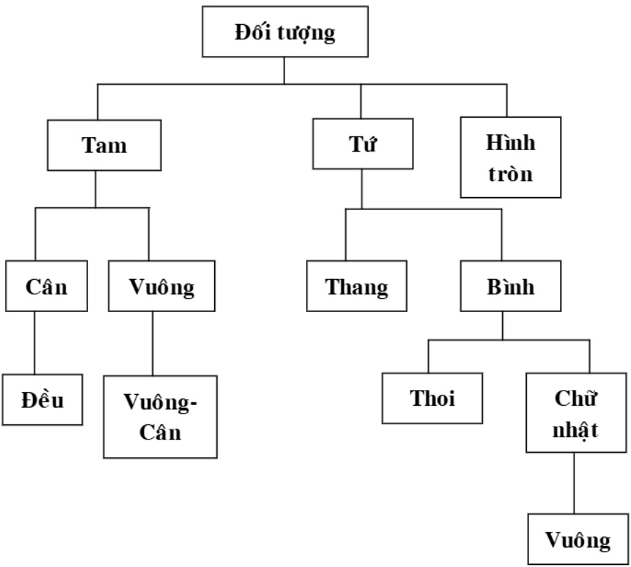

Hình 2.5

Một ví dụ biểu diễn các đối tượng hình học bằng frame

Các kiểu dữ liệu cơ bản :

Area : numeric; // diện tích

Height : numeric; //chiêu cao

Perimeter : numberic; //chu vi

Side : numeric; //cạnh

Diagonal : numeric; //đường chéo

<!-- page: 137 -->

```txt
Radius : numeric; //bán kính
Angle : numeric; //góc
Diameter : numeric; //đường kính
pi : (val:numeric = 3.14159)
```

Frame : CIRCLE (hình tròn)

```txt
Frame : CIRCL
r : radius;
s : area;
p : perimeter;
d : diameter;
d = 2 × r;
s = pi × r²;
p = 2 × pi × r;
```

Frame RECTANGLE (hình chữ nhật)

```txt
b₁ : side;
b₂ : side;
s : area;
p : perimeter;
s = b₁ × b₂;
p = 2 × (b₁+b₂);
d² = b₁² + b₂²;
```

Frame SQUARE (hình vuông)

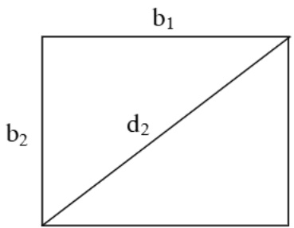

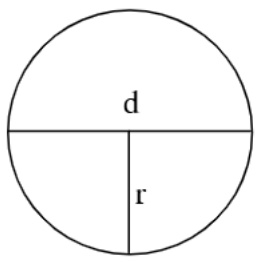

Là : RECTANGLE

<!-- page: 138 -->

```matlab
Frame RHOMBUS (hình thoi)
b : side;
d1 : diagonal;
d2 : diagonal;
s : area;
p : perimeter;
alpha1 : angle;
alpha2 : angle;
h : height;
cos (alpha2/2) × d1 = h;
s = d1 × d2 / 2;
p = 4 × b;
s = b × h;
cos (alpha2/2)/(2×b) = d2;
```

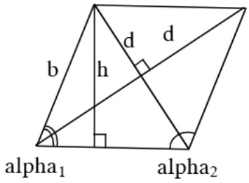

Chúng ta có thể dễ dàng khai báo các đối tượng hình học khác theo cách này. Sau khi đã biểu diễn các tri thức về các hình hình học cơ bản xong, ta có thể vận dụng nó để giải các bài toán hình học, chẳng hạn bài toán tính diện tích. Ví dụ, cho hình vuông $\mathbf{k}$ và vòng tròn nội tiếp $\mathbf{c}$, biết cạnh hình vuông có chiều dài là $\mathbf{x}$, hãy viết chương trình để tính diện tích phần tô đen.

<!-- page: 139 -->

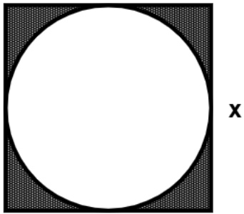

Dễ thấy rằng, diện tích phần tô đen chính là hiệu giữa diện tích hình vuông và diện tích hình tròn nội tiếp. Dĩ nhiên là bạn cũng có thể viết một chương trình bình thường để tính toán, nhưng khi đã “tích hợp” các tri thức về tính diện tích bên trong biểu diễn, chương trình của chúng ta trở nên rất gọn nhẹ. Bạn hây lưu ý ba lệnh được in đậm trong ví dụ dưới. Lệnh đầu tiên sẽ “đặc tả” lại giả thiết “hình vuông có cạnh với chiều dài x”, lệnh kế tiếp đặc tả giả thiết “hình tròn nội tiếp”, còn lệnh thứ ba mô tả việc tính diện tích bằng cách lấy diện tích hình vuông trừ cho diện tích hình tròn.

VAR x, s : numeric; k : square; c : circle;

BEGIN

&lt;Nhập x&gt;;

k.b₁ := x;

c.d := x;

$$
\mathbf {s} := \mathbf {k}. \mathbf {s} - \mathbf {c}. \mathbf {s};
$$

END.

<!-- page: 140 -->

Như vậy, chương trình máy tính của chúng ta đã hoạt động khá giống như việc “mô tả” các giải bài toán bằng ngôn ngữ tự nhiên. Hãy nghĩ xa hơn một tí. Các bài toán hình học thường được mô tả bằng các ngôn từ khá chính xác (chẳng hạn như : cho một tam giác với chiều cao xuất phát từ đình A là 5, chiều dài cạnh đáy là 6...). Do đó, về mặt nguyên tác, chúng ta vẫn có thể xây dựng một chương trình để “hiểu” những để bài này (theo như cách mà chúng ta vừa làm). Sau đó, người dùng có thể hoàn toàn nhờ máy tính giải giúp bài toán cho mình bằng cách mô tả lời giải cho máy tính (chứ không cần phải lập trình). Bạn có cảm giác điều này thật thú vị không? Đây chính là bước đi đầu tiên trong việc tạo ra một chương trình trợ giúp cho việc giải các bài toán hình học trên máy tính với giao tiếp bằng ngôn ngữ tự nhiên!

Đế tăng thêm sức mạnh cho hệ thống này, người ta thường cải đặt một mạng ngữ nghĩa ngay bên trong mỗi frame. Chắng hạn, ta có thể có một frame TRIANGLE, trong đó cải đặt một mạng ngữ nghĩa (giống như ở ví dụ trong phần mạng ngữ nghĩa) để đặc tả mối liên hệ giữa các yếu tố tam giác (thay vì sử dụng các công thức liên hệ đơn giản như ví dụ trên).

<!-- page: 141 -->

## XII. BIÊU DIÊN TRI THỨC BĂNG SCRIPT

Script là một cách biểu diễn tri thức tương tự như frame nhưng thay vì đặc tả một đối tượng, nó mô tả một chuỗi các sự kiện. Đề mô tả chuỗi sự kiện, script sử dụng một dãy các slot chứa thông tin về các con người, đối tượng và hành động liên quan đến sự kiện đó.

Tuy cấu trúc của các script là rất khác nhau tùy theo bài toán, nhưng nhìn chung một script thường bao gồm các thành phần sau :

○ Điều kiện vào (entry condition): mô tả những tình hướng hoặc điều kiện cần được thỏa mãn trước khi các sự kiện trong script có thể diễn ra.

○ Role (diễn viên): là những con người có liên quan trong script.

○ Prop (tác tố): là tất cả những đối tượng được sử dụng trong các chuỗi sự kiện sẽ diễn ra.

\- Scene(Tình huống) : là chuỗi sự kiện thực sự diễn ra.

\- Result (Kết quả) : trạng thái của các Role sau khi script đã thi hành xong.

○ Track (phiên bản) : mô tả một biến thể (hoặc trường hợp đặc biệt) có thể xảy ra trong đoạn script.

Sau đây là một ví dụ tiêu biểu cho script. Ví dụ này là một biến thể của ví dụ nổi tiếng về nhà hàng bán thức ăn nhanh (các nhà hàng bán gà rán mà ta thường gặp trong các siêu thị!) thường được sử dụng để minh họa cách biểu

<!-- page: 142 -->

diễn tri thức bằng script trong cách sách nói về trí tuệ nhân tạo. Đi ăn trong một nhà hàng là một tình huống thường gặp trong cuộc sống với những điều kiện vào, diễn viên, tác tố, hoàn cảnh, kết quả khá “chuẩn”. Và qua script ở ví dụ, bạn sẽ thấy phương pháp này có thể được dùng để mô tả chính xác những tình huống diễn ra hàng ngày của những nhà hàng bán thức ăn nhanh. Các tình huống là những đoạn script con trong đoạn script chính để mô tả những tình huống nhỏ trong toàn bộ quá trình. Lưu ý rằng trong đoạn script này có tình huống tùy chọn trong đó mô tả việc khách hàng mua thức ăn về thay vì vào nhà hàng ăn.

```txt
Script "nhà hàng"
Phiên bản : Nhà hàng bán thúc ăn nhanh
Diễn viên : Khách hàng
    Người phục vụ
Tác tố :  Bàn phục vụ
    Chỗ ngồi
    Khay dựng thức ăn
    Thức ăn
    Tiên
    Các loại gia vị như muối, tương, ôt, tiêu, ...
Điều kiện vào :
    Khách hàng đói
    Khách hàng có đủ tiên để trả.

Tình huống 1 : Vào nhà hàng
Khách hàng đậu xe vào bãi đậu xe.
```

<!-- page: 143 -->

Khách hàng bước vào nhà hàng.
Khách hàng xếp hàng trước bàn phục vụ.
Khách hàng đọc thực đơn trên tường và quyết định sẽ kêu món ăn gì.
Tình huống 2: Kêu món ăn.
    Khách hàng kêu món ăn với người phục vụ (đang đúng ở quấy phục vụ)
    Người phục vụ đặt thức ăn lên khay và dua hóa đơn tính tiền cho khách.
    Khách hàng trả tiền cho người phục vụ.
Tình huống 3: Khách hàng dùng món ăn
    Khách hàng lấy thêm các gia vị
    Khách hàng cầm khay đến một bàn còn trống.
    Khách hàng ăn thúc ăn.
Tình huống 3A (tùy chọn) : Khách hàng mua thúc ăn đem về
    Khách hàng mang thúc ăn về nhà.
Tình huống 4 : Ra về
    Khách hàng thu đơn bàn
    Khách hàng bổ rác (thức ăn thừa, xương, màng vụn...) vào thùng rác.
    Khách hàng ra khởi nhà hàng.
    Khách hàng lái xe đi.
Kết quả :
    Khách hàng không còn đói.
    Khách hàng còn ít tiên hơn ban đầu.
    Khách hàng vui về \*
    Khách hàng bục mình \*
    Khách hàng quá no.

\* Tùy chọn.

<!-- page: 144 -->

Script rất hữu dụng trong việc dự đoán điều gì sẽ xảy đến trong những tình huống xác định. Thậm chí trong những tình huống chưa diễn ra, script còn cho phép máy tính dự đoán được việc gì sẽ xảy ra và xảy ra đối với ai và vào thời điểm nào. Nếu máy tính kích hoạt một script, người dùng có thể đặt câu hỏi và hệ thống có thể suy ra được những câu trả lời chính xác mà không cần người dùng cung cấp thêm nhiều thông tin (trong một số trường hợp có thể không cần thêm thông tin). Do đó, cũng giống như frame, script là một dạng biểu diễn tri thức tương đối hữu dụng vì nó cho phép ta mô tả chính xác những tình huống “chuẩn” mà con người vẫn thực hiện mỗi ngày hoặc đã nắm bắt chính xác.

Đế cài đặt script trong máy tính, bạn phải tìm cách lưu trữ các tri thức dưới dạng hình thức. LISP là ngôn ngữ lập trình phù hợp nhất để làm điều này. Sau khi đã cài đặt xong script, bạn (người dùng) có thể đặt câu hỏi về những con người hoặc điều kiện có liên quan trong script. Hệ thống sau đó sẽ tiến hành thao tác tìm kiếm hoặc thao tác so mẫu để tìm câu trả lời. Chẳng hạn bạn có thể đặt câu hỏi “Khách hàng làm gì trước tiên?”. Hệ thống sẽ tìm thấy câu trả lời trong scene 1 và đưa ra đáp án “Đậu xe và bước vào nhà hàng”.

<!-- page: 145 -->

## XIII. PHỐI HỢP NHIỀU CÁCH BIỂU DIỄN TRI THỨC

Mục tiêu chính biểu diễn tri thức trong máy tính là phục vụ cho việc thu nhận tri thức vào máy tính, truy xuất tri thức và thực hiện các phép suy luận dựa trên những tri thức đã lưu trữ. Do đó, để thỏa mặn được ba mục tiêu trên, khi chọn phương pháp biểu diễn tri thức, chúng ta phải cân nhắc một số yếu tố cơ bản sau đây :

o Tính tự nhiên, đồng bộ và dễ hiểu của biểu diễn tri thức.

\- Mức độ trừu tượng của tri thức : tri thức được khai báo cụ thể hay nhúng vào hệ thống dưới dạng các mã thủ tục?

○ Tính đơn thể và linh động của cơ sở tri thức (có cho phép dễ dàng bổ sung tri thức, mức độ phụ thuộc giữa các tri thức, ...)

○ Tính hiệu quả trong việc truy xuất tri thức và sức mạnh của các phép suy luận (theo kiểu heuristic).

Bảng sau cho chúng ta một số ưu và khuyết điểm của các phương pháp biểu diễn tri thức đã được trình bày.

Bảng 2.1

| P.Pháp | Ưu điểm | Nhược điểm |
| --- | --- | --- |
| Luật sinh | Cú pháp đơn giản, dễ hiểu, diễn dịch đơn giản, tính đơn thể cao, linh động (đễ điều chỉnh). | Rất khó theo dõi sự phân cấp, không hiệu quả trong những hệ thống lớn, không thể biểu diễn được mọi loại tri thức, rất yếu |

<!-- page: 146 -->

|  |  | trong việc biểu diễn các tri thức dạng mô tả, có cấu trúc. |
| --- | --- | --- |
| Mạng ngữ nghĩa | Đễ theo dõi sự phân cấp, sẽ dò theo các mối liên hệ, linh động | Ngữ nghĩa gắn liền với mỗi đình có thể nhập nhẳng, khó xử lý các ngoại lệ, khó lập trình. |
| Frame | Có sức mạnh diễn đạt tốt, dễ cải đặt các thuộc tính cho các slot cũng như các mối liên hệ, dễ dàng tạo ra các thủ tục chuyên biệt hóa, dễ đưa vào các thông tin mặc định và dễ thực hiện các thao tác phát hiện các giá trị bị thiếu sót. | Khó lập trình, khó suy diễn, thiếu phân mềm hỗ trợ. |
| Logic hình thức | Cơ chế suy luận chính xác (được chứng minh bởi toán học). | Tách rời việc biểu diễn và xử lý, không hiệu quả với lượng dữ liệu lớn, quá chậm khi cơ sở dữ liệu lớn. |

Tuy vậy, như chúng ta đã biết, hiện nay vẫn chưa có một kiểu biểu diễn tri thức nào phù hợp với mọi tình huống. Do đó, khi phải làm việc với nhiều nguồn tri thức khác nhau (khác loại, khác tính chất), chúng ta nhiều lúc phải hy sinh tính đồng bộ bằng cách sử dụng cùng lúc nhiều kiểu biểu diễn tri thức, mỗi kiểu biểu diễn ứng với một nhiệm vụ con. Nhưng như vậy, chúng ta lại này sinh ra vấn đề “địch” một tri thức từ kiểu biểu diễn này sang kiểu biểu diễn khác. Tuy thế nhưng một số hệ chương

<!-- page: 147 -->

trình trí tuệ gần đây vẫn dùng cùng lúc nhiều kiểu biểu diễn dữ liệu khác nhau.

Một trong những ví dụ kết hợp nhiều kiểu biểu diễn tri thức mà chúng ta đã từng làm quen là kiểu kết hợp giữa frame và mạng ngũ nghĩa trong việc trợ giúp giải bài toán hình học.

Một trong những sự phối hợp tương đối thành công là sự kết hợp giữa luật sinh và frame. Luật sinh không đủ hiệu quả trong nhiều ứng dụng, đặc biệt là trong các tác vụ định nghĩa, mô tả các đối tượng hoặc những mối liên kết tỉnh giữa các đối tượng. Tuy vậy, những yếu điểm này lại chính là ưu điểm của frame. Ngày nay, đã có rất nhiều hệ thống đã tạo ra một kiểu biểu diễn lai giữa luật sinh và frame có được ưu điểm của hai cách biểu diễn. Sự thành công của các hệ thống nổi tiếng như KEE, Level5 Object và Nexpert Object đã minh chứng cho điều này. Frame cung cấp một ngôn ngữ cấu trúc hiệu quả để đặc tả những đối tượng xuất hiện trong các luật. Frame còn đóng vai trò như một lớp hỗ trợ cho thao tác suy diễn cơ bản trên những đối tượng không cần phải tương tác một cách tường minh trong các luật. Khả năng phân lớp của frame còn có thể được dùng để phân hoạch, tạo chỉ mục và sắp xếp các luật sinh trong hệ thống. Khả năng này rất thích hợp cho người dùng trong việc xây dựng và hiểu các luật, cũng như cũng có thể theo dõi được các luật được sử dụng khi nào và cho mục gì.

<!-- page: 148 -->

Hình sau cho thấy một kiểu kết hợp giữa luật sinh và frame. Sự kết hợp này đã cho phép tạo ra các luật so mẫu nhằm tăng tốc độ tìm kiếm của hệ thống. Kết quả của sự kết hợp này cho phép tạo ra các biểu diễn phúc tạp hơn rất nhiều so với việc chỉ dùng frame, thâm chí phúc tạp hơn cả việc lập trình trực tiếp bằng ngôn ngữ C++ !!.

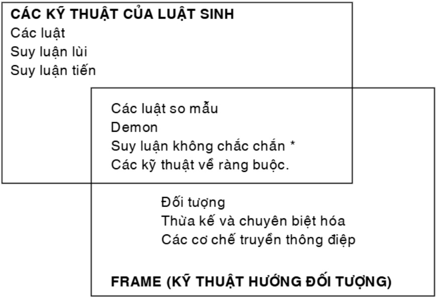

\* Suy luận không chắc chắn (Hypothetical reasoning) là kỹ thuật suy luận dựa trên các điều kiện có thể có màu thuẫn hoặc không chắc chắn.

Ví dụ kết hợp biểu diễn tri thức bằng luật sinh và frame trong bài toán điều chế chất hóa học

<!-- page: 149 -->

Ván đề : Cho trước một số chất hóa học. Hãy xây dựng chuỗi các phần ứng hóa học để điều chế một số chất hóa học khác.

Đầu tiên, đây là một ứng dụng hết sức tự nhiên của tri thức biểu diễn dưới dạng luật. Lý do là vì bản thân các phản ứng hóa học tiêu chuẩn đều được thể hiện dưới dạng luật. Chắng hạn ta có các phương trình phản ứng sau :

$$
\begin{array}{l}\mathrm{Na} + \mathrm{Cl} _ {2} \rightarrow \mathrm{NaCl}\\\mathrm{Fe} + \mathrm{Cl} _ {2} \rightarrow \mathrm{FeCl} _ {2}\\\mathrm{Cu} + \mathrm{Cl} _ {2} \rightarrow \mathrm{CuCl} _ {2}\\\mathrm{Cl} _ {2} + \mathrm{H} _ {2} \mathrm{O} \rightarrow \mathrm{HCl} + \mathrm{HClO}\\\mathrm{MnO} _ {2} + 4 \mathrm{HCl} \rightarrow \mathrm{MnCl} _ {2} + \mathrm{Cl} _ {2} \uparrow + \mathrm{H} _ {2} \mathrm{O}\\\mathrm{HCl} + \mathrm{KMnO} _ {4} \rightarrow \mathrm{KCl} + \mathrm{MnCl} _ {2} + \mathrm{H} _ {2} \mathrm{O} + \mathrm{Cl} _ {2} \uparrow\\\mathrm{NaCl} + \mathrm{H} _ {2} \mathrm{O} \rightarrow \mathrm{Cl} _ {2} + \mathrm{H} _ {2} \uparrow + \mathrm{NaOH}\end{array}
$$

Như vậy, nếu xem một chất hóa học là một sự kiện và một phương trình phân ứng như là một luật dẫn thì bài toán điều chế chất hóa học, một cách rất tự nhiên, trở thành bài toán suy luận tiến trong cơ sở tri thức dạng luật dẫn.

Tuy nhiên, số lượng các phần ứng là rất lớn, nên ta không thể sử dụng các luật dựa trên các phần ứng cụ thể

<!-- page: 150 -->

như vậy mà phải sử dụng các phần ứng tổng quát hơn như :

$$
\begin{array}{l}\text {Axit + Bazo} \rightarrow \text {Muói + Nước}\\\text {Kiểm + Nước} \rightarrow \text {Xút + H_{2} \uparrow}\end{array}
$$

(trong hóa học cũng có nhiều phần ứng rất đặc biệt không thể tổng quát được, trong trường hợp này, ta sẽ xem phần ứng đó như là một luật riêng!).

Đế mô tả được các phần ứng tổng quát như trên, ta sẽ sử dụng các frame. Chẳng hạn để đặc tả acid sulfuric  $H_{2}SO_{4}$  ta sử dụng các frame tổng quát sau.

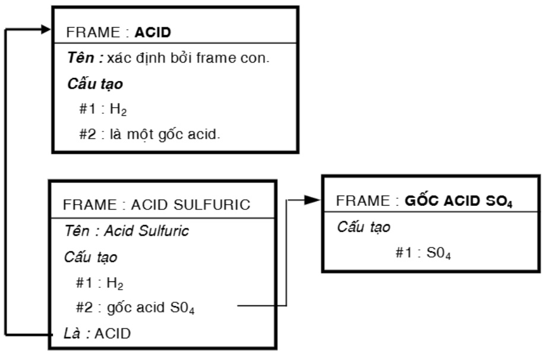

Dĩ nhiên là trong các frame ở trên còn rất nhiều thuộc tính hóa học khác. Ô đây chúng tôi chỉ trình bày sơ lược về mặt ý tưởng để bạn đọc có cơ sở bắt đầu. Ý tưởng này

<!-- page: 151 -->

đã được một số sinh viên năm 4 của khoa Công nghệ Thông tin Đại học Khoa học Tự nhiên - Đại học Quốc gia TP. Hồ Chí Minh cải đặt thành công. Chương trình chạy tốt trong phạm vi các phản ứng trong sách giáo khoa lớp 10, 11 và 12.

<!-- page: 152 -->

## Chương 3 MỞ ĐẦU VỀ MÁY HỌC

Trong chương trước, chúng ta đã tìm hiểu cách thức chuyển giao tri thức một cách trực tiếp cho máy tính. Đến đây, máy tính cũng vẫn còn thu động. Trong chương này chúng ta sẽ tìm hiểu các phương pháp giúp máy tính có thể chủ động rút ra được tri thức bằng cách “quan sát” các dữ liệu do con người cung cấp.

## I. THẾ NÀO LÀ MÁY HỌC ?

Thuật ngữ “học” theo nghĩa thông thường là tiếp thu tri thức để biết cách vận dụng. Ô ngoài đổi, quá trình học diễn ra dưới nhiều hình thức khác nhau như học thuộc lòng (học vẹt), học theo kinh nghiệm (học dựa theo trường hợp), học theo kiểu nghe nhìn... Trên máy tính cũng có nhiều thuật toán học khác nhau. Tuy nhiên, trong phạm vi của giáo trình này, chúng ta chỉ khảo sát phương pháp học dựa theo trường hợp. Theo phương pháp này, hệ thống sẽ được cung cấp một số các trường hợp “mẫu”, dựa trên tập mẫu này, hệ thống sẽ tiến hành phân tích và rút ra các quy luật (biểu diễn bằng luật sinh). Sau đó, hệ thống sẽ dựa trên các luật này để “đánh giá” các trường hợp khác (thường không giống như các trường hợp “mẫu”). Ngay cả chỉ với kiểu học này, chúng ta cũng đã có nhiều thuật toán học khác nhau. Một lần nửa, với mục đích giới thiệu, chúng ta chỉ khảo sát một trường hợp đơn giản. Có thể

<!-- page: 153 -->

khái quát quá trình học theo trường hợp dưới dạng hình thức như sau :

Dữ liệu cung cấp cho hệ thống là một ánh xạ f trong đó ứng một trường hợp p trong tập hợp P với một “lớp” r trong tập R.

$$
\mathrm{f}: \mathrm{P} \mid \longrightarrow \mathrm{R}
$$

$$
\mathrm{p} \longrightarrow \mathrm{r}
$$

Tuy nhiên, tập P thường nhỏ (và hữu hạn) so với tập tất cả các trường hợp cần quan tâm P' (P ⊂ P'). Mục tiêu của chúng ta là xây dựng ánh xạ f' sao cho có thể ứng mọi trường hợp p' trong tập P' với một "lớp" r trong tập R. Hơn nữa, f' phải bảo toàn f, nghĩa là :

Vói mọi  $p \in P$  thì  $f(p) \equiv f'(p)$


Hình 3.1: Học theo trường hợp là tìm cách xây dựng ánh xạ f' dưa theo ánh xạ f. f được gọi là tập mẫu.

<!-- page: 154 -->

Phương pháp học theo trường hợp là một phương pháp phố biến trong cả nghiên cứu khoa học và mê tín dị đoan. Cả hai đều dựa trên các dữ liệu quan sát, thống kê để tử đó rút ra các quy luật. Tuy nhiên, khác với khoa học, mê tín dị đoan thường dựa trên tập mẫu không đặc trưng, cục bộ, thiếu cơ sở khoa học.

## II. HỌC BẰNG CÁCH XÂY DỰNG CÂY ĐỊNH DANH

Phát biểu hình thức có thể khó hình dung. Đề cụ thể hơn, ta hây cùng nhau quan sát một ví dụ. Nhiệm vụ của chúng ta trong ví dụ này là xây dựng các quy luật để có thể kết luận một người như thế nào khi đi tấm biển thì bị cháy nắng. Ta gọi tính chất cháy nắng hay không cháy nắng là thuộc tính quan tâm (thuộc tính mục tiêu). Như vậy, trong trường hợp này, tập R của chúng ta chỉ gồm có hai phần tử {“cháy nắng”, “bình thường”}. Còn tập P là tất cả những người được liệt kê trong bảng dưới (8 người) Chúng ta quan sát hiện tượng cháy nắng dựa trên bốn thuộc tính sau : chiều cao (cao, trung bình, thấp), màu tóc (vàng, nâu, đồ) cân nặng (nhẹ, trung bình, nặng), dùng kem (có, không). Ta gọi các thuộc tính này gọi là thuộc tính dẫn xuất.

Dĩ nhiên là trong thực tế để có thể đưa ra được một kết luận như vậy, chúng ta cần nhiều dữ liệu hơn và đồng thời cũng cần nhiều thuộc tính dẫn xuất hơn. Ví dụ đơn giản này chỉ nhằm để minh hoa ý tưởng của thuật toán máy học mà chúng ta sắp trình bày.

<!-- page: 155 -->

| Tên | Tóc | Ch.Cao | CânNặng | Dùngkem? | Kết quả |
| --- | --- | --- | --- | --- | --- |
| Sarah | Vàng | T.Bình | Nhẹ | Không | Cháy |
| Dana | Vàng | Cao | T.Bình | Có | Không |
| Alex | Nâu | Thấp | T.Bình | Có | Không |
| Annie | Vàng | Thấp | T.Bình | Không | Cháy |
| Emilie | Đỏ | T.Bình | Nặng | Không | Cháy |
| Peter | Nâu | Cao | Nặng | Không | Không |
| John | Nâu | T.Bình | Nặng | Không | Không |
| Kartie | Vàng | Thấp | Nhẹ | Có | Không |

Ý tưởng đầu tiên của phương pháp này là tìm cách phân hoạch tập P ban đầu thành các tập  $P_{i}$  sao cho tất cả các phần tử trong tất cả các tập  $P_{i}$  đều có chung thuộc tính mục tiêu.

$$
\mathsf {P} = \mathsf {P} _ {1} \cup \mathsf {P} _ {2} \cup \dots \cup \mathsf {P} _ {\mathrm{n}} \text {và} \forall (\mathrm{i}, \mathrm{j}) \mathrm{i} \neq \mathrm{j}: \text {thì} \left(\mathsf {P} _ {\mathrm{i}} \cap \mathsf {P} _ {\mathrm{j}} = \varnothing\right) \text {và}
$$

$$
\forall \mathrm{i}, \forall \mathrm{k}, \mathrm{l}: \mathrm{p} _ {\mathrm{k}} \in \mathrm{P} _ {\mathrm{i}} \text {và} \mathrm{p} _ {\mathrm{l}} \in \mathrm{Pi} \text {thì} \mathrm{f} (\mathrm{p} _ {\mathrm{k}}) = \mathrm{f} (\mathrm{p} _ {\mathrm{l}})
$$

Sau khi đã phân hoạch xong tập P thành tập các phân hoạch  $P_{i}$  được đặc trưng bởi thuộc tính đích  $r_{i} (r_{i} \in \mathbb{R})$ , bước tiếp theo là ứng với mỗi phân hoạch  $P_{i}$  ta xây dựng luật  $L_{i}$ :  $GT_{i} \rightarrow r_{i}$  trong đó các  $GT_{i}$  là mệnh để được hình thành bằng cách kết hợp các thuộc tính dẫn xuất.

Một lần nửa, vấn đề hình thức có thể làm bạn cảm thấy khó khăn. Chúng ta hãy thử ý tưởng trên với bảng số liệu mà ta đã có.

<!-- page: 156 -->

Có hai cách phân hoạch hiến nhiên nhất mà ai cũng có thể nghĩ ra. Cách đầu tiên là cho mỗi người vào một phân hoạch riêng ( $P_{1}=\{Sarah\}$ ,  $P_{2}=\{Dana\}$ , ... tổng cộng sẽ có 8 phân hoạch cho 8 người). Cách thứ hai là phân hoạch thành hai tập, một tập gồm tất cả những người cháy nắng và tập còn lại bao gồm tất cả những người không cháy nắng. Tuy đơn giản nhưng phân hoạch theo kiểu này thì chúng ta chẳng giải quyết được gì !!

Chúng ta hây thử một phương pháp khác. Bây giờ bạn hây quan sát thuộc tính đầu tiên – màu tóc. Nếu dựa theo màu tóc để phân chia ta sẽ có được ba phân hoạch khác nhau ứng với mỗi giá trị của thuộc tính màu tóc, cụ thể là :

$P_{vàng} = \{ Sarah, Dana, Annie, Kartie \}$

$$
\mathrm{P} _ {\text {náu}} = \{\text {Alex, Peter, John} \}
$$

$P_{d\dot{o}} = \{ \underline{\text{Emmile}} \}$

\* Các người bị cháy nắng được gạch dưới và in đậm.

Thay vì liệt kê ra như trên, ta dùng sơ đồ cây để tiện mô tả cho các bước phân hoạch sau :


<!-- page: 157 -->

Quan sát hình trên ta thấy rằng phân hoạch  $P_{nâu}$  và  $P_{đỏ}$  thỏa mặn được điều kiện “có chung thuộc tính mục tiêu” ( $P_{nâu}$  chứa toàn người không cháy nắng,  $P_{đỏ}$  chứa toàn người cháy nắng).

Còn lại tập  $P_{vàng}$  là còn lẫn lộn người cháy nắng và không cháy nắng. Ta sẽ tiếp tục phân hoạch tập này thành các tập con. Bây giờ ta hãy quan sát thuộc tính chiều cao. Thuộc tính này giúp phân hoạch tập  $P_{vàng}$  thành ba tập con:  $P_{vàng}$ , Thấp = {Annie, Kartie},  $P_{Vàng}$ , T.Binh = {Sarah} và  $P_{Vàng,Cao}$  = {Dana}

Nếu nổi tiếp vào cây ở hình trước ta sẽ có hình ảnh cây phân hoạch như sau :


Quá trình này cứ thế tiếp tục cho đến khi tất cả các nút lá của cây không còn lẫn lộn giữa cháy nắng và không cháy nắng nửa. Bạn cũng thấy rằng, qua mỗi bước phân hoạch cây phân hoạch ngày càng “phình” ra. Chính vì vậy

<!-- page: 158 -->

mà quá trình này được gọi là quá trình “đâm chôi”. Cây mà chúng ta đang xây dựng được gọi là cây định danh.

Đến dây, chúng ta lại gặp một vấn đề mới. Nếu như ban đầu ta không chọn thuộc tính màu tốc để phân hoạch mà chọn thuộc tính khác như chiều cao chẳng hạn để phân hoạch thì sao? Cuối cùng thì cách phân hoạch nào sẽ tốt hơn?

Vấn đề mà chúng ta gặp phải cũng tương tự như bài toán tìm kiếm : “Đúng trước một ngã rễ, ta cần phải đi vào hướng nào?”. Hai phương pháp đánh giá dưới đây sẽ giúp ta chọn được thuộc tính phân hoạch tại mỗi bước xây dựng cây định danh.

## II.2.1. Quinlan

Quinlan quyết định thuộc tính phân hoạch bằng cách xây dựng các vector đặc trưng cho mỗi giá trị của từng thuộc tính dẫn xuất và thuộc tính mục tiêu. Cách tính cụ thể như sau :

Với mỗi thuộc tính dẫn xuất A còn có thể sử dụng để phân hoạch, tính :

$$
V _ {A} (j) = (T (j, r _ {1}), T (j, r _ {2}), \dots , T (j, r _ {n}))
$$

<!-- page: 159 -->

$T(j, r_{i}) = (\text{tổng số phân tử trong phân hoạch có giá trị thuộc tính dẫn xuất A là j và có giá trị thuộc tính mục tiêu là r_{i}) / (\text{tổng số phân tử trong phân hoạch có giá trị thuộc tính dẫn xuất A là j )}$

\* trong đó $r_{1}, r_{2}, \ldots, r_{n}$ là các giá trị của thuộc tính mục tiêu

$$
^ {*} \sum_ {\mathrm{i}} \mathrm{T} (\mathrm{j}, \mathrm{r} _ {\mathrm{i}}) = 1
$$

Như vậy nếu một thuộc tính A có thể nhận một trong năm giá trị khác nhau thì nó sẽ có năm vector đặc trưng.

Một vector V(A$_{j}$) được gọi là vector đơn vị nếu nó chỉ có duy nhất một thành phần có giá trị 1 và những thành phần khác có giá trị 0.

Thuộc tính được chọn để phân hoạch là thuộc tính có nhiều vector đơn vị nhất.

Trở lại ví dụ của chúng ta, ở trạng thái ban đầu (chưa phân hoạch) chúng ta sẽ tính vector đặc trưng cho từng thuộc tính dẫn xuất để tìm ra thuộc tính dùng để phân hoạch. Đầu tiên là thuộc tính màu tóc. Thuộc tính màu tóc có ba giá trị khác nhau (vàng, đỗ, nâu) nên sẽ có ba vector đặc trưng tương ứng là :

$$
\mathrm{V}_{\text{Tóc}}(\text{vàng}) =
$$

$$
(T (\text {vàng}, \text {cháy nǎng}), T (\text {vàng}, \text {không cháy nǎng}))
$$

Số người tốc vàng là : 4

Số người tốc vàng và cháy nắng là : 2

Số người tốc vàng và không cháy nắng là : 2

<!-- page: 160 -->

Do đó

$$
\mathrm{V} _ {\text {Tóc}} (\text {vang}) = (2 / 4, 2 / 4) = (0. 5, 0. 5)
$$

Tương tự

$$
\mathrm{V} _ {\text {Tóc}} (\mathrm{n} \hat {\mathrm{a}} \mathrm{u}) = (0 / 3, 3 / 3) = (0, 1) \quad (\text {vector don vi})
$$

$$
\text {Số người tốc nâu là : 3}
$$

$$
\text {Số người tốc nâu và cháy nắng là:} 0
$$

$$
\text {Số người tốc nâu và không cháy nắng là: 3}
$$

$$
\mathrm{V} _ {\text {Tóc}} (\mathrm{d} \hat {\mathrm{o}}) = (1 / 1, 0 / 1) = (1, 0) \quad (\text {vector don vi})
$$

Tổng số vector đơn vị của thuộc tính tốc vàng là 2

Các thuộc tính khác được tính tương tự, kết quả như sau

$$
\mathrm{V} _ {\mathrm{C.Cao}} (\mathrm{Cao}) = (0 / 2, 2 / 2) = (\mathbf {0}, \mathbf {1})
$$

$$
\mathrm{V} _ {\mathrm{C.Cao}} (\mathrm{T.B}) = (2 / 3, 1 / 3)
$$

$$
\mathrm{V} _ {\mathrm{C.Cao}} (\text {Thâp}) = (1 / 3, 2 / 3)
$$

$$
\mathrm{V} _ {\text {C.Nang}} (\text {Nhe}) = (1 / 2, 1 / 2)
$$

$$
\mathrm{V} _ {\mathrm{C.Nang}} (\mathrm{T.B}) = (1 / 3, 2 / 3)
$$

$$
\mathrm{V} _ {\mathrm{C.Nang}} (\text {Nang}) = (1 / 3, 2 / 3)
$$

$$
\mathrm{V} _ {\text {Kem}} (\text {Có}) = (3 / 3, 0 / 3) = (\mathbf {1}, \mathbf {0})
$$

$$
\mathrm{V} _ {\text {Kem}} (\text {Không}) = (3 / 5, 2 / 5)
$$

<!-- page: 161 -->

Như vậy thuộc tính màu tóc có số vector đơn vị nhiều nhất nên sẽ được chọn để phân hoạch.

Sau khi phân hoạch theo màu tóc xong, chỉ có phân hoạch theo tốc vàng (P$_{vàng}$) là còn chứa những người cháy nắng và không cháy nắng nên ta sẽ tiếp tục phân hoạch tập này. Ta sẽ thực hiện thao tác tính vector đặc trưng tương tự đối với các thuộc tính còn lại (chiều cao, cân nặng, dùng kem). Trong phân hoạch P$_{vàng}$, tập dữ liệu của chúng ta còn lại là :

| Tên | Chleêu cao | Cân nặng | Dùng kem? | Kết quả |
| --- | --- | --- | --- | --- |
| Sarah | T.Bình | Nhẹ | Không | Cháy |
| Dana | Cao | T.Bình | Có | Không |
| Annie | Thấp | T.Bình | Không | Cháy |
| Kartie | Thấp | Nhẹ | Có | Không |

$$
\begin{array}{l} \mathrm{V} _ {\mathrm{C.Cao}} (\mathrm{Cao}) = (0 / 1, 1 / 1) = (\mathbf {0}, \mathbf {1}) \\ \mathrm{V} _ {\mathrm{C.Cao}} (\mathrm{T.B}) = (1 / 1, 0 / 1) = (\mathbf {1}, \mathbf {0}) \\ \mathrm{V} _ {\mathrm{C.Cao}} (\text {Tháp}) = (1 / 2, 1 / 2) \end{array}
$$

$$
\begin{array}{l} \mathrm{V} _ {\mathrm{C.Nang}} (\text {Nhe}) = (1 / 2, 1 / 2) \\ \mathrm{V} _ {\mathrm{C.Nang}} (\mathrm{T.B}) = (1 / 2, 1 / 2) \\ \mathrm{V} _ {\mathrm{C.Nang}} (\text {Nang}) = (0, 0) \end{array}
$$

$$
\begin{array}{l} \mathrm{V} _ {\text {Kem}} (\text {Có}) = (0 / 2, 2 / 2) = (\mathbf {0}, \mathbf {1}) \\ \mathrm{V} _ {\text {Kem}} (\text {Không}) = (2 / 2, 0 / 2) = (\mathbf {1}, \mathbf {0}) \end{array}
$$

<!-- page: 162 -->

Hai thuộc tính dùng kem và chiều cao đều có hai vector đơn vị. Tuy nhiên, số phân hoạch của thuộc tính dùng kem là ít hơn nên ta chọn phân hoạch theo thuộc tính dùng kem. Cây định danh cuối cùng của chúng ta sẽ như sau :


## II.2.2. Độ đo hỗn loạn

Thay vì phải xây dựng các vector đặc trưng như phương pháp của Quinlan, ứng với mỗi thuộc tính dẫn xuất ta chỉ cần tính ra độ đo hỗn loạn và lựa chọn thuộc tính nào có độ đo hỗn loại là thấp nhất. Công thức tính như sau :

$$
\mathrm{T} _ {\mathrm{A}} = \sum_ {\mathrm{j}} \left(\frac {\mathrm{b} _ {\mathrm{j}}}{\mathrm{b} _ {\mathrm{t}}} \times \sum_ {i} \left(- \frac {\mathrm{b} _ {\mathrm{ri}}}{\mathrm{b} _ {\mathrm{j}}} \times \log_ {2} \left(- \frac {\mathrm{b} _ {\mathrm{ri}}}{\mathrm{b} _ {\mathrm{j}}}\right)\right)\right)
$$

trong đó :

$b_{t}$ là tổng số phần tử có trong phân hoạch

<!-- page: 163 -->

$b_{j}$ là tổng số phần tử có thuộc tính dẫn xuất A có giá trị j.

b$_{ri}$ : tổng số phần tử có thuộc tính dẫn xuất A có giá trị j và thuộc tính mục tiêu có giá trị i.

Nguyên tắc phát sinh tập luật từ cây định danh khá đơn giản. Ứng với mỗi nút lá, ta chỉ việc đi từ đình cho đến nút lá đó và phát sinh ra luật tương ứng. Cụ thể là từ cây định danh kết quả ở cuối phần II.2 ta có các luật sau (xét các nút lá từ trái sang phải)

(Màu tóc vàng) và (có dùng kem) → không cháy nắng

(Màu tóc vàng) và (không dùng kem) → cháy nắng

(Màu tóc nâu) → không cháy nắng

(Màu tóc dô) → cháy nắng

Khá đơn giản phải không? Có lẻ không có gì phải nói gì thêm. Chúng ta hây thực hiện bước cuối cùng là tối ưu tập luật.

## II.4.1. Loại bổ mệnh để thừa

Khác so với các phương pháp loại bỏ mệnh để thừa đã được trình bày trong phần biểu diễn tri thức (chỉ quan tâm đến logic hình thức), phương pháp loại bỏ mệnh để thừa ở đây dựa vào dữ liệu. Với ví dụ và tập luật đã có ở phần trước, bạn hãy quan sát luật sau :

<!-- page: 164 -->

(Màu tóc vàng) và (có dùng kem) → không cháy nắng

Bây giờ ta hãy lập một bảng (gọi là bảng Contigency), bảng thống kê những người có dùng kem tương ứng với tốc màu vàng và bị cháy nắng hay không. Trong dữ liệu đã cho, có ba người không dùng kem.

|  | Không cháy nắng | Cháy nắng |
| --- | --- | --- |
| Màu vàng | 2 | 0 |
| Màu khác | 1 | 0 |

Theo bảng thống kê này thì rõ ràng là thuộc tính tóc vàng (trong luật trên) không đóng góp gì trong việc đưa ra kết luận cháy nắng hay không (cả ba người dùng kem đều không cháy nắng) nên ta có thể loại bỏ thuộc tính tóc vàng ra khối tập luật.

Sau khi loại bỏ mệnh để thừa, tập mệnh để của chúng ta trong ví dụ trên sẽ còn :

(co' dùng kem) → không cháy nắng

(Màu tóc vàng) và (không dùng kem) → cháy nắng

(Màu tóc nâu) → không cháy nắng

(Màu tóc dô) → cháy nắng

Như vậy quy tắc chung để có thể loại bỏ một mệnh để là như thế nào? Rất đơn giản, giả sử luật của chúng ta có n mệnh để :

$$
\mathsf {A} _ {1} \text {và} \mathsf {A} _ {2} \text {và} \dots \text {và} \mathsf {A} _ {\mathrm{n}} \rightarrow \mathsf {R}
$$

<!-- page: 165 -->

Đế kiểm tra xem có thể loại bỏ menses để $A_i$ hay không, bạn hây lập ra một tập hợp P bao gồm các phần tử thỏa tất cả menses để $A_1$, $A_2$, ... $A_{i-}$, $A_{i+1}$, ..., $A_n$ (lưu ý : không cần xét là có thỏa $A_i$ hay không, chỉ cần thỏa các menses để còn lại là được)

Sau đó, bạn hãy lập bảng Contigency như sau :

|  | $\mathbf{R}$ | $\neg\mathbf{R}$ |
| --- | --- | --- |
| $\mathbf{A}_{1}$ | E | F |
| $\neg\mathbf{A}_{1}$ | G | H |

trong đó

E là số phân tử trong P thỏa cả A\_{i} và R.

F là số phần tử trong P thỏa A$_{i}$ và không thỏa R

G là số phân tử trong P không thỏa A$_{i}$ và thỏa R

H là số phần tử trong P không thỏa A$_{i}$ và không thỏa R

Nếu tổng F + H = 0 thì có thể loại bỏ mệnh để A$_{i}$ ra khối luật.

## II.4.2. Xây dựng mệnh đề mặc định

Có một vấn đề đặt ra là khi gặp phải một trường hợp mà tất cả các luật đều không thỏa thì phải làm như thế nào? Một cách hành động là đặt ra một luật mặc định đại loại như :

Nếu không có luật nào thỏa → cháy nắng (1)

Hoặc

<!-- page: 166 -->

Nếu không có luật nào thỏa → không cháy nắng. (2)

(chỉ có hai luật vì thuộc tính mục tiêu chỉ có thể nhận một trong hai giá trị là cháy nắng hay không cháy nắng)

Giả sử ta đã chọn luật mặc định là (2) thì tập luật của chúng ta sẽ trở thành :

(Màu tóc vàng) và (không dùng kem) → cháy nắng

(Màu tóc đổ) → cháy nắng

Nếu không có luật nào thỏa → không cháy nắng. (2)

Lưu ý rằng là chúng ta đã loại bỏ đi tất cả các luật dẫn đến kết luận không cháy nắng và thay nó bằng luật mặc định. Tại sao vậy? Bôi vì các luật này có cùng kết luận với luật mặc định. Rỗ ràng là chỉ có thể có một trong hai khả năng là cháy nắng hay không.

Vấn đề là chọn luật nào? Sau đây là một số quy tắc.

1) Chọn luật mặc định sao cho nó có thể thay thế cho nhiều luật nhất. (trong ví dụ của ta thì nguyên tắc này không áp dụng được vì có hai luật dẫn đến cháy nắng và hai luật dẫn đến không cháy nắng)

2) Chọn luật mặc định có kết luận phổ biến nhất. Trong ví dụ của chúng ta thì nên chọn luật (2) vì số trường hợp không cháy nắng là 5 còn không cháy nắng là 3.

3) Chọn luật mặc định sao cho tổng số mệnh để của các luật mà nó thay thế là nhiều nhất. Trong ví dụ của chúng

<!-- page: 167 -->

ta thì luật được chọn sẽ là luật (1) vì tổng số mệnh đề của luật dẫn đến cháy nắng là 3 trong khi tổng số mệnh đề của luật dẫn đến không cháy nắng chỉ là 2.

<!-- page: 168 -->

## BÀI TẬP

## CHƯƠNG 1

1) Viết chương trình giải bài toán hành trình người bán hàng rong bằng hai thuật giải GTS$_{1}$ và GTS$_{2}$ trong trường hợp có n địa điểm khác nhau.

2) Viết chương trình giải bài toán phân công công việc bằng cách ứng dụng nguyên lý thứ tự.

3) Ứng dụng nguyên lý thứ tự, hãy giải bài toán chia đồ vật sau. Có n vật với khối lượng lần lượt là M₁, M₂, ... Mₙ. Hãy tìm cách chia n vật này thành hai nhóm sao cho chênh lệch khối lượng giữa hai nhóm này là nhỏ nhất.

4) Viết chương trình giải bài toán mã đi tuần.

5) Viết chương trình giải bài toán 8 hậu.

6) Viết chương trình giải bài toán Ta-canh bằng thuật giải A\*.

7) Viết chương trình giải bài toán thấp Hà Nội bằng thuật giải A\*.

8) Việt chương trình tìm kiếm đường đi ngắn nhất trong một bản đồ tổng quát. Bản đồ được biểu diễn bằng

<!-- page: 169 -->

một măng hai chiều A, trong đó A[x,y] = 0 là có thể đi được và A[x,y] = 1 là vật cần. Cho phép người dùng click chuột trên màn hình để tạo bản đồ và xác định điểm xuất phát và kết thúc. Chi phí để đi từ một ô bất kỳ sang ô kế cận nó là 1.

Mở rộng bài toán trong trường hợp chi phí để di chuyển từ ô (x,y) sang một bất kỳ kế (x,y) là A[x,y].

## CHƯƠNG 2

1) Viết chương trình minh họa các bước giải bài toán dong nước (sử dụng đồ họa cảng tốt).

2) Viết chương trình cài đặt hai thuật toán Vương Hạo và Robinson trong đó liệt kê các bước chứng minh một biểu thức logic.

3) Viết chương trình giải bài toán tam giác tổng quát bằng mạng ngữ nghĩa (lưu ý sử dụng thuật toán ký pháp nghịch đảo Ba Lan)

4) Hây thử xây dựng một bộ luật phúc tạp hơn trong ví dụ đã được trình bày dùng để chuẩn đoán hồng hóc của máy tính. Việt chương trình ứng dụng bộ luật này trong việc chuẩn đoán hồng hóc của máy tính (sử dụng thuật toán suy diễn lùi).

<!-- page: 170 -->

5) Hãy cài đặt các frame đặc tả các đối tượng hình học bằng kỹ thuật hướng đối tượng trong ngôn ngữ lập trình mà bạn quen dùng. Hãy xây dựng một ngôn ngữ script đơn giản cho phép người dùng có thể sử dụng các frame này trong việc giải một số bài toán hình học đơn giản.

## CHƯƠNG 3

## 1) Cho bảng số liệu sau

Hãy xây dựng cây định danh và tìm luật để xác định một người là Châu Âu hay Châu Á bằng hai phương pháp vector đặc trưng của Quinlan và độ đo hỗn loạn.

| STT | Dáng | Cao | Gicl | Châu |
| --- | --- | --- | --- | --- |
| 1 | To | TB | Nam | Á |
| 2 | Nhỏ | Cao | Nam | Á |
| 3 | Nhỏ | TB | Nam | Âu |
| 4 | To | Cao | Nam | Âu |
| 5 | Nhỏ | TB | Nữ | Âu |
| 6 | Nhỏ | Cao | Nam | Âu |
| 7 | Nhỏ | Cao | Nữ | Âu |
| 8 | To | TB | Nữ | Âu |

2)\* Viết chương trình cải đặt tổng quát thuật toán học dựa trên việc xây dựng cây định danh. Chương trình yêu cầu người dùng đưa vào danh sách các thuộc tính dẫn xuất, thuộc tính mục tiêu cùng với tất cả các giá trị của mỗi thuộc tính; yêu cầu người dùng cung cấp bảng

<!-- page: 171 -->

số liệu quan sát. Chương trình sẽ liệt kê lên màn hình các luật mà nó tìm được từ bảng số liệu. Sau đó, yêu cầu người dùng nhập vào các trường hợp cần xác định, hệ thống sẽ đưa ra kết luận của trường hợp này.

Lưu ý : Nên sử dụng một hệ quản trị CSDL để cài đặt chương trình này.

<!-- page: 172 -->

# TÀI LIÊU THAM KHẢO

1. Bạch Hưng Khang, Hoàng Kiểm
Trí tuệ nhân tạo: Các phương pháp và ứng dụng, Nhà xuất bản Khoa học và Kỹ thuật, 1989

2. John Durkin
Expert System, Prentice Hall, 1994

3. N. Nilson
Artificial Intelligence, McGrawhill, 1971

4. Patrick Henry Winston
Artificial Intelligence, Addison Wesley, 1992

5. Rich Elaine
Artificial Intelligence, Addison Wesley, 1983
