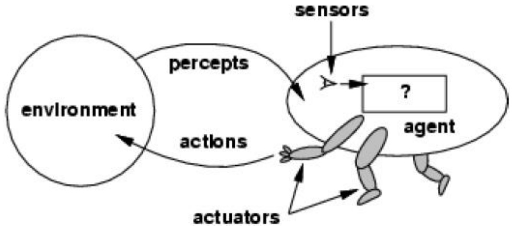
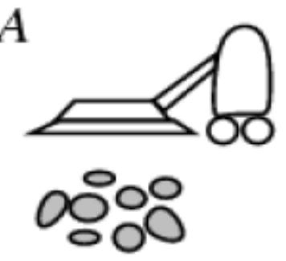
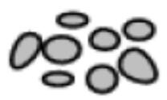
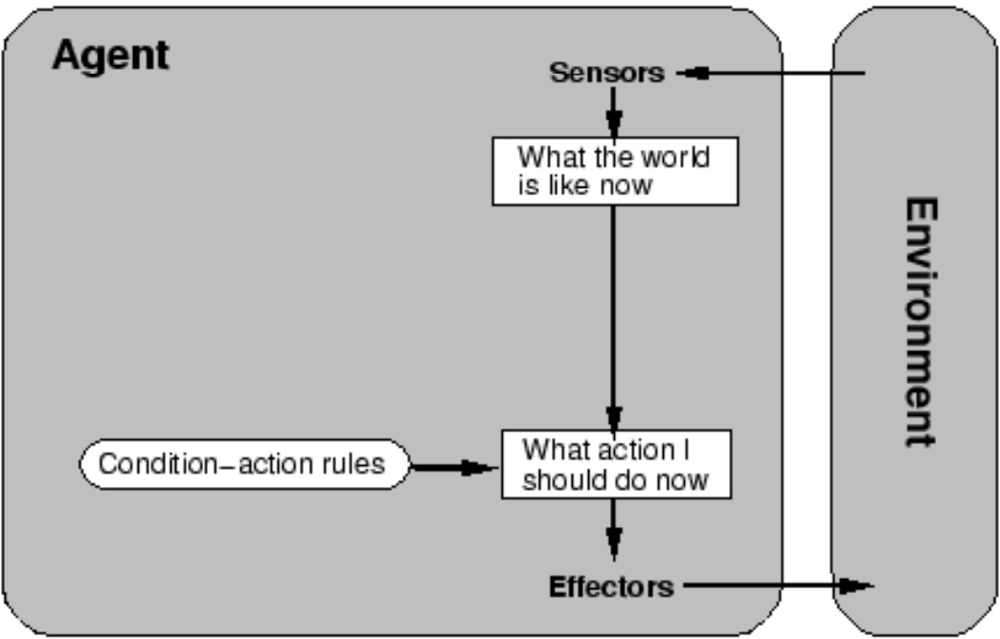
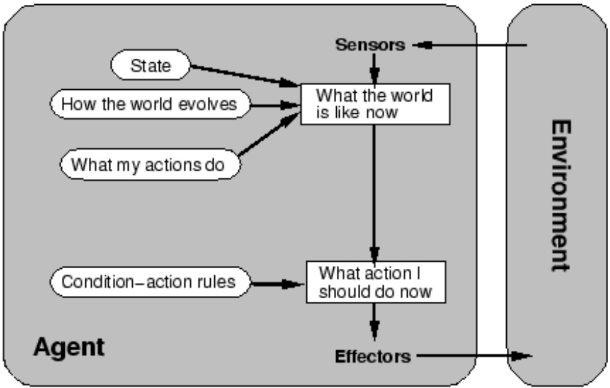
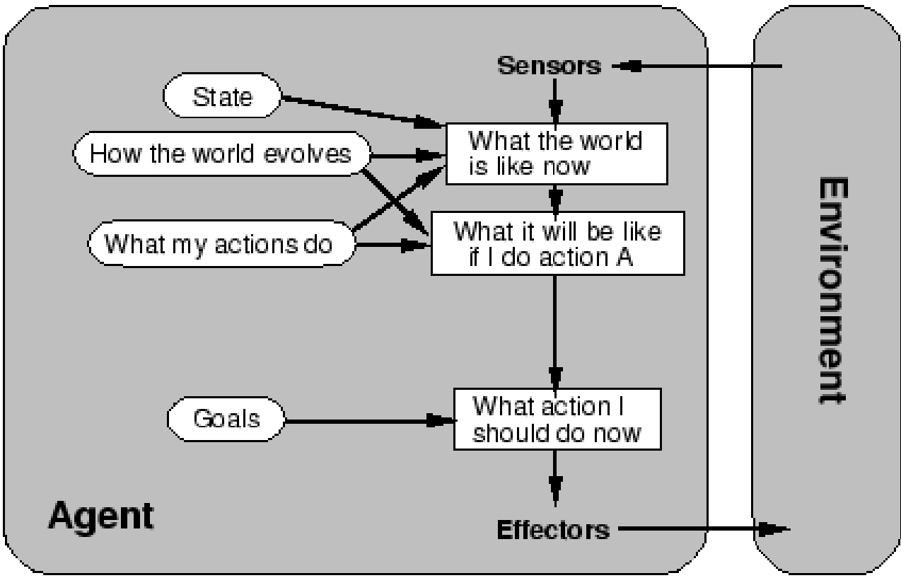
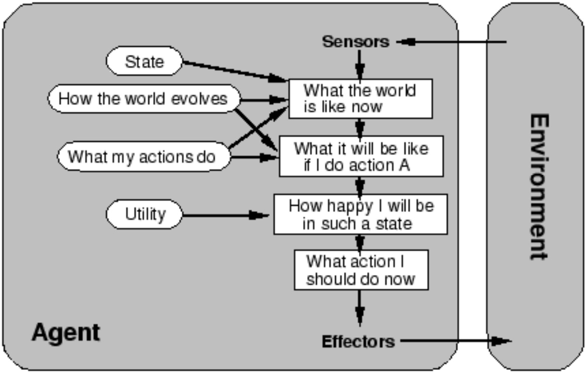
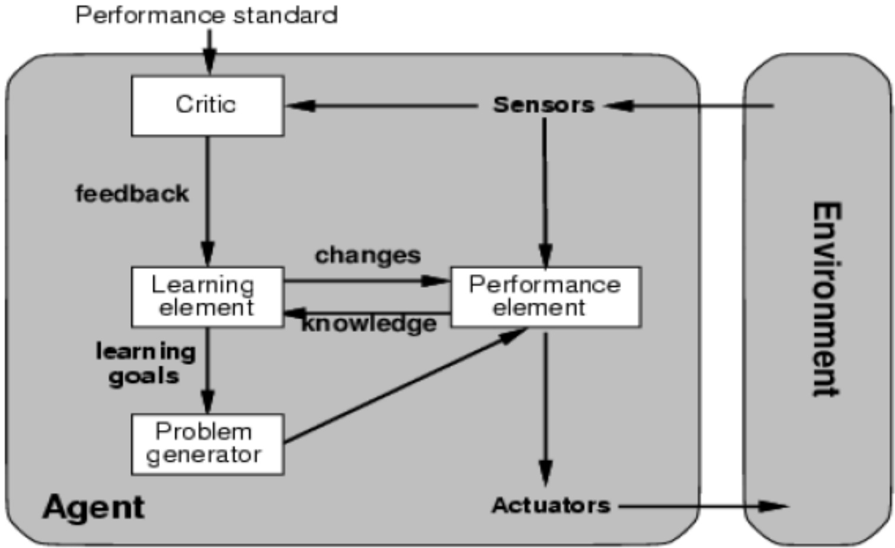

<!-- page: 1 -->

## Chương 2 Tác tử thông minh

Lê Thanh Hương

Viện CNTT&TT – ĐHBKHN

<!-- page: 2 -->

## Nội dung môn học

▪ Chương 1. Tổng quan

▪ Chương 2. Tác tử thông minh

▪ Chương 3. Giải quyết vấn đề

▪ Chương 4. Tri thức và suy diễn

▪ Chương 5. Biểu diễn tri thức

▪ Chương 6. Học máy

<!-- page: 3 -->

## Nội dung

1 Tác tử và môi trường

2. Một số đặc điểm của tác tử

3. PEAS – Những yếu tố cần xem xét khi thiết kế tác tử

4. Các kiểu môi trường

5. Các kiểu tác tử

6. Đa tác tử

<!-- page: 4 -->

## 2.1. Tác tử và môi trường

Một tác tử - agent được hiểu là bất cứ thứ gì cảm nhận môi trường quanh nó thông qua các cảm biến và tác động trở lại môi trường thông qua bộ kích hoạt.

◼ Ví dụ 1: con người được xem là một tác tử

❑ Cảm biến: mắt, tai, …

❑ Bộ kích hoạt: tay, chân, …

## ◼ Ví dụ 2: Người máy Aishimo

❑ Cảm biến: camera, các bộ dò đường hồng ngoại

❑ Bộ kích hoạt: mô tơ

Ví dụ …: hệ chuyên gia MYCIN, Google search, cửa tự động đóng mở,

<!-- page: 5 -->

## 2.1. Tác tử và môi trường



Hàm tác tử là ánh xạ từ tập cảm nhận trong quá khứ tới hành động tương ứng: f: $\mathsf { P } ^ { \star } \supset \mathsf { A }$

◼ Chương trình tác tử chạy trên kiến trúc vật lý để tạo ra hàm f

<!-- page: 6 -->

Chương trình tác tử dựa trên bảng điều kiện

```txt
Function TABLE-DRIVEN-AGENT(percept) returns action
static: percepts, một dãy cảm nhận, khởi đầu rỗng
table, bằng các hành động ứng với chuỗi cảm nhận
Thêm percept vào cuối dãy percepts
action ← LOOKUP(percepts, table)
Return action
```

Nhược điểm: sự bùng nổ kích thước của table

<!-- page: 7 -->

Ví dụ: tác tử hút bụi thông minh

<table><tr><td></td><td>B</td></tr></table>

◼ Cảm nhận: vị trí (A hoặc B), trạng thái (sạch hoặc bẩn)

◼ Hành động: qua trái, qua phải, hút bụi, NoOp

| Dãy cảm nhận | Hành động |
| --- | --- |
| [A, sạch] | Qua phải |
| [A, bẩn] | Hút bụi |
| [B, sạch] | Qua trái |
| [B, bẩn] | Hút bụi |
| [A, sạch][A, sạch] | Qua phải |
| [A, sạch][A, bẩn] | Hút bụi |

<!-- page: 8 -->

## Ví dụ: tác tử hút bụi thông minh

```txt
Funtion Reflex-Vacuum-Agent([vị_trí, trạng_thái])
  returns hành_dộng
    If trạng_thái = Bản then return Hút_Bụi
      Else if vị_trí = A then return Qua_Phải
      Else if vị_trí = B then return Qua_Trái
End Function
```

◼ Liệu tác tử có hoạt động hợp lý không?

<!-- page: 9 -->

## Tác tử hợp lý (1)

Tác tử cần phấn đấu để “làm đúng việc cần làm”, dựa trên **những gì nó nhận thức (nhận biết) được** và dựa trên **các hành động mà nó có thể thực hiện**

◼ Một **hành động đúng (hợp lý)** là hành động giúp cho tác tử đạt được thành công cao nhất đối với mục tiêu đặt ra

**Đánh giá hiệu quả hoạt động**: là tiêu chuẩn để đánh giá mức độ thành công trong hoạt động của một tác tử

❑ Ví dụ: Tiêu chí đánh giá hiệu quả hoạt động của một tác tử máy hút bụi có thể là: mức độ làm sạch, thời gian hút bụi, mức độ điện năng tiêu tốn, mức độ tiếng ồn gây ra,

<!-- page: 10 -->

## Tác tử hợp lý (2)

## ◼ Tác tử hợp lý

❑ Với mỗi chuỗi nhận thức có được,

❑ Một tác tử hợp lý cần phải lựa chọn một hành động giúp cực đại hóa tiêu chí đánh giá hiệu quả hoạt động của tác tử đó,

❑ Dựa trên các thông tin được cung cấp bởi chuỗi nhận thức và các tri thức được sở hữu bởi tác tử đó

<!-- page: 11 -->

## Tác tử hợp lý (3)

◼ Sự hợp lý  Sự thông suốt mọi thứ

❑ Sự thông suốt mọi thứ = Biết tất cả mọi thứ, với tri thức vô hạn

❑ Vì các nhận thức có thể không cung cấp tất cả các thông tin liên quan

◼ Các tác tử có thể thực hiện các hành động nhằm thay đổi các nhận thức trong tương lai, với mục đích thu được các thông tin hữu ích (ví dụ: thu thập thông tin, khám phá tri thức)

Tác tử tự trị (autonomous agent) là một tác tử mà các hành động của nó được quyết định bởi chính kinh nghiệm của tác tử đó (cùng với khả năng học và thích nghi)

<!-- page: 12 -->

## 2.2. Đặc điểm của tác tử

Với mỗi dãy trạng thái cảm nhận được cùng với tri thức sẵn có, tác tử phải lựa chọn hành động sao cho tối đa hóa hàm đánh giá hiệu năng

Cho đích cần đạt và các tri thức sẵn có, tác tử cần:

Sử dụng thông tin thu được từ các quan sát mới để cập nhật lại tri thức của nó

2. Trên cơ sở tri thức của nó, thực thi hành động nhằm đạt được mục tiêu đề ra trong thế giới của nó.

Một tác tử là tự trị nếu hành vi được xác định bởi kinh nghiệm của chính bản thân nó (với khả năng học và thích nghi)

<!-- page: 13 -->

## 2.3. PEAS – Yếu tố xem xét khi thiết kế

Khi thiết kế, xây dựng một tác tử, phải xem xét 4 yếu tố:

❑ Performance measure: hàm đo hiệu năng

❑ Enviroment: môi trường

❑ Actuator: bộ kích hoạt

❑ Sensor: cảm biến

<!-- page: 14 -->

## PEAS: một số ví dụ

|  | Tác tử lái xe tự động | Tác tử mua hàng | Tác tử lọc thư rác |
| --- | --- | --- | --- |
| Hàm đánh giá | độ an toàn, tốc độ, đúng luật, lợi ích | giá, chất lượng, độ tin cậy của đơn hàng | phân loại sai |
| Môi trường | đường, giao thông, người đi bộ, lái xe | người bán hàng, tác tử vận chuyển, khách hàng | phần mềm email trên server/client |
| Bộ kích hoạt | bánh xe, chân ga, phanh | trình bày hoá đơn, điền HĐ, gửi HĐ | các thư được gãn nhãn |
| Bộ cảm biến | camera, máy đo tốc độ | trang HTML, form giao diện với KH | nội dung thư, tiêu đề, thời gian |

<!-- page: 15 -->

## Bài tập

◼ Xác định 4 yếu tố PEAS cho các tác tử sau:

❑ Máy giặt thông minh

❑ Tác tử chơi bóng bàn

❑ Chatbot bán hàng

❑ Chơi cờ

<!-- page: 16 -->

## 2.4. Các kiểu môi trường (1)

## Có thể quan sát được hoàn toàn (hay có thể quan sát được một phần)?

❑ Các bộ cảm biến của một tác tử cho phép nó truy cập tới trạng thái đầy đủ của môi trường tại mỗi thời điểm

## ◼ Xác định (hay ngẫu nhiên)?

❑ Trạng thái tiếp theo của môi trường được xác định hoàn toàn dựa trên trạng thái hiện tại và hành động của tác tử (tại trạng thái hiện tại này)

❑ Nếu một môi trường là xác định, ngoại trừ đối với các hành động của các tác tử khác, thì gọi là môi trường chiến lược

<!-- page: 17 -->

## 2.4.Các kiểu môi trường (2)

## ◼ Phân đoạn (hay liên tiếp)?

❑ Lịch sử kinh nghiệm của tác tử được chia thành các giai đoạn (chương/hồi)

❑ Mỗi giai đoạn bao gồm việc nhận thức của tác tử và hành động mà nó thực hiện

❑ Ở mỗi giai đoạn, việc lựa chọn hành động để thực hiện chỉ phụ thuộc vào giai đoạn đó (không phụ thuộc vào các giai đoạn khác)

## ◼ Tĩnh (hay động)?

❑ Môi trường không thay đổi trong khi tác tử cân nhắc (xem nên đưa ra hành động nào)

❑ Môi trường bán động (semi-dynamic) là môi trường mà khi thời gian trôi qua thì nó (môi trường) không thay đổi, nhưng hiệu quả hoạt động của tác tử thì thay đổi

◼ Ví dụ: Các chương trình trò chơi có tính giờ

<!-- page: 18 -->

## 2.4.Các kiểu môi trường (3)

## ◼ Rời rạc (hay liên tục)?

❑ Tập các nhận thức và các hành động là hữu hạn, được định nghĩa phân biệt rõ ràng

## ◼ Tác tử đơn lẻ (hay đa tác tử)?

❑ Một tác tử hoạt động độc lập (không phụ thuộc / liên hệ với các tác tử khác) trong một môi trường

<!-- page: 19 -->

## Các kiểu môi trường – Ví dụ

Quan sát đầy đủ?

Xác định?

Phân đoạn?

Tĩnh?

Rời rạc?

Tác tử đơn?

Chơi cờ tính giờ

Chơi cờ không Lái xe taxi tính giờ

| có | có | không |
| --- | --- | --- |
| chiến lược | chiến lược | không |
| không | không | không |
| bán động | có | không |
| có | có | không |
| không | không | không |

Kiểu của môi trường có ảnh hưởng quyết định đối với việc thiết kế tác tử

Môi trường trong thực tế thường có các đặc điểm: chỉ có thể quan sát được một phần, ngẫu nhiên, liên tiếp, thay đổi (động), liên tục, đa tác tử

<!-- page: 20 -->

## Điền đặc điểm môi trường vào bảng

| Tác tử Môi trường | Mở khóa đthoại bằng vân tay | Đếm người ra vào phòng | Lọc thư rác | Chatbot bán hàng |
| --- | --- | --- | --- | --- |
| Quan sát được |  |  |  |  |
| Xác định được |  |  |  |  |
| Động |  |  |  |  |
| Liên tục |  |  |  |  |
| Đơn/đa |  |  |  |  |

<!-- page: 21 -->

## 2.5.Các kiểu tác tử

◼ 4 kiểu tác tử cơ bản

❑ Tác tử phản xạ đơn giản (simple reflex agents)

❑ Tác tử phản xạ dựa trên mô hình (model-based reflex agents)

❑ Tác tử dựa trên mục tiêu (goal-based agents)

❑ Tác tử dựa trên lợi ích (utility-based agents)

<!-- page: 22 -->

## Tác tử phản xạ đơn giản

◼ Tác tử hành động theo một quy tắc (luật) có điều kiện phù hợp với trạng thái hiện thời (của môi trường), không xét đến quá khứ



**Function** SIMPLE-REFLEX- AGENT(percept) **returns** an action **static**: rules, a set of condition-action rules state  INTERPRET-INPUT(percept) rule  RULE-MATCH(state, rules) action  RULE-ACTION[rule] **return** action

<!-- page: 23 -->

## Tác tử phản xạ có trạng thái

◼ Tác tử lưu **internal states** dựa trên chuỗi percept, phản ánh ít nhất một vài khía cạnh không quan sát được của môi trường



function REFLEX-AGENT-WITH-STATE(percept) returns an action static: state, a description of the current world state rules, a set of condition-action rules action, the most recent action, initially none state  UPDATE-STATE(state, action, percept) rule  RULE-MATCH(state, rules) action  RULE-ACTION[rule] return action

<!-- page: 24 -->

## Tác tử hướng mục đích (1)

◼ Biết về trạng thái hiện tại của môi trường: chưa đủ → Cần biết thêm thông tin về mục tiêu

❑ Trạng thái hiện tại của môi trường: Ở một ngã tư, xe taxi có thể rẽ trái, rẽ phải, hoặc đi thẳng

❑ Thông tin về mục tiêu: xe taxi cần đi tới đích đến của hành khách

## ◼ Tác tử dựa trên mục tiêu

❑ Theo dõi trạng thái hiện tại của môi trường

❑ Lưu giữ một tập các mục tiêu (cần đạt được)

❑ Chọn hành động cho phép (rốt cuộc) sẽ đạt đến các mục tiêu

<!-- page: 25 -->

## Tác tử hướng mục đích (2)



Các dạng đích:

◼ Một trạng thái

◼ Tập các trạng thái thỏa mãn một số tính chất nào đó

◼ Một phép thử áp dụng vào trạng thái và thông báo có thỏa đích hay không

Đích khiến tác tử phải suy luận về tương lai hoặc các trạng thái khác. Có thể có trường hợp không hành động nào đưa đến đích.

<!-- page: 26 -->

## Tác tử hướng lợi ích (1)

◼ Trong nhiều môi trường, thông tin về các mục tiêu không đủ để đánh giá hiệu quả của các hành động

❑ Có rất nhiều chuỗi các hành động cho phép taxi đi đến đích (tức là đạt đến mục tiêu)

❑ Nhưng: chuỗi hành động nào nhanh hơn, an toàn hơn, đáng tin cậy hơn, chi phí thấp hơn?

◼ Cần sự đánh giá lợi ích đối với tác tử

◼ Hàm lợi ích (utility function)

❑ Ánh xạ từ **chuỗi** các trạng thái của môi trường tới một giá trị số thực (thể hiện mức lợi ích đối với tác tử)

<!-- page: 27 -->

## Tác tử hướng lợi ích (2)



Các tác tử thực hiện hành động sao cho có lợi nhất về lâu dài

◼ Các tác tử muốn thực hiện hành động đem lại lợi ích lớn hơn

Có thể suy luận về các nhiệm vụ có nhiều đích, về sự xung đột giữa các đích, và về các tình huống không chắc chắn.

<!-- page: 28 -->

## Tác tử với khả năng học (1)

◼ Khả năng học cho phép tác tử cải thiện hiệu quả hoạt động của nó

◼ 4 thành phần tạo nên một tác tử có khả năng học

❑ Thành phần hành động: đảm nhiệm việc lựa chọn các hành động

❑ Thành phần đánh giá (bình luận): đánh giá hiệu quả hoạt động

❑ Thành phần học: giúp cải thiện hiệu quả hoạt động - dựa trên các đánh giá, để thay đổi (cải thiện) thành phần hành động

❑ Thành phần sản sinh kinh nghiệm: có nhiệm vụ đề xuất các hành động giúp sản sinh ra (dẫn đến) các kinh nghiệm mới

<!-- page: 29 -->

## Tác tử với khả năng học (2)



<!-- page: 30 -->

## Cơ sở tri thức của tác tử

◼ Một cơ sở tri thức (a knowledge base) là một tập các mệnh đề (phát biểu) được biểu diễn trong một ngôn ngữ hình thức, cung cấp tri thức (hiểu biết) cho một tác tử

◼ Tác tử khai thác cơ sở tri thức (mà nó sở hữu) trong quá trình đưa ra các hành động

◼ Tác tử cần có khả năng

❑ Thu thập (cập nhật) các tri thức mới

❑ Cập nhật việc biểu diễn (bên trong tác tử) đối với môi trường xung quanh

❑ Suy diễn ra các thuộc tính ẩn của môi trường xung quanh

❑ Suy luận để đưa ra các hành động hợp lý

<!-- page: 31 -->

## 2.6. Đa tác tử (1)

◼ Môi trường hoạt động: **Cộng tác (hợp tác)** hay là **Cạnh tranh (đối kháng)**?

◼ Trong nhiều bài toán thực tế, môi trường hoạt động luôn thay đổi (biến động) → tác tử cần cập nhật

◼ Cần một mô hình biểu diễn kế hoạch của các tác tử khác

## ◼ Các tác tử cộng tác

❑ Cùng chia sẻ các mục tiêu hoặc các kế hoạch

❑ Ví dụ: Lập kế hoạch (cho hoạt động nhóm) trong trò chơi tennis đánh đôi

❑ Các cơ chế cộng tác: Phân tách và phân phối các nhiệm vụ cho mỗi tác tử

<!-- page: 32 -->

## 2.6. Đa tác tử (2)

## ◼ Các tác tử cạnh tranh

❑ Ví dụ: chơi cờ

❑ Mỗi tác tử phải nhận biết được sự tồn tại (và hoạt động) của các tác tử khác

❑ Mỗi tác tử tính toán (dự đoán) được các kế hoạch của (một số) các tác tử khác

❑ Mỗi tác tử tính toán (dự đoán) được ảnh hưởng của các kế hoạch của các tác tử khác đối với kế hoạch của bản thân nó

❑ Mỗi tác tử quyết định hành động tối ưu đối với dự đoán ảnh hưởng này

<!-- page: 33 -->

## Bài tập: Xếp các tác tử sau vào các loại tác tử liệt kê trên:

◼ Lái xe tự động

◼ Mua hàng

◼ Lọc thư rác

◼ Máy giặt thông minh

◼ Chơi bóng bàn

◼ Chatbot bán hàng

◼ Chơi cờ

◼ Hệ chuyên gia MYCIN

◼ Google search

◼ Cửa tự động đóng mở

<!-- page: 34 -->

## Tổng kết

◼ Tác tử tương tác với môi trường thông qua các bộ phận cảm biến và các bộ phận hành động

◼ Một tác tử hợp lý sẽ cực đại hóa hiệu quả hoạt động của nó

◼ Hàm tác tử mô tả các hành động mà tác tử thực hiện trong các tình huống

Các chương trình tác tử cài đặt (thực hiện) các hàm tác tử

◼ Các mô tả PEAS xác định môi trường công việc

◼ Các môi trường được phân loại dựa theo các tiêu chí: Có thể quan sát được? Xác định? Phân đoạn? Tĩnh? Rời rạc? Tác tử đơn lẻ?

◼ Các kiến trúc tác tử cơ bản: Phản xạ đơn giản, Dựa trên mô hình, Dựa trên mục tiêu, Dựa trên lợi ích
