<!-- page: 1 -->

## Trí Tuệ Nhân Tạo

## (Artificial Intelligence)

**Lê Thanh Hương**

Viện Công nghệ thông tin và Truyền thông Trường Đại Học Bách Khoa Hà Nội

<!-- page: 2 -->

## Nội dung môn học

Chương 1. Tổng quan

Chương 2. Tác tử thông minh

Chương 3. Giải quyết vấn đề

3.1. Tìm kiếm cơ bản

3.2. Tìm kiếm với tri thức bổ sung

3.3. Tìm kiếm dựa trên thỏa mãn ràng buộc

Chương 4. Tri thức và suy diễn

Chương 5. Học máy

<!-- page: 3 -->

## Nhắc lại: Tìm kiếm theo cấu trúc cây

```txt
function TREE-SEARCH(problem, fringe) returns a solution, or failure
    fringe ← INSERT(MAKE-NODE(INITIAL-STATE[problem]), fringe)
loop do
    if fringe is empty then return failure
    node ← REMOVE-FRONT(fringe)
    if GOAL-TEST[problem] applied to STATE(node) succeeds return node
    fringe ← INSERTALL(EXPAND(node, problem), fringe)
```

Một chiến lược (phương pháp) tìm kiếm = Một cách xác định thứ tự xét các nút của cây

<!-- page: 4 -->

## Tìm kiếm với tri thức bổ sung

◼ Các chiến lược tìm kiếm cơ bản (uninformed search strategies) chỉ sử dụng các thông tin chứa trong định nghĩa của bài toán

❑ Không phù hợp với nhiều bài toán thực tế (do đòi hỏi chi phí quá cao về thời gian và bộ nhớ)

◼ Các chiến lược tìm kiếm với tri thức bổ sung (informed search strategies) sử dụng các tri thức cụ thể của bài toán → Quá trình tìm kiếm hiệu quả hơn

❑ Các giải thuật tìm kiếm best-first (Greedy best-first, A\*)

❑ Các giải thuật tìm kiếm cục bộ (Hill-climbing, Simulated annealing, Local beam, Genetic algorithms)

❑ Các giải thuật tìm kiếm đối kháng (MiniMax, Alpha-beta pruning)

<!-- page: 5 -->

## Best-first search

Ý tưởng: Sử dụng một hàm đánh giá f(n) cho mỗi nút của cây tìm kiếm

❑ Để đánh giá mức độ “phù hợp” của nút đó

Trong quá trình tìm kiếm, ưu tiên xét các nút có mức độ phù hợp cao nhất

## ◼ Cài đặt giải thuật

❑ Sắp thứ tự các nút trong cấu trúc fringe theo trật tự giảm dần về mức độ phù hợp

◼ Các trường hợp đặc biệt của giải thuật Best-first search ❑ Greedy best-first search

❑ A<sup>\*</sup> search

<!-- page: 6 -->

## Greedy best-first search

◼ Hàm đánh giá $f ( n )$ là hàm heuristic $h ( n )$

◼ Hàm heuristic $h ( n )$ đánh giá chi phí để đi từ nút hiện tại n đến nút đích (mục tiêu)

◼ Ví dụ: Trong bài toán tìm đường đi từ Arad đến Bucharest, sử dụng: $h _ { S L D } ( \boldsymbol { n } ) = \boldsymbol { \cup }$ ớc lượng khoảng cách đường thẳng (“chim bay”) từ thành phố hiện tại n đến Bucharest

◼ Phương pháp tìm kiếm Greedy best-first search sẽ xét (phát triển) nút “có vẻ” gần với nút đích (mục tiêu) nhất

<!-- page: 7 -->

## Greedy best-first search – Ví dụ (1)

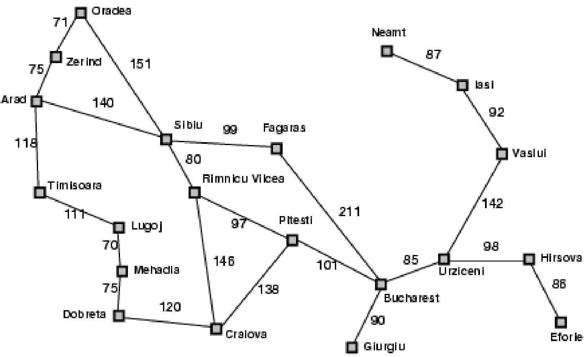

<table><tr><td colspan="2">Straight-line distance to Bucharest</td></tr><tr><td>Arad</td><td>366</td></tr><tr><td>Bucharest</td><td>0</td></tr><tr><td>Craiova</td><td>160</td></tr><tr><td>Dobreta</td><td>242</td></tr><tr><td>Eforie</td><td>161</td></tr><tr><td>Eagaras</td><td>176</td></tr><tr><td>Giurgiu</td><td>77</td></tr><tr><td>Hirsova</td><td>151</td></tr><tr><td>Iasi</td><td>226</td></tr><tr><td>Lugoj</td><td>244</td></tr><tr><td>Mehadia</td><td>241</td></tr><tr><td>Neamt</td><td>234</td></tr><tr><td>Oradea</td><td>380</td></tr><tr><td>Pitesti</td><td>10</td></tr><tr><td>Rimnicu Vilcea</td><td>193</td></tr><tr><td>Sibiu</td><td>253</td></tr><tr><td>Timisoara</td><td>329</td></tr><tr><td>Urziceni</td><td>80</td></tr><tr><td>Vaslui</td><td>199</td></tr><tr><td>Zerind</td><td>374</td></tr></table>

<!-- page: 8 -->

## Greedy best-first search – Ví dụ (2)

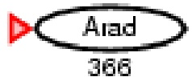

<!-- page: 9 -->

## Greedy best-first search – Ví dụ (3)

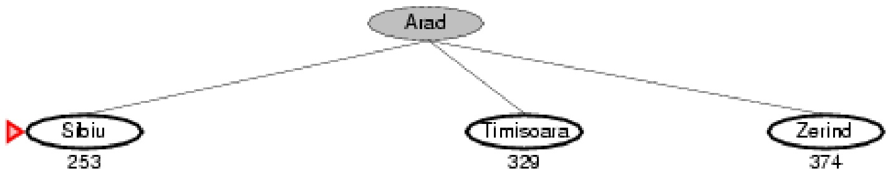

<!-- page: 10 -->

## Greedy best-first search – Ví dụ (4)

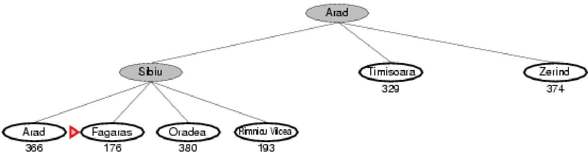

<!-- page: 11 -->

## Greedy best-first search – Ví dụ (5)

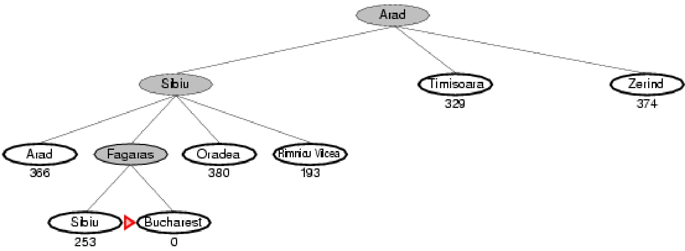

<!-- page: 12 -->

## Greedy best-first search – Các đặc điểm

## ◼ Tính hoàn chỉnh?

❑ Không – Vì có thể vướng (chết tắc) trong các vòng lặp kiểu như: Iasi → Neamt → Iasi → Neamt →

## ◼ Độ phức tạp về thời gian?

❑ $O ( b ^ { m } )$

❑ Một hàm heuristic tốt có thể mang lại cải thiện lớn

## ◼ Độ phức tạp về bộ nhớ?

❑ O(b<sup>m</sup>) – Lưu giữ tất cả các nút trong bộ nhớ

## ◼ Tính tối ưu?

❑ Không

<!-- page: 13 -->

## A<sup>\*</sup> search

◼ Ý tưởng: Tránh việc xét (phát triển) các nhánh tìm kiếm đã xác định (cho đến thời điểm hiện tại) là có chi phí cao

◼ Sử dụng hàm đánh giá $f ( n ) = g ( n ) + h ( n )$

❑ g(n) = chi phí từ nút gốc cho đến nút hiện tại n

❑ h(n) = chi phí ước lượng từ nút hiện tại n tới đích

❑ f(n) = chi phí tổng thể ước lượng của đường đi qua nút hiện tại n đến đích

<!-- page: 14 -->

## A<sup>\*</sup> search – Ví dụ (1)

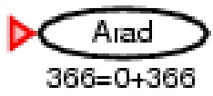

<!-- page: 15 -->

## A<sup>\*</sup> search – Ví dụ (2)

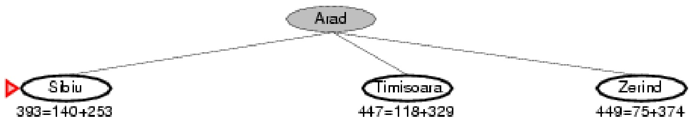

<!-- page: 16 -->

## A<sup>\*</sup> search – Ví dụ (3)

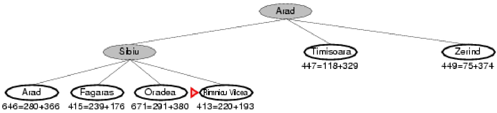

<!-- page: 17 -->

## A<sup>\*</sup> search – Ví dụ (4)

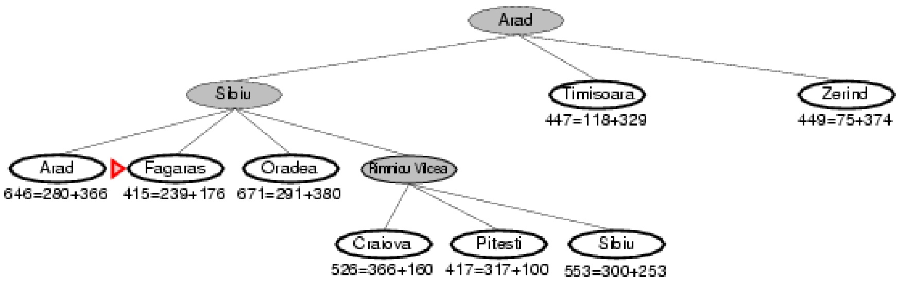

<!-- page: 18 -->

## A<sup>\*</sup> search – Ví dụ (5)

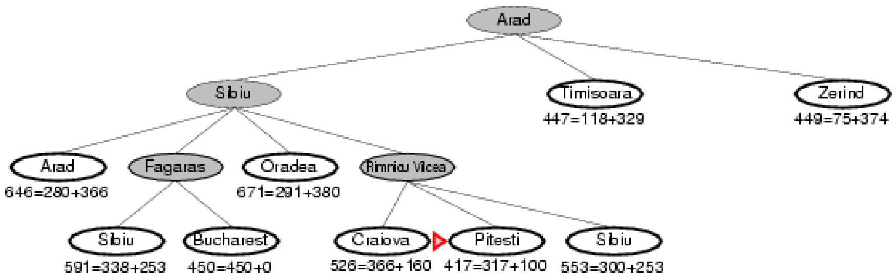

<!-- page: 19 -->

## A<sup>\*</sup> search – Ví dụ (6)

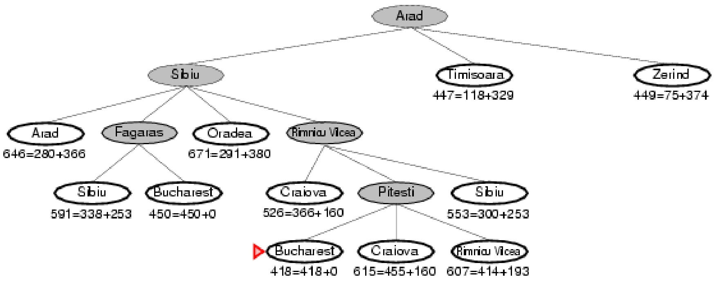

<!-- page: 20 -->

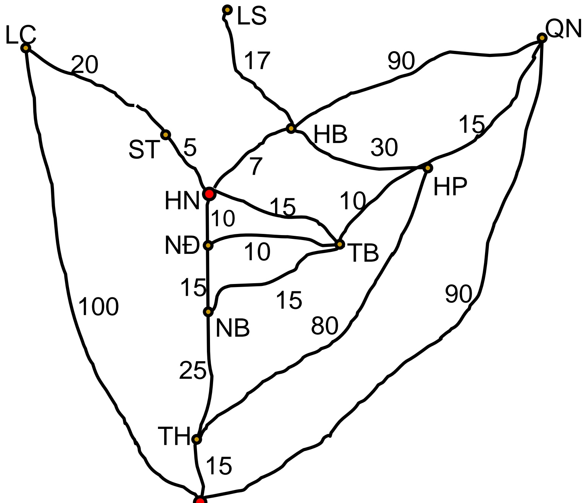

| n | h(n) |
| --- | --- |
| HN | 50 |
| ST | 60 |
| LC | 75 |
| HB | 65 |
| LS | 70 |
| HP | 80 |
| QN | 80 |
| TB | 55 |
| NĐ | 45 |
| NB | 20 |
| TH | 15 |
| V | 0 |

h(n): khoảng cách đường chim bay HN → V

<!-- page: 21 -->

## A\* search: các đặc điểm

Nếu không gian các trạng thái là hữu hạn và có giải pháp để tránh việc xét (lặp) lại các trạng thái, thì giải thuật A\* là hoàn chỉnh (tìm được lời giải) – nhưng không đảm bảo là tối ưu

Nếu không gian các trạng thái là hữu hạn và không có giải pháp để tránh việc xét (lặp) lại các trạng thái, thì giải thuật A\* là không hoàn chỉnh

Nếu không gian các trạng thái là vô hạn, thì giải thuật A\* là không hoàn chỉnh

◼ Khi nào thì $\mathsf { A } ^ { \star }$ tối ưu?

<!-- page: 22 -->

## Các ước lượng chấp nhận được

Một ước lượng h(n) được xem là chấp nhận được nếu đối với mọi nút n: $0 \leq h ( n ) \leq h ^ { * } ( n )$ , trong đó $h ^ { * } ( n )$ là chi phí thật (thực tế) để đi từ nút n đến đích

◼ Một ước lượng chấp nhận được không bao giờ đánh giá quá cao (overestimate) đối với chi phí để đi tới đích ❑ Thực chất, ước lượng chấp nhận được có xu hướng đánh giá “lạc quan”

◼ Ví dụ: Ước lượng $h _ { S L D } ( n )$ đánh giá thấp hơn khoảng cách đường đi thực tế

**Định lý:** Nếu h(n) là đánh giá chấp nhận được, thì phương pháp tìm kiếm A<sup>\*</sup> sử dụng giải thuật TREE-SEARCH là tối ưu

<!-- page: 23 -->

## Tính tối ưu của $\mathbb { A } ^ { * }$ - Chứng minh (1)

Giả sử có một đích không tối ưu (suboptimal goal) $G _ { 2 }$ được sinh ra và lưu trong cấu trúc fringe. Gọi n là một nút chưa xét trong cấu trúc fringe sao cho n nằm trên một đường đi ngắn nhất đến một đích tối ưu (optimal goal) G

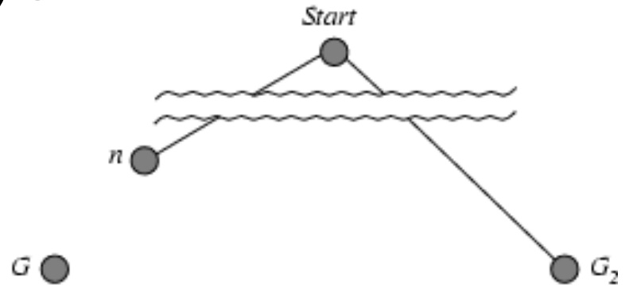

◼ Ta có: 1) $\mathsf { f } ( \mathsf { G } _ { 2 } ) = \mathsf { g } ( \mathsf { G } _ { 2 } )$

◼ Ta có: 2) $g ( G _ { 2 } ) > g ( G )$

◼ Ta có: 3) $\mathsf{f}(\mathsf{G}) = \mathsf{g}(\mathsf{G})$

◼ Từ $1 ) + 2 ) + 3 )$ suy ra: $4 ) \mathsf { f } ( \mathsf { G } _ { 2 } ) > \mathsf { f } ( \mathsf { G } )$

vì $h ( \mathbf { G } _ { 2 } ) = 0$

vì $\mathsf { G } _ { 2 }$ là đích không tối ưu

$h ( \mathbf { G } ) = 0$

<!-- page: 24 -->

## Tính tối ưu của $\mathbb { A } ^ { * }$ - Chứng minh (2)

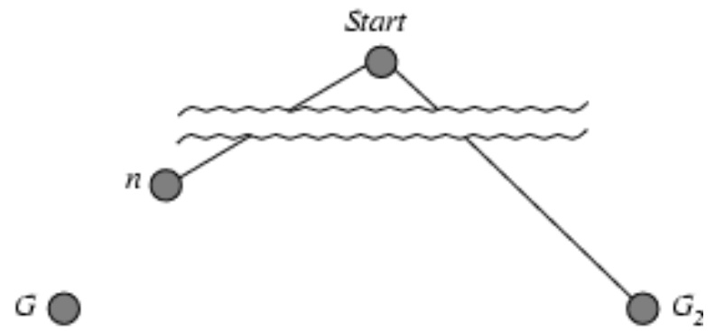

◼ Ta có: 5) $h ( n ) \leq h ^ { \prime } ( n )$

vì h là ước lượng chấp nhận được

◼ Từ 5) suy ra: 6) $g ( n ) + h ( n ) \leq g ( n ) + h ^ { \prime } ( n )$

◼ Ta có: $7 ) g ( n ) + h ^ { \prime } ( n ) = f ( G )$ vì n nằm trên đường đi tới G

◼ Từ 6)+7) suy ra: $8 ) f ( n ) \leq f ( G )$

◼ Từ $4 ) + 8 )$ suy ra: $\mathsf { f } ( \mathsf { G } _ { 2 } ) > \mathsf { f } ( \mathsf { n } )$ . Tức là, giải thuật $\mathsf { A } ^ { \star }$ không bao giờ xét $G _ { 2 }$

<!-- page: 25 -->

## Các ước lượng chấp nhận được (1)

Ví dụ đối với trò chơi ô chữ 8 số:

◼ $h _ { 1 } ( n ) = s \hat { 0 }$ các ô chữ nằm ở sai vị trí (so với vị trí của ô chữ đấy ở trạng thái đích)

◼ $h _ { 2 } ( n ) =$ khoảng cách dịch chuyển $( \leftarrow , \rightarrow , \uparrow , \downarrow )$ ngắn nhất để dịch chuyển các ô chữ nằm sai vị trí về vị trí đúng

$$
\mathsf {h} _ {1} (\mathsf {S}) = ?
$$

$$
\mathsf {h} _ {2} (\mathsf {S}) = ?
$$

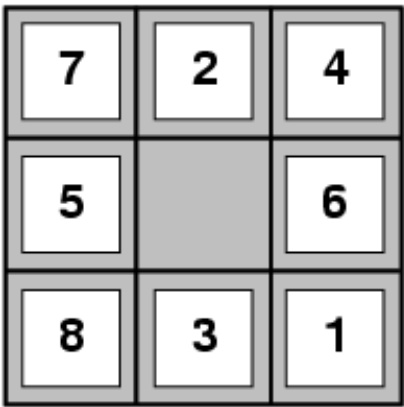

Start State


Goal State

<!-- page: 26 -->

## Các ước lượng chấp nhận được (2)

Ví dụ đối với trò chơi ô chữ 8 số:

◼ $h _ { 1 } ( n ) = s \hat { 0 }$ các ô chữ nằm ở sai vị trí (so với vị trí của ô chữ đấy ở trạng thái đích)

◼ $h _ { 2 } ( n ) =$ khoảng cách dịch chuyển $( \leftarrow , \rightarrow , \uparrow , \downarrow )$ ngắn nhất để dịch chuyển các ô chữ nằm sai vị trí về vị trí đúng

◼ $\mathsf { h } _ { 1 } ( \mathsf { S } ) = 8$

$$
\mathsf{h}_2(\mathsf{S}) = 3 + 1+
$$

$$
2 + 2 + 2 + 3 + 3 + 2 = 1 8
$$

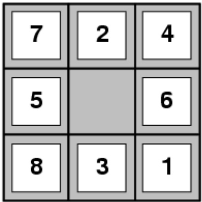

Start State

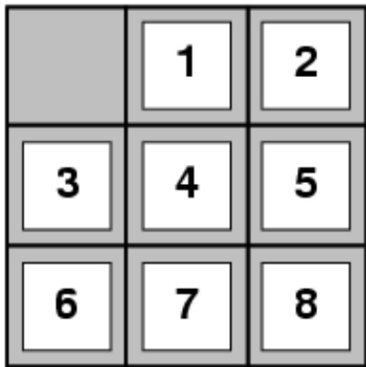

Goal State

<!-- page: 27 -->

Trò chơi Tic-tac-toe

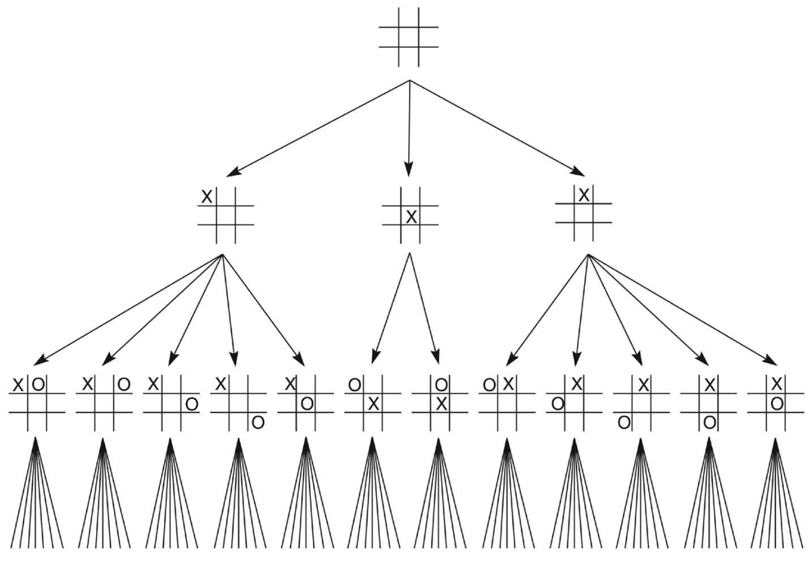

KGTT của tic-tac-toe được thu nhỏ nhờ tính đối xứng của các trạng thái

<!-- page: 28 -->

## Phép đo heuristic

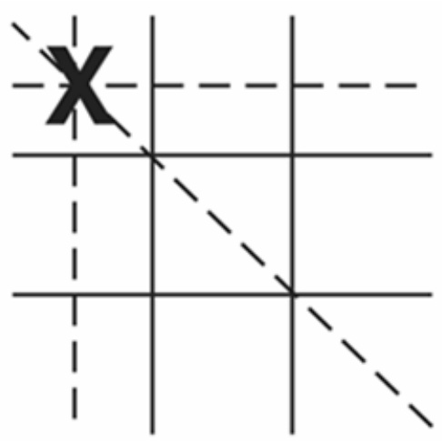

Chiếm 3 đường

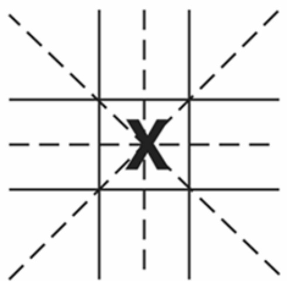

Chiếm 4 đường

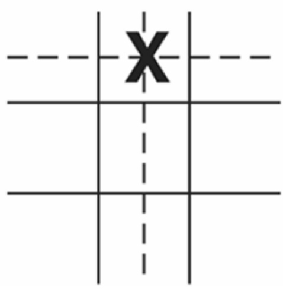

Chiếm 2 đường

Heuristic “Số đường thắng nhiều nhất” áp dụng cho các nút con đầu tien trong tic-tac-toe.

<!-- page: 29 -->

## Phép đo heuristic

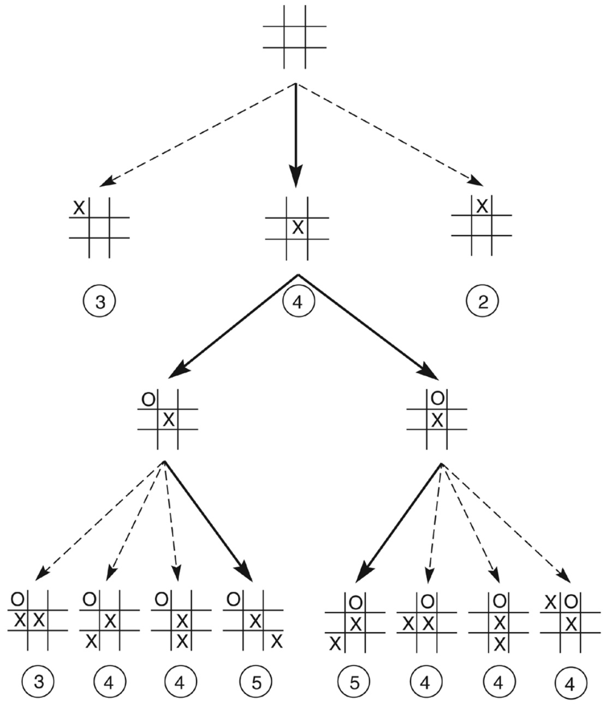

<!-- page: 30 -->

## Ước lượng ưu thế

◼ Ước lượng $h _ { 2 }$ được gọi là ưu thế hơn / trội hơn (dominate) ước lượng $\tilde { h } _ { 1 } \tilde { n } \hat { e } u _ { 1 } ^ { 2 }$

❑ $h ^ { \star } ( n ) \geq h _ { 2 } ( n ) \geq h _ { 1 } ( n )$ đối với tất cả các nút n

◼ Nếu ước lượng $h _ { 2 } \mathbf { w } \mathbf { u }$ thế hơn ước lượng $h _ { 1 } ,$ , thì $h _ { 2 }$ tốt hơn (nên được sử dụng hơn) cho quá trình tìm kiếm

Trong ví dụ (ô chữ 8 số) ở trên: Chi phí tìm kiếm = Số lượng trung bình của các nút phải xét:

❑ Với độ sâu $d { = } 1 2$

◼ IDS (Tìm kiếm sâu dần):

3.644.035 nút phải xét

◼ $\mathsf { A } ^ { \star }$ (sử dụng ước lượng $h _ { 1 } )$

227 nút phải xét

◼ $\mathsf { A } ^ { \star } ($ (sử dụng ước lượng $h _ { 2 } )$

73 nút phải xét

❑ Với độ sâu $d { = } 2 4$

◼ IDS (Tìm kiếm sâu dần):

Quá nhiều nút phải xét

◼ A<sup>\*</sup>(sử dụng ước lượng $h _ { 1 } )$

39.135 nút phải xét

◼ A<sup>\*</sup>(sử dụng ước lượng $h _ { 2 } )$ :

1.641 nút phải xét

<!-- page: 31 -->

## Các ước lượng kiên định

◼ Một ước lượng h được xem là kiên định (consistent), nếu với mọi nút n và với mọi nút tiếp theo $n ^ { \prime }$ của n (được sinh ra bởi hành động a):

$$
h (n) \leq c (n, a, n ^ {\prime}) + h (n ^ {\prime})
$$

Nếu ước lượng h là kiên định, ta có:

$$
{ \begin{array}{r l} {f (n ^ {\prime})} & {= g (n ^ {\prime}) + h (n ^ {\prime})} \\ & {= g (n) + c (n, a, n ^ {\prime}) + h (n ^ {\prime})} \\ & {\geq g (n) + h (n) = f (n)} \end{array} }
$$

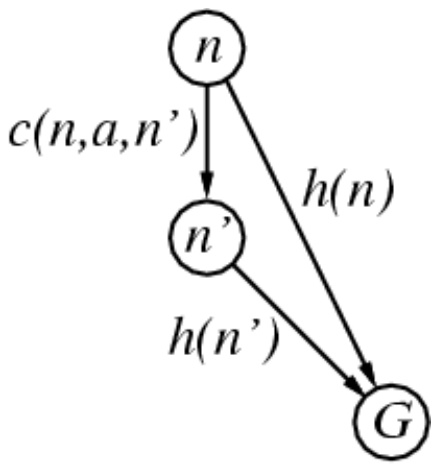

Nghĩa là: f(n) không giảm trong bất kỳ đường đi (tìm kiếm) nào đi qua n

**Định lý:** Nếu $h ( n )$ là kiên định, thì phương pháp tìm kiếm $\mathsf { A } ^ { \star }$ sử dụng giải thuật GRAPH-SEARCH là tối ưu

<!-- page: 32 -->

## Các đặc điểm của A\*

## ◼ Tính hoàn chỉnh?

❑ Có (trừ khi có rất nhiều các nút có chi phí f ≤ f(G) )

◼ Độ phức tạp về thời gian?

❑ Bậc của hàm mũ – Số lượng các nút được xét là hàm mũ của độ dài đường đi của lời giải

## ◼ Độ phức tạp về bộ nhớ?

❑ Lưu giữ tất cả các nút trong bộ nhớ

## ◼ Tính tối ưu?

❑ Có (đối với điều kiện đặc biệt)

<!-- page: 33 -->

## A\* vs. UCS

◼ Tìm kiếm với chi phí cực tiểu (UCS) phát triển theo mọi hướng

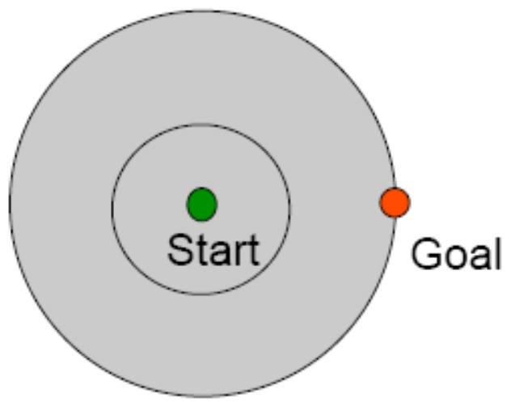

◼ Tìm kiếm $\mathsf { A } ^ { \star }$ phát triển chủ yếu theo hướng tới đích, nhưng đảm bảo tính tối ưu

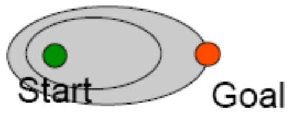

<!-- page: 34 -->

## Các giải thuật tìm kiếm cục bộ

◼ Trong nhiều bài toán tối ưu, các đặc điểm thường phức tạp và ta không thể tìm được lời giải tối ưu.

❑ Trạng thái đích = Lời giải của bài toán phải thoả mãn ràng buộc nào đó.

◼ Ví dụ: Bài toán n quân hậu (bố trí n quân hậu trên một bàn cờ kích thước nxn, sao cho các quân hậu không ăn nhau)

❑ Bài toán tối ưu có nhiều điểm cực trị địa phương.

◼ Trong những bài toán như thế, chúng ta có thể sử dụng các giải thuật tìm kiếm cục bộ

Tại mỗi thời điểm, chỉ lưu một trạng thái “hiện thời" duy nhất. Mục tiêu: cố gắng “cải thiện” trạng thái (cấu hình) hiện thời này đối với một tiêu chí nào đó (định trước)

<!-- page: 35 -->

## Tìm kiếm leo đồi: minh họa

◼ Nhược điểm: Tùy vào trạng thái đầu, giải thuật tìm kiếm leo đồi có thể “tắc” ở các điểm cực đại cục bộ (local maxima)

❑ Không tìm được lời giải tối ưu toàn cục (global optimal solution)

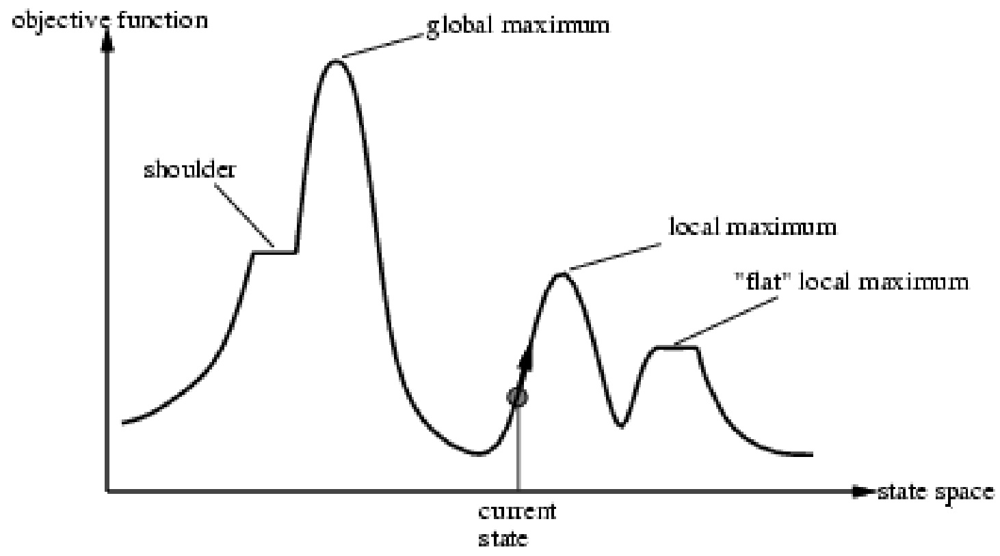

<!-- page: 36 -->

## Ví dụ: Bài toán n quân hậu

Bố trí n (=4) quân hậu trên một bàn cờ có kích thước n ×n, sao cho không có 2 quân hậu nào trên cùng hàng, hoặc trên cùng cột, hoặc trên cùng đường chéo

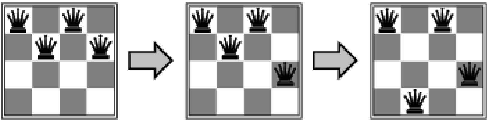

<!-- page: 37 -->

## Tìm kiếm leo đồi: giải thuật

```javascript
function HILL-CLIMBING(problem) returns a state that is a local maximum
  inputs: problem, a problem
  local variables: current, a node
    neighbor, a node

  current←MAKE-NODE(INITIAL-STATE[problem])
  loop do
    neighbor←a highest-valued successor of current
    if VALUE[neighbor] ≤ VALUE[current] then return STATE[current]
    current←neighbor
```

<!-- page: 38 -->

## Tìm kiếm leo đồi: bài toán ô chữ

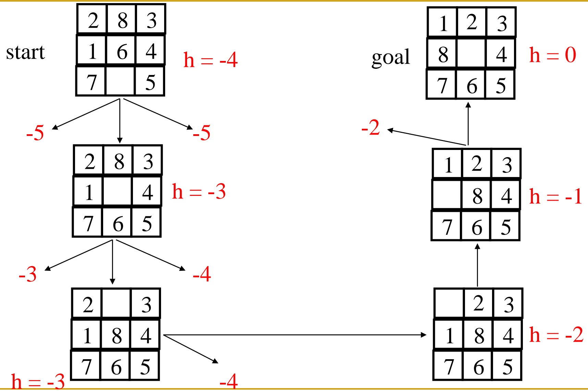

f(n) = -(Số lượng các ô chữ nằm sai vị trí)

<!-- page: 39 -->

## Tìm kiếm leo đồi: bài toán 8 quân hậu (1)

| 18 | 12 | 14 | 13 | 13 | 12 | 14 | 14 |
| --- | --- | --- | --- | --- | --- | --- | --- |
| 14 | 16 | 13 | 15 | 12 | 14 | 12 | 16 |
| 14 | 12 | 18 | 13 | 15 | 12 | 14 | 14 |
| 15 | 14 | 14 |  | 13 | 16 | 13 | 16 |
|  | 14 | 17 | 15 |  | 14 | 16 | 16 |
| 17 |  | 16 | 18 | 15 |  | 15 |  |
| 18 | 14 |  | 15 | 15 | 14 |  | 16 |
| 14 | 14 | 13 | 17 | 12 | 14 | 12 | 18 |

◼ Ước lượng h = tổng số các cặp quân hậu ăn nhau, hoặc là trực tiếp hoặc gián tiếp

◼ Trong trạng thái (bàn cờ) trên: $h = 1 7$

<!-- page: 40 -->

Tìm kiếm leo đồi: bài toán 8 quân hậu (2)

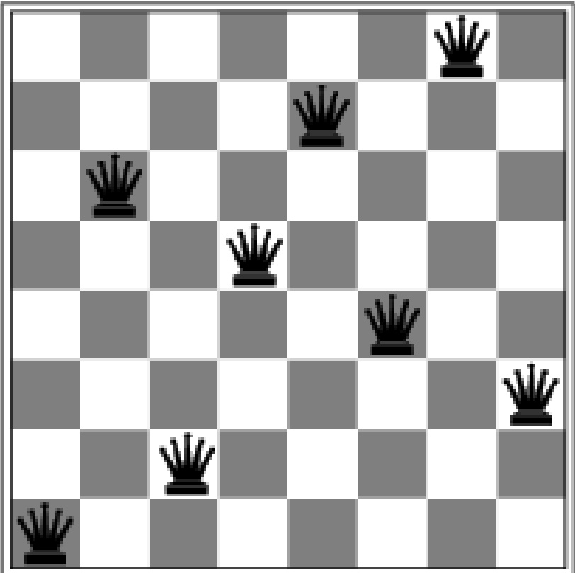

Trạng thái bàn cờ trên là một giải pháp tối ưu cục bộ (a local minimum)

❑ Với ước lượng h =1 (vẫn còn 1 cặp hậu ăn nhau)

<!-- page: 41 -->

## Simulated annealing search

◼ Dựa trên quá trình tôi ủ (annealing process): Kim loại nguội đi và lạnh cứng lại thành cấu trúc kết tinh

◼ Phương pháp tìm kiếm Simulated Annealing có thể tránh được các điểm tối ưu cục bộ (local optima)

◼ Phương pháp tìm kiếm Simulated Annealing sử dụng chiến lược tìm kiếm ngẫu nhiên, trong đó chấp nhận các thay đổi làm tăng giá trị hàm mục tiêu (i.e., cần tối ưu) và cũng chấp nhận (có hạn chế) các thay đổi làm giảm

◼ Phương pháp tìm kiếm Simulated Annealing sử dụng một tham số điều khiển T (như trong các hệ thống nhiệt độ) ❑ Bắt đầu thì T nhận giá trị cao, và giảm dần về 0

<!-- page: 42 -->

## Simulated annealing search: giải thuật

◼ Ý tưởng: Thoát khỏi (vượt qua) các điểm tối ưu cục bộ bằng cách cho phép cả các dịch chuyển “tồi” từ trạng thái hiện thời, nhưng giảm dần tần xuất của các di chuyển tồi này

```txt
function SIMULATED-ANNEALING(problem, schedule) returns a solution state
  inputs: problem, a problem
      schedule, a mapping from time to "temperature"
  local variables: current, a node
      next, a node
      T, a "temperature" controlling prob. of downward steps
  current← MAKE-NODE(INITIAL-STATE[problem])
  for t← 1 to ∞ do
    T← schedule[t]
    if T = 0 then return current
      next← a randomly selected successor of current
      ΔE← VALUE[next] - VALUE[current]
    if ΔE > 0 then current ← next
      else current ← next only with probability e^Δ E/T
```

<!-- page: 43 -->

## Simulated annealing search: các đặc điểm

(Có thể chứng minh được) Nếu giá trị của tham số T (xác định mức độ giảm tần xuất đối với các di chuyển tồi) giảm chậm, thì phương pháp tìm kiếm Simulated Annealing sẽ tìm được lời giải tối ưu toàn cục với xác suất xấp xỉ 1

◼ Phương pháp tìm kiếm Simulated Annealing Search rất hay được sử dụng trong các lĩnh vực: thiết kế sơ đồ bảng mạch VLSI, lập lịch bay,

<!-- page: 44 -->

## Local beam search

Ở mỗi thời điểm (trong quá trình tìm kiếm), luôn lưu giữ k – thay vì chỉ 1 – trạng thái tốt nhất

◼ Bắt đầu giải thuật: Chọn k trạng thái ngẫu nhiên

Ở mỗi bước tìm kiếm, sinh ra tất cả các trạng thái kế tiếp của k trạng thái này

◼ Nếu một trong số các trạng thái là trạng thái đích, thì giải thuật kết thúc (thành công); nếu không, thì chọn k trạng thái tiếp theo tốt nhất (từ tập các trạng thái tiếp theo), và lặp lại bước trên

<!-- page: 45 -->

## Giải thuật di truyền: giới thiệu

◼ Dựa trên (bắt chước) quá trình tiến hóa tự nhiên trong sinh học

◼ Áp dụng phương pháp tìm kiếm ngẫu nhiên (stochastic search) để tìm được lời giải (vd: một hàm mục tiêu, một mô hình phân lớp, …) tối ưu

◼ Giải thuật di truyền (Genetic Algorithm – GA) có khả năng tìm được các lời giải tốt thậm chí ngay cả với các không gian tìm kiếm (lời giải) không liên tục rất phức tạp

◼ Mỗi khả năng của lời giải được biểu diễn bằng một chuỗi nhị phân (vd: 100101101) – được gọi là **nhiễm sắc thể (chromosome)**

• Việc biểu diễn này phụ thuộc vào từng bài toán cụ thể

<!-- page: 46 -->

## Giải thuật di truyền: mô tả

## ◼ Xây dựng (khởi tạo) quần thể (population) ban đầu

• Tạo nên một số các giả thiết (khả năng của lời giải) ban đầu

• Mỗi giả thiết khác các giả thiết khác (vd: khác nhau đối với các giá trị của một số tham số nào đó của bài toán)

## ◼ Đánh giá quần thể

• Đánh giá (cho điểm) mỗi giả thiết (vd: bằng cách kiểm tra độ chính xác của hệ thống trên một tập dữ liệu kiểm thử)

• Trong lĩnh vực sinh học, điểm đánh giá này của mỗi giả thiết được gọi là **độ phù hợp (fitness)** của giả thiết đó

• Xếp hạng các giả thiết theo mức độ phù hợp của chúng, và chỉ giữ lại các giả thiết tốt nhất (gọi là **các giả thiết phù hợp nhất – survival of the fittest**)

## ◼ Sản sinh ra thế hệ tiếp theo (next generation)

• Thay đổi ngẫu nhiên các giả thiết để sản sinh ra thế hệ tiếp theo (gọi là **các con cháu – offspring**)

◼ Lặp lại quá trình trên cho đến khi ở một thế hệ nào đó có giả thiết tốt nhất có độ phù hợp cao hơn giá trị phù hợp mong muốn (định trước)

<!-- page: 47 -->

```txt
GA(Fitness, θ, n, r_co, r_mu)
    Fitness: A function that produces the score (fitness) given a hypothesis
    θ: The desired fitness value (i.e., a threshold specifying the termination condition)
    n: The number of hypotheses in the population
    r_co: The percentage of the population influenced by the crossover operator at each step
    r_mu: The percentage of the population influenced by the mutation operator at each step

Initialize the population: H ← Randomly generate n hypotheses
Evaluate the initial population. For each h ∈ H: compute Fitness(h)
while (max_{h ∈ H} Fitness(h) < θ) do
    H_next ← ∅

    Reproduction (Replication). Probabilistically select (1 - r_co).n hypotheses of H to add to H_next.
    The probability of selecting hypothesis h_i from H is:
        P(h_i) = Fitness(h_i) / ∑_{j=1}^n Fitness(h_j)
```

<!-- page: 48 -->

```txt
GA(Fitness, θ, n, r_co, r_mu)
...
Crossover.
    Probabilistically select (r_co.n/2) pairs of hypotheses from H, according to the probability computation P(h_i) given above.
    For each pair (h_i, h_j), produce two offspring (i.e., children) by applying the crossover operator. Then, add all the offspring to H_next.
Mutation.
    Select (r_mu.n) hypotheses of H_next, with uniform probability.
    For each selected hypothesis, invert one randomly chosen bit (i.e., 0 to 1, or 1 to 0) in the hypothesis's representation.
Producing the next generation: H ← H_next
Evaluate the new population. For each h∈H: compute Fitness(h)
end while
return argmax_{h∈H}Fitness(h)
```

<!-- page: 49 -->

## Giải thuật di truyền: minh họa

parents

[Duda et al., 2000]

survival of the fittest and reproduction

10001001010001 11010110101000 00101100100100 11001010101010 00001110010100 11100010110100 11110101101001 11110100101011 11010100101000 01001110111011

<!-- page: 50 -->

## Các toán tử di truyền

◼ 3 toán tử di truyền được sử dụng để sinh ra các cá thể con cháu (offspring) trong thế hệ tiếp theo

• Nhưng chỉ có 2 toán tử lai ghép (crossover) và đột biến (mutation) tạo nên sự thay đổi

## ◼ Tái sản xuất (Reproduction)

→ Một giả thiết được giữ lại (<u>không thay đổi</u>)

## ◼ Lai ghép (Crossover) để sinh ra 2 cá thể mới

→ Ghép (“phối hợp") của hai cá thể cha mẹ

• Điểm lai ghép được chọn ngẫu nhiên (trên chiều dài của nhiễm sắc thể)

• Phần đầu tiên của nhiễm sắc thể h được ghép với phần sau của nhiễm sắc thể $\mathrm { h } _ { \mathbf { j } }$ , và ngược lại, để sinh ra 2 nhiễm sắc thể mới

## ◼ Đột biến (Mutation) để sinh ra 1 cá thể mới

→Chọn ngẫu nhiên một bit của nhiễm sắc thể, và đổi giá trị (0→1 / 1→0)

• Chỉ tạo nên một thay đổi nhỏ và ngẫu nhiên đối với một cá thể cha mẹ!

<!-- page: 51 -->

## Các toán tử di truyền: ví dụ

|  | Cha mẹ - Thế hệ hiện tại |  | Con cháu- Thế hệ tiếp theo |
| --- | --- | --- | --- |
| Tái sản xuất: | 11101001000 |  | 11101001000 |
| Lai ghép tại | 11101001000 | 11111000000 | 11101010101 |
| 1 điểm: | 00001010101 | (crossover mask) | 00001001000 |
| Lai ghép tại | 11101001000 | 00111110000 | 11001011000 |
| 2 điểm: | 00001010101 | (crossover mask) | 00101000101 |
| Đột biến: | 11101001000 |  | 11101011000 |

[Mitchell, 1997]

<!-- page: 52 -->

## Toán tử lai ghép: ví dụ

Bài toán bố trí 8 quân hậu trên bàn cờ - Toán tử lai ghép (crossover)

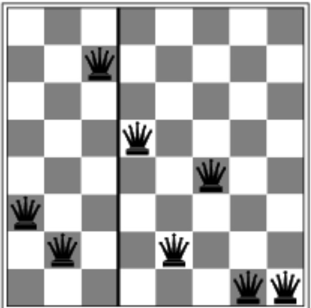

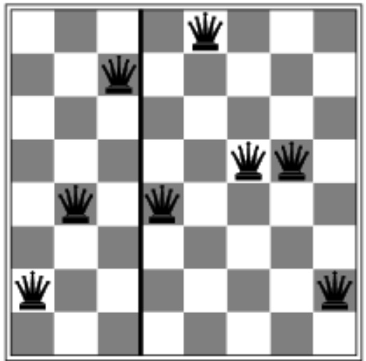

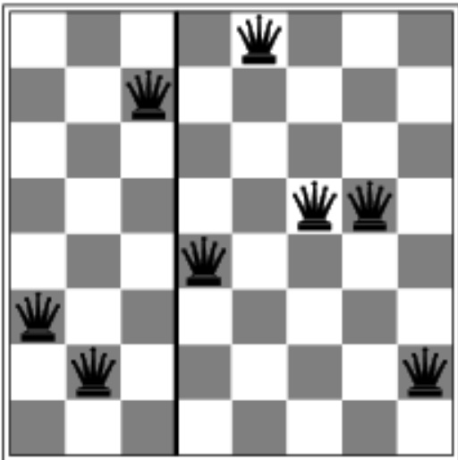

<!-- page: 53 -->

## Tìm kiếm có đối thủ

Các thủ tục tìm kiếm sâu dần (IDS) và tìm kiếm A\* hữu dụng đối với các bài toán (tìm kiếm) liên quan đến một tác tử

◼ Thủ tục tìm kiếm cho các bài toán liên quan đến 2 tác tử có mục tiêu đối nghịch nhau (xung đột với nhau)? ❑ Tìm kiếm có đối thủ (Adversarial search)

◼ Phương pháp tìm kiếm có đối thủ được áp dụng phổ biến trong các trò chơi (games)

<!-- page: 54 -->

## Các vấn đề của tìm kiếm trong trò chơi

◼ Khó dự đoán trước được phản ứng của đối thủ

❑ Cần xác định (xét) một nước đi phù hợp đối với mỗi phản ứng (nước đi) có thể của đối thủ

◼ Giới hạn về thời gian (trò chơi có tính giờ)

❑ Thường khó (hoặc không thể) tìm được giải pháp tối ưu → Xấp xỉ

Tìm kiếm có đối thủ đòi hỏi tính hiệu quả (giữa chất lượng của nước đi và chi phí thời gian) Đây là một yêu cầu khó khăn

◼ Nguyên tắc trong nhiều trò chơi đối kháng

❑ Một người chơi thắng = Người chơi kia thua

❑ Mức độ (tổng điểm) thắng của một người chơi = Mức độ (tổng điểm) thua của người chơi kia

<!-- page: 55 -->

## Trò chơi cờ ca-rô

◼ Trò chơi cờ ca-rô là một ví dụ phổ biến trong AI để minh họa về tìm kiếm có đối thủ

❑ Vd: [http://www.ourvirtualmall.com/tictac.htm](http://www.ourvirtualmall.com/tictac.htm)

◼ Là trò chơi đối kháng giữa 2 người (gọi là MAX và MIN)

❑ Thay phiên nhau đi các nước (moves)

❑ Kết thúc trò chơi: Người thắng được thưởng (điểm), người thua bị phạt (điểm)

<!-- page: 56 -->

## Biểu diễn bài toán trò chơi đối kháng

◼ Trò chơi bao gồm các thông tin

❑ Trạng thái bắt đầu (Initial state): Trạng thái của trò chơi + Người chơi nào được đi nước đầu tiên

❑ Hàm chuyển trạng thái (Sucessor function): Trả về thông tin gồm (nước đi, trạng thái)

◼ Tất cả các nước đi hợp lệ từ trạng thái hiện tại

◼ Trạng thái mới (là trạng thái chuyển đến sau nước đi)

❑ Kiểm tra kết thúc trò chơi (Terminal test)

❑ Hàm tiện ích (Utility function) để đánh giá các trạng thái

## ◼ Trạng thái bắt đầu + Các nước đi hợp lệ = Cây biểu diễn trò chơi (Game tree)

<!-- page: 57 -->

## Cây biểu diễn trò chơi cờ ca-rô

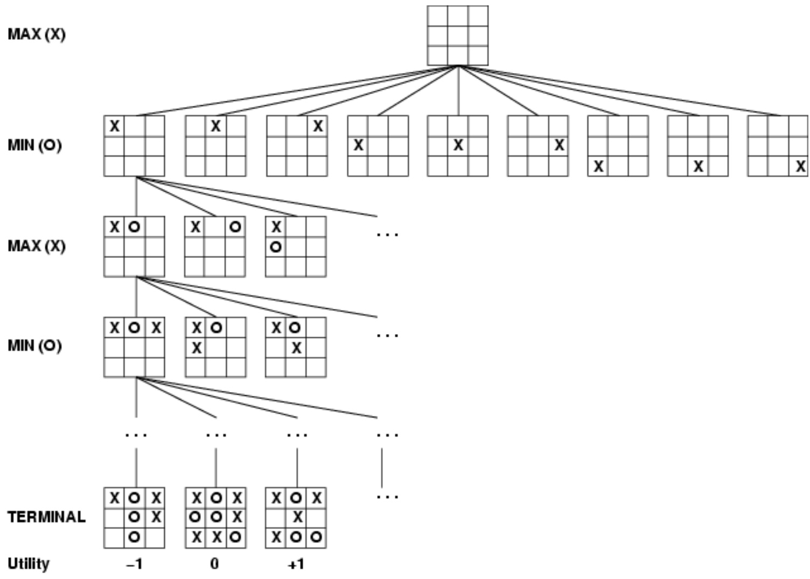

<!-- page: 58 -->

## Các chiến lược tối ưu

◼ Một chiến lược tối ưu là một chuỗi các nước đi giúp đưa đến trạng thái đích mong muốn (vd: chiến thắng)

◼ Chiến lược của MAX bị ảnh hưởng (phụ thuộc) vào các nước đi của MIN – và ngược lại

◼ MAX cần chọn một chiến lược giúp cực đại hóa giá trị hàm mục tiêu – với giả sử là MIN đi các nước đi tối ưu ❑ MIN cần chọn một chiến lược giúp cực tiểu hóa giá trị hàm mục tiêu

◼ Chiến lược này được xác định bằng việc xét giá trị MINIMAX đối với mỗi nút trong cây biểu diễn trò chơi

❑ Chiến lược tối ưu đối với các trò chơi có không gian trạng thái xác định (deterministic states)

<!-- page: 59 -->

## Giá trị MINIMAX

◼ MAX chọn nước đi ứng với giá trị MINIMAX cực đại (để đạt được giá trị cực đại của hàm mục tiêu)

◼ Ngược lại, MIN chọn nước đi ứng với giá trị MINIMAX cực tiểu

MAX

MIN

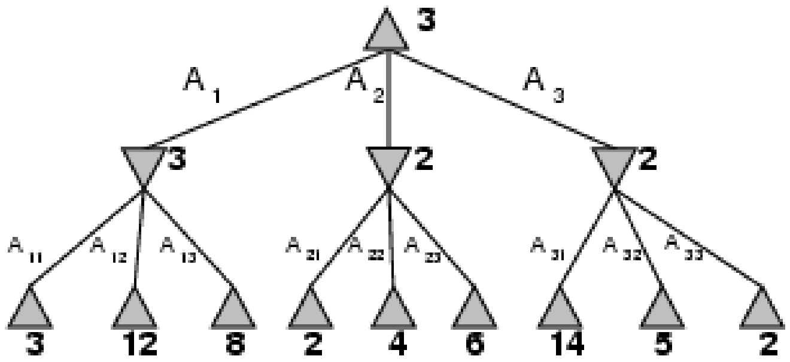

<!-- page: 60 -->

## Giải thuật MINIMAX

```txt
function MINIMAX-DECISION(state) returns an action
    v ← MAX-VALUE(state)
    return the action in SUCCESSORS(state) with value v

function MAX-VALUE(state) returns a utility value
    if TERMINAL-TEST(state) then return UTILITY(state)
    v ← −∞
    for a, s in SUCCESSORS(state) do
        v ← MAX(v, MIN-VALUE(s))
    return v

function MIN-VALUE(state) returns a utility value
    if TERMINAL-TEST(state) then return UTILITY(state)
    v ← ∞
    for a, s in SUCCESSORS(state) do
        v ← MIN(v, MAX-VALUE(s))
    return v
```

<!-- page: 61 -->

## Giải thuật MINIMAX: các đặc điểm

◼ Tính hoàn chỉnh

❑ Có (nếu cây biểu diễn trò chơi là hữu hạn)

◼ Tính tối ưu

❑ Có (đối với một đối thủ luôn chọn nước đi tối ưu)

◼ Độ phức tạp về thời gian

❑ O(b<sup>m</sup>)

◼ Độ phức tạp về bộ nhớ

❑ O(bm) (khám phá theo chiến lược tìm kiếm theo chiều sâu)

◼ Đối với trò chơi cờ vua, hệ số phân nhánh b 35 và hệ số mức độ sâu của cây biểu diễn m100

❑ Chi phí quá cao – Không thể tìm kiếm chính xác nước đi tối ưu

<!-- page: 62 -->

## Cắt tỉa tìm kiếm

◼ Vấn đề: Giải thuật tìm kiếm MINIMAX vấp phải vấn đề bùng nổ (mức hàm mũ) các khả năng nước đi cần phải xét → không phù hợp với nhiều bài toán trò chơi thực tế

◼ Chúng ta có thể cắt tỉa (bỏ đi – không xét đến) một số nhánh tìm kiếm trong cây biểu diễn trò chơi

Phưong pháp ct tia α-β (Alpha-beta prunning)

❑ Ý tưởng: Nếu một nhánh tìm kiếm nào đó không thể cải thiện đối với giá trị (hàm tiện ích) mà chúng ta đã có, thì không cần xét đến nhánh tìm kiếm đó nữa!

❑ Việc cắt tỉa các nhánh tìm kiếm (“tồi”) không ảnh hưởng đến kết quả cuối cùng

<!-- page: 63 -->

Ct tia α-β − Ví d (1)

MAX

MIN

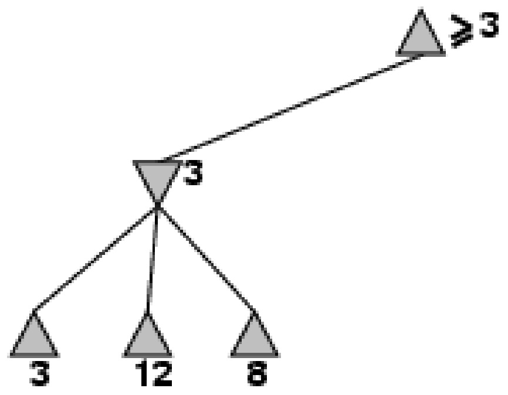

<!-- page: 64 -->

## Ct tia α-β − Ví d (2)

MAX

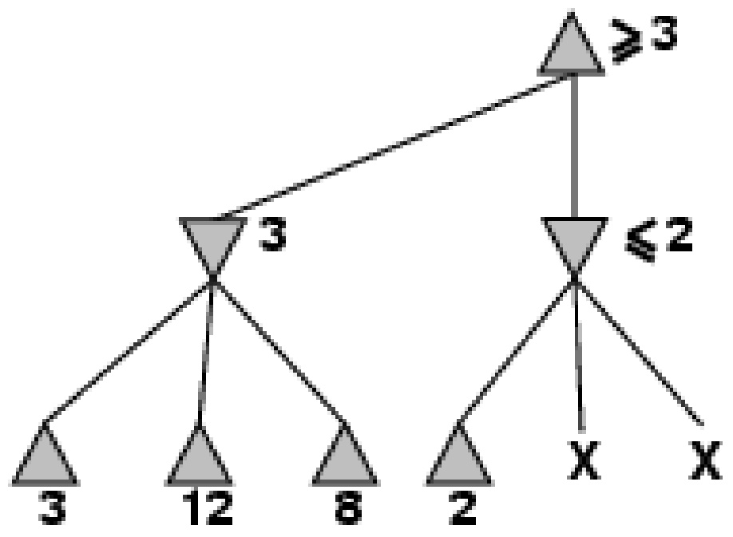

<!-- page: 65 -->

## Ct tia α-β − Ví d (3)

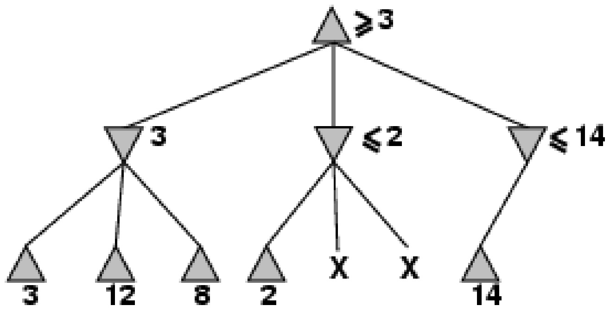

<!-- page: 66 -->

Ct tia α-β − Ví d (4)

MAX

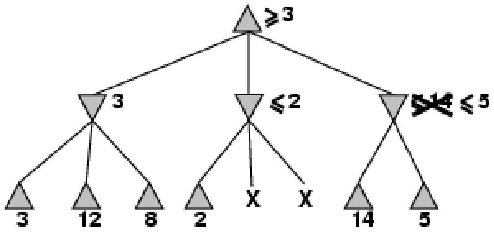

<!-- page: 67 -->

## Ct tia α-β − Ví d (5)

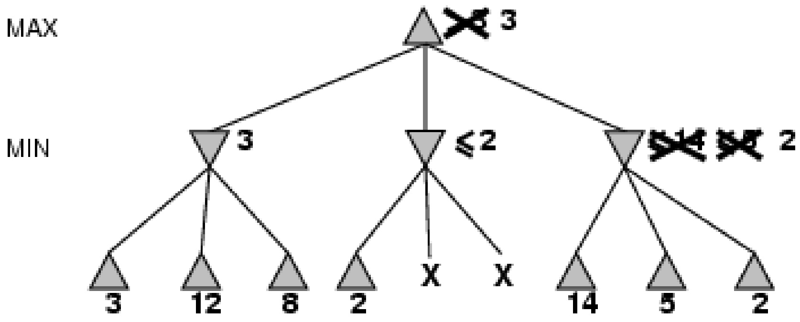

<!-- page: 68 -->

## Ti sao đưc gi là ct tia α-β?

 là giá trị của nước đi tốt nhất đối với MAX (giá trị tối đa) tính đến hiện tại đối với nhánh tìm kiếm

◼ Nếu v là giá trị tồi hơn , MAX sẽ bỏ qua nước đi ứng với v ❑ Cắt tỉa nhánh ứng với v

◼  được định nghĩa tương tự đối với MIN

MAX

MIN

MAX

MIN

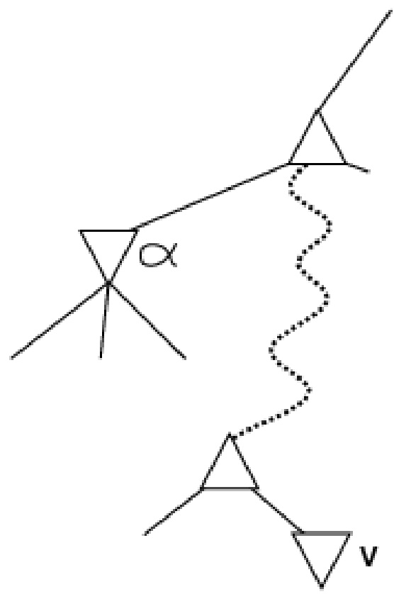

<!-- page: 69 -->

## Gii thut ct tia α-β (1)

```txt
function ALPHA-BETA-SEARCH(state) returns an action
  inputs: state, current state in game
  v ← MAX-VALUE(state, -∞, +∞)
  return the action in SUCCESSORS(state) with value v

function MAX-VALUE(state, α, β) returns a utility value
  inputs: state, current state in game
    α, the value of the best alternative for MAX along the path to state
    β, the value of the best alternative for MIN along the path to state
  if TERMINAL-TEST(state) then return UTILITY(state)
  v ← -∞
  for a, s in SUCCESSORS(state) do
    v ← MAX(v, MIN-VALUE(s, α, β))
    if v ≥ β then return v
      α ← MAX(α, v)
  return v
```

<!-- page: 70 -->

## Gii thut ct tia α-β (2)

```txt
function MIN-VALUE(state, α, β) returns a utility value
    inputs: state, current state in game
        α, the value of the best alternative for MAX along the path to state
        β, the value of the best alternative for MIN along the path to state
    if TERMINAL-TEST(state) then return UTILITY(state)
    v ← +∞
    for a, s in SUCCESSORS(state) do
        v ← MIN(v, MAX-VALUE(s, α, β))
        if v ≤ α then return v
            β ← MIN(β, v)
    return v
```

<!-- page: 71 -->

## Cåt tia α-β

◼ Đối với các trò chơi có không gian trạng thái lớn, thì phương pháp cắt tỉa $\alpha \beta v \tilde { \hat { a } } n$ không phù hợp ❑ Không gian tìm kiếm (kết hợp cắt tỉa) vẫn lớn

◼ Có thể hạn chế không gian tìm kiếm bằng cách sử dụng các tri thức cụ thể của bài toán

❑ Tri thức để cho phép đánh giá mỗi trạng thái của trò chơi

❑ Tri thức bổ sung (heuristic) này đóng vai trò tương tự như là hàm ước lượng h(n) trong giải thuật tìm kiếm $\mathsf { A } ^ { \star }$

<!-- page: 72 -->

## Một số trò chơi đối kháng (minimax)

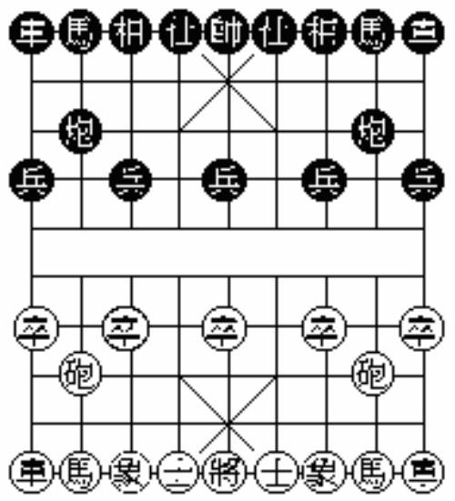

a) Cδ Tung

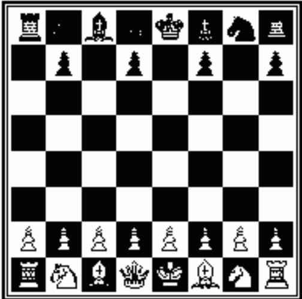

b) Cδ Vua (cδ Quc Té)

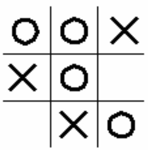

c) Tictactoe

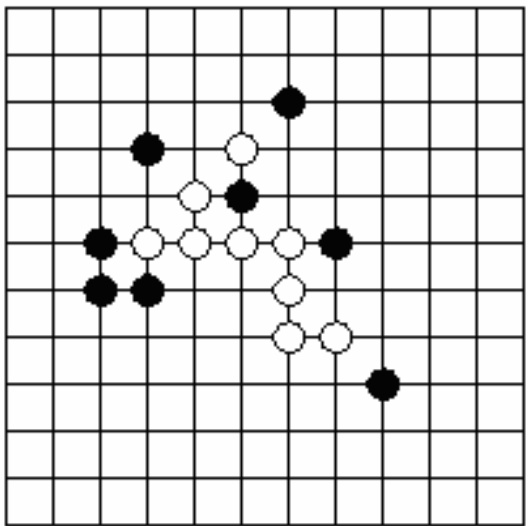

d) Go-moku (cð caro)
