<!-- page: 1 -->

**Trí Tuệ Nhân Tạo**

# (Artificial Intelligence)

**Lê Thanh Hương**

Viện Công nghệ thông tin và Truyền thông Trường Đại Học Bách Khoa Hà Nội

<!-- page: 2 -->

## Nội dung môn học

Chương 1. Tổng quan

Chương 2. Tác tử thông minh

Chương 3. Giải quyết vấn đề

3.1. Tìm kiếm cơ bản

3.2. Tìm kiếm với tri thức bổ sung

3.3. Tìm kiếm dựa trên thỏa mãn ràng buộc

Chương 4. Tri thức và suy diễn

Chương 5. Học máy

<!-- page: 3 -->

## Ràng buộc

◼ Một **ràng buộc** (constraint) là một quan hệ trên một tập các biến ❑ Mỗi biến có (gắn với) một tập các giá trị có thể nhận – gọi là miền giá trị (domain)

❑ Trong môn học này, chúng ta chỉ xét các miền hữu hạn các giá trị rời rạc

◼ Một ràng buộc có thể được biểu diễn bằng

❑ Một biểu thức (toán học / logic)

❑ Một bảng liệt kê các phép gán giá trị phù hợp cho các biến

Ví dụ về ràng buộc

❑ Tổng các góc trong một tam giác là 180<sup>o</sup>

❑ Độ dài của từ W là 10 ký tự

❑ X nhỏ hơn Y

❑ Tuấn có thể tham dự buổi seminar vào thứ 4 sau 14h

❑

<!-- page: 4 -->

## Bài toán thỏa mãn ràng buộc

Một bài toán thỏa mãn ràng buộc (Constraint Satisfaction Problem – CSP) bao gồm:

❑ Một tập hữu hạn các biến X

Miền giá trị (một tập hữu hạn các giá trị) cho mỗi biến D

❑ Một tập hữu hạn các ràng buộc C

◼ Một lời giải (solution) của bài toán thỏa mãn ràng buộc là một phép gán đầy đủ các giá trị của các biến sao cho thỏa mãn tất cả các ràng buộc

◼Một bài toán thỏa mãn ràng buộc thường được biểu diễn bằng một đồ thị (graph)

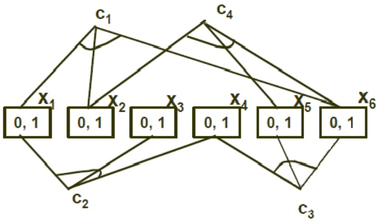

Ví dụ: Các biến $\times 1 , \ldots , \times 6 .$ Miền giá trị {0,1}. Các ràng buộc:

$$
\cdot \mathrm{x}_1 + \mathrm{x}_2 + \mathrm{x}_6 = 1
$$

$$
\cdot \mathrm{X}_{1} - \mathrm{x}_{3} + \mathrm{x}_{4} = 1
$$

$$
\cdot \mathrm{x}_4 + \mathrm{x}_5 - \mathrm{x}_6 > 0
$$

$$
\cdot \mathrm{x}_2 + \mathrm{x}_5 - \mathrm{x}_6 = 0
$$

<!-- page: 5 -->

## Ví dụ: Bài toán tô màu bản đồ (1)

```csv
■Các biến: WA, NT, Q, NSW, V, SA, T
```

Các miền giá trị: D<sub>i</sub> = {red, green, blue}

◼Các ràng buộc: Các vùng liền kề nhau phải có màu khác nhau

```txt
■Ví dụ:
    □ WA ≠ NT
    □ (WA,NT) = {(red,green), (red,blue),
(green,red), (green,blue),
(blue,red), (blue,green)}
```


<!-- page: 6 -->

## Đồ thị các ràng buộc

◼ Đối với bài toán thỏa mãn ràng buộc nhị phân (binary CSP): Mỗi ràng buộc chỉ liên quan đến 2 biến

Đồ thị các ràng buộc (constraint graph)

❑ Các nút biểu diễn các biến

❑ Các cạnh biểu diễn các ràng buộc

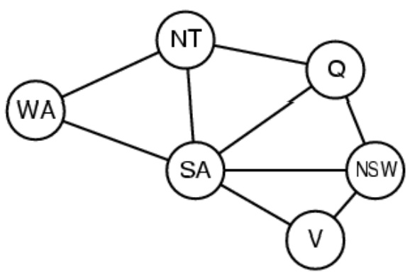

<!-- page: 7 -->

## Các kiểu bài toán thỏa mãn ràng buộc

## ◼ Các biến rời rạc

❑ Các miền giá trị hữu hạn

◼ Với n biến và kích thước miền giá trị d, thì số lượng các phép gán đầy đủ giá trị cần xét là O(d<sup>n</sup>)

◼ Ví dụ: Các bài toán thỏa mãn ràng buộc nhị phân (Boolean CSPs)

❑ Các miền giá trị vô hạn

Miền giá trị các số nguyên, các chuỗi, ...

◼ Ví dụ: Trong bài toán xếp lịch công việc, các biến là các ngày bắt đầu và kết thúc đối với mỗi công việc

◼ Cần một ngôn ngữ biểu diễn ràng buộc (constraint language), ví dụ: StartJob<sub>1</sub> + 5 ≤ StartJob<sub>3</sub>

## ◼ Các biến liên tục

❑ Ví dụ: Các mốc thời gian bắt đầu và kết thúc đối với các quan sát bằng kính viễn vọng không gian Hubble

❑ Bài toán các ràng buộc tuyến tính có thể giải quyết được ở mức <u>chi phí thời gian đa thức bằng phương pháp lập trình tuyến tính</u>

<!-- page: 8 -->

## Các kiểu ràng buộc

◼ **Ràng buộc đơn** (unary constraint) chỉ liên quan đến 1 biến

❑ Ví dụ: SA ≠ green

◼ **Ràng buộc nhị phân** (binary constraint) liên quan đến 2 biến

❑ Ví dụ: SA ≠ WA

◼ **Ràng buộc bậc cao** (higher-order constraint) liên quan đến nhiều hơn 2 biến

❑ Ví dụ: Các ràng buộc trong bài toán mật mã số học (trình bày ở slide tiếp theo)

<!-- page: 9 -->

## Ví dụ: Bài toán mật mã số học

$$
\begin{array}{c} \text {T W O} \\ + \text {T W O} \\ \hline \text {F O U R} \end{array}
$$

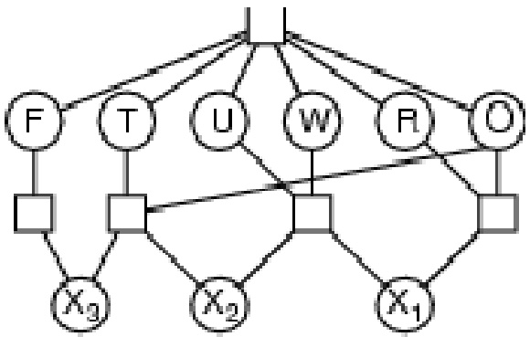

◼ Các biến: $F T U W R O$ $X _ { 1 } X _ { 2 } X _ { 3 }$ (các nhớ của các phép +)

Miền giá trị: $\{ 0 , 1 , 2 , 3 , 4 , 5 , 6 , 7 , 8 , 9 \}$

◼ Các ràng buộc: Giá trị của các biến $( F , T , U , W , R , O )$ khác nhau $O + O = R + 10^{\star}X_{1}$ ❑ $X_{1}+W+W=U+10^{\star}X_{2}$ ❑ $X_{2}+T+T=O+10^{\star}X_{3}$ ❑ $X _ { 3 } { = } F$ ❑ $T \neq 0$ ❑ $F \neq 0$

<!-- page: 10 -->

## Các bài toán CSP thực tế

◼ Phân công công việc

❑ Vd: Ai dạy lớp nào

◼ Lập kế hoạch

❑ Ví dụ, khi nào và nơi lớp học diễn ra

◼ Thiết kế phần cứng

◼ Bảng tính

◼ Lập kế hoạch vận chuyển

◼ Lập kế hoạch sản xuất

<!-- page: 11 -->

## Tìm kiếm bằng kiểm thử (1)

Là phương pháp giải quyết vấn đề tổng quát nhất

## ◼ Phương pháp giải quyết bằng kiểm thử (Generate and Test)

❑ Sinh ra một khả năng (candidate) của lời giải

❑ Kiểm tra xem khả năng này có thực sự là một lời giải

## ◼ Áp dụng phương pháp kiểm thử đối với bài toán CSP

❑ Bước 1. Gán các giá trị cho tất cả các biến

❑ Bước 2. Kiểm tra xem tất cả các ràng buộc được thỏa mãn hay không

❑ Lặp lại 2 bước này cho đến khi tìm được một phép gán thỏa mãn

<!-- page: 12 -->

## Tìm kiếm bằng kiểm thử (2)

◼ Điểm yếu nghiêm trọng của phương pháp tìm kiếm bằng kiểm thử là việc phải xét quá nhiều các khả năng gán (hiển nhiên) không thỏa mãn các ràng buộc

◼ Ví dụ

❑ Các biến X,Y,Z lấy các giá trị {1,2}

❑ Các ràng buộc: $X = Y , X \neq Z , Y > Z$

❑ Các phép (khả năng) gán: (1,1,1); (1,1,2); (1,2,1); (1,2,2); (2,1,1); (2,1,2); (2,2,1)

<!-- page: 13 -->

## Tìm kiếm bằng kiểm thử (3)

◼ Làm thế nào để cải thiện phương pháp kiểm thử?

❑ Sinh ra các khả năng (các phép gán giá trị) một cách thông minh hơn

◼ Không theo thứ tự tuần tự

◼ Sử dụng các kết quả (thông tin) thu được từ bước kiểm tra (bước 2)

❑ Phát hiện sớm (từ trước) các mâu thuẫn

◼ Các ràng buộc được kiểm tra ngay sau khi mỗi biến được gán giá trị (chứ không phải đợi đến khi tất cả các biến được gán giá trị)

<!-- page: 14 -->

## Tìm kiếm quay lui (1)

◼ **Tìm kiếm quay lui (backtracking)** là giải thuật tìm kiếm được sử dụng phổ biến nhất trong CSP

❑ Dựa trên giải thuật tìm kiếm theo chiều sâu (depth-first search)

❑ Mỗi lần gán, chỉ làm việc (gán giá trị) cho một biến

❑ (Tìm kiếm bằng kiểm thử: mỗi lần gán xác định các giá trị cho tất cả các biến)

## ◼ Phương pháp tìm kiếm quay lui đối với bài toán CSP

❑ Gán giá trị lần lượt cho các biến – Việc gán giá trị của biến này chỉ được làm sau khi đã hoàn thành việc gán giá trị của biến khác

❑ Sau mỗi phép gán giá trị cho một biến nào đó, kiểm tra các ràng buộc có được thỏa mãn bởi tất cả các biến đã được gán giá trị cho đến thời điểm hiện tại – Quay lui (backtrack) nếu có lỗi (không thỏa mãn các ràng buộc)

<!-- page: 15 -->

## Tìm kiếm quay lui (2)

◼ Các yếu tố ảnh hưởng đến phương pháp tìm kiếm quay lui

❑ Thứ tự được xét của các biến?

◼ Ưu tiên xét trước các biến có ít giá trị (miền giá trị nhỏ)

Ưu tiên xét trước các biến tham gia vào nhiều ràng buộc

Ưu tiên các biến quan trọng hơn (được định nghĩa tùy vào bài toán cụ thể)

❑ Với mỗi biến, thứ tự được xét của các giá trị?

Thứ tự ưu tiên của các giá trị với mỗi biến được định nghĩa tùy thuộc vào bài toán cụ thể

<!-- page: 16 -->

## Tìm kiếm quay lui

```javascript
function BACKTRACKING-SEARCH(csp) returns a solution, or failure
    return RECURSIVE-BACKTRACKING({}, csp)
function RECURSIVE-BACKTRACKING( assignment,csp) returns a solution, or failure
    if assignment is complete then return assignment
    var← SELECT-UNASSIGNED-VARIABLE( Variables[csp], assignment, csp)
    for each value in ORDER-DOMAIN-VALUES(var, assignment, csp) do
        if value is consistent with assignment according to Constraints[csp] then
            add { var = value } to assignment
            result← RECURSIVE-BACKTRACKING(assignment, csp)
            if result ≠ failure then return result
            remove { var = value } from assignment
    return failure
```

<!-- page: 17 -->

Tìm kiếm quay lui – Ví dụ (1)

<!-- page: 18 -->

Tìm kiếm quay lui – Ví dụ (2)

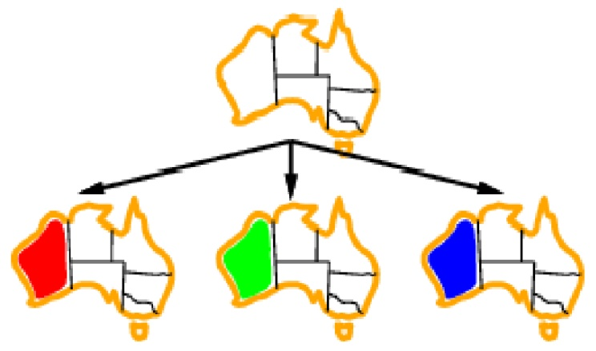

<!-- page: 19 -->

Tìm kiếm quay lui – Ví dụ (3)

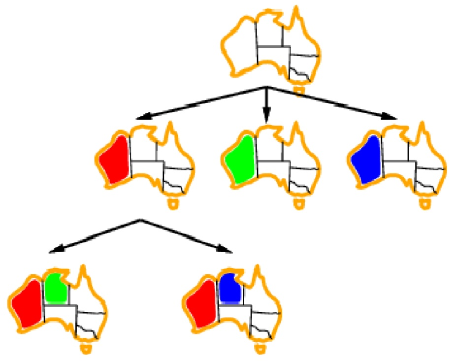

<!-- page: 20 -->

Tìm kiếm quay lui – Ví dụ (4)

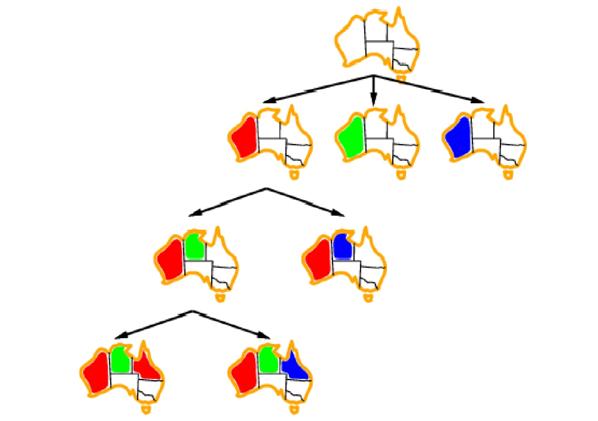

<!-- page: 21 -->

## Tìm kiếm quay lui – Các vấn đề (1)

## ◼ Lặp đi lặp lại lỗi

❑ Lý do: Bỏ đi (không khai thác) lý do của mâu thuẫn

❑ Ví dụ:

Các biến A,B,C,D,E lấy các giá trị trong miền 1..10

◼ Ràng buộc: A>E

◼ Phương pháp tìm kiếm quay lui thử tất cả các khả năng gán giá trị cho các biến B,C,D cho đến khi phát hiện ra rằng A1

❑ Giải pháp: Phương pháp Backjumping (chuyển đến xét từ chỗ sinh ra lỗi)

<!-- page: 22 -->

## Tìm kiếm quay lui – Các vấn đề (2)

◼ Các thao tác (kiểm tra) không cần thiết

❑ Lặp lại các kiểm tra ràng buộc không cần thiết

❑ Ví dụ:

◼ Các biến A,B,C,D,E lấy các giá trị trong miền 1..10

◼ Các ràng buộc: B+8<D; $C = 5 ^ { \star } E$

◼ Khi gán giá trị cho các biến C,E, thì các giá trị 1..9 được kiểm tra (lặp đi lặp lại) đối với biến D

❑ Giải pháp: Phương pháp Backchecking (lưu giữ / nhớ lại các phép gán tốt và không tốt)

<!-- page: 23 -->

## Tìm kiếm quay lui – Các vấn đề (3)

◼ Phát hiện muộn các mâu thuẫn (vi phạm ràng buộc)

❑ Các vi phạm ràng buộc chỉ được phát hiện sau khi các giá trị được gán

❑ Ví dụ:

Các biến A,B,C,D,E lấy các giá trị trong miền 1..10

◼ Ràng buộc: $A = 3 ^ { \star } E$

Chỉ đến khi gán giá trị cho biến E thì mới phát hiện ra rằng $A > 2$

❑ Giải pháp: Phương pháp Forward checking (kiểm tra trước các ràng buộc)

<!-- page: 24 -->

## Tìm kiếm quay lui – Cải thiện

◼ Hiệu quả của phương pháp tìm kiếm quay lui trong CSP có thể được cải thiện bằng

❑ Thứ tự xét các biến (để gán giá trị)

❑ Thứ tự xét (gán) các giá trị đối với mỗi biến

❑ Phát hiện sớm các lỗi (vi phạm ràng buộc) sẽ xảy ra

<!-- page: 25 -->

## Biến bị ràng buộc nhiều nhất

◼ Quy tắc lựa chọn thứ tự xét các biến: Ưu tiên biến bị ràng buộc nhiều nhất (most constrained variable)

❑ Chọn biến có số lượng các giá trị hợp lệ ít nhất

❑ Ví dụ: Tại bước S<sub>2</sub>, biến NT được chọn vì nó có số lượng các giá trị hợp lệ ít nhất (2)


◼ Còn được gọi là quy tắc ưu tiên các biến có tập giá trị hợp lệ nhỏ nhất (Minimum Remaining Values – MRV)

<!-- page: 26 -->

## Biến ràng buộc các biến khác nhiều nhất

Khi có >=2 biến có như nhau số lượng giá trị hợp lệ ít nhất, thì chọn biến nào?

❑ Ví dụ: Trong ví dụ trước, 2 biến NT va SA có cùng số lượng giá trị hợp lệ ít nhất (2)

◼ Chọn biến ràng buộc (khống chế) các biến khác (chưa được gán giá trị) nhiều nhất

❑ Ví dụ: Tại bước $\mathbb { S } _ { 2 } ,$ tuy cùng mức độ bị ràng buộc, nhưng biến SA nên được xét trước biến NT – vì SA ràng buộc 5 biến khác, còn NT chỉ ràng buộc 3 biến khác


<!-- page: 27 -->

## Giá trị ràng buộc các biến khác ít nhất

Đối với một biến, các giá trị được xét (để gán) theo thứ tự nào?

Chọn giá trị ràng buộc (khống chế) các biến khác (chưa được gán giá trị) ít nhất

❑ Giá trị này gây ra hạn chế tối thiểu đối với các khả năng gán giá trị của các biến khác

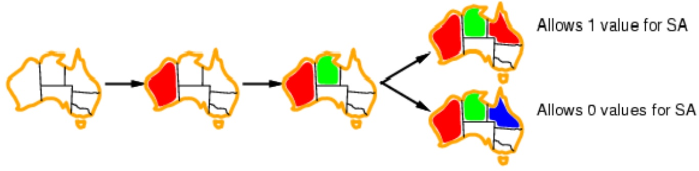

<!-- page: 28 -->

## Kiểm tra tiến (Forward checking)

◼ Mục đích: Tránh các thất bại, bằng kiểm tra trước các ràng buộc

Kiểm tra tiến đảm bảo sự phù hợp (consistency) giữa biến đang được xét gán giá trị và các biến khác **có liên quan (ràng buộc) trực tiếp** với nó

◼ Ý tưởng:

❑ Ở mỗi bước gán giá trị, theo dõi các giá trị hợp lệ (có thể được gán) đối với các biến chưa được gán giá trị

❑ Loại bỏ (dừng) hướng tìm kiếm hiện tại khi có bất kỳ một biến (chưa được gán giá trị) nào đó không còn giá trị hợp lệ

<!-- page: 29 -->

## Tìm kiếm kiểu tiến

## ◼ Lan truyền ràng buộc

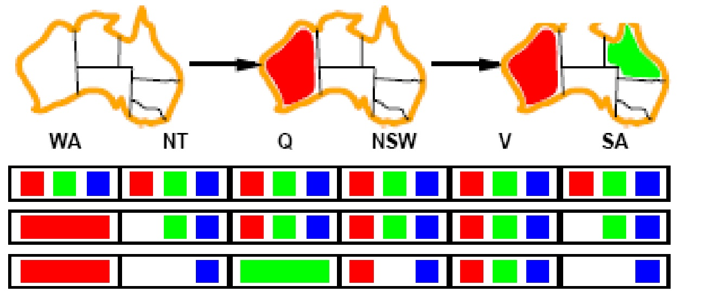

❑ NT và SA không thể cùng màu blue

◼ Cách lan truyền đơn giản nhất để các phép gán trị bền vững:

❑ X -> Y bền vững nếu với mỗi giá trị x của X có vài giá trị y của Y

<!-- page: 30 -->

Kiểm tra tiến – Ví dụ (1)


<!-- page: 31 -->

Kiểm tra tiến – Ví dụ (2)

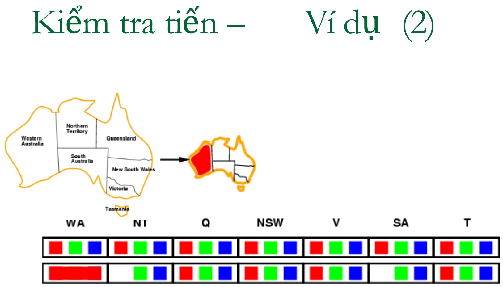

<!-- page: 32 -->

Kiểm tra tiến – Ví dụ (3)

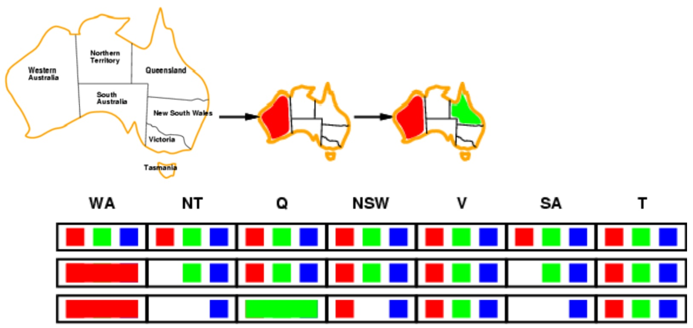

<!-- page: 33 -->

Kiểm tra tiến –

Ví dụ (4)


WA NT Q NSW V SA T OO

<!-- page: 34 -->

## Lan truyền các ràng buộc

Kiểm tra tiến giúp lan truyền thông tin (ràng buộc) từ các biến đã được gán giá trị đến các biến chưa được gán giá trị

◼ Nhưng: Phương pháp kiểm tra tiến không thể phát hiện trước (ngăn chặn) được tất cả các thất bại

❑ Ví dụ: NT và SA không thể cùng là màu xanh!


NSW

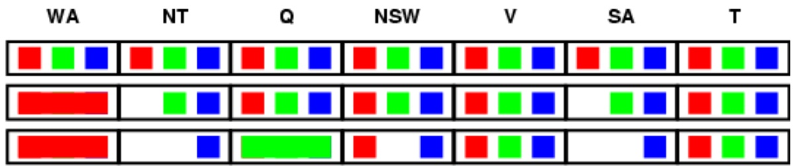

Lan truyền các ràng buộc chỉ đảm bảo tính phù hợp cục bộ (local consistency) của các ràng buộc

<!-- page: 35 -->

## Tìm kiếm cục bộ cho CSP (1)

Mục đích: Ðể sử dụng các phương pháp tìm kiếm cục bộ (ví dụ: hill climbing simulated annealing) cho bài toán thỏa mãn ràng buộc

Mỗi trạng thái (của không gian tìm kiếm) ứng với một phép gán đầy đủ giá trị cho tất cả các biến

Không gian tìm kiếm bao gồm cả các trạng thái trong đó các ràng buộc bị vi phạm

Dịch chuyển trạng thái = Gán giá trị mới cho các biến

Trạng thái đích = Trạng thái trong đó tất cả các ràng buộc được thỏa mãn

<!-- page: 36 -->

## Tìm kiếm cục bộ cho CSP (2)

## ◼ Quá trình tìm kiếm

❑ Lựa chọn biến để gán giá trị mới? → Chọn ngẫu nhiên một biến mà giá trị của nó vi phạm các ràng buộc

❑ Đối với một biến, lựa chọn giá trị mới? → Dựa theo chiến lược **min-conflicts**: chọn giá trị mà nó vi phạm ít nhất các ràng buộc

◼ Ví dụ: Áp dụng phương pháp tìm kiếm cục bộ Hillclimbing, với hàm ước lượng h(n) = tổng số các ràng buộc bị vi phạm

❑ Trạng thái (lân cận) tiếp theo chuyển đến (được xét) là trạng thái ứng với giá trị hàm h(n) tốt hơn (=ít ràng buộc bị vi phạm hơn)

<!-- page: 37 -->

## Ví dụ bài toán 4 quân hậu

Các trạng thái: ứng với vị trí của 4 quân hậu nằm ở 4 cột ❑ Chỉ có duy nhất một quân hậu ở mỗi cột

❑ Không gian trạng thái gồm tổng cộng (4x4x4x4=) 256 trạng thái

◼ Các hành động:di chuyển của một quân hậu (nào đó) trong một cột (của nó)

◼ Trạng thái đích: không có quân hậu nào ăn nhau

◼ Hàm ước lượng: $h ( n ) = t \sin g$ số các cặp hậu ăn nhau

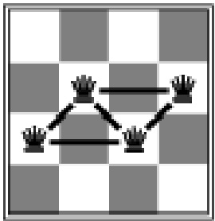

h = 5


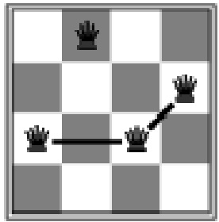

h = 2


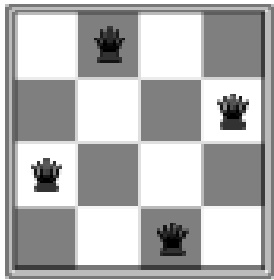

h = 0

<!-- page: 38 -->

## Thỏa mãn ràng buộc – Tổng kết

◼ Trong một bài toán thỏa mãn ràng buộc (CSP) :

❑ Mỗi trạng thái tương ứng với một phép gán giá trị cho các biến

❑ Kiểm tra trạng thái đích = Kiểm tra tập các ràng buộc đối với các giá trị của các biến

◼ Phương pháp quay lui (Backtracking) = Tìm kiếm theo chiều sâu (Depth-first search) với mỗi nút tương ứng với một phép gán giá trị cho một biến

Các chiến lược chọn thứ tự xét các biến và thứ tự xét các giá trị đối với một biến sẽ ảnh hưởng quan trọng đến hiệu quả của quá trình tìm lời giải

Phương pháp tìm kiếm tiến (Forward checking) cho phép ngăn chặn các phép gán giá trị đưa đến các thất bại sau đó

Phương pháp tìm kiếm cục bộ sử dụng chiến lược Minconflicts thường hiệu quả trong nhiều bài toán thực tế

<!-- page: 39 -->

## Bài tập - Bài toán đố chữ

Hãy thay các chữ cái bằng các chữ số từ 0 đến 9 sao cho không có hai chữ cái nào được thay bởi cùng 1 số và thỏa mãn ràng buộc sau:

$$
\begin{array}{c c} \text {SEND} & \text {CROSS} \\ + \text {MORE} & + \text {ROADS} \\ \hline \text {MONEY} & \text {DANGER} \end{array}
$$
