<!-- page: 1 -->

## Trí Tuệ Nhân Tạo

## (Artificial Intelligence)

**Lê Thanh Hương**

Viện Công nghệ thông tin và Truyền thông Trường Đại Học Bách Khoa Hà Nội

<!-- page: 2 -->

## Nội dung môn học

Chương 1. Tổng quan

Chương 2. Tác tử thông minh

Chương 3. Giải quyết vấn đề

Chương 4. Tri thức và suy diễn

❑ Giới thiệu về logic

❑ Logic định đề

❑ Logic vị từ

Chương 5. Học máy

<!-- page: 3 -->

## Giới thiệu về logic

**Logic** là ngôn ngữ hình thức cho phép (giúp) biểu diễn thông tin dưới dạng các kết luận có thể được đưa ra

❑ Logic = Syntax + Semantics

◼ **Cú pháp (syntax)**: để xác định các mệnh đề (sentences) trong một ngôn ngữ.

**Ngữ nghĩa (semantics)**: để xác định “ý nghĩa" của các mệnh đề trong một ngôn ngữ

❑ Tức là, xác định sự đúng đắn của một mệnh đề

◼ Ví dụ: Trong ngôn ngữ của toán học

❑ (x+2 ≥ y) là một mệnh đề; (x+y > {}) không phải là một mệnh đề

❑ (x+2 ≥ y) là đúng nếu và chỉ nếu giá trị (x+2) không nhỏ hơn giá trị y

❑ (x+2 ≥ y) là đúng khi x = 7, y = 1

❑ (x+2 ≥ y) là sai khi x = 0, y = 6

<!-- page: 4 -->

## Cú pháp (syntax)

◼ Cú pháp = Ngôn ngữ + Lý thuyết chứng minh

## ◼ Ngôn ngữ (Language)

❑ Các ký hiệu (symbols), biểu thức (expressions), thuật ngữ (terms), công thức (formulas) hợp lệ

❑ Ví dụ: one plus one equal two

## ◼ Lý thuyết chứng minh (Proof theory)

❑ Tập hơp các luật suy diễn cho phép chứng minh (suy luận ra) các biểu thức

❑ Ví dụ: Luật suy diễn any plus zero Ⱶ any

Một **định lý (theorem)** là một mệnh đề logic cần chứng minh

Việc chứng minh một định lý không cần phải xác định ngữ nghĩa (interpretation) của các ký hiệu!

<!-- page: 5 -->

## Ngữ nghĩa (semantics)

◼ Ngữ nghĩa = Ý nghĩa (diễn giải) của các ký hiệu

◼ Ví dụ

❑ I(one) nghĩa là 1 ( N)

❑ I(two) nghĩa là 2 ( N)

❑ I(plus) nghĩa là phép cộng + : N x N → N

❑ I(equal) nghĩa là phép so sánh bằng = : N x N → {true, false}

❑ I(one plus one equal two) nghĩa là true

◼ Nếu diễn giải của một biểu thức là đúng (true), chúng ta nói rằng phép diễn giải này là một **mô hình (model)** của biểu thức

◼ Một biểu thức đúng đối với bất kỳ phép diễn giải nào thì được gọi là một biểu thức **đúng đắn (valid)**

❑ Ví dụ: A OR NOT A

<!-- page: 6 -->

## Tính bao hàm

◼ Tính bao hàm có nghĩa là một cái gì đó tuân theo (bị hàm chứa ý nghĩa bởi, được suy ra từ) một cái gì khác:

$$
\texttt{KB} \models \alpha
$$

◼ Một cơ sở tri thức KB **bao hàm** (hàm chứa) mệnh đề α nếu và chỉ nếu α là đúng **trong mọi mô hình** (thế giới) mà trong đó KB là đúng. Tức là: nếu KB đúng, thì α cũng phải đúng

❑ Ví dụ: Nếu một cơ sở tri thức KB chứa các mệnh đề “Đội bóng A đã thắng” và “Đội bóng B đã thắng”, thì KB bao hàm mệnh đề “Đội bóng A hoặc đội bóng B đã thắng”

❑ Ví dụ: Mệnh đề $( x + y = 4 )$ bao hàm mệnh đề $( 4 = x + y )$

<!-- page: 7 -->

## Các mô hình

◼ Các nhà logic học thường hay xem xét các sự việc theo các mô hình (models)

Các mô hình là các không gian (thế giới) có cấu trúc, mà trong các không gian đó tính đúng đắn (của các sự việc) có thể đánh giá được

◼ **Định nghĩa:** m là một mô hình của mệnh đề α nếu α là đúng trong m

◼ M(α) là tập hợp tất cả các mô hình của α

◼ KB╞ α nếu và chỉ nếu $M ( K B ) \subseteq M ( \alpha )$ ❑ Ví dụ: $K B = \mathbf { \partial } ^ { a } [ D \hat { g } ]$ bóng A đã thắng và đội bóng B đã thắng”, $\mathbf { \tilde { q } } = \mathbf { \Omega } ^ { \omega }$ “Đội bóng A đã thắng ”

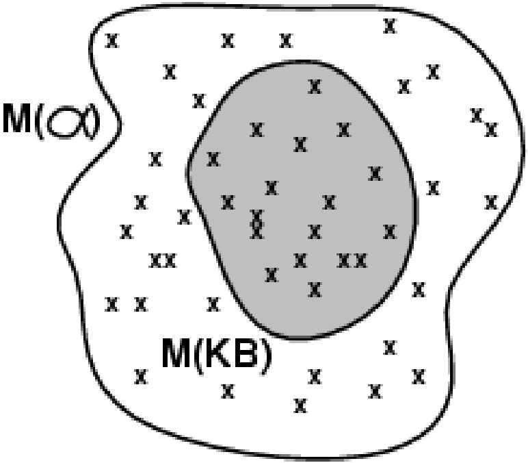

<!-- page: 8 -->

## Suy diễn logic (1)

## ◼ $K B \models \alpha$

❑ Mệnh đề α **được suy ra** từ KB bằng cách áp dụng thủ tục (suy diễn) i

❑ (Nói cách khác) Thủ tục i **suy ra** mệnh đề α từ KB

## ◼ Tính đúng đắn (soundness)

❑ Một thủ tục suy diễn i được gọi là **đúng đắn (sound)**, nếu thủ tục i suy ra **chỉ** các mệnh đề được bao hàm (entailed sentences)

❑ Thủ tục i là đúng đắn, nếu bất cứ khi nào $K B \models \alpha ,$ thì cũng đúng đối với $K B \models \alpha$

❑ Nếu thủ tục i suy ra mệnh đề α, mà α không được bao hàm trong KB, thì thủ tục i là không đúng đắn (unsound)

<!-- page: 9 -->

## Suy diễn logic (2)

## ◼ Tính hoàn chỉnh (completeness)

❑ Một thủ tục suy diễn i được gọi là **hoàn chỉnh (complete)**, nếu thủ tục i có thể suy ra **mọi** mệnh đề được bao hàm (entailed sentences)

❑ Thủ tục i là hoàn chỉnh, nếu bất cứ khi nào $K B \models \alpha$ , thì cũng đúng đối với $K B \models \alpha$

◼ (Trong phần tiếp theo của bài giảng) chúng ta sẽ xét đến logic vị từ bậc 1 (first-order logic)

❑ Có khả năng biểu diễn (diễn đạt) hầu hết các phát biểu logic

❑ Với logic vị từ bậc 1, tồn tại một thủ tục suy diễn đúng đắn và hoàn chỉnh

<!-- page: 10 -->

## Suy diễn logic (3)

Logic là một cách để biểu diễn hình thức và suy diễn tự động

◼ Việc suy diễn (reasoning) có thể được thực hiện ở mức cú pháp (bằng các chứng minh): **suy diễn diễn dịch (deductive reasoning)**

Việc suy diễn có thể được thực hiện ở mức ngữ nghĩa (bằng các mô hình): **suy diễn dựa trên mô hình (model-based reasoning)**

<!-- page: 11 -->

## Suy diễn logic (4)

◼ Suy diễn ngữ nghĩa ở mức của <u>một phép diễn giải</u> (mô hình):

❑ Với một biểu thức, có tồn tại một mô hình không? **có thể thỏa mãn được (satisfiability)?**

❑ Với một biểu thức và một phép diễn giải, kiểm tra xem phép diễn giải có phải là một mô hình của biểu thức không?: **kiểm tra mô hình (model checking)**

◼ Suy diễn ngữ nghĩa ở mức của <u>tất cả các phép diễn giải có thể</u>: **kiểm tra tính đúng đắn (validity checking)**

<!-- page: 12 -->

## Logic định đề: Cú pháp (1)

◼ Logic định đề (propositional logic) là loại logic đơn giản nhất

◼ **Biểu thức định đề (propositional formula)**

❑ Một ký hiệu định đề $( \mathsf { S } _ { 1 } ,   \mathsf { S } _ { 2 } ,   \ldots )$ là một biểu thức (định đề)

❑ Các giá trị hằng logic **đúng (true)** và **sai (false)** là các biểu thức

❑ Nếu $\mathbb { S } _ { 1 }$ là một biểu thức, thì $( - S _ { 1 } )$ cũng là một biểu thức (Phép **phủ định**)

<!-- page: 13 -->

## Logic định đề: Cú pháp (2)

◼ **Biểu thức định đề (propositional formula)…**

❑ Nếu $\mathbb { S } _ { 1 }$ và $\mathbb { S } _ { 2 }$ là các biểu thức, thì $( \mathbf { S } _ { 1 } \wedge \mathbf { S } _ { 2 } )$ cũng là một biểu thức (Phép **kết hợp** / **và**)

❑ Nếu $\mathbb { S } _ { 1 }$ và $\mathbb { S } _ { 2 }$ là các biểu thức, thì $( \mathbf { S } _ { 1 } \lor \mathbf { S } _ { 2 } )$ cũng là một biểu thức (Phép **tuyển** / **hoặc**)

❑ Nếu $\mathbb { S } _ { 1 }$ và $\mathbb { S } _ { 2 }$ là các biểu thức, thì $( \mathbb { S } _ { 1 } \Rightarrow \mathbb { S } _ { 2 } )$ cũng là một biểu thức (Phép **suy ra** / **kéo theo**)

❑ Nếu $\mathbb { S } _ { 1 }$ và $\mathbb { S } _ { 2 }$ là các biểu thức, thì $( \mathbb { S } _ { 1 } \Leftrightarrow \mathbb { S } _ { 2 } )$ cũng là một biểu thức (Phép **tương đương**)

❑ Không gì khác (các dạng trên) là một biểu thức

<!-- page: 14 -->

## Cú pháp của logic định đề: Ví dụ

◼ p

◼ q

◼ r

◼ true

◼ false

◼ p

(¬p) ∧ true

¬((¬p) ∨ false)

◼ $( \neg \mathsf { p } ) \Rightarrow ( \neg ( ( \neg \mathsf { p } ) \lor \mathsf { f a l s e } ) )$

◼ (p $\wedge ( \mathsf { q } \vee \mathsf { r } ) ) \Leftrightarrow ( \mathsf { p } \wedge \mathsf { q } ) \vee ( \mathsf { p } \wedge \mathsf { r } )$

<!-- page: 15 -->

## Thứ tự ưu tiên của các toán tử logic

◼ Thứ tự ưu tiên của các toán tử logic (từ cao xuống thấp)

$$
\neg , \land , \lor , \Rightarrow , \Leftrightarrow
$$

◼ Sử dụng cặp ký tự “()” để xác định mức độ ưu tiên

◼ Các ví dụ

❑ $p \wedge q \vee r$ tương đương $( p \land q ) \lor r$ chứ không phải $p \wedge ( q \vee r )$

❑ $\neg p \land q$ tương đương $( - p ) \land q$ chứ không phải $\pi ( p \land q )$

❑ $\mathsf { p } \land \neg \mathsf { q } \Rightarrow \mathsf { r }$ tương đương $( p \land ( \neg q ) ) \Rightarrow r$ chứ không phải $p \land ( \neg ( \mathsf { q } \Rightarrow \mathsf { r } ) )$ hoặc $p \land ( ( \neg q ) \Rightarrow r )$

<!-- page: 16 -->

## Logic định đề: Ngữ nghĩa (1)

◼ Với một mô hình (model) cụ th $\tilde { \dot { \mathsf { e } } }$ , nó sẽ xác định giá trị đúng/sai cho mỗi ký hiệu định đề

❑ Ví dụ: Với 3 ký hiệu $\mathbf { S } _ { 1 } , \mathbf { S } _ { 2 }$ và $\mathbb { S } _ { 3 } ,$ , thì có thể lấy ví dụ một mô hình $\mathsf { m } _ { 1 }$ xác định như sau:

$$
\mathrm{m} _ {1} \equiv (\mathrm{S} _ {1} = \text {sai}, \mathrm{S} _ {2} = \text {dúng}, \mathrm{S} _ {3} = \text {sai})
$$

Với 3 ký hiệu định đề như ví dụ trên, có thể chỉ ra 8 mô hình có thể

<!-- page: 17 -->

## Logic định đề: Ngữ nghĩa (2)

◼ Ngữ nghĩa của một mô hình $m = \mathbb { C }$ ác quy tắc để đánh giá giá trị chân lý (đúng/sai) của các mệnh đề trong mô hình m đó

$\neg \mathsf { S } _ { 1 }$ là đúng, khi và chỉ khi $\mathbb { S } _ { 1 }$ là sai

$\mathbf { S } _ { 1 } \wedge \mathbf { S } _ { 2 }$ là đúng, khi và chỉ khi $\mathbb { S } _ { 1 }$ là đúng và $\mathbb { S } _ { 2 }$ là đúng

$\mathbf { S } _ { 1 } \vee \mathbf { S } _ { 2 }$ là đúng, khi và chỉ khi $\mathbb { S } _ { 1 }$ là đúng hoặc $\mathbb { S } _ { 2 }$ là đúng

$\mathbf { S } _ { 1 } \Rightarrow \mathbf { S } _ { 2 }$ là đúng, khi và chỉ khi $\mathbb { S } _ { 1 }$ là sai hoặc $\mathbb { S } _ { 2 }$ là đúng;

là sai, khi và chỉ khi $\mathbb { S } _ { 1 }$ là đúng và $\mathbb { S } _ { 2 }$ là sai

$\mathbf { S } _ { 1 } \Leftrightarrow \mathbf { S } _ { 2 }$ là đúng, khi và chỉ khi $\mathbf { S } _ { 1 } \mathbf { \Rightarrow } \mathbf { S } _ { 2 }$ là đúng và $\mathbf { S } _ { 2 } \mathbf { \Rightarrow } \mathbf { S } _ { 1 }$ là đúng

◼ Ví dụ: Với mô hình $m _ { j }$ như trong ví dụ trước, thì giá trị của biểu thức logic định đề sau sẽ là:

$$
\neg \mathrm{S} _ {1} \wedge (\mathrm{S} _ {2} \vee \mathrm{S} _ {3}) = \text {dúng} \wedge (\text {dúng} \vee \text {sai}) = \text {dúng} \wedge \text {dúng} = \text {dúng}
$$

<!-- page: 18 -->

## Ngữ nghĩa của logic định đề: Ví dụ (1)

◼ Xét mô hình $m _ { 1 } = ( p = d i n g , q = s a i )$ , ta có ngữ nghĩa (giá trị logic) của các biểu thức sau

```txt
□ ¬p là sai
□ ¬q là đúng
□ p ∧ q là sai
□ p ∨ q là đúng
□ p ⇒ q là sai
□ q ⇒ p là đúng
□ p ⇔ q là sai
□ ¬p ⇔ q là đúng
```

<!-- page: 19 -->

## Ngữ nghĩa của logic định đề: Ví dụ (2)

◼ Xét mô hình $m _ { 2 } = ( p = s a i , q = d i i n g )$ , ta có ngữ nghĩa (giá trị logic) của các biểu thức sau

```txt
□ ¬p là đúng
□ ¬q là sai
□ p ∧ q là sai
□ p ∨ q là đúng
□ p ⇒ q là đúng
□ q ⇒ p là sai
□ p ⇔ q là sai
□ ¬p ⇔ q là đúng
```

<!-- page: 20 -->

## Bảng chân lý đối với các toán tử logic

| S<sub>1</sub> | S<sub>2</sub> | S<sub>1</sub> | S<sub>1</sub>ΛS<sub>2</sub> | S<sub>1</sub>VS<sub>2</sub> | S<sub>1</sub>S<sub>2</sub> | S<sub>1</sub>S<sub>2</sub> |
| --- | --- | --- | --- | --- | --- | --- |
| sai | sai | đúng | sai | sai | đúng | đúng |
| sai | đúng | đúng | sai | đúng | đúng | sai |
| đúng | sai | sai | sai | đúng | sai | sai |
| đúng | đúng | sai | đúng | đúng | đúng | đúng |

<!-- page: 21 -->

## Các phép biến đổi tương đương

Hai câu có ý nghĩa tương đương nếu cùng giá trị đúng:

<div class="docvortex-algorithm" style="white-space: pre-wrap; font-family:monospace;">
$\begin{array}{rcl}(\alpha \land \beta) &amp; \equiv &amp; (\beta \land \alpha) \\ (\alpha \lor \beta) &amp; \equiv &amp; (\beta \lor \alpha) \end{array}\}$ giao hoán  
$\begin{array}{rcl}((\alpha \land \beta) \land \gamma) &amp; \equiv &amp; (\alpha \land (\beta \land \gamma)) \\ ((\alpha \lor \beta) \lor \gamma) &amp; \equiv &amp; (\alpha \lor (\beta \lor \gamma)) \end{array}\}$ kết hợp  
$\neg (\neg \alpha) &amp; \equiv &amp; \alpha \quad \text{phù định kép}\\ (\alpha \Rightarrow \beta) &amp; \equiv &amp; (\neg \beta \Rightarrow \neg \alpha) \quad \text{tương phản}\\ (\alpha \Rightarrow \beta) &amp; \equiv &amp; (\neg \alpha \lor \beta)\\ (\alpha \Leftrightarrow \beta) &amp; \equiv &amp; ((\alpha \Rightarrow \beta) \land (\beta \Rightarrow \alpha))\\ \neg (\alpha \land \beta) &amp; \equiv &amp; (\neg \alpha \lor \neg \beta) \\ \neg (\alpha \lor \beta) &amp; \equiv &amp; (\neg \alpha \land \neg \beta) \end{array}\}$ de Morgan  
$(\alpha \land (\beta \lor \gamma))$
</div>

<!-- page: 22 -->

## Biểu diễn bằng logic định đề: Ví dụ

## ◼ Giả sử chúng ta có các định đề sau

```txt
□ p ≡ “Chiều nay trời nắng”
```

```txt
□ q ≡ “Thời tiết lạnh hơn hôm qua”
```

```txt
□ r ≡ “Tôi sẽ đi bơi”
```

```txt
□ s ≡ “Tôi sẽ đi đá bóng”
```

```txt
□ t ≡ “Tôi sẽ về đến nhà vào buổi tối”
```

Biểu diễn các phát biểu trong ngôn ngữ tự nhiên

❑“Chiều nay trời không nắng và thời tiết lạnh hơn hôm qua”: p  q

❑“Tôi sẽ đi bơi nếu như chiều nay trời nắng”: p → r

❑“Nếu tôi (sẽ) không đi bơi thì tôi sẽ đi đá bóng”: r → s

❑“Nếu tôi (sẽ) đi đá bóng thì tôi sẽ về nhà vào buối tối”: s → t

<!-- page: 23 -->

## Mâu thuẫn và Tautology

◼ Một biểu thức logic định đề luôn có giá trị sai (false) trong mọi phép diễn giải (mọi mô hình) thì được gọi là một **mâu thuẫn (contradiction)**

❑ Ví dụ: $( p \land \neg p )$

◼ Một biểu thức logic định đề luôn có giá trị đúng (true) trong mọi phép diễn giải (mọi mô hình) thì được gọi là một **tautology**

$$
\begin{array}{l l} \text {☐ Ví dụ:} & (p \lor \neg p) \\ & \neg (p \land q) \leftrightarrow (\neg p \lor \neg q) \\ & \neg (p \lor q) \leftrightarrow (\neg p \land \neg q) \end{array}
$$

<!-- page: 24 -->

## Tính thỏa mãn được và Tính đúng đắn

Một biểu thức logic định đề là **thỏa mãn được (satisfiable)**, nếu biểu thức đó đúng trong một mô mình nào đó

□ Ví d: A √ B, A > B

◼ Một biểu thức là **không thể thỏa mãn được (unsatisfiable)**, nếu không tồn tại bất kỳ mô hình nào mà trong đó biểu thức là đúng

❑ Ví dụ: $\mathsf { A } \land \neg \mathsf { A }$

◼ Một biểu thức là **đúng đắn (valid)**, nếu biểu thức đúng trong mọi mô hình

□ Ví d: đúng; A ∨ ¬A; A ⇒ A; (A ∧ (A ⇒ B)) ⇒ B

<!-- page: 25 -->

## Bài toán chứng minh logic

◼ Với một cơ sở tri trức (một tập các mệnh đề) KB và một mệnh đề  cần chứng minh (gọi là một định lý)

Cơ sở tri thức KB có bao hàm (về mặt ngữ nghĩa)  hay không: $\mathsf { K B } \models \alpha$ ?

❑ Nói cách khác,  có thể được suy ra (được chứng minh) từ cơ sở tri thức KB hay không?

Câu hỏi đặt ra: Liệu có tồn tại một thủ tục (suy diễn) có thể giải quyết được bài toán chứng minh logic, trong một số hữu hạn các bước?

❑ Đối với logic định đề, câu trả lời là có!

<!-- page: 26 -->

## Giải quyết bài toán chứng minh logic

◼ Mục đích: để trả lời câu hỏi KB╞  ?

◼ Có 3 phương pháp (chứng minh) phổ biến:

❑ Sử dụng bảng chân lý (Truth-table)

❑ Áp dụng các luật suy diễn (Inference rules)

❑ Chuyển về bài toán chứng minh thỏa mãn (SAT)

◼ Phương pháp chứng minh bằng phản chứng (Refutation)

<!-- page: 27 -->

## Chứng minh dựa trên bảng chân lý (1)

◼ Bài toán chứng minh: KB╞  ?

Kiểm tra tất cả các phép diễn giải có thể (tất cả các mô hình có thể) mà trong đó KB là đúng, để xem  đúng hay sai

◼ Bảng chân lý: Liệt kê các giá trị chân lý (đúng/sai) của các mệnh đề, đối với tất cả các phép diễn giải có thể

❑ Các phép gán giá trị đúng/sai đối với các ký hiệu định đề

<table><tbody><tr><td colspan="4">KB</td><td></td></tr><tr><td>p</td><td>q</td><td>p q</td><td>p q</td><td>(p q) q</td></tr><tr><td>đúng</td><td>đúng</td><td>đúng</td><td>đúng</td><td>đúng chứng minh</td></tr><tr><td>đúng</td><td>sai</td><td>đúng</td><td>sai</td><td>sai</td></tr><tr><td>sai</td><td>đúng</td><td>đúng</td><td>sai</td><td>sai</td></tr><tr><td>sai</td><td>sai</td><td>sai</td><td>đúng</td><td>sai</td></tr></tbody></table>

<!-- page: 28 -->

## Chứng minh dựa trên bảng chân lý (2)

◼ $K B = ( p \lor r ) \land ( q \lor \neg r )$

◼ $\alpha = ( p \lor q )$

◼ $\mathsf { K B } \models \alpha   ?$

| p | q | r | p r | q r | KB |  |
| --- | --- | --- | --- | --- | --- | --- |
| đúng | đúng | đúng | đúng | đúng | đúng | đúng |
| đúng | đúng | sai | đúng | đúng | đúng | đúng |
| đúng | sai | đúng | đúng | sai | sai | đúng |
| đúng | sai | sai | đúng | đúng | đúng | đúng |
| sai | đúng | đúng | đúng | đúng | đúng | đúng |
| sai | đúng | sai | sai | đúng | sai | đúng |
| sai | sai | đúng | đúng | sai | sai | sai |
| sai | sai | sai | sai | đúng | sai | sai |

Trí tuệ nhân tạo

<!-- page: 29 -->

## Chứng minh dựa trên bảng chân lý (3)

◼ Đối với logic định đề, phương pháp chứng minh dựa trên bảng chân lý có tính đúng đắn (sound) và hoàn chỉnh (complete)

◼ Độ phức tạp tính toán của phương pháp chứng minh dựa trên bảng chân lý

❑ Hàm mũ đối với số lượng (n) các ký hiệu định đề: 2<sup>n</sup>

❑ Nhưng chỉ có một tập con (nhỏ) của tập các khả năng gán giá trị chân lý, mà trong đó KB và  là đúng

<!-- page: 30 -->

## Chứng minh bằng các luật suy diễn (1)

◼ Luật suy diễn **Modus ponens**

$$
\begin{array}{c} \mathsf {p} \to \mathsf {q}, \mathsf {p} \\ \hline \mathsf {q} \end{array}
$$

◼ Luật suy diễn loại bỏ liên kết $\nabla \hat { A }$ (**And-Elimination**)

$$
\mathsf {p} _ {1} \land \mathsf {p} _ {2} \land \dots \land \mathsf {p} _ {n}
$$

$$
(i = 1.. n)
$$

◼ Luật suy diễn đưa vào liên kết VÀ (**And-Introduction**)

$$
\frac {\mathsf {p} _ {1} , \mathsf {p} _ {2} , \dots , \mathsf {p} _ {n}}{\mathsf {p} _ {1} \wedge \mathsf {p} _ {2} \wedge \dots \wedge \mathsf {p} _ {n}}
$$

◼ Luật suy diễn đưa vào liên kết HOẶC (**Or-Introduction**)

p<sub>i</sub>

P1 ∨ P2 ∨ ... ∨ P ∨ ... ∨ Pn

<!-- page: 31 -->

## Chứng minh bằng các luật suy diễn (2)

◼ Luật suy diễn loại bỏ phủ định hai lần (**Elimination of Double Negation**)

$$
\frac {\neg \neg p}{p}
$$

◼ Luật suy diễn hợp giải (**Resolution**)

$$
\begin{array}{c} \mathsf {p} \lor \mathsf {q}, \quad \neg \mathsf {q} \lor \mathsf {r} \\ \hline \mathsf {p} \lor \mathsf {r} \end{array}
$$

◼ Luật suy diễn hợp giải đơn (**Unit Resolution**)

$$
\mathsf{p}\lor \mathsf{q},\quad \neg \mathsf{q}
$$

◼ Tất cả các luật suy diễn trên đều có tính đúng đắn (sound)!

<!-- page: 32 -->

## Chứng minh bằng luật suy diễn: Ví dụ (1)

◼ Giả sử có tập giả thiết KB 1) $\mathsf { p } \wedge \mathsf { q }$ 2) $\mathsf { p } \to \mathsf { r }$ 3) (q  r) → s

◼ Cần chứng minh định lý s

◼ Từ 1) và sử dụng luật And-Elimination, ta có: 4) p

◼ Từ 2), 4), và sử dụng luật Modus Ponens, ta có: 5) r

<!-- page: 33 -->

## Chứng minh bằng luật suy diễn: Ví dụ (2)

◼ …

◼ Từ 1), và sử dụng luật And-Elimination, ta có: 6) q

◼ Từ 5), 6), và sử dụng luật And-Introduction, ta có: 7) (q  r)

◼ Từ 7), 3), và sử dụng luật Modus-Ponens, ta có: 8) s

◼ Vậy định lý (biểu thức logic) s được chứng minh là đúng!

<!-- page: 34 -->

## Suy diễn logic và Tìm kiếm

◼ Để chứng minh định lý  là đúng đối với tập giả thiết KB, cần áp dụng một chuỗi các luật suy diễn đúng đắn

◼ Vấn đề: Ở mỗi bước suy diễn, có nhiều luật có thể áp dụng được

❑ Chọn luật nào để áp dụng tiếp theo?

◼ Đây là vấn đề của bài toán tìm kiếm (search)

$$
\begin{array}{c}\text {KB}\\\hline\end{array}\begin{array}{c}p \rightarrow q\\r \rightarrow s\\p\\r\\\dots\end{array}\quad\begin{array}{c}\text {?}\\\hline\end{array}\begin{array}{c}p \rightarrow q, p\\\hline q\\r \rightarrow s, r\\\hline s\end{array}
$$

<!-- page: 35 -->

## Chuyển đổi các biểu thức logic

◼ Trong logic định đề

❑ Một biểu thức có thể bao gồm nhiều liên kết: $\neg , \land , \lor , \rightarrow , \leftrightarrow$

❑ Một biểu thức có thể bao gồm nhiều biểu thức con (lồng) khác

◼ Chúng ta có cần sử dụng tất cả các liên kết logic để biểu diễn một biểu thức phức tạp?

❑ Không.

❑ Chúng ta có thể viết lại (chuyển đổi) một biểu thức logic định đề thành một biểu thức tương đương chỉ chứa các liên kết $\longrightarrow , 1 ,$ 

<!-- page: 36 -->

## Các dạng chuẩn

◼ Các biểu thức trong logic định đề có thể được chuyển đổi về một trong các dạng chuẩn (Normal forms)

❑ Giúp đơn giản hóa quá trình suy diễn

## ◼ Dạng chuẩn kết hợp (Conjunctive normal form – CNF)

❑ Là kết hợp (liên kết VÀ) của các mệnh đề (clauses)

❑ Mỗi mệnh đề (clause) là một liên kết HOẶC của các ký hiệu định đề đơn

❑ Ví dụ: $( p \lor q ) \land ( \neg q \lor \neg r \lor s )$

◼ **Dạng chuẩn tuyển** (Disjunctive normal form – DNF)

❑ Là liên kết HOẶC của các mệnh đề (clauses)

❑ Mỗi mệnh đề (clause) là một liên kết VÀ của các ký hiệu định đề đơn

❑ Ví dụ: $( p \land - q ) \lor ( - p \land r ) \lor ( r \land - s )$

<!-- page: 37 -->

## Dạng chuẩn Horn

Một biểu thức logic ở dạng chuẩn Horn nếu:

❑ Biểu thức đó là một liên kết VÀ của các mệnh đề

❑ Mỗi mệnh đề là một liên kết HOẶC các ký hiệu (literals), và có tối đa là 1 ký hiệu khẳng định (positive literal)

❑ Ví dụ: (p $v - q ) \wedge ( - p \vee - r \vee s )$

◼ Không phải mọi biểu thức logic định đề đều có thể được chuyển về dạng chuẩn Horn!

Biểu diễn tập giả thiết KB ở dạng chuẩn Horn

❑ **Các luật (Rules)**

◼ $( \neg \mathsf { p } _ { 1 } \lor \neg \mathsf { p } _ { 2 } \lor \ldots \lor \neg \mathsf { p } _ { \mathsf { n } } \lor \mathsf { q } )$

◼ Tương đương với luật: $( \mathsf { p } _ { 1 } \land \mathsf { p } _ { 2 } \land \ldots \land \mathsf { p } _ { \mathsf { n } } \to \mathsf { q } )$

❑ **Các sự kiện (Facts)**

◼ p, q

❑ **Các ràng buộc toàn vẹn (Integrity constraints)**

◼ $( \neg p _ { 1 } \lor \neg p _ { 2 } \lor \ldots \lor \neg p _ { n } )$

◼ Tương đương với luật: $( { \sf p _ { 1 } } \wedge { \sf p _ { 2 } } \wedge \ldots \wedge { \sf p _ { n } } \to { \sf s o l } )$

<!-- page: 38 -->

## Chuyển đổi sang CNF – Ví dụ

$$
\mathsf {B} _ {1, 1} \Leftrightarrow (\mathsf {P} _ {1, 2} \lor \mathsf {P} _ {2, 1})
$$

1. Loại bỏ phép $\Leftrightarrow ,$ thay $\alpha \leftrightarrow \beta$ bằng $( \alpha \Rightarrow \beta ) \land ( \beta \Rightarrow \alpha )$ $( \mathsf { B } _ { 1 , 1 } \Rightarrow ( \mathsf { P } _ { 1 , 2 } \lor \mathsf { P } _ { 2 , 1 } ) ) \land ( ( \mathsf { P } _ { 1 , 2 } \lor \mathsf { P } _ { 2 , 1 } ) \Rightarrow \mathsf { B } _ { 1 , 1 } )$

2. Loại bỏ $\mathsf { p h e p } \Rightarrow$ , thay $\mathbf { \alpha } \Rightarrow \mathbf { \beta }$ bằng $- a \lor \beta$ $( \neg \mathsf { B } _ { 1 , 1 } \lor \mathsf { P } _ { 1 , 2 } \lor \mathsf { P } _ { 2 , 1 } ) \land ( \neg ( \mathsf { P } _ { 1 , 2 } \lor \mathsf { P } _ { 2 , 1 } ) \lor \mathsf { B } _ { 1 , 1 } )$

3. Đưa  vào trong sử dụng luật de Morgan và phủ định kép: $( \neg \mathsf { B } _ { 1 , 1 } \lor \mathsf { P } _ { 1 , 2 } \lor \mathsf { P } _ { 2 , 1 } ) \land ( ( \neg \mathsf { P } _ { 1 , 2 } \land \neg \mathsf { P } _ { 2 , 1 } ) \lor \mathsf { B } _ { 1 , 1 } )$

4. Áp dụng luật phân phối đối với phép $\triangle$ : $( \neg \mathsf { B } _ { 1 , 1 } \lor \mathsf { P } _ { 1 , 2 } \lor \mathsf { P } _ { 2 , 1 } ) \land ( \neg \mathsf { P } _ { 1 , 2 } \lor \mathsf { B } _ { 1 , 1 } ) \land ( \neg \mathsf { P } _ { 2 , 1 } \lor \mathsf { B } _ { 1 , 1 } )$

<!-- page: 39 -->

## Ví dụ

(AB)→(C→D)

1. Loại bỏ phép suy ra $- ( A \lor B ) \lor ( - C \lor D )$

2. Chuyển phủ định vào trong ngoặc $( - A \sim B ) \lor ( - C \lor D )$

3. Phân phối $( \neg \mathsf { A } \lor \neg \mathsf { C } \lor \mathsf { D } ) \land ( \neg \mathsf { B } \lor \neg \mathsf { C } \lor \mathsf { D } )$

<!-- page: 40 -->

## Bài tập

Chuyển đổi các công thức sau về dạng kết nối chuẩn:

1. $\mathsf { P } \lor ( \neg \mathsf { P } \land \mathsf { Q } \land \mathsf { R } )$

2. $( \neg \mathsf { P } \land \mathbb { Q } ) \lor ( \mathsf { P } \land \neg \mathbb { Q } )$

3. $\neg ( \mathsf { P } \Rightarrow \mathsf { Q } ) \lor ( \mathsf { P } \lor \mathsf { Q } )$

4. $( \mathsf { P } \Rightarrow \mathsf { Q } ) \Rightarrow \mathsf { R }$

5. $( \mathsf { P } \Rightarrow ( \mathsf { Q } \Rightarrow \mathsf { R } ) ) \Rightarrow ( ( \mathsf { P } \land \mathsf { S } ) \Rightarrow \mathsf { R } )$

6. $( \mathsf { P } \land ( \mathsf { Q } \Rightarrow \mathsf { R } ) ) \Rightarrow \mathsf { S }$

7. $\mathsf { P } \land \mathsf { Q } \Rightarrow \mathsf { R } \land \mathsf { S }$

<!-- page: 41 -->

## Bài toán chứng minh thỏa mãn (SAT)

◼ Mục đích của bài toán chứng minh thỏa mãn (Satisfiability – SAT) là xác định một biểu thức ở dạng chuẩn kết hợp (CNF) có thể thỏa mãn được hay không

❑ Tức là chứng minh biểu thức đó là đúng hay không

❑ Ví dụ: $( p \lor q \lor - t ) \land ( - p \lor - t \lor s ) \land ( - p \lor q \lor - t )$

◼ Đây là một trường hợp của bài toán thỏa mãn ràng buộc (CSP)

❑ Tập các biến

◼ Các ký hiệu định đề (ví dụ: p, q, r, s, t)

◼ Các giá trị (hằng) logic đúng, sai

❑ Tập các ràng buộc

◼ Tất cả các mệnh đề (được liên kết bởi phép VÀ) trong biểu thức phải đúng

Với mỗi mệnh đề, ít nhất một trong các định đề đơn phải đúng

<!-- page: 42 -->

## Giải quyết bài toán SAT

## ◼ Phương pháp Backtracking

❑ Áp dụng chiến lược tìm kiếm theo chiều sâu (Depth-first search)

❑ Xét một biến (một định đề đơn), xét các khả năng gán giá trị (đúng/sai) cho biến đó

❑ Lặp lại, cho đến khi tất cả các biến được gán giá trị, hoặc việc gán giá trị cho tập con của tập tất cả các biến, làm cho **biểu thức là sai**

## ◼ Các phương pháp tối ưu hóa lặp (Iterative optimization methods)

❑ Bắt đầu với một phép gán ngẫu nhiên các giá trị đúng/sai cho các ký hiệu định đề

❑ Đổi giá trị (đúng thành sai / sai thành đúng) đối với một biến

❑ Heuristic: ưu tiên các phép gán giá trị làm cho nhiều mệnh đề (hơn) đúng

❑ Sử dụng các phương pháp tìm kiếm cục bộ: Simulated Annealing, Walk-SAT

<!-- page: 43 -->

## Bài toán suy diễn vs. Bài toán thỏa mãn được

## ◼ Bài toán suy diễn logic

❑ Cần chứng minh: biểu thức logic (định lý)  được bao hàm bởi tập các mệnh đề KB

❑ Nói cách khác: với mọi phép diễn giải mà trong đó KB đúng, thì  có đúng?

## ◼ Bài toán thỏa mãn được (SAT)

❑ Có tồn tại một phép gán giá trị đúng/sai cho các ký hiệu định đề (một phép diễn giải) sao cho biểu thức  là đúng?

## ◼ Mối quan hệ:

```txt
KBmodels α
(NB ∧ ¬α)
nếu và chỉ nếu:
là không thể thỏa mãn được
(unsatisfiable)
```

<!-- page: 44 -->

## Luật suy diễn hợp giải (1)

◼ Luật suy diễn **hợp giải (Resolution)** p ∨ q, ¬q v r p  r

Luật suy diễn hợp giải áp dụng được đối với các biểu thức logic ở dạng chuẩn CNF

◼ Luật suy diễn hợp giải có tính đúng đắn (sound), nhưng không có tính hoàn chỉnh (incomplete)

❑ Tập giả thiết (cơ sở tri thức) KB chứa biểu thức (p  q)

❑ Cần chứng minh: (p  q) ?

❑ Luật suy diễn hợp giải không thể suy ra được biểu thức cần chứng minh!

<!-- page: 45 -->

## Luật suy diễn hợp giải (2)

◼ Chuyển bài toán chứng minh logic $v \dot { \theta }$ bài toán SAT

❑ Phương pháp chứng minh bằng phản chứng

❑ Việc chứng minh sự mâu thuẫn của: $( \mathsf { K B } \land \neg \alpha )$

❑ Tương đương việc chứng minh sự bao hàm: $\kappa _ { B } \models \alpha$

◼ Luật suy diễn hợp giải (Resolution rule)

❑ Nếu các biểu thức trong tập KB và biểu thức $- \alpha$ đều $\vec { \mathbf { o } }$ dạng CNF, thì áp dụng luật suy diễn hợp giải sẽ xác định tính (không) thỏa mãn được của $( \mathsf { K B } \land \neg \alpha )$

<!-- page: 46 -->

## Giải thuật hợp giải của Robinson

Chúng minh bàng phàn chúng: CSTT ∧—KL không thoà mãn

```txt
function PL-RESOLUTION(KB, α) returns true or false
    clauses ← the set of clauses in the CNF representation of KB ∧ ¬α
    new ← {}
loop do
    for each Ci, Cj in clauses do
        resolvents ← PL-RESOLVE(Ci, Cj)
        if resolvents contains the empty clause then return true
        new ← new ∪ resolvents
    if new ⊆ clauses then return false
    clauses ← clauses ∪ new
```

<!-- page: 47 -->

## Giải thuật hợp giải của Robinson

```txt
Chứng minh bằng phần chứng: CSTT ∧¬KL không thỏa mãn
Giả sử có GT₁, GT₂,...,GTₙ. Cần CM KL → phần chứng
GT₁
...
GTₙ
¬KL
><
Viết mỗi GTᵢ, ¬KL trên 1 dòng
Đưa GTᵢ, ¬KL về dạng chuẩn CNF
(p₁∨...∨pₙ) ∧ (q₁∨...∨qₙ)      (*)
Tách mỗi dòng (*) thành các dòng con:
p₁∨...∨pₙ
q₁∨...∨qₙ
```

<!-- page: 48 -->

## Giải thuật hợp giải của Robinson

```txt
Xét 1 cắp dòng
    u)    ¬p∨q
    v)    p∨r
Hợp giải:
    w) q∨r
Vô lý xuất hiện khi
    i)    ¬t
    ii)    t
⇒ đpcm
```

<!-- page: 49 -->

## Ví dụ

VD1:

1 a

2. a→b

3. b→(c→d)

4. c

## Chứng minh d

VD2:

1. ab→c

2. bc →d

3. a

4. b Chứng minh d

<!-- page: 50 -->

## Ví dụ

VD3:

1. p

2. $\mathsf { p } { \to } \mathsf { q }$

3. $\mathbf { q } \wedge \mathbf { r } \wedge \mathbf { S } \rightarrow \mathbf { t }$

4. $\mathsf { p } { \to } \mathsf { U }$

5. $\mathsf { V } { \rightarrow } \mathsf { W }$

6. $\mathsf { U } { \rightarrow } \mathsf { V }$

7. v→t

## Cho r,s. CM t

VD4:

1. $( ( a \vee b ) \wedge c ) \rightarrow ( c \wedge d )$

2. $a \wedge m \wedge d \rightarrow f$

3. ${ \mathsf { m } } { \to } { \mathsf { b } } { \land } { \mathsf { c } }$

4. $a { \rightarrow } c$

5. $( a \wedge f ) \rightarrow ( - e \vee g )$

6. $( m \wedge f ) \rightarrow g$

Cho a,m. CM g

<!-- page: 51 -->

## Ví dụ

1. $\mathsf { a 1 } \lor \mathsf { a 2 } \Rightarrow \mathsf { a 3 } \lor \mathsf { a 4 }$

2. $a 1 \Rightarrow a 5$

3. $\mathsf { a 2 } \land \mathsf { a 3 } \Rightarrow \mathsf { a 5 }$

4. $\mathsf { a 2 } \land \mathsf { a 4 } \Rightarrow \mathsf { a 6 } \land \mathsf { a 7 }$

5. $a 5 \Rightarrow a 7$

6. a1 $\wedge   { \mathsf { a 3 } }   \Rightarrow   { \mathsf { a 6 } } \vee { \mathsf { a 7 } }$

◼ Cho các mệnh đề a1, a2 đúng.

Đưa các biểu thức logic trên về dạng chuẩn

◼ áp dụng phương pháp hợp giải của Robinson, chứng minh a7 đúng.

<!-- page: 52 -->

## Nhận xét

Thuật giải Robinson vẫn vấp phải sự bùng nổ tổ hợp. Có thể áp dụng các heuristics:

❑ Chiến lược ưu tiên các biểu thức đơn

❑ Chiến lược đơn giản hóa các biểu thức

❑ Chiến lược giảm số lần hợp giải

❑ Chiến lược sắp thứ tự các hợp giải

❑ Chiến lược tập tựa

Thuật giải Robinson được áp dụng trong CM định lý tự động. 2 nhược điểm:

❑ con người không tư duy theo cách này

chúng ta bị mất ngữ nghĩa và nội dung thông tin khi chuyển về dạng câu CNF

<!-- page: 53 -->

## Luật suy diễn Modus Ponens tổng quát

$$
\frac {(p _ {1} \land p _ {2} \land \ldots \land p _ {n} \rightarrow q), p _ {1}, p _ {2}, \ldots, p _ {n}}{q}
$$

◼Luật suy diễn Modus Ponens có tính đúng đắn (sound) và hoàn chỉnh (complete), đối với các ký hiệu định đề và đối với tập các biểu thức KB ở dạng chuẩn Horn

◼Luật suy diễn Modus Ponens có thể được sử dụng với cả 2 chiến lược suy diễn (suy diễn tiến và suy diễn lùi)

<!-- page: 54 -->

## Suy diễn tiến (forward chaining)

Với một tập các mệnh đề giả thiết (cơ sở tri thức) KB, cần suy ra mệnh đề kết luận Q

Ý tưởng: Lặp lại 2 bước sau cho đến khi suy ra được kết luận ❑ Áp dụng các luật có mệnh đề giả thiết được thỏa mãn trong KB ❑ Bổ sung kết luận của các luật đó vào KB

$$
\begin{array}{l} P \Rightarrow Q \\ L \land M \Rightarrow P \\ B \land L \Rightarrow M \\ A \land P \Rightarrow L \\ A \land B \Rightarrow L \\ A \\ B \end{array}
$$

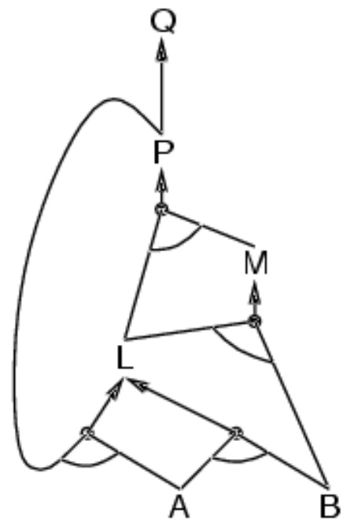

<!-- page: 55 -->

## Suy diễn tiến: Ví dụ (1)

$$
P \Rightarrow Q
$$

$$
L \land M \Rightarrow P
$$

$$
B \land L \Rightarrow M
$$

$$
A \land P \Rightarrow L
$$

$$
A
$$

B

$$
A \land B \Rightarrow L
$$

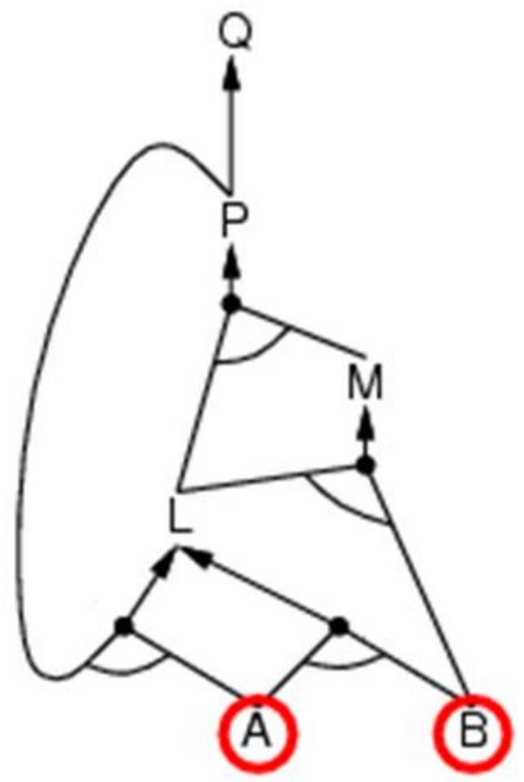

<!-- page: 56 -->

## Suy diễn tiến: Ví dụ (2)

$$
P \Rightarrow Q
$$

$$
L \land M \Rightarrow P
$$

$$
B \land L \Rightarrow M
$$

$$
A \land P \Rightarrow L
$$

$$
A
$$

B

$$
A \land B \Rightarrow L
$$

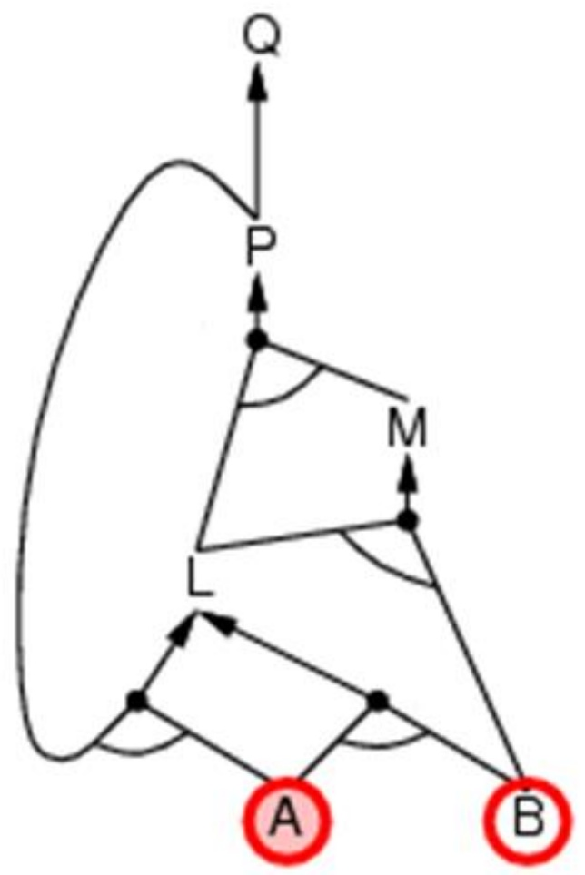

<!-- page: 57 -->

## Suy diễn tiến: Ví dụ (3)

$$
P \Rightarrow Q
$$

$$
L \land M \Rightarrow P
$$

$$
B \land L \Rightarrow M
$$

$$
A \land P \Rightarrow L
$$

B

$$
A \land B \Rightarrow L
$$

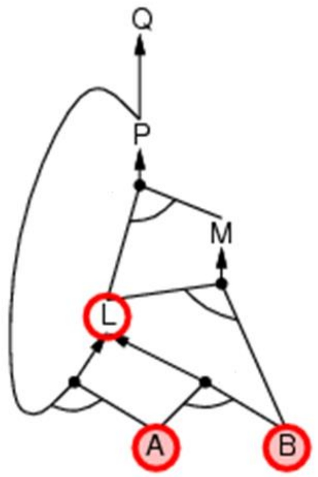

<!-- page: 58 -->

## Suy diễn tiến: Ví dụ (4)

$$
P \Rightarrow Q
$$

$$
L \land M \Rightarrow P
$$

$$
B \land L \Rightarrow M
$$

$$
A \land P \Rightarrow L
$$

$$
A
$$

B

$$
A \land B \Rightarrow L
$$

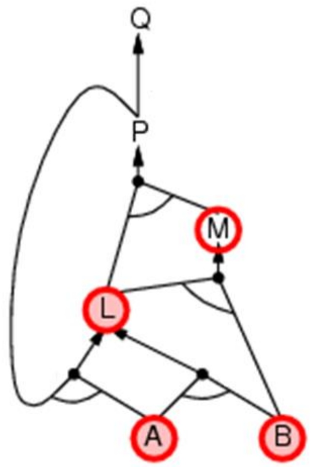

<!-- page: 59 -->

## Suy diễn tiến: Ví dụ (5)

$$
P \Rightarrow Q
$$

$$
L \land M \Rightarrow P
$$

$$
B \land L \Rightarrow M
$$

$$
A \land P \Rightarrow L
$$

$$
A
$$

B

$$
A \land B \Rightarrow L
$$

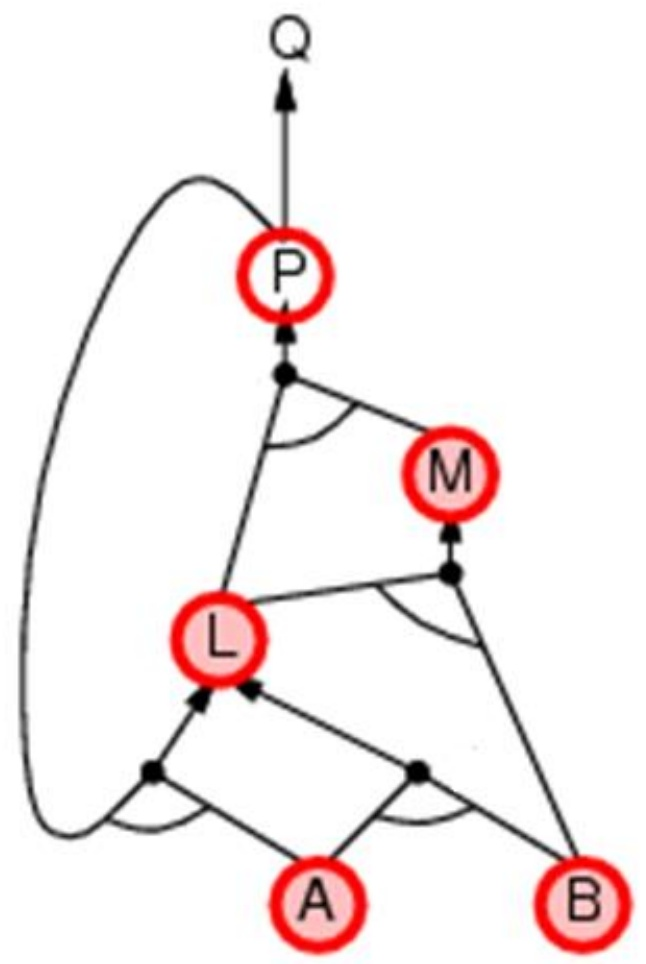

<!-- page: 60 -->

## Suy diễn tiến: Ví dụ (6)

$$
P \Rightarrow Q
$$

$$
L \land M \Rightarrow P
$$

$$
B \land L \Rightarrow M
$$

$$
A \land P \Rightarrow L
$$

$$
A
$$

B

$$
A \land B \Rightarrow L
$$

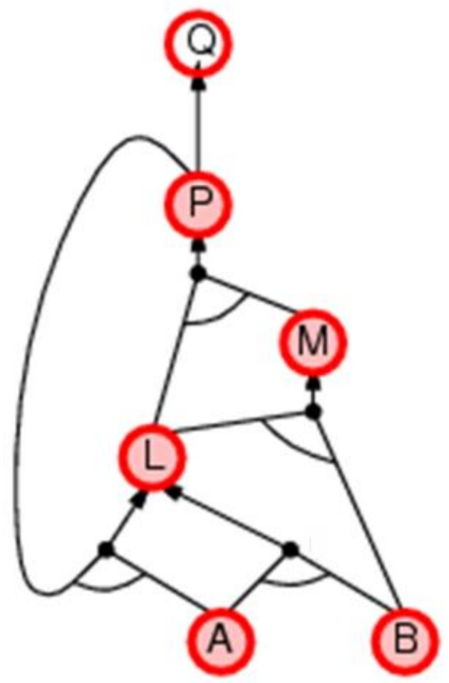

<!-- page: 61 -->

## Suy diễn tiến: Ví dụ (7)

$$
P \Rightarrow Q
$$

$$
L \land M \Rightarrow P
$$

$$
B \land L \Rightarrow M
$$

$$
A \land P \Rightarrow L
$$

$$
A
$$

B

$$
A \land B \Rightarrow L
$$

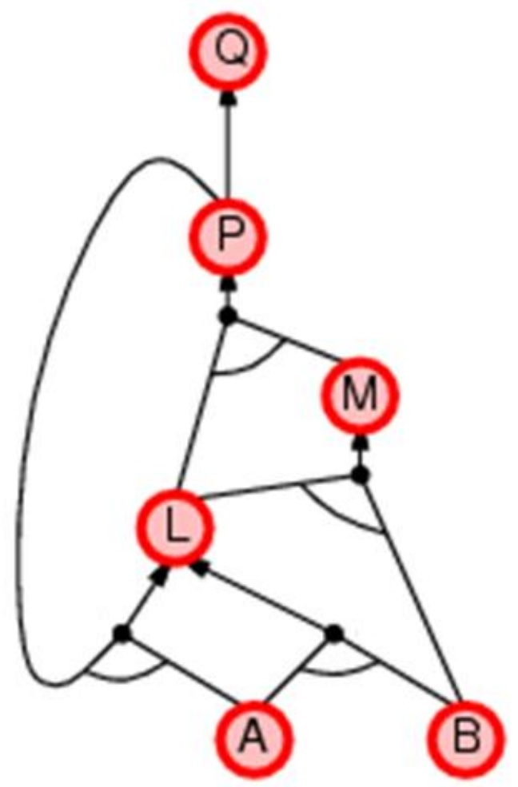

<!-- page: 62 -->

## Ví dụ

VD1. Cho $G T = \{ a , b , m _ { a } \}$ . Tìm $M L = \{ h _ { c } \}$

1. $a ,   \mathsf { b } ,   \mathsf { m _ { a } }   \to   \mathsf { c }$

2. $\mathsf { a , } \mathsf { b , } \mathsf { c } \to \mathsf { A }$ 7. $\mathsf { A , } \mathsf { B } \to \mathsf { C }$

3. $\mathsf { b } \mathsf { , } \mathsf { A } \to \mathsf { h } _ { \mathsf { c } }$

4. $\mathsf { a , } \mathsf { b , } \mathsf { c } \to \mathsf { B }$

5. $\mathsf { a , } \mathsf { b , } \mathsf { c } \to \mathsf { C }$

$$
6. a, B \to h_c
$$

$$
8. B, C \rightarrow A
$$

$$
9. A, C \rightarrow B
$$

<!-- page: 63 -->

## Bài tập tại lớp

## So sánh stack và queue

BT1. Cho $G T = \{ a \} , K L = \{ u \}$

1. $a   \rightarrow   \mathsf { b }$

2. ${ \mathfrak { b } } \to { \mathfrak { c } }$

3. $\mathbf { c } \rightarrow \mathbf { d }$

4. $\mathsf { a } \to \mathsf { U }$

BT2. $G T = \{ a \} , K L = \{ u \}$

1. $\mathsf { a } \to \mathsf { b }$

$$
2. \quad \mathsf {d} \to \mathsf {c}
$$

$$
3. \quad \mathsf {c} \to \mathsf {u}
$$

$$
4. \quad \mathsf {a} \to \mathsf {m}
$$

$$
5. \quad b \to n
$$

$$
6. \quad \mathsf {m} \to \mathsf {p}
$$

$$
7. \quad p \to q
$$

$$
8. \quad q \to u
$$

<!-- page: 64 -->

## Thuật toán

Vào:

◼ Tập các mệnh đề/vị từ đã cho (ở dạng chuẩn Horn)

◼ Tập các luật RULE dạng p→q

◼ Tập các mệnh đề/vị từ kết luận KL

◼ Thông báo “Thành công” nếu KL có thể suy ra từ GT

PP: /\*Tgian là tập các mệnh đề/vị từ đúng cho đến thời điểm đang xét\*/

<!-- page: 65 -->

## Thuật toán

```cpp
{1 Tgian = GT;
    Thoa = Loc(Tgian,R);
    while Thoa <>0 and KL∉Tgian do
    {2 r ← get(Thoa); /* r: left → q */
        R = R \ {r}; Vet = Vet ∪ {r};
        Tgian = Tgian ∪ {q};
        Thoa = Loc(Tgian,R)
    }2
    if KL ⊆ Tgian then exit("Thành công")
    else exit("Không thành công")
```

<!-- page: 66 -->

## Suy diễn lùi (backward chaining)

Ý tưởng: suy diễn lùi từ kết luận KL

◼ kiểm tra xem KL đã được biết chưa, nếu không

◼ chứng minh bằng quay lui sử dụng các luật dẫn đến q

## ◼ Tránh lặp vô tận:

❑ lưu trữ các đích đã được chứng minh

❑ trước khi chứng minh kiểm tra xem đích cần chứng minh đã có trong goal stack chưa?

## ◼ Tránh lặp lại công việc: kiểm tra xem KL mới

❑ đã ở trong tập đã được chứng minh chưa

❑ đã làm nhưng thất bại chưa

<!-- page: 67 -->

## Suy diễn lùi: Ví dụ (1)

$$
\begin{array}{l} P \Rightarrow Q \\ L \land M \Rightarrow P \\ B \land L \Rightarrow M \\ A \land P \Rightarrow L \\ A \land B \Rightarrow L \\ A \\ B \end{array}
$$

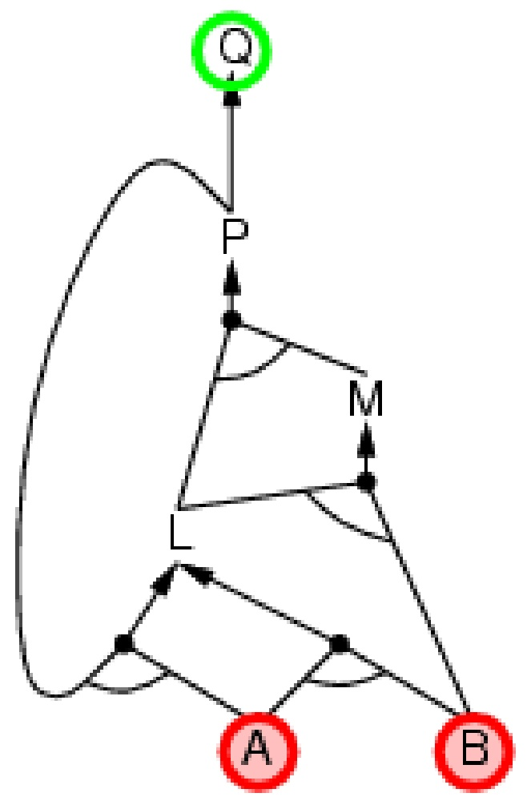

<!-- page: 68 -->

## Suy diễn lùi: Ví dụ (2)

$$
\begin{array}{l} P \Rightarrow Q \\ L \land M \Rightarrow P \\ B \land L \Rightarrow M \\ A \land P \Rightarrow L \\ A \land B \Rightarrow L \\ A \\ B \end{array}
$$

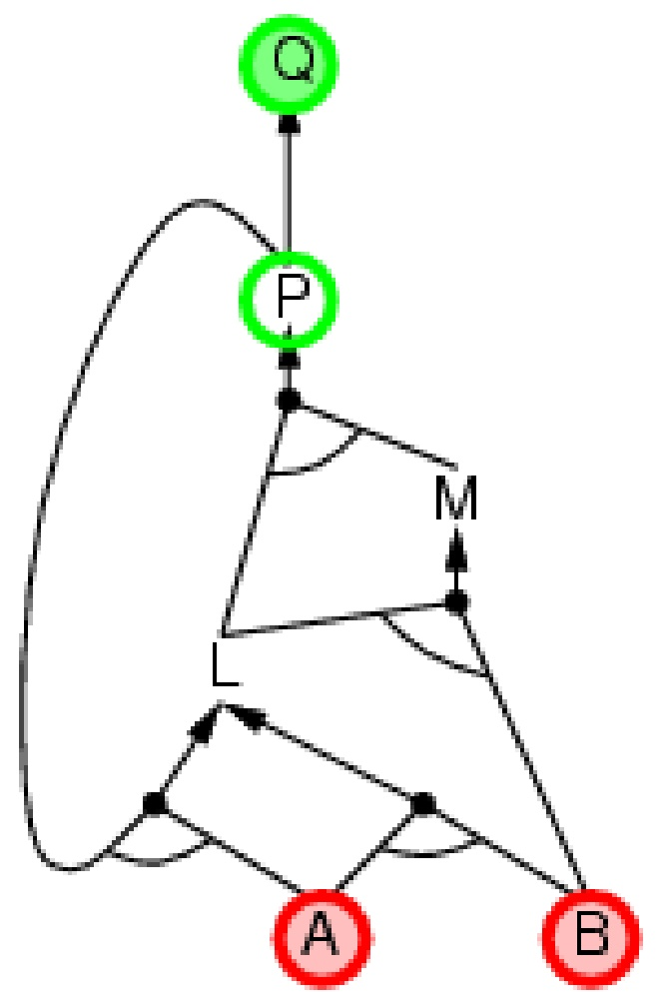

<!-- page: 69 -->

## Suy diễn lùi: Ví dụ (3)

$$
\begin{array}{l} P \Rightarrow Q \\ L \land M \Rightarrow P \\ B \land L \Rightarrow M \\ A \land P \Rightarrow L \\ A \land B \Rightarrow L \\ A \\ B \end{array}
$$

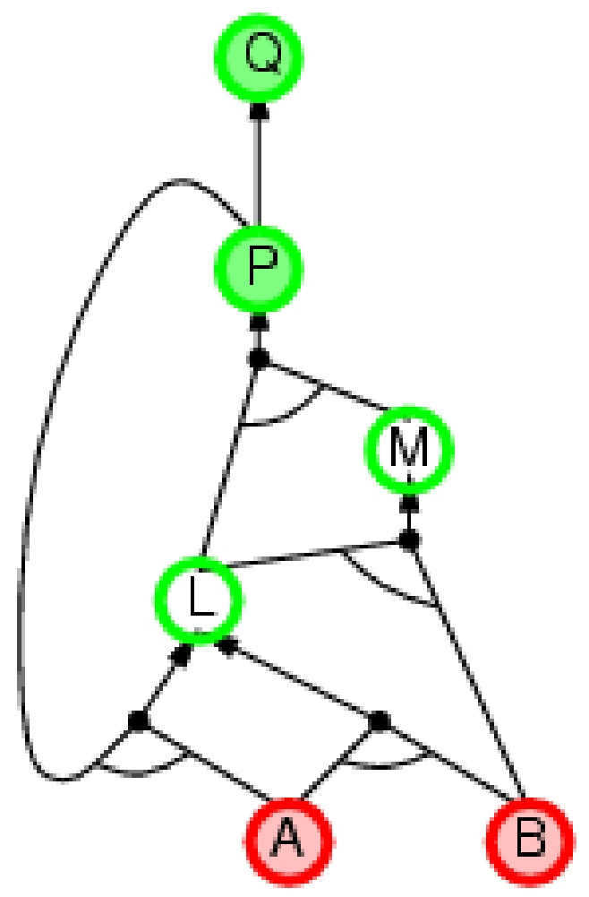

<!-- page: 70 -->

## Suy diễn lùi: Ví dụ (4)

$$
\begin{array}{l} P \Rightarrow Q \\ L \land M \Rightarrow P \\ B \land L \Rightarrow M \\ A \land P \Rightarrow L \\ A \land B \Rightarrow L \\ A \\ B \end{array}
$$

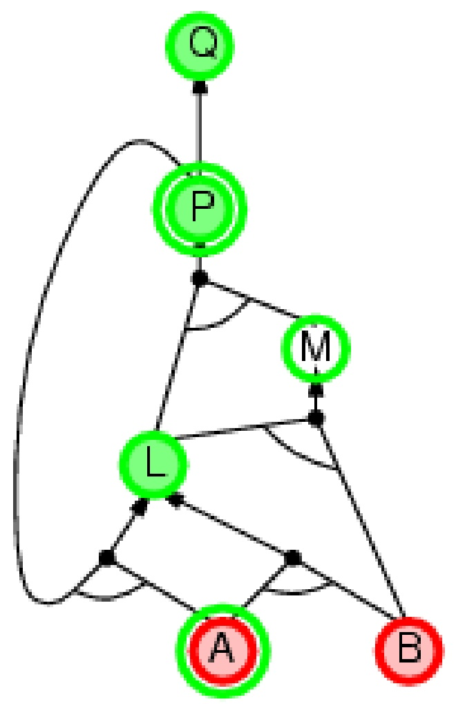

Trí tuệ nhân tạo

<!-- page: 71 -->

## Suy diễn lùi: Ví dụ (5)

$$
\begin{array}{l} P \Rightarrow Q \\ L \land M \Rightarrow P \\ B \land L \Rightarrow M \\ A \land P \Rightarrow L \\ A \land B \Rightarrow L \\ A \\ B \end{array}
$$

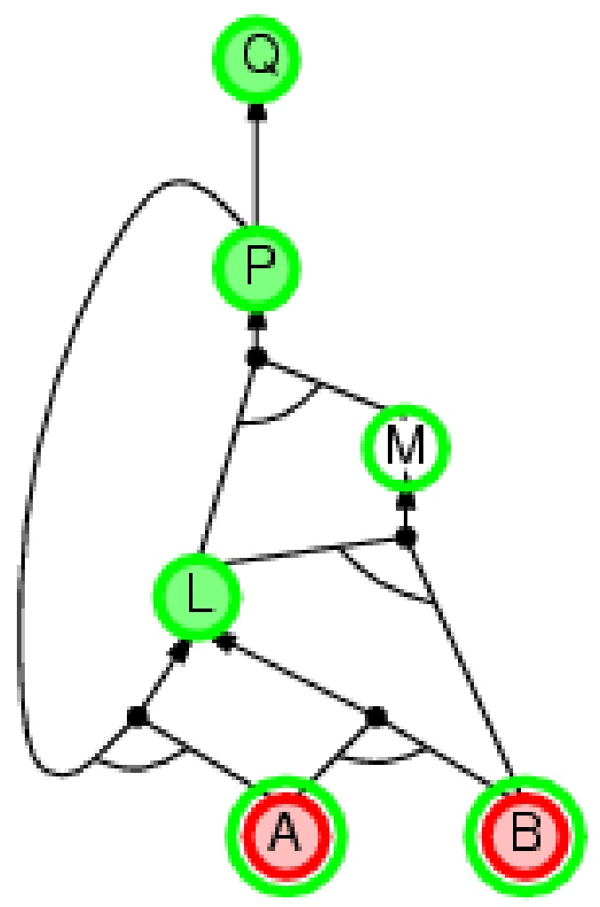

Trí tuệ nhân tạo

<!-- page: 72 -->

## Suy diễn lùi

1. $\mathsf { A } { , } \mathsf { C } \to \mathsf { B }$

2. $a ,   \mathsf { b } ,   \mathsf { m _ { a } }   \to   \mathsf { c }$

3. $\mathsf { a , } \mathsf { b , } \mathsf { c } \to \mathsf { A }$

4. $\mathsf { a , } \mathsf { b , } \mathsf { c } \to \mathsf { B }$

$$
5. a, b, c \to C
$$

$$
\mathsf{GT} = \{\mathsf{a},\mathsf{b},\mathsf{m}_{\mathsf{a}}\};
$$

$$
6. a, B \to h_c
$$

$$
7. b, A \to h_c
$$

$$
8. \mathsf {c}, \mathsf {S} \to \mathsf {h} _ {\mathsf {c}}
$$

$$
9. a, b, c \to S
$$

$$
1 ^ {\prime}. h _ {a}, c \to B
$$

$$
K L = \{h_c\}
$$

<!-- page: 73 -->

## Suy diễn lùi

Đầu:

◼ Goal = tập các sự kiện cần $C M = K L$

◼ Goal = {f| f cần CM cho đến thời điểm hiện tại}

◼ $\forall e t = \{ ( f , j ) \}$ để CM f thì dùng luật j: $\log ( \theta _ { j } \rightarrow \theta )$

◼ Cờ Back = true khi quay lui false không quay lui

<!-- page: 74 -->

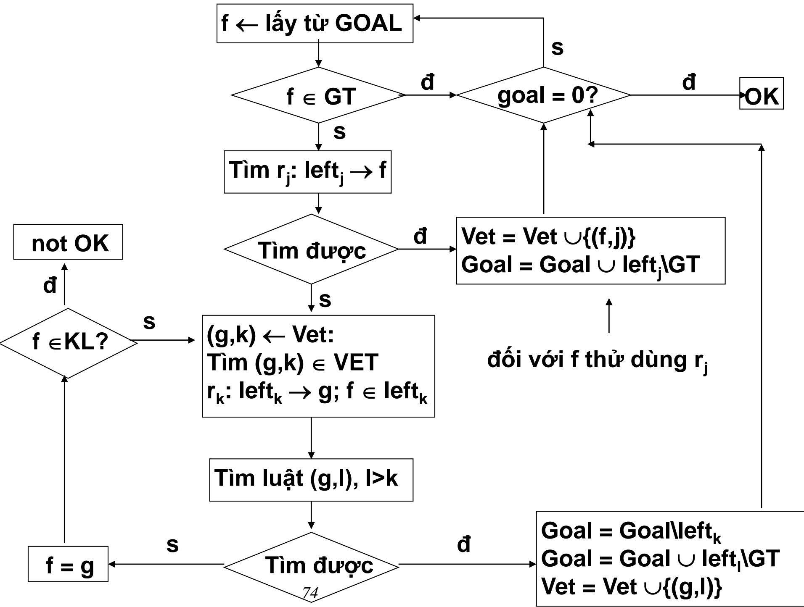

<!-- page: 75 -->

## Suy diễn lùi

Quá trình SD lùi tương tự quá trình tìm cây/đồ thị lời giải trong đồ thị V/H

2 Để tăng hiệu quả của thủ tục SDL, có thể đưa vào 2 tập:

❑ Tập Đúng chứa các sự kiện đã được khẳng định là đúng (đã xác định)

❑ Tập Sai chứa các sự kiện đã được khẳng định là sai (không thể xác định)

<!-- page: 76 -->

## Bài tập tại lớp

BT1. Cho $G T = \{ a , b , m _ { a } \} ,$ $K L = \{ h _ { c } \}$

1. $\mathsf { a , } \mathsf { b , } \mathsf { m _ { a } } \to \mathsf { c }$

2. $\mathsf { a , } \mathsf { b , } \mathsf { C } \to \mathsf { s }$

3. $\mathsf { a , } \mathsf { s } \to \mathsf { h } _ { \mathsf { a } }$

4. $\mathsf { b , } \mathsf { s } \to \mathsf { h } _ { \mathsf { b } }$

5. $\mathtt { c , } \mathtt { s } \rightarrow \mathsf { h } _ { \mathtt { c } }$

6. $\mathsf { a , } \mathsf { B } \to \mathsf { h } _ { \mathsf { c } }$

7. $\mathsf { a , } \mathsf { b , } \mathsf { c } \to \mathsf { B }$

BT2. $G T = \{ a \} , K L = \{ u \}$

1. $\mathsf { a } \to \mathsf { b }$

2. $\mathsf { d } \to \mathsf { c }$

3. $\mathbf { c } \rightarrow \mathbf { u }$

4. $\mathsf { a } \to \mathsf { m }$

5. ${ \mathsf { b } } \to { \mathsf { n } }$

6. ${ \mathsf { m } } \to { \mathsf { p } }$

7. $\mathsf { p } \to \mathsf { q }$

8. $\mathsf { q } \to \mathsf { U }$

<!-- page: 77 -->

## So sánh SD tiến và SD lùi

SD tiến hướng dữ liệu, tự động, không định hướng. Ví dụ, nhận dạng đối tượng, xác định hành trình

◼ Có thể làm rất nhiều việc không liên quan đến KL

SD lùi hướng KL, thích hợp cho các bài toán giải quyết vấn đề. Ví dụ, tìm chìa khoá, lập kế hoạch thi TOEFL

Độ phức tạo của SD lùi thường nhỏ hơn rất nhiều so với kích thước của CSTT.

<!-- page: 78 -->

## Logic định đề: Ưu và nhược điểm

(+) Logic định đề cho phép dễ dàng phát biểu (biểu diễn) cơ sở tri thức bằng tập các mệnh đề

(+) Logic định đề cho phép làm việc với các thông tin $\dot { \alpha }$ dạng phủ định, dạng tuyển (disjunctive)

◼ (+) Logic định đề có tính cấu tạo (kết cấu)

❑ Ngữ nghĩa của mệnh đề $( S _ { 1 } \wedge S _ { 2 } )$ được suy ra từ ngữ nghĩa của $S _ { 1 }$ và ngữ nghĩa của $S _ { 2 }$

(+) Ngữ nghĩa trong logic định đề không phụ thuộc ngữ cảnh (context-independent)

❑ Không như trong ngôn ngữ tự nhiên (ngữ nghĩa phụ thuộc vào ngữ cảnh của các câu nói)

(-) Khả năng diễn đạt (biểu diễn) của logic định đề là rất hạn chế

口 Logic định đề không thể diễn đạt được (như trong ngôn ngữ tự nhiên): “Nếu X là cha của Y, thì Y là con của $X ^ { \flat }$

❑ Logic định đề phải liệt kê (xét) mọi khả năng gán giá trị chân lý (đúng/sai) cho X và Y

<!-- page: 79 -->

## Giới hạn của Logic định đề

◼ Hãy xét ví dụ sau đây:

❑ Tuấn là một sinh viên của HUST

❑ Mọi sinh viên của HUST đều học môn Đại số

❑ Vì Tuấn là một sinh viên của HUST, nên Tuấn học môn Đại số

## ◼ Trong logic định đề:

❑ Định đề p: “Tuấn là một sinh viên của HUST”

❑ Định đề q: “Mọi sinh viên của HUST đều học môn Đại số”

❑ Định đề r: “Tuấn học môn Đại số”

❑ Nhưng: (trong logic định đề) r không thể suy ra được từ p và q!
